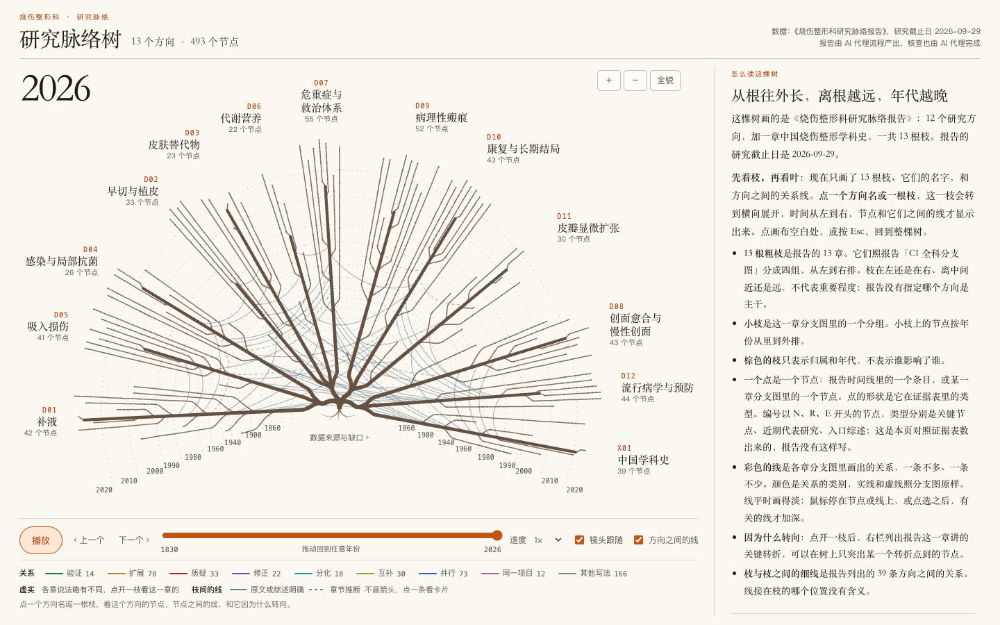

# 科室研究脉络

给临床医生和研究者看的学科研究地图。每份报告按研究方向回答同一组问题：这个方向从哪里起步，哪些证据或方法让它转了向，哪些路线并存、哪些被否定，近五年在研究什么、用什么数据，还有什么不知道。

这些报告不是系统综述，也不是 Meta 分析：没有重新计算合并效应量，不对任何疗法给出推荐，不能用作患者的诊疗建议。

上图是烧伤整形科的研究脉络树：13 根枝是报告的 13 章，离根越远年代越晚。[在线打开这棵树](https://terryfyl.github.io/research-lineage/%E7%83%A7%E4%BC%A4%E6%95%B4%E5%BD%A2%E7%A7%91/%E7%A0%94%E7%A9%B6%E8%84%89%E7%BB%9C%E6%A0%91.html)，点开一枝看节点、关系和「因为什么转向」；也可以先看一条 75 秒的[解说视频](https://terryfyl.github.io/research-lineage/)。树上画的是报告的一部分，说明见 [烧伤整形科/README.md](烧伤整形科/README.md)。

## 现有三份

| 科室 | 范围 | 研究截止日 | 规模 | 从这里读 |
|---|---|---|---|---|
| 烧伤整形科 | 12 个研究方向，另加中国烧伤整形学科史 | 2026-09-29 | 13 章正文；证据表 1,008 行，涉及 953 个不同的 PMID | [烧伤整形科/README.md](烧伤整形科/README.md) |
| 中医心内科 | 12 个研究方向，另加中国中医心内科学科史（横切） | 2026-10-17 | 13 章正文；证据表 585 行，分层抽查 87 行 0 行实质错误；树页面与 81 秒解说视频（活血化瘀枝）同仓 | [中医心内科/README.md](中医心内科/README.md) |
| 精神科 | 25 个研究方向 | 2026-10-05 | 一份正文，约 20 万字符；来源对照表列出正文引到的 473 篇文献，其中 396 篇有标识 | [精神科/README.md](精神科/README.md) |

## 引用在哪里

- **烧伤整形科**：各章第 9 节是这一章的节点速查表。关键节点、近期代表研究、入口综述等共 1,008 行汇总在 D 关键文献证据表里（按方向分成 13 个 Markdown 文件，另有一份完整的 CSV）。1,008 行里有 1 行查不到标识，其余每行都带 PMID、DOI 或网址；每行都标明这条证据实际读到了哪一层。各章行文里另有几百篇只带 PMID 提到的文献，不在这张表里。
- **精神科**：正文里很多文献只写了年份、内容和阅读层级，没有作者、题名或标识。所以另附一张 `来源对照表`，把正文引到的 473 篇文献逐条列出并补上标识：396 篇有 PMID 或 DOI（正文本来就给了的 73 篇，补出的 323 篇），14 篇没对上，63 篇是书、官方文件、网页或老文献，不在 PubMed。补出的标识由 AI 模型给出、程序逐条核对，没有人类专家逐条核对。正文本身没有改。

## 用之前请先知道

1. **报告由 AI 代理流程产出，核查也由 AI 代理完成。** 多个 AI 代理分工检索、起草、互相核查后成稿。烧伤整形科报告里说的核查员、抽查员、「第二人」，指的都是 AI 代理，不是人。本仓库没有临床专家审定这些报告的记录。拿它当依据之前，请回到原始文献核对。
2. **每条证据都标了实际读到的程度。** 从 L0（只见到二手转述）到 L4（通读全文）共五层，各报告开头有定义。按报告的写作规则，只见到二手转述或只核到题录的文献，不应写成已经核对过原文；发现例外请指出。
   烧伤整形科的证据表里，1,008 行中有 728 行由另一个 AI 代理逐条核对过，280 行只由写稿的代理自己核对。另做过一次 79 行的分层随机抽查，没有发现实质错误；这只是抽样估计，不代表每一行都被复核过。
3. **覆盖有缺口，报告里逐项写明了。** 最大的几处是：
   - 两份报告都没有覆盖中文数据库。
   - 烧伤整形科：1950–1970 年代的苏联文献基本没有覆盖；一批付费墙后面的奠基原文只核到题录；13 个条目里有 1 个只算部分完成（创面愈合与慢性创面）。
   - 精神科：没有一篇文献被全文通读，读到的原文只限于具名的页、表、图和段落；文献计数只覆盖 PubMed/MEDLINE；按报告自己的口径，25 个方向里只有 1 个方向（P02）具备可支撑的历史谱系，其余 24 个是部分历史。
4. **两份报告各有截止日，截止日之后的文献没有纳入。**

## 发现错误怎么办

欢迎在 [Issues](https://github.com/TerryFYL/research-lineage/issues) 里指出，最好附上 PMID 或 DOI，以及原文的页码或段落。

精神科报告定稿后，对 25 个方向里的 3 个做过一轮补充核查，发现 12 处可以修订的地方，列在 [精神科/已知可修订之处.md](精神科/已知可修订之处.md)。其余 22 个方向没有做过这一轮核查。正文暂时没有改。

## 许可与署名

报告的文字、表格和图以 [CC BY 4.0](LICENSE) 许可公开：可以转载、改编和商用，但要署名并注明出处。建议的写法：

> AI Research Army. 科室研究脉络（烧伤整形科、精神科）. 2026. https://github.com/TerryFYL/research-lineage

报告里引用的第三方文献，版权归原作者和出版方所有。本仓库收录的是题录信息和对文献内容的转述，另有为核对而保留的少量原文短句。解说视频的背景音乐来自别的项目，不在这个许可的范围内，出处见 [烧伤整形科/README.md](烧伤整形科/README.md)。

## 相关项目

这两份报告出自 [AI Research Army](https://github.com/TerryFYL/ai-research-army) 项目。

## English summary

Research lineage maps of clinical specialties, written in Chinese: burn and plastic surgery; psychiatry. For each research direction the reports trace where it started, what evidence or methods changed its course, which lines coexist or were abandoned, what the last five years have focused on, which data were used, and what remains unknown. Every piece of evidence carries an explicit reading level (from second-hand mention to full text read). The burn report cites its sources with PMID, DOI or URL (one row out of 1,008 has none). The psychiatry report names only part of its sources in the text; a separate source table maps the 473 sources it cites to identifiers (396 identified), machine-checked but not expert-reviewed. The reports were produced and checked by AI agents; this repository holds no record of review by clinical experts. They are not systematic reviews and not clinical advice. Licensed under CC BY 4.0.
