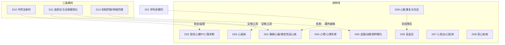

# A 科室研究总览（中医心内科）

> A1 方向地图；A2 条目一览（每条一行回答六个问题）；A3 全科层面的问题转向（详见 C4）；A4 给临床医生的阅读提醒；A5 怎样用这份报告。年份都是本轮找到的最早文献或公认奠基，不是绝对第一篇。

## A1 方向地图

三条横线分别承接各病种的**证候工具**（D11）、**机制解释**（D12）与**安全/监管**（D10）；X01 提供统一核实过的事件底稿。方向间完整关系见 `C_时间线与分支图.md`。

## A2 条目一览

| 条目 | 研究什么 | 从哪里来 | 为什么变 | 现在研究什么 | 用了什么数据 | 最大未知 | 覆盖 |
|---|---|---|---|---|---|---|---|
| D01 | 稳定性冠心病/心绞痛的活血化瘀及成药治疗 | 1972 冠心2号协作初报（L1） | 1982 精制冠心片双盲 RCT 立范式；1998–99 国际批评与 Cochrane 否定推大样本化 | MUSKARDIA 后亚组/真实世界；以 PRO 与影像终点的新一代安慰剂 RCT | 协作系列→双盲 RCT（112→3505 例）→Cochrane/网络 Meta→注册库→真实世界 | 事件终点获益至今未确立；T89 美国 III 期结果未发表 | 基本完整但有标注缺口 |
| D02 | 急性心梗/ACS 与 PCI 围术期中医药 | 1975 南开医院 AMI 99 例（L1） | 注射剂与 1990s 中成药化；2023 CTS-AMI 登 JAMA 推上国际硬终点层面 | PCI 围术期无复流/重构的加载+安慰剂试验；通心络证据链争议 | 协作组病死率对照→RCT→JAMA 级试验→注册库 | 静脉注射剂无硬终点试验；通心络获益来自单一中国试验 | 基本完整但有标注缺口 |
| D03 | 心衰的中医药治疗与中成药循证 | 1985–91 证候-客观指标关联研究 | 芪苈强心走通"替代终点（2013 JACC）→硬终点（2024 Nat Med QUEST，HR 0.78）"路径 | QUEST 亚组/post hoc；HFpEF 空白；注射剂与经典方仍软终点 | 注册 RCT→指南/共识→Cochrane（生脉线撤回） | QUEST 企业申办、全因死亡 P=0.058、SGLT2i 时代外推未回答 | 基本完整但有标注缺口 |
| D04 | 心悸/心律失常的中成药与经方 | 《伤寒论》炙甘草汤经典起点；1980 温阳线起步 | 2011–2024 稳心/参松养心把证据层级上移；2024 SS-AFRF 登 Eur Heart J | 室早适应证已有多中心双盲；房颤/缓慢心律失常补证据 | 经方实验→双盲 RCT（859–1200 例）→注册库 | 房颤与缓慢性心律失常证据弱；无海外人群重复 | 基本完整但有标注缺口 |
| D05 | 高血压的中医药与针灸 | 1958 天麻钩藤饮专方（转述）；1959 日本针刺报告（L1） | 针刺被假针对照与 Cochrane 否定（2018）；中药转人群分层 | 隐匿性高血压与低危 1 级两个人群的安慰剂-动态血压阳性（2020/2025） | RCT（含阴性/假针）→Cochrane→注册库→共识 | 针刺特异性效应未证；中重度高血压中药证据缺 | 基本完整但有标注缺口 |
| D06 | 血脂异常/动脉粥样硬化的痰浊血瘀路线与红曲 | 《素问》膏粱之疾（转引）；1979 Endo monacolin K | CCSPS（2005/2008，4870 例，冠脉事件 −45.1%）把终点从血脂升到事件 | 斑块影像 RCT（CAPITAL/TXL-CAP）与真实世界/政策数据 | 菌株生化→小 RCT→硬终点 RCT→影像终点→医保数据 | CCSPS 单一团队、无独立重复；影像获益无事件验证 | 基本完整但有标注缺口 |
| D07 | 心肌炎与心肌病的中医药 | 1985 上海 CVB 心肌细胞模型→1987 黄芪首筛→1999 九五 1028 例 | 诊断标准收窄 + Cochrane 四版后 2016 撤回；证据生产退为 SR 再综合 | VMC 近乎空白；DCM 2024 进入注册 RCT 时代 | 细胞/动物模型→多中心 RCT→Cochrane→注册 RCT | 无一试验经组织学/CMR 确诊；硬终点几乎空白 | 基本完整但有标注缺口 |
| D08 | 心血管病合并焦虑抑郁 | 心主神明理论接口；"双心医学"自称 1995（最早公开文本 2017） | 2008 门诊筛查把共病量化（约 40%）；共识线与中药 RCT 线并行 | 五中心安慰剂方案（2025）；网络 Meta（2026）；双心门诊规范 | 量表终点为主；HRV/组学/注册库补充 | 无心血管硬终点为主要终点的中药/针灸 RCT | 基本完整但有标注缺口 |
| D09 | 心脏康复中的传统功法与中医药 | 1981 太极遥测心电（最早英文索引）；1996 Channer 三臂 RCT | 2011 百例 RCT 修正为"容量终点阴性、QoL 阳性"；向居家/HFpEF/剂量学分化 | 八段锦 Meta（46 RCT/3597 例）与等耗氧剂量学；共识写入 MET 处方 | RCT/Meta→注册库→共识→剂量生理学 | 无以死亡/住院为终点的大样本试验 | 基本完整但有标注缺口 |
| D10 | 中药注射剂在心血管急危重症的应用与安全 | 1941 柴胡注射液（L0 转述）→1960 丹参注射液入冠心病 | 2006–2009 连续安全事件转入监管转折（再评价/说明书/医保/监测） | 方法学达标的安慰剂 RCT 交出阴性成绩单；再评价退市 | 监管公告原文→集中监测（万例级）→RCT→China PEACE | 心血管急救适应证无以死亡率为主要终点的足把握度 RCT | 基本完整但有标注缺口 |
| D11 | 血瘀证诊断标准与证候客观化 | 1981 秦万章（PubMed 可核最早）；1982 金惠铭微循环；1982/86 全国标准 | 1986 标准敏感性 0.762 被 2015 信效度研究定量暴露，催生 2016 实用标准 | 三组学、AI 四诊、文献挖掘、标志物 Meta、国际指南 | 会议标准→横断面+冠造→前瞻队列→组学→机器学习→ICD-11 试点 | 四十年无经外部验证、国际接受的生物标志物 | 基本完整但有标注缺口 |
| D12 | 中药作用机制与现代药理 | 1979 川芎嗪/丹参酮 IIA 药理（PubMed 可核最早）；2004 小檗碱登 Nat Med | 网络药理学 2020s 爆发（近五年 14,467 篇）但盲法对接审计证明预测力接近随机 | AI 融合、菌群-成分轴、临床再检验（小檗碱 2026 阴性）；网络药理学方向口径近五年 2,681 条（同法全库 2023–2026 年 14,467 条） | 动物/细胞→单体 RCT→网络药理→多组学→方法学审计 | 单体转化成功率与预测实验验证率两个量化锚点无文献可考 | 基本完整但有标注缺口 |
| X01 | 学科史：建制、标准化、产业、国际化 | 1955 中医研究院（L0）；1960 西苑心血管科（机构自述） | 1982 双盲 RCT 与 1986 血瘀证标准解决方法与测量问题；1981–2003 六品种上市 | 2019–2024 ICD-11、国家临床医学研究中心、JAMA/Nat Med 登顶与国际审视并存 | 政府目录、学会官网、NLM 期刊记录、注册库 | 1982 年前文献未数字化；学会分支年份无官方来源 | 基本完整但有标注缺口 |

"覆盖"为成稿自评口径，第二轮修订统一后的最终评级见 `README.md` 与 `F_检索选读排除与覆盖状态.md` 的 F5 表。

## A3 全科层面的问题转向

八次大转向（病例系列→双盲 RCT；症状→事件终点；头对头失败后转加载设计；国际批评驱动的方法学重置；单体→复方网络药理；疗效叙事→安全再评价；证候标准化基础设施化；事件终点后再转向 PRO/影像）的时期、变化内容与章节依据见 **`C_时间线与分支图.md` 的 C4**；其中第 4 条（国际批评是否为动因）只有时间先后依据，已按"本报告推断"标注。

## A4 给临床医生的阅读提醒

1. **本报告不是疗效综述**。它解释每个方向"从哪里来、为什么变、现在研究什么"，不回答"该不该用"；合并效应量请看各章引用的系统评价，并注意其质量分级。
2. **阅读层级如实**：L0=二手转述、L1=题录、L2=摘要、L3=原文章节、L4=全文。涉及 1970–1980 年代中文奠基文献的表述多为 L0/L1——CNKI/万方本轮未检索，这是全报告最大的共同缺口（各章第 8 节有具体影响说明）。
3. **对 RCT 保持两问**：注册的主要终点与发表的是否一致——三例都要回到注册记录核对，但问题形态不同（清心解瘀 QUEST：揭盲前追加"硬终点"；成都针刺试验：注册终点如实发表、阳性仅出现在停针后次要时点；BEAR：回溯注册、题名与主办单位变更，注册主终点与发表一致）；申办方与主要研究者的利益结构是否披露（QUEST 2024、CTS-AMI 各有说明）。
4. **"影像/替代终点阳性 ≠ 事件终点获益"**：TXL-CAP（OCT 纤维帽阳性、事件未降）、CACT-IHF（软终点阳性、硬终点阴性）、MUSKARDIA（心绞痛频率改善、MACE 未达显著）是三种典型形态。
5. **安全边界先于疗效**：注射剂的说明书警示语与医保限定条款（D10）是当前最硬的处方边界；苦参、乌头碱、红曲各有安全议题，见对应章节第 5 节。
6. 方向之间不要孤立读：血瘀证标准（D11）是多个病种 RCT 的入组工具；机制研究（D12）的论文量最大但临床转化极少；注射剂（D10）同时出现在 D02/D03/D07 的疗效线里。

## A5 怎样用这份报告

- **只读一屏**：每章第 0 节"三分钟速读"（六条，逐条回答六个问题）。
- **查一个方向的来龙去脉**：读该章第 1–5 节与第 9 节速查表；查具体文献用 `D_关键文献证据表.csv`（可按 direction/kind/层级过滤）。
- **查一个事件/年份**：X01 第 9 节事件底账表（39 行，按核实状态分列）；跨方向关系查 C3。
- **要引用某个数字**：回到证据表对应行，按 result_location 回到原文位置；标"存疑"的行不要直接引用。
- **做证候分层研究**：先读 D11 第 1、4 节与两套标准的定量性能对比，再决定用哪套标准。
