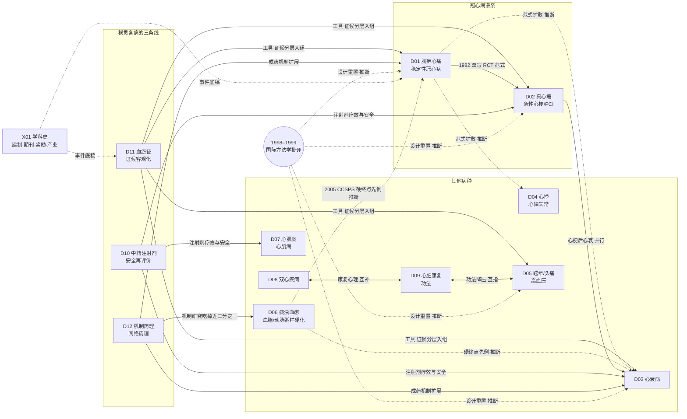

# C 时间线与分支图

> 本文件的 C3、C5 两表由 `scripts/build_c_tables.py` 从全报告复核结果（`data/qa_relations.json`）生成，不手抄；C2 的代表节点由汇总者从 13 章成稿人返回的 258 条时间线条目（`data/C_timeline_items.csv`）中挑选，并经 `scripts/annotate_c2_levels.py` 按证据表给只到题录或二手转述的节点加标注。关系强度分三级：**原文或综述明确** / **章节推断** / **仅时间先后**；分支图中实线为前者，虚线为后两者。年份都是本轮找到的最早文献或公认奠基，不是绝对第一篇。

## C1 全科分支图

读法：实线关系在至少一章正文或综述中有明确讨论；虚线是本报告据时间与叙事归纳的推断。**边方向表示影响/证据流向，可与 C3 的"专向分工"行方向相反**（如 C1 画 D10→D02 是"注射剂疗效与安全影响 D02"，C3 记"D02→D10 注射剂类干预的疗效问题归 D10"是同一关系的分工表述）；C1 中无 C3 对应行的边，其依据为 D03 覆盖边界（D02→D03）、D05 与 D09 的互指句（功法降压）、E2 重叠矩阵（D12→D06 等"机制口径吃掉病种文献"的量化依据）与 `data/qa_relations.json` 各行。D11 是唯一向多个病种输出"工具"的方向；D10 与 D12 分别承接各病种的安全线与机制线；国际方法学批评（1998–1999）对各病种 RCT 设计的影响在多章被写成动因，但只有时间先后与叙事依据，所以全部标虚线。

## C2 各年代代表节点

| 年代 | 节点 | 条目 | 为什么选它 |
|---|---|---|---|
| ≤1979 | 1955 中医研究院成立；1960 西苑医院心血管科成立 | [X01-N01][X01-N02]（二手） | 建制起点（机构自述，L0） |
| ≤1979 | 1941 柴胡注射液诞生→1954 武汉制药厂工业化→1960 丹参注射液问世 | [D10-N01]（二手） | 中药注射剂剂型史起点（综述与纪念史料转述，L0） |
| ≤1979 | 1972 冠心2号方多医院协作疗效初报 | [D01-N01]（题录） | 活血化瘀主线的最早可核实题录（原文不可及，L1） |
| ≤1979 | 1975 天津南开医院中西医结合治疗 AMI 99 例 | [D02-N01]（题录） | 急性心梗线现存最早可核实题录（L1） |
| ≤1979 | 1977 陈可冀《试谈冠心病心绞痛及急性心肌梗塞的中医治疗》 | [D01-N02]（题录） | 把活血化瘀立为冠心病主要治法的理论定型（L1） |
| ≤1979 | 1979 川芎嗪麻醉犬药理、丹参酮 IIA 磺酸钠药理 | [D12-N01]（题录）[D12-N02]（题录） | 单体成药线 PubMed 可核最早记录 |
| ≤1979 | 1979 Endo 从红曲菌分离 monacolin K | [D06-N01] | 血脂康路线的化学源头（国际） |
| 1980s | 1981 《中西医结合杂志》创刊、中国中西医结合研究会成立、麝香保心丸上市 | [X01-N06][X01-N17]（二手）[X01-N22] | 学科载体、学会、产业三件事同年 |
| 1980s | 1982 精制冠心片 112 例双盲 RCT | [D01-N05]（题录） | 被其后文献公认的中医药首个随机双盲试验（PMID 6751749，无摘要，L1） |
| 1980s | 1982 金惠铭微循环研究；1982 上海会议《血瘀证诊断试行标准》 | [D11-N01]（题录）[D11-N02]（题录） | 证候客观化与标准化同时起步 |
| 1980s | 1984 丹参酮 IIA 磺酸钠冠心病双盲试验 | [D12-N03]（题录） | 单体从药理走到双盲临床 |
| 1980s | 1985 CVB2 感染乳鼠心肌细胞模型；1987 黄芪首筛 | [D07-N01][D07-N02]（题录） | 心肌炎黄芪线的方法学起点与首筛 |
| 1980s | 1986 广州会议修订《血瘀证诊断标准》；1988 王阶/陈可冀标准方法学论证 | [D11-N02]（题录）[D11-N04]（题录） | 标准谱系的关键两步（原刊不在 PubMed，L1） |
| 1980s | 1986 Black：经典方 vs 西药治中重度高血压 RCT 阴性 | [D05-N03] | 头对头替代西药路线在高血压的早期失败 |
| 1990s | 1992 Lancet 乌头中毒 17 例 | [D04-N04] | 中药安全线的国际里程碑 |
| 1990s | 1994 复方丹参滴丸上市；1995 稳心颗粒获新药证书；1996 通心络创制 | [X01-N07][X01-N20][X01-N08] | 三条产业支线成形 |
| 1990s | 1996 Channer：AMI 后太极三臂 RCT | [D09-N01] | 功法康复最早 RCT（英国） |
| 1990s | 1997 通心络首个临床研究（492 例）；1997 FDA 受理复方丹参滴丸 IND | [D01-N06]；[X01-N09] | 络病支线临床起点；国际注册起点 |
| 1990s | 1997 GB/T 16751.2 证候术语国家标准 | [D11-N17]（题录） | 比较研究中被引最多的证候标准 |
| 1990s | 1998 Vickers；1999 Tang/Zhan/Ernst BMJ | [D01-N15][D01-N16]（题录） | 国际方法学批评的标志性文献（多章共引） |
| 1990s | 1999 "九五"攻关 12 中心 1028 例心肌炎多中心 RCT | [D07-N08] | 心肌炎线规模峰值，早搏终点阴性 |
| 2000s | 2003 "血瘀证与活血化瘀研究"获国家科技进步一等奖（J-234-1-01） | [D11-N06]（二手）；[X01-N10] | 学科标志性成果（科技部目录一手） |
| 2000s | 2003 Chinese Journal of Integrative Medicine 建刊 | [X01-N11] | 英文载体起点（NLM 收录起点 2003） |
| 2000s | 2004 Cochrane 心肌炎中药评价首版（40 RCT/3448 例） | [D07-N12] | 国际证据综合进入本科室 |
| 2000s | 2004 小檗碱新机制登 Nature Medicine | [D12-N08] | "老成分新机制"路线的顶刊节点 |
| 2000s | 2005 CCSPS（66 中心 4870 例，冠脉事件 −45.1%） | [D06-N05] | 本科室第一个大样本硬终点阳性试验 |
| 2000s | 2006 鱼腥草注射液事件（国食药监安〔2006〕218 号） | [D10-N05]（题录） | 注射剂监管转折起点 |
| 2000s | 2006 SHARP 假针对照阴性；2007 Flachskampf 停针即失效 | [D05-N08][D05-N09] | 针刺降压的国际假针裁决 |
| 2000s | 2007 李梢证候网络框架；2008 Hopkins 网络药理学 | [D12-N09][D12-N10] | 两线并行、互不引用 |
| 2000s | 2008 王阶 324 例证候要素×冠脉造影 | [D11-N07] | 证候流行病学进入影像时代 |
| 2000s | 2009 国食药监安〔2009〕28 号启动注射剂安全性再评价 | [D10-N07]（题录） | 再评价制度起点 |
| 2010–2020 | 2011 参松养心室早 859 例与阵发房颤 349 例双盲 RCT | [D04-N05][D04-N06] | 抗心律失常中成药 RCT 化 |
| 2010–2020 | 2012 NMPA 第 44 期通报：生脉注射液 508 例严重报告 | [D10-N09] | 注射剂安全事件的量化记录（公告原文 L3） |
| 2010–2020 | 2012 稳心颗粒心房选择性 INa 机制（Heart Rhythm） | [D04-N07] | 海外电生理实验室的独立机制研究 |
| 2010–2020 | 2013 MISPS-TCM 芪参益气 3505 例双盲双模拟头对头阿司匹林，结论不确定 | [D01-N09] | 头对头替代路线的第二次失败，推动"加载+安慰剂"范式 |
| 2010–2020 | 2013 JACC 芪苈强心 512 例替代终点 RCT | [D03-N05] | 心衰中成药进入国际心脏病学期刊 |
| 2010–2020 | 2015 Luo 712 例信效度：1986 标准敏感性 0.762 | [D11-N12] | 老标准被定量检验 |
| 2010–2020 | 2016 T89 完成 FDA III 期（n=1004），结果未发表未获批 | [D01-N10]（题录） | 国际注册路线受挫 |
| 2010–2020 | 2016 生脉 Cochrane 与心肌炎 Cochrane 撤回（流程性停止维护） | [D03-N08]；[D07-N15] | 国际证据综合停滞 |
| 2010–2020 | 2017 医保目录 26 个中药注射剂限二级以上机构 | [D10-N13]（题录） | 支付收紧（政策文件，L1） |
| 2010–2020 | 2018 Cochrane 针刺降压裁决：无持续效应 | [D05-N13] | 针刺降压国际证据定格 |
| 2010–2020 | 2019 清心解瘀颗粒 QUEST 1500 例：预设主要终点阴性、揭盲前追加"硬终点" | [D01-N12] | 注册终点与发表终点关系的代表性争议 |
| 2010–2020 | 2019 WHO ICD-11 第 26 章通过 | [D11-N14]；[X01-N13] | 证候进入国际疾病分类 |
| 2010–2020 | 2020 瑞金天麻钩藤颗粒治隐匿性高血压登 Circulation | [D05-N16] | 中药降压安慰剂对照动态血压阳性 |
| 2010–2020 | 2020 CACT-IHF 640 例：软终点阳性、硬终点阴性 | [D03-N10]（题录） | 心衰线"软阳硬阴"形态 |
| 2021–2026 | 2021 MUSKARDIA 麝香保心丸 2674 例：MACE 未达显著（P=0.2869） | [D01-N13] | 稳定性冠心病最大安慰剂 RCT |
| 2021–2026 | 2021 世界中联《国际血瘀证诊断指南》；2021 WFCMS《网络药理学评价方法指南》 | [D11-N16]；[D12-N15] | 标准与方法治理国际化 |
| 2021–2026 | 2022 莲必治退市（首个再评价退市品种） | [D10-N16] | 再评价制度产生退出 |
| 2021–2026 | 2023 CTS-AMI 3797 例登 JAMA（30 天 MACCE RR 0.64）与 2024 JAMA 通信质疑 | [D02-N13]；[X01-N27]（题录） | 本科室第一个 JAMA 硬终点 RCT 及其国际反馈 |
| 2021–2026 | 2023 RESTORE 参附注射液阴性 | [D10-N17] | 注射剂心血管急救线转向脓毒症 |
| 2021–2026 | 2024 芪苈强心 QUEST 3110 例登 Nat Med（HR 0.78） | [D03-N12]（题录） | 心衰中成药硬终点阳性 |
| 2021–2026 | 2024 SS-AFRF 920 例登 Eur Heart J 配 Packer 社论 | [D04-N15] | 抗心律失常中成药进入欧洲顶刊并被要求海外重复 |
| 2021–2026 | 2024 BEAR：HFmrEF/HFpEF 常规康复±八段锦阳性 | [D09-N14] | 功法康复进入人群分层 RCT |
| 2021–2026 | 2025 松龄血脉康低危 1 级高血压安慰剂 RCT 阳性 | [D05-N17] | 中药降压第二个安慰剂对照阳性人群 |
| 2021–2026 | 2025 盲法对接定量审计（34%–47% vs 90.2%） | [D12-N16] | 网络药理学方法治理的转折 |
| 2021–2026 | 2026 血府逐瘀口服液 148 例 RCT 主要终点转患者报告结局 | [D01-N14] | 终点再转向 PRO |
| 2021–2026 | 2026 TXL-CAP：OCT 纤维帽阳性、事件未降 | [D06-N14] | 影像-事件背离 |
| 2021–2026 | 2026 小檗碱多中心 RCT 主终点阴性（n=337） | [D12-R12] | 单体临床再检验 |

## C3 方向之间的关系

| # | 从 | 到 | 关系 | 依据强度 | 依据（章节:行号 与文献） |
|---|---|---|---|---|---|
| 1 | D11 | D01 | 互补/工具提供 | 原文或综述明确 | D01:30（「最早期研究……病机理论与证候标准（归D11）随之配套」）、D01:101（活血化瘀主线承「血瘀证诊断标准系列……方法学归D11，据E1图1及其引文[21][24][25]」）、D01:127（证候量表/诊断标准谱系归D11）；D11:14（覆盖边界：「活血化瘀治疗冠心病/心梗/心衰的临床试验主线（归D01/D02/D03）」）；X01:41（转折三：1986标准解决「血瘀证无统一定义，多中心研究无法统一入组」→2015信效度检验 [PMID 26485909]） |
| 2 | D11 | D02、D03 | 互补/工具提供 | 原文或综述明确 | D02:14（纳入「急性期证候演变与共识/指南制度化」）、D02:39（AMI证候-预后前瞻队列525例 [D02-N10]；「CTS-AMI未按证候分层……辨证分层与固定成药构成互补路径（推断）」）；D03:19（「证候诊断标准系统梳理（归D11，本章只取心衰直接相关者）」）；D11:162（「病种试验按证候分层的示例见Danlou片多中心RCT（ChiCTR1900023708，PMID 39559795，归D03详述）」） |
| 3 | D11 | D05 | 互补/共享方法（证候-生物学关联） | 原文或综述明确 | D05:32（1991年130例高血压证型与RAAS/心钠素关联报告 [D05-N06]；「系统总结归 D11」）、D05:112（2025年证型血清代谢组PMID 41415032，「交叉 D11/D12」） |
| 4 | D11 | D12 | 分工（机制归D12） | 原文或综述明确 | D11:14（「具体方药疗效与机制（归D12与各病种方向）」）、D11:152（日本活血化瘀药抗凝成分系列Kosuge/Ishida 1984-1987，「药理机制归D12，此处仅作背景」） |
| 5 | D11 | D06 | 分工（病机主线归D06） | 原文或综述明确 | D11:14（「痰瘀互结与血脂异常/动脉粥样硬化主线（归D06，本章只交叉引用）」）；D06:14（纳入「痰浊、痰瘀互结……辨证标准化谱系」） |
| 6 | D01 | D02 | 扩展（同药跨人群：症状终点→急性硬终点） | 原文或综述明确 | D01:104（益气活络支：「2019年CAPITAL……界接D06→2026年TXL-CAP冠脉斑块OCT试验（PMID 41735255，人群界接D02）→急性心梗CTS-AMI登JAMA（2023，PMID 37874574，归D02交叉）」）、D01:116（「JAMA 2023年CTS-AMI（通心络治急性心梗……归D02」）；D02:33（转折二：通心络1997年492例心绞痛试验 [D02-N04]与D01 [D01-N06]为同一试验，PMID 10322862）、D02:4（一句话判断：CTS-AMI为当前主线） |
| 7 | D01、D02 | D06 | 共享数据（通心络影像RCT双落位） | 原文或综述明确 | D01:104、D01:162（N19 CAPITAL「界接D06」）；D02:43（转折七 TXL-CAP [PMID 41735255]）、D02:122（缺口③「TXL-CAP影像阳性而事件未降」）；D06:14（纳入「通心络抗动脉粥样硬化影像RCT（CAPITAL、TXL-CAP）」）、D06:48（转折七 [D06-N12/N14]）、D06:95（争议四） |
| 8 | D01 | D08 | 互补/边界分工 | 原文或综述明确 | D01:80（ADECODE真实世界研究1428例「其焦虑抑郁结局归D08」）；D08:14（「QUEST试验（2019，PMID 31780034）终点为稳定冠心病MACE而非情志，归D01」） |
| 9 | D01、D02 | D12 | 互补（临床疗效线与机制线分工） | 原文或综述明确 | D01:74（麝香保心丸「肠道菌群与单细胞测序机制研究（归D12）」）、D01:126（「冠心2号/Guanxin II大鼠模型……清心解瘀颗粒NETs/焦亡机制（归D12，此处仅列数据路径）」）；D02:14（「不含……机制与药理专向（D12）」）；D12:19（「不含——各成分与中成药的临床疗效线（D01-D09交接）」） |
| 10 | D02、D03 | D10 | 互补（疗效线与安全再评价专向分工） | 原文或综述明确 | D02:41（转折六：参麦注射液说明书修订「专向展开归D10」）、D02:87（争议二安全侧并列监管通报）、D02:122（缺口①「专向归D10」）；D03:19（「注射剂安全性再评价（归D10）」）、D03:90（主题三注射剂网络Meta化，「安全性归D10」）；D10:19（纳入「心血管急危重症（心源性休克、AMI/PCI围术期、心衰……）的注射剂疗效证据」） |
| 11 | D03 | D07 | 分化（同药异病：芪苈强心HFrEF与病毒相关DCM两条注册RCT线） | 原文或综述明确 | D03:49（转折七 QUEST [D03-N12]，芪苈强心HFrEF 3110例）；D07:14（覆盖边界：「芪苈强心 QUEST 试验归该方向[D03]」）、D07:46（转折8：QLQX-DCM 24中心注册双盲RCT 345例 [D07-N18，NCT01293903]） |
| 12 | D07 | D10 | 共享数据（黄芪/生脉/参麦注射液跨章；Cochrane CD003711交界） | 原文或综述明确 | D07:14（「中药注射剂安全性再评价（D10，仅在安全性争议处点到）」）、D07:106（1997年中药致可逆性扩张型心肌病报告PMID 9155965，「与 D10 交叉」）；D10:64（转折10：「2004年Cochrane综述 Herbal medicines for viral myocarditis（CD003711.pub2）覆盖参麦/生脉注射液」）、D10:247（N21「国际综合线最早节点（D07交界）」） |
| 13 | D09 | D03 | 互补（功法心衰证据进入心衰指南推荐） | 原文或综述明确 | D03:47（2022团体标准T/CACM 1418-2022：「太极拳/八段锦与三伏贴C级弱推荐」）、D03:19（「康复功法（归D09）」）；D09:87（HFmrEF/HFpEF功法主题：BEAR 2024 [D09-N14]） |
| 14 | D09 | D01、D03、D06 | 分工（中药二级预防疗效评价归病种章） | 原文或综述明确 | D09:14（「不含……中药二级预防疗效评价（D01/D03/D06——芪参益气滴丸MISPS、麝香保心丸等仅交叉点到）」） |
| 15 | D08 | D09 | 互补（双心与心脏康复制度衔接、边界互指） | 原文或综述明确 | D08:52（胡大一大五处方：「2012年将双心融入心肺预防康复五大处方」）、D08:14（「心脏康复功法归D09」）；D09:14（「双心心理康复主叙事（D08）」）、D09:122（2012年胡大一重启中国心脏康复） |
| 16 | D08 | X01 | 分工（学科史归横切章） | 原文或综述明确 | D08:147（「学科史层面对胡大一双心学科形成的完整叙事归X01横切方向，此处只保留与本方向直接相关的环节」） |
| 17 | D08 | D11、D12 | 互补（病机理论与机制交叉） | 原文或综述明确 | D08:72（「理论细化与证候分期话题与D11（证候客观化）交叉，机制多组学与D12交叉，此处点到为止」；双心方S100A9蛋白组学 [D08-N20]、网络药理合并分析PMID 35600859） |
| 18 | D06 | D10 | 分工（注射剂证据归D10） | 原文或综述明确 | D06:149（待核线索：「丹红注射液斑块影像证据（归D10处理）」） |
| 19 | D06 | D12 | 互补（红曲「多组分协同 vs monacolin K单体」归因争议连接单体/多组分主题） | 原文或综述明确 | D06:14（「单体药理与网络药理归D12」）、D06:93（争议三：中国叙事「13种天然复合他汀」 vs EFSA「monacolin K＝洛伐他汀」单一归因；monacolin K即洛伐他汀链条见 [D06-S02]） |
| 20 | D12 | D10 | 互补（单体注射剂上市后安全归D10） | 原文或综述明确 | D12:17（葛根素注射液急性心衰SR [D12-R21，PMID 35958424]；「再评价细节归 D10」）、D12:101（「监管事件与安全性再评价细节见 D10」）、D12:19（覆盖边界） |
| 21 | D03 | D04 | 共享数据（心衰合并室早试验为交叉点） | 原文或综述明确 | D04:19（覆盖边界：「不含：心衰总论（D03，仅心衰合并室早试验为交叉点）」）、D04:50（2017年参松养心心衰合并室早465例双注册试验 [D04-N11]，复合心脏事件无差异） |
| 22 | D02 | D04 | 并行（同一经方系成药通脉养心丸：心室重构线与减率线各自展开） | 章节推断 | D02:43（转折七：通脉养心丸270例LVEDVI多中心双盲安慰剂RCT [D02-N14，PMID 39489990]）；D04:55（「减率分支……通脉养心减慢窦房结起搏」）、D04:117（炙甘草汤衍生成药通脉养心丸Q-marker/通道机制） |
| 23 | D01、D02、D03 | D01、D02、D03 | 共享数据（芪参益气滴丸同药跨病域证据链） | 原文或综述明确 | D01:42（转折5：MISPS-TCM 3505例心梗二级预防 [D01-N09]，inconclusive）、D01:95（负性路线清单）；D02:39（转折五：QIAO头对头阿司匹林 [D02-N09]，「中成药替代西药二级预防路线就此搁置」）；D03:45（转折五：CACT-IHF 640例缺血性心衰 [D03-N10]，软终点阳性/事件终点阴性）；D09:14（「芪参益气滴丸MISPS……仅交叉点到」） |
| 24 | D01 | D02 | 并行（麝香保心丸同药两线：稳定性症状终点链与急性期SPECT替代终点） | 章节推断 | D01:38（转折3：1998人工麝香 [D01-N17]→2010长期给药 [D01-N18]→MUSKARDIA [D01-N13]）、D01:74（MUSKARDIA后亚组/经济学扩展）；D02:43（转折七：麝香保心丸110例SPECT梗死面积试验 [D02-N12，PMID 34603032]，影像终点阳性而MACCE P=0.482） |
| 25 | X01 | D01-D12 | 互补（事件底账与病种细节分工） | 原文或综述明确 | X01:14（「不含各病种疗效研究细节（归D01–D09）……交叉处只点到为止」）、X01:55（SS-AFRF「疗效细节归D04」）、X01:95（「各病种疗效归D01–D09，此处只记学科级事实」）、X01:207（「交叉引用的病种细节见D01–D12各章」）；X01:31（冠心2号/宽胸气雾剂/血瘀证三线各自的延续节点分别指向D01、D11等） |
| 26 | 国际方法学批评（Vickers 1998 PMID 9551280；Tang/Zhan/Ernst 1999 BMJ 319:160-161） | D01、D03、D05、D07、D10（并波及D02、D04、D06、D09） | 驱动（质疑→设计重置） | 章节推断 | D01:8（「1998–1999年国际学界批评……2008/2010年两篇Cochrane……共同推动大样本安慰剂对照硬终点试验」）、D01:40（转折4自注定位「系本章归纳」）；D03:39（转折二：批评为跨病种背景→2007生脉Cochrane）、D03:43（「2013原文未自述这一因果，出版先后不等于因果」）；D05:42（「本方向最深的一次认识重置」）；D07:48（「最早的国际方法学解释框架」）；D10:50（转折3）；X01:43（转折四：「其后大型严格RCT路线的背景之一（推断）」） |
| 27 | 制度激励（2003/2019国家科技进步一等奖、注册制度、国家重点研发计划） | D02、D03、D04 | 驱动（章节推断） | 章节推断 | X01:49（转折七：「2019年奖是通心络/参松养心/芪苈强心三品种后续大型RCT的共同奖励背景（推断）」）、X01:35（三类动力：「制度激励（国家奖励与研究平台体系决定资源流向）」）；D03:51（QUEST获国家重点研发计划2017YFC1700500等资助）、D04:111（SS-AFRF获2017YFC1700504资助） |
| 28 | Cochrane否定性判定（太极2014 CD010366、气功2015 CD010390） | D09 | 驱动（方法学修正：PROSPERO预注册+GRADE） | 章节推断 | D09:38（转折4：「两Cochrane……均给出『证据不足、不能下结论』……后果：此后中国证据综合升级为PROSPERO预注册+RoB2+GRADE（综述归纳）」）、D09:46（转折8） |
| 29 | 监管与支付环境（注射剂再评价、医保限付、FDA/EFSA监管） | D01、D06、D10 | 驱动（章节推断） | 章节推断 | X01:35（三类动力之三：「监管与支付环境（FDA注册路径、注射剂再评价与医保限付改变产业行为）」）；D01:44（转折6：T89 FDA III期完成未发表未获批）、D01:47（争议4）；D06:44（转折五：Pharmanex v. Shalala、EFSA 2018/2025）；D10:58（转折7：医保限付与说明书修订潮） |

## C4 全科层面的问题转向

据 `data/qa_relations.json` 的 field_level_turns（跨章关系检查员从 13 章归纳，每条都有章节依据），本科室六十年里可以辨认出八次大的转向：

1. **病例系列 → 随机双盲对照（1972–1982，2010 年代注册化收尾）**：1982 年精制冠心片 112 例双盲 RCT 成为其后四十年中药 RCT 的方法学原点，各病种方向陆续复制。涉及 D01（原点）→D02–D09。
2. **症状/替代终点 → 事件终点（2005–2024，CCSPS→QUEST）**：主要终点从有效率、心电图、Holter、诊室血压升级为死亡、心梗、MACE；证据形态随之定格为"症状/替代终点获益较一致、事件终点大多未证实"。涉及 D06、D01、D02、D03、D05。
3. **头对头替代西药失败 → "标准治疗加载 + 安慰剂对照"（1986/2013–2023）**：Black 1986 中药治中重度高血压几乎无效、QIAO 2013 头对头阿司匹林 inconclusive 之后，大试验一律采用加载设计。涉及 D02、D03、D05、D01。
4. **国际方法学批评驱动的设计重置（1998–2019）**：Vickers 1998、Tang/Ernst 1999 与随后 Cochrane 的否定性/谨慎判定，各章写成大样本安慰剂 RCT 的动因——**但这一因果只有时间先后与叙事依据（C5 第 1 条）**。涉及 D05（最深一次重置）及 D01–D04、D06、D07、D09。
5. **单味药/单体还原式药理 → 复方整体机制与网络药理（1979/2004–2026）**：川芎嗪、丹参酮 IIA、葛根素、monacolin K 的成分路线，经 2004 年小檗碱登 Nat Med，转向 2007/2008 年网络药理学、2014–2016 年数据库工具化、2021–2025 年方法治理。涉及 D12（主）、D11、D01/D02/D03/D06。
6. **规模扩张的疗效叙事 → 安全再评价与支付收紧（2006–2026）**：AMI 住院静脉中药使用率 2001–2011 年 38.2%→56.1% 的扩张，与 2006 鱼腥草事件→2009 再评价→2012 通报→2017 医保限用→2022 退市的收紧并行。涉及 D10（主）、D02、D03、D07、D12、X01。
7. **证候从各家自说的标签 → 标准化基础设施（1982–2021）**：全国统一条款（1982/1986）→信效度定量检验（2015）→学会标准代际更替→国家标准→ICD-11 与国际指南；证候成为多个病种 RCT 的入组工具。涉及 D11（主）、D01/D02/D03/D05/D06、X01。
8. **事件终点之后的再转向：患者报告结局与影像/机制替代终点（2024–2026）**：新一代 RCT 把主要终点转向 VAS、西雅图问卷、MLHFQ 与 OCT 纤维帽、SPECT 梗死面积——事件终点难以达标后的务实选择，也带来"影像阳性、事件未降"的新争议。涉及 D01、D02、D06。

## C5 不确定或互相矛盾的因果说法

| # | 跨章说法 | 涉及位置（复核时行号） | 为什么冲突 | 处理 |
|---|---|---|---|---|
| 1 | 大样本安慰剂对照硬终点试验的出现，动因是1998-1999国际方法学批评与Cochrane否定性判定，还是国家奖励/注册制度等制度激励？ | D01:8（速读以「共同推动大样本安慰剂对照硬终点试验」直述因果）、D01:40（转折4自注「此定位系本章归纳」） vs D03:39、D03:43（转折二/四：批评与生脉Cochrane为背景，且明示「2013原文未自述这一因果，出版先后不等于因果」） vs X01:9（速读把「外部压力（国际方法学批评）」与「内部激励（国家奖励与注册制度）」并列）、X01:35（明示归因于单一动力均属推断）、X01:43（「其后大型严格RCT路线的背景之一（推断）」） | 同一因果链在不同章的确定性层级不一致：D01速读层无保留地写成因果推动；D03与X01对同链条标注「综述归纳/推断、原文未自述」；X01还并列制度激励作为另一动力且同样标推断。总览若采用任一单因表述都会越出部分章节的限定。 | A总览统一采用限定表述：「1998-1999年国际方法学批评与Cochrane否定性判定、国家奖励与注册制度激励先后出现（时间先后关系，各章标注为推断/背景，非文献自述因果）」；分支图将「驱动」边统一降级为虚线或注「推断」。 |
| 2 | 「中医药领域第一个随机双盲RCT」的时间归属：1970年代协作组已开展双盲研究（E03述评）、1980年冠心2号RCT（作者自述，存疑）还是1982年精制冠心片？ | D01:24（「1982年精制冠心片双盲RCT被公认为……第一个随机对照试验」，并注明该定性出自活血化瘀学派述评E1、获独立史学文献PMID 40459228交叉支持）、D01:36（转折2） vs X01:112（争议4：「机构表述称1982年……第一个；E03述评则记70年代西苑已开展多中心双盲随机研究。两者关系无法用现存题录厘清，本章两说并存」） vs D02:27（「冠心2号1980年RCT为中医药界第一篇循证论著」系陈可冀自述，原始RCT题录未找到，标【作者自称+存疑】不作定量节点） | 三章对「首个」各持不同证据层级：D01以「公认首个」表述（附学派自述来源限定），X01两说并存不裁定，D02把1980年自述列为存疑排除。若总览径直写「1982年首个RCT」将与X01的两说并存和D02的存疑标记不一致。 | 统一表述为「1982年精制冠心片研究为广受认可的首个随机双盲RCT；另有1970年代西苑已开展多中心双盲研究的述评（X01两说并存）与1980年冠心2号RCT作者自述（存疑、未获题录）两说，均未获原始文献核实」。 |
| 3 | 2016年Cochrane评价（生脉CD005052.pub6、葛根素CD004196.pub3等）停止维护的性质：流程性「撤回」还是「撤稿」？ | D03:39（转折二：撤回声明原文已读L3——「unable to progress……low priority」）、D03:100（争议二：「撤回原因为编辑流程性……不是数据造假或结论被推翻；但……常被误读」） vs D07:42（转折6撤回声明原文L3）、D07:93（争议2：「非数据错误或安全性问题」） vs D10:11（速读「于2016年两篇撤稿后中断」）、D10:64（转折10写作「已撤稿（withdrawn……withdrawal notice未直读）」） | D03/D07基于已读撤回声明澄清其为编辑流程性撤回（withdrawn，非学术不端、非结论被推翻）；D10两处使用「撤稿」字样且自注未直读撤回声明，「撤稿」在中文语境易被读者理解为因造假或安全问题的retraction，与D03/D07的澄清存在措辞级冲突。 | 全报告统一术语为「撤回（withdrawn，Cochrane Heart以团队无法推进/低优先级为由，流程性原因，非数据或安全性问题）」；D10处改写并补注与D03/D07同一的撤回声明出处，或明示「据Cochrane Library检索结果页转述」。 |
| 4 | 参麦注射液说明书修订（加警示语）的时点与文号：2017年11月还是2018年第14号公告（2018-04-26）？ | D02:41（转折六：「时点有两处记载并存：一处记为2017年11月……另一并行方向材料（D10）定位为国家药监局2018年第14号公告——两说均未经本轮直接打开公告原文核对，不作裁定」） vs D10:58（转折七：「2018-04-26 NMPA 2018年第14号公告对参麦注射液说明书增加警示语并修订【不良反应】【禁忌】【注意事项】（L3，公告原文已读；官网发布2018-04-28）」） | D02将两说并列且明示不作裁定，D10以已读公告原文裁定为2018年第14号公告。两章对同一监管事实的确定性层级不一致，总览若引D02会带回未裁定的两说，引D10则为单一说。 | 总览采信D10的一手来源口径（2018年第14号公告，2018-04-26发布），D02的2017年11月说降为待核异说注记；或由复核者调取NMPA公告原文后全报告统一。 |
| 5 | 功法降压（太极/气功降压证据）归D05还是D09？ | D05:19（覆盖边界：「不含/只点到——……功法降压（D09，2024网络Meta中『太极+生活方式』最优一项仅在此注记 [D05-R54]）」） vs D09:14（覆盖边界：「不含：功法降压效应（D05）……」） | 两章覆盖边界互相把「功法降压」指派给对方，形成循环引用：按两章自述，功法降压的临床证据主线（太极降压RCT、Cochrane血压结局等）可能两章都不系统展开，仅各留一条注记。 | 为功法降压指定唯一归属章（建议按干预类型归D09「功法」线、或在D05「针刺/中药之外的非药物降压」节集中），另一章仅保留一句交叉引用；总览分支图相应只画一条归属边。 |
| 6 | 血瘀证诊断标准谱系的年份口径：1982还是1983年试行？1986还是1987年修订？2016还是2018年实用标准？2021还是2018年国际指南？ | D01:101（「血瘀证诊断标准系列（1983试行、1987修订、2011冠心病血瘀证量化诊断、2016史大卓冠心病血瘀证标准、2018实用血瘀证标准……据E1图1及其引文[21][24][25]）」）、D01:127（「1979辨证参考标准→1983/1987血瘀证标准→2016冠心病血瘀证标准→2018国际血瘀证指南（据E1表1）」） vs D11:7（「1982年上海第一次全国活血化瘀研究学术会议制定《血瘀证诊断试行标准》（多来源转述一致，原文未获取）」）、D11:44（「1986年广州会议修订（刊1987;7(3):129）」）、D11:64（「2016年……发布《实用血瘀证诊断标准》」）、D11:68（「2021年世界中联发布《国际血瘀证诊断指南》，英文版2022」）、D11:12（1982/1986/1989三个标准原始文本均未获取） vs X01:41（「1986年中国中西医结合研究会活血化瘀专业委员会制定血瘀证诊断参考标准[X01-N05]」） | 同一标准谱系在不同章标注不同年份：D01按E1转述写1983试行/1987修订/2018实用标准/2018国际指南；D11按自查写1982试行/1986修订（1987为刊出年）/2016实用标准/2021国际指南；X01写1986年制定。多组年份无法同时成立，而D11明示标准原始文本未获取，各说均带转述成分。 | 总览统一采用专向章D11的口径（1982试行/1986修订、1987为《中西医结合杂志》刊出年；2016实用标准；2021国际指南、2022英文版），D01的E1转述年份（1983/1987/2018）以「另一说（据E1转述）」注记；分支图年代轴采用D11口径。 |
| 7 | 「QUEST」试验指称冲突：2019年清心解瘀颗粒QUEST（稳定冠心病）与2024年芪苈强心QUEST（HFrEF）为两个不同试验，D01与D03均以「QUEST」裸名指称各自对象。 | D01:42（「QUEST试验：1500例稳定型冠心病多中心双盲安慰剂RCT……[D01-N12]」，即PMID 31780034） vs D03:49（转折七：QUEST [D03-N12，ChiCTR1900021929]，芪苈强心HFrEF 3110例，2024年发表） vs X01:111（争议3：「两个『同名QUEST』（2019年清心解瘀颗粒QUEST与本试验）另见待核线索」）、X01:55（QUEST登Nat Med指芪苈强心试验）；D08:14（「QUEST试验（2019，PMID 31780034）……归D01」） | 两章同名异实：D01的QUEST为2019年清心解瘀颗粒/稳定冠心病试验（JAMA Intern Med，PMID 31780034），D03的QUEST为2024年芪苈强心/HFrEF试验（Nat Med）。这不是因果矛盾，但A总览与C分支图若不区分「QUEST」，时间线与药物归因都会错位；X01已自查标注该混淆风险。 | 全报告统一以「QUEST(2019，清心解瘀颗粒，稳定冠心病，PMID 31780034)」与「QUEST(2024，芪苈强心，HFrEF，ChiCTR1900021929)」区分；或在首次出现处加括注并保持其后各章一致。 |

以上 7 处冲突的处置：第 1 条（硬终点试验动因）在各章一律加"本报告推断"限定；第 2 条（首个双盲 RCT）保留"被其后文献公认"的限定并列出两种更早说法；第 3 条统一用"撤回（withdrawn，流程性停止维护）"；第 4 条以 2018 年第 14 号公告为准、2017 年说标未核实异说；第 5 条 D05 只保留血压终点、D09 只保留康复终点并互指；第 6 条按 C2 与 D11 的统一年份口径；第 7 条两个同名 QUEST 一律写全名。落实情况见各章"## 12 复核修订记录"。
