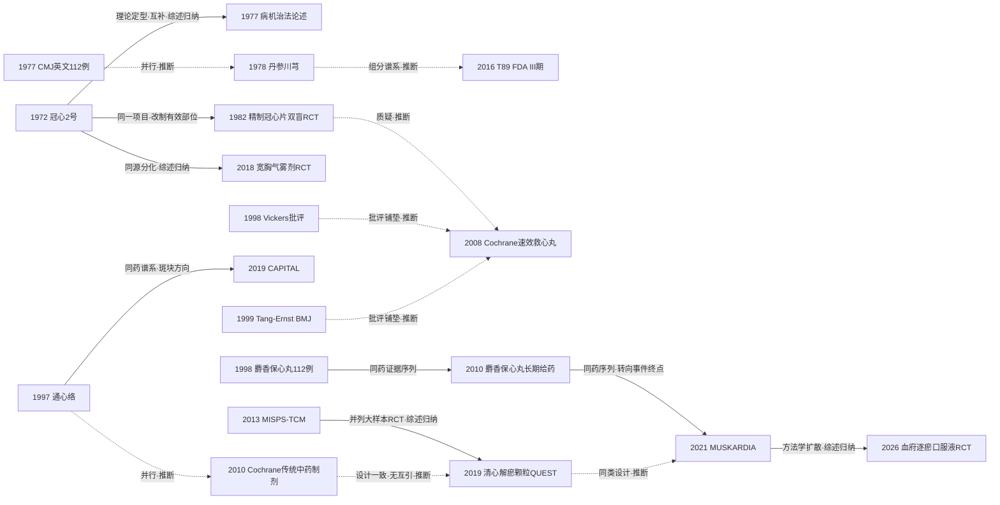

# D01 胸痹心痛：稳定性冠心病与心绞痛的中医药治疗（活血化瘀主线）

> 活血化瘀是这条脉络的主线：1972年冠心2号方起步，1982年精制冠心片完成中医药领域公认的首个随机双盲对照试验，此后衍生出麝香保心丸、通心络、复方丹参滴丸、芪参益气、血府逐瘀等成药谱系。当代证据形态是"症状终点获益较一致、事件终点未证实"：迄今最大规模双盲安慰剂RCT（MUSKARDIA，2674例）MACE主要终点未达显著（P=0.2869），仅18个月心绞痛发作频率显著减少。对临床医生最重要的一点：中成药改善症状有逐步积累的证据，但"降低死亡与心梗"至今没有被任何一项大样本安慰剂对照试验确立。

## 0 三分钟速读

1. **从哪里来**：1972年《新医药学杂志》发表冠心2号方（丹参、赤芍、川芎、红花、降香）多医院协作疗效初报 [D01-N01]，1977年陈可冀在《中华内科杂志》把活血化瘀立为冠心病主要治法 [D01-N02]。
2. **为什么改变**：1970年代协作观察无对照设计，1982年精制冠心片完成中医药领域公认的首个随机双盲试验 [D01-N05]（"公认首个"另有1970年代协作组双盲与1980年冠心2号RCT作者自述两说，见第1节）；1998–1999年国际学界批评中医药对照试验"几乎全阳性、质量低" [D01-N15][D01-N16]，2008/2010年两篇Cochrane判定证据薄弱/不足 [D01-N07][D01-N08]；这串事件与大样本安慰剂对照硬终点试验的出现为时间上先后关系，"共同推动"系本报告推断，不写成唯一动因。
3. **如何分化**：主线之外分出芳香温通（宽胸气雾剂非劣效RCT）[D01-N11]、益气活络（通心络，1997）[D01-N06]、苏合香丸—麝香保心丸（上海系，至MUSKARDIA）[D01-N13]、丹参滴丸企业线（T89 FDA III期）[D01-N10]、芪参益气（MISPS-TCM 3505例）[D01-N09]、古方血府逐瘀（2026年RCT）[D01-N14]。
4. **现在研究什么**：MUSKARDIA之后的亚组/卫生经济学/机制扩展；对全部RCT的方法学审计（188项RCT平均样本量83例、长程预后结局仅占0.37%，PMID 39701718）；以患者报告结局和影像替代终点为主要终点的新一代安慰剂RCT [D01-N14]。
5. **用了什么数据**：协作病例系列→双盲RCT（按年份序：112例1982→3505例2013→1500例2019→2674例2021，非按样本量排列）→Cochrane/网络Meta（179 RCT/16789例）与伞状评价（539篇系统评价）→ChiCTR与ClinicalTrials.gov注册库→真实世界研究。
6. **还有什么不知道**：硬终点获益未确立；1970—1980年代奠基文献原文不可及（只到题录）；T89美国III期（n=1004）结果至今未经同行评议发表。

**覆盖边界**：纳入胸痹心痛病名病机演变、活血化瘀治法方药路径（冠心2号系、血府逐瘀系、丹参系）、芳香温通、益气活血/络病、中成药RCT与系统评价、国际试验与监管节点、指南共识。不含：急性心肌梗死/PCI围术期（D02，CTS-AMI等仅在交叉处提及）、血脂与动脉粥样硬化（D06）、血瘀证与证候标准方法学（D11）、单体药理与机制（D12）、合并焦虑抑郁（D08）、康复功法（D09）、中药注射剂（D10）。

**本章口径**：截止2026-10-17；近期窗口2021-10-17至2026-10-17。**覆盖状态：基本完整但有标注缺口**——六问（从哪里来、为什么改变、如何分化、现在研究什么、用了什么数据、还有什么不知道）均可据本章正文与节点回答；章节范围内主要分支（冠心2号系、血府逐瘀系、丹参系、芳香温通、益气活络、苏合香丸—麝香保心丸）均有节点支撑；缺口限于个别原文未读（1972/1977/1982三篇奠基文献仅到题录、T89 III期结果未发表、BMJ 1999全文未读）、CNKI/万方中文库未查、部分近期研究停留题录层，均为第8节已标注项目，不影响六问回答。阅读层级：L0=仅二手转述、L1=题录已核、L2=摘要已读、L3=原文部分章节已读、L4=全文已读。本章节点19个：L1×6、L2×10、L3×3（其中N10注册协议为L3、其结果层面仅L1）；证据表42行（关键节点19、近期代表研究13、入口综述10）。只到L0/L1的说法一律写"转述"，不作"已核对原文贡献"的表述。

## 1 源头：最初在研究什么

按四类起点说法标注：

**被公认的奠基工作（经典源流，均为二手转述）**：胸痹病名与"阳微阴弦"（上焦阳虚、阴寒内盛）病机出自汉代《金匮要略·胸痹心痛短气病脉证治》（据E1第797-798页转述，古籍原文本轮未直接查证）；清代王清任《医林改错》（1830年刊行，通行说法）血府逐瘀汤为行气活血古方（据E8及2024年血府逐瘀述评PMID 38617912转述）；宋代《太平惠民和剂局方》苏合香丸为芳香温通方源（据专家共识等转述，L0）。

**被公认的奠基工作（现代）**：20世纪60年代，以陈可冀为代表的第一代中西医结合临床家在大量临床实践中发现冠心病患者的诸多表现与中医血瘀证候相似，转以活血化瘀论治（E1第797-798页；其参考文献[4]即1977年《中华内科杂志》论文 [D01-N02]，该题录公开学术库无记录、未经独立核实）。1982年精制冠心片双盲RCT被公认为"中医药领域第一个随机对照试验（首次以多中心、双盲方法评价活血化瘀复方）"——该定性出自活血化瘀学派述评E1第800页（学派自述属性），并得到独立史学文献（Yu X、Chen Y、Podolsky SH《中国对照试验史》，J R Soc Med 2025，PMID 40459228，本轮已核题录，L1）收录该文作为独立交叉支持；据该史学文章转述，研究开展于1980-1981年。"公认"限定为被其后文献公认；更早的两说照录、不作裁定：1970年代西苑协作组已开展多中心双盲研究的述评说，与1980年冠心2号RCT的作者自述说（原始题录均未获得）。

**目前最早找到的文献**：1972年《冠心2号方治疗冠心病心绞痛疗效的初步报告》（新医药学杂志1972年第1期29-32页）[D01-N01]（该题录公开学术库无记录、未经独立核实，全报告复核时判存疑）。限定语：这是"目前最早找到"，不是"最早存在"——本轮经E1参考文献与图1、公开网络著录三路核实题录，Europe PMC 1960-1990年英文检索中最早的中医治疗心绞痛报告为1977年 [D01-N03]，未发现更早公开题录；1955-1971年中文期刊公开索引亦核查无所得，更早个案与经验总结需纸本或CNKI（见第8节）。

**作者自称首次/企业叙事（全部L0）**：麝香保心丸——1974年（一说1972年）起在上海市卫生部门组织下的协作攻关，华山医院戴瑞鸿等在苏合香丸基础上经冠心苏合丸→苏冰滴丸→人参苏合香丸逐步改进，1980年代定型（据专家共识与媒体报道转述，研制期原始临床报告未检索到题录）；复方丹参滴丸——上市年份以1994年为准（Chin Med J 2017全文句"came into the market in 1994"，全报告复核时核对）；"1993年获新药批件"与"1995年上市"两说保留为L0企业叙事并加注；1994年闫希军创办天士力（L0转述）；速效救心丸——1982年章臣桂研制、官方口径为中国第一个纯中药滴丸制剂，但其发明人归属另有2019年媒体报道的争议，两说照录（L0）。

最早期研究的对象是"固定活血组方对心绞痛症状的影响"，分析单位是患者的心绞痛症状疗效；病机理论与证候标准（归D11）随之配套。

## 2 关键转折：问题—新证据/新方法—认识变化—新问题

**转折1（1972-1977）：从宣痹通阳到固定活血组方——起点与理论定型。** 1970年代冠心病心绞痛缺乏有效药物，中医治胸痹以宣痹通阳为主；西苑医院团队观察到患者表现与血瘀证相似，转向固定活血化瘀组方并开展多医院协作验证 [D01-N01]。协作方构成两说并存：一说为"中国中医研究院与中国医学科学院阜外医院协作开发活血化瘀代表性方剂冠心2号，十多家医院临床大协作同时开展基础研究"（E1第798页原文，本轮经PDF逐字核对）；另一说为"北京地区防治冠心病协作组"（阜外医院陶寿淇、陈在嘉等参加，据中国中医科学院官网等公开转述，L0）。1977年陈可冀《试谈冠心病心绞痛及急性心肌梗塞的中医治疗》（中华内科杂志1977,16(4):232-235）[D01-N02]，与1979年《瘀血证与活血化瘀治法源流概述》（中医杂志1979;9:51-57）共同构成活血化瘀治法的理论表述，为此后方药研究与证候标准提供了病机锚点。两节点为互补关系（E1第798页先述临床发现与治法表述、再述协作组方；先后关系系综述叙述，不构成因果证明）。同期中医治疗心绞痛进入英文期刊：1977年Chin Med J 112例病例系列 [D01-N03]（PubMed无作者著录，L1）与1978年丹参-川芎对药报告 [D01-N04]并行出现（两者是否同一团队不可考，本报告推断）。

**转折2（1982）：方法学转折——公认首个随机双盲试验。** 问题：协作系列为非对照或开放设计，疗效判定易受安慰效应与主观终点影响。精制冠心片（与冠心2号同组：丹参、赤芍、川芎、红花、降香的有效部位制剂）双盲法治疗112例冠心病心绞痛 [D01-N05]，据E1第800页转述显示可显著改善心绞痛症状与心电图、明显减少硝酸甘油使用（原文不可及，精确效应值无法核对；同一试验另有《医学研究通讯》1982年第11期24-25页同名报告，属同试验双发表）。此为同一研究项目内的改制延伸（冠心2号五行不变，E1第798-800页综述归纳）。它把中药疗效评价从病例系列推进到随机双盲对照，成为其后40年中药RCT的方法学原点（"公认首个"为被其后文献公认的限定，另有两说更早、见第1节）；新问题是：单个112例试验不足以支撑整个领域的证据强度。

**转折3（1990s-2010s）：按病机与剂型分支化。** 益气活络（络病理论）分支以通心络胶囊1997年临床试验起步：随机单盲、阳性药对照，492例（342 vs 150），4周后轻、中、重度心绞痛疗效均优于舒心口服液（P<0.01）[D01-N06]，以"络气虚滞、络脉瘀阻"病机开辟活血化瘀之外的分支。芳香温通分支从郭士魁宽胸丸经验制剂（据E1第799页治法表述与公开院史转述，L0）走到2018年宽胸气雾剂与硝酸甘油头对头多中心非劣效RCT：750例（376 vs 374），发作期舌下给药5分钟缓解率94.41% vs 90.64%（P>0.05，非劣效成立），CCS II/III亚组不良反应率显著更低（9.29% vs 26.22%、10.13% vs 20.88%）[D01-N11]（与2014年中文报告PMID 24812891为同一试验双发表）。麝香保心丸分支的证据链为：1998年人工麝香替代验证（225例随机盲法，人工vs天然麝香保心丸112/113例，2周，显著减少心绞痛发作与硝酸甘油用量）[D01-N17]→2010年长期给药200例（前6个月前瞻随机平行对照+后续队列，评价长期用药与心血管事件，转向事件终点问题）[D01-N18]→2021年MUSKARDIA [D01-N13]。丹参类分支从1978年对药报告 [D01-N04]经复方丹参片（1970年代广泛应用）走向滴丸剂型与FDA申报 [D01-N10]（组分谱系承继为本报告推断，非文献明确记载）。

**转折4（1998-2010）：国际独立评价的否定。** 独立国际评价的起点不是2008年，而是1990年代末的方法学批评：Vickers等系统核查1966-1995年MEDLINE收录的中国对照试验，发现"几乎全部报告阳性结局" [D01-N15]（摘要已读L2）；Tang、Zhan与Ernst在BMJ发表《中医药随机对照试验的综述》（BMJ 1999;319:160-161，题录已核、全文未读），其针对的中医药RCT中大量为冠心病/心绞痛试验——本章将两者并列为本领域"小样本全阳性"格局的国际认知源头节点（此定位系本章归纳）。2008年Cochrane对速效救心丸纳入15个RCT/1776例：合并效应量阳性（vs消心痛：心电图改善RR 1.16，95%CI 1.05-1.27；症状RR 1.09；发作次数MD -0.70次；硝酸甘油补充用量MD -0.60片），但纳入研究方法学质量差，结论"似有效但证据仍薄弱（weak）" [D01-N07]；2010年Cochrane对全部传统中药制剂治疗稳定性心绞痛仅能纳入3个RCT/216例、干预互不相同无法合并，判定"证据不足，应谨慎使用" [D01-N08]。认识变化：小样本全阳性被识别为方法学现象而非疗效结论。跨时代呼应：这一批评指向的格局在2024年证据图谱中依旧（188项RCT平均样本量83例、长程预后结局仅0.37%，见第5节；该呼应为本章归纳，非文献互引）。

**转折5（2013-2021）：硬终点大样本RCT——三个试验三种结果。** 芪参益气滴丸3505例心梗二级预防试验（多中心、随机、双盲双模拟、平行对照，注册号ChiCTR-TRC-00000002）：18个月复合终点3.67% vs 3.81%（vs阿司匹林），无显著差异，作者自认结论不确定（inconclusive）[D01-N09]。2019年清心解瘀颗粒QUEST试验（稳定性冠心病，Complement Ther Med）：1500例稳定型冠心病多中心双盲安慰剂RCT，预设主要复合终点（心血管死亡+非致死心梗+血运重建）1.59% vs 1.62%（HR 0.41，95%CI 0.13-1.28）阴性；揭盲前追加的"硬终点"（心源性死亡/非致死心梗/缺血性卒中）分析0.31% vs 1.30%、HR 0.06（0.01-0.53）成为争论焦点 [D01-N12]。MUSKARDIA试验：2674例、97家中心、24个月双盲安慰剂IV期RCT（基线99.7%用阿司匹林、93.0%用他汀），MACE主要终点OR 0.80（95%CI 0.45-1.07，P=0.2869）未达显著，仅18个月心绞痛发作频率显著减少（P=0.0362），不良事件率两组相当 [D01-N13]。认识变化：领域证据形态被改写为"症状终点有获益迹象、事件终点未证实"。三个试验在E1图1中被并列为大样本RCT里程碑（综述归纳）；清心解瘀颗粒QUEST等的设计特征与CD004468作者"需要干预措施一致的高质量随机试验"的建议一致（时间在后；OpenAlex核实清心解瘀颗粒QUEST参考文献不含该Cochrane，承继关系为本报告推断，不写为"回应"）。新问题：事件率低（<3%）导致检验效能不足，主终点阴性而追加终点阳性的解释分歧延续至今。

**转折6（2012-2026）：国际注册尝试与受挫。** 复方丹参滴丸（T89/Dantonic）按FDA植物药路径完成首个复方中药III期（NCT01659580，n=1004，注册库四臂含T89高/低剂量、三七冰片拆方组与安慰剂；2012-08启动，完成时间两说并存：期刊表2016-03、注册库2016-12）：注册库无结果，仅公司公告（2016-12-23）称高剂量组心绞痛发作减少约27%、硝酸甘油用量减少约25%、达到主要终点；结果未经同行评议发表、未获批准，第二项III期（NCT03789552，n=765）2019年启动、截至本轮仍招募中、预计2027年完成 [D01-N10]。

**转折7（2024-2026，延伸）：终点选择的再转向。** 新一代RCT把主要终点从"有效率/心电图"转向患者报告结局与影像替代终点：血府逐瘀口服液6中心双盲安慰剂RCT（148例），12周VAS疼痛强度调整后组间差-0.63（95%CI -1.12至-0.14，P=0.012），急救硝酸甘油使用率2.7% vs 13.5%（P=0.016）[D01-N14]；通心络TXL-CAP试验以OCT最小纤维帽厚度为主要终点（220例ACS人群，人群界接D02，PMID 41735255）。此为方法学扩散（据MUSKARDIA被引列表与2024-2026年新试验设计的综述归纳），回应的正是此前小样本阳性证据以症状有效率为主的老问题。

## 3 分支图

关系说明：实线=原文明确讨论或综述归纳的关系；虚线=本报告推断。N02→N01为E1叙述的先后（互补）；N01→N05为同一项目改制（E1第798-800页）；N17→N18→N13为同一药物的证据序列（症状→长期用药→事件终点）；N15/N16→N07为国际批评铺垫（推断，互引未核）；N08→N12两侧文献互引已被OpenAlex排除（清心解瘀颗粒QUEST参考文献33条不含CD004468）。

## 4 近五年重点（2021-10-17至2026-10-17）

**主题1：麝香保心丸证据链的亚组、经济学与机制扩展（MUSKARDIA后时代）。** 以MUSKARDIA [D01-N13]（L3）为基准做亚组与事后分析（女性PMID 36386372、合并糖尿病PMID 36752805、体重分组PMID 39793776、eGFR降低PMID 41795301、基线血红蛋白PMID 42730905）与成本-效果分析（PMID 38427636，L1）；同一药物、不同队列的独立新试验为麝香保心丸治ANOCA人群的多中心双盲安慰剂RCT（PMID 40020628，L1；据题录转述：239例、11中心、12周，证据表按独立试验登记）；机制扩展另有肠道菌群与单细胞测序研究（归D12）。42个RCT的Meta（PMID 36452225，L2）：MACE RR 0.50（0.37-0.68）、心绞痛频率MD -2.83次/周（-3.62至-2.05），GRADE仅MACE与心电图为中等确定性。分歧：小试验合并效应阳性与唯一大样本安慰剂RCT主终点阴性（P=0.2869）的矛盾未解决；注意上述亚组与经济学分析均为同一主试验的二次分析，不重复计为独立证据。成熟度：发展中。

**主题2：硬终点/复合终点RCT的方法转向及其证据审计。** 清心解瘀颗粒QUEST（2019，稳定性冠心病）[D01-N12]、MISPS-TCM [D01-N09]等确立了大样本硬终点设计；审计端，PCI后心绞痛中医RCT证据图谱（PMID 39701718，中国中药杂志2024，检索至2024-01-31，L2）：188项RCT/15521例（含4个注册方案），平均样本量83例、最大248例，结局指标160种/频次1348次，其中长期预后仅5次（0.37%），疗程多为4-8周、多数无随访。分歧：硬终点试验事件率低致效能不足；审稿层级之争（清心解瘀颗粒QUEST刊于综合替代医学期刊）。成熟度：方法转向进行中、被审计的证据底子薄弱。

**主题3：复方丹参滴丸国际路径与"替代硝酸酯"主张。** T89首项III期完成未发表未获批，第二项III期（NCT03789552，n=765）招募中至2027 [D01-N10]。复方丹参滴丸vs硝酸酯系统评价（PMID 37283584，Front Cardiovasc Med 2023，L2）：29个RCT，症状有效率（4/6/8周）OR 1.95/3.45/4.02、不良反应OR 0.15，证据等级very low至low，作者（天士力人员，利益相关）建议可作为硝酸酯替代；2026年更新系统评价（PMID 42851529，L1，据题名转述）。分歧：企业主导证据与Cochrane"证据不足"判定（2010）的矛盾；公告数据无同行评议版本。成熟度：早期线索。

**主题4：真实世界研究。** 冠心丹参滴丸ADECODE前瞻性真实世界研究（本轮已核题录：Chin J Integr Med 2024，doi:10.1007/s11655-023-3628-x，1428例；PMID 37947990，L1，据题录转述；其焦虑抑郁结局归D08）；老年患者活血类中成药与临床结局关联的回顾性队列（北京医保数据库、≥65岁，PMID 42389288，L1，据题名转述）。分歧：真实世界研究控混杂能力有限，尚无改变指南的中成药真实世界证据。成熟度：早期线索。

**主题5：经典古方与证型导向的安慰剂RCT。** 血府逐瘀口服液RCT（6中心，263例筛选/148例入全分析集，12周VAS主要终点阳性、24周持续，急救硝酸甘油使用减少）[D01-N14]（L2）；速效救心丸在长效硝酸酯不耐受慢性稳定型冠心病人群的8中心双盲安慰剂RCT（174例mITT，4周，有效率OR 2.43，1.32-4.47，P=0.004，PMID 39367481，L2）；Yingxin pill（中文名本轮未核）RCT（2026，随机单盲、麝香保心丸阳性对照、60例4周，PMID 41782933，L1，据题录转述）；血府逐瘀汤系背景证据为其2021年Meta（30 RCT/3126例，联合化学药有效率RR 1.26、心电图RR 1.63，E8，L2）。分歧：按证型入组提高同质性但限制外推；阳性药对照与安慰剂对照标准不一；样本量仍在48-174例级。成熟度：发展中。

**主题6：证据整合与审计。** 口服中成药+西药的网络Meta（179 RCT/16789例，E5，L2）：芪参益气+西药在有效率/心电图有效率排名居首（概率98.12%/94.21%），QLQX+WM在心绞痛周频率、KXQW+WM在发作时长、TXL+WM在硝酸甘油周用量居首，但ROB2评估全部试验"some concerns"；伞状评价（539篇系统评价=346中文+193英文，E7，L2）：冠心病、心绞痛等5类疾病证据较一致支持获益，"效应量需进一步研究"；证据图谱（PMID 39701718，见主题2）。分歧：网络Meta排序（芪参益气第一）与其硬终点试验证据（MISPS-TCM结论不确定）矛盾。成熟度：整合与审计方法成熟，被整合的证据质量仍是瓶颈。

## 5 争议、负性结果与停滞路线

1. **硬终点效力争议（未解决）**：42 RCT的Meta示麝香保心丸MACE RR 0.50（PMID 36452225），而唯一大样本安慰剂RCT主终点P=0.2869未达显著 [D01-N13]；网络Meta多药排名居首（E5）与MISPS-TCM"结论不确定"（[D01-N09]）矛盾。当前可守的结论只有"症状终点获益较一致、事件终点未证实"。
2. **MUSKARDIA结果的表述矛盾（两说并存）**：原文为OR 0.80（0.45-1.07），P=0.2869未达显著、仅18个月心绞痛频率显著；E1（李逸雯等2022第800页）称"MACE事件及心绞痛症状发生率均有统计学差异"，疑为对"相对降低26.9%"的过度概括（E1中该试验亦被称作MUST研究并引作2020年）。以原文数字为准，两说各自出处照录，未见勘误。
3. **清心解瘀颗粒QUEST追加"硬"终点HR 0.06的解释争议**：该终点非预设主要终点（揭盲前追加），事件率极低（0.31% vs 1.30%），属探索性分析；E1引述时未强调其探索性质。后续同团队转向中间冠脉病变人群RCT（PLoS ONE 2024;19:e0307074，PMID 39012918），未见针对HR 0.06的确证试验。
4. **T89的透明度与效力争议（停滞中）**：III期结果未发表、注册库无Results，公开渠道仅公司公告；1997年申报至今未获批，第二项III期至2027年，2026年另有媒体报道天士力调整海外合作（L0转述）。
5. **协作组构成两说**：见第2节转折1，1970年代原始档案未公开，两说保留。
6. **"小样本全阳性"格局的跨时代呼应**：1998年Vickers等发现中国对照试验几乎全阳性 [D01-N15]，2024年证据图谱显示188项RCT平均83例、长程预后结局仅0.37%（PMID 39701718）——外部批评与内部审计在四分之一个世纪后指向同一结构性问题（呼应系本章归纳）。
7. **撤稿个案**：血府逐瘀颗粒双盲安慰剂RCT论文于2023年被撤稿（Retracted标记，PMID 37565163）。
8. **失败/停滞路线清单**：清心解瘀颗粒QUEST预设主要终点阴性（PMID 31780034）；芪参益气滴丸替代阿司匹林路线未获证据支持（[D01-N09]结论不确定）；T89 FDA上市路径受阻（[D01-N10]）；Cochrane对传统中药制剂的否定性判定（[D01-N07][D01-N08]）。

## 6 传承线与国际线

**传承线**（证据层级逐段标注）：

- **活血化瘀主线（中国中医研究院西苑医院系）**：郭士魁、陈可冀以活血化瘀、芳香温通治冠心病（学术思想传承据E1及公开转述，生平细节L0）→1972年冠心2号协作初报 [D01-N01]（L1）→1977年病机治法论述 [D01-N02]（L1）→1982年精制冠心片双盲RCT [D01-N05]（L1；公认首个，独立史学交叉PMID 40459228）→血瘀证诊断标准系列（谱系统一口径：1982年制定、刊1983；1986年广州会议修订《血瘀证诊断标准》、刊1987;7(3):129；1988年北京国际会议《血瘀证诊断参考标准》、刊1989;9(2):111；GB/T 16751.2-1997；2011年冠心病血瘀证量化诊断；2016年冠心病血瘀证专项标准PMID 27783323；2016年实用血瘀证诊断标准中文版、2017年英文版PMID 27921194；2021年世界中联国际血瘀证诊断指南。E1图1所记"2018实用血瘀证标准"为转述、与题录核实不符；方法学归D11，据E1图1及其引文[21][24][25]）→介入后再狭窄支线（2000芎芍胶囊、2006 XS0601，据E1引文[17][18]，归D02/D06）→徐浩、史大卓承接：2017年基于郭士魁血瘀证辨治方法的实用性随机对照研究（中国中西医结合杂志2017;37:1174-1180，据E1引文[33]核实题录，L1）、2019年清心解瘀颗粒QUEST（稳定性冠心病）[D01-N12]（L2）、2024年中间冠脉病变RCT（PMID 39012918，L1）。
- **芳香温通支（同源分化，同出西苑）**：郭士魁宽胸丸→西苑医院宽胸气雾剂（制剂沿革L0）→2014年13中心RCT（中文，PMID 24812891）与2018年英文非劣效RCT [D01-N11]（L2；同一试验双发表，末位作者陈可冀）。
- **苏合香丸—麝香保心丸支（上海系）**：1974年（一说1972年）起华山医院戴瑞鸿等协作研制，1980年代定型（全程L0转述）→1998年人工麝香保心丸112例临床观察 [D01-N17]（L2）→2010年长期给药200例 [D01-N18]（L2）→2011-2020年葛均波（中山医院）、范维琥（华山医院）牵头MUSKARDIA [D01-N13]（L3）→2022-2026年亚组、成本-效果（均为主试验二次分析）、ANOCA独立新RCT与机制系列（见第4节主题1）。
- **益气活络支（络病理论系，河北以岭）**：吴以岭络病理论→通心络胶囊→1997年徐贵成、高荣林、吴以岭首篇临床研究 [D01-N06]（L2；第二作者经中文引文链核实为高荣林，MEDLINE著录Gao RL无法区分）→大量小样本RCT与Meta（2023年Meta 26 RCT/2352例，PMID 37832041；2024年总览PMID 38414926、GRADE评估PMID 39844907）→2019年CAPITAL颈动脉斑块试验 [D01-N19]（L2；界接D06）→2026年TXL-CAP冠脉斑块OCT试验（PMID 41735255，人群界接D02）→急性心梗CTS-AMI登JAMA（2023，PMID 37874574，归D02交叉）。
- **丹参滴丸支（企业研发系）**：1978年丹参-川芎英文报告 [D01-N04]（L1）→复方丹参片（1970年代）→复方丹参滴丸1994年上市（Chin Med J 2017全文句，全报告复核时核对；"1993年获新药批件"与"1995年上市"两说保留为L0企业叙事并加注）→1997年起FDA IND→2012-2016美国III期 [D01-N10]（L3注册）→2019年第二项III期（NCT03789552）。
- **芪参益气支（天津中医药大学系）**：张伯礼、商洪才、张俊华团队MISPS-TCM（3505例，2013年发表 [D01-N09]，L3；E1图1记该试验2011年获国家科学技术进步二等奖，发表与授奖先后并存）→芪参益气滴丸2021年6月获FDA慢性心衰II期（据E6表2记载，注册号本轮未单独核实，见第8节）。
- **古方血府逐瘀线**：王清任《医林改错》（1830，转述）→血府逐瘀汤/胶囊/口服液→2021年Meta（30 RCT/3126例，E8，L2）→2026年血府逐瘀口服液多中心安慰剂RCT [D01-N14]（L2）。
- **旁支（从脾胃/气血论治，均L0无题录，本轮未核）**：邓铁涛（广州中医药大学）"心脾相关""调脾护心"、痰瘀兼治；路志正（中国中医科学院）调理脾胃治胸痹；颜德馨（上海）"衡法"、温阳活血——待核线索见第8节。
- **指南/成药阶段**：1979年冠心病心绞痛中医辨证参考标准（医学研究通讯1979;12:19，据E1引文[20]）→2018年《冠心病稳定型心绞痛中医诊疗专家共识》（王阶、陈光，中医杂志2018,59(5):447-450，doi:10.13288/j.11-2166/r.2018.05.020，本轮已核题录、无PMID，其引言转引1982年精制冠心片试验）→2020年《中成药治疗冠心病临床应用指南》（毛静远、吴永健、史大卓，2021年刊出，据E1引文[31]）。

**国际线**：

- **1998-1999年国际方法学批评（独立评价的起点，早于Cochrane近十年）**：Vickers等对1966-1995年MEDLINE收录中国对照试验的系统核查发现几乎全部阳性结局 [D01-N15]（L2）；Tang/Zhan/Ernst在BMJ发表中医药RCT综述（[D01-N16]，L1；全文在PMC28166未读）。
- **Cochrane反证（2008/2010）**：速效救心丸15 RCT/1776例"证据薄弱" [D01-N07]；传统中药制剂3 RCT/216例"证据不足、应谨慎使用" [D01-N08]。
- **FDA植物药路径与海外注册**：T89两项III期（[D01-N10]，第二项至2027）；2008年复方丹参滴丸与柴胡滴丸以"传统药"身份获加拿大批准、2016年丹参胶囊在荷兰注册（据E6表1）——均为传统草药路径，不以疗效证据审批。
- **国际期刊节点**：JAMA 2023年CTS-AMI（通心络治急性心梗，PMID 37874574，归D02但为中国中药硬终点试验登顶刊的标志）；JAMA Intern Med 2019年针刺治慢性稳定型心绞痛多中心RCT（PMID 31355870，非药物、毗邻方向）；2024年伞状评价结论"效应量需进一步研究"（E7）。
- **海外独立申办的稳定性心绞痛中成药验证试验**：本轮未查到——除天士力申办的T89系列外，未检索到海外研究者独立发起的活血化瘀中成药RCT；FDA/EMA/ESC指南未纳入任何中成药推荐。

## 7 数据路径小结（历史上 vs 现在）

- **1970年代：多医院协作病例系列**——冠心2号十多家医院临床观察 [D01-N01]与1977年CMJ 112例系列 [D01-N03]，无对照设计，终点为症状。
- **1982年起：随机双盲/对照试验**——精制冠心片112例双盲RCT（[D01-N05]，L1）→通心络492例单盲阳性对照（[D01-N06]）→宽胸气雾剂750例多中心非劣效RCT（[D01-N11]，发作期给药）→清心解瘀颗粒QUEST（2019，稳定性冠心病）1500例、MUSKARDIA 2674例、MISPS-TCM 3505例双盲安慰剂/双模拟硬终点RCT（[D01-N12][D01-N13][D01-N09]）→2024-2026年血府逐瘀口服液148例、速效救心丸174例等中等规模安慰剂RCT。终点从症状/心电图有效率转向MACE复合终点与患者报告结局（VAS、SAQ）。
- **系统评价族**：Cochrane两篇（2008/2010）、传统Meta（血府逐瘀30 RCT/3126例，2021）、网络Meta（179 RCT/16789例，2022）、伞状评价（539篇SR，2024）、RCT证据图谱（188项，2024）——共同发现是平均样本量约83例、长程预后结局仅0.37%。
- **注册与监管数据**：ChiCTR（ChiCTR-TRC-00000002、ChiCTR-TRC-12003513、ChiCTR-TRC-13004370、ChiCTRIPR-15007204、ChiCTR1900026899）与ClinicalTrials.gov（NCT00797953、NCT01659580、NCT03789552）——T89 III期注册库无结果发布是透明度缺口。
- **真实世界与登记**：ADECODE前瞻性研究（1428例）、北京医保老年队列（≥65岁）。
- **动物实验与机制组学**：冠心2号/Guanxin II大鼠模型（PMID 19041701等）、麝香保心丸肠道菌群/单细胞测序、清心解瘀颗粒NETs/焦亡机制（归D12，此处仅列数据路径）。
- **证候量表/诊断标准**（归D11）：1979辨证参考标准→1982年制定（刊1983）、1986年广州会议修订《血瘀证诊断标准》（刊1987;7(3):129）、1988年北京国际会议《血瘀证诊断参考标准》（刊1989;9(2):111）→2016年冠心病血瘀证专项标准（PMID 27783323）→2016/2017年实用血瘀证诊断标准（中文版2016、英文版2017，PMID 27921194）→2021年世界中联国际血瘀证诊断指南（据E1表1；E1表1所记"2018国际血瘀证指南"为转述、与题录核实不符）。

## 8 还不知道什么（领域证据缺口）与本报告的检索缺口

**领域证据缺口**：

1. **硬终点获益未确立**：三个最大RCT中两个主要终点阴性、一个未达显著；188项RCT中长程预后结局仅占0.37%；2024-2026年仍无新的硬终点阳性大样本RCT。
2. **T89美国III期（n=1004）结果未发表**：只有公司公告（发作-27%/硝酸甘油-25%），无效应值、CI与运动时长数据；第二项III期至2027年才完成。
3. **海外独立验证缺失**：无海外研究者独立申办的稳定性心绞痛中成药RCT；国际指南未纳入任何中成药推荐。
4. **早期成药原始临床报告缺失**：麝香保心丸1970-80年代研制期（冠心苏合丸/苏冰滴丸阶段）与速效救心丸1980-90年代的原始临床试验均未检索到题录，相关研制史停留L0转述（1998/2010两个节点已补上 [D01-N17][D01-N18]，但研制期仍空缺）。

**本报告检索缺口（含CNKI/万方未检索的影响）**：CNKI与万方在本轮不可登录，这对本章结论的影响是实质性的：1972年冠心2号初报 [D01-N01]与1977年病机论述 [D01-N02]两篇公开学术库无题录（全报告复核时判存疑、未经独立核实），1982年精制冠心片双盲RCT [D01-N05]有PubMed题录（PMID 6751749，无摘要）：三篇奠基文献原文均只到题录（L1），协作规模、疗程、随机方案与疗效数字均无法核对，"首个双盲RCT"的疗效表述只能以E1学派述评为准（其独立性已尽量以J R Soc Med 2025史学题录交叉，但该史学文献本身亦仅L1）；1979年辨证参考标准、2017年实用性RCT等同样只能经E1参考文献核实题录。1972年以前的个案与经验报道：公开索引（含Europe PMC 1955-1990与中文公开检索）已核查无所得，若CNKI/纸本可及，起点可能前移。**待核线索**（本轮无可定位题录或仅单一来源，不入正文叙事）：郭士魁生平细节（1915-1981、师承等，L0）；邓铁涛/路志正/颜德馨旁支的原始题录；麝香保心丸"1972年起"与"1974年起"两说的原始档案；速效救心丸发明人归属争议（2019年媒体报道）；1970年代更大样本冠心2号系列（如"528例/600例"线索，未见确切题录）；芪参益气滴丸FDA II期注册号（仅E6表2一行）；屠呦呦等Nature Medicine 2011年文中提及活血化瘀中药防治冠心病的段落（仅经E1参考文献核实题录Nat Med 2011,17:1217-1220）；T89 III期剂量组设置的历史公告细节（注册库四臂已核，公告层面数字仍未经独立验证）；Xingling颗粒FDA III期（仅E6表2一行，非本方向主线）。

## 9 本章节点速查表

| 编号 | 年份 | 第一作者+题名简写 | 期刊 | 节点作用 | 设计/数据/分析单位 | 样本 | 关键结果 | 阅读层级 | 核查状态 | PMID/DOI |
|---|---|---|---|---|---|---|---|---|---|---|
| N01 | 1972 | 冠心2号方治疗冠心病心绞痛疗效的初步报告 | 新医药学杂志 | 活血化瘀起点（最早可及题录，未经独立核实） | 多医院协作病例观察/患者 | 患者数不可得；协作医院十余家（转述） | 原文不可及；据E1转述疗效较好 | L1 | 存疑（公开学术库无题录） | — |
| N02 | 1977 | 陈可冀·试谈冠心病心绞痛及急性心肌梗塞的中医治疗 | 中华内科杂志 | 理论定型 | 理论论述/病机治法 | — | 据E1转述：血瘀相似性→活血化瘀治法 | L1 | 存疑（公开学术库无题录；题名此前已修正） | — |
| N03 | 1977 | （无作者著录）TCM treatment of angina pectoris: 112 cases | Chin Med J | 国际可见度起点 | 病例系列/患者 | 112例 | 题录核实，原文不可及 | L1 | 通过 | 410601 |
| N04 | 1978 | Liu CS·丹参川芎治冠心病 | Chin Med J | 丹参支先声 | 用药观察/患者 | 不可得 | OpenAlex被引39（锚点） | L1 | 通过 | 417902 |
| N05 | 1982 | 陈可冀·精制冠心片双盲法治疗心绞痛112例 | 中华心血管病杂志 | 公认首个随机双盲RCT（另有两说，见第1节） | 多中心随机双盲/患者 | 112例 | 据E1转述：症状与心电图显著改善 | L1 | 通过（PMID已补） | 6751749 |
| N06 | 1997 | 徐贵成·通心络胶囊治疗冠心病心绞痛临床研究 | 中国中西医结合杂志 | 益气活络分支临床起点 | 随机单盲阳性药对照/患者 | 492（342/150） | 轻、中、重度心绞痛疗效均优于对照（P<0.01） | L2 | 修正（followup） | 10322862 |
| N07 | 2008 | Duan X·Cochrane：速效救心丸 | Cochrane Database Syst Rev | 国际独立反证 | Cochrane SR/RCT合并 | 15 RCT/1776例 | 效应阳性但"证据仍薄弱" | L2 | 通过 | 18254051 |
| N08 | 2010 | Zhuo Q·Cochrane：传统中药制剂治稳定性心绞痛 | Cochrane Database Syst Rev | 国际独立反证 | Cochrane SR | 3 RCT/216例 | 证据不足、应谨慎使用 | L2 | 通过 | 20464731 |
| N09 | 2013 | Shang H·MISPS-TCM（芪参益气vs阿司匹林） | Evid Based Complement Alternat Med | 首个数千例硬终点试验 | 多中心随机双盲双模拟平行对照/患者 | 3505（1746/1759） | 18月3.67% vs 3.81%，结论不确定 | L3 | 修正（设计） | 23935677 |
| N10 | 2016 | T89（Dantonic）III期 NCT01659580 | ClinicalTrials.gov | 国际注册节点 | 国际多中心双盲安慰剂III期四臂/患者 | 1004 | 公告达标（-27%/-25%）；未发表未获批 | L3注册/L1结果 | 修正（四臂拆方组） | NCT01659580 |
| N11 | 2018 | 杨庆年·宽胸气雾剂非劣效RCT | Chin J Integr Med | 芳香温通RCT化 | 多中心非劣效RCT/发作事件 | 750（376/374） | 5分钟缓解94.41% vs 90.64%，非劣效成立 | L2 | 修正（引文） | 29435729 |
| N12 | 2019 | Li J·清心解瘀颗粒QUEST | Complement Ther Med | 硬终点主终点阴性 | 多中心双盲安慰剂RCT/患者 | 1500 | 主终点HR 0.41阴性；追加终点HR 0.06（探索性） | L2 | 通过 | 31780034 |
| N13 | 2021 | Ge JB·MUSKARDIA（麝香保心丸） | Chin Med J | 最大规模安慰剂RCT | 97中心双盲安慰剂IV期RCT/患者 | 2674 | MACE P=0.2869未达显著；18月心绞痛频率P=0.0362 | L3 | 通过 | 33273369 |
| N14 | 2026 | Cao W·血府逐瘀口服液RCT | Front Med | PRO终点转向 | 6中心双盲安慰剂RCT/患者 | 148（筛选263） | VAS -0.63（P=0.012）；急救硝酸甘油2.7% vs 13.5% | L2 | 通过 | 42136835 |
| N15 | 1998 | Vickers A·Do certain countries produce only positive results? | Control Clin Trials | 国际方法学批评 | 系统核查（试验为单位，1966-1995中国试验） | 纳入试验数见原文 | 中国试验几乎全部阳性结局 | L2 | 通过（补入） | 9551280 |
| N16 | 1999 | Tang JL·Review of RCTs of traditional Chinese medicine | BMJ | 国际方法学批评 | 综述 | — | 题录核实；全文未读 | L1 | 通过（补入） | 10406751 |
| N17 | 1998 | 王硕?·人工麝香保心丸治疗冠心病心绞痛112例临床观察 | 中国中西医结合杂志 | 麝香保心丸线临床起点 | 随机盲法/患者 | 225（112/113），2周 | 减少心绞痛发作与硝酸甘油用量（人工麝香替代可行） | L2 | 通过（补入） | 11475741 |
| N18 | 2010 | 朱慧?·麝香保心丸长期给药治疗稳定型心绞痛 | 中国中西医结合杂志 | MUSKARDIA直接前奏 | 前6月随机平行对照+队列/患者 | 200例 | 随访中位2.25年：复合心血管事件20 vs 29例、心绞痛事件9 vs 19例，均显著减少（P<0.05）；硝酸甘油用量减少；全因死亡等单项事件差异不显著（P>0.05） | L2 | 通过（补入） | 20681275 |
| N19 | 2019 | Zhang M·CAPITAL（通心络与颈动脉斑块） | Sci Rep | 通心络线最大安慰剂RCT之一（界接D06） | 多中心双盲安慰剂RCT/患者 | 1212（IMT≥1.2mm），24月 | IMT年均变化-0.00095 vs 0.01312 mm，组间差-0.01407 mm（95%CI -0.01740至-0.01073，P<0.001）；斑块面积、血管重塑指数与首次MACE复合终点亦显著优于安慰剂 | L2 | 通过（补入） | 30872737 |

注：N17/N18第一作者中文姓名按音译推断（题录经PubMed核实），作者全名以原文为准；N05同试验另有《医学研究通讯》1982;(11):24-25同名报告；N11同试验中文版PMID 24812891。

## 10 本章入口文献与检索截止

| 编号 | 文献 | 类型 | 文中检索截止 |
|---|---|---|---|
| E1 | 李逸雯, 罗斌玉, 崔京, 朱梦梦, 刘玥, 徐浩, 史大卓, 陈可冀. 病证结合与冠心病防治策略. 中国科学:生命科学, 2022, 52(6): 797-811. doi:10.1360/SSV-2021-0384 | 学派述评（本章历史骨架主要来源，注意其自述属性与已发现的转述失真） | 未说明（收稿2021-10-26，网络首发2022-03-30） |
| E2 | Ge JB, et al. MUSKARDIA. Chin Med J (Engl), 2021, 134(2): 185-192. doi:10.1097/CM9.0000000000001257 | 大样本RCT原文 | 注册2012年 |
| E3 | Zhuo Q, et al. Traditional Chinese herbal products for stable angina. Cochrane Database Syst Rev, 2010, (5): CD004468 | Cochrane系统评价 | 检索至2008年6月 |
| E4 | Duan X, et al. Suxiao jiuxin wan for angina pectoris. Cochrane Database Syst Rev, 2008, (1): CD004473 | Cochrane系统评价 | 末次检索2005年11月 |
| E5 | Huang P, et al. Network meta-analysis of 179 trials. Front Pharmacol, 2022, 13: 918689 | 网络Meta | 2022-03-13（PROSPERO CRD42022316534） |
| E6 | Wu S, et al. International multi-center clinical trials on TCHM. Front Pharmacol, 2023, 14: 1195364 | 国际注册/监管综述 | 覆盖至2021年启动的试验 |
| E7 | Li X, et al. Umbrella review. J Cardiovasc Pharmacol, 2024, 83(4): 340-352 | 伞状评价 | 建库至2023年8月 |
| E8 | Zhang S, et al. XFZYD for CHD: SR/MA. Evid Based Complement Alternat Med, 2021: 9931826 | 系统评价/Meta | 建库至2020-12-20 |
| — | 王阶, 陈光. 冠心病稳定型心绞痛中医诊疗专家共识. 中医杂志, 2018, 59(5): 447-450. doi:10.13288/j.11-2166/r.2018.05.020 | 学会共识（本轮已核题录，无PMID） | 未说明 |
| — | Yu X, Chen Y, Podolsky SH. The history of controlled clinical trials in China. J R Soc Med, 2025. PMID 40459228（另Part 1：PMID 40409347） | 独立史学（"1982首个双盲RCT"定性的交叉来源） | 未说明 |

本章全部检索执行于2026-10-17（Europe PMC、PubMed E-utilities、ClinicalTrials.gov API、OpenAlex、Crossref、公开网络检索；未登录、未付费，CNKI/万方全文不可得）。

## 12 复核修订记录（2026-10-17）

1. 跨章一致性｜第6节传承线血瘀证标准系列、第7节证候量表条目｜据E1写的"2018实用血瘀证标准、2018国际血瘀证指南"改为"2016/2017年实用血瘀证诊断标准（英文版PMID 27921194）、2021年世界中联国际血瘀证诊断指南"，并注明E1图表所记2018为转述、与题录核实不符；标准谱系统一口径为1982年制定（刊1983）、1986年广州会议修订《血瘀证诊断标准》（刊1987;7(3):129）、1988年北京国际会议《血瘀证诊断参考标准》（刊1989;9(2):111）、GB/T 16751.2-1997、2016年冠心病血瘀证专项标准（PMID 27783323）、2021年世界中联国际诊断指南（两条PMID经PubMed题录复核）。
2. 跨章一致性｜第1节作者自称段、第6节丹参滴丸支｜复方丹参滴丸上市年份改以1994年为准（Chin Med J 2017全文句"came into the market in 1994"，全报告复核时核对）；原"1993年获新药批件、1995年上市"改保留为L0企业叙事并加注。
3. 跨章一致性｜第2节转折6｜T89美国III期完成时间由单一口径"2012-08至2016-12"补注两说并存：期刊表2016-03、注册库2016-12。
4. 跨章一致性｜第6节益气活络支、证据表D01-R06｜1997年通心络首篇临床研究第二作者"高润霖"改为"高荣林"（中文引文链核实；MEDLINE著录Gao RL无法区分），证据表limitations同步注明。
5. 跨章一致性｜第2节转折1、第5节争议5、第3节分支图｜1970年代冠心2号协作组构成维持两说并存（中国中医研究院+阜外医院协作／北京地区防治冠心病协作组）；复核确认结论句与分支图均未单取一说，未作改动。
6. 证据抽查｜证据表D01-R05、第9节速查表N05、第8节｜D01-R05补PMID 6751749（PubMed有题录无摘要，L1维持）；D01-R01、D01-R02经全报告抽查判"无法核实"，证据表verification_status改"存疑"、limitations注明"公开学术库无题录，待核线索（纸本/中文库人工核对）"，正文第1节相应处注明未经独立核实，速查表N01/N02核查状态同步为存疑。
7. 跨章关系｜速读第2条、第1节、第2节转折2｜凡涉"大样本安慰剂对照硬终点试验的出现"与1998–1999国际批评/Cochrane否定的关系处，加"时间上先后、'共同推动'系本报告推断、不写成唯一动因"限定；"中医药领域第一个随机双盲RCT"保留"被其后文献公认"限定，并注明另有1970年代协作组双盲与1980年冠心2号RCT（作者自述）两种更早说法、不作裁定。
8. 跨章关系｜全文QUEST指称（第2节转折5、第3节分支图与关系说明、第4节主题2、第5节争议3与争议8、第6节传承线、第7节数据路径）｜裸名"QUEST"一律写全名"清心解瘀颗粒QUEST（稳定性冠心病，Complement Ther Med，2019）"或等义限定；本章未涉2024年芪苈强心QUEST（HFrEF，Nat Med）。
9. 机械质检｜全文引用节点与分支图｜复合方括号（如"[D01-N05，L1，公认首个，独立史学交叉（PMID 40459228）]""[D01-N13，L3]""[D01-N15，摘要已读L2]"等约20处）全部拆为单个 [D01-Nxx]，层级与注记移到括号外；分支图边标签去除全角圆括号、N12节点写全名；被引编号逐一回查证据表row_id/node_id，19个节点编号全部在表；入口综述以E1–E8行内编号指称、正文无[D01-E1]式括号引用，与证据表入口行无冲突。

**第二轮（完整性检查，2026-10-17）**

10. 落实完整性检查三条建议改：①第4节主题1｜ANOCA人群RCT（PMID 40020628）从MUSKARDIA亚组/成本-效果清单同一句中拆出，改写为"同一药物、不同队列的独立新试验"并列明其239例/11中心/12周双盲安慰剂设计，与证据表D01-R31按独立试验登记（same_cohort_as空）一致；第6节传承线同步改为"亚组、成本-效果（均为主试验二次分析）、ANOCA独立新RCT与机制系列"。②第9节速查表N18/N19与证据表D01-R18/D01-R19｜经Europe PMC补读两文摘要（PMID 20681275、30872737）补齐"结果"要素：N18随访中位2.25年，复合心血管事件20 vs 29例、心绞痛事件9 vs 19例均显著减少（P<0.05）、硝酸甘油用量减少，全因死亡等单项事件差异不显著（P>0.05）；N19（CAPITAL）IMT年均变化-0.00095 vs 0.01312 mm、组间差-0.01407 mm（95%CI -0.01740至-0.01073，P<0.001），斑块面积、血管重塑指数与首次MACE复合终点亦显著优于安慰剂；两表limitations中"结果数字未摘录"表述相应删除。③第0节速读第5条｜双盲RCT样本量序列由按样本量排列（112→1500→2674→3505）改为按年份序（112例1982→3505例2013→1500例2019→2674例2021）并注明"非按样本量排列"，消除误读为证据演进序。
11. 覆盖状态按统一口径复评（写入"本章口径"）：六问均可据本章回答、主要分支均有节点，缺口限于个别原文未读、CNKI/万方未查、部分近期研究停留题录层（均为第8节已标注项），判定为"基本完整但有标注缺口"。本轮补查共2次Europe PMC查询（PMID 20681275、30872737摘要），未超20次限额。
