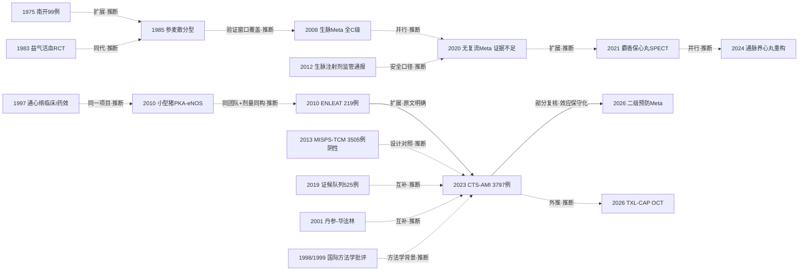

# D02 真心痛：急性心肌梗死/ACS 与血运重建围术期的中医药

> 一句话判断：真心痛（急性心肌梗死/ACS）的中医药研究从1970年代"病死率对照+辨证救治"起步，经注射剂与1990年代中成药化，到2023年CTS-AMI（JAMA，3797例）第一次把中成药推上国际硬终点大试验层面。当前主线是PCI围术期无复流、缺血再灌注损伤与心室重构的"指南治疗加载+安慰剂对照"试验；但影像/替代终点获益常见而事件终点获益稀少（TXL-CAP影像阳性而12个月心血管事件未降），静脉注射剂至今没有硬终点试验。对临床医生最重要的一点：通心络的30天/1年MACCE获益（RR 0.64）来自单一中国试验，资助方供药且主要研究者持有相关专利，二级预防场景合并效应已保守化（RR 0.72）——方向可参考，结论未定案。

## 0 三分钟速读

- **①从哪里来**：1975年天津市南开医院99例住院总结是本轮在线可检索题录中最早的中西医结合心梗临床总结 [D02-N01]；更早的1970s协作组病死率对照（益气活血为主98例8.2% vs 单纯西药151例29.1%）目前只能据陈可冀1982年英文综述转述（PMC全文本轮已核，L3）。
- **②为什么改变**：溶栓/PCI再灌注时代把问题从"能否降低病死率"改写为无复流、缺血再灌注损伤与心室重构；2008年生脉注射液系统评价（4项RCT全部C级）与2020年无复流Meta（结论"证据不足以评价"）两次总账暴露了小样本低质量证据的底色 [D02-N06][D02-N11]。
- **③如何分化**：通心络硬终点线（动物机制→ENLEAT→CTS-AMI）、注射剂无复流线、芳香温通影像线、心室重构线、中药-抗栓安全性线、证候预后线并行 [D02-N08][D02-N12][D02-N14]。
- **④现在研究什么**：CTS-AMI之后做证据外推与再检验——OCT斑块试验TXL-CAP主要终点阳性（最小纤维帽厚度115.0 vs 80.0 μm，P<0.001）但12个月心血管事件未降；通心络二级预防Meta效应保守化（MACE RR 0.72，卒中不显著）[D02-N13]。
- **⑤用了什么数据**：住院病例系列→血流动力学分型观察→多中心安慰剂对照+影像替代终点（ST段回落/SPECT/OCT）→注册、事件驱动大试验（NCT03792035）与基于个体数据的成本效用模型。
- **⑥还有什么不知道**：静脉注射剂无大型安慰剂对照硬终点试验；无任何海外独立验证或反驳；1970s原始中文报告至今在线不可得，病死率对照数字只能到综述转述层。

**覆盖边界**：纳入急性心梗/ACS的中医药救治史、溶栓与PCI围术期（无复流/慢血流、缺血再灌注损伤、心室重构）、围术期中成药RCT、中药-抗栓药相互作用、急性期证候演变与共识/指南制度化。不含：稳定性冠心病与心绞痛主线（D01）、心衰长期治疗（D03）、注射剂安全性与再评价专向（D10）、机制与药理专向（D12）。

**本章口径**：截止2026-10-17；近期重点窗口2021-10-17至2026-10-17。阅读层级：L0仅二手转述、L1题录核实、L2摘要已读、L3原文部分章节已读、L4全文已读。本章节点20个（L1×9、L2×10、L3×1）；本轮核查：通过12、修正8；正文关键判断均标注节点编号。**覆盖状态（统一口径，第二轮复核2026-10-17后维持）：基本完整但有标注缺口**——理由：六个问题均可据本章回答；范围内主要分支（通心络硬终点/加载式RCT线、注射剂无复流线、芳香温通影像线、心室重构线、中药-抗栓安全性线、证候预后线、监管通报与证据综合线）均有节点与可核来源；缺口限于第8节已标注项（1970s中文原始报告在线不可得、CNKI/万方全文未查、JAMA正文与2024年通信付费墙未读、若干题录层文献未读全文）。

## 1 源头：最初在研究什么

起点按四类标注（"本轮在线可检索题录中最早"不等于"公认奠基"）：

1. **【目前最早找到的文献】**天津市南开医院冠心病研究组《中西医结合治疗急性心肌梗塞99例的临床总结》，《科学通报》1975;20(11):501-505（doi:10.1360/csb1975-20-11-501；OpenAlex题录核实，无PMID，全文页动态渲染不可读）[D02-N01]。限定：OpenAlex以"心肌梗塞/急性心肌梗塞"检索1966-1975年仅命中此1条、PubMed同窗口0命中——"最早"仅对"在线可检索题录"成立，1973年前后冠心病座谈会资料汇编等内部文献无法在线核实。正文不可得，方药与疗效数字均未核实；"把真心痛从个案医话推向系统化住院病例总结与病死率报告"系据题录与同期协作组模式所作推断。
2. **【据1982年英文综述转述，全文本轮已核（L3）】**1970s北京地区协作组病死率对照：陈可冀1982年英文综述（Anc Sci Life 1982;1(4):192-199，PMID 22556489，PMC3336685开放全文）原样记载——以益气活血法为主的中西医结合治疗98例（阜外医院组）病死率8.2%，同期病情基本一致的北京地区冠心病协作组单纯西药组151例病死率29.1%；另载1972-1974年纯西药71例病死率16.3% vs 1975-1977年中西医结合74例8.1%；北京冠心病协作组1966年24小时内开始治疗562例病死率11.6%、1977年948例11.2%，同期病情相似的24小时内未用中药者401例为19%。注意分组归属：8.2%是阜外医院治疗组，29.1%是协作组西药对照组，不是同一队列的随机分组。《中国医学通史》相关章节载同一数字并注明出自中国医学科学院阜外医院工作。原始中文报告（约1976-1979年《中华内科杂志》/《心脏血管疾病》）本轮仍未在线检索到（见第8节）。该量级差异在再灌注时代未被复现：CTS-AMI 3777例的30天MACCE绝对差仅1.8个百分点 [D02-N13]。
3. **【背景趋势】**陶寿淇、寇文镕等北京住院AMI发病率/病死率趋势英文报告（Chin Med J 1982;95(4):239-244，PMID 6813031，L1题录），为协作组时代的病死率背景提供可核实出处 [D02-N20]。
4. **【首批RCT与机理批次】**寇文镕等"益气活血"中药治疗AMI随机对照研究（《中西医结合杂志》1983;3(3):146-148，PMID 6225546，L1）是本轮可核实的最早AMI中药RCT题录，直接接续"病死率对照→RCT"的转折 [D02-N15]；同年同刊另有AMI中药对血清酶、血小板聚集与血液流变学作用的研究（1983;3(5):268-270，PMID 6227403，L1）[D02-N18]。注射剂线更早可上溯至1974年生脉散对急性出血致心脏骤停作用的实验报告（《中华医学杂志》英文版1974;4:246-248，PMID 4211083，L1）[D02-N17]；1984年生脉注射液对AMI血流动力学作用的研究（《中华心血管病杂志》1984;12(1):5-8，PMID 6745071，L1）[D02-N16]；1985年张建华、邵耕、胡大一报告参麦散注射液对AMI各临床与血流动力学亚型的疗效（《中华内科杂志》1985;24(11):651-654,700-701，PMID 3833502，L1）——题名显示其按血流动力学亚型分组，样本与设计未核实 [D02-N03]。心梗后长期用药线：1984年中药对AMI出院后64例长期作用的题录（《中西医结合杂志》1984;4(5):268-269，PMID 6236893，L1）[D02-N19]。
5. **【国际题录起点】**陈可冀团队AMI合剂（AMI-mixture）联合西药治疗AMI的短篇报告刊于Planta Medica（1983;48(1):63-64，PMID 6611747，doi:10.1055/s-2007-969886，L1无摘要）——据题录推断为本方向国际期刊可见的最早记录，作者中文名、单位与结果数字缺失 [D02-N02]。
6. **【作者自称+存疑】**"冠心2号1980年RCT为中医药界第一篇循证论著"系陈可冀自述（福建中医药大学转载页，见证据表URL）；其1982年英文综述仅载冠心2号（CH-2）抗心绞痛有效率30-50%与血小板/cAMP机制，未见RCT方法学描述，1980年原始RCT题录本轮未找到——**存疑**，不作定量节点引用；冠心2号主线归D01。

## 2 关键转折：问题—新证据/新方法—认识变化—新问题

**转折一（1974-1985）：从病死率对照到首批RCT与血流动力学分型。**无CCU时代真心痛住院病死率约30%上下，最初的问题是"中药辨证+西药支持能否降低病死率"（99例总结、协作组8.2% vs 29.1%，见第1节）。认识变化有两条：一是评价单位从"病死率"细化为"按血流动力学亚型选患者"（1984生脉注射液、1985参麦散分型研究 [D02-N16][D02-N03]，据题名推断）；二是证据形式从病例总结升级为随机对照（1983益气活血RCT [D02-N15]）与国际期刊题录（1983 Planta Medica [D02-N02]）。N01→N03为扩展（推断：评价语言随CCU技术进入中西医结合研究）；N03→N06为验证（推断，依据：2008年系统评价检索窗口1979-2007覆盖同代注射剂研究；其纳入清单未公开，不能断言1985年该文被纳入合并）。遗留问题：注射剂"哪类患者获益"未获硬终点回答。

**转折二（1992-1997）：络病理论产业化与中成药进入临床验证。**问题从汤剂辨证转向固定成药能否拿得出可重复证据。1997年《中国中西医结合杂志》17卷集中出现通心络最早三篇可核实题录：临床研究492例（通心络342 vs 舒心口服液150，单盲4周，轻中重度心绞痛改善均P<0.01，剂量4粒tid）[D02-N04]（PMID 10322862；期号经核为17(7):414-416）、实验药效学（PMID 10322866，17(7):425-428）、犬血流动力学（PMID 10322838，17(8):487-489）。吴以岭1992年创办以岭药业、1996年通心络获批为公司侧转述（L0-L1，见第8节待核线索）。该剂量方案后来直接沿用至心梗试验。遗留问题：心绞痛人群、症状终点、非安慰剂对照。

**转折三（2001-2008）：安全性边界与第一次证据总账。**丹参等活血药广泛合用抗栓药，Chan 2001年系统梳理丹参-华法林相互作用（MEDLINE 1966-2000.10；丹参多途径影响止血，大鼠实验显示升高R/S-华法林AUC、峰浓度并降低清除率），把"活血药+抗栓药"从经验谨慎上升为有药动学证据的命题（Ann Pharmacother 2001;35(4):501-504，PMID 11302416）[D02-N05]。同年代另一侧，Gao等对生脉注射液与AMI病死率做系统评价（4项RCT 376例，检索Cochrane Central/PubMed/EMBASE/CBM/CNKI/VIP至2007.4并手工检索会议论文集）：病死率RR 0.18（0.04-0.77）但全部研究质量C级，与血管活性药合用时获益消失（RR 0.67，0.29-1.51）（《中国中西医结合杂志》2008;28(12):1069-1073，PMID 19317159）[D02-N06]——首次把"注射剂降死亡率"放到证据分级下检验，效应点估计大而证据等级最低。遗留问题：如此大的效应为何无人做大型安慰剂对照试验。

**转折四（2010）：机制—临床两步转化，替代终点模板成形。**阜外医院杨跃进、李向东团队先用小型猪90分钟缺血+3小时再灌注模型证明通心络使无复流面积从48.6%降至9.5%、梗死面积从78.5%降至59.2%（P<0.05），H-89（PKA抑制剂）部分取消、L-NNA（eNOS抑制剂）完全取消保护，提出PKA-eNOS通路（Am J Physiol Heart Circ Physiol 2010;299(4):H1255-H1261，PMID 20693395）[D02-N07]；同年ENLEAT多中心随机双盲安慰剂对照试验（9中心，2007-01至2009-05，219例STEMI急诊PCI：108 vs 111；负荷2.08 g+维持1.04 g tid×6月）显示ST段回落（24小时-0.27±0.16 vs -0.20±0.16 mV，P=0.0021）、24小时无复流34.3% vs 54.1%（P=0.0031）、SPECT灌注评分第7/180天均优，严重不良事件无差异（Chin Med J 2010;123(20):2858-2864，PMID 21034597；摘要未报注册号）[D02-N08]。N07→N08为同一研究项目的两步（推断，依据：作者团队重合+负荷/维持剂量方案同构；ENLEAT摘要并未直接引述该动物研究）。认识变化：中成药从经验用药改写为有机制假设、可按影像替代终点检验的干预。新问题：219例、替代终点，不能回答死亡/再梗——成为CTS-AMI立项直接理由（本报告推断）。

**转折五（2013-2023）：设计分野——头对头阴性 vs 加载式阳性，这是两条同级重要的转折线。**阴性线：MISPS-TCM试验（早期曾称QIAO，该缩写在所引文献与注册号中出处未建立，弃用；与D01章所记为同一试验，PMID 23935677）把芪参益气滴丸与阿司匹林头对头用于心梗二级预防，3505例随机（1746 vs 1759），12个月复合终点2.98% vs 2.96%、18个月3.67% vs 3.81%，均无显著差异，作者自认inconclusive（Evid Based Complement Alternat Med 2013;2013:738391，PMID 23935677；注册号PubMed/OpenAlex题录不显示，经论文全文核实为ChiCTR-TRC-00000002；作者串经核为Shang H, Zhang J, Yao C, Liu B, Gao X, Ren M, Cao H, Dai G等，末位作者Zhang B）[D02-N09]——既未证明等效也未证明优效，"中成药替代西药二级预防"路线就此搁置。阳性线：CTS-AMI把同一"加载还是不加载"的问题换成"标准治疗+通心络 vs 标准治疗+安慰剂"：124家中国医院、2019-05至2020-12入组、3797例发病24小时内STEMI（主分析3777例：1889 vs 1888），30天MACCE 3.4% vs 5.2%（RR 0.64，0.47-0.88；RD -1.8个百分点）、30天心性死亡3.0% vs 4.2%（RR 0.70）、1年MACCE 5.3% vs 8.3%（HR 0.64）、1年心性死亡HR 0.73；卒中、30天与1年大出血、1年全因死亡、支架内血栓均无显著差异（JAMA 2023;330(16):1534-1545，PMID 37874574，NCT03792035注册终点与发表一致；设计论文Am Heart J 2020;227:47-55，PMID 32679281，同一队列）[D02-N13]。两条线的关系是并行/设计对照（推断）：头对头替代未成功，加载式附加进入顶级期刊——此后"加载式"成为默认路径。药物不良反应率（通心络2.1% vs 安慰剂1.1%，P=.02，主要为胃肠症状）出自JAMA摘要Results段（2026-10-17经Europe PMC摘要直接复核），原记『出自正文、付费墙未核』系来源层级误写，已更正；未读原刊付费墙正文。同期并行一支：AMI证候分布与预后的前瞻队列525例（随访495例，94.29%；实证72.95% vs 虚证27.05%；校正后虚寒证HR 3.76、虚热证HR 2.37预后最差；Chin J Integr Med 2019;25(11):825-830，PMID 26779711）[D02-N10]，给"由实转虚"病机以定量预后梯度；CTS-AMI未按证候分层（摘要未报），辨证分层与固定成药构成互补路径（推断）。

**转折六（2012-2025）：注射剂线的证据总账、监管通报与安全口径缺口。**2020年系统评价纳入10项RCT 814例（检索8个库至2017-12）：参麦注射液降低无复流/慢血流（TIMI≤2）RR 0.55（0.38-0.81，P=0.003，I²=37%），注射用丹参多酚酸盐对校正TIMI帧数无获益（MD -4.24，-13.03~4.54，P=0.34，I²=86%），结论"现有RCT证据不足以评价"（Chin J Integr Med 2020;26(3):227-234，PMID 31093877）[D02-N11]。疗效之外必须记录安全与监管事实：国家药监局《药品不良反应信息通报》第44期（2012-01-10）警示生脉注射液严重过敏反应——严重病例报告中过敏性休克90例、严重过敏样反应89例共179例，约占严重病例35.2%（通报原文经全报告复核核读，L3；生脉/参麦正是上文分型研究与两次Meta的主角干预）；参麦注射液说明书修订（要求在具备抢救条件的医疗机构使用）的确认时点为国家药监局2018年第14号公告（2018-04-26发布，公告原文经全报告复核核读）；另有『2017年11月』一说（检索所得官方页面摘要），未核实异说（可能为另一次修订）。专向展开归D10。2025年网状Meta（14种中药注射剂干预、5535例，检索至2024-11-30，PROSPERO CRD42024497449）结论细化为"丹参多酚酸盐冻干粉+标准治疗可能最优"（Front Cardiovasc Med 2025;12:1619345，PMID 41573502）——与2020年配对Meta"丹参多酚酸盐无获益、I²=86%"直接冲突，且其安全性数据口径未纳入上述监管通报。认识变化：注射剂证据综合越来越精细，底层研究质量（小样本、常无注册、替代终点）未升级。

**转折七（2021-2026）：影像/替代终点获益与事件终点获益的裂缝，及负性、保守化结果的常态化。**麝香保心丸单中心随机安慰剂对照试验（鄂尔多斯市中心医院2016-09至2019-03，入组110例、剔除7例、分析103例：52 vs 51；入院2粒、继以2粒tid×1月）：SPECT测定的梗死面积（FIS中位数6.50% vs 15.00% LV，P=0.047）、心肌挽救（2.50% vs 1.00%，P=0.023）、挽救指数（27.95% vs 4.30%，P=0.006）、ST段回落率（73.04% vs 63.30%，P=0.036）、hs-TnT峰值（5.54 vs 7.09 µg/L，P=0.048）、LVEF（56.53% vs 53.27%，P=0.049）均优于安慰剂，而MACCE 5.9% vs 13.5%不显著（P=0.482）（Front Pharmacol 2021;12:721011，PMID 34603032；正文未报注册号。注意：影像终点为SPECT测定，本轮已按全文核实更正，非CMR）[D02-N12]。通脉养心丸多中心随机双盲安慰剂对照（11家医院，270例随机/PP 218例，主要终点12周LVEDVI变化）显示4周LVEDVI变化-2.17 vs 3.76（P<0.05）、12周仍优（Phytomedicine 2024;135:156133，PMID 39489990；事件终点摘要未报）[D02-N14]。TXL-CAP多中心随机双盲安慰剂对照（220例ACS后OCT薄帽脂质斑块，他汀基础上通心络12个月，ChiCTR1900025842）：主要终点12个月OCT最小纤维帽厚度115.0 vs 80.0 μm（P<0.001）、纤维帽增幅61.2 vs 33.7 μm（P=0.002）、最大脂质弧缩小-38.4° vs -8.1°（P=0.007），心绞痛评分改善——影像与症状终点阳性，但未降低12个月心血管事件（Signal Transduct Target Ther 2026;11(1):72，PMID 41735255）。合并层面：通心络二级预防Meta（4项RCT 7087例，检索至2024-11-20）MACE RR 0.72（0.59-0.88）方向一致但弱于CTS-AMI试验内估计，卒中RR 0.84（0.61-1.17）不显著（Brain Behav 2026;16(3):e71232，PMID 41821187）[D02-E05]——N13→E05的关系是部分复核/效应保守化（综述归纳），不是简单验证。机制侧的负性事件：麝香保心丸促血管生成机制论文（GDF15-TRPV4，Biomed Pharmacother 2023;165:115186）2025年被标记Expression of Concern（2025;183:117628，PMID 39914990）、2026年撤稿（2026;199:119462，PMID 42103522）。成本侧：基于CTS-AMI 3777例个体数据的成本效用分析报告30天总费用¥38,561 vs ¥39,217（无显著差异）、结论cost-effective（J Evid Based Med 2025;18(3):e70060，PMID 40818069；同一队列，不重复计为独立证据）。认识变化：本方向的成熟形态是"替代终点阳性—事件终点存疑"被公开承认为常态，而非被隐藏。

## 3 分支图

实线=原文明确讨论或综述归纳；虚线=本报告推断；边上标注关系类型。

## 4 近五年重点（2021-10-17 至 2026-10-17）

**主题一：CTS-AMI之后的证据外推与再检验。**研究什么：把CTS-AMI结论外推到二级预防、冠脉斑块与卫生经济学场景并检验稳健性。数据与设计：系统评价/Meta、OCT腔内影像终点的多中心安慰剂RCT、基于RCT个体数据的Markov模型。代表研究：二级预防Meta（4 RCT 7087例，MACE RR 0.72、卒中不显著）[D02-E05]；TXL-CAP（影像主要终点阳性、事件未降，见转折七）；成本效用分析（30天费用无差异，终身QALY增量在全文，摘要截断）。分歧：二级预防效应量（0.72）低于试验内（0.64）、卒中不显著；斑块形态改善未转化为事件减少；资助方利益冲突与安慰剂相似性持续被质疑。成熟度：发展中。

**主题二：PCI后无复流/慢血流的注射剂（与非药物）干预。**研究什么：参麦、丹参多酚酸盐、丹红、血塞通等注射剂及通心络对无复流/慢血流、心肌灌注的作用；术中电针开始进入同一框架。数据与设计：网状Meta、TIMI帧数/ST段回落等造影与心电替代终点、单中心小样本RCT与pilot方案。代表研究：2025网状Meta（14种干预5535例，丹参多酚酸盐冻干粉可能最优）[D02-E07]；电针pilot RCT方案（岳阳中西医结合医院，60例1:1，主要结局SF-NR发生率；Front Cardiovasc Med 2024;11:1401269，PMID 38957330）。分歧：网状Meta排名与2020年配对Meta（丹参多酚酸盐无获益、I²=86%）直接冲突；所有结论建立在未注册/小样本/替代终点研究上；安全性口径未纳入监管通报（见转折六）。成熟度：证据综合活跃但原始RCT质量未升级。

**主题三：心梗后心室重构与心衰预防。**研究什么：通脉养心丸、复方丹参滴丸等对STEMI后LVEDVI/LVEF/BNP的影响。数据与设计：多中心双盲安慰剂RCT（超声容积指数主要终点）、48周随访方案、系统评价（40项RCT 3659例，检索8库至2020-07-20；Front Pharmacol 2021;12:707394，PMID 34531742，摘要本轮已核）。代表研究：通脉养心丸（270随机/PP 218，12周LVEDVI优效）[D02-N14]；CODE-AAMI方案（复方丹参滴丸268例、随访48周；Chin J Integr Med 2023;29(12):1059-1065，PMID 37656413，结果待发表）。分歧：容积指标获益是否等于事件获益未回答（通脉养心丸未报事件终点）；成药间无头对头。成熟度：发展中。

**主题四：急性期/危重场景。**研究什么：参附/生脉类注射剂在STEMI再灌注损伤、心梗合并心源性休克（IABP场景）中的作用；麝香保心丸对再灌注损伤的影像评价。数据与设计：小样本随机对照（IABP支持时长、炎症因子、SPECT梗死定量）、Meta方案注册。代表研究：参附-STEMI PCI的系统评价至2023年仍为protocol（Medicine 2023;102(1):e32483，PMID 36607881）；麝香保心丸SPECT试验（窗口外，历史背景：ePub 2021-09-10，经Europe PMC/PubMed核实早于窗口起点2021-10-17）[D02-N12]；参附注射液合并心源性休克60例（30/30）随机数字表分组，IABP支持时间52.87±28.84 vs 87.45±87.31小时（P=0.047）、CRP峰值提前（窗口外，历史背景；Chin J Integr Med 2017;23(3):170-175，PMID 28028723）。分歧：阳性结果全部来自小样本替代终点研究；生脉与血管活性药合用时死亡率获益消失（转折三）。成熟度：早期线索至发展中。

**主题五：安全性边界——中药-抗栓相互作用与出血。**研究什么：丹参及制剂与华法林、氯吡格雷、替格瑞洛的药动/药效相互作用；活血注射剂与标准抗栓"等效替代"的安全性；AMI合并上消化道出血的中医处置。数据与设计：健康志愿者PK/PD试验、基因多态性分层、系统评价。代表研究：复方丹参滴丸-华法林的sEH基因关联（Front Pharmacol 2023;14:1105702，PMID 37214448）；两项活血注射剂抗栓等效性Meta（Complement Ther Med 2024;82:103039，PMID 38616000；Front Pharmacol 2024;15:1400990，PMID 39206257）；AMI合并急性上消化道出血的中医认识与治疗（中国中药杂志2025;50(7):1969-1973，PMID 40350889）；以下两项为窗口外历史背景：丹参胶囊-氯吡格雷健康人PK/PD研究（窗口外，历史背景；Food Chem Toxicol 2018;119:302-308，PMID 29496531；摘要经Europe PMC核实：多剂量丹参胶囊诱导CYP、氯吡格雷清除率升高96.5%、抗血小板活性下降，n=20健康男性；期刊经核更正）与CYP基因型剂量研究（窗口外，历史背景；Clin Ther 2019;41(6):1097-1109，PMID 31053296）。分歧：机制预警（2001年起）与临床事件数据（CTS-AMI大出血无差异）之间的张力无定论；等效性Meta本身显示替代安全性仍在检验中。成熟度：发展中。相关负性事件：麝香保心丸GDF15-TRPV4机制论文2025年EOC、2026年撤稿（见转折七）。

**主题六：CTS-AMI的同行评议场。**JAMA 2024;331(15):1332-1333刊出2篇读者通信（Asham H & Entezari-Maleki T，doi:10.1001/jama.2024.0623，PMID 38506789；Zakiev/Gvozdeva/Skotnikov，doi:10.1001/jama.2024.0620）与1篇作者回复（Chen G, Shang M, Yang Y，doi:10.1001/jama.2024.0617，PMID 38506845）——通信与回复全文付费墙未读，具体质疑点本轮未核；同期存在正面评述（Curr Probl Cardiol 2024;49(9):102692，PMID 38852911）。媒体与博客层面的批评（TCTMD 2022-11、STAT News 2023-10-24、Mandrola Substack：成分标准化、安慰剂相似性、可重复性）未经独立复核，证据等级低于正式通信。成熟度：争议公开化、未解决。

## 5 争议、负性结果与停滞路线

**争议一：CTS-AMI结论的稳健性与利益冲突。**一方视为中成药硬终点证据的突破（JAMA配发评论Bach《Traditional Chinese Medicine Meets Evidence-Based Medicine in the Acutely Infarcted Heart》330(16):1529-1530，doi:10.1001/jama.2023.20838；Curfman社论330(16):1546，PMID 37874581；正面评述PMID 38852911）；另一方质疑复方成分标准化、安慰剂与含虫类成分胶囊的盲法维持、仅在中国开展的可重复性。JAMA原文披露：以岭药业资助并免费提供全部研究药物；主要研究者持通心络相关专利2项（ZL 2019 1 0535074.8；ZL 2021 1 0738185.6）。注册透明度经核对无出入：NCT03792035注册主要终点（30天MACCE）与发表一致，注册3796例、主办者国家心血管病中心。状态：未解决；无海外独立重复。

**争议二：注射剂证据质量、"等效替代"叙事与安全口径。**一方主张注射剂减少无复流（参麦RR 0.55；2025网状Meta称丹参多酚酸盐冻干粉可能最佳）；另一方指出全部证据来自小样本、常无注册、替代终点、高异质性研究，且2020与2025两次综合对同一药物结论相反。安全侧必须并列：2012年第44期通报生脉注射液严重过敏（过敏性休克90例+严重过敏样反应89例，约占严重病例35.2%）、参麦说明书修订（确认时点为2018年第14号公告、2018-04-26发布；『2017年11月』为未核实异说，见转折六）；两次证据综合的安全性口径均未纳入监管通报。状态：未解决；注射剂大型安慰剂对照硬终点试验缺位。

**争议三：试验注册与终点透明度。**新近大试验（CTS-AMI、TXL-CAP有ChiCTR1900025842）注册规范；大量围术期中成药RCT无注册号：ENLEAT摘要未报注册号、麝香保心丸SPECT试验正文未报、MISPS-TCM注册号PubMed/OpenAlex题录不显示但经论文全文核实为ChiCTR-TRC-00000002（早期中国注册，题录不可见）、2020年无复流Meta纳入10项RCT的注册情况未报告——终点切换风险不可核查。状态：顶级期刊试验已改善，中低层期刊试验普遍缺注册。

**争议四：活血化瘀药在抗栓时代的出血风险。**药动学证据链（N05起，含健康人PK/PD与基因分层研究）提示相互作用与出血风险；CTS-AMI报告30天/1年大出血无差异，2024年两项等效性Meta仍在比较。机制预警与临床事件数据的落差（人群、剂量、监测强度差异）无前瞻出血终点研究回答。状态：未解决。

**负性/失败/受挫路线清单**：①芪参益气滴丸头对头阿司匹林二级预防（3505例inconclusive）[D02-N09]；②通心络未降低ACS后12个月心血管事件（TXL-CAP，影像终点阳性但事件未降；自[D02-N13]外推）；③注射用丹参多酚酸盐在2020配对Meta无获益（I²=86%）与2025网状Meta"可能最佳"并存，同一药物两种结论；④生脉注射液与血管活性药联用时死亡率获益消失（RR 0.67，0.29-1.51）[D02-N06]；⑤麝香保心丸GDF15-TRPV4机制论文2026年撤稿；⑥1970s"8.2% vs 29.1%"量级未被再灌注时代复现（CTS-AMI绝对差1.8个百分点），该数字只能按未对照时代记录使用。

## 6 传承线与国际线

**传承线（学术思想→名家/单位→方药/指南的接力链）：**
(1) 1950s末-1970s，北京西苑医院陈可冀、郭士魁确立活血化瘀与芳香温通两大治法（冠心2号、宽胸丸/宽胸气雾剂；"1980年首篇RCT"为作者自称，存疑，见第1节）——为心梗救治提供方药学上游。
(2) 1971-1979，北京地区防治冠心病协作组（1971年16个单位用冠心2号治心绞痛600例——据二手史料转述，X01方向已将其列为待核线索，细节仅单源）并开展心梗病死率对照（8.2%/29.1%等数据现存最强出处为1982年英文综述，98例归属阜外医院组、151例为协作组西药对照，见第1节）。
(3) 1975，天津市南开医院99例临床总结 [D02-N01]；1983-1985，益气活血RCT、AMI合剂国际题录、参麦散分型研究（寇文镕、陈可冀、胡大一等）[D02-N15][D02-N02][D02-N03]。
(4) 1992-1997，吴以岭以络病理论为基础创办以岭药业、通心络获批（公司侧转述，待核）；1997年三篇最早题录（刘建勋/尚晓泓药效学，徐贵成、高荣林、吴以岭临床492例）[D02-N04]。
(5) 2000s起，阜外医院杨跃进、李向东团队接力：小型猪机制 [D02-N07]→ENLEAT [D02-N08]→CTS-AMI设计（Am Heart J 2020）→JAMA 2023 [D02-N13]；张伯礼（组分中药国家重点实验室）、高润霖共同署名，Eric Peterson/Ying Xian参与概念设计与统计分析监督。
(6) 制度化落点：2014年《急性心肌梗死中西医结合诊疗专家共识》（中国医师协会中西医结合医师分会，《中国中西医结合杂志》2014;34(4):389-395，PMID 24812890，题录经数据库核实）→2021年中国中西医结合学会团体标准T/CAIM 001-2021（2021-08-11批准，学会公告第001号；牵头制定者为张敏州团队/重症医学专业委员会，学会内容页另见"急性心肌梗死中西医结合临床路径的构建和评价研究"协作组与益气活血法路径；caim.org.cn，本轮页面仅快照可达，L1）→2025年《通络药物系统干预心血管事件链专家共识》发布（据新华网报道转述，本轮未获直接链接，未经独立复核）。
(7) 支线：中日友好医院史载祥以气虚血瘀/气陷血瘀与升陷祛瘀法介入心梗及冠脉微循环障碍——仅二手转述，无卷页与PMID，见第8节待核线索；陈可冀心梗经验方"愈梗通瘀汤"仅见于科普转述，列入待核线索。

**国际线：**
(1) **方法学批评前史（1998-1999，必须先于CTS-AMI叙述）**：Vickers等系统复习MEDLINE 1966-1995中国发表的非针灸对照试验，99%阳性、无一项报告无效，提出发表偏倚解释（Control Clin Trials 1998;19(2):159-166，PMID 9551280，摘要本轮已核）；Tang、Zhan、Ernst手检28种中文期刊得2938项中药RCT（估计全国累计近1万项），列出的十大病种中缺血性心脏病居第一——即本方向试验所在病种池；盲法仅15%、意向性分析从未提及、漏斗图提示选择性发表阳性结果（BMJ 1999;319(7203):160-161，PMID 10406751，存档全文本轮已读，L4）。CTS-AMI遭遇的国际质疑应定位为这条批评线的延续与检验，而非2023年才出现的孤立事件。
(2) **参与**：CTS-AMI有UT Southwestern学者参与概念设计与统计分析监督（JAMA作者贡献部分，本轮已核）。
(3) **评论与通信**：JAMA同期两篇配发评论（见争议一）；2024年2篇读者通信+1篇作者回复（内容付费墙未读，L1）；另有正面评述（PMID 38852911）。媒体/博客批评（TCTMD、STAT、Mandrola）为L1层，未经独立复核。
(4) **边界**：本轮未查到海外独立完成的验证或反驳性RCT；Europe PMC以Cochrane Library+中药+急性心梗检索0命中；未查到FDA/EMA批准心梗适应证中成药或国际AMI指南收录中成药的记录（本轮检索范围内）。1983年Planta Medica题录与2026年TXL-CAP、二级预防Meta刊于国际期刊（Signal Transduct Target Ther、Brain Behav），属发表平台的国际化，不等于国际验证。总结：国际线目前是"参与+评论+通信+质疑"，没有独立验证。

## 7 数据路径小结

**历史上的数据路径**：1970s住院病例系列+病死率对照（协作组模式；8.2%/29.1%现存于1982年综述）→1980s CCU血流动力学分型下的临床观察（生脉/参麦散）→1990s-2000s单中心随机对照（通心络492例单盲；生脉/参附类小RCT）与动物实验起步（犬血流动力学1997→小型猪无复流2010）→2010s多中心安慰剂对照RCT+影像替代终点（ENLEAT：ST段回落+SPECT 17节段灌注评分；麝香保心丸：SPECT梗死面积/心肌挽救）与3505例头对头终点试验（阴性）→2020s事件驱动大型注册试验（NCT03792035，124家医院，30天/1年MACCE）、OCT腔内影像终点（TXL-CAP）、前瞻证候队列+Cox分层（525例）。

**现在的数据路径**："指南导向治疗加载+安慰剂对照+硬终点"用于顶级期刊大试验；"影像替代终点"（SPECT/OCT/超声容积）用于成药筛选；证据综合（配对Meta/网状Meta）与RCT个体数据二次利用（成本效用模型）并行。注册库以ClinicalTrials.gov为主（NCT03792035、NCT01612533类登记），多数中文围术期RCT仍无注册记录。

**总账口径**（统计边界：仅本章节点与近期代表研究，同一队列的设计论文/成本分析/方案不重复计入）：本章直接点名并报告样本量的试验/队列10项，报告患者合计约10,300例（99+492+219+3505+525+110+3797+270+220+60）；其中明确随机对照/安慰剂对照试验9项（含1983年RCT与2项方案阶段试验则11项）。证据综合层面：生脉Meta纳入4项RCT 376例、无复流Meta 10项RCT 814例、麝香保心丸PCI后Meta 19项RCT 2022例（Evid Based Complement Alternat Med 2021;2021:2672516，PMID 34931125，MACE RR 0.38但研究质量低）、通心络二级预防Meta 4项RCT 7087例、网状Meta 14种干预5535例——名义合计47项次/逾1.5万例次，与点名试验存在重叠（CTS-AMI同时进入二级预防Meta，ENLEAT类试验进入无复流Meta），同一队列只按一次独立证据计。

## 8 还不知道什么（领域证据缺口）与本报告的检索缺口

**领域证据缺口**：①静脉注射剂（生脉、参附、参麦、丹参类）无大型安慰剂对照硬终点RCT——2008与2020/2025两次证据综合均指认此问题，2012年监管通报严重过敏事件之后安全性证据也未升级（专向归D10）；②无任何海外独立验证或反驳试验，国际线只有评论、通信与质疑；③替代/影像终点获益与硬终点获益是否一致未回答——TXL-CAP影像阳性而事件未降、通脉养心丸未报事件终点、麝香保心丸SPECT终点阳性而MACCE不显著；④证候演变-预后研究2021年后更新缓慢，2021-2026窗口内未见新的多中心前瞻证候队列；⑤1998-1999年国际批评指认的高阳性率、低盲法报告证据池，在无复流/注射剂领域未见根本改善（两次综合均低质量）；⑥CTS-AMI的亚组与机制分析不足，胃肠不良反应增高的临床意义未量化（2.1% vs 1.1%已据摘要层核实；正文亚组分析未读）。

**本报告的检索缺口与CNKI/万方未检索的影响**：本轮全程未获取CNKI/万方全文，影响是结构性的——(a) 1970s协作组原始报告（约1976-1979年《中华内科杂志》/《心脏血管疾病》，含8.2%/29.1%的中文原始数据）无法在线核实，病死率对照只能据1982年英文综述转述，起点判定仅对"在线可检索题录"有效；(b) 1980s-1990s中文原始研究多数只能到PubMed题录/摘要层（N02、N03、N15-N20均无摘要可读），无法核对随机方法、样本与终点；(c) 1975年《科学通报》全文页动态渲染不可读。待核线索（无可定位来源或未获全文，不入正文叙事）：通心络防治冠心病专家共识的确切出处与年份；愈梗通瘀汤的原始发表文献；丹参注射液1970s用于AMI的原始临床报告（PubMed 1975-1995检索0命中）；史载祥升陷祛瘀法介入心梗的原始文献（仅有期刊名+年份，无卷页）；各地胸痛中心中西医结合路径的行业文件；芪苈强心胶囊在缺血性心脏病场景的RCT（归D03）；JAMA 2024三篇通信与回复的具体内容；2025年通络药物事件链共识的直接链接。

## 9 本章节点速查表

| 编号 | 年份 | 第一作者+题名简写 | 期刊 | 节点作用 | 设计/数据/分析单位 | 样本 | 关键结果 | 阅读层级 | 核查状态 | PMID/DOI |
|---|---|---|---|---|---|---|---|---|---|---|
| N17 | 1974 | 生脉散对急性出血致心脏骤停的作用 | 中华医学杂志英文版 | 生脉线可核最早实验记录 | 实验研究/动物 | 未录 | 题录层（正文不可得） | L1 | 通过 | 4211083 |
| N01 | 1975 | 天津南开医院·中西医结合治疗AMI 99例 | 科学通报 | 现存最早可核实临床总结，建立"病死率+证候分型"报告范式 | 单中心病例总结/患者（按证型） | 99例 | 未核实（正文不可得） | L1 | 通过 | doi:10.1360/csb1975-20-11-501 |
| N20 | 1982 | Tao SQ·北京住院AMI发病率病死率趋势 | Chin Med J | 协作组时代病死率背景 | 住院患者趋势分析 | 未录 | 题录层 | L1 | 通过 | 6813031 |
| N15 | 1983 | 寇文镕·益气活血中药治AMI随机对照 | 中西医结合杂志 | 可核实的最早AMI中药RCT | RCT/患者 | 未录 | 题录层 | L1 | 通过 | 6225546 |
| N02 | 1983 | Guo SK, Chen KJ·AMI-mixture联合西药 | Planta Medica | 本方向国际期刊题录起点（据题录推断） | 短篇临床报告/患者 | 未录 | 未核实（无摘要） | L1 | 修正（补DOI与期号48(1)） | 6611747；doi:10.1055/s-2007-969886 |
| N18 | 1983 | AMI中药对血清酶/血小板/流变学作用 | 中西医结合杂志 | 1983年机理临床批次 | 临床观察/患者 | 未录 | 题录层 | L1 | 通过 | 6227403 |
| N16 | 1984 | 生脉注射液对AMI血流动力学作用 | 中华心血管病杂志 | 注射剂+血流动力学分型（1985前一年同型） | 临床观察/患者（血流动力学亚型） | 未录 | 题录层 | L1 | 通过 | 6745071 |
| N19 | 1984 | Zhao GY·AMI出院后64例中药长期作用 | 中西医结合杂志 | 心梗后长期用药证据线 | 随访观察/患者 | 64例 | 题录层 | L1 | 通过 | 6236893 |
| N03 | 1985 | Zhang JH, Shao G, Hu DY·参麦散注射液按血流动力学亚型治AMI | 中华内科杂志 | "辨证+病理生理分型"结合早期样本（据题名推断） | 按血流动力学亚型分组观察/患者 | 未核实 | 未核实（无摘要） | L1 | 通过 | 3833502 |
| N04 | 1997 | 徐贵成/吴以岭·通心络治冠心病心绞痛 | 中国中西医结合杂志 | 通心络临床验证起点；剂量方案沿用至心梗试验 | 随机单盲阳性对照/患者 | 492例（342 vs 150） | 轻中重度心绞痛改善均优（P<0.01） | L2 | 修正（期号17(7)） | 10322862 |
| N05 | 2001 | Chan TY·丹参-华法林相互作用 | Ann Pharmacother | 中药-抗栓相互作用安全边界奠基 | MEDLINE系统梳理（1966-2000.10） | 病例报告+动物研究 | 丹参增强华法林效应、延长INR | L2 | 修正（补卷期页35(4):501-504） | 11302416 |
| N06 | 2008 | Gao ZY·生脉注射液与AMI病死率系统评价 | 中国中西医结合杂志 | 第一次回答"注射剂能否降死亡率"；暴露全C级 | 系统评价4项RCT/患者 | 4项RCT 376例 | RR 0.18(0.04-0.77)；合血管活性药RR 0.67(0.29-1.51)不显著；全C级 | L2 | 通过 | 19317159 |
| N07 | 2010 | Li XD, Yang YJ·通心络PKA-eNOS抗无复流 | Am J Physiol Heart Circ Physiol | 建立"通心络—微血管"机制链，催生ENLEAT | 小型猪90min缺血+3h再灌注，5组/动物 | 5组小型猪 | 无复流48.6%→9.5%；梗死78.5%→59.2%；H-89部分/L-NNA完全取消 | L2 | 修正（期号299(4)） | 20693395 |
| N08 | 2010 | Zhang HT, Yang YJ·ENLEAT | Chin Med J | 中药防治STEMI无复流首个多中心安慰剂RCT；CTS-AMI前体 | 随机双盲安慰剂对照，9中心/患者 | 219例（108 vs 111） | 24h无复流34.3% vs 54.1%（P=0.0031）；ST回落/SPECT均优；无注册号 | L2 | 通过 | 21034597 |
| N09 | 2013 | Shang H·MISPS-TCM（芪参益气滴丸vs阿司匹林二级预防） | Evid Based Complement Alternat Med | 最大规模头对头二级预防试验：阴性/inconclusive | 多中心RCT头对头/患者 | 3505例（1746 vs 1759） | 12月2.98% vs 2.96%、18月3.67% vs 3.81%无差异 | L2 | 修正（作者串更正） | 23935677；doi:10.1155/2013/738391 |
| N10 | 2019 | Zhu HM·AMI证候分布与预后 | Chin J Integr Med | 证候演变的定量预后梯度 | 前瞻队列+Cox/患者（4证候亚组） | 525例（随访495） | 虚寒HR 3.76(1.71-8.28)、虚热HR 2.37预后最差 | L2 | 修正（作者串与卷期页25(11):825-830） | 26779711 |
| N11 | 2020 | Zhang XY, Shang HC·中药与PCI后无复流Meta | Chin J Integr Med | 无复流方向中期证据总账："证据不足以评价" | 系统评价10项RCT/患者 | 10项RCT 814例 | 参麦RR 0.55(0.38-0.81)；丹参多酚酸盐cTFC无获益（I²=86%） | L2 | 通过 | 31093877；doi:10.1007/s11655-019-2703-9 |
| N12 | 2021 | Qin H·麝香保心丸对STEMI再灌注损伤 | Front Pharmacol | 芳香温通类影像终点RCT代表（SPECT，非CMR） | 单中心随机安慰剂对照/患者 | 入组110/分析103（52 vs 51） | SPECT梗死面积6.50% vs 15.00%LV（P=0.047）；MACCE 5.9% vs 13.5%不显著；无注册号 | L3 | 修正（影像方式SPECT，删"首次CMR定量"） | 34603032；doi:10.3389/fphar.2021.721011 |
| N13 | 2023 | Yang Y等·CTS-AMI（通心络治STEMI） | JAMA | 中成药首个硬终点国际顶级期刊大试验；引发成分/安慰剂/利益冲突争议 | 随机双盲安慰剂对照，124医院，事件驱动/患者 | 3797随机/3777主分析 | 30天MACCE 3.4% vs 5.2%（RR 0.64）；1年HR 0.64；卒中/大出血无差异 | L2（元数据L3） | 通过（AE 2.1% vs 1.1%一项经Europe PMC摘要复核） | 37874574；doi:10.1001/jama.2023.19524 |
| N14 | 2024 | 通脉养心丸对前壁STEMI后心室重构 | Phytomedicine | 重构终点+安慰剂+多中心的常规模板 | 多中心随机双盲安慰剂对照，11医院/患者 | 270随机/PP 218 | 4周LVEDVI变化-2.17 vs 3.76（P<0.05）；事件终点未报 | L2 | 修正（补文章号156133） | 39489990 |

## 10 本章入口文献与检索截止

| 编号 | 文献 | 类型 | 文中检索截止 | 本轮核实 |
|---|---|---|---|---|
| E01 | Yang Y等. CTS-AMI. JAMA 2023;330(16):1534-1545（PMID 37874574） | 大样本RCT（兼节点N13） | 入组2019-05至2020-12，随访至2021-12-15 | 摘要+注册库+引文网络 |
| E02 | Zhang XY等. Chin J Integr Med 2020;26(3):227-234（PMID 31093877） | 系统评价（兼节点N11） | 2017-12（8库） | 摘要 |
| E03 | 中国医师协会中西医结合医师分会. AMI中西医结合诊疗专家共识. 中国中西医结合杂志 2014;34(4):389-395（PMID 24812890） | 专家共识 | 未说明（共识） | 题录（数据库核实） |
| E04 | 中国中西医结合学会. T/CAIM 001-2021（2021-08-11批准；张敏州团队牵头） | 团体标准 | 未说明（标准） | 公告快照（L1） |
| E05 | 通心络二级预防Meta. Brain Behav 2026;16(3):e71232（PMID 41821187） | 系统评价 | 2024-11-20 | 摘要 |
| E06 | 麝香保心丸PCI后Meta. Evid Based Complement Alternat Med 2021;2021:2672516（PMID 34931125） | 系统评价 | 2021-07 | 摘要 |
| E07 | 中药注射剂无复流网状Meta. Front Cardiovasc Med 2025;12:1619345（PMID 41573502） | 网状Meta | 2024-11-30 | 摘要 |
| E08 | Cheang I等. JACC Asia 2024;4(10):711-720（PMID 39553906） | 叙述性综述（络病转化） | 未说明（叙述性） | 题录 |
| E09 | Chen K（陈可冀）. Anc Sci Life 1982;1(4):192-199（PMID 22556489；PMC3336685） | 英文综述（1970s病死率数据出处） | 综述发表时（1982） | PMC全文已读（L3） |
| — | Vickers等. Control Clin Trials 1998;19(2):159-166（PMID 9551280）；Tang/Ernst. BMJ 1999;319(7203):160-161（PMID 10406751） | 方法学批评前史入口 | 1995/1998（各自检索窗口） | 摘要（L2）/存档全文（L4） |

## 12 复核修订记录（2026-10-17）

以下为全报告复核后对本章的修订，逐条记来源｜改动位置｜改前→改后要点（行号为复核当时行号）：

1. 跨章一致性｜转折五与争议三、证据表N09行｜QIAO（芪参益气滴丸3505例）注册号：『本轮未见注册号』『在PubMed/OpenAlex未见注册号』→『注册号PubMed/OpenAlex题录不显示，经论文全文核实为ChiCTR-TRC-00000002』；证据表EVID-D02-015同步补注册号。依据：论文全文（PMID 23935677）明确记载该注册号，与D01一致。
2. 跨章一致性｜转折六、争议二、第8节待核线索、证据表监管文件行｜参麦注射液说明书修订时点：『2017年11月与2018年第14号公告两说并存、不作裁定』→『确认时点为2018年第14号公告（2018-04-26发布，公告原文经全报告复核核读）；2017年11月降为未核实异说（可能为另一次修订）』；待核线索清单中对应条目因已核实而删除。同处2012年第44期通报层级标注：『据通报页面摘要转述，原页本轮未直接打开』→『通报原文经全报告复核核读（L3）』，数字（过敏性休克90例+严重过敏样反应89例共179例、占35.2%）不变；证据表EVID-D02-048阅读层级L2→L3。
3. 跨章一致性｜第6节传承线(2)(4)｜1997年通心络首篇作者写法与D01统一为『徐贵成、高荣林、吴以岭』（本章原已写高荣林，仅统一分隔写法）；1971年16单位600例保留『据二手史料转述』限定，并补注『X01方向已将其列为待核线索，细节仅单源』。
4. 证据抽查（EVID-D02-036）｜主题五正文与证据表对应行｜丹参胶囊-氯吡格雷PK/PD（PMID 29496531）：删『摘要未随本轮返回』，经Europe PMC获取摘要补方向——多剂量丹参胶囊诱导CYP、氯吡格雷清除率升高96.5%、抗血小板活性下降，n=20健康男性；阅读层级L1→L2。
5. 跨章PMID比对｜证据表EVID-D02-025、EVID-D02-028｜first_author『未录（题录层）』→按Europe PMC题录补第一作者：网状Meta（PMID 41573502）补Cai T，TXL-CAP（PMID 41735255）补Ni M（与D01/D06一致）。
6. 机械质检｜证据表EVID-D02-017、EVID-D02-019｜kind字段『关键节点/入口综述』复合值→单一值『关键节点』（kind只取关键节点/入口综述/近期代表研究三值之一）。
7. 跨章关系（causal_conflicts第1条）｜转折四末｜『成为CTS-AMI立项直接理由』→补『（本报告推断）』限定，与全报告对硬终点试验动因的推断标注口径一致。
8. 跨章关系（QUEST指称）｜全章｜本章正文无任何QUEST试验表述，无需改动；后续增补时须写全名（2019年清心解瘀颗粒QUEST或2024年芪苈强心QUEST）。
9. 跨章关系（Cochrane停止维护术语）｜全章｜本章无Cochrane评价2016年停止维护的表述（机制论文2026年撤稿属期刊retraction，保留原表述），无需改动。
10. 机械质检（引用节点）｜正文与证据表｜负性清单中『D02-N13外推』这一括号内复合写法→『自[D02-N13]外推』，正文引用全部为单个方括号节点编号；证据表EVID-D02-023、EVID-D02-025补node_id为D02-E05、D02-E07，使正文[D02-E05]与[D02-E07]两个引用与证据表入口行编号一字不差；其余被引编号均已在evidence_D02.json的node_id中核到。

速读（第0节）、一句话判断与第9节速查表经逐条比对，所涉事实未受上述修订影响，无需改动；第8节待核线索清单已随第2条同步。

### 第二轮（完整性检查，2026-10-17）

11. 同一试验名称统一（qa完整性检查建议改，final补充指令：与D01写法互指）｜转折五首句、第3节分支图N09节点、争议三、第9节速查表N09行、证据表EVID-D02-015｜同一芪参益气滴丸3505例心梗二级预防试验本章原称『QIAO』而D01章称『MISPS-TCM』（同PMID 23935677、同注册号ChiCTR-TRC-00000002）→本章统一改为MISPS-TCM，转折五首现处括注『早期曾称QIAO，该缩写在所引文献与注册号中出处未建立，弃用；与D01章所记为同一试验（PMID 23935677）』；分支图节点改『2013 MISPS-TCM 3505例阴性』（仅改节点文字，语法不变），争议三与速查表同步改名。证据表EVID-D02-015题名改『（MISPS-TCM，即QIAO）』、role补跨章说明、same_cohort_as补『D01-N09（同一芪参益气滴丸二级预防试验）』。依据：Europe PMC全文检索"MISPS-TCM"有同项目方法学文献命中（3篇），"QIAO"缩写在所引文献题名与注册号中均未见出处。
12. 近五年窗口外条目标注（qa建议改）｜第4节主题四、主题五、证据表EVID-D02-018/024/034/036/038｜主题内代表研究改为以窗口内研究领衔：主题四以参附-STEMI PCI系统评价方案（2023）领衔；麝香保心丸SPECT试验加『（窗口外，历史背景：ePub 2021-09-10，经Europe PMC/PubMed核实早于窗口起点2021-10-17）』，参附-心源性休克RCT（2017）加『（窗口外，历史背景）』并移至主题末。主题五以sEH基因关联（2023）、两项抗栓等效性Meta（2024）、上消化道出血综述（2025）领衔；丹参胶囊-氯吡格雷PK/PD（2018）与CYP基因型剂量研究（2019）加『（窗口外，历史背景）』并置于末位。qa所列『麝香保心丸PCI后Meta（2021-07）』经核未列入第4节主题（仅见于第7节总账口径与第10节入口文献表，且首次发表2021-12-11在窗口内），无需改动；其检索截止2021-07早于窗口起点一事已在证据表EVID-D02-024 limitations注明。证据表EVID-D02-018/034/036/038的role同步加窗口外标注。
13. AE率来源层级更正（qa建议改）｜转折五末、第8节缺口⑥、第9节速查表N13核查状态、证据表EVID-D02-019｜原表述『出自JAMA正文，本轮付费墙未核，据正文转述』自相矛盾→2026-10-17经Europe PMC复核PMID 37874574摘要，确认『40例[2.1%] vs 21例[1.1%]，P=.02，主要为胃肠症状』确在摘要Results段内——实际获取路径为摘要层直接核实（L2），并非付费墙正文转述。正文改写为『出自JAMA摘要Results段（2026-10-17经Europe PMC摘要直接复核），原记「出自正文、付费墙未核」系来源层级误写，已更正』；速查表N13核查状态改『通过（AE 2.1% vs 1.1%一项经Europe PMC摘要复核）』；证据表EVID-D02-019 key_result与reading_level同步（阅读层级维持L2，明确AE一项在摘要层）。
14. 覆盖状态重评（统一口径）｜本章口径｜按统一口径重评为『基本完整但有标注缺口』：六个问题均可据本章回答，范围内主要分支均有节点与可核来源，缺口限于第8节已标注项（1970s中文原始报告不可得、CNKI/万方未查、JAMA正文与2024年通信付费墙未读、若干题录层文献未读全文）；本轮3条一致性修缮（名称统一、窗口外标注、AE来源层级）不触及主线证据链，维持该评级。理由已写入章首本章口径。

第二轮改动不触及一句话判断与速读（第0节）的事实表述；第9节速查表N09/N13行、第8节缺口⑥已随第11/12/13条同步；本章口径补覆盖状态说明（第14条）。有限检索：本轮共8次查询（Europe PMC REST 7次：PMID 23935677题名核对、"MISPS-TCM"全文检索及PMID 24527045/24325372溯源、PMID 37874574摘要复核、PMID 34603032/34931125出版日期核实；PubMed E-utilities 1次：PMID 34603032 epubdate交叉核实，请求间隔≥1.5秒），未超20次上限；除上述核实外未新增清单以外文献或数字。
