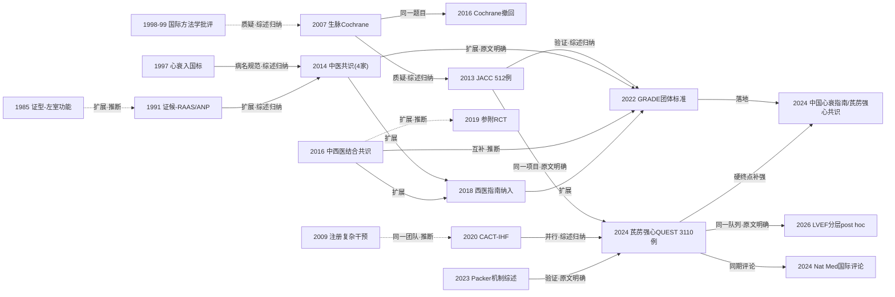

# D03 心衰病：心力衰竭的中医药治疗与中成药循证

> **一句话判断**：心力衰竭的中医药研究自1980年代"证候—客观指标"关联研究和经典方小样本试验起步，分化为证候与指南标准化、中成药注册RCT、中药注射剂三条并行主线。中成药线以芪苈强心胶囊走通了从替代终点RCT（2013年JACC，512例）到硬终点RCT（2024年芪苈强心QUEST，HFrEF，Nature Medicine，3110例，心血管死亡+心衰住院HR 0.78）的路径，但芪苈强心QUEST由企业申办、全因死亡未达统计学显著（P=0.058）、SGLT2i时代的外推性未回答。注射剂与经典方仍以软终点和低质量证据为主；HFpEF硬终点试验与证候-预后连接尚属空白。

## 0 三分钟速读

① **从哪里来**：MEDLINE可核的最早工作是1985年心脏病阴阳虚证型与左室功能关联研究（PMID 3157494，仅题录），1991年65例慢性心衰证型与心房肽/RAAS指标的关联研究把它推进到心衰专项 [D03-N01][D03-N02]；"心衰"一词词源可追至西晋《脉经》"心衰则伏"（本义为脉象描述），1997年作为规范病名写入国标GB/T 16751.1-1997。

② **为什么改变**：1998-1999年国际方法学批评发现MEDLINE收录的中国非针灸对照试验99%阳性、无一项阴性（跨病种、非心衰专项）[PMID 9551280]；2007年生脉Cochrane评价纳入19项试验后给出"可能有益但证据弱"的结论，把“普遍阳性但质量低”的结构性问题摆上台面，推动注册、双盲、安慰剂对照设计登场（本报告推断）[D03-N03]。

③ **如何分化**：证候流调与专家调查汇入2014年中医专家共识（4家单位联合发布）、2016年中西医结合共识、2018年西医指南、2022年GRADE团体标准的标准化序列 [D03-N06][D03-N07][D03-N11][D03-N14]；中成药走"标准治疗加载+安慰剂RCT"注册路线；注射剂走网络Meta并向真实世界队列转移。

④ **现在研究什么**：芪苈强心QUEST硬终点证据的扩散——收缩压亚组、LVEF分层post hoc（效应跨层一致，P interaction=0.28）、成本效果分析、24项RCT 5580例系统评价（检索截止2025-02-24）[D03-N12][D03-N13]；HFpEF新一代安慰剂RCT尚在方案阶段。

⑤ **用了什么数据**：事件驱动RCT（133家医院、3110例随机）、84中心1225例前瞻队列、107项RCT贝叶斯网络Meta、340例PRO量表信效度研究——数据路径从“有效率对照”迁移到“硬终点+真实世界”双轨 [D03-N10][D03-N12]。

⑥ **还有什么不知道**：芪苈强心QUEST全因死亡未达显著（HR 0.84，P=0.058）；SGLT2i背景下联合疗效无人回答（芪苈强心QUEST基线SGLT2i仅9.3%/7.7%）；HFpEF没有任何以死亡/住院为终点的中成药RCT；2009年注册的340例复杂干预试验结果至今未见发表。

**覆盖边界**：纳入——心衰中医病名与病机认识、经典方现代研究、中成药循证（芪苈强心胶囊、芪参益气滴丸、参附注射液、心脉隆注射液、生脉制剂等）、与GDMT联合的试验设计、HFrEF/HFmrEF/HFpEF分层、终点从症状/6分钟步行距离/BNP到死亡与再住院的演进、中医心衰指南与共识、近五年国际期刊RCT与真实世界研究。不含——急性心梗后心衰预防（归D02）、注射剂安全性再评价（归D10）、康复功法（归D09）、心肌病本体（归D07）、证候诊断标准系统梳理（归D11，本章只取心衰直接相关者）。

**本章口径**：报告截止2026-10-17；近期窗口2021-10-17至2026-10-17。阅读层级：L0=仅二手转述；L1=题录已在数据库核实；L2=摘要已读；L3=原文部分章节已读；L4=全文已读。本章节点14个：L1×4、L2×7、L3×3；核查状态12项通过、2项修正（正文一律按修正值书写）；无"删除"项。证据表40行（关键节点类16、入口综述类5、近期代表研究类19）；芪苈强心QUEST主文与2026年post hoc等同一队列的报告以same_cohort_as标注、不重复计数。其中D03-R37/R38（Vickers 1998、Tang 1999）为跨病种背景补充文献，不占节点号、以PMID回查（第二轮修订，见第12节）。覆盖状态（按全报告统一口径，2026-10-17第二轮复评）：**基本完整但有标注缺口**——理由：六个问题均可据本章内容与节点回答；章节范围内主要分支（证候客观化与标准化、中成药注册RCT、注射剂、经典方、真实世界队列、机制解释国际化）均有节点，主链关键转折均有可核来源；缺口限于第8节已标注项（CNKI/万方未检索、部分文献题录级或原文未读、2013 JACC资助明细未核等），不存在主要分支缺节点或主链关键转折缺可核来源的情形。

## 1 源头：最初在研究什么

**词源层【目前最早找到的文献（词源义）】。**"心衰"作为词语的可考出处，目前最早找到的是西晋王叔和《脉经·脾胃部第三》："心衰则伏，肝微则沉，故令脉伏而沉"——本义是脉象描述，与现代心力衰竭不是同一概念（据《山东中医杂志》2022;41(11)引文核对，该文明确以之为"心衰"一词最早出处；《脉经》原书本轮未直接翻检）。宋代《圣济总录·心脏门》（政和年间，卷43）有"心衰則健忘，心熱則多汗"（维基文库原文已核，L3），古义指心之气血衰少所致健忘，是"心衰"一词较早且常被引用的出处之一，但同样非现代义。两条古籍证据均为词源层证据，不得当作疾病实体层面的等同。

**病名规范层【目前最早找到的文献（规范义）】。**"心衰"作为规范中医病名载入国家标准GB/T 16751.1-1997《中医临床诊疗术语·疾病部分》（1997-03-04发布、1997-10-01实施，国家技术监督局发布、国家中医药局主管；该标准现已废止、被新版国标替代）。标准号、名称、日期与主管部门经国家标准全文公开系统元数据核实（L1）；废止标准不提供在线文本，"心衰"条目定义本身仍属二手转述。此前心衰临床表现散见于心悸、喘证、水肿、痰饮等病证名下（据2022指南与共识叙述，L2/L3）。

**证候客观化层【目前最早找到的文献（限MEDLINE范围）】。**1985年《中西医结合杂志》刊出Dong QM的心脏病阴阳虚证型与左室功能关系研究（5(3):148-150,130，PMID 3157494，L1；1980年代中文摘要未数字化，全文在CNKI不可公开获取）。限定语有二：其一，这是"证型—左室功能"这一特定配对在MEDLINE的最早记录；证型与其他生物学指标的配对更早已有先声——1982年冠心病证型与免疫指标（PMID 6305520）、1982年芪附注射液对左室功能的影响（PMID 6219801）、1983年男性冠心病证型与血浆性激素（PMID 6224596），本轮均为题录核实。其二，"目前最早找到"不等于"公认奠基"——1980年代以前中文文献未被MEDLINE收录，更早的工作可能存在。1991年Liu YZ、Guo SP把思路收窄到充血性心衰：65例患者的证型（心气虚→心阴虚→心阳虚传变）与血浆心房肽（pANP）、血管紧张素II（pAII）、醛固酮（pALD）对照，除pALD外，阴虚组pANP/pAII较健康人明显升高（P<0.05-0.001），阳虚组pANP/pALD显著升高（P<0.05-0.005）而pAII较阴虚组明显下降（P<0.05）；pANP与pALD正相关（P<0.005），pAII与pANP/pALD负相关（P<0.001）[D03-N02]（L2）。这使"气虚→阴虚→阳虚"的病机传变第一次（本轮检索范围内）获得可测量的神经内分泌轨迹，成为此后证候流调与证候-预后研究的模板。

**"第一"类说法【作者自称首次】。**芪苈强心胶囊（黄芪、人参、附子、丹参、葶苈子等11味）被研发方称为"我国第一个具有循证医学研究证据、疗效确切的治疗慢性心衰的中药"（中国工程院官网吴以岭专访，2015-01-08，L0转述），并称其为首个基于络病/脉络学说研制的心衰中成药（2024年专家共识摘要，L2）。"有循证证据"可由其率先完成512例安慰剂RCT（2013 JACC）与3110例硬终点RCT（2024年芪苈强心QUEST）部分佐证，但"第一个"始终是自称。SECETCM-HF（毛静远等）被行业媒体称为"中医药治疗心衰的第一个注册研究"——方案与注册号（ChiCTR-TRC-00000059）可核（L2），"第一个注册"仅见媒体转述（L0），未找到独立佐证。2024年芪苈强心QUEST为“中成药首个以心血管死亡+心衰住院复合终点为主要终点的大型RCT”——本轮基于芪苈强心QUEST协议、主文与2013 JACC（NT-proBNP终点）、2020 CACT-IHF（6MWD终点）、2022芪参颗粒191例（NT-proBNP终点）四文主要终点对照做出的推断（限已发表HFrEF中成药RCT；医师报与新华网有此表述，属L0转述），不排除漏网的小样本硬终点试验。

**当时的问题。**心衰在中医文献中长期无独立病名；中西医结合治疗需要回答两个问题：证型差异是否对应可测的生物学差异（证候客观化），经典方剂（真武汤、苓桂术甘汤、葶苈大枣泻肺汤、生脉散、保元汤）与现代标准治疗合用是否获益（疗效验证）。1980-1990年代的中文文献以第二个问题的有效性对照试验为主，但基本停留在小样本、无盲法、有效率终点——这一形态在2007年被Cochrane评价定量呈现（见第2节转折二）。

## 2 关键转折：问题—新证据/新方法—认识变化—新问题

**转折一：证候客观化开题（1985→1991，扩展[推断]）。**问题：证型有无生物学基础。新证据：左室功能（1985）与RAAS/ANP指标（1991）与证型的定量关联 [D03-N01][D03-N02]。认识变化：证型从症状描述变为可测量对象。新问题：证型能否预测预后、能否指导治疗。关系标注：1985→1991为扩展，但属推断——两文同刊、思路同构，1985年文无可查引文线索，本轮亦未找到直接关联证据。

**转折二：国际方法学批评前史与生脉Cochrane的建立与撤回（1998→2007→2016，质疑[综述归纳]＋同一项目[原文明确]）。**问题：中文试验的普遍阳性是否可信。前史：1998年Vickers等系统比较MEDLINE 1966-1995各国对照试验，中国发表的非针灸试验99%阳性、无一项阴性（英格兰75%）[PMID 9551280，L2]；1999年Tang、Zhan、Ernst在BMJ发表中医药RCT总体方法学批评 [BMJ 319(7203):160-161，PMID 10406751，L1；全文本轮未能读取，是否涉及心衰试验未确认]。两文均为跨病种批评、非心衰专项，此处仅作背景。心衰病种内的系统落地：2007年四川大学华西医院团队（Chen J、Wu G、Li S、Yu T、Xie Y、Zhou L、Wang L）发表生脉治疗心衰的Cochrane评价（CD005052.pub2，Issue 4 2007；MEDLINE年份记2008），检索MEDLINE（至2005-05）、EMBASE（至2004-03）、CBM（至2004-04）、CENTRAL（2005年第2期）等并手检17种中文期刊，纳入19项RCT：NYHA改善RR 0.32（0.25-0.40）、死亡率RR 0.25（0.07-0.86）、TNF-α WMD -0.52（-0.99~-0.05）；1项血流动力学试验（100例）有改善；全部试验均未报告不良反应；作者结论“可能有益但证据弱，需长期高质量研究” [D03-N03]（L2）。注意：网络常见的作者名单（Chen J, Yao Y, Chen H, Kwong JS, Chen J）是2012年更新版（pub4，PMID 23152229）与2016年撤回版的团队，并非2007首发版。2011/2012/2014三次更新期间作者团队逐年更替（2011版PMID 21328272；2012版Chen J、Yao Y等，PMID 23152229；2014版Zhou Q等，PMID 24733159）；2016年4月29日Cochrane Heart撤回（withdrawn，流程性停止维护，撤回声明注明原因）该评价（pub6，Issue 4 2016，PMID 27128629），撤回声明原文："Cochrane Heart withdrew this review as the current author team is unable to progress. This review is considered low priority and therefore this review is not open for new authors." [D03-N08]（L3）。撤回原因是编辑流程性的（团队无法推进、低优先级），不是数据造假或结论被推翻——撤回不等于否定2007版"证据弱"的结论本身。认识变化：心衰中成药证据第一次进入国际系统评价框架，其"普遍阳性但质量低"的结构被量化；2016年后该领域失去唯一的Cochrane级整合，证据生产转向国内非Cochrane系统评价与网络Meta。新问题：谁来做下一代的整合与验证。关系标注：1998-99批评→2007评价为质疑（综述归纳）；2007→2016为同一题目的版本链（原文明确）。

**转折三：注册复杂干预框架的建立与结果缺失（2009，同一项目内方法建立；负性记录）。**问题：辨证汤剂+中成药的"复杂干预"如何评价。新方法：SECETCM-HF（毛静远等，9个城市9家中心、340例、中央随机、ChiCTR-TRC-00000059、主要终点心血管死亡、随访12个月）[D03-N04]（L2，方案）。认识变化：心衰中医药第一次有了注册的、以心血管死亡为主要终点的复杂干预评价框架。新问题（至今未解决）：结果论文至本轮检索日在PubMed/Europe PMC不可见，仅行业媒体以会议报道形式转述"症状、6分钟步行距离、生存质量改善，再住院与病死率呈降低趋势"（L0转述）；340例以心血管死亡为主要终点的事件数预期极低，检验效能存疑。这是本方向最明显的证据链断点之一。

**转折四：替代终点RCT范式确立（2013，范式修正[其后综述归纳其与Cochrane的承继关系]）。**问题：中成药疗效能否通过国际同行评议。新证据：李新立等512例多中心、随机、双盲、平行、安慰剂对照RCT，标准治疗基础上芪苈强心胶囊12周：NT-proBNP降幅显著大于安慰剂（p=0.002），下降≥30%者47.95% vs 31.98%（p<0.001），NYHA分级、LVEF、6分钟步行距离、生活质量均优于安慰剂 [D03-N05]（L2，JACC 62(12):1065-1072）。JACC同期配发Cleveland Clinic Tang WHW与Huang Y编者按《Cardiotonic modulation in heart failure》（62:1073-1074，PMID 23747774，L1），标志国际主流期刊开始正面讨论中成药。申办与利益结构（本轮可核范围）：该试验由"芪苈强心胶囊治疗慢性心衰疗效与安全性研究协作组（Efficacy and Safety of Qili Qiangxin Capsules for CHF Study Group）"组织实施；其申办方与资助明细位于付费墙内正文，本轮只读到摘要（L2），未经独立核实——见第8节缺口。认识变化：中成药证据从"19项低质量试验的Meta"升级为"512例双盲安慰剂RCT"，并成为其后2024年芪苈强心QUEST的先导（该试验正文原句“In our pilot study, Qiliqiangxin (QLQX) capsules...”，原文明确）。新问题：NT-proBNP是替代终点，死亡与住院没有回答；试验注册号在可及文本中未见；12周疗程短。关系标注：生脉Cochrane"证据弱"结论与2013设计升级之间是“据后续综述与编者按归纳的背景之一（本报告推断）”，2013原文未自述这一因果，出版先后不等于因果。

**转折五：软硬终点分野（2020，并行扩展）。**问题：同类益气活血中成药按同一范式检验结果如何。新证据：CACT-IHF（毛静远团队）前瞻随机双盲多中心安慰剂RCT，2012-03至2014-08入组640例（分析638例，平均65岁、72%男性）缺血性心衰，芪参益气滴丸或安慰剂加载标准治疗6个月：主要终点6分钟步行距离 336.15±100.84→374.47±103.09 m（+38.32）vs 安慰剂+6.31 m（P<0.001），生活质量MLHFQ积分 -11.78 vs -9.17（P=0.004）；但复合临床事件（全因死亡+心衰急诊治疗/住院）13% vs 17%（P=0.45）与BNP变化（-14.55 vs -12.30 pg/mL，P=0.21）两个硬终点相关指标均为阴性 [D03-N10]（L2）。认识变化：确立"替代终点阳性≠硬终点获益"的证据边界。2024年中国心衰指南引用本文时写下"中西医结合治疗心衰有待开展更多的以死亡率和再住院率为主要终点的研究[83]"（CSC官网原文，指南2024-04-18发布，早于芪苈强心QUEST结果2024-08-02）。关系标注：与2013 JACC为并行扩展（同型设计、不同药物、不同替代终点）；SECETCM-HF→CACT-IHF为同一团队延续（作者名单高度重叠，推断，两文均未自我声明同一项目）。

**转折六：标准化序列（2014/2016/2018/2022，分化→互补→扩展）。**问题：各地证型命名、辨证标准与用药不一，中成药推荐缺乏证据分级。节点：①2014年《慢性心力衰竭中医诊疗专家共识》（中医杂志55(14):1258-1260，DOI 10.13288/j.11-2166/r.2014.14.026）——核查确认由4家联合发布：冠心病中医临床研究联盟、中国中西医结合学会心血管疾病专业委员会、中华中医药学会心病分会、中国医师协会中西医结合医师分会心血管病学专家委员会 [D03-N06]（L1）；共识自述"心衰的中医诊疗至今尚未在业界形成共识，制约了中医药在心衰领域的应用"，确立本虚标实、气虚为本/血瘀为标与气虚血瘀、气阴两虚血瘀、阳气亏虚血瘀三基本证型框架（可兼痰饮；框架内容据2022指南引用核对）。②2016年《慢性心力衰竭中西医结合诊疗专家共识》（中国中西医结合杂志36(2):133-141，PMID 27078985；解读同刊36:142-145，PMID 27078986）把中医辨证嵌入西医诊断与GDMT流程，同期规范心脉隆注射液用药（36:280-284，PMID 27236882）[D03-N07]（L1）；其"虚、瘀、水"三要素概括与2014年三证型框架不一致，反映证候体系分歧（概括内容据网络转述，L0）。③2018年《中国心力衰竭诊断和治疗指南》（中华心血管病杂志46(10):760-789，PMID 30369168）将中医药纳入主流西医指南推荐意见，是标准化线进入西医指南体系的锚点 [D03-N14]（L1题录）。④2022年团体标准T/CACM 1418-2022（2022-11-14发布；中医杂志2023;64(7):743-756，DOI 10.13288/j.11-2166/r.2023.07.016）首次以GRADE分级（A/B/C/D×强/弱推荐）给出全部推荐：芪苈强心胶囊获HFrEF阳气亏虚血瘀证口服中成药A级强推荐（证据引文[90-152]共63条，首条[90]即2013 JACC）、HFpEF汇总表最高1B；真武汤C级强推荐、苓桂术甘汤D级弱推荐；参附注射液、心脉隆注射液C级强推荐，参麦注射液B级强推荐，心宝丸B级弱推荐，参附强心丸C级弱推荐，注射用益气复脉（冻干）B级弱推荐；太极拳/八段锦与三伏贴C级弱推荐；明确HFmrEF证据不足仅参照HFrEF [D03-N11]（L3，PDF全文主要章节已读）。认识变化：心衰中医诊疗从各院经验变为全国统一、分级的规范体系；2024年《中国心力衰竭诊断和治疗指南》（中华心血管病杂志52(3):235-275，PMID 38514328；英文版J Geriatr Cardiol 2025;22(3):277-331，PMID 40351394）设"中医中药治疗"专节，把芪苈强心[84]与芪参益气滴丸[85]证据写入西医指南。局限：2014/2016共识与2022指南均无系统说明的检索截止日；2022指南A级推荐主要依赖单项多中心RCT而非多项高质量试验。

**转折七：硬终点确证与证据扩散（2019注册→2024发表→2026精细化，同一项目[原文明确]）。**问题：加载中成药能否降低死亡与住院。新证据：2024年芪苈强心QUEST（HFrEF，Nat Med；ChiCTR1900021929，2019-03-16注册，计划约3080例/620事件，仅1次期中分析）——中国133家医院，3119例入组/3110例随机（1555/1555，9例无基线后数据），HFrEF（NT-proBNP≥450 pg/ml、LVEF≤40%）1:1随机至芪苈强心胶囊（4粒tid）或安慰剂加载标准治疗，主要分析截止2022-05-24，中位随访18.3个月（IQR 14.3-23.5）：主要复合终点（心血管死亡或首次心衰住院）389例（25.02%）vs 467例（30.03%），HR 0.78（95%CI 0.68-0.90），P<0.001；心衰住院15.63% vs 19.16%（HR 0.76，0.64-0.90，P=0.002）；心血管死亡13.31% vs 15.95%（HR 0.83，0.68-0.996，P=0.045）；全因死亡221/262例，HR 0.84（0.70-1.01），P=0.058未达显著；药物相关不良事件1.35% vs 0.90%；基线三联GDMT 60.5%/61.9%，ARNI 55.9%/57.9%，SGLT2i仅9.3%/7.7%（试验启动早于SGLT2i在中国的心衰适应证获批）[D03-N12]（L3全文XML）。发表口径说明：Packer 2023年EJHF综述转述的"859事件/3119例/中位18.2月"与芪苈强心QUEST正文口径（3110例随机/18.3个月/389 vs 467）并存于不同文献，各有出处（PMID 37877337 vs 39095596）；前者成文于芪苈强心QUEST正式发表（2024-08-02）之前（该综述在线2023-11-14），其数字更可能来自大会报告阶段口径——此为推断、未经独立复核，引用两组数字时须分别注明来源。2026年EJHF发表基线LVEF分层post hoc（与芪苈强心QUEST主文同一3110例队列，不重复计数）：四层（≤25%/n=482、>25-30%/n=692、>30-35%/n=829、>35%/n=1107）HR依次0.91（0.64-1.30）、0.65（0.47-0.89）、0.94（0.71-1.26）、0.71（0.55-0.91），P interaction=0.28（连续变量P=0.45），获益不集中于某一射血分数段；但最重症状层事件率最高（25.4/100患者年 vs 其余三层18.7-19.8）而点估计最弱、CI跨1；结论再次注明SGLT2i使用有限 [D03-N13]（L2）。芪苈强心QUEST局限（原文限制段）：SGLT2i基线使用率极低，SGLT2i时代外推性未知；CRT患者被排除；COVID-19期间部分随访改为远程；亚组提示NYHA II级、缺血性病因、无ARNI者获益更明显的信号；单一中成药固定剂量，不含辨证分层。

**申办方与利益结构（事实陈述，据芪苈强心QUEST全文Funding与Competing interests段，L3，本轮已核）。**芪苈强心QUEST（2024年，HFrEF）申办方为石家庄以岭药业，提供部分经费、芪苈强心胶囊与配套安慰剂，文中声明资助方不参与设计与实施（funders had no role）；试验另获国家重点研发计划（2017YFC1700500）与国家自然科学基金多项资助；主要研究者李新立与贾振华在"络病理论创新转化国家重点实验室"任associate fellows。2013年JACC试验的对应信息在付费墙内未能核实（见第8节）。2024年《慢性心力衰竭芪苈强心临床应用的专家共识》（临床心血管病杂志40(12):947-954，DOI 10.13201/j.issn.1001-1439.2024.12.001）由"中国心力衰竭芪苈强心研究协作组"等制定，推荐表给至Ⅰ类/A级。资源与平台结构的事实是：本方向三条线中，只有中成药线具备"企业申办+全国133家中心网络+国家课题+产业化平台"的组合，注射剂线与经典方线没有同等规模的试验资源；这种结构差异与各线证据等级的差异同时存在，二者的因果关系本章不作断言。截至本轮检索，ESC/AHA心衰指南均未纳入芪苈强心或任何心衰中成药——国内推荐体系完整与国际指南缺位并存（查证：Europe PMC/PubMed指南与评论检索；芪苈强心QUEST引用网络73条引用中无国际指南条目）。

**关系小结**：证候客观化线→共识/指南：扩展（综述归纳）；1998-99批评→Cochrane：质疑（综述归纳）；Cochrane“证据弱”→2013设计升级：质疑推动（本报告推断；综述归纳，原文未自述）；2013→芪苈强心QUEST：同一项目两阶段（原文明确）；2016共识→2019参附RCT：扩展（推断，注射剂规范化在前、循证落地在后）；CACT-IHF→芪苈强心QUEST：并行（综述归纳，2024指南同引两药并呼吁硬终点研究）；芪苈强心QUEST→2026 post hoc：同一队列（原文明确，共用ChiCTR1900021929）。

## 3 分支图

实线=原文明确讨论或综述归纳的关系；虚线=本章推断。图中节点编号为D03-N01至D03-N14；1998-99批评为跨病种背景（非心衰专项）。

## 4 近五年重点（2021-10-17至2026-10-17）

**主题一：芪苈强心QUEST之后的硬终点证据生态（成熟：HFrEF方向；SGLT2i交互与HFpEF外推未成熟）。**研究什么：芪苈强心QUEST亚组精细化、卫生经济学、证据整合与共识固化。常用数据与设计：事件驱动RCT的预设/事后亚组分析、Markov成本效果模型（中国医疗体系视角）、Cochrane RoB 2.0+GRADE系统评价、专家共识推荐级别表。代表研究：JACC: Heart Failure 2025收缩压亚组分析（13(11):102646，PMID 40925129，仅题录，付费墙）；BMC Complementary Medicine and Therapies 2025成本效果分析（25:437，PMID 41366666，题录）；Journal of Ethnopharmacology 2026系统评价（24项RCT、5580例，七数据库，检索截止2025-02-24明确标注）：心血管死亡RR 0.82（0.69-0.96）、心衰住院RR 0.78（0.67-0.91）、复合事件RR 0.82（0.73-0.92），证据质量中等；LVEF +7.14%、6MWD +44.8 m（PMID 41500350，L2）。分歧：全因死亡未达显著（P=0.058）与部分媒体/共识"显著降低心血管终点事件/死亡风险"表述之间的解释张力；芪苈强心QUEST亚组提示NYHA II级、缺血性病因、无ARNI者获益更明显的信号，但均为事后信号；各亚组分析与共识均由国内或企业协作组主导，国际指南未纳入。

**主题二：HFpEF的中医药治疗（发展中：证据整合成熟、硬终点试验早期线索）。**研究什么：症状、运动耐量、舒张功能（E/A、E/e'）与BNP；新一代安慰剂RCT。常用设计：小样本RCT与Meta、叙述性综述（临床证据+网络药理/代谢机制）、多中心双盲安慰剂RCT方案。代表研究：毛静远团队HFpEF中医药临床证据与机制综述（Front Pharmacol 2023;14:1154167，PMID 37234711，L2）；口服中成药HFpEF Meta（Chin J Integr Med 2019;25(10):770-777，PMID 31127505，题录；卷期页经Crossref修正；窗口外，背景/工具）；升陷益心颗粒4家中医医院多中心双盲安慰剂RCT方案（Front Cardiovasc Med 2026;13:1902637，PMID 42661921，L2，试验进行中）；HFpEF经方/成分从基础发现到临床的综述（Front Pharmacol 2026;17:1927962，PMID 42812852，题录）。分歧：2022指南HFpEF推荐多为C/D级（芪苈强心B级为最高），与HFrEF的A级+硬终点RCT形成两个分型间最大证据落差；HFpEF硬终点试验尚未出现。

**主题三：中药注射剂的疗效证据网络Meta化（发展中：证据数量大、质量低，正向队列/注册转移；安全性归D10）。**研究什么：参附、生脉、参麦、心脉隆、益气复脉（冻干）治疗HFrEF的相对疗效排序（有效率SUCRA）与安全性。代表研究：107项RCT贝叶斯网络Meta（检索至2021-08-03，七数据库；Front Pharmacol 12:659707，PMID 34916929，L2）；中文注射剂网络Meta（BMC Complement Altern Med 2018;18:41，PMID 29386000，题录；文章号经DOI修正；窗口外，背景/工具）；心脉隆专病Meta（Front Pharmacol 9:810，PMID 30140225，题录；窗口外，背景/工具）；益气复脉（冻干）216例前瞻队列方案（JMIR Res Protoc 2026;15:e91051，PMID 42413004，L2；背景明言中国指南已推荐但运动耐量证据不足）。分歧：注射剂试验几乎全部以有效率/症状为终点、风险偏倚高，网络Meta的高排序建立在低质量证据上，与安慰剂对照试验仅软终点阳性（2019参附160例：NYHA有效率78.38% vs 61.43%、6MWD +113.00 vs +82.99 m）存在解释落差；注射剂证据再评估已有国际期刊声音——Nature Medicine 2026年刊出中国学者对注射剂循证再评价的观点文章（Chen C、Hou Z，Nat Med 2026;32(2):392-393，PMID 41507575，题录；年份为2026，此前流传的"2024年社论"说法有误）。

**主题四：真实世界与前瞻注册队列（发展中）。**研究什么：中成药在GDMT背景下的长期结局、LVEF分类改善与证候-预后关系。常用设计：多中心前瞻队列+倾向评分匹配、RCT队列二次分析、PRO量表、注册研究。代表研究：84中心1225例缺血性心衰前瞻队列二次分析+1:1倾向评分匹配，评估芪参益气滴丸对LVEF分类改善的纵向作用（Phytomedicine 2025;139:156530，PMID 39978275，L2）；CACT-IHF post-hoc临床结局分析（Drug Des Devel Ther 2025:10163-10174，PMID 41268060，DOI 10.2147/DDDT.S556373，题录）；芪苈强心QUEST团队证候分型与长期结局队列方案（Chinese Medicine 2021;16:103，PMID 34656145，L2；2021-10-16在线发表、早于窗口起点1日；窗口外，背景/工具）；TCM-HF-PRO量表340例多中心信效度验证（中国中西医结合杂志2016;36(3):300-305，PMID 27236886：Cronbach α=0.903、分半信度0.844/0.849、与MLHFQ r=0.726、判别正确率>78.8%，L2；窗口外，背景/工具）。分歧：队列研究的适应证混杂与适应证偏倚（病重者更可能加用中药）；证候工具与硬终点的连接未完成；芪苈强心QUEST主试验固定剂量不含辨证分层，证候队列结果未见发表。

**主题五：机制解释的国际化（早期线索至发展中：临床前繁荣、临床转化未定）。**研究什么：芪苈强心及心衰常用复方的多成分多靶点机制——营养过剩/营养剥夺信号（PI3K/Akt/mTOR/HIF-1α/NRF2与SIRT1/AMPK/PGC-1α/RXRα）、能量代谢、炎症、自噬；多组学与网络药理整合。代表研究：Packer机制综述（EJHF 2023;25(12):2130-2143，PMID 37877337，L2；指出黄芪甲苷、丹参酮IIA、人参皂苷、periplocymarin与SGLT2i机制可能重叠；注意其在线发表2023-11-14早于芪苈强心QUEST正式发表，芪苈强心QUEST数据转述的来源可议）；中成药/汤剂/成分机制全景综述（Acta Pharm Sin B 2023;13(5):1919-1955，PMID 37250151，L2）；多组学研究（Phytomedicine 2025;143:156828，PMID 40378592，题录）；Packer国际评论（Eur Heart J 2024;45:4315-4317，PMID 39288272，题录，付费墙）；芪苈强心QUEST发表当期Nature Medicine配发国际评论《Integrating traditional and modern medicines to treat heart failure》（Tian Z、Zhang S，Nat Med 2024;30(8):2129-2130，PMID 39095598，DOI 10.1038/s41591-024-03135-y，题录核实、评论无摘要、全文付费墙未读）。分歧：Packer标题本身即分歧——芪苈强心是"整体协同治疗"还是"可拆解的药理探针组合"；成分-靶点还原论路径与络病理论整体框架的解释权未统一；机制研究绝大多数为临床前，与临床终点证据的因果链未闭合。

## 5 争议、负性结果与停滞路线

**争议一（SGLT2i联合效应，未解决）。**一方（Packer，EJHF 2023/EHJ 2024）：芪苈强心QUEST获益“见于使用除SGLT2i外的基础药物的患者”，芪苈强心成分与SGLT2i在营养剥夺信号（SIRT1/AMPK/PGC-1α）上机制高度重叠，联合可能无增量甚至拮抗，需专门试验；另一方（芪苈强心QUEST团队）：SGLT2i亚组（基线9.3%/7.7%）事件少、CI过宽，不能推断正负交互，结论应在当时GDMT背景下解读；2026年EJHF分层分析再次承认SGLT2i使用有限。SGLT2i已是HFrEF基石用药，芪苈强心QUEST人群与当前标准治疗脱节；针对性新试验至本轮未见注册或发表。

**争议二（生脉Cochrane撤回的含义，已澄清但常被误读）。**撤回原因为编辑流程性（原文见第2节转折二），不是数据造假或结论被推翻；但撤回后生脉制剂缺乏高质量新试验，证据真空延续——国内团队2020年仍在以中文数据库做生脉注射液系统评价（eCAM，PMID 32655670，检索至2019-09-10；本轮未经独立复核）。撤回版仅获极少量引用（Europe PMC记录2条）。

**争议三（芪苈强心QUEST全因死亡表述，争议中）。**发表数据：全因死亡HR 0.84（0.70-1.01），P=0.058未达显著；心血管死亡HR 0.83（0.68-0.996）刚过显著界。部分媒体与共识宣传采用"降低死亡风险"类表述（新华网2024-08报道与2024芪苈强心共识摘要，L0/L2）；2026年Meta亦只能给出心血管死亡RR 0.82（0.69-0.96）的中等质量证据。复合终点本身稳健（P<0.001），死亡终点的表述存在过度解读风险。

**争议四（利益结构与推荐强度，观察中）。**事实层面：芪苈强心QUEST申办方为以岭药业、主要作者在络病理论国家重点实验室任职（芪苈强心QUEST全文L3，见第2节）；2013 JACC由企业相关研究协作组组织实施（资助明细未核）；2024芪苈强心共识由药企深度参与的协作组制定并给至Ⅰ类/A级；2022指南A级推荐主要依赖单项多中心RCT（2013 JACC，引文[90]）而非多项高质量试验；ESC/HFA与AHA/ACC/HFSA心衰指南均未纳入。判断层面：国内推荐体系完整与国际接受度停留在顶刊论文、编者按与个人综述层面，内外双轨并存；据此评估A级推荐的证据基础时，申办结构与证据数量两个因素都应计入，本节不给出倾向性结论。

**争议五（证候体系不统一与复杂干预可评价性，发展中）。**2014共识三基本证型 vs 2016共识"虚、瘀、水"；SECETCM-HF复杂干预框架结果未发表；芪苈强心QUEST固定复方固定剂量不含辨证分层，与其辨证论治的理论基础存在张力（芪苈强心QUEST团队另立证候队列回应，方案2021年发表、结果未见发表）；证候-预后连接（TCM-HF-PRO、2021队列）尚无已发表的硬终点结果。

**负性结果与停滞路线。**①国际系统评价路线中断：生脉Cochrane 2007首发、三次更新、2016撤回，心衰中成药自此无Cochrane级证据整合。②SECETCM-HF（340例、CV死亡终点、2009注册）结果未发表，复杂干预路线证据链中断。③CACT-IHF硬终点阴性：复合临床事件13% vs 17%（P=0.45）、BNP（P=0.21），仅软终点阳性。④芪苈强心QUEST全因死亡未达显著（P=0.058）。⑤经典方循证升级停滞：真武汤2022指南仅C级强推荐、苓桂术甘汤仅D级弱推荐，无多中心安慰剂RCT；2016年加味真武汤Meta（PMID 28925168，题录）与2018年系统评价方案（PMID 30024553，题录）均停留在低质量层级——该线证据生产明显落后于中成药线。⑥国际指南采纳缺位：截至本轮未查到ESC/AHA指南纳入任何心衰中成药的记录；国际接受度停留在顶刊论文与评论层面。

## 6 传承线与国际线

**传承线一：病名与证候客观化线。**《脉经》"心衰则伏"（词源，西晋）→《圣济总录·心脏门》"心衰則健忘"（词源，宋，常被引用的后出出处）→"心衰"入国标GB/T 16751.1-1997（1997）→1985年证型-左室功能研究（Dong QM）→1991年65例证候-神经内分泌研究（Liu YZ、Guo SP）→2008-2013年多项证候流调、用药规律文献研究与专家调查（据2014共识引文列表转引；其中一项404例证候流调本轮在MEDLINE检出0条、未能独立定位，见第8节待核线索）→2014年共识（毛静远、朱明军牵头，4家联合发布）→2016年中西医结合共识→2018年西医指南纳入→2022年团体标准T/CACM 1418-2022（GRADE化）。配套工具：TCM-HF-PRO量表（2016，340例信效度）；芪苈强心QUEST团队证候队列方案（2021）。另：北京中医药大学东直门医院郭维琴以心衰合剂、心肾同治辨治中晚期心衰的经验总结见《北京中医药》2023;42(9):1001-1003（DOI 10.16025/j.1674-1307.2023.09.015，L2），属经验传承而非试验证据。

**传承线二：中成药循证线。**吴以岭（河北以岭医院/以岭药业，络病理论体系）以络病理论指导研发芪苈强心胶囊（11味，益气通络、活血利水；获批年份未核实（约2004年说与2008-2010年说并存，批件号未在监管数据库核实））→2007-2012年全国多家医院小样本观察（2022指南引文[91]-[152]；最早一条据该指南引文列表为2007年《疑难病杂志》42例报告）→李新立（南京医科大学第一附属医院）2013年JACC 512例试验（作者含Zhang J、Huang J、Yao C等）→2024年芪苈强心QUEST（HFrEF，Nat Med；2019注册、2024发表；申办方以岭药业；李新立、贾振华在络病理论创新转化国家重点实验室任职——事实陈述，据芪苈强心QUEST全文）→2024年芪苈强心临床应用专家共识与2024年中国心衰指南"中医中药治疗"专节。并行支线：毛静远（天津中医药大学第一附属医院）团队SECETCM-HF（2009注册）→CACT-IHF（2020）→芪参益气84中心1225例前瞻队列（2025）。

**传承线三：注射剂线。**参附注射液1987年上市（据2019年RCT背景原文自述）→2019年160例安慰剂RCT（限定阳气虚证、急性加重期；毛静远团队参与署名）→2022指南C级强推荐。心脉隆注射液（美洲大蠊提取物）2016年获专门用药共识（中国中西医结合杂志36:280-284，PMID 27236882）→2022指南C级强推荐。生脉制剂：2007年Cochrane评价及其2016年撤回（见第2节）。益气复脉（冻干）2026年进入216例前瞻队列阶段。注射剂证据整体停留在软终点，评价设计正转向真实世界队列。

**传承线四：经典方线（停滞）。**真武汤、苓桂术甘汤的现代研究以动物实验与小样本中文RCT为主，未走通多中心安慰剂RCT路线，2022指南分别仅获C级强推荐与D级弱推荐——与中成药线的资源结构差异同时存在（事实并列，不作因果断言）。

**国际线。**前史（跨病种、非心衰专项）：1998年Vickers等发现中国非针灸对照试验99%阳性、无阴性（Control Clin Trials 19(2):159-166，PMID 9551280，L2）；1999年Tang、Zhan、Ernst在BMJ发表中医药RCT方法学批评（319(7203):160-161，PMID 10406751，L1）。心衰病种落地：2007年华西团队生脉Cochrane评价（建立→2016撤回；作者团队随更新更替，撤回声明L3），这是心衰中成药唯一进入Cochrane体系的案例。证据底盘点：2010年Heart Asia发表中意联合实验室研究（Fu S等，含Ferrelli R、Guerra R、Hu L等），系统调查CNKI 1994-2007年1029篇心衰中药临床论文、提取239味药，最常用为黄芪、茯苓、丹参、附子、葶苈子（PMID 27325938，L2）——国际团队对中文证据底的首次系统盘点。期刊与学者：2013年JACC配发Cleveland Clinic编者按（PMID 23747774，L1）；2023-2024年Milton Packer在EJHF与EHJ连续发表芪苈强心机制综述与评论（PMID 37877337，L2；39288272，L1）；2024年芪苈强心QUEST发表于Nature Medicine，共同资深作者含哈佛医学院Rosenzweig A（据论文作者列表，L3），同期刊发Tian、Zhang国际评论（PMID 39095598，L1）；2025年JACC: Heart Failure收缩压亚组、2026年EJHF分层post hoc延续扩散；2024年中国心衰指南英文版发表于J Geriatr Cardiol（PMID 40351394）。监管与验证：本轮未查到任何针对心衰中成药的海外独立RCT或FDA/EMA审评记录；未发现芪苈强心QUEST-2或海外重复试验的注册信息；ESC/AHA心衰指南均未纳入芪苈强心或任何心衰中成药。

## 7 数据路径小结

**历史上**：①中文小样本有效率对照（1990s-2010s主力路径，《中西医结合杂志》《中国中西医结合杂志》等刊载，MEDLINE收录其中文英文题录；Cochrane 2007纳入的19项试验与其"证据弱"结论是该路径的量化画像；无盲法、小样本、软终点）。②证候流调与证候-生物学标志关联（65例1991→多项2008-2013流调[据2014共识引文列表转引]→84中心1225例前瞻队列2025；配套PRO量表开发）。③注册RCT与安慰剂对照升级（2013 JACC 512例NT-proBNP终点、未见注册号；SECETCM-HF 340例CV死亡终点[结果未发表]；CACT-IHF 640例6MWD终点；参附160例证型限定+安慰剂；芪苈强心QUEST 3110例事件驱动，注册终点与发表主要终点核对一致——注册号核对是2019年后试验的标准化动作）。

**现在**：④系统评价与网络Meta（Cochrane已撤回；107项RCT注射剂贝叶斯NMA 2021；24项RCT 5580例Meta 2026，检索截止2025-02-24；多部系统评价停留在方案阶段）。⑤临床前机制（芪苈强心在压力负荷/心梗模型、代谢组、hiPSC-CM等平台上的系列研究与Packer式跨研究机制综合；其中2025年多组学研究PMID 40378592为近年代表；更早期临床前文献的材料内题录不全，见第8节）。⑥真实世界与登记队列（84中心1225例二次分析、216例益气复脉队列方案、CACT-IHF post-hoc、证候长期结局队列方案）。⑦卫生经济学与政策（2025年中国视角成本效果分析；指南/共识的推荐级别与证据级别双表制）。⑧指南/共识文献体系（2014共识→2016中西医结合共识→2018/2024西医指南→2022团体标准，构成国内证据汇流的制度性管道，2024指南英文版进入国际期刊）。

分析单位：患者（按随机分组/证型亚组/前瞻队列）、研究（系统评价）、推荐条目（指南：证型×心衰分型×剂型三维矩阵）。

## 8 还不知道什么（领域证据缺口）与本报告的检索缺口

**领域证据缺口**：①HFpEF没有任何以死亡/住院为终点的中成药RCT（2022指南HFpEF推荐多为C/D级；升陷益心颗粒等新一代RCT尚在方案阶段，PMID 42661921）。②SGLT2i背景下的芪苈强心联合疗效无人回答（芪苈强心QUEST基线SGLT2i仅约9%；机制重叠假说待检验，至本轮未见针对性试验注册或发表）。③SECETCM-HF（340例、CV死亡终点、2009注册）结果未发表，复杂干预路线的证据链中断。④经典方（真武汤、苓桂术甘汤、葶苈大枣泻肺汤、保元汤）无高质量安慰剂RCT。⑤芪苈强心QUEST证候分型队列（2021方案，PMID 34656145）结果未见发表，证候-硬终点连接缺席——证候与疗效的关系是中医理论的核心主张，该数据至今缺席。⑥2013年JACC奠基试验的申办方与资助明细未能在公开摘要层面核实（全文付费墙，本轮L2）——本方向两个奠基RCT中仅芪苈强心QUEST的利益结构经全文核实，2013年试验的资助来源仍是空白，评估A级推荐的证据基础时应把这一点计入。

**本报告检索缺口（含CNKI/万方未检索的影响）**：本章未检索CNKI与万方全文库，影响有三。其一，1980-1990年代中文原始研究（如1985年证型-左室功能研究）只能到MEDLINE题录（L1），样本量与方法细节缺失，起点描述的精度受限。其二，2014共识、2016共识等中文共识全文不可公开获取，其辨证框架内容只能经2022指南引用间接核对，2014共识全文仅得题录与摘要（L1）。其三，SECETCM-HF结果论文、404例证候流调等中文结果可能存在于CNKI或会议论文而公开英文库不可见——本章"结果未发表"的判断限于英文数据库与公开网络，不是对中文文献存在性的否定。其他检索缺口：芪苈强心胶囊获批年份与批件号未在监管数据库核实（两说并存）；GB/T 16751.1-1997为废止标准、原文不可在线阅读，"心衰"条目定义仍是转述；芪苈强心QUEST在ESC大会报告的具体时间两说未核（2023年/2024年，媒体表述互相矛盾；论文收稿2023-11-28、接收2024-07-01可核）。

**待核线索（无可定位来源，未进入正文叙事）**：邹旭等404例慢性心衰中医证候规律调查（2011，中文期刊，刊名待定；以作者+主题、题名两条路径检索Europe PMC/PubMed均0命中，现仅据2014共识引文列表转引）；《"心衰"作为心力衰竭的中医病名探究》（中医杂志2013;54(10):891-892，作者与内容未核对）；参草通脉颗粒多中心随机双盲平行对照研究（中国中西医结合杂志2012;32(5):612-615，仅见共识引文转引）；国家中医药管理局《心衰病（慢性心力衰竭）中医诊疗方案》及中医临床路径（版本与年份未核）；中国中西医结合学会心血管病专业委员会心衰学组（未查到设立文献）；心宝丸、参附强心丸、保元汤、葶苈大枣泻肺汤的原始RCT（2022指南列有推荐但原始试验未逐一落位）；2013 JACC作者Huang J与芪苈强心QUEST作者Jia Z的身份对应（据姓名与团队背景推断，未经机构署名页核对）；芪苈强心临床前机制早期系列文献（材料仅给出期刊+年份，未附PMID/卷页，未逐一核实）。

## 9 本章节点速查表

| 编号 | 年份 | 第一作者+题名简写 | 期刊 | 节点作用 | 设计/数据/分析单位 | 样本 | 关键结果 | 层级 | 核查 | PMID/DOI |
|---|---|---|---|---|---|---|---|---|---|---|
| N01 | 1985 | Dong QM 心脏病阴阳虚证型与左室功能 | 中西医结合杂志 | 开题：证候客观化 | 临床证型×左室功能／患者按证型分组 | 未核（题录无样本数） | 阴阳虚证型与左室功能表现存在关联（题录级） | L1 | 通过 | 3157494 |
| N02 | 1991 | Liu YZ 充血性心衰患者的中医证候 | 中西医结合杂志 | 建方法：证候-神经内分泌范式 | 横断面对照／患者按证型分组 | 65例 | 心气虚为主因；阴虚/阳虚组pANP、pAII、pALD差异显著 | L2 | 通过 | 1833081 |
| N03 | 2007 | Chen J（华西团队） Shengmai for heart failure | Cochrane Database Syst Rev | 建方法＋初验：国际整合 | SR：19项RCT固定效应合并／研究与患者 | 19项RCT | NYHA RR 0.32；死亡率RR 0.25；结论"可能有益但证据弱" | L2 | 修正（作者、期号） | 17943836／10.1002/14651858.CD005052.pub2 |
| N04 | 2009 | Mao J SECETCM-HF方案 | Trials | 建方法：注册复杂干预框架 | 9中心中央随机方案／患者 | 340例（计划） | 方案发表；结果论文未见（媒体转述软终点优势） | L2 | 通过 | 20030859／10.1186/1745-6215-10-122 |
| N05 | 2013 | Li X 芪苈强心胶囊512例 | JACC | 改认识：替代终点RCT范式 | 多中心双盲安慰剂RCT／患者 | 512例（随机） | NT-proBNP p=0.002；≥30%下降47.95% vs 31.98% | L2 | 通过 | 23747768／10.1016/j.jacc.2013.05.035 |
| N06 | 2014 | 毛静远/朱明军 慢性心衰中医诊疗专家共识 | 中医杂志 | 形成分支：全国统一辨证框架 | 4家联合专家共识／推荐意见 | 基本证型3个 | 三基本证型框架；被2018/2022指南继承 | L1 | 修正（4家联合发布） | DOI 10.13288/j.11-2166/r.2014.14.026 |
| N07 | 2016 | （学会共识）慢性心衰中西医结合诊疗共识 | 中国中西医结合杂志 | 扩展：中西医结合双轨 | 共识+解读+心脉隆用药共识／推荐意见 | 3份文件 | 辨证嵌入西医诊疗与GDMT；注射剂规范化 | L1 | 通过 | 27078985 |
| N08 | 2016 | Chen J等 WITHDRAWN: Shengmai | Cochrane Database Syst Rev | 反证：证据生命周期事件 | 撤回声明／系统评价 | — | 撤回原因=团队无法推进/低优先级（编辑流程性） | L3 | 通过 | 27128629／10.1002/14651858.CD005052.pub6 |
| N09 | 2019 | Wang X 参附注射液安慰剂RCT | Evid Based Complement Alternat Med | 验证＋划界：注射剂首证 | 多中心双盲安慰剂RCT／阳气虚证患者 | 160例 | NYHA有效率78.38% vs 61.43%；6MWD +113.00 vs +82.99 m | L2 | 通过 | 30930952／10.1155/2019/9297163 |
| N10 | 2020 | Mao J CACT-IHF 芪参益气滴丸 | ESC Heart Failure | 验证＋边界：软硬终点分野 | 双盲安慰剂RCT／患者 | 640随机/638分析 | 6MWD +38.32 vs +6.31 m（P<0.001）；复合事件P=0.45（阴性） | L2 | 通过 | 32954647／10.1002/ehf2.12980 |
| N11 | 2022 | 中华中医药学会项目组 心衰中医诊疗指南 | 中医杂志（T/CACM 1418-2022） | 改认识：GRADE化团体标准 | 团体标准／证型×分型×剂型推荐条目 | 引文约264条 | 芪苈强心HFrEF A级强推荐；真武汤C级、苓桂术甘汤D级 | L3 | 通过 | DOI 10.13288/j.11-2166/r.2023.07.016 |
| N12 | 2024 | Cheang I 芪苈强心QUEST（HFrEF） | Nature Medicine | 改认识：硬终点确证 | 事件驱动双盲安慰剂RCT／患者 | 3119入组/3110随机（133家医院） | 复合终点HR 0.78（0.68-0.90）；全因死亡P=0.058；申办方以岭药业 | L3 | 通过 | 39095596／10.1038/s41591-024-03169-2 |
| N13 | 2026 | （芪苈强心QUEST团队）基线LVEF分层post hoc | European Journal of Heart Failure | 划界：post hoc分层 | 芪苈强心QUEST post hoc／患者按LVEF四层 | 3110（同N12队列，不重复计数） | 四层HR 0.91/0.65/0.94/0.71；P interaction=0.28 | L2 | 通过 | 41771073／10.1093/ejhf/xuaf017 |
| N14 | 2018 | 中华心血管病杂志编委会等 心衰诊断和治疗指南2018 | 中华心血管病杂志 | 锚点：西医指南纳入中医药 | 指南／推荐意见 | — | 中医药推荐进入主流西医指南体系 | L1 | 通过 | 30369168 |

## 10 本章入口文献与检索截止

- **D03-E01** 中华中医药学会慢性心力衰竭中医诊疗指南项目组. 慢性心力衰竭中医诊疗指南（2022年）. 中医杂志 2023;64(7):743-756. 团体标准T/CACM 1418-2022（2022-11-14发布）. DOI 10.13288/j.11-2166/r.2023.07.016. 文中检索截止：未说明（方法节仅称检索RCT与Meta等高质量文献）。阅读层级L3（PDF全文主要章节）。
- **D03-E02** 毛静远, 朱明军等（4家联合发布）. 慢性心力衰竭中医诊疗专家共识. 中医杂志 2014;55(14):1258-1260. DOI 10.13288/j.11-2166/r.2014.14.026. 共识类文件，无检索截止。L1。
- **D03-E03** 慢性心力衰竭中西医结合诊疗专家共识. 中国中西医结合杂志 2016;36(2):133-141（解读36:142-145，PMID 27078986；心脉隆用药共识36:280-284，PMID 27236882）. PMID 27078985。共识类，无检索截止。L1。
- **D03-E04** Chen J, Wu G, Li S, Yu T, Xie Y, Zhou L, Wang L. Shengmai (a traditional Chinese herbal medicine) for heart failure. Cochrane Database Syst Rev 2007, Issue 4: CD005052.pub2. 检索截止：MEDLINE至2005-05、EMBASE至2004-03、CBM至2004-04、CENTRAL 2005年第2期、AMED/DARE/BIOSIS，并手检17种中文期刊。PMID 17943836. DOI 10.1002/14651858.CD005052.pub2。L2；2016撤回版（Chen J, Yao Y, Chen H, Kwong JS, Chen J，PMID 27128629）撤回声明L3。
- **D03-E05** Packer M. Qiliqiangxin: A multifaceted holistic treatment for heart failure or a pharmacological probe? Eur J Heart Fail 2023;25(12):2130-2143. PMID 37877337. DOI 10.1002/ejhf.3068. 叙述性综述，无检索截止。L2。注意：在线发表（2023-11-14）早于芪苈强心QUEST正式发表（2024-08-02）。
- **D03-E06** Guo L, Yang Z, Feng W, et al. Clinical evidence and potential mechanisms of TCM for refractory heart failure. Front Cardiovasc Med 2024;11:1369642. PMID 38716483. DOI 10.3389/fcvm.2024.1369642. 叙述性综述。L2。
- **D03-E07** Mao J, Hou Y, Shang H, et al. QUEST study protocol（芪苈强心QUEST方案）. BMC Complement Med Ther 2020;20:38. PMID 32024496. DOI 10.1186/s12906-020-2821-0. 方案类（ChiCTR1900021929，2019-03-16注册）。L2。
- **D03-E08** Chen J, Wei X, Zhang Q, et al. The traditional Chinese medicines treat chronic heart failure and their main bioactive constituents and mechanisms. Acta Pharm Sin B 2023;13(5):1919-1955. PMID 37250151. DOI 10.1016/j.apsb.2023.02.005. 叙述性综述。L2。
- **另用入口** 中国心力衰竭诊断和治疗指南2024（中华心血管病杂志52(3):235-275，PMID 38514328；英文版J Geriatr Cardiol 2025;22(3):277-331，PMID 40351394；"中医中药治疗"节原文经中华医学会心血管病学分会官网核对，L3）；芪苈强心QUEST全文XML（HFrEF，Nat Med 2024；Europe PMC PMC11333273，L3：方法、基线、亚组、Funding与Competing interests段）。

**本章检索截止：2026-10-17。**各入口文献自身的检索截止如上列；近五年代表研究覆盖至2026年当期文献（2026年芪苈强心系统评价的文献检索截止为2025-02-24）。

## 12 复核修订记录（2026-10-17）

以下六条为全报告复核后的修订，来源按证据抽查/跨章一致性/跨章关系/机械质检标注；连带同步了一句话判断、第0节速读、第9节速查表、第3节分支图与证据表对应行（D03-R12/R13/R15/R17/R20/R21/R22/R39/R40）。

1. 跨章一致性（芪苈强心获批年份）｜第6节传承线二｜改前"获批年份两说——约2004年与2008-2010年前后，批件号本轮未在监管数据库核实"→改后"获批年份未核实（约2004年说与2008-2010年说并存，批件号未在监管数据库核实）"，与X01底账口径统一，两说均不作裁定。
2. 跨章一致性（生脉Cochrane作者谱系与停止维护用语）｜第2节转折二｜改前三次更新仅列PMID未落到作者→改后补全"2012版Chen J、Yao Y等（PMID 23152229）；2014版Zhou Q等（PMID 24733159）"，2007首版Chen J华西团队（PMID 17943836）口径保持不变；2016年停止维护统一写"撤回（withdrawn，流程性停止维护，撤回声明注明原因）"，本章与证据表全程无"撤稿"用词。
3. 跨章一致性（PMID 41507575年份比对）｜第4节主题三与证据表D03-R40｜Nat Med注射剂评论发表年经Europe PMC再核为2026（刊出日2026-02-01，Nat Med 32(2):392-393），证据表year字段保持2026（发表年）；评论无摘要、正文未读，所评述再评价事件的年份跨度不写入year字段、只在key_result注明口径；正文保留"此前流传的'2024年社论'说法有误"的纠错注。
4. 跨章关系（硬终点试验动因的归因层级）｜第0节速读②、第2节转折四关系标注与关系小结｜改前"推动注册、双盲、安慰剂对照设计登场""质疑推动（综述归纳，原文未自述）"→改后统一加"本报告推断"限定，明确批评/Cochrane→硬终点试验设计的因果归因是本章推断而非原文自述。
5. 跨章关系（同名QUEST指称）｜全章QUEST提法（一句话判断、速读、第1至8节、第9节速查表N12/N13、第3节分支图N12、第10节另用入口）｜改前裸名"QUEST"→改后首次出现写全称"2024年芪苈强心QUEST（HFrEF，Nat Med）"，其余各处一律带药名"芪苈强心QUEST"，与2019年清心解瘀颗粒QUEST（稳定性冠心病，Complement Ther Med）明确区分；文献官方英文题名内出现的QUEST不改。
6. 机械质检（引用节点格式）｜正文全部引用节点｜改前存在斜杠并列（如D03-N01与N02共括）、逗号连写层级（如D03-N02与L2共括）、箭头连写（D03-N01→N02）与图注范围简写（D03-N01–N14）等复合写法→改后正文引用一律写成单个方括号的[D03-Nxx]形式，阅读层级与说明移到括号外（如"[D03-N12]（L3全文XML）"），图注改为文字"图中节点编号为D03-N01至D03-N14"；全部被引编号（D03-N01至N08、N10至N14）逐一对回证据表node_id，无悬空引用、无缺失编号。

### 第二轮（完整性检查，2026-10-17）

依据 data/qa_completeness.json 中 id="D03" 的 top_issues（2条，均为"建议改"）。本轮为标注类修订，未做新增文献检索，未新增清单以外的文献或数字；正文引用节点保持单个 [D03-Nxx] 形式；检索缺口无变化，仍见第8节。

1. 建议改（证据表node_id撞号）｜evidence_D03.json D03-R37、D03-R38｜改前Vickers 1998与Tang 1999两行node_id均为"D03-N03"，与2007年生脉Cochrane（D03-R03）撞号，按node_id回查会命中三条不同文献→改后两行node_id置空，同R16/R18/R19/R23-R30/R35/R36/R40等补充行处理；"关键节点（补充文献）"的角色定位与跨病种背景属性不变。两文在正文本就以PMID/题录引用（[PMID 9551280]、[PMID 10406751]），分支图中"1998-99国际方法学批评"保持无编号背景节点；本章节点计数（14个）与第9节速查表不受影响，首轮第6条"正文被引编号（N01-N08、N10-N14）逐一对回node_id"的结论仍成立。

2. 建议改（窗口外代表研究未标）｜第4节主题二/主题三/主题四｜对列为主题"代表研究"的窗口外条目加"窗口外，背景/工具"标注：2019年HFpEF口服中成药Meta（PMID 31127505）、2018年BMC注射剂网络Meta（PMID 29386000）、2016年TCM-HF-PRO量表（PMID 27236886）。连带2处：同句同类的2018年心脉隆专病Meta（PMID 30140225）一并加注；主题四的芪苈强心QUEST证候队列方案经Europe PMC核实在线发表日为2021-10-16（PMID 34656145），早于窗口起点2021-10-17一天，加注"窗口外"并注明日期。证据表对应行D03-R24/R28/R29/R33/R34的role字段同步加注（R33的limitations补记发表日期）。窗口内研究领衔位置不变（主题三领衔的107项RCT网络Meta经核实在线发表2021-11-30，属窗口内，不加注）。

3. 覆盖状态复评（统一口径）｜本章口径｜评定为"基本完整但有标注缺口"。理由：六个问题（从哪里来、为什么改变、如何分化、现在研究什么、用了什么数据、还有什么不知道）均可据本章内容与节点回答；章节范围内主要分支——证候客观化与标准化、中成药注册RCT、注射剂、经典方、真实世界队列、机制解释国际化——均有节点（N01-N14），主链关键转折均有可核来源；缺口限于第8节已标注项（CNKI/万方未检索、GB/T 16751.1-1997废止标准原文不可在线读、部分文献题录级或原文未读、2013 JACC资助明细未核），以及本章如实记录的领域缺口（SECETCM-HF结果未发表、HFpEF硬终点RCT空白等，属"还有什么不知道"的回答内容而非章节覆盖缺陷）。不存在主要分支缺节点或主链关键转折缺可核来源的情形，与完整性检查"可在标注缺口前提下称完整"的结论一致。
