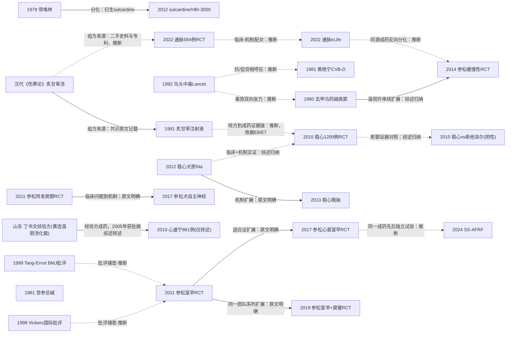

# D04 心悸：心律失常的中成药与经方治疗

> 心悸（心律失常）的中医治疗以《伤寒论》炙甘草汤为公认经典起点，1980年代分化出病窦温阳、中药单体化学药与经验方成药多条支线。2011–2024年，稳心颗粒、参松养心两个成药平台以多中心双盲RCT把证据层级逐步上移，同期仍存在大量方法学质量低的小样本试验；2024年SS-AFRF试验登上Eur Heart J是国际认可的转折点。对临床医生最重要的一点：室性早搏适应证有双盲大试验支撑，房颤与缓慢性心律失常的证据仍弱。

## 0 三分钟速读

① **从哪里来**：经典起点是《伤寒论》炙甘草汤"伤寒脉结代、心动悸"（据2017年《中华医学杂志》稳心颗粒专家共识英文引文转述，共识全文本轮已核，[D04-E6]）；现代可核最早题录为1979年常咯林药效学报告、1980年去甲乌药碱治心动过缓、1981年苦参总碱与黄杨宁实验研究、1991年炙甘草注射液动物实验（[D04-N03][D04-N02][D04-N16][D04-N17][D04-N01]）。

② **为什么改变**：1992年Lancet报告香港17例乌头类药材中毒、2例死亡，把"中药致心律失常"确立为独立临床实体[D04-N04]；中成药自此必须同时回答疗效与安全性，2011年起参松养心、稳心颗粒相继完成多中心双盲RCT（[D04-N05][D04-N10]）；更早的1998–1999年，国际方法学批评已指出中文对照试验"几乎全阳性"（跨病种，[D04-N22][D04-N23]，见第6节国际线）。

③ **如何分化**：同出炙甘草汤系的成药分化为"升率"（参松养心治缓慢性心律失常）与"减率"（通脉养心减慢窦房结起搏）两支（[D04-N09][D04-N14]，分化关系为本报告推断）；常咯林、苦参、黄杨宁走"中药单体→化学药"支线，与复方中成药路线并行。

④ **现在研究什么**：房颤消融后复发预防（SS-AFRF 920例，12月复发HR 0.6，[D04-N15]）；稳心颗粒成分拆解（2025年鉴定月桂酸为NaV1.5阻断成分，PMID 39807341）；炙甘草汤系物质基础（Q-marker）；病窦新一代小样本RCT（灵宝护心丹、通阳复脉方）。

⑤ **用了什么数据**：从动物模型+24h Holter计数，到多中心双盲安慰剂对照RCT+ChiCTR/NCT注册，再到SR总览+GRADE与安慰剂报告横断面审计；参松养心与稳心颗粒在ClinicalTrials.gov合计仅3项注册（NCT01612260、NCT01750775、NCT02319603），全部为中国中心。

⑥ **还有什么不知道**：无中国以外人群的重复试验，死亡/卒中等硬终点未验证；1980年代中文原始研究全文不可得（本章CNKI/万方未检索），苦参等早期线只能核到题录层。

**覆盖边界**：纳入心悸/怔忡病机、炙甘草汤及经方现代研究、参松养心与稳心颗粒临床与机制研究、缓慢性心律失常/病窦中医药、乌头类安全、相关指南共识。不含：心衰总论（D03，仅心衰合并室早试验为交叉点）、机制一般论述与网络药理（D12）、中药注射剂临床应用（D10）、证候客观化主线（D11）、针灸治疗心律失常（方向地图无对应条目，本轮排除，相关SR见PMID 36569126/28642714）。

**本章口径**：执行/检索截止2026-10-17；近期窗口2021-10-17至2026-10-17。阅读层级：L0=仅二手转述，L1=题录核实，L2=摘要已读，L3=原文部分章节已读，L4=全文已读。本章节点23个：L3×3（N10、N11、N15）、L2×13、L1×7；其中N16–N20共5个节点为上一轮合并时补充新增，N21–N23共3个节点为完整性检查轮补入（N21补化学单体线sulcardine当代延伸，N22/N23补1998–1999国际方法学批评前史；均为附PMID/DOI的可核条目，题录经Europe PMC核对）。核查状态：通过15、修正6（N01、N02、N03、N04、N11、N13，均按修正值改写）、存疑2（N19、N20）。**覆盖状态：基本完整但有标注缺口**——六个问题均可据本章回答；范围内主要分支（经方实验线、中药单体化学药线、病窦温阳线、参松养心/稳心颗粒成药双线、乌头安全线、国际线）均有节点，且国际线已含1998–1999跨病种方法学批评前史；余下缺口限于CNKI/万方未检索、部分早期中文全文不可得、个别二手转述未仲裁等，均已在第8节标注，不影响任一主要分支的节点覆盖。

## 1 源头：最初在研究什么

**经典起点（被公认的奠基工作）**：汉代《伤寒论》炙甘草汤主治"伤寒脉结代、心动悸"，稳心颗粒、通脉养心丸、养心定悸胶囊等成药组方均追溯至此方。原始典籍为汉代文献，无法经本轮数据库核对原文；据2017年《中华医学杂志》稳心颗粒专家共识英文引文转述（该共识全文本轮已核，[D04-E6]）。

**本轮可核最早的现代题录（"最早找到"≠"公认奠基"）**，按支线分列：
- **中药单体化学药线**：常咯林（抗疟药常山乙素结构改造产物）。PubMed/Europe PMC可核最早题录为1979年《Scientia Sinica》22:1220-1228（常咯林化学结构、四步合成、抗乌头碱/哇巴因致心律失常、提高室颤阈值，PMID 515728），同年另有《药学学报》14:710-714心血管作用报告（PMID 554432）；1983–1987年《中国药理学报》进入临床药理与电生理阶段（静滴对心律失常患者心功能的影响，PMID 6230869；与烟酰胺合用，PMID 6239508；血药浓度与心功能，PMID 2959017）[D04-N03]。同期并列的还有两条单体线：苦参线——1981年汉防己碱与苦参总碱抗心律失常实验（Zhongguo Yao Li Xue Bao 1981;2:26-28，PMID 6461195）、1983年苦参总黄酮对培养心肌细胞作用（PMID 6223495）、1986年Am J Chin Med英文报告（14:119-123，PMID 3799527）、1990年苦参碱抗心律失常（PMID 2088002）[D04-N16]；黄杨宁线——环常绿黄杨碱D（cyclovirobuxine D，CVB-D）1981年即有"抗心律失常与致心律失常双相作用"实验分析（Zhongguo Yao Li Xue Bao 1981;2:101-107，PMID 6461208），2004年《中国中西医结合杂志》系统报告其电生理双相效应（PMID 15609602）[D04-N17]。
- **缓慢性心律失常温阳线**：PubMed可核最早临床记录为1980年《中华心血管病杂志》8:95-98去甲乌药碱（附子有效成分，higenamine）治疗心动过缓的初步临床研究（PMID 6118247）；1982年Chin Med J 95:781-784报告14例临床+His束检查+犬实验（PMID 6129956）；1984年《中西医结合杂志》4(1):30-31（陈富灏？题录仅单一作者Chen FH，PMID 6233037）才首次以窦房结恢复时间/传导时间（SNRT/SACT）做电生理定量，是"定量起点"而非最早临床记录；1985年附子注射液治虚证病窦（Zhu BQ，5(4):219-222,195，PMID 2986870）[D04-N02]。1980/1982/1984/1985四文在PubMed均无摘要（L1）。
- **经方实验线**：1991年炙甘草注射液的实验抗心律失常作用（中国中药杂志16(10):617-619，作者Chen R、Yuan C，PMID 1820795），把《伤寒论》炙甘草汤从汤剂推进为可做药效学评价的对象（题录层，中文全文在CNKI不可得）[D04-N01]。

**作者/共识自称"首次"的说法（均带限定）**：
- 稳心颗粒为中国中医科学院广安门医院周玉萍以炙甘草汤合个人临证经验组方（党参、黄精、三七、琥珀、甘松五味），1987年立项、1991年列入国家中医药"八五"攻关、1995年获卫生部新药证书并上市——2017年CMJ专家共识英文原文完整记载（全文已核，[D04-E6]）；共识口径称其为（企业/媒体亦称）国家批准的第一个治疗心律失常的复方中药新药，"首个"以共识原文为据，未经药监批文数据库独立核对。
- 稳心颗粒"心房选择性钠通道抑制"的电生理定位出自美国Masonic医学研究实验室Burashnikov/Antzelevitch 2012年Heart Rhythm原文（作者在该期刊语境内自称"effective in suppressing atrial fibrillation"，PMID 21884675）；国内更早的稳心离子通道中文研究（2003–2007年前后）未入MEDLINE，无法比较先后。
- 参松养心胶囊由吴以岭以络病理论指导组方（益气养阴、活血通络、清心安神）；2003年获批准为抗心律失常药（批准文号Z20030058）有期刊论文全文句明确记载（PMID 30949218，PMC6425419：approved in 2003 … Z20030058，全报告复核时核对），监管数据库一手批件仍未核；SS-AFRF作者单位含"络病理论创新转化重点实验室"（贾振华），佐证产业-学术链条（全文已核，[D04-N15]）。
- 心速宁胶囊由山东中医药大学丁书文以黄连温胆汤化裁的经验方开发、2005年获SFDA批准，据2019年Front Pharmacol心速宁综述转述（PMID 34858163，摘要已读），批件未核。

## 2 关键转折：问题—新证据/新方法—认识变化—新问题

**问题一：中药方剂有没有可直接测量的药效？（1979–1991，验证→分化）**
1970–80年代国内大量经方与中药治心律失常的临床报告缺乏药效学证据。可核题录显示三条并行的实验路线：①化学单体——1979年常咯林在《Scientia Sinica》一次性给出结构、合成与抗乌头碱/哇巴因心律失常、提高室颤阈值的完整药效学描述（[D04-N03]，L1）；②单体药理——1981年苦参总碱[D04-N16]与黄杨宁双相作用[D04-N17]实验题录，与常咯林同期，构成1980年代"中药单体抗心律失常"格局（三条支线的关系为并列并行，本报告按题录年份归纳）；③经方制剂——1991年炙甘草注射液动物实验（[D04-N01]，L1）。认识变化：中药复方/单体进入可药效学评价的对象序列。新问题：注射剂型与临床口服汤剂差异大，且这三条线的中文全文均不可得，结果数字停留在题录层。

**问题二：缓慢性心律失常不装起搏器还能做什么？（1980–1991，扩展）**
病窦综合征除起搏器外缺乏有效药物。1980年去甲乌药碱初步临床观察（PMID 6118247）→1982年Chin Med J加做His束检查（PMID 6129956）→1984年以SNRT/SACT电生理定量[D04-N02]→1985年附子注射液治虚证病窦（PMID 2986870）→1990年心宝丸治疗87例病窦（PMID 2268939）→1991年参仙升脉液用兔甲醛窦房结法造模、报告提高心率10–30次/分并缩短SNRT/SACT（PMID 1813173）。认识变化：温阳药单体/复方的效应被电生理指标客观化。新问题：全部为开放、无安慰剂对照、单中心小样本。

**问题三：中药的安全边界在哪？（1992–，质疑/划界）**
香港Tai等在Lancet报告17例意外草药乌头中毒：均在服药2小时内起病，多为室速/室颤等快速心律失常，2例死亡；毒理学评价确认乌头碱类为唯一可信病因（[D04-N04]，L2）；姊妹篇（PACE 1992;15(5):831-839，PMID 1382285）报告1例双向性室速对迷走刺激/腺苷ATP敏感、提示自律性机制。认识变化："中药相关性心律失常"以国际标准毒理学归因确立为独立临床实体。它与温阳线构成同一毒性成分族的双向张力——乌头碱是明确致心律失常毒物，其炮制品/成分又被用于升率治疗（此互补关系为本报告推断）；黄杨宁1981年即报告的"抗/促心律失常双相"[D04-N17]与之呼应（推断）。

**问题四：经验方成药能否走双盲RCT？（2011–2019，范式确立）**
室早的西药治疗存在疗效与促心律失常风险的矛盾，中成药长期临床应用却缺乏规范RCT。2011年参松养心室早试验[D04-N05]以双平行随机双盲多中心设计（非器质性室早188例 vs 模拟对照；器质性室早671例 vs 美西律）用24h Holter定量：非器质性组总有效率74.2% vs 28.9%、器质性组65.8% vs 50.7%（均P<0.001）。此后主要多中心试验沿用此设计（注意：同期大量单中心小样本试验并未采用——2026年SR总览显示11篇SR覆盖的211个稳心室早RCT方法学质量普遍低，[D04-E5]）。同药扩展：2011年阵发房颤三臂双模拟试验349例，参松养心单药与普罗帕酮疗效相当而证候疗效80.2% vs 67.7%更优[D04-N06]；2015年稳心颗粒60家中心1200例安慰剂对照（ChiCTR-TRC-12002159注册，全文已核），室早15,138±7,597→5,686±5,940次/日 vs 安慰剂10,592±8,009，总有效率83.8% vs 43.5%[D04-N10]；2017年参松养心心衰合并室早465例（双注册ChiCTR-TRC-12002061/NCT01612260，注册终点与发表一致），室早降幅-2,145±2,848 vs -841±3,411、ΔLVEF 4.75 vs 3.30、Δ6MWD +35.1 vs +17.2 m，但复合心脏事件组间无差异（[D04-N11]，全文已核）；2019年"室早+窦缓"两难人群333例、33家中心，室早负荷-68.2% vs -32.2%、平均心率+10.9% vs +4.7%（注册号NCT01750775，[D04-N13]），把2011室早与2014缓慢性两条证据合并为一个矛盾人群试验（原文引言明确承接N05/N09，同一研究团队系列）；2014年缓慢性心律失常219例安慰剂RCT平均心率显著优于安慰剂[D04-N09]。认识变化：中成药抗心律失常有了Holter定量+安慰剂对照+注册的高等级证据范式。新问题：终点全部为Holter替代指标与症状积分，无硬终点。

**问题五：机制是什么？（2012–2025，扩展/互补）**
- 海外离子通道三部曲：2012年稳心颗粒选择性抑制犬心房INa、阻止6/6标本房颤诱发并终止3/3已诱发房颤（[D04-N07]，L2；配发社论Kalifa & Avula UM"Heart Rhythm 2012;9:132-133"正面评价）；2013年兔心室模型定量晚钠选择性抑制（IC50 3.8±0.4 vs 峰钠10.6±0.9 mg/mL，[D04-N08]）；2016年Int J Cardiol 207:326-334以Markov模型阐明机制（PMID 26820362）。
- 国内自主神经机制：2017年18只犬起搏模型显示参松养心降低HRV、抑制心房电重塑与房颤进展[D04-N12]，承接2011年阵发房颤RCT的临床问题（原文明确讨论）。
- 减率分支：2022年米兰大学DiFrancesco/Baruscotti团队证明通脉养心经拮抗cAMP对f通道的变构调节减慢窦房结起搏细胞频率-20.8%/-50.2%（[D04-N14]，L2），与参松养心"升率"形成同一经方系两个方向（分化关系为本报告推断）。
- 物质基础：2025年从稳心颗粒鉴定月桂酸为NaV1.5阻断成分（PMID 39807341）。机制链的具体复用研究可列举为：2013年Brugada模型（PMID 23499631）、2016年Markov建模、2022年eLife、2025年月桂酸鉴定——"海外机制研究+国内大样本RCT互为支撑"的双证据结构（综述归纳，[D04-E2][D04-E6]）。

**问题六：消融辅助治疗？（2024–，转折+国际认可）**
胺碘酮短期辅助（AMIO-CAT）未降低6月复发率、EAST-AF 90天I/III类AAD停药后效应消失（据SS-AFRF全文讨论节转述）——西药辅助消融后复发预防的证据有限。SS-AFRF（[D04-N15]，全文已核）：66家中心、920例首次消融的持续性房颤，1:1参松养心1.6g tid或安慰剂12个月，3个月空白期后≥30s房性心动过速复发为主要终点；12月无复发85.5% vs 77.7%（HR 0.6，95%CI 0.4-0.8，P=0.001）。配发Packer社论（PMID 39288272，全文已核）复核复发率14% vs 22%，同时明确"事件数过少……需要以重大临床事件为终点的大型确证试验"；社论中"先导试验→确证试验"的开发程序叙述针对芪苈强心（QUEST），对参松养心仅评述SS-AFRF（此点经全文核查确认，此前流传的"社论涵盖心衰室早试验"说法不成立，已按核查结论删改）。认识变化：中成药从"替代消融"转为"消融上游辅助"，证据首次进入ESC系旗舰期刊。新问题：单国人群、事件数少、背景AAD比例高、安慰剂报告合规性存疑。

**对照组：房颤证据的反面**。2015年稳心颗粒 vs 索他洛尔治疗甲亢性阵发房颤的前瞻开放标签随机试验（题录已核，PMID 26074982；总有效率76.7% vs 73.3%、P=0.67等数字据[D04-E2]转述）为阴性结果；E2综述对该试验例数的转述（120例）与题录（91 vs 89）存在出入，本节点按存疑处理[D04-N19]。

## 3 分支图

## 4 近五年重点（2021-10-17至2026-10-17）

**主题1：房颤消融后复发预防与持续性房颤辅助治疗（参松养心主导，发展中）**
研究什么：消融术后加用参松养心能否降低房性心动过速复发、减轻房颤负荷、改善生活质量。数据与设计：多中心随机双盲安慰剂对照试验为锚（SS-AFRF，66中心920例，ChiCTR1900026912前瞻注册，国家重点研发计划2017YFC1700504资助，[D04-N15]）；2025–2026年出现SR/Meta与GRADE评价。代表研究：持续性房颤SR/MA（10 RCT、1713例，复发RR=0.65，95%CI 0.56-0.75，PMID 40606602，[D04-E1]）；消融后复发SR/MA（9研究2199例，检索至2025-07-01，PROSPERO CRD420251012453，GRADE评价，PMID 42219066，[D04-E8]）；参松养心+决奈达隆治疗消融后阵发房颤RCT（Medicine 2024;103:e37918，PMID 38669399，L1）。分歧：SS-AFRF的阴性解读点包括单国人群、事件数少、背景AAD混杂、房颤负荷绝对差异小；国内Meta普遍给出有利合并效应但纳入试验偏倚风险高。成熟度：锚点试验已建立，等待国际多中心与非华裔人群验证。

**主题2：稳心颗粒机制拆解——从复方到活性成分（发展中：机制成熟度高、临床转化证据薄）**
研究什么：用膜片钳、系统药理与成分鉴定定位抗心律失常物质基础（INa/INaL/ICaL/CaMKII），扩展到肿瘤治疗相关心律失常。代表研究：月桂酸鉴定为稳心颗粒中强效NaV1.5阻断成分（SCN5A-HEK293自动膜片钳+色谱质谱，Drug Des Devel Ther 2025;19:141-157，DOI 10.2147/dddt.s485723，PMID 39807341）；系统药理网络（68成分33靶点）+AC大鼠模型验证CaMKII/钙瞬变通路（Front Pharmacol 2021;12:704622，PMID 34512338）；WARMA多中心随机双盲安慰剂对照方案——稳心颗粒治疗蒽环类化疗相关房性心律失常，计划152例（Front Cardiovasc Med 2026;13:1805789，PMID 42232310）。分歧（[D04-E2]全文批评）：机制证据多在高浓度离体条件获得，临床浓度相关性未证；配方变异性与质量控制限制向FDA式监管路径转化；房颤临床证据全部来自中国且无双盲试验。

**主题3：炙甘草汤及衍生成药的物质基础与再临床验证（发展中：机制与物质基础活跃，临床证据滞后）**
研究什么：炙甘草汤Q-marker/代谢组物质基础、心房电-结构重塑机制，及衍生成药（通脉养心丸、养心定悸胶囊）的通道机制与临床试验。代表研究：血清药物化学+代谢组联用提出炙甘草汤抗心律失常Q-marker集合（J Ethnopharmacol 2025;353:120331，PMID 40738293）；炙甘草汤+美托洛尔SR/MA（检索2010.1-2020.9，结论为联合优于单药，Front Cardiovasc Med 2022;9:795903，PMID 35282353）；兔快速起搏房颤模型逆转右心房肌纤维化（J Int Med Res 2019;47:884-892，PMID 30632430）；养心定悸胶囊抑制INa与ICaL（J Ethnopharmacol 2025;347:119803，PMID 40239882，摘要已核）；通脉养心丸584例多中心随机平行安慰剂对照RCT（[D04-N18]：40粒bid+美托洛尔 vs 美托洛尔+安慰剂丸8周，总有效率76.4% vs 51.4%，P<0.001；室早-4537 vs -3013次/24h；局限为联合美托洛尔设计、以总有效率为主）；HFpEF适应证安慰剂RCT方案（Trials 2021;22:293，PMID 33879223）。分歧：2015年SR（25 RCT、2441例，RR 1.30[1.22-1.38]，[D04-E7]）判定方法学质量普遍低、不能下可靠结论；新一代研究转向物质基础与高质量试验，但临床终点证据仍未建立。

**主题4：缓慢性心律失常/病窦的新一代成药试验（早期线索）**
研究什么：以起搏器适应证前人群为目标，评价温阳益气类复方对心率、起搏依赖与生活质量的作用。代表研究：灵宝护心丹30例DDD起搏器患者随机单盲安慰剂交叉试验（4周治疗+2周洗脱；完成25例，倾向评分匹配后17例；心房起搏比例38.99%±20.67% vs 48.03%±21.95%、HRV改善，Front Cardiovasc Med 2026;13:1821435，PMID 42656354）；通阳复脉方224例随机对照 vs 茶碱缓释片（平均心率+6 vs +3 bpm，P<0.01，SF-36更优，J Tradit Chin Med 2024;44:1247-1253，DOI 10.19852/j.cnki.jtcm.2024.06.010，PMID 39617710）；缓慢性心律失常中药处方规则数据挖掘（Medicine 2022;101:e31436，PMID 36343087，L1）。分歧：样本量小（匹配后17–224例）、终点偏软（起搏比例、HRV、生活质量）；茶碱对照的效应解释存在争议；尚无事件终点试验。

**主题5：中药致心律失常与中毒救治体系（发展中）**
研究什么：乌头碱中毒流行病学、诊断评分、血液灌流/ECMO救治、中药心脏不良反应系统批评。代表研究：误标香料致群体乌头中毒调查（Clin Toxicol 2025;63:633-639，PMID 40637172，L1）；乌头类中毒临床诊断评分推导与内部验证（香港，Clin Toxicol 2025;63:476-487，PMID 40528738，L1）；中药致心脏不良反应批评性综述（Front Pharmacol 2026;17:1856615，PMID 42568515，L1）。分歧：救治路径（大剂量镁剂、血液灌流、ECMO指征）均为病例系列级证据，无RCT；附子炮制减毒的标准化与临床获益平衡未定（相关综述PMID 42147340、42440987）。

**主题6：证据体系反思——低质量RCT海洋与安慰剂设计缺陷（发展中：方法论共识正在形成）**
研究什么：对中成药抗心律失常SR/MA的方法学质量、结局报告偏倚与安慰剂合规性的系统审计。代表研究：稳心颗粒室早SR总览（11篇SR、211 RCT、19,673例；仅36.36%的SR低偏倚风险，GRADE证据级别普遍低，检索至2025-05-01，Medicine 2026;105:e47265，PMID 41560113，[D04-E5]）；中药与西药治疗房颤试验结局报告系统评价（呼吁核心结局集，BMJ Open 2019;9:e028803，DOI 10.1136/bmjopen-2018-028803，PMID 31471437）；中草药安慰剂RCT横断面（136项试验、2018–2025：仅11.76%完整报告安慰剂成分与剂量，4.41%报告安慰剂质量与安全性检验，Pharmacol Res 2026;229:108244，DOI 10.1016/j.phrs.2026.108244，PMID 42128211）。分歧：阳性合并效应与证据质量评级低并存；"继续产出小型阳性RCT"还是"转向大试验与核心结局集"，综述间口径不一。

## 5 争议、负性结果与停滞路线

**争议一：参松养心/稳心颗粒试验的证据质量与国际可重复性。** 国内共识与指南推荐（2020年《中成药治疗室性早搏临床应用指南》、2020/2022年《室性心律失常中国专家共识》及基层版）依据多中心双盲RCT；国际评述（[D04-E2]，全文已核）指出所有试验在中国完成、事件终点缺失、安慰剂与报告合规性不足：稳心室早1200例试验室早中位降幅61% vs 22%（安慰剂）——此为中位降幅口径、据[D04-E2]转述，与第2节问题四及速查表[D04-N10]的均值口径（15,138→5,686 vs 10,592次/日）不同——但被指无硬终点；Packer社论明确"事件数过少，需要以重大临床事件为终点的大型确证试验"（PMID 39288272，全文已核）。2026年横断面研究显示同类试验安慰剂成分完整报告率仅11.76%（PMID 42128211），本方向锚点试验亦在其批评范围内。状态：进行中，尚无非中国人群重复试验。

**争议二：注册与发表一致性、"2400例"口径。** 已核试验注册与发表一致：NCT01612260注册主要终点=24h Holter室早数，与2017年发表一致（API已核）；NCT01750775为2019年"室早+窦缓"试验匹配注册（sponsor kejiang Cao，2012-08启动，预计330例，主要终点与发表一致，API已核——该试验发表摘要末尾亦印有此注册号，此前"未报告注册号"的说法按核查结论更正）。但企业/媒体口径"稳心颗粒2400例随机双盲安慰剂对照研究（疗效83%）"与论文的1200例随机、83.8%（FAS）存在口径差异，2400例口径只见于企业与媒体文本（L0），未找到对应注册或论文；ChiCTR旧版编号（ChiCTR-TRC-12002159、ChiCTR-TRC-12002061）与SS-AFRF的ChiCTR1900026912注册页在线无法回溯核对（网站为JS应用）。两药在ClinicalTrials.gov合计仅3项注册（另含稳心颗粒NCT02319603，房性早搏，状态UNKNOWN），全部为中国中心。以论文数字为准。

**争议三：稳心颗粒的房颤证据强度。** 一方以8项小RCT的Meta支持其维持窦律（OR 3.21，95%CI 2.14-4.82，[D04-E2]）；另一方指出纳入试验均在中国、无一双盲、分配隐藏报告不足、中到高异质性（I²=52%），不能作为治疗依据；唯一直接对照的随机试验是甲亢性阵发房颤开放标签RCT（vs 索他洛尔，P=0.67，[D04-N19]，阴性）。状态：未决，等待双盲安慰剂对照房颤试验（WARMA方案已启动但方向为肿瘤心律失常）。

**争议四：乌头类成分"毒与效"的双向性。** 附子/乌头是缓慢性心律失常温阳治法的核心药材（1980去甲乌药碱、1985附子注射液），但乌头碱是明确致心律失常毒物（Lancet 1992，17例2死）；黄杨宁1981年即报告"抗/致心律失常双相作用"[D04-N17]，2004年电生理研究再次确认[D04-N17]。毒性成分与药效成分部分重叠，缺乏个体化安全窗；炮制与煎煮减毒的标准化程度决定安全边界。状态：长期存在。

**争议五：炙甘草汤经方临床证据是否足以支持成药化。** 支持方：25个RCT合并RR 1.30[1.22-1.38]（[D04-E7]）；反对方：方法学质量普遍低、无安慰剂、结局异质。后续SR/MA（PMID 35282353）未突破低质量瓶颈；高质量安慰剂对照试验缺失（仅HFpEF方案于2021年注册）。状态：未决。

**负性结果与停滞路线**：①心衰合并室早试验中复合心脏事件组间无差异——阳性试验内的阴性硬终点（[D04-N11]全文，L3）；②胺碘酮/EAST-AF西药辅助消融后复发预防未显示远期获益（据[D04-N15]讨论节转述），构成本方向转向"中成药12月持续使用"的参照背景；③1983–1987年常咯林临床药理系列之后，原药本身未见后续大型验证试验发表（PubMed断档约10年），路线转向衍生物sulcardine（HBI-3000，PMID 22922342设计；2026年心电图效应研究PMID 41737939）[D04-N21]，原药临床结局（是否退市）本轮未查到可靠记录；④心速宁861例多中心试验（室早抑制率65.85% vs 美西律63.10%）仅有据PMID 30787875（2019年心速宁离子通道机制论文）转述的二手出处，原始试验报告与注册记录未定位（[D04-N20]，存疑），该药全部临床规模证据停留在转述层。

## 6 传承线与国际线

**传承链一（炙甘草汤→稳心颗粒）**：《伤寒论》炙甘草汤（汉代典籍，据[D04-E6]共识引文转述）→广安门医院周玉萍组方（党参、黄精、三七、琥珀、甘松；1987立项、1991列入国家中医药"八五"攻关、1995获卫生部新药证书上市——[D04-E6]全文英文原文记载，L3）→旅美学者严干新（Lankenau研究所）2013年定量其晚钠选择性抑制[D04-N08]，媒体此前称其为"第一个具有离子通道研究证据的抗心律失常中成药"（《中国经济周刊》2008-06-16，L0二手，未经同行评议核实）→阜外医院华伟、高润霖、张澍完成60中心1200例双盲安慰剂RCT（[D04-N10]，L3）→中国生物医学工程学会心律分会+中西医结合学会脑心同治专业委员会发布《稳心颗粒治疗心律失常专家共识》（通讯作者郭继鸿，[D04-E6]，L3）→《中成药治疗室性早搏临床应用指南（2020年）》（中国中西医结合杂志2021;41(6):646-651，题录经检索核实）与《室性心律失常中国专家共识（2020）》及基层版（2022）推荐。

**传承链二（络病理论→参松养心）**：吴以岭以络病理论组方参松养心胶囊（益气养阴、活血通络、清心安神；2003年批准见期刊论文全文句PMID 30949218记载，批准文号Z20030058；监管数据库一手批件仍未核）→曹克将（南京医科大学一附院）牵头室早多中心双盲RCT 859例[D04-N05]→浦介麟参与的阵发房颤多中心RCT 349例[D04-N06]→武汉大学人民医院黄从新牵头心衰合并室早RCT 465例（[D04-N11]，双注册）→同院黄鹤牵头SS-AFRF（66中心920例，[D04-N15]），以岭医院贾振华（络病理论创新转化重点实验室）共同署名（作者单位经全文核实）→《室性心律失常中国专家共识》系列推荐。

**传承链三（病窦温阳线）**：1980年去甲乌药碱治心动过缓初步临床研究（中华心血管病杂志8:95-98，PMID 6118247）→1982年Chin Med J 14例+His束研究（PMID 6129956）→1984年SNRT/SACT电生理定量[D04-N02]→1985年附子注射液（PMID 2986870）→1986年韩明向病窦中医药综述（中西医结合杂志6:376-379，PMID 2946480）→1990年心宝丸87例（PMID 2268939）→1991年参仙升脉液实验性病窦（PMID 1813173）→2014年参松养心缓慢性心律失常RCT 219例[D04-N09]→2024年通阳复脉方224例RCT（PMID 39617710）→2026年灵宝护心丹起搏器患者交叉RCT（PMID 42656354）。

**传承链四（经方成药支线）**：炙甘草汤→1991年炙甘草注射液实验[D04-N01]→1993年加味炙甘草汤注射液抗大鼠心律失常（PMID 8251728）→2006年炙甘草汤含药血清对兔心室肌细胞Ito的作用（PMID 17058836）→2019年兔房颤纤维化模型（PMID 30632430）→通脉养心丸（天津董晓初于炙甘草汤合《医学启源》生脉散基础上拟"651丸"，后经国医大师阮士怡化裁定型——仅见天津"卫药"文化故事、专利CN106075038A说明书与媒体叙述，L0二手，无同行评议史料）→2022年米兰大学eLife f通道机制[D04-N14]与同年584例多中心RCT[D04-N18]→养心定悸胶囊通道机制（PMID 40239882）与代谢组研究（PMID 41175498）。

**传承链五（山东经验方→心速宁）**：山东中医药大学丁书文以黄连温胆汤化裁组方心速宁胶囊（11味药），30余年临床观察后2005年获SFDA批准生产，用于痰热扰心型室性心律失常（据Front Pharmacol 2021综述转述，PMID 34858163，摘要已读；批件未核）。其临床规模证据仅有861例试验的二手转述（[D04-N20]，存疑），原始报告疑为中文期刊发表、未入MEDLINE。

**化学单体支线（与上述复方线并行）**：常山→常咯林（1979年《Scientia Sinica》结构与药效学，PMID 515728；1983–1987年APS临床药理与电生理系列）→2010年状态依赖性阻断hERG钾通道（PMID 20686516；离体大鼠心肌细胞电生理PMID 20826150）→2012年据此设计sulcardine/HBI-3000（PMID 22922342原文写明源自常咯林结构）→2026年HBI-3000健康志愿者首次人体心电图效应研究（随机双盲安慰剂剂量递增，PMID 41737939）[D04-N21]。苦参线：1981年总碱实验（PMID 6461195）→1986年Am J Chin Med英文报告（PMID 3799527）→1990年苦参碱（PMID 2088002），全文均不可得。黄杨宁线：1981年双相作用（PMID 6461208）→2004年电生理双相（PMID 15609602）。

**国际线**：①方法学批评前史（1998–1999，跨病种）——1998年Vickers等系统核查MEDLINE 1966–1995年各国对照试验摘要，中国发表的非针灸对照试验99%阳性、无一项报告无效（Control Clin Trials 19(2):159-166，PMID 9551280，摘要已读，[D04-N22]）；1999年Tang、Zhan、Ernst在BMJ发表中医药RCT方法学批评（BMJ 319(7203):160-161，PMID 10406751，题录已核、全文本章未读，[D04-N23]）。两文均为跨病种综述，其批评的中医药RCT证据池含大量心血管病种试验；两文对心悸/心律失常方向的具体影响本章未单独定位，跨病种入表与全文定位详见D01/D03。②机制验证与背书——美国Masonic医学研究实验室Burashnikov/Antzelevitch 2012年证明稳心颗粒心房选择性抑制INa[D04-N07]，同期社论以"来自远东的心房选择性"正面评价（Heart Rhythm 2012;9:132-133，Kalifa J、Avula UM）；该团队后续完成Brugada模型研究（Heart Rhythm 2013;10:1054-62，PMID 23499631）与2016年Markov机制精析（Int J Cardiol 2016;207:326-334，PMID 26820362）；严干新（Lankenau）2013年定量晚钠选择性[D04-N08]；意大利米兰大学DiFrancesco/Baruscotti/Bucchi（f通道发现者团队）2022年解剖通脉养心机制[D04-N14]。③国际期刊态度——Eur Heart J以原创试验+社论接受SS-AFRF；Packer社论在肯定设计的同时明确要求以重大临床事件为终点的确证试验（全文已核；其"先导→确证"程序叙述针对芪苈强心QUEST，对参松养心仅评SS-AFRF）。④国际综述——2026年Anatol J Cardiol（伊朗/中国作者合作，[D04-E2]，全文已核）对稳心颗粒提出配方变异、质控与监管路径的系统性批评；更早有美国团队把参松养心、稳心颗粒列入替代医学房颤治疗综述（J Thorac Dis 2015;7:185-192）。⑤监管与指南——本轮未查到FDA/EMA批准，亦未查到ACC/AHA/HRS或ESC指南对两药的推荐条目（查证方式：PubMed/Europe PMC检索指南题名与国际系统评价，未见收录）。⑥国际安全性报告——香港乌头碱中毒系列（Lancet 1992；PACE 1992）与2025年加拿大群体乌头中毒报告（PMID 40637172）构成国际安全叙事。

## 7 数据路径小结（历史上 vs 现在）

**历史上**：①动物模型——乌头碱/氯化钡/肾上腺素诱发心律失常（稳心颗粒早期药效，[D04-E6]记载）；犬冠脉灌注心房标本+ACh诱发房颤[D04-N07]；犬长期间歇性心房起搏+HRV[D04-N12]；兔甲醛窦房结法病窦（参仙升脉液1991）；兔快速心房起搏纤维化（PMID 30632430）；兔窦房结单细胞膜片钳[D04-N14]。②临床RCT谱系——单中心小样本开放对照（1980s–2000s中文期刊）→多中心双盲安慰剂/活性药对照+24h Holter定量（2011参松室早、2015稳心1200例、2017心衰室早、2019室早+窦缓）→国际期刊大试验（SS-AFRF，66中心920例）。③通用终点——24h室早计数/负荷、平均心率、HRV、中医证候积分；硬终点缺位。④注册——2011年无注册→2012年起ChiCTR/NCT双注册（NCT01612260、NCT01750775均经API核对与发表一致）→ChiCTR1900026912前瞻注册+国家重点研发计划资助；交叉安慰剂设计进入起搏器人群（2026灵宝护心丹）。

**现在**：①证据合成——SR/MA与SR总览（overview+AMSTAR-2/GRADE）成为2021–2026主流产出；PROSPERO前瞻注册自2025年起出现（CRD420251012453）；SR总览直接给出质量审计数字（211个RCT仅36.36%低偏倚，[D04-E5]）。②方法学审计——安慰剂设计/报告合规横断面（PMID 42128211）、结局报告系统评价（PMID 31471437）。③化学与组学——UPLC-Q-TOF成分鉴定、血清药物化学+代谢组定Q-marker（PMID 40738293、40239882）、系统药理网络（PMID 34512338）、SCN5A自动膜片钳成分筛选（PMID 39807341）。④真实世界与数据挖掘——缓慢性心律失常处方规则挖掘（PMID 36343087）；定悸方真实世界试验（Chin Herbal Med 2020，PMID 32351995）。⑤注册足迹——两药在ClinicalTrials.gov合计仅3项注册且均为中国中心（稳心颗粒仅NCT02319603一项，状态UNKNOWN）；ChiCTR旧版编号在线不可回溯。分析单位口径：本章研究数、报告数、患者数、中心数分字段记录（见第9节与证据表）；同一药物的不同试验各为独立证据，不合并计数；同文两层试验（如[D04-N05]的188+671例）标"2个疾病层"；同一队列多篇报告标same_cohort_as。

## 8 还不知道什么（领域证据缺口）与本报告的检索缺口

**领域证据缺口**：
1. 参松养心/稳心颗粒均无中国以外人群或国际多中心重复试验，死亡、卒中、心衰住院等硬终点未验证（Packer社论明确呼吁大型确证试验；SS-AFRF作者自述需其他族裔验证）。
2. 缓慢性心律失常/病窦的中成药证据停留在小样本软终点：最大试验224例（通阳复脉），主要终点为心率/生活质量；灵宝护心丹倾向匹配后仅17例；无事件驱动RCT。
3. 安慰剂设计质量：中草药RCT安慰剂成分/质控报告合规率极低（136项试验仅11.76%完整报告成分与剂量，PMID 42128211），可能影响双盲完整性，含本方向锚点试验。
4. 心悸证候（气阴两虚、心络瘀阻、痰热扰心等）的客观化与疗效分层研究稀缺，中成药RCT几乎不做证候分层分析；仅心速宁以"痰热扰心"为适应证定位（PMID 34858163）。证候客观化主线归D11，本方向未见交叉RCT。
5. 心速宁的临床规模证据（861例）只有二手转述，原始试验报告与注册记录未定位（[D04-N20]，存疑）。

**本报告的检索缺口与过程偏差（如实记录）**：
1. **CNKI/万方未检索对本章结论的影响**：本章CNKI、万方全文均未检索（不登录、不付费口径下仅题录/摘要可得）。影响有三：其一，1970–1990年代中文原始研究的证据链只能核到PubMed题录层（L1），苦参线、常咯林临床试验细节、病窦温阳方系列、稳心颗粒早期临床的具体样本量与疗效数字全部缺失；其二，"本轮可核最早"的起点判定仅对MEDLINE收录有效，不能排除更早的中文工作（1970年代常山碱结构改造、苦参协作研究等）；其三，心速宁861例试验等仅见于中文期刊的原始报告无法定位，只能保持转述层标注。
2. **苦参线初检漏检的过程偏差**：本轮初检曾以"(matrine OR oxymatrine kushen OR Sophora flavescens) AND arrhythmi 1975-1999"式查询检索苦参早期抗心律失常文献并得出"0命中、只能入待核线索"的结论；经复查发现该查询词"arrhythmi"拼写残缺，属假阴性——换词复检（1966–2000区间）实得1981年起17条题录。本章已回写该早期线，但仅采用其中附PMID且经核实的4条（PMID 6461195、6223495、3799527、2088002，[D04-N16]），其余13条未逐条核对。教训：检索词入库前未做拼写校验、"0命中"结论未换词复检即写入交付物，属可避免的过程错误；该偏差已通过复查更正。
3. **撤稿/更正筛查**：本轮以Europe PMC PUB_TYPE:"retraction of publication"/"expression of concern"复查Wenxin Keli、Shensong Yangxin、Zhigancao相关文献及Antzelevitch名下文献，均0命中；此前流程未记录该筛查步骤，现已补记（"查过没有"与"没查"应可区分）。今后对企业资助试验与2011年前无注册试验应把撤稿核查列为固定步骤。
4. **注册库回溯受限**：ChiCTR网站为JS应用且无公开API命中，ChiCTR-TRC-12002159、ChiCTR-TRC-12002061、ChiCTR1900026912三个注册页均未能在线核对注册终点与发表终点的一致性；SS-AFRF注册号以论文正文记载为据（全文已核）。ClinicalTrials.gov侧NCT01612260与NCT01750775已经API核对。
5. **待核线索（本轮无可定位来源或未核实，不得作为正文结论引用）**：①参松养心胶囊2003年批准（批准文号Z20030058）的监管一手批件——批准事实已有期刊论文全文句明确记载（PMID 30949218，PMC6425419：approved in 2003 … Z20030058，全报告复核时核对），NMPA批文数据库一手记录仍未核；②稳心颗粒"2400例随机双盲安慰剂对照（有效率83%）"企业口径——与论文1200例/83.8%不一致，未见对应注册或论文；③黄杨宁（CVB-D）当前国内临床使用与批件状态——本轮未核；④常咯林原药是否退市及临床使用结局——无可靠记录；⑤[D04-E2]对稳心vs索他洛尔试验例数的转述（120例）与题录（91 vs 89）的出入，需读原文仲裁；⑥"参松养心胶囊辅助治疗房颤射频消融术后早期复发"2019年中文研究——仅见中文期刊页链接，题录未核实；⑦通脉养心丸"651丸"组方史——仅二手卫药史料与专利说明书，无学术史文献。

## 9 本章节点速查表

| 编号 | 年份 | 第一作者+题名简写 | 期刊 | 节点作用 | 设计/数据/分析单位 | 样本 | 关键结果 | 阅读层级 | 核查状态 | PMID/DOI |
|---|---|---|---|---|---|---|---|---|---|---|
| N03 | 1979 | 未录·常咯林结构与抗心律失常药效 | Scientia Sinica 22:1220-1228 | 化学单体线可核最早题录（常山结构改造） | 实验：结构+四步合成+抗乌头碱/哇巴因模型/动物 | 1研究 | 结构、合成、抗心律失常效价、提高室颤阈值（题录层） | L1 | 修正（起点由1983前移至1979） | 515728 |
| N02 | 1980 | 未录·去甲乌药碱治心动过缓初步临床研究 | 中华心血管病杂志 8:95-98 | 温阳线最早可核临床记录 | 临床观察/患者 | 1研究 | 可提升心动过缓患者心率（题录层，无摘要） | L1 | 修正（起点由1984前移至1980；1984为电生理定量起点） | 6118247 |
| N02附 | 1982 | 未录·去甲乌药碱14例+His束+犬实验 | Chin Med J 95:781-784 | 温阳线量化过渡 | 临床+电生理+动物/患者 | 14例 | 题录层 | L1 | 修正（新增） | 6129956 |
| N02附 | 1984 | Chen FH·higenamine治病窦电生理 | 中西医结合杂志 4(1):30-31 | 温阳线SNRT/SACT定量起点 | 临床电生理/病窦患者 | 1研究 | 提高心率/改善窦房结功能（摘要未获） | L1 | 修正（降级L2→L1） | 6233037 |
| N02附 | 1985 | Zhu BQ·附子注射液治虚证病窦 | 中西医结合杂志 5(4):219-222,195 | 温阳线复方制剂观察 | 病例治疗观察/虚证病窦患者 | 1研究 | 题录层（摘要未获） | L1 | 修正（降级L2→L1） | 2986870 |
| N16 | 1981 | 未录·汉防己碱与苦参总碱抗心律失常 | Zhongguo Yao Li Xue Bao 2(1):26-28 | 苦参线最早题录（本轮回写） | 动物实验/动物 | 1研究 | 抗心律失常作用（题录层）；另见1983总黄酮（PMID 6223495）、1990苦参碱（PMID 2088002） | L1 | 通过（新增） | 6461195 |
| N16附 | 1986 | Dai S·苦参抗心律失常（大鼠/小鼠） | Am J Chin Med 14:119-123 | 苦参线国际可读报告 | 动物实验/动物 | 1研究 | 题录层 | L1 | 通过（新增） | 3799527 |
| N17 | 1981 | 未录·CVB-D抗/致心律失常双相作用 | Zhongguo Yao Li Xue Bao 2(2):101-107 | 黄杨宁线最早题录；自带致心律失常面 | 动物实验/动物 | 1研究 | 抗与促心律失常双相（题录层） | L1 | 通过（新增） | 6461208 |
| N17附 | 2004 | 未录·CVB-D电生理双相效应 | 中国中西医结合杂志 24(11):1010-1013 | 双相效应系统报告 | 电生理研究/动物+细胞 | 1研究 | 双向电生理效应（题录层） | L1 | 通过（新增） | 15609602 |
| N01 | 1991 | Chen R, Yuan C·炙甘草注射液实验抗心律失常 | 中国中药杂志 16(10):617-619 | 经方实验线可核起点 | 动物实验/动物 | 1研究 | 报道实验性抗心律失常作用（题录层） | L1 | 修正（作者由"佚名/Xu SQ?"改为Chen R, Yuan C） | 1820795 |
| N04 | 1992 | Tai YT·草药乌头中毒心脏毒性 | Lancet 340(8830):1254-1256 | 中药安全线里程碑 | 前瞻病例系列+毒理归因/中毒患者 | 17例 | 2小时内起病、VT/VF为主、2例死亡、乌头碱为唯一可信病因 | L2 | 修正（期号8826→8830） | 1359321 |
| N04附 | 1992 | Tai YT·双向性室速 | Pacing Clin Electrophysiol 15(5):831-839 | 毒理电生理细节 | 病例报告/中毒患者 | 1例 | 对迷走刺激/腺苷ATP敏感，提示自律性机制 | L2 | 修正（随N04） | 1382285 |
| N22 | 1998 | Vickers A·Do certain countries produce only positive results? | Control Clin Trials 19(2):159-166 | 国际方法学批评前史（跨病种，完整性检查补入） | 系统核查（试验为单位，MEDLINE 1966-1995摘要）/试验 | 纳入试验数见原文 | 中国非针灸试验99%阳性、无一项报告无效（摘要已读） | L2 | 通过（新增） | 9551280 |
| N23 | 1999 | Tang JL·Review of RCTs of traditional Chinese medicine | BMJ 319(7203):160-161 | 国际方法学批评前史（跨病种，完整性检查补入） | 综述/短评 | — | 题录核实（无摘要收录）；全文本章未读，跨病种定位详见D01/D03 | L1 | 通过（新增） | 10406751 / 10.1136/bmj.319.7203.160 |
| N05 | 2011 | Zou JG·参松养心治室早两层RCT | Chin Med J 124(1):76-83 | 参松循证化起点，双对照范式 | 随机双盲多中心（两层）/室早患者 | 859例（188+671），2疾病层 | 非器质性有效率74.2% vs 28.9%；器质性65.8% vs 50.7%（均P<0.001） | L2 | 通过 | 21362312 |
| N06 | 2011 | Wang AH·参松养心治阵发房颤三臂RCT | 中华医学杂志 91(24):1677-1681 | 适应证扩至房颤 | 随机双盲双模拟三臂/阵发房颤患者 | 349例（117/115/117） | 发作频次组间相当；证候疗效80.2% vs 67.7%（P<0.05） | L2 | 通过 | 21914315 |
| N07 | 2012 | Burashnikov A·稳心颗粒心房选择性抑制INa | Heart Rhythm 9(1):125-131 | 国际机制定调 | 犬冠脉灌注心房标本+SCN5A-HEK293/动物组织+细胞 | 犬心房标本11份 | 阻止6/6房颤诱发、终止3/3；抑制INa、失活曲线左移 | L2 | 通过（社论作者Avula UM） | 21884675 |
| N21 | 2012 | Bai DL·sulcardine（常咯林磺酰胺类似物）发现 | Acta Pharmacol Sin 33:1176-1186 | 化学单体线当代延伸（完整性检查补入） | 实验：大鼠乌头碱/豚鼠哇巴因模型+豚鼠心室肌细胞全细胞记录/动物+细胞 | 1研究 | 常咯林磺酰胺类似物中选定sulcardine为新型抗心律失常药、多通道抑制（摘要层） | L2 | 通过（新增） | 22922342 / 10.1038/aps.2012.119 |
| N08 | 2013 | Xue X·稳心颗粒选择性抑制晚钠 | Pacing Clin Electrophysiol 36(6):732-740 | 机制扩至室性晚钠 | 兔心室肌细胞/楔形标本/动物组织 | 每组n=6 | 晚钠IC50 3.8±0.4 vs 峰钠10.6±0.9 mg/mL（P<0.05）；抑制EAD/DAD | L2 | 通过 | 23438075 |
| N09 | 2014 | Liu Y·参松养心治缓慢性心律失常RCT | Evid Based Complement Alternat Med 2014:605714 | 升率证据，接续温阳线 | 随机双盲安慰剂多中心/缓慢性心律失常患者 | 219例（115+104） | 平均/最快/最慢心率均优于安慰剂（P<0.05或0.01） | L2 | 通过（followup年份2014→2015更正） | 24527049 |
| N10 | 2015 | Hua W·稳心颗粒1200例室早RCT | Chin Med J 128(19):2557-2564 | 中成药抗心律失常规模之最 | 随机双盲安慰剂平行、60中心/无结构心脏病频发室早 | 1200例 | 室早15,138→5,686 vs 10,592次/日；有效率83.8% vs 43.5%（P<0.001） | L3 | 通过 | 26415790 / 10.4103/0366-6999.166026 |
| N19 | 2015 | 未录·稳心vs索他洛尔治甲亢房颤 | （期刊卷页本轮未录） | 房颤证据的阴性对照 | 前瞻开放标签随机/甲亢性阵发房颤 | 91 vs 89例（题录层） | 总有效率76.7% vs 73.3%，P=0.67（数字据[D04-E2]转述；[D04-E2]转述例数120与题录有出入） | L1 | 存疑 | 26074982 |
| N11 | 2017 | Wang X·参松养心治心衰合并室早RCT | Chin Med J 130(14):1639-1647 | 证据推进到心衰合并人群 | 随机双盲安慰剂多中心/CHF+频发室早 | 465例（232+233） | ΔVPC -2145 vs -841（P<0.05）；ΔLVEF 4.75 vs 3.30；Δ6MWD +35.1 vs +17.2 m；复合心脏事件无差异 | L3 | 修正（删改"Packer社论提及本试验"表述） | 28685712 |
| N12 | 2017 | Zhao H·参松养心调节自主神经（犬） | Chin Med J 130(2):171-178 | 机制扩至自主神经 | 犬起搏模型/动物 | 18只犬（6/6/6） | LF 20.85 vs 15.3 ms²（P=0.004）；房颤进展被抑制 | L2 | 通过 | 28091409 |
| N20 | 2019 | Wang T·心速宁离子通道机制 | Front Pharmacol 2019;10:70 | 心速宁861例试验的唯一可定位出处 | 综述性机制论文（转述源） | — | 转述"861例试验：室早抑制率65.85% vs 美西律63.10%"；原始报告未定位 | L2 | 存疑 | 30787875 |
| N13 | 2019 | Zhang F·参松养心治室早+窦缓RCT | Evid Based Complement Alternat Med 2019:3917282 | 两难人群专属试验，合并[D04-N05][D04-N09]证据 | 随机双盲安慰剂、33中心/室早+窦缓（MHR 45-59） | 333例（166+167） | 室早负荷-68.2% vs -32.2%；平均心率+10.9% vs +4.7%（均P<0.001）；注册号NCT01750775；全文另载参松养心2003年获批准（Z20030058） | L2 | 修正（补注册号；第三作者Yu H） | 30949218 |
| N14 | 2022 | Piantoni C·通脉养心f通道机制 | eLife 11:e75119 | "减率支"国际机制节点 | 兔窦房结单细胞膜片钳/动物细胞 | 2/6 mg/mL两剂量系列 | 频率-20.8%/-50.2%；If激活曲线负移-6.7/-11.9 mV；拮抗cAMP变构调节 | L2 | 通过（该药临床RCT见[D04-N18]） | 35315774 / 10.7554/elife.75119 |
| N18 | 2022 | Liu LJ·通脉养心丸584例室早RCT | J Geriatr Cardiol 19(4):284-291 | "减率支"临床证据（本轮补入） | 多中心随机平行安慰剂对照/症状性室早 | 584例 | 总有效率76.4% vs 51.4%（P<0.001）；室早-4537 vs -3013次/24h；局限：联合美托洛尔、以总有效率为主 | L2 | 通过（新增） | 35572220 / 10.11909/j.issn.1671-5411.2022.04.008 |
| N15 | 2024 | Huang H·SS-AFRF消融后复发试验 | Eur Heart J 45(40):4305-4314 | 中成药登国际顶刊的消融辅助大试验 | 随机双盲安慰剂、66中心/持续性房颤消融后 | 920例（460+460） | 12月无复发85.5% vs 77.7%（HR 0.6，0.4-0.8，P=0.001）；ChiCTR1900026912 | L3 | 通过 | 39178138 / 10.1093/eurheartj/ehae532 |
| N15附 | 2024 | Packer M·SS-AFRF配发社论 | Eur Heart J 45:4315-4317 | 国际态度节点 | 社论 | — | 复发率14% vs 22%；事件数过少，需以重大临床事件为终点的确证试验；"先导→确证"叙述针对QUEST | L3 | 通过 | 39288272 |
| N21附 | 2026 | Mason JW·HBI-3000心电图效应首次人体研究 | Heart Rhythm O2 2026:264-272 | sulcardine临床开发现状（完整性检查补入） | 首次人体随机双盲安慰剂对照序贯队列剂量递增（静注20-600 mg，6:2随机）/健康志愿者 | 47例 | 高剂量水平出现临床与统计学显著心电图效应（摘要层） | L2 | 通过（新增） | 41737939 / 10.1016/j.hroo.2025.11.019 |

## 10 本章入口文献与检索截止

| 编号 | 入口文献 | 类型 | 文中检索截止 | 层级 |
|---|---|---|---|---|
| E1 | Chen Y, et al. SSYX for persistent AF: SR/MA. Front Pharmacol 2025;16:1620340（PMID 40606602，DOI 10.3389/fphar.2025.1620340） | 系统评价/Meta（10 RCT，1713例） | 未给出明确截止日（2025年发表；方案未提PROSPERO号） | L2 |
| E2 | Fu J, et al. Pharmacological Insights and Clinical Challenges of Wenxin Keli. Anatol J Cardiol 2026;30:487-500（PMID 42504903，DOI 10.14744/Anatoljcardiol.2026.5694） | 叙述性综述（批评性） | 未说明（叙述性综述） | L3 |
| E3 | Liu S, et al. TCM for Bradyarrhythmia. Front Pharmacol 2018;9:324（PMID 29686614） | 叙述性综述+系统检索 | 2000年1月至2017年8月 | L2 |
| E4 | Wang Y, et al. Overview of SRs on Wenxin Keli for AF. Evid Based Complement Alternat Med 2022;2022:6973151（PMID 35677364，DOI 10.1155/2022/6973151） | SR总览（8篇SR，AMSTAR-2/GRADE） | 建库至2021年12月 | L2 |
| E5 | Zhou X, et al. Wenxin Keli for VPB: overview of SRs. Medicine 2026;105:e47265（PMID 41560113，DOI 10.1097/md.0000000000047265） | SR总览（11篇SR、211 RCT、19,673例） | 至2025年5月1日 | L2 |
| E6 | 题录无个人作者（学会署名，通讯郭继鸿）. Expert Consensus on Wenxin Granule. Chin Med J 2017;130:203-210（PMID 28091413，DOI 10.4103/0366-6999.198003） | 专家共识（含研发史） | 不适用（共识） | L3 |
| E7 | Liu W, et al. Zhigancao Decoction for PVCs: SR. Complement Ther Med 2015;23:100-115（PMID 25637158） | 系统评价/Meta（25 RCT，2441例） | 至2014年6月 | L2 |
| E8 | Mao T, et al. SSYX for AF recurrence after ablation: SR/MA. J Ethnopharmacol 2026;369:121928（PMID 42219066，DOI 10.1016/j.jep.2026.121928；PROSPERO CRD420251012453） | 系统评价/Meta（9研究，2199例） | 至2025年7月1日 | L2 |

本章检索截止2026-10-17（PubMed/Europe PMC/OpenAlex/Crossref/ClinicalTrials.gov API/WebSearch；入口综述检索截止之后的2026年证据——Anatol J Cardiol批评综述、Medicine 2026 SR总览、灵宝护心丹交叉RCT、WARMA方案、Clinical Toxicology中毒系列——为本轮另行补查）。CNKI/万方未检索，影响见第8节。

## 12 复核修订记录（2026-10-17）

以下为全报告复核后本章的修订逐条记录（来源｜改了哪里｜改前→改后要点）：

- 跨章一致性｜第1节参松养心组方条、第6节传承链二、第8节待核线索①｜参松养心2003年批准的证据定性：改前"属企业/媒体口径（媒体报道L0，本轮未核批文；获批年份约2003年仅有媒体说法）"→改后"2003年获批准为抗心律失常药（批准文号Z20030058）有期刊论文全文句明确记载（PMID 30949218，PMC6425419：approved in 2003 … Z20030058，全报告复核时核对），监管数据库一手批件仍未核"；待核线索①相应由"约2003年获新药证书/批件号——仅媒体与百科口径"改写为仅针对监管一手批件的核对缺口。
- 跨章关系（跨章PMID比对）｜证据表三行字段｜EVID-D04-024（PMID 30949218）：year保持发表年2019，2003为事件年写入key_result（含批准文号Z20030058）；EVID-D04-034（PMID 28091413）：first_author改前"生物医学工程学会心律分会等（通讯郭继鸿）"（机构署名作首作者）→改后"未录（题录无个人作者，通讯Guo JH）"，year保持2017，第10节入口表E6行同步；EVID-D04-050（PMID 42568515）：first_author改前"未录（题录层）"→改后"Cai X"。
- 证据抽查｜证据表EVID-D04-008与第9节N16附行｜first_author改前"未录（题录层）"→改后"Dai S"（Dai S, Chan MY, Lee SS, Ogle CW，AJCM 1986;14:119-123，复核时经Europe PMC题录核对）。
- 机械质检｜正文节点引用与证据表入口行｜正文引用的D04-E1/E2/E5/E6/E7/E8改前在证据表无对应行→改后入口综述8行（EVID-D04-029至036）node_id统一为D04-E1…D04-E8，与正文引用一字不差，8篇入口均入表；正文复合与括注引用（如D04-N03/N02/N16/N17/N01、D04-N09/D04-N14两编号合写于一对方括号、节点编号与阅读层级同括等写法）全部拆为单个方括号形式（编号各自成括、层级移出括号）；第0—8节及第9节速查表内N05/N09、N18、E2等无章号引用同步改为带章号方括号，全部被引编号均可在evidence_D04.json的row_id/node_id回查。
- 跨章关系｜Cochrane评价2016年停止维护的措辞（撤回vs撤稿）｜本章无该事件的表述（第8节"撤稿/更正筛查"指对本章文献的撤稿类型复查步骤，非2016年Cochrane Heart撤回事件，用词不冲突），无需改动，仅记录核对结论。

### 第二轮（完整性检查）

- 国际线缺1998–1999方法学批评前史（必须改，qa_completeness top_issues）｜第6节国际线、第0节速读②、第3节分支图、第9节速查表、证据表｜改前国际线从2012年稳心颗粒机制背书起算，单独阅读本章会形成"国际关注始于机制背书"的偏向印象→改后在第6节国际线开头新增"①方法学批评前史（1998–1999，跨病种）"：Vickers 1998（Control Clin Trials 19(2):159-166，PMID 9551280，摘要已读L2，[D04-N22]）与Tang/Zhan/Ernst BMJ 1999（319(7203):160-161，PMID 10406751，题录已核全文本章未读L1，[D04-N23]），并注明两文对心悸方向的具体影响本章未单独定位、详见D01/D03；原①–⑤顺延为②–⑥。新增节点D04-N22/N23入第9节速查表与证据表（EVID-D04-056/057，题录经Europe PMC核对）；分支图增设N22/N23节点并以"批评铺垫·推断"虚线指向N05（2011参松室早RCT，双盲范式起点）；速读②补一句前史提示。
- 分支图自环边（建议改）｜第3节分支图、第9节速查表、证据表、第5节负性结果③、第6节化学单体支线｜改前"N03 -->|分化：衍生sulcardine| N03"为自环边，sulcardine/HBI-3000无节点→改后增设N21节点，边改为N03 -->|分化：衍生sulcardine| N21；第9节补N21（2012设计，PMID 22922342/10.1038/aps.2012.119，L2）与N21附（2026首次人体心电图效应，PMID 41737939/10.1016/j.hroo.2025.11.019，L2）两行；证据表补EVID-D04-054/055（两篇题录与摘要均经Europe PMC核对）；第5节负性结果③与第6节化学单体支线的sulcardine句补挂[D04-N21]，并把2026年研究按核实摘要精确为"健康志愿者首次人体心电图效应研究（随机双盲安慰剂剂量递增）"。
- 61%/22%口径标注（建议改）｜第5节争议一｜改前"稳心室早1200例试验室早中位降幅61% vs 22%（安慰剂）"未注明口径出处，与第2节问题四及速查表N10均值口径并存易混→改后补"——此为中位降幅口径、据[D04-E2]转述，与第2节问题四及速查表[D04-N10]的均值口径（15,138→5,686 vs 10,592次/日）不同——"。
- 覆盖重评（final_extra补充指令）｜第0节本章口径｜改前无覆盖状态明示→改后新增"覆盖状态：基本完整但有标注缺口"及理由：补入N22/N23后国际线不再缺前史，六问均可回答、主要分支均有节点；余下缺口（CNKI/万方未检索、早期中文全文不可得、个别转述未仲裁）均已在第8节标注。
- 连带同步｜第0节本章口径｜节点计数20→23（L3×3、L2×13、L1×7）；核查状态通过12→通过15；补记"N21–N23共3个节点为完整性检查轮补入"。本轮检索仅限4次Europe PMC题录/摘要核对（PMID 9551280、10406751、22922342、41737939），未新增清单外文献。
