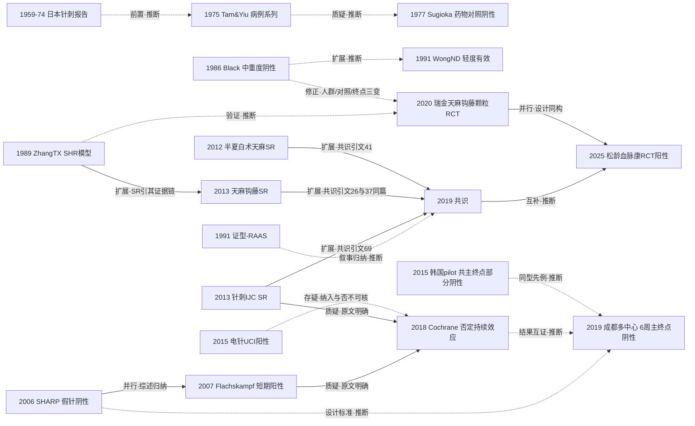

# D05 眩晕/头痛：高血压的中医药与针灸干预

> 一句话判断：高血压的中医干预走过了"经验方药—对照检验—方法学否定—注册化重证"四步。针刺降压的特异性效应至今未被确证（Cochrane 2018 汇总 22 项 RCT/1744 例：无持续降压证据，非假针对照的阳性判为偏倚）；中药则在隐匿性高血压与低中危 1 级高血压两个人群拿到注册一致、安慰剂对照、以动态血压为硬终点的阳性（2020 Circulation、2025 Phytomedicine）。对临床医生最重要的一点：中药可作为低中危 1 级高血压的单药选项（松龄血脉康，2025；单试验、无独立重复，见第 8 节）或中重度高血压的联合选项，针刺降压不应作为独立降压手段来期待。

## 0 三分钟速读

① **从哪里来**：理论源头是《素问·至真要大论》"诸风掉眩，皆属于肝"的从肝论治体系（据 2019 共识全文转述，本章已读原文）；1958 年天麻钩藤饮被立为高血压专方（据共识溯源叙述转述，原书未核）。临床研究的可核实起点不在 1975 年——OpenAlex 题录显示日本 1959、1973、1974 年已有针刺降压临床报告 [D05-N18]，1975 年 Tam & Yiu 只是"PubMed/Europe PMC 可核实的最早英文临床报告"[D05-N01]。

② **为什么改变**：1998 年方法学评审发现中国/日本/港台针刺试验 252 篇全部阳性、中国内地非针刺试验无一篇阴性（据 D05-E7 转述），随后美国 SHARP 以侵袭性假针对照得出阴性（192 例，P=0.90）[D05-N08]，Cochrane 2018 据此否定持续效应并把"假针对照+动态血压持续终点"设为最低标准 [D05-N13]——整个方向的方法学被重置。

③ **如何分化**：分化为四支——针刺的假针裁决线（SHARP→成都多中心，注册主终点 6 周 P=0.103）[D05-N14]、电针的神经机制转化线（UC Irvine，去甲肾上腺素 -41%、肾素 -67%）[D05-N12]、中药的经典方/中成药线（天麻钩藤饮 SR→共识）[D05-N10][D05-N15]、主流西医团队的"西学中"安慰剂 RCT 线（瑞金 2020、西苑 2025）[D05-N16][D05-N17]。

④ **现在研究什么**：以 24h 动态血压为硬终点的安慰剂对照 RCT（2025 年松龄血脉康 393 例随机：24h SBP/DBP -5.91/-4.66 vs -2.26/-2.56 mmHg，P<0.001）[D05-N17]、真实世界登记与倾向评分匹配（1325 例登记 vs 300 例 RCT）[D05-R35]、以及经典方的代谢组/菌群机制研究。

⑤ **用了什么数据**：注册试验+动态血压（当前主流）、Cochrane/系统评价汇总（针刺 22 RCT/1744 例；松龄血脉康 34 RCT/4306 例）、真实世界登记+PSM、SHR 与 L-NAME 动物模型、血清代谢组与 16S rRNA 测序。

⑥ **还有什么不知道**：中药降压至今没有 Cochrane 完整系统评价；针刺没有以心血管事件为终点的试验，电针的确证性假针多中心 RCT 缺位；中药单药治疗低中危 1 级高血压的硬终点阳性仅一项且无独立重复；1950—1970 年代国内降压中药临床报告因未检索 CNKI/万方而整体不可核。

**覆盖边界**：纳入——高血压的中医证治（眩晕/头痛；肝阳上亢、痰饮内停、肾阴亏损、兼血瘀）、平肝潜阳类方药与中成药、针刺/电针降压 RCT（含阴性）、血压节律与变异性、指南共识、近五年注册 RCT 与真实世界研究。不含/只点到——脑卒中（脑病科）、血脂异常（D06）、功法降压（本章只保留血压终点一条注记：2024 网络 Meta 中"太极+生活方式"最优一项 [D05-R54]；功法康复总论见 D09，本章不重复展开）、证候客观化总论（D11）、中药注射剂（D10）。

**本章口径**：截止 2026-10-17；近期重点窗口 2021-10-17 至 2026-10-17。阅读层级：L0=仅二手转述、L1=题录已核实、L2=摘要已读、L3=原文部分章节已读、L4=全文已读；层级只标到实际读到的深度，转述处逐一注明。本章节点 21 个：L4×1（2019 共识）、L2×17、L1×3（1959—1974 日本报告、半夏白术天麻汤 SR、邓铁涛浴足方临床观察）；其中 4 个节点为本轮核查遗漏候选补入（N18—N21），均附 DOI/PMID 或完整书目；N20（邓铁涛浴足方）在全报告复核时公开学术库未见题录，未经独立核实（见第 12 节）。**覆盖状态**：基本完整但有标注缺口——六问均可据本章回答，四条主分支（针刺假针裁决、电针机制转化、中药经典方/中成药、西学中安慰剂 RCT）及节律、机制支线均有节点；缺口限于第 8 节已标注的 CNKI/万方未检索、个别中文题录未独立核实与注册记录核实边界等项目。

## 1 源头：最初在研究什么

**经典理论源头（被公认的奠基工作）**。《素问·至真要大论》"诸风掉眩，皆属于肝"；2019 年《高血压中医诊疗专家共识》第 2 节原文为"历代医家及现代学者大多强调'诸风掉眩，皆属于肝'，倡导从肝风、肝阳论治"（共识 PDF 第 218 页，本轮已核图像；引文以共识原文为准，不取流传的异文）。病机归为肝阳上亢、痰饮内停、肾阴亏损兼火、饮、瘀、虚。共识第 1 篇参考文献（熊兴江、王阶《论高血压病的中医认识及经典名方治略》，中医杂志 2011 年 52 卷 23 期 1985—1989 页）同以此为起点。这是理论源头，不是现代临床研究起点。

**专方化起点（据二手转述，原书未核）**。天麻钩藤饮始载于胡光慈《中医内科杂病证治新义》（1958），原书明言主治高血压病之头痛、眩晕、失眠——据共识（D05-E4）方剂溯源叙述与多来源书目转述，原书未获原件核对，标 L0—L1。

**临床研究的最早起点（按"目前最早找到的文献"标注，加限定语）**：
- **针刺降压临床报告**：OpenAlex 题录检出三条早于 Tam & Yiu 的临床报告——1959 年日文《血圧に対する兪刺の作用について（第2報）：高血圧症の臨床成績》、1973 年《全日本鍼灸学会雑誌》20 卷 14 页"Various Methods of One-Acupuncture for Hypertension"（DOI 10.3777/jjsam1948.20.14）、1974 年同刊 21 卷"Treatment of Patients of High Blood Pressure and Other Symptoms by Chinese Acupuncture"（DOI 10.3777/jjsam1948.21.4_100）[D05-N18]。三者均只到题录层（L1），未读摘要。因此 Tam & Yiu 1975（28 例病例系列，PMID 1202935）[D05-N01] 的准确定位是"PubMed/Europe PMC 可核实的最早英文（英文全文）临床报告"，且无法排除更早的中日文文献。
- **中药降压的对照试验起点**：Black 等（美国）1986 年 12 味经典方 vs 西药随机对照（45 例，阴性）[D05-N03]，限定为"英文可核实的最早随机对照"；核查在 Europe PMC 1950—1985 年题名检索 138 条中未发现更早对照试验。
- **证候客观化起点**：1983—1991 年《中西医结合杂志》系列把高血压中医分型与前列腺素、血液流变学、肾素-血管紧张素-醛固酮关联（PMID 6225552、6236896、3074879），1991 年 130 例高血压+70 例对照报告阳亢型肾素与 AngII 高于正常组及其他证型（P<0.01—0.001）、三型心钠素均低于正常 [D05-N06]。系统总结归 D11。

**存在争议的首次**：松龄血脉康胶囊上市时间两说并存——其 2019 年 Trials 方案称"自 1994 年起在中国大陆用于高血压"（PMID 30987658 摘要 Background，本轮已核）；公开批准文号资料称国药准字 Z10960023、约 1996 年由成都康弘药业推出。原始批件未核，两说保留。

## 2 关键转折：问题—新证据/新方法—认识变化—新问题

**转折一（1975—1991）：病例系列阳性→对照检验→人群边界成形。** 问题：针刺/中药降压的中文经验叙述能否经得起对照？1975 年 Tam & Yiu 28 例病例系列报告 16 例"显效"（摘要层，本轮已核）[D05-N01]；1977 年 Sugioka 以氯噻酮/普萘洛尔为对照检验 5 组穴位方案，血压、儿茶酚胺、肾素均无显著变化，且劣于普萘洛尔、患者接受度差——针刺降压第一次"证据降级"（据两文摘要推断其承接关系；Sugioka 引言是否点名回应早期病例系列，原文未读，不作断言）[D05-N02]。中药侧：1986 年 Black 45 例随机对照显示 12 味经典方治疗中重度高血压（舒张压≥105 mmHg）几乎无效（出院 DBP<90 者中药组 8% vs 西药组 66%）[D05-N03]；1991 年 Wong ND 等把人群移到轻度高血压（DBP 90—104），50 例对照显示中药"弱于西药但有效"（168.2/95.9→146.4/80.5 vs 西药 137.3/76.7 mmHg，均 P<0.01）[D05-N07]。认识变化：中药单药的有效人群边界被界定——轻症可能可行、中重度不行；这条边界是 35 年后"低中危 1 级单药"定位的先声（本报告推断）。

**转折二（1989—1991）：动物模型与证候客观化建立。** 问题：经典方与证型能否在可控体系中机制化？1989 年 Zhang TX 等（注意：第一作者署名 Zhang TX、Wang YF、Ciriello J，非流传的"Zhang G"；本轮经摘要核实更正）把天麻钩藤饮移入自发高血压大鼠，5 周龄起灌胃至 16 周龄，显著延缓高血压发生发展，心率、体重、摄食水与尿电解质不受影响，提示经交感血管运动活性 [D05-N04]；这一"SHR 发育模型"范式被沿用 30 年。同期 1990 年西苑医院魏敏、陈可冀的长寿降压方 RCT（65 例肾虚证）首次把评价维度扩展到靶器官——左室质量指数由 114.75 降至 100.39 g/m²（P<0.001），对照药罗布麻组不降 [D05-N05]；1991 年证型-RAAS 关联给"肝阳上亢"找到可测量的神经内分泌对应物 [D05-N06]。新问题：辨证选方+靶器官保护成为独立分支，但证型与生物标志的联系始终是横断面。

**转折三（1998—2018）：方法学批评与假针裁决——本方向最深的一次认识重置。** 1998 年 Vickers 等系统评审：入选 252 篇针刺对照试验（自 1085 篇中），中国/日本/香港/台湾来源全部阳性；中国内地发表的非针刺试验 99% 阳性且无一篇阴性结论（据 D05-E7 摘要转述）；1999 年 Tang 与 Ernst 在 BMJ 对中医药 RCT 质量提出系统性批评（仅题录层）[D05-E8]。新证据：2006 年美国 NIH 资助的 SHARP 试验（192 例，个体化/标准化/侵袭性假针三臂）——主动针刺与假针降压无差异（SBP -3.56 vs -3.84 mmHg，P=0.90；DBP P=0.16），遵守辨证取穴不能挽救结果 [D05-N08]。2007 年德国 Flachskampf 用 24h 动态血压给出短期阳性（160 例随机，疗程结束时 24h SBP 组间差 6.4 mmHg，95%CI 3.5—9.2），但停针 3、6 个月后两组均回基线 [D05-N09]——与 SHARP 同为假针对照却结论相反，分歧的根源被锁定为"诊室 vs 动态血压、短期 vs 持续效应"（两试验并列讨论见 Cochrane，综述归纳）。2013 年广安门团队的 International Journal of Cardiology 针刺 SR（35 RCT/2539 例）报告"针刺+西药 vs 假针+西药"阳性（-7.47/-4.22 mmHg），但该比较仅来自 2 个试验 [D05-N11]。2018 年 Cochrane 裁决（22 RCT/1744 例）：无持续降压证据（唯一评价停针后效应的即 Flachskampf，3/6 个月无效）；4 个假针试验的短期效应小（SBP -3.4、DBP -1.9 mmHg）且证据质量极低；针刺 vs ACEI（8 试验）/CCB（7 试验）的阳性汇总"极可能是偏倚而非真效应"，拒绝写入结果总结（据完整摘要，本轮已核；作者串 Yang J, Chen J, Yang M, Yu S, Ying L, Liu GJ, Ren YL, Wright JM, Liang FR）[D05-N13]。注意两条边的证据状态：UC Irvine 电针试验是否被 Cochrane 纳入，在公开层面无法核实（全文付费墙、PMC 存档仅摘要），该边标存疑；可核的是 2026 年电针综述以"生物学合理而临床未确证"重述了这一分歧 [D05-R31]。新问题：假针+动态血压+≥7 天持续效应成为后续试验的最低标准（该标准实际源自 SHARP 2006 的设计，而非 Cochrane 2018——成都试验 2012 年即注册，早于 Cochrane，时间顺序不可倒置）。把 1998—1999 年方法学批评视为后续安慰剂对照/硬终点试验设计转向的动因，系本报告推断（批评的存在与内容为原文明确）。

**转折四（2013—2019）：证据汇总→共识标准化——传承线的高点与内循环。** 问题：散在的阳性 RCT 能否支撑推荐？2013 年天麻钩藤饮辅助降压 SR（22 RCT，检索至 2012-11-20）：除利尿剂亚组外血压改善、ACEI/CCB 亚组证候积分改善，但质量低、"不能就疗效与安全性作出确定结论"[D05-N10]；同谱系还有半夏白术天麻汤 SR（eCAM 2012:271462，共识参考文献[41]，据题录与共识引文转述）[D05-N19]。2019 年中华中医药学会《高血压中医诊疗专家共识》发布（组长王阶，执笔王阶/熊兴江/杨晓忱；全文 5 页、76 条编号参考文献，本轮全文已读）：肝阳上亢→天麻钩藤饮（建议小剂量，中成药可选天麻钩藤颗粒、清肝降压胶囊、松龄血脉康）、痰饮内停→半夏白术天麻汤、肾阴亏损→六味地黄丸类、兼血瘀→血府逐瘀汤，并列针灸穴位与治未病 [D05-N15]。需要指出：共识参考文献[26]与[37]为同一篇天麻钩藤饮 SR 重复著录，独立文献实为 75 篇；镇肝熄风汤 SR 为参考文献[29]（DOI 10.1155/2013/982380）。共识的参考文献主体即王阶/熊兴江团队自己的 SR 系列——"文献梳理→团队 SR→共识"的证据内循环由此成形，共识本身不做证据分级。另一条国际汇总在同期形成：2015 年 PLoS One SR（23 RCT/1788 例，单用针刺 vs 药物阴性）[D05-R48]→2019 年网络 Meta（31 RCT/2649 例、15 种干预）[D05-R51]→2026 年两篇 Blood Pressure SR。

**转折五（2019—2025）：注册化安慰剂 RCT 与硬终点——中药重新确立定位，针刺反证加深。** 问题：中药降压能否脱离低质量汇总、以西医最高证据标准独立成立？2020 年瑞金医院上海市高血压研究所在 Circulation 发表天麻钩藤颗粒治疗隐匿性高血压 RCT（251 例，安慰剂对照，主要终点为日间动态血压变化）：日间 SBP/DBP 组间差 2.52/1.79 mmHg（P≤0.025）、24h 差 2.33/1.49 mmHg（P≤0.012），夜间与诊室血压差异不显著；注册号 NCT02156024（注：现行注册记录极简，"注册主终点与发表一致"仅由论文摘要自含的注册声明支撑，本轮未能在注册库逐字段核实）[D05-N16]。2025 年西苑医院牵头松龄血脉康多中心安慰剂 RCT（9 中心，393 例随机/356 例分析，2 周导入+8 周，ChiCTR-IPR-17011383，主终点与 2019 年方案论文一致）：24h SBP/DBP -5.91/-4.66 vs -2.26/-2.56 mmHg（均 P<0.001），24h 控制率 38.04% vs 24.42%（P=0.002）[D05-N17]。针刺侧则是反证加深：成都中医药大学牵头的 11 中心假针对照试验（428 例随机，NCT01701726）注册主终点为"随机前后 6 周 24h 平均血压变化"，发表如实报告 6 周未达优效（vs 假针 2.7 mmHg，校正 P=0.103；vs 等待对照 P=0.078），阳性仅出现在停针后第 9 周时点（vs 假针 3.3 mmHg，P=0.035）。经查证注册记录与方案论文：注册终点在发表中被完整报告、无隐瞒或改换，属"以次要时点下'小效应'结论"而非"终点改换"（本轮经 ClinicalTrials.gov API 与 Trials 方案全文核实；注册库 enrollment 记录为 400 例，论文报告随机 428 例，存在小出入）[D05-N14]。同期 2022 年共识解读、2024 年"一核心、两机制、三病因、四目标"新框架（PMID 39701806，据题录转述）接续理论线。

## 3 分支图

实线=原文明确或综述归纳的关系；虚线=本报告推断（标"推断"），其中 N12→N13 一条为存疑边。N05（长寿降压方）、N20（邓铁涛浴足方）为传承线叶节点，未入图。

## 4 近五年重点（2021-10-17 至 2026-10-17）

**主题 1：针刺/电针降压——假针对照、动态血压硬终点与神经机制转化（发展中有争议）。** 定位说明：该分支窗口内没有新增完成的假针对照人体硬终点 RCT，唯一在研原始研究为 2022 年注册的 II 期方案（64 例，主要终点 4 周 24h 动态血压，ChiCTR2100043737，结果待发表）[D05-R32]，代表证据仍是 2012—2013 年小样本与 2026 年的汇总；窗口内新增的原始数据仅 2025 年巴西单臂内皮功能试验（题录层，PMID 39968972）[D05-R47]。常用设计与数据：多中心假针 RCT（含等待对照）、假针+24h ABPM、机制导向 II 期方案+代谢组/fMRI、SR 与网络 Meta。代表汇总：Blood Pressure 2026 两篇——7 RCT/812 例（SBP -6.73、DBP -6.59 mmHg，但 I²=73.3%/90.9%）[D05-E3]；13 RCT/1080 例（24h SBP -3.57、DBP -3.61 mmHg，摘要明示血压变异性与血压负荷改善，其具体数值未在摘要直见）[D05-R30]；Frontiers in Medicine 2026（RoB2+GRADE，16 篇报告/15 个独立研究：疗程末诊室 SBP -6.63 mmHg 但 DBP 无明确效应，动态血压证据稀少）[D05-R33]。分歧：假针试验（SHARP 阴性、成都 6 周主终点阴性）与非假针/对照穴位试验（Longhurst 电针阳性）结论持续冲突；电针综述原话判定"已完成的确证性电针特异性随机试验缺位""生物学合理而临床未确证"。

**主题 2：中成药单药治疗低中危 1 级高血压——安慰剂 RCT、真实世界登记与在研非劣效试验（发展中）。** 代表：松龄血脉康 2025 多中心安慰剂 RCT（数字见转折五）[D05-N17]；真实世界 1325 例登记与 300 例 RCT 的倾向评分匹配对比（匹配后 552 例：真实世界 8 周 SBP/DBP 降幅 15.82 vs 10.48 mmHg，P<0.001）[D05-R35]——需交叉标注：该 PSM 论文对照臂所称"SXC-BP RCT 300 例"疑似即 ChiCTR-IPR-17011383 试验（393 随机/356 分析）的完成或分析子集，全量 MED 题录检索 13 条未见以该名发表的 300 例 RCT 主报告，身份未核实；本章统计独立试验数时按同一试验保守处理。在研：清达颗粒 vs 缬沙坦非劣效 RCT（13 中心、552 例，ChiCTR2000033890，2020-06-15 注册，方案 2023 年发表，结果未见发表）[D05-R37]；血管重塑试验（baPWV/毛细血管密度+菌群代谢组，NCT06093932，100 例方案）[D05-R36]。分歧：单药定位与 2022 年 SR"单药 24h SBP 劣于西药（MD +2.07 mmHg，95%CI 0.19—3.96）"的张力——现有证据支持的表述是"低中危 1 级单药可行、中重度仍需联合"（人群分层式修正，本报告推断）；真实世界效果大于 RCT 的解释（依从性/人群选择/合并治疗）未定。牛黄降压类证据仍停留在低质量汇总（2017 年 SR，题录层）[D05-R53]。

**主题 3：西学中——主流高血压团队用安慰剂 RCT 检验经典方（发展中）。** 代表：天麻钩藤颗粒治隐匿性高血压（Circulation 2020，数字见转折五）；其机制跟进为网络药理+实验验证（题录层）[D05-R38]。分歧：夜间血压与诊室血压未获益提示效应限于日间；4 周短疗程的外推性存疑；未按证型做亚组分析。

**主题 4：血压昼夜节律、变异性与睡眠/失眠共病（早期线索）。** 定位说明：该分支窗口内无新增完成的人体硬终点 RCT，人体证据仍为 2012 年日本 33 例双盲假针 RCT（夜间 DBP 勺型加深，P=0.038）与 2013 年清眩颗粒 90 例分层随机安慰剂 RCT（氨氯地平基础上加用，观察血压变异性与 OSA 指数）[D05-R40][D05-R41]，窗口内新增为 2026 年共病 SR（PROSPERO CRD420261468564：16 项入选/12 项定量合成，睡眠质量 SMD -2.21、血压 SMD -0.43，高血压人群 SBP 降 2.5—6.2 mmHg）[D05-R39]；动物侧 2020 年清眩降压方 SHR 实验（下调 Ang II、ET-1，改善血管重塑）[D05-R42]。SR 阳性主要靠变异性等替代指标，纳入研究证型口径不一。

**主题 5：经典方物质基础与机制多组学（早期线索→发展中）。** 代表：镇肝熄风汤颗粒 vs 汤剂 SHR 血清代谢组（74 个潜在生物标志物中 18 个被逆转，颗粒与汤剂代谢谱基本等效）[D05-R43]；天麻钩藤颗粒经胆汁酸-FXR 轴降压（题录层）[D05-R44]；L-NAME 大鼠 16S rDNA 菌群重塑（题录层）[D05-R45]；镇肝熄风汤入血成分与靶点网络（题录层）[D05-R46]。分歧：机制研究几乎全部在动物/分子层面，与临床阳性之间的因果链未闭合。

## 5 争议、负性结果与停滞路线

**争议一：针刺降压是特异性效应还是安慰剂/偏倚——未决。** 一方（病例系列、非假针 RCT、IJC 2013 SR、部分 2026 SR）认为针刺可降压尤其作为辅助；另一方（SHARP、Vickers 1998、Tang/Ernst 1999、Cochrane 2018、成都 2019 注册主终点）认为特异性效应未确立。关键数字：SHARP P=0.90/0.16；Flachskampf 短期 +6.4 mmHg 但 3/6 个月归零；Cochrane 非假针阳性判为偏倚；2026 年汇总阳性但 I²=73.3%/90.9%。方法学界立场（假针+持续效应+动态血压）在 2026 年仍被重申，阳性 SR 继续发表而异质性无法消解。

**争议二：中药降压"全阳性"与证据质量——证据升级中但覆盖面极窄。** 各中文团队 SR（2013 天麻钩藤 22 RCT、2015 中成药 73 RCT/8138 例 [D05-R49]、2022 松龄血脉康 34 RCT/4306 例）报告汇总阳性并进入共识推荐；方法学侧以 Vickers/Tang 批评与头对头数据反驳：单药 24h SBP 劣于西药 +2.07 mmHg；2015 年难治性高血压中药 SR"不能定论"（5 RCT/446 例）[D05-R50]；本轮 Cochrane 库以题名两路检索均未见"中药治疗原发性高血压"完整评价。注册一致、安慰剂对照的硬终点阳性至今仅两项（2020 Circulation、2025 Phytomedicine），人群限于隐匿性与低中危 1 级。

**争议三：注册终点与发表终点的证据强度错配——两例疑似，一例对照。** 已裁定的第一例：成都 2019（NCT01701726）注册主终点 6 周 24h 动态血压变化未达优效（P=0.103），发表以第 9 周次要时点阳性（P=0.035）下"小效应"结论——经注册库与方案全文核实，注册终点在发表中被如实完整报告，属"以次要时点下结论"，不构成终点改换；但该试验被后续 SR 作为阳性证据纳入时未见标注此点，是 2026 年汇总异质性的可能解释之一。第二例疑似：韩国 2015 pilot（30 例，KCT0000496，assessor-blinded）注册共主终点为治疗末 SBP/DBP——治疗末 SBP 组间差 -6.0 mmHg 未达显著（P=0.123，阴性），仅 DBP -5.7 mmHg 阳性（P=0.025），随访期 SBP/DBP 才均阳性 [D05-N21]。对照样本：瑞金 2020 与西苑 2025 两项中药 RCT 主终点注册一致且阳性。

**负性结果与停滞路线**（逐条保留）：①针刺假针对照大型试验路线——SHARP（2006）后近 20 年无更大规模国际确证试验，唯一后续大型试验（成都 2019）注册主终点阴性；②经典方单药替代西药在中重度高血压——Black 1986 后该人群路线终止（控制率 8% vs 66%）；③针刺早期药物对照验证——Sugioka 1977 全阴性与接受度差；④中成药单药替代西药——2022 年 SR 单药劣效后转为人群分层定位；⑤针刺 vs ACEI/CCB 头对头"优于西药"汇总——被 Cochrane 判为偏倚、拒绝写入结果总结；⑥针刺降压的长期心血管结局评价——截至 2026-10 未检索到以 MACE/靶器官事件为终点的试验。

## 6 传承线与国际线

**传承线**。理论源头（《素问》从肝论治）→1958 年天麻钩藤饮专方化（据共识溯源转述）→1989 年实验化（SHR 模型）[D05-N04]。其后四条接力链：

1. **广安门医院王阶/熊兴江团队**：2013 年天麻钩藤饮 SR（22 RCT）[D05-N10]、半夏白术天麻汤 SR（同谱系）[D05-N19]、2013 年针刺 IJC SR [D05-N11]→2019 年王阶任组长、熊兴江/杨晓忱执笔全国专家共识 [D05-N15]→2022 年共识解读（DOI 10.13422/j.cnki.syfjx.20221191，据题录转述）→2024 年熊兴江提出新框架（PMID 39701806，据题录转述）。团队名下另有清心胶囊（2005 年临床研究，PMID 15768872）。
2. **西苑医院陈可冀一系**：1990 年长寿降压方 RCT（65 例肾虚证，作者魏敏、陈可冀，逆转左室肥厚）[D05-N05]→清眩调压方/清达颗粒支线。**归属裁定**：该支线归西苑陈可冀一系，依据是一手论文署名——2013 年清眩颗粒血压变异性 RCT 作者为 Chen YY、Chen J、Zhang JC、Chen KJ（PMID 24126974），2023 年清达颗粒非劣效方案末位作者为 Chen KJ（PMID 36588157），两文均含陈可冀署名（本轮均已核作者列表）。合并底稿的传承线总括段曾把该支线归入广安门王阶团队，与上述一手署名相抵；两说并存、按一手署名取前者，此处注明分歧出处以免失真。长寿降压方（1990）与清眩调压方/清达颗粒之间的成方转化关系未经原文证实，为本报告推断。
3. **成都中医药大学梁繁荣/郑晖针灸团队**：2012 年注册、2013 年发表方案的 NCT01701726（方案自述为中国首个大型多中心假针对照针刺降压试验，Trials 方案全文 Discussion 已核）→2019 年发表（428 例随机，末位作者梁繁荣，本轮经 OpenAlex 核实）；"梁繁荣学术体系"的师承归属仍为本报告推断。2018 年 Cochrane 针刺降压评价由香港大学与成都中医药大学团队合作完成（作者串末位 Liang FR）[D05-N13]。
4. **上海瑞金医院上海市高血压研究所（王继光团队）**：2020 年 Circulation 天麻钩藤颗粒安慰剂 RCT [D05-N16]，为西医高血压国家队介入经典方评价的标志。中成药产业化枢纽为成都康弘松龄血脉康（约 1996 年上市，两说并存见第 1 节）；西苑—广安门外，国医大师邓铁涛的高血压经验另有一条临床落点题录：邓铁涛浴足方平稳降压临床观察（中华中医药杂志 2015 年 30 卷 12 期 4528—4530 页，共识参考文献[76]，据共识 PDF 第 221 页题录核实，原文未读；全报告复核时公开学术库未见该题录，未经独立核实）[D05-N20]。

指南线：2019 专家共识→中华中医药学会团体标准 T/CACM 1465-2023《高血压（中医）防治指南》→2024 年中国中西医结合学会《高血压病中西医结合诊疗指南》（后两项据共识跟踪线索与公开检索转述，本轮未核原文，见第 8 节）。

**国际线**。国际线的实质是"方法学输入+独立检验+否定/修正"：（1）早期报告与阴性：日本 1959/1973/1974 年针刺降压临床报告（题录层）[D05-N18]；1975 年 Tam & Yiu 病例系列 [D05-N01]；1977 年 Sugioka 药物对照阴性 [D05-N02]；（动物侧孤例：1974 年 Endocrinology 大鼠肾上腺针刺致升压研究，PMID 4426288，方向相反，仅注记）。（2）西方对照试验：1986 年 Black 阴性 [D05-N03]、1991 年 Wong ND 轻度高血压"弱于西药但有效"[D05-N07]。（3）方法学批评：1998 年 Vickers（252 篇针刺试验全阳性悖论）、1999 年 Tang/Ernst（据 D05-E7、D05-E8 转述）。（4）国际大型假针 RCT：2006 年 SHARP 阴性 [D05-N08]、2007 年 Flachskampf 短期阳性 [D05-N09]、2015 年 UC Irvine 电针阳性并量化交感-肾素轴中介 [D05-N12]、2015 年韩国 30 例 pilot 共主终点部分阴性 [D05-N21]、2012 年日本节律 RCT [D05-R40]。（5）国际协作评价与近况：2018 年 Cochrane [D05-N13]；2022 年意大利 45 例单臂前瞻（诊室与动态血压均下降）[D05-R34]；2025 年巴西随机对照（内皮功能终点，题录层）[D05-R47]；2024 年国际网络 Meta 把针刺+推拿、太极+生活方式列为候选非药物干预（据 D05-R54 转述；功法部分本章只记血压终点，功法康复总论见 D09）。（6）国际指南态度：本轮未查到 AHA/ESC/ESH 对针刺或中药降压的正面推荐（未逐一核对指南全文，属检索缺口）；2024 中国高血压指南的英文 Highlights 未把针刺/中药列为标准降压手段（据 D05-R55 转述）。小结：国际研究始终扮演方法学裁判与否定性检验者——从 1970 年代"能否重复"、1990 年代"偏倚质疑"、2000 年代"假针裁决"到 2020 年代"机制转化但临床未确证"。

## 7 数据路径小结

历史形态→当前形态：（1）无对照病例系列（1975 Tam & Yiu 28 例——起点形态，现基本淘汰）→（2）中药 vs 西药头对头 RCT（1986/1991，界定人群边界，现已少用）→（3）高血压动物模型：SHR 发育模型（1989 起，沿用至今）、L-NAME 模型、Goldblatt 两肾一夹（1994，PMID 7872233）→（4）证候-生物学关联队列（1991 年 130 例+70 对照 RAAS/ANF 分型；2025 年证型血清代谢组，PMID 41415032，交叉 D11/D12）→（5）**假针对照 RCT+24h 动态血压**（2006 SHARP、2007 Flachskampf、2019 成都、2020 瑞金、2025 松龄血脉康）——当前主流形态，主终点一致转向 24h/日间动态血压变化→（6）系统评价/Cochrane（针刺有 2018 Cochrane；中药只有 eCAM/Phytomedicine/Medicine 等非 Cochrane SR）→（7）前瞻性注册试验+方案先行发表（Trials/JMIR 等，5 项在册）→（8）真实世界登记+倾向评分匹配（2023，1325 例登记 vs 300 例 RCT）→（9）RCT 结局指标质量审计（2021 年对 2018—2019 年 125 个 RCT+15 个方案的分析，PMID 33787153：主次终点不分、健康经济学指标缺失）→（10）机制多组学（LC-MS 代谢组、16S rRNA、网络药理+分子对接，2024—2026 集中于天麻钩藤饮/镇肝熄风汤）→（11）可穿戴/家庭血压监测已进入 2024 中国指南的筛查叙述（据 D05-R55 转述），尚未与中药/针刺试验结合，是潜在数据路径。

## 8 还不知道什么（领域证据缺口）与本报告的检索缺口

**领域证据缺口**：
1. Cochrane 库至今没有"中药治疗原发性高血压"的完整系统评价（本轮以题名两路检索均无命中，2026-10-17）；针刺有 2018 Cochrane，中药只有非 Cochrane SR。
2. 针刺降压缺乏以心血管事件（MACE/靶器官事件）为终点的试验；电针的确证性假针多中心 RCT 缺位（2026 年电针综述原话，据摘要转述）。
3. 中药单药治疗低中危 1 级高血压的硬终点阳性仅一项（松龄血脉康 2025），无独立重复；清达颗粒非劣效试验（552 例，2020 年注册）临床结果截至检索日未发表；天麻钩藤颗粒证据限于隐匿性高血压 4 周疗程。
4. 机制-临床因果链未闭合：多组学/网络药理证据几乎全部在动物与分子层面，与两项临床阳性之间无中介证据。

**本报告的检索缺口（含 CNKI/万方未检索的影响）**：
5. **CNKI/万方未检索是本章最大的系统性限制**，影响有三：其一，1983—1991 年《中西医结合杂志》高血压系列多数无 DOI、全文在 CNKI，本章仅到英文题录/摘要层，证候客观化一线无法核对全文；其二，**1950—1970 年代国内降压中药临床实践（罗布麻叶、臭梧桐、汉防己甲素及 1960 年代中医药治疗高血压协作时期的临床报告）整体不可核**——本轮对 1950—1985 年英文索引逐一排查，最接近条目仅为台湾 1975 年 50 味中药降压药理筛查（非临床报告，PMID 1062497，题录层），提示这二十余年的国内临床线暗区是检索边界而非历史空白；本章"国内临床线自英文可核条目起"应据此理解；其三，国内指南/标准原文（含下条）多数不可得，指南线的描述只能到题录与转述层。
6. 传承线人物直接文献不足：邓铁涛高血压用药经验（浴足方临床观察已落一条题录 [D05-N20]，公开学术库无题录、未经独立核实，待纸本/中文库人工核对；其余经验类叙述仅二手 L0）；翁维良高血压经验仅见医院官网简历层（据公开网页转述，本轮未核原刊）；松龄血脉康 1990 年代原始批件与首发临床未获，上市年份两说并存（1994 方案转述 vs 1996 批准文号资料）。
7. 国际指南（AHA/ESC/ESH）对针刺/中药降压的正式条文未逐一核对（付费长文未获取）；"国家基层高血压防治管理指南(2020)首次写入中医药"仅来自公开检索摘要，本轮未核原文；T/CACM 1465-2023 团体标准与 2024 年中西医结合指南原文未获。
8. 注册一致性核实的边界：NCT02156024 现行注册记录极简，瑞金试验"注册主终点一致且阳性"仅由论文摘要自含注册声明支撑；ChiCTR-IPR-17011383 原始记录未能直接访问，其一致性经 2019 年方案论文核实。
9. 待核线索（本轮未核实，不入正文叙事）：上海中医药大学/龙华医院高血压研究团队的代表性原始研究；中华中医药学会 ZYYXH/T 系列《中医内科常见病诊疗指南》高血压病部分（2008—2011）原文条目；"SXC-BP"300 例 RCT 的独立注册号与主方案（疑似即 ChiCTR-IPR-17011383 试验的次级分析）；长寿降压方的后续随访与成药化；Sugioka 1977 全文引言（对早期病例系列的点名回应）。

## 9 本章节点速查表

| 编号 | 年份 | 第一作者+题名简写 | 期刊 | 节点作用 | 设计/分析单位 | 样本 | 关键结果 | 层级 | 核查 | PMID/DOI |
|---|---|---|---|---|---|---|---|---|---|---|
| N01 | 1975 | Tam & Yiu，针刺治原发性高血压 | Am J Chin Med | 最早英文临床报告（限定：PubMed/EPMC 可核） | 病例系列/患者 | 28 例 | 16 显效/8 中等/4 无效 | L2 | 通过 | 1202935 |
| N02 | 1977 | Sugioka，针刺降压未成功尝试 | Am J Chin Med | 首个药物对照针刺试验，阴性 | RCT（药物对照）/患者 | 5 组穴位方案（总数摘要未列） | 血压/儿茶酚胺/肾素无显著变化；劣于普萘洛尔 | L2 | 通过 | 322470 |
| N03 | 1986 | Black，中药vs西药 | J Clin Hypertens | 西方首个中药降压 RCT，阴性 | RCT/患者 | 45 例 | 出院 DBP<90：8% vs 66% | L2 | 通过 | 3806153 |
| N04 | 1989 | Zhang TX，天麻钩藤饮-SHR | Am J Chin Med | 建立经典方动物模型范式 | SHR 发育模型/动物 | SHR 多组（例数摘要未列） | 延缓高血压发生；交感机制提示 | L2 | 修正（作者 Zhang TX） | 2633622 |
| N05 | 1990 | 魏敏/陈可冀，长寿降压方 | 中西医结合杂志 | 靶器官终点（LVH）首试 | RCT/患者（肾虚证） | 65 例 | LVMI 114.75→100.39 g/m²（P<0.001） | L2 | 通过 | 2148508 |
| N06 | 1991 | 李华，证型-RAAS-ANF | 中西医结合杂志 | 证型神经内分泌客观化 | 横断面/患者（证型亚组） | 130 例+70 对照 | 阳亢型肾素/AngII 高（P<0.01—0.001）；ANF 三型均低 | L2 | 通过 | 1831735 |
| N07 | 1991 | Wong ND，轻度高血压中药vs西药 | Yale J Biol Med | 人群边界：轻度"弱于西药但有效" | RCT/患者 | 50 例 | 中药 146.4/80.5 vs 西药 137.3/76.7 mmHg | L2 | 修正（作者 Wong ND） | 1897264 |
| N08 | 2006 | Macklin，SHARP | Hypertension | 大型假针对照阴性，分水岭 | 三臂假针 RCT/患者 | 192 例 | SBP P=0.90、DBP P=0.16；辨证不挽救 | L2 | 通过 | 17015784 |
| N09 | 2007 | Flachskampf，针刺降压试验 | Circulation | 短期阳性/停针即失效 | 单盲假针 RCT/患者 | 160 随机/140 完成 | 24h SBP 差 6.4 mmHg；3/6 月回基线 | L2 | 通过 | 17548730 |
| N10 | 2013 | 王阶，天麻钩藤饮辅助SR | eCAM | 经典方证据结构化：低质量不可定论 | Cochrane SR/研究 | 22 RCT | 5/6 亚组血压改善；质量低 | L2 | 通过 | 23710230 |
| N11 | 2013 | 王阶，针刺治高血压SR | Int J Cardiol | 辅助治疗阳性汇总及其争议 | Cochrane SR/研究 | 35 RCT/2539 例 | 假针+西药仅 2 试验：-7.47/-4.22 mmHg | L2 | 通过 | 24060112 |
| N12 | 2015 | Li Peng，电针降压 RCT | Medical Acupuncture | 穴位特异性+神经机制转化分支 | 双臂对照穴位 RCT/患者 | 65 例（14 例延长） | NE -41%、肾素 -67%、醛固酮 -22% | L2 | 通过 | 26392838 |
| N13 | 2018 | Yang J，Acupuncture for hypertension | Cochrane DB Syst Rev | 权威否定：无持续效应、非假针阳性判偏倚 | Cochrane SR/研究 | 22 RCT/1744 例 | 假针短期 -3.4/-1.9 mmHg；ACEI/CCB 阳性判偏倚 | L2（由 L3 降级） | 修正 | 30480757 |
| N14 | 2019 | 郑晖，成都多中心针刺 | J Clin Hypertens | 注册主终点阴性/次要时点下小效应结论 | 多中心假针 RCT/患者 | 428 随机/415 ITT | 6 周 P=0.103；第 9 周 P=0.035 | L2 | 通过（注册已核） | 30737889 |
| N15 | 2019 | 中华中医药学会，高血压中医诊疗专家共识 | 中国实验方剂学杂志 | 证治体系首次全国标准化 | 共识/文件 | 3+1 证型；75 篇独立参考文献（[26]=[37] 重复） | 三证型三方药+针灸+治未病 | L4 | 通过 | 10.13422/j.cnki.syfjx.20191521 |
| N16 | 2020 | Zhang Dong-Yan，天麻钩藤颗粒治隐匿性高血压 | Circulation | 西学中：安慰剂+ABPM 硬终点阳性 | 安慰剂 RCT/患者 | 251 例 | 日间差 2.52/1.79 mmHg（P≤0.025）；夜间/诊室阴性 | L2 | 通过（补 DOI） | 33019798 |
| N17 | 2025 | Jiang Yuerong，松龄血脉康低中危1级 | Phytomedicine | 中成药单药硬终点阳性（多中心） | 9 中心安慰剂 RCT/患者 | 393 随机/356 分析 | 24h -5.91/-4.66 vs -2.26/-2.56；控制率 38.04% vs 24.42% | L2 | 通过 | 41075522 |
| N18 | 1974 | （题名）Treatment of Patients of High Blood Pressure…by Chinese Acupuncture | 全日本鍼灸学会雑誌 | 国际线起点前移的题录证据（另有 1959/1973 两条） | 临床报告/患者 | 未读摘要 | 题录层存在性 | L1 | 新增（核查遗漏候选） | 10.3777/jjsam1948.21.4_100 |
| N19 | 2012 | Xiong XJ，半夏白术天麻汤SR | eCAM | 痰饮内停证型-方药证据基础（共识引[41]） | SR/研究 | 题录层 | 存在性与共识引用已核 | L1 | 新增（核查遗漏候选） | 10.1155/2012/271462 |
| N20 | 2015 | 王茜，邓铁涛浴足方降压观察 | 中华中医药杂志 | 邓铁涛经验的临床落点题录（共识引[76]） | 临床观察/患者 | 题录层 | 平稳降压作用观察 | L1 | 存疑（公开学术库无题录，未经独立核实） | （无 PMID/DOI，卷页齐全） |
| N21 | 2015 | Liu Y，韩国针刺 pilot | Complement Ther Med | 国际注册试验共主终点部分阴性先例 | assessor-blind pilot RCT/患者 | 30 例 | 治疗末 SBP P=0.123 阴性、DBP P=0.025 阳性 | L2 | 新增（核查遗漏候选） | 26365445 |

## 10 本章入口文献与检索截止

| 编号 | 入口文献 | 类型 | 文中检索截止 | 层级 |
|---|---|---|---|---|
| E1 | 熊兴江等. 高血压的中医药治疗回顾与展望. 中国中药杂志 2023;48(24):6592-6599 | 叙述性综述 | 未说明（叙述性综述） | L2 |
| E2 | Yang J et al. Acupuncture for hypertension. Cochrane 2018;11:CD008821 | Cochrane 系统评价 | 2017-02（CNKI/VIP 仅至 2015-01；注册库至 2017-02） | L2（由 L3 降级） |
| E3 | Acupuncture for primary hypertension… Blood Pressure 2026;35(1):2654103 | SR/Meta | 未说明（纳入 2015—2024 年 RCT） | L2 |
| E4 | 中华中医药学会心血管病分会. 高血压中医诊疗专家共识. 中国实验方剂学杂志 2019;25(15):217-221 | 专家共识 | 未说明（称基于近 30 年文献梳理） | L4 |
| E5 | Songling Xuemaikang capsule… Phytomedicine 2022;107:154459 | SR/Meta | 未说明（7 个数据库） | L2 |
| E6 | Li J. TCM in Treating Hypertension. Circ Cardiovasc Qual Outcomes 2022;15(3):e008723 | 叙述性综述（阜外） | 未说明 | L1 |
| E7 | Vickers et al. Do certain countries produce only positive results? Control Clin Trials 1998;19(2):159-166 | 方法学系统评价 | MEDLINE 1966-01 至 1995-06 | L2 |
| E8 | Tang JL, Zhan SY, Ernst E. Review of randomised controlled trials of TCM. BMJ 1999;319(7203):160-161 | 方法学综述 | 未说明（栏目文，题录层） | L1 |

本章检索截止 2026-10-17；入口综述截止之后的时间段已用 2024—2026 年原始文献补查（见第 4 节）。

## 12 复核修订记录（2026-10-17）

1. 机械质检｜第 3 节分支图边标签｜改前三条边标签含方括号（"扩展·共识引[69]"、"扩展·共识引[26]=[37]"、"扩展·共识引[41]"）致 mermaid 解析失败→改后为"扩展·共识引文69"、"扩展·共识引文26与37同篇"、"扩展·共识引文41"，全图边标签不再含方括号，node 检查通过。
2. 机械质检｜正文引用编号与证据表统一｜改前正文 [D05-E3]、[D05-E8] 在证据表查不到（入口综述行只有 D05-Rxx 行号、无对应编号）→改后在证据表 8 条入口综述行补 node_id=D05-E1…D05-E8，与正文引用编号一字不差；正文节点引用均为单个方括号内单编号的写法（如方括号包住 D05-N01 或 D05-R30），方括号内不含斜杠、逗号加层级等复合写法，原"D05-E7/E8"复合作者写法拆为"D05-E7、D05-E8"。
3. 证据抽查｜D05-R32 与 D05-R20（邓铁涛浴足方）｜改前 R32 first_author 为"（Front Cardiovasc Med题录）"、R20 verification_status 为"通过"→改后 R32 补 first_author=Zhang P（全报告复核时经 Europe PMC 题录核对）；R20 判无法核实，verification_status 改"存疑"，limitations 注明"公开学术库无题录，待核线索（纸本/中文库人工核对）"，正文第 6 节、第 8 节、本章口径段与第 9 节速查表相应处注明"未经独立核实"。
4. 跨章一致性｜功法降压归章互指｜改前本章覆盖边界写"功法降压（D09，……仅在此注记）"，与 D09 覆盖边界"功法降压效应（D05）"互相指派、形成循环引用→改后本章只保留血压终点一条注记（2024 网络 Meta"太极+生活方式"最优 [D05-R54]）并明确写"功法康复总论见 D09"，第 6 节国际线提及处同步交叉引用，不重复展开。
5. 跨章关系｜硬终点/安慰剂试验动因的确定性层级｜改前转折三把 1998—1999 年方法学批评与后续假针/安慰剂、硬终点试验转向并叙而未标因果层级→改后在转折三末尾加"系本报告推断"限定，明确批评的存在与内容为原文明确、批评驱动设计转向为推断。

**第二轮（完整性检查）**：

6. 口径统一｜"低危 1 级"与"低中危 1 级"并存｜改前一一句话判断、0 速读⑥、转折一、争议二、第 8 节缺口 3、速查表 N17 及证据表 R07/R17 的 role 字段均简写为"低危 1 级"，与 Phytomedicine 原题"grade 1 hypertension at low-to-moderate risk"（低至中危 1 级，证据表 R17 title 字段已核）口径不一，人群判断偏窄且两种写法并存→改后全章统一为"低中危 1 级"，与第 4 节主题 2 标题一致。
7. 证据限定｜一句话判断单药定位句｜改前"中药可作为低危 1 级高血压的单药选项（松龄血脉康，2025）"未带单试验限定，与第 8 节缺口 3"仅一项、无独立重复"口径不齐，单看首句易高估证据强度→改后补"（松龄血脉康，2025；单试验、无独立重复，见第 8 节）"。
8. 覆盖状态重评｜按统一口径重评｜本章六问均可据章内回答，主要分支（针刺假针裁决、电针机制转化、中药经典方/中成药、西学中安慰剂 RCT，另节律与机制支线）均有节点，缺口限于第 8 节已标注的 CNKI/万方未检索、个别中文题录未独立核实与注册记录核实边界，无"主要分支无节点"或"主链关键转折缺可核实来源"情形，故评"基本完整但有标注缺口"，理由已写入"本章口径"段。
