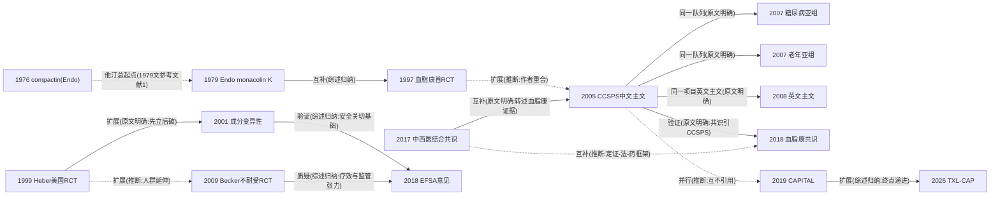

# D06 痰浊血瘀：血脂异常与动脉粥样硬化（红曲/血脂康路线）

> **一句话判断**：中医以"痰浊／痰瘀互结"认识血脂异常，这一病机认识与红曲天然他汀（monacolin K）的化学发现结合，凝结为血脂康——迄今唯一以冠脉事件为主要终点的红曲提取物RCT（CCSPS，66家医院4870例，主要冠脉事件相对下降45.1%）的证据载体。当前国内研究重心已从"降脂幅度"转向斑块影像RCT（CAPITAL、TXL-CAP）与真实世界／医保政策数据；海外则因FDA诉讼与EFSA安全意见收缩为"他汀不耐受替代"并按成分从严限量（此因果关联系本报告推断）。对临床医生最要紧的一点：中国2023年《血脂管理指南》已将血脂康列为他汀不耐受者的起始降脂治疗，而欧美按"monacolin K＝洛伐他汀"从严监管，中外双轨并存。

## 0 三分钟速读

1. **从哪里来**：《素问·通评虚实论》"肥贵人，则膏粱之疾也"、《灵枢·血络论》"血黑以浊"（经2017年中西医结合共识转引）构成痰浊／痰瘀病机源头 [D06-N11]；1979年Endo从红曲菌（Monascus ruber）分离出monacolin K，后证实即洛伐他汀 [D06-N01]。
2. **为什么改变**：1997年108例RCT证明血脂康8周调脂幅度与辛伐他汀相当 [D06-N02]；2005年CCSPS把评价终点从血脂升到冠脉事件——4870例心梗后患者主要终点5.72%对10.41%，相对风险降45.1% [D06-N05]。
3. **如何分化**：中国走"药品＋辨证共识"线（2017中西医结合共识、2018血脂康单品共识，2023国家指南有限纳入）[D06-N11][D06-N13]；美国走膳食补充剂线（Heber 1999→Becker 2009），被FDA诉讼与警告信压回 [D06-N03][D06-N09]；欧盟走剂量监管线（EFSA 2018／2025）[D06-N10]。
4. **现在研究什么**：斑块影像RCT——CAPITAL 1212例颈动脉IMT（组间年化差-0.014 mm）[D06-N12]、TXL-CAP 220例冠脉OCT（纤维帽增幅差27.5 μm，但12个月心血管事件未降低）[D06-N14]；以及真实世界与政策研究（台湾健保15.7万例红曲队列、国家集采中断时间序列）。
5. **用了什么数据**：从菌株生化与动物实验（N01）、8–24周小样本RCT、多中心硬终点RCT、同一队列多重亚组报告（标same_cohort_as不重复计数），到IMT/OCT影像终点、伞形综述（15篇meta、186项RCT）与医保数据库、药物警戒自发报告。
6. **还有什么不知道**：CCSPS是单一团队试验、1996年启动早于注册制度、至今无独立重复、方案细节不可核；TXL-CAP影像获益无事件终点验证；血脂康之外的降脂中成药无硬终点RCT；中文文献库（CNKI/万方）本轮未检索（见第8节）。

**覆盖边界**：纳入——血脂异常的中医认识（膏脂、痰浊、痰瘀互结）与辨证标准化谱系；红曲与血脂康的研发与循证（CCSPS主研究及同队列多篇亚组报告，标same_cohort_as不重复计数）；海外红曲RCT与他汀不耐受人群；红曲系统评价／伞形综述与安全性证据；monacolin K与他汀的关系及FDA/EFSA监管争议；荷丹片、脂必泰及泽泻、山楂、绞股蓝等降脂中成药与单味药；通心络抗动脉粥样硬化影像RCT（CAPITAL、TXL-CAP）；近五年PCSK9时代定位与真实世界／政策研究。不含／交叉——稳定性心绞痛治疗归D01；急性MI围术期归D02；高血压归D05；中药注射剂归D10；证候客观化方法学归D11；单体药理与网络药理归D12（本章均仅点到）。

**本章口径**：执行与检索截止2026-10-17；近期重点窗口2021-10-17至2026-10-17；历史追溯不设起点。证据阅读层级：L0仅二手转述、L1题录已核、L2摘要已读、L3原文部分章节已读、L4全文已读。本章主节点14个（L4×1：N01；L3×2：N10、N11；L2×11：其余），另有补充链环4项（S01–S04）与国际线补充2项（S05–S06）；入口文献8篇（L3×2、L2×6）。逐条证据见证据表 `data/evidence_D06.json`（44行）。转述类说法标注"据〈来源〉转述"；核实状态用"本轮已核／本轮未核／未经独立复核"表述。**覆盖状态（第二轮按全报告统一口径复评，2026-10-17）：基本完整但有标注缺口**——理由：六个问题（从哪里来、为什么改变、如何分化、现在研究什么、用了什么数据、还有什么不知道）均可据本章回答（完整性检查对六问及节点要素、源头分类、近期窗口含截止、关系依据、负性结果保留、单位区分、可读性均评"满足"）；章节范围内主要分支（化学与理论源头、临床与制剂源头、辨证标准化、CCSPS硬终点主线、成分变异与欧美监管线、他汀不耐受海外线、通心络斑块影像线、真实世界与政策线）均有节点；缺口限于已在第8节显性标注的项目（CNKI/万方未检索、ChiCTR注册文本未逐字比对、个别全文未读、部分线索仅L1转述及待核线索未写入正文），不存在主要分支无节点或主链关键转折无可核实来源的情形。

## 1 源头：最初在研究什么

按"公认奠基"与"目前最早找到"两类标注：

**化学源头（公认奠基）**：Endo 1979年从Monascus属菌株（Monascus ruber No.1005，分离自泰国食品样品）5 L发酵液中得到87 mg无色结晶monacolin K（分子式C24H36O5）；动物预实验：Triton WR-1339高脂模型大鼠10 mg/kg腹腔注射（n=5）血浆胆固醇降23.9%（P<0.01），2只新西兰兔口服2 mg/kg/d×5天降10.1%–26.2%，小鼠口服LD50>1000 mg/kg；1980年续报证明其特异性抑制HMG-CoA还原酶（PMID 7380744，题录级）。本轮已核：1979年原文全文3页经J-Stage开放获取逐页读取（原判L1，经全文阅读升L4）[D06-N01]。**限定语**：monacolin K是红曲／Monascus来源降脂物质的起点，但他汀研究的总起点是Endo 1976年从青霉菌发现的compactin（ML-236A/B/C，J Antibiot 1976;29(12):1346-1348，PMID 1010803）——1979年文参考文献第1条即该文 [D06-S01]；另有1976年"citrinin抑制胆固醇合成"的同期线索（J Antibiot 1976;29(8):841-3，PMID 791911）。

**经典理论源头**：《素问·通评虚实论》"肥贵人，则膏粱之疾也"与《灵枢·血络论》"血黑以浊"，现代将其归纳为痰浊、痰瘀互结。本轮经2017年《血脂异常中西医结合诊疗专家共识》PDF第262页读到转引原文（L3转述；经典原刻本未另核）[D06-N11]。

**"痰浊"生化基础的实验起点（目前最早找到的文献）**：宋剑南、刘东远、牛晓红等《高脂血症与中医痰浊关系的实验研究》，《中国中医基础医学杂志》1995年第1卷第1期49-51页。题录本轮已经CNKI期刊官网页面与维普引文格式两条独立路径核至卷期页（L1；作者为刘东远而非早前误写的"刘远旭"，出处为《中国中医基础医学杂志》而非《中国中西医结合杂志》）；设计要点（药物反证、化痰健脾方）系CNKI官网页转述，全文仅CNKI可得、本轮未读。该文被后世综述与学位论文广泛引为血脂异常"从痰论治"的实验起点 [据题录与转述；实验数据未经独立复核]。

**临床与制剂源头（目前最早找到的文献，限英文题录库范围）**：Europe PMC限定1990–2001年检索"Xuezhikang"仅得5条，最早为1997年阜外医院寇文镕、陆宗良等《中华内科杂志》108例辛伐他汀对照RCT [D06-N02]；OpenAlex按年排序交叉核对无更早真实命中。其后1999年血脂康与洛伐他汀对照的高血压人群RCT发表于J Clin Epidemiol（doi:10.1016/S0895-4356(99)80007-9，OpenAlex核实题录、PubMed未收录），是血脂康证据走出中文期刊的中间环节 [D06-S03]。血脂康制剂系特制红曲发酵制品（2023年国家指南第14页表述：特制红曲发酵、含13种天然复合他汀、无晶型洛伐他汀及同类物）[D06-E2]；其研制企业与上市年份细节仅见二手来源且互有出入，本轮未核（见第8节待核线索）。

**辨证标准化起点（目前最早找到的文献，转述级）**：2002年《中药新药临床研究指导原则》已列高脂血症中医分型（肝肾阴虚、痰浊阻遏、阴虚阳亢、气滞血瘀）；2008年中华中医药学会心病分会《血脂异常中医诊疗指南》定痰浊阻遏、气滞血瘀、肝（肾）阴虚、脾肾阳虚四型。两者本轮均经2017年共识PDF第264页转述读到（L3转述；2008年指南原件系学会内部印发，未单独获得）[D06-N11]。

**硬终点奠基（公认奠基）**：CCSPS（2005中文主文、2008英文主文）是本轮检索范围内唯一以"非致死性心梗＋冠心病死亡"为主要终点的红曲提取物RCT；本轮以Europe PMC两条检索式复查（TITLE:"red yeast rice" AND TITLE:"coronary events"；TITLE:"China Coronary Secondary Prevention"，7条均属同一队列）未见第二家 [D06-N05][D06-N08]。该试验1996年启动、早于临床试验注册制度，无注册号可核。

## 2 关键转折：问题—新证据/新方法—认识变化—新问题

**转折一：化学实体→临床入场券（1979–1999）。** Endo 1979年使红曲获得明确化学实体与他汀类药理学身份 [D06-N01]；1997年寇文镕等108例RCT：血脂康1.2 g/d×8周TC -23.0%、LDL-C -28.0%、TG -28.1%（均P<0.001），与辛伐他汀10 mg/d组四项血脂组间均无显著差异、不良反应更少 [D06-N02]；1999年Heber（UCLA）83例双盲安慰剂RCT：红曲2.4 g/d×12周使TC由6.57±0.93降至5.38±0.80 mmol/L（254±36→208±31 mg/dL，组间P<0.001），同一化学实体进入美国"膳食补充剂降脂"叙事 [D06-N03]。关系类型：**扩展**（N02→N05同团队证据升级系据作者名单重合推断，原文未自述）。

**转折二：阳性结果能否外推——制品成分变异（2001–2010）。** Heber团队2001年对9种美国市售红曲制品HPLC分析：总monacolin含量0%–0.58% w/w、仅1/9含全部10种monacolin、7/9检出citrinin，摘要结论明言单一标准化菌株制品的临床结果不能外推到成分不同的其他制品（原文明确）[D06-N03][D06-N04]；Gordon 2010（Becker团队）对12种市售制品再测：总monacolin 0.31–11.15 mg/粒（约36倍差异）、monacolin K 0.10–10.09 mg/粒、4/12检出citrinin [D06-S04]。质量变异由此成为EFSA安全关切的基础（EFSA 2018全文设"红曲中monacolin含量及其变异来源"专节并多处引Heber；综述归纳）[D06-N04][D06-N10]。认识变化：标准化生产与批间一致成为红曲领域此后二十余年质量、效力、安全三条线的共同争点。

**转折三：中国低胆固醇人群的硬终点回答（2005–2010）。** 问题：中国心梗后人群基线TC（4.40–6.47 mmol/L）低于西方4S/CARE人群，西方调脂试验结论能否外推未证明。CCSPS（66家医院，1996-05至2003-12，4870例18–75岁心梗后患者，血脂康0.6 g bid对安慰剂，平均随访4年）：主要终点（非致死MI＋冠心病死亡）5.72%对10.41%，相对降45.1%（P=0.0000）；冠心病死亡-31.0%（3.79%对5.49%）、非致死MI -60.8%、总死亡-33.0%、次要终点（卒中/肿瘤/血运重建）-31.1%、PCI/CABG需求-33.3%（P=0.097）[D06-N05]。认识变化：红曲提取物从"降脂药"升格为"降低冠脉事件与总死亡"的证据级别。**同一队列亚组接力**（标题均明示subgroup from CCSPS，不重复计为独立证据）：糖尿病亚组591例，冠心病事件9.2%对18.6%（降50.8%，P<0.001）[D06-N06]；老年亚组（65–75岁）1445例，冠脉事件-36.9%（P=0.001）、NNT=18 [D06-N07]；英文主文2008年载Am J Cardiol（主要终点5.7%对10.4%，相对降45%）[D06-N08]；另有不同MI病史分析（2006，中华内科45(1):21-24，PMID 16624082）、糖尿病中文分析（2005，PMID 16563271）、高血压亚组（2010，Ann Med 42(3):231-240，PMID 20350253，2704例，冠脉事件-43.0%）、老年高血压亚组（2009，J Clin Pharmacol 49(8):947-956，PMID 19602720，1530例，-38.2%）。**新问题**：单一团队、早于注册制度、无独立重复（见第5节争议六）。

**转折四：他汀不耐受的海外分支与同期质疑（2009–2010）。** Becker等62例RCT（31对31，因肌痛停用他汀者）：红曲1800 mg bid×24周，全部同步12周生活方式干预；LDL-C 12周降1.11 mmol/L（43 mg/dL）、24周降0.90 mmol/L，安慰剂组分别降0.28/0.39 mmol/L，组间12周P<0.001、24周P=0.011；肝酶、CPK、疼痛评分组间无差异；注册号NCT00405769——本轮经ClinicalTrials.gov API核对：Chestnut Hill Health System、2007-01启动、登记实际入组64例、已完成，注册主要终点（基线/12周/24周LDL-C）与发表一致 [D06-N09]。同期Ann Intern Med刊出三封读者信（2010;152(2)，PMID 20083838/20083840/20083842，本轮已核题录）质询成分一致性与安全性。关系类型：**质疑**；疗效阳性与安全性追问同台，构成海外红曲RCT的标准张力结构。

**转折五：食品还是药品——监管分化（1998–2025）。** 美国线：Pharmanex公司红曲制品Cholestin遭FDA扣押；地区法院1998年一度判行业胜（Pharmanex, Inc. v. Shalala, 35 F. Supp. 2d 1341, D. Utah），第十巡回上诉法院2000年推翻（221 F.3d 1151），确立"含显著monacolin K的红曲制品属未经批准新药"；2007-08-09 FDA向Red Yeast Rice、Red Yeast Rice/Policosonal Complex、Cholestrix三家销售商发警告信（本轮经新闻/法律数据库检索核实）。欧盟线：EFSA 2018意见认定monacolin K（内酯型）与洛伐他汀为同一物质，10 mg/d即有显著安全关切、3 mg/d已有严重不良反应个案（横纹肌溶解、肝损伤）、无法为普通人群与易感亚组确定无健康关切的摄入量（结论章节本轮经PMC全文逐字核对）[D06-N10]；EFSA 2025年再评价：所提交数据不足以确立3 mg/d以下剂量单可林的安全性，也无法识别任何不引起安全关切的日摄入量（PMID 40027377，摘要本轮已读；注意2018与2025两份意见结论应分开表述，"任何剂量均有安全关切"是两份意见的压缩说法）[D06-R13]。认识变化：同一物质在中国按药品/中成药扩张、在欧美按化学成分定量收缩；monacolin K从"天然红曲"的身份中析出为独立监管对象。

**转折六：辨证标准化与单品共识，直至国家指南有限纳入（2002–2023）。** 2017年中西医结合共识集成四复合证型（痰浊内阻、脾虚湿盛、气滞血瘀、肝肾阴虚）、三方剂（温胆汤、血府逐瘀汤、一贯煎合杞菊地黄丸）与中成药推荐（血脂康胶囊用于痰瘀互阻证、丹蒌片、养心氏片、银杏叶片等），并将CCSPS证据转写为证型语境下的中成药推荐（原文明确）[D06-N11]；2018年血脂康单品共识给出8周调脂数据（TC -23%、LDL-C -28.5%、TG -36.5%、HDL-C +19.6%）与一/二级预防适用边界，明确引CCSPS为推荐依据（原文明确）[D06-N05][D06-N13]；2023年《中国血脂管理指南》把血脂康写入正文：第12页明文"对于他汀类药物不耐受者可使用天然降脂药血脂康作为起始降脂治疗，血脂康具有较好的安全性，在中国人群二级预防研究中显示临床获益"，第14页专段介绍（特制红曲发酵、13种天然复合他汀）并列入降脂药物及剂量表（表12，1.2 g），第16页"其他降脂药"载脂必泰（红曲＋山楂、泽泻、白术复合制剂），第19页载降脂中成药与他汀/依折麦布联用证据（本轮已核该PDF上述4页，L3）[D06-E2]。**修正记录**：初检仅读该指南PDF前2页曾得出"指南未纳入红曲/血脂康"的断言，经完整核读第12/14/16/19页证伪，本章按核读后事实改写（过程偏差记入第8节）。认识变化：国内形成"西医指南有限纳入＋中西医结合共识定证-法-药"的两级结构；欧美主流指南仍未纳入红曲制品（背景：Gerards 2015判定红曲RCT安全性评估多数低质量 [D06-E5]；ILEP 2022自述红曲"在国际指南中受关注相对少" [D06-E7]）。

**转折七：从降脂幅度到斑块形态——通心络影像线（2008–2026）。** CAPITAL 1212例颈动脉IMT≥1.2 mm患者24个月多中心双盲安慰剂RCT（注册号ChiCTR-TRC-08000212、2008-12-05注册，经PMC全文XML核实）：通心络IMT年化变化-0.00095 mm（95%CI -0.00330~0.00141）对安慰剂+0.01312 mm（0.01076~0.01548），组间差-0.01407 mm（-0.01740~-0.01073，P<0.001）；斑块面积、重塑指数、hsCRP与首发主要心血管事件复合终点亦改善 [D06-N12]。TXL-CAP 220例ACS合并冠脉薄帽纤维粥样斑块患者12个月RCT（注册号ChiCTR1900025842载于发表摘要；方案论文J Geriatr Cardiol 2025;22(7):615-624，PMID 40896570、PMC12394960，方案主要终点与发表一致，本轮已核）：12个月OCT最小纤维帽厚度115.0对80.0 μm（P<0.001），增幅差27.5 μm（61.2对33.7 μm，P=0.002），最大脂质弧-38.4°对-8.1°（差-30.3°，P=0.007），西雅图心绞痛问卷与CCS分级改善；但发表文自述12个月心血管事件未降低 [D06-N14]。关系类型：TXL-CAP对CAPITAL为**扩展**（方案文将试验定位为通心络抗斑块研究延续，综述归纳）；该线与红曲硬终点线**并行**（设计与目标互不引用，推断）[D06-N05][D06-N12]。**新问题**：影像替代终点获益与事件终点未降的落差（见第5节争议四）。

## 3 分支图

实线＝原文明确讨论或综述归纳的关系；虚线＝本报告推断；边上标注关系类型。

另三条不设节点的补充链环：Endo 1976 compactin→N01（引文关系，已核）[D06-S01]；1999年J Clin Epidemiol血脂康国际RCT介于N02与N05之间的国际发表环节 [D06-S03]；Gordon 2010（12种美国制品HPLC）承接N04、通往N10的成分变异证据链 [D06-S04]。

## 4 近五年重点（2021-10-17至2026-10-17）

**主题一：红曲／降脂中成药的真实世界与医保政策研究。** 研究红曲及降脂中成药在医保数据库、电子病历与集采政策下的使用、结局与经济性；常用全人群医保回顾性队列（台湾NHI 2010–2016，倾向评分匹配）、中断时间序列（国家医保局2019-01至2020-12集采前后）与电子病历回顾。代表研究：Chang 2024——台湾健保156,587例高脂血症，匹配后红曲34,367对洛伐他汀34,367，肝硬化风险HR 0.60（95%CI 0.57-0.63）伴剂量-反应趋势，作者自述不能推断因果 [PMID 39100903]；Yang 2025——他汀集采后单价降25%–96%、可负担性0.242→0.014，而脂必泰与血脂康价格小幅波动、用量与支出无显著影响，即集采冲击化学药而未波及中成药使用 [PMID 40026643]（该文细句来自全文，设计/数据窗口本轮已核）；Huang 2021——真珠调脂胶囊单中心电子病历2年回顾，血脂持续改善信号（L1）[PMID 34707672]。分歧：观察性数据一致提示获益信号（另一台湾LipoCol Forte卒中队列同此，PMID 35502179），但均受适应证混杂与依从性数据缺失限制；集采研究被批评缺乏结局终点。成熟度：发展中。

**主题二：红曲有效性与安全性的证据再评价。** 用RoB 2.0系统评价／伞形综述（AMSTAR-2）、国家药物警戒中心自发报告系列与上市后nutrivigilance再评价降脂幅度、与他汀比较及不良事件谱。代表研究：Ma ZY 2024伞形综述——15篇meta、186项（164项独立）RCT、61条关联：16.4%显示保护、8.2%显示风险信号（尿酸/ALT/AST升高）、75.4%无显著差异；关联层34.4%中等、55.7%低、9.8%极低可信度；meta层12/15（80%）为critically low；检索截至2023-05-05 [PMID 38413255]；Li P 2021——15项高质量RCT、1012例：与安慰剂/营养素比显著降TC/LDL-C，与他汀比LDL-C相当、降TG更强（MD -19.90，95%CI -32.22~-7.58）、降TC稍弱，不良事件不增加 [PMID 35111069]；Vrolijk 2021——荷兰Lareb 94例自发报告、187条ADR：肌骨骼64、胃肠33、全身23，结论"显著安全关切" [PMID 33085778]；Trogkanis 2024——SR/MA总体支持但异质性大（L1）[PMID 38794691]。分歧：疗效结论稳定（LDL-C降约1.0 mmol/L，Gerards 2015检索至2014-11 [D06-E5]），但纳入RCT安全性评估方法学普遍低质（Gerards判定）且证据可信度多为中低（Ma ZY判定）；欧洲药物警戒与东亚临床使用习惯对同一数据得出不同行动。成熟度：疗效综合成熟，安全性证据仍发展中。

**主题三：面向斑块的影像RCT链（红曲与通心络）。** 以IMT、斑块面积/积分、OCT纤维帽厚度/脂质弧为终点评价中成药抗斑块效应。代表研究：Wang S 2022——红曲颈动脉斑块SR/MA：20项RCT、2217例，斑块面积SMD -0.855（95%CI -1.259~-0.451）、IMT -0.588、斑块积分-0.708、LDL-C -0.938，均优于对照且存在剂量-效应关系，安全性指标无差异 [PMID 36120360]；CAPITAL 1212例IMT终点阳性 [D06-N12]；TXL-CAP 220例OCT终点影像阳性、事件未降 [D06-N14]；Su W 2023——多种中成药治颈动脉斑块的贝叶斯网络meta（L1）[PMID 37986011]。分歧：影像终点一致为正，但TXL-CAP自报12个月事件未降低；以低质量中文RCT为主的meta面临选择偏倚质疑（Gerards式的安全/偏倚批评同样适用）。成熟度：发展中。

**主题四：PCSK9时代与组合降脂中的中药定位。** 在PCSK9抑制剂/中强度他汀＋依折麦布一线策略下研究红曲与降脂中成药的残余定位（不耐受替代、TG管理、辅助达标）。代表研究：Xie L 2024——23项RCT、7316例，西药基础上加用中药：心血管事件377/3670对717/3646，RR 0.52（95%CI 0.47-0.58）；LDL-C多降0.46 mmol/L；事件降幅随基线LDL-C/TG水平变化（交互P=0.03）；纳入试验质量低、发表偏倚未系统评估 [PMID 39055660，DOI 10.3389/fcvm.2024.1407536（本轮更正：原引DOI指向他文）]；Xu J 2023方案——血脂康1.2 g/d对普伐他汀20 mg/d×6周、计划114例、主要终点6周空腹TG（方案已发表，结果未查到）[PMID 36998136]；Jia等——30只大鼠＋16例患者：血脂康与洛伐他汀同样经SREBP-2通路升高PCSK9约34%（P=0.006）、LDL-C降28%，即红曲对PCSK9无抑制优势（机制层面，归D12点到）[PMID 24993334，Chin J Integr Med 2016;22(2):96-100，2014年7月在线]；Li S 2025——阜外团队策略评论主张中强度他汀＋依折麦布为初始策略，压缩红曲"中等强度替代"空间 [PMID 39542994]。分歧：中药＋西药meta显示事件RR 0.52的大幅获益信号，而国际策略共识（2026年初始降脂策略共识，PMC13226597）与该主张完全不讨论红曲位置。成熟度：早期线索（定位之争）。

**主题五：欧美监管收紧与红曲制品标准化。** 研究EFSA再评价后欧盟限量执行、低剂量配方效力损失、制品含量/污染物检测。代表研究：EFSA NDA 2025——所提交数据不足以确立3 mg/d以下的安全性、无法识别任何无安全关切的日摄入量 [PMID 40027377]；Minamizuka 2021——日本18例多中心RCT：红曲200 mg/d（含monacolin K 2 mg）×8周，LDL-C -0.96对-0.20 mmol/L（P=0.030），TC/ApoB/血压亦降、无肌/肝/肾严重不良——探索EFSA红线以下的最低有效剂量 [PMID 34587702]；Izzo 2024（LopiGLIK经验）——讨论EFSA限量对含monacolin营养制剂降脂效力的影响 [PMID 39614370，Clin Diabetes Endocrinol 2024;10:38（本轮更正期刊名，原误写为J Physiol Pharmacol）]；Cicero 2026——红曲补充剂上市后nutrivigilance：自发不良事件与暴露校正报告率估计（L1）[PMID 42514371]；国际线另有纳豆红曲ENTRY研究设计文 [D06-S05]与JACC Asia同期述评 [D06-S06]。分歧：欧洲监管方与产业/部分临床学者对"任何剂量是否均不安全"根本分歧；低剂量试验（日本2 mg/d有效）被监管方认为不足以推翻严重个案报告。成熟度：发展中。

## 5 争议、负性结果与停滞路线

**争议一（美国线）：红曲制品是食品还是药品。** FDA与第十巡回上诉法院立场：标准化含显著monacolin K的红曲制品属未经批准新药（Pharmanex v. Shalala, 35 F. Supp. 2d 1341；221 F.3d 1151）；行业主张DSHEA下按膳食补充剂销售（地区法院1998年一度支持）。2007-08-09警告信后美国市场红曲制品的monacolin含量不受控：Gordon 2010对12种市售制品HPLC测得总monacolin 0.31–11.15 mg/粒（约36倍差异）、monacolin K 0.10–10.09 mg/粒、4/12检出citrinin [D06-S04]——即含量跨两个数量级、部分制品monacolin K接近10 mg而另一些极低，标签与实际严重不符；"美国制品monacolin K一律被压至痕量"的简化说法与实测不符。状态：FDA立场确立并维持；含量失控未解。

**争议二（欧盟线）：monacolin限量——任何剂量是否都不安全。** EFSA 2018：10 mg/d即有显著安全关切、3 mg/d已有严重个案、无法确定无安全关切的摄入量；EFSA 2025：数据不足以确立3 mg/d以下安全性、无法识别任何无安全关切的日摄入量 [D06-N10][D06-R13]。对立面：ILEP 2022立场文件主张红曲有临床效用、用于不耐受人群且"在国际指南中受关注相对少" [D06-E7]；LopiGLIK经验讨论限量后配方效力损失 [PMID 39614370]；日本低剂量试验显示2 mg/d仍有效 [PMID 34587702]。欧盟随后收紧补充剂中monacolin限量（具体执行值本轮仅见二手转述，见第8节）；中国大陆红曲制剂按药品管理不受此限。状态：监管持续收紧、争议未决，中外双轨。

**争议三：红曲获益归因——多组分协同还是monacolin K单体。** 中国叙事（APSB 2024综述摘要"13 kinds of monacolins"、2023指南"13种天然复合他汀"）强调多组分协同 [D06-E1][D06-E2]；EFSA与国际评审按"monacolin K＝洛伐他汀"单一归因并以此监管 [D06-N10]。历史锚点：monacolin K即洛伐他汀（商品名Mevacor，1987年FDA批准），这一药品化链条经Tobert 2003他汀研发史综述梳理 [D06-S02]——同一化合物在中国按中成药审评、在欧美按成分定量监管，是本方向核心制度争议的根源。变异性证据（Heber 2001：仅1/9制品含全部10种monacolin）使"协同"主张难以在同一制剂水平验证 [D06-N04]。状态：未决，两套话语体系平行运行。

**争议四：影像终点获益与事件终点未降（通心络线）。** 支持方引CAPITAL（IMT年化差-0.01407 mm，P<0.001）与TXL-CAP（最小纤维帽厚度差35.0 μm，115.0对80.0 μm；增幅差27.5 μm，61.2对33.7 μm；脂质弧差-30.3°）证明抗斑块效应；质疑方指出TXL-CAP发表文自述12个月心血管事件未降低，影像替代终点的临床意义存疑 [D06-N12][D06-N14]。状态：需要事件驱动的大样本RCT；2026年已有多篇通心络系统评价快速跟进（PMID 41821187，Brain and Behavior；PMID 41831382，Phytomedicine）。

**争议五：红曲系统评价的证据质量。** 疗效综合结论稳定（LDL-C降约1.0 mmol/L [D06-E5]）；批评方：纳入RCT安全性评估质量普遍低下（Gerards 2015，20项研究中多数安全性评估低质量）、伞形综述显示多数关联可信度中低（Ma ZY 2024：meta层80% critically low）。状态：持续；高质量、有成分定量的长期安全性试验缺失。

**争议六：CCSPS的单一性与不可重复性。** CCSPS是本方向唯一事件终点红曲RCT：出自单一团队、66家医院、1996年启动早于临床试验注册制度、无注册号，随机化隐藏、盲法执行、依从性与各批次monacolin K/citrinin含量无公开可核文件 [D06-N05]；至今无独立重复——本轮复查（Europe PMC，"red yeast rice" AND "cardiovascular events" AND randomized，25条）仍未见第二家以事件为终点的红曲RCT；本轮亦未查到海外对其原始数据的独立再分析。读者易把"4870例大样本"误读为证据稳固，实际是单一不可重复试验；Gerards 2015对红曲RCT整体内部真实性的批评同样适用于它 [D06-E5]。状态：这是本方向最大的证据风险，作为显性缺口立项（见第8节）。

**负性结果与停滞路线**：
1. **TXL-CAP的事件终点**：OCT影像终点显著优于安慰剂，但12个月心血管事件未降低（发表文自述）[D06-N14]。
2. **欧美"他汀当量剂量红曲补充剂"路线**：FDA诉讼与2007警告信禁售含显著monacolin K制品，EFSA 2018/2025按"任何剂量构成安全关切"收紧→市售制品含量收缩、效力与临床证据脱节（监管收紧与该路线停滞的因果关联系本报告推断）[D06-N10][D06-S04][D06-R13]。
3. **红曲进入欧美主流血脂指南受限**：尽管CCSPS硬终点阳性、ILEP 2022呼吁指南纳入，Gerards式安全判定与成分变异证据使欧美主流指南未纳入红曲制品 [D06-E5][D06-E7]；与之对照，中国2023年血脂管理指南已有限纳入血脂康（他汀不耐受起始治疗、表12剂量、脂必泰与中成药联用）[D06-E2]。
4. **血脂康2400例上市后注册研究（NCT02057302，中国中医科学院，2010-03启动）无结果发表**：ClinicalTrials.gov注册记录本轮查询无结果字段，PubMed/Europe PMC未见对应主报告。
5. **单味药降脂的临床RCT路线停滞**：泽泻2025年系统评价仅纳入动物研究（J Ethnopharmacol，doi:10.1016/j.jep.2025.120386）；山楂方剂SR/MA纳入的多为小样本低质量中文RCT（Tox Res 2024，doi:10.1093/toxres/tfae035）；绞股蓝SR 22项RCT证据确定性很低（Front Pharmacol 2022，doi:10.3389/fphar.2022.917521）。

## 6 传承线与国际线

**传承线（四条可核接力链）**：

1. **制剂—硬终点线（阜外医院主线）**：血脂康系特制红曲发酵制品（研制企业与上市年份细节待核，见第8节）→1997年阜外医院寇文镕、陆宗良等108例RCT [D06-N02]→同一团队主持CCSPS（66家医院4870例，陆宗良、杜保民等）[D06-N05]→亚组接力：赵水平（糖尿病亚组，591例）[D06-N06]、叶平（老年亚组，1445例，作者自称首个老年红曲二级预防证据）[D06-N07]、阜外李建军团队（高血压/老年高血压亚组，2010/2009；2024年发表血脂康全线系统综述 [D06-E1]）→2018年中国老年学学会心脑血管病专业委员会《血脂康（2017年修订版）》单品共识 [D06-N13]→2023年国家指南有限纳入 [D06-E2]。
2. **理论—共识线**：《素问》《灵枢》经文（据2017共识PDF第262页转引，L3）→陈可冀分四型（痰浊内阻、肝郁脾虚、气滞血瘀、肝肾阴虚）、王永炎分五型（均据2017年中西医结合共识PDF第264页转述）→2002年《中药新药临床研究指导原则》分型→2008年心病分会指南四型（转述）→2017年中西医结合共识集成证型-治法-中成药 [D06-N11]。
3. **斑块影像线**：通心络（络病理论代表成药，见CAPITAL试验背景 [D06-N12]）→CAPITAL颈动脉IMT千例RCT（2019，ChiCTR-TRC-08000212）[D06-N12]→TXL-CAP冠脉OCT 220例RCT（2026，ChiCTR1900025842）[D06-N14]。
4. **政策/真实世界线**：台湾健保红曲大队列（2024）与国家集采中断时间序列（2025）反映从RCT到人群与政策数据的接力（见第4节主题一）。

**国际线（完整且双向）**：

- **验证与分支**：日本Endo 1979 monacolin K [D06-N01]→美国UCLA Heber 1999年RCT（83例）[D06-N03]与2001年成分变异分析 [D06-N04]→Gordon 2010（Becker团队；12种制品含量实测）[D06-S04]→Becker 2009年他汀不耐受RCT（NCT00405769）[D06-N09]→同期Ann Intern Med三封读者信（PMID 20083838/20083840/20083842）→多国不耐受人群试验：意大利Sartore 2013（地中海饮食＋红曲，PMID 24454511，题录）、日本Minamizuka 2021低剂量RCT（18例）[PMID 34587702]→2025–2026年纳豆红曲ENTRY研究（多中心双模拟RCT，设计文PMID 40486958）[D06-S05]及JACC Asia同期述评"Natto So Fast?"（Glenn等，2026:1092-1094，PMID 42412694，doi:10.1016/j.jacasi.2026.04.027）[D06-S06]。
- **监管节点**：FDA扣押Cholestin与两审诉讼（1998/2000）、2007-08-09警告信；EFSA 2018 [D06-N10]与2025 [D06-R13]安全意见；他汀史背景见Tobert 2003 [D06-S02]。
- **学会立场与批评视角**：ILEP 2022立场文件 [D06-E7]；美国视角"补充剂无上市前效力/安全要求、成分含量可变"的框架批评见Grant 2024 [D06-E8]。
- **安全监测**：荷兰Lareb 94例自发报告系列 [D06-R05]。
- **总体判断**：海外路径从验证（1999）经分支（2009）走向监管否定与剂量收缩（2007–2025），与中国以药品身份扩张形成对照；本轮未查到海外对CCSPS原始数据的独立再分析。

## 7 数据路径小结

**历史上用过**：①真菌化学与动物实验——Endo 1979/1980（菌株/化合物；大鼠、兔、小鼠）；血脂康早期机制分支（1999年兔血管成形术后内膜增生、LDL氧化体外实验，PMID 11798686/11798688，题录级，全文未读）；②小样本降脂对照RCT——8–24周、几十至上百例（1997年108例、1999年83例、2009年62例），至今仍是新品/新配方的默认路径（2021年日本18例低剂量试验同型）；③多中心安慰剂对照硬终点RCT——CCSPS（66中心4870例、冠脉事件，无注册）；④同一队列多重报告——CCSPS主文＋糖尿病/老年/高血压/老年高血压/不同MI史等至少7篇报告（标same_cohort_as，不重复计数）。

**现在常用**：⑤影像替代终点——颈动脉IMT/斑块面积/积分（CAPITAL与红曲20项RCT meta）、冠脉OCT纤维帽/脂质弧（TXL-CAP）；⑥系统评价谱系——传统meta（Gerards 2015；Li P 2021；Wang S 2022）、贝叶斯网络meta（Su W 2023）、伞形综述（Ma ZY 2024）；⑦真实世界与政策数据——台湾健保队列（156,587例）、国家医保集采中断时间序列（2019–2020）、电子病历回顾（真珠调脂胶囊）；⑧上市后注册与证候工具——NCT02057302（2400例，未发表）；2011年血脂康上市后中医证候条目再评价（中国中药杂志，doi:10.4268/cjcmm20112037）属"证候量表＋上市后"混合路径（衔接D11）；⑨质量/成分检测路径——HPLC定量monacolin谱（Heber 2001；Gordon 2010）、citrinin检测（Food Res Int 2026，PMID 41360537）；⑩药物警戒——自发报告系列（Lareb）、暴露校正报告率（Cicero 2026）。

路径迁移的主线：从"化合物→血脂百分数"到"事件→影像形态→人群与政策"，评价单位从化合物/患者扩展到斑块病变、制品批次与医保记录。

## 8 还不知道什么（领域证据缺口）与本报告的检索缺口

**领域证据缺口**：

1. **CCSPS原始细节不可核＋无独立重复**（最大证据风险）：随机化隐藏、盲法执行、依从性、各批次血脂康monacolin K/citrinin含量无公开可核文件；1996年启动早于ICMJE注册政策；至今无第二家事件终点红曲RCT，海外亦无独立再分析（见第5节争议六）。
2. **上市后证据缺位**：血脂康2400例上市后注册研究（NCT02057302，2010年启动）无结果发表。
3. **血脂康之外的降脂中成药无硬终点RCT**：丹蒌片、养心氏片、脂必泰、荷丹片等共识推荐品种均为血脂/体重终点（如脂必泰28项RCT meta、荷丹代谢综合征62例RCT），无冠脉事件试验。
4. **TXL-CAP影像获益缺乏事件终点验证**：220例12个月不足以支持事件评价。
5. **高质量、有成分定量的长期安全性试验缺失**：Gerards 2015与Ma ZY 2024的判定共同指向此点。
6. **归因问题未决**：多组分协同假说（13种monacolin等）未在同一制剂水平做成分析原设计验证。

**本报告的检索缺口与过程偏差**：

1. **CNKI/万方未检索的影响**：本轮坚持不登录、不付费原则，CNKI/万方全文不可得。后果：1980年代泽泻、山楂、蒲黄等单味药降脂中文原始临床试验无法核到题录；宋剑南1995年全文（痰浊生化基础实验）不可读；血脂康1995–1996年中文首篇临床论文不可核；2024年《中国中药杂志》中成药治高脂血症证据图谱仅得CNKI题录。因此本章所有"最早"类判断仅限英文题录库与公开PDF范围，中医理论源头依赖共识转引与二手引用链，存在"英文库可见性偏差"——中文文献中可能存在更早的源头工作被系统性低估。
2. **ChiCTR注册库不可直接访问的影响**：站点返回405，注册结构化文本不可得。CAPITAL的注册号与注册日期经PMC全文XML核实（ChiCTR-TRC-08000212，2008-12-05）；TXL-CAP的注册号取自发表摘要自述（ChiCTR1900025842），"注册主要终点与发表一致"的判断依据其方案论文（J Geriatr Cardiol 2025;22(7):615-624）而非注册库原文，注册文本未逐字比对。
3. **过程偏差记录**：初检仅读2023年《血脂管理指南》官网PDF前2页，即得出"该指南未纳入红曲/血脂康"的全称断言；后经完整核读第12/14/16/19页证实断言错误——该指南已明确推荐血脂康为他汀不耐受者起始降脂治疗并列入剂量表。本章已按核读后事实改写。教训：全称判断必须覆盖全文相关章节，局部阅读不得支撑"未纳入"类否定断言。
4. **待核线索（无可定位来源或全文未获，本轮不写入正文叙事）**：血脂康研制企业与上市年份（北大维信，1995或1996年，二手来源互有出入）；指纹图谱质控报道（北大新闻网2006）；"红曲衍生34个中成药品种"（市场/百科类）；荷丹片组方与厂家沿革；脂必泰组方及其与脂必妥关系；NCT02057302是否发表；丹红注射液斑块影像证据（归D10处理）；台湾LipoCol Forte注册研究（NCT01346670）结果发表情况；1999年机制论文全文（PMID 11798686/11798687/11798688）；宋剑南1995全文；西班牙动脉硬化学会2023功能食品声明与台湾学会2026声明（仅L1转述、无定位符）；斯洛文尼亚暴发性横纹肌溶解个案（2025）与日本红曲补充剂肾损伤报告（Intern Med 2025，均L1无定位符）；Banach 2024年nutrivigilance综述（无定位符）；欧盟monacolin限量的具体执行值（二手转述）。

## 9 本章节点速查表

| 编号 | 年份 | 第一作者+题名简写 | 期刊 | 节点作用 | 设计/数据/分析单位 | 样本 | 关键结果 | 阅读层级 | 核查状态 | PMID/DOI |
|---|---|---|---|---|---|---|---|---|---|---|
| D06-N01 | 1979 | Endo A：Monacolin K | J Antibiot 32(8):852-854 | 奠基：红曲降脂化学实体 | 菌株发酵分离+动物实验/化合物 | 1篇报告+1980机制续报 | 大鼠胆固醇-23.9%；兔-10.1%~26.2%；LD50>1000 mg/kg | L4（全文3页） | 通过（层级升L4） | 500505 / 10.7164/antibiotics.32.852 |
| D06-N02 | 1997 | Kou W：血脂康治疗原发性高脂血症 | 中华内科杂志 36(8):529-531 | 最早可查血脂康RCT | RCT，8周/患者 | 108（53vs55） | TC-23.0%、LDL-C-28.0%、TG-28.1%，与辛伐他汀相当 | L2 | 通过 | 10436958 / — |
| D06-N03 | 1999 | Heber D：Cholestin降脂RCT | Am J Clin Nutr 69(2):231-236 | 海外独立验证 | 双盲安慰剂RCT，12周/患者 | 83 | TC 6.57→5.38 mmol/L（P<0.001） | L2 | 通过 | 9989685 / 10.1093/ajcn/69.2.231 |
| D06-N04 | 2001 | Heber D：9种红曲制品分析 | J Altern Complement Med 7(2):133-139 | 提出成分变异问题 | HPLC/制品 | 9种制品 | 总monacolin 0%-0.58%；1/9含全部10种；7/9含citrinin | L2 | 通过（补卷页） | 11327519 / 10.1089/107555301750164181 |
| D06-N05 | 2005 | Lu ZL：CCSPS中文主文 | 中华心血管病杂志 33(2):109-115 | 硬终点主文 | 多中心双盲安慰剂RCT，4年/患者 | 4870（66家医院） | 主要终点-45.1%（P=0.0000）；总死亡-33.0% | L2 | 通过 | 15924803 / — |
| D06-N06 | 2007 | Zhao SP：CCSPS糖尿病亚组 | J Cardiovasc Pharmacol 49(2):81-84 | 同队列亚组（不重复计数） | 亚组分析/患者 | 591（306vs285） | 冠心病事件-50.8%（P<0.001） | L2 | 通过 | 17312447 / 10.1097/FJC.0b013e31802d3a58 |
| D06-N07 | 2007 | Ye P：CCSPS老年亚组 | J Am Geriatr Soc 55(7):1015-1022 | 同队列亚组（不重复计数） | 亚组分析/患者 | 1445（735vs710） | 冠脉事件-36.9%；NNT=18；肿瘤-51.4%（多重比较警示，不作因果解释） | L2 | 通过 | 17608873 / 10.1111/j.1532-5415.2007.01230.x |
| D06-N08 | 2008 | Lu Z：CCSPS英文主文 | Am J Cardiol 101(12):1689-1693 | 国际发表主文 | 同队列/患者 | 同4870 | 主要终点5.7%vs10.4%（-45%） | L2 | 通过 | 18549841 / 10.1016/j.amjcard.2008.02.056 |
| D06-N09 | 2009 | Becker DJ：红曲治他汀不耐受 | Ann Intern Med 150(12):830-839 | 海外分支：不耐受RCT | RCT，24周/患者 | 62（31vs31；注册64） | LDL-C 12周-1.11 mmol/L（P<0.001）；NCT00405769注册终点与发表一致 | L2 | 修正（注册信息更正） | 19528562 / 10.7326/0003-4819-150-12-200906160-00006 |
| D06-N10 | 2018 | EFSA ANS：monacolins安全意见 | EFSA Journal 16(8):e05368 | 国际监管转折 | 官方安全评估/暴露与个例 | 1份意见 | 10 mg/d有安全关切；3 mg/d已有严重个案；无法定安全摄入量 | L3（结论章节逐字核） | 通过 | 32626016 / 10.2903/j.efsa.2018.5368 |
| D06-N11 | 2017 | 动脉粥样硬化与血脂异常专业组：中西医结合共识 | 中国全科医学 20(3):262-269 | 辨证-治法-中成药集成标准 | 共识/证型·方剂·中成药 | 4证型、3方剂、多种中成药 | 四复合证型定型；血脂康入推荐 | L3（PDF页262-264） | 通过 | — / 10.3969/j.issn.1007-9572.2017.03.002 |
| D06-N12 | 2019 | Zhang M：CAPITAL | Sci Rep 9:4545 | 新分支：颈动脉IMT千例RCT | 多中心双盲安慰剂RCT，24个月/患者 | 1212 | IMT年化组间差-0.01407 mm（P<0.001） | L2（注册L3） | 通过 | 30872737 / 10.1038/s41598-019-41118-z |
| D06-N13 | 2018 | 中国老年学学会心脑血管病专委会：血脂康共识 | 中华内科杂志 57(2):97-100 | 单品适用边界 | 共识/药品·人群 | 整合CCSPS系列 | 8周TC-23%、LDL-C-28.5%、TG-36.5%、HDL-C+19.6%；一/二级预防 | L2 | 通过（DOI未入Crossref，以PMID核） | 29397593 / 10.3760/cma.j.issn.0578-1426.2018.02.003 |
| D06-N14 | 2026 | Ni M：TXL-CAP | Signal Transduct Target Ther | 最新分支：冠脉OCT RCT（影像阳性/事件阴性） | 多中心双盲安慰剂RCT，12个月/患者·斑块 | 220 | 纤维帽115.0vs80.0 μm；增幅差27.5 μm；脂质弧差-30.3°；事件未降 | L2（方案文L3片段） | 修正（方案文出处补正） | 41735255 / 10.1038/s41392-026-02581-z |
| D06-S01 | 1976 | Endo A：ML-236A/B/C（compactin） | J Antibiot 29(12):1346-1348 | 补充链环：他汀总起点 | 真菌化学/化合物 | 1篇 | 青霉来源胆固醇合成抑制剂 | L1（题录核实） | 通过（核查补充） | 1010803 / — |
| D06-S02 | 2003 | Tobert JA：他汀研发史 | Nat Rev Drug Discov 2(7):517-526 | 补充链环：monacolin K=洛伐他汀药品化锚点 | 历史综述/药品 | 1篇综述 | 洛伐他汀（Mevacor）1987年FDA批准等链条 | L1（题录核实） | 通过（核查补充） | 12815379 / 10.1038/nrd1046 |
| D06-S03 | 1999 | Li J：血脂康vs洛伐他汀（高血压人群） | J Clin Epidemiol | 补充链环：最早国际期刊RCT之一 | RCT/患者 | 见原文（PubMed未收录） | 血脂康国际发表环节 | L1（OpenAlex题录） | 通过（核查补充） | — / 10.1016/S0895-4356(99)80007-9 |
| D06-S04 | 2010 | Gordon RY：12种红曲制品monacolin实测 | Arch Intern Med 170(19):1722-1727 | 补充链环：成分变异证据链承重环节 | HPLC/制品 | 12种制品 | 总monacolin 0.31-11.15 mg/粒（约36倍）；monacolin K 0.10-10.09 mg/粒；4/12含citrinin | L2 | 通过（批评补充） | 20975018 / 10.1001/archinternmed.2010.382 |
| D06-S05 | 2025 | ENTRY研究设计文：纳豆红曲RCT设计 | （见证据表） | 国际线补充：纳豆红曲新证据 | 多中心双模拟RCT设计/患者 | 见原文 | 纳豆红曲调脂试验设计 | L1（题录核对） | 通过（批评补充） | 40486958 / — |
| D06-S06 | 2026 | Glenn AJ：Natto So Fast?（述评） | JACC: Asia 1092-1094 | 国际线补充：同期述评 | 述评 | 1篇 | 纳豆红曲补充剂新证据述评 | L1（题录核对，无公开摘要） | 通过（批评补充） | 42412694 / 10.1016/j.jacasi.2026.04.027 |

注：CCSPS主文（N05）与糖尿病（N06）、老年（N07）、英文主文（N08）为同一4870例队列的多重报告，不重复计为独立证据。近期代表研究（16项）与入口文献（8篇）逐条见证据表 `data/evidence_D06.json`。

## 10 本章入口文献与检索截止

本章检索与执行截止日：**2026-10-17**。入口文献及其文中检索截止：

1. **E1**：Yang C, Wu Y, Qian J, Li JJ. A systematic, updated review of Xuezhikang…. Acta Pharmacol Sin B, 2024, 14(10):4228-4242（阜外医院团队；PMID 39525586，doi:10.1016/j.apsb.2024.05.011，PMC11544391）。检索截止未说明（系统更新综述，L2）。用于向后追溯骨架与近五年定位。
2. **E2**：中国血脂管理指南修订联合专家委员会. 中国血脂管理指南（2023年）. 中华心血管病杂志, 2023, 51(3):221-255（doi:10.3760/cma.j.cn112148-20230319-00038；官网PDF）。检索截止未说明；本轮已读页1-2与页12/14/16/19（L3）。用于西医指南谱系、PCSK9背景与"血脂康有限纳入"事实。
3. **E3**：血脂异常中西医结合诊疗专家共识. 中国全科医学, 2017, 20(3):262-269（doi:10.3969/j.issn.1007-9572.2017.03.002）。共识，检索截止未说明；已读PDF页262-264（L3）。用于理论溯源、辨证分型与中成药推荐。
4. **E4**：Ma ZY, et al. Red yeast rice preparations and adverse health outcomes: umbrella review. J Integr Med, 2024, 22(2):126-136（PMID 38413255）。检索截至2023-05-05（摘要明示，L2）。用于安全性证据全貌。
5. **E5**：Gerards MC, et al. Atherosclerosis, 2015, 240(2):415-423（PMID 25897793）。检索至2014-11（摘要明示，L2）。用于"LDL-C降1.02 mmol/L与安全性不确定并存"的判定基准。
6. **E6**：中国专家共识：血脂康（2017年修订版）. 中华内科杂志, 2018, 57(2):97-100（PMID 29397593）。共识，检索截止未说明（L2；DOI未入Crossref，题录以PMID核实）。
7. **E7**：Banach M, et al. Red yeast rice for dyslipidaemias…: ILEP position paper. Pharmacol Res, 2022, 183:106370（PMID 35901940）。立场文件，检索截止未说明（L2）。
8. **E8**：Grant JK, et al. J Lipid Res, 2024, 65:100493（PMID 38145747，doi:10.1016/j.jlr.2023.100493，PMC10844731）。叙述性综述，检索截止未说明（L2）。用于美国补充剂监管框架。

本章全部文献、数字与关系的逐条定位（含近期16项代表研究与补充链环）见证据表：`/Users/terry/ai-research-army/docs/strategy/中医心内科研究脉络/data/evidence_D06.json`。

## 12 复核修订记录（2026-10-17）

1. 跨章关系（全报告复核跨章关系清单第1条）｜改了：一句话判断、第5节负性结果2｜改前：海外路线收缩的动因以因果直述（"因FDA诉讼与EFSA安全意见收缩为'他汀不耐受替代'""EFSA收紧→市售制品含量收缩、效力与临床证据脱节"）→改后：两处因果表述后分别补"（此因果关联系本报告推断）"与"（监管收紧与该路线停滞的因果关联系本报告推断）"。FDA诉讼、警告信与EFSA意见等监管动作本身有据，但把CCSPS之后硬终点/他汀当量剂量路线的稀少与停滞归因于监管收紧属本报告推断，不写成唯一动因。

2. 跨章一致性｜改了：证据表EV-D06-05（D06-N05）的same_cohort_as字段；核查：正文与证据表中2023年指南"已有限纳入血脂康"的全部出现处｜改前：CCSPS主文行same_cohort_as为空，仅糖尿病（N06）、老年（N07）、英文主文（N08）三行单向外指D06-N05→改后：主文行补列"D06-N06、D06-N07、D06-N08（同一4870例队列的糖尿病亚组、老年亚组与英文主文；互指不重复计数）"，互指齐全。"已有限纳入血脂康"各处（一句话判断、速读、转折六及其修正记录、负性结果3、传承线、第8节过程偏差记录、证据表E2行）经全报告复核时核对，口径一致（他汀不耐受者起始降脂治疗、表12剂量1.2 g、指南第12/14/16/19页已核、初检误判已按核读后事实改写），未再改动。

3. 机械质检｜改了：正文全部引用节点（约25处）｜改前：引用节点存在三种不规范写法——复合写法（两个编号共用一个括号，如D06-N11、N13共6处）、关系型写法（箭头或双向连接，如D06-N03→N04、D06-N05↔N12，含"D06-N04→N10，综述归纳"把注记写入括号，共4处）与裸写（入口综述与代表研究缺D06-前缀，如E1、E2、E5、E7、E8、R05、R13及"证据表R13"）→改后：一律改为单个方括号、编号与证据表node_id一字不差（复合拆为相邻两括，关系注记移出括号，裸写补全为D06-E1、D06-E2、D06-E5、D06-E7、D06-E8、D06-R05、D06-R13）；改后以脚本核对，每个被引编号均能在data/evidence_D06.json的row_id/node_id回查；PMID定位符、分支图节点标签与"（据题录与转述）"类夹注不属节点引用，保持原样。

### 第二轮（完整性检查）

1. 团队称谓统一（完整性检查top_issues，建议改）｜改了：第2节转折二、第6节国际线、证据表EV-D06-18（D06-S04）的key_result与limitations｜改前：同一篇Arch Intern Med 2010论文（第一作者Gordon RY，Becker DJ为合作者）在第2节转折二称"2010年Becker团队"，而第5节争议一、第3节补充链环、第7节按第一作者称"Gordon 2010"、速查表D06-S04按"Gordon RY"，两套称谓并存，读者可能误当作两项研究→改后：第2节转折二改称"Gordon 2010（Becker团队）对12种市售制品再测"，第6节国际线该处同步规范为"Gordon 2010（Becker团队；12种制品含量实测）"；证据表该行key_result的"（Becker团队测定）"改为"（第一作者Gordon RY，Becker DJ为合作者）"，limitations注明称谓口径及其与D06-N09（Becker DJ为第一作者的2009年他汀不耐受RCT）同团队但系不同研究、勿混同。第5节、第3节、第7节与速查表本按第一作者称"Gordon 2010"/"Gordon RY"，维持不变；速读、一句话判断不涉及该文，未动。全章统一口径：2010年含量实测文称"Gordon 2010（Becker团队）"或"Gordon 2010"，2009年不耐受RCT称"Becker 2009"。

2. 覆盖状态按统一口径复评｜改了："本章口径"｜改前：本章口径未载覆盖状态说明→改后：写入"基本完整但有标注缺口"，理由：六问均可据本章回答（完整性检查对六问及各项质检均评"满足"、can_call_complete=true），主要分支均有节点，缺口限于第8节已显性标注项（CNKI/万方未检索、ChiCTR注册文本未逐字比对、个别全文未读、部分线索仅L1转述），无主链缺失或关键转折无来源情形。

3. 本轮检索：0次（称谓统一与覆盖状态复评不需新增检索，符合本轮≤20次限额；正文与速读无新增文献或数字）。
