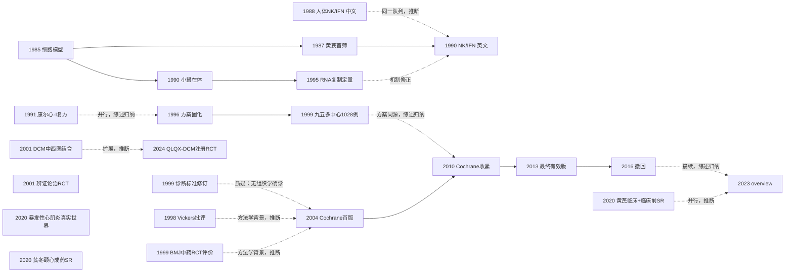

# D07 心肌炎与心肌病的中医药治疗

> 一句话判断：本方向以 1985–1999 年上海中山医院杨英珍/陈灏珠团队的"病毒-心肌细胞模型 → 黄芪抗柯萨奇病毒 → 黄芪+牛磺酸中西医结合方案 → 全国 12 中心 1028 例"为主线成形；2004–2016 年 Cochrane 系统评价（CD003711）四度更新后于 2016 年以"低优先级"撤回。今天病毒性心肌炎（VMC）方向的新 RCT 与国际注册近乎空白，证据生产退为对旧试验的反复系统评价再综合；扩张型心肌病（DCM）支线 2024 年进入注册双盲 RCT 时代。对临床医生最重要的一点：全部阳性证据都来自心电图、心肌酶等替代终点，无一试验经组织学或心脏磁共振确诊。

## 0 三分钟速读

1. **从哪里来**：1985 年上海医科大学中山医院建立柯萨奇 B2 病毒-乳鼠搏动心肌细胞培养模型 [D07-N01]，1987 年在该模型上首筛黄芪 [D07-N02]，1988 年报告首篇人体 NK 细胞/干扰素观察（中华心血管病杂志，PMID 2854784）[D07-N19]，1999 年"九五"攻关把黄芪+牛磺酸方案放大到全国 12 家医院 1028 例 [D07-N08]。
2. **为什么改变**：诊断标准从 1987 年宽标准（心律失常+酶学即可诊断）收窄到 1999 年修订版（不再单独以 CK-MB 或心律失常确诊；据公开页转述）[D07-N09]；Cochrane 指出纳入试验"无一经组织学确诊"[D07-N12]，"临床疑似"人群的疗效结论国际置信度低；2010 年方法学门槛提高后证据从 40 项 RCT/3448 例缩至 14 项/1463 例 [D07-N13]。
3. **如何分化**：黄芪单药、清热解毒复方（康尔心-I [D07-N05]）与辨证论治 [D07-N10] 三条配方线并行；研究对象从 VMC 延伸到 DCM（2001 年 164/156 例对照 [D07-N11] → 2024 年 24 中心注册双盲 RCT [D07-N18]）；重症端出现黄芪注射液真实世界再利用 [D07-N16]。
4. **现在研究什么**：近五年 VMC 中药 RCT 与国际注册近乎空白（ClinicalTrials.gov 检索为 0 条），证据生产转为系统评价再综合——黄芪注射液 SR 纳入 26 项研究/2793 例 [D07-ES4]、生脉散 SR 纳入 44 项 RCT/4298 例 [D07-R03]；DCM 方向网络 Meta 井喷（单一 SR 纳入 96 项 RCT/8452 例 [D07-R10]）。
5. **用了什么数据**：细胞/小鼠模型 → 单中心小样本 RCT → 全国多中心 RCT → Cochrane 证据链 → 真实世界回顾队列 → 注册 RCT → GBD 生态学数据；终点长期停留在有效率、心电图与心肌酶等替代指标。
6. **还有什么不知道**：无一试验经组织学或 CMR 确诊；死亡等硬终点在 Cochrane 2013 版 20 项试验中仅 1 项报告 [D07-N14]；2016 年 Cochrane 评价因"低优先级"撤回后无国际维护 [D07-N15]；海外无独立临床验证；1987 年首篇与 1999 年诊断标准两个承重节点本轮仅有题录/二手转述层证据、未经独立核实。

**覆盖边界**：纳入病毒性心肌炎（急性期与后遗症期）与扩张型心肌病的中医药治疗，含黄芪系列基础与临床研究、Cochrane CD003711 版本系谱与 2016 年撤回、心肌炎诊断标准变迁；儿科病毒性心肌炎仅作交叉（1999 年中华儿科标准、芪冬颐心口服液）。不含：心衰总论（D03，芪苈强心 QUEST 试验归该方向）、中药注射剂安全性再评价（D10，仅在安全性争议处点到）、作用机制系统梳理（D12）、心律失常（D04）。

**本章口径**：截止 2026-10-17；近期窗口 2021-10-17 至 2026-10-17。证据阅读层级：L0=仅二手转述、L1=题录已核实、L2=摘要已读、L3=原文部分章节已读、L4=全文已读。本章共 23 个节点：L1 者 5 个（N02、N09、N19、N21、N23），L2 者 17 个，L3 者 1 个（N15，Cochrane 撤回声明全文已读）。**覆盖状态：基本完整但有标注缺口**——"从哪里来、为什么改变、如何分化、现在研究什么、用了什么数据、还有什么不知道"六问均可据本章回答；章节范围内主要分支（VMC 黄芪主线、康尔心-I 复方与辨证论治支线、DCM 支线、重症真实世界、Cochrane 与中文 SR 证据综合链、临床前机制与递送）均有节点；缺口限于第 8 节已标注项目（中文库未查、1987 年首篇与 1999 年诊断标准原文未读、ChiCTR 全量组合检索未执行、Cochrane 全文不可得等），属标注级缺口，不动摇主链关系的可核实性，故不降为"部分"。

## 1 源头：最初在研究什么

起点按四类标注（"目前最早找到的文献"不等于"公认奠基"，凡属前者均带检索范围限定）：

- **实验室起点（被公认的奠基工作）**：1985 年 Yang YZ 与英国合作者 Dyke JW 建立柯萨奇 B2 病毒感染乳鼠搏动心肌细胞培养模型（J Virol Methods；感染后 42h LDH 116±24.8 vs 对照 46.9±9.7 U/L，96h 搏动完全消失），确立"病毒直接损伤心肌"的三参数定量读出平台 [D07-N01]。"公认"的依据是团队后续论文的方法学回指与作者/单位连续性，范围限于团队内部沿用，未见第三方专门评述。
- **黄芪进入心肌炎（目前最早找到的文献）**：1987 年同一团队在 Chin Med J 发表黄芪注射液对 CVB2 感染心肌细胞的作用 [D07-N02]，为本轮 PubMed/Europe PMC 可查的最早黄芪-心肌炎英文原始研究（1987 年前仅见无关综述）。**注意：该文 MEDLINE 无摘要、原文不在 PMC，本轮仅有题录（L1），其具体效应数字未经原文核对。**
- **人体验证起点（本轮已修正）**：最早可查的人体观察是 1988 年中华心血管病杂志报告（16(6):337-9,382，PMID 2854784，题录层、无摘要）[D07-N19]；1990 年 Chin Med J 发表其英文报告，NK 活性 11.5±11.9%→44.9±15.0%、诱导 α/γ 干扰素等数字出自该英文摘要 [D07-N04]。两篇同题、同团队，本章按同一队列处理。
- **复方路线起点（目前最早找到的文献）**：1991 年云南中医学院康尔心-I（金银花、麦冬、黄芪）26 例随机配对交叉试验（辅酶 Q10 对照）[D07-N05]；更早复方研究可能存在于 1980 年代中文期刊，本轮未及。
- **诊断标准节点**：1986 年全国心肌炎心肌病专题座谈会制订《成人急性病毒性心肌炎诊断参考标准》（纪要刊于中华内科杂志 1987 年第 26 卷第 10 期，起始页 597；卷页据二手引用页转述，未经原刊核对）；1999 年全国心肌炎心肌病学术研讨会修订并采纳 WHO/ISFC 心肌病定义 [D07-N09]。**该节点条文内容全部据中华急诊网与期刊引用页转述（L1），未经原刊核对；全报告复核时公开学术库未检得该纪要题录，未经独立核实。**
- **DCM 支线起点（本轮已重标）**：OpenAlex 可检得 1999 年《西北国防医学杂志》题录 "Observation on therapeutic effects of the combination of Chinese traditional and western medicines on dilated cardiomyopathy"（Wan Chen，OpenAlex W2392439813，无 DOI/卷页），为本轮可查的更早 DCM 中西医结合题录；2001 年中山医院 164 vs 156 例对照 [D07-N11] 表述为"可核查的最大样本奠基团队研究之一"，不再称"最早"。
- **证据综合起点（目前最早找到的文献）**：2004 年 Cochrane CD003711 首版（40 项 RCT/3448 例，全部来自中国）为该干预方向的首次国际系统化 [D07-N12]。

## 2 关键转折

**转折 1（验证/扩展）：体外 → 在体 → 人体，1985–1990。** 细胞模型上的黄芪保护结论先后在小鼠在体模型（黄芪组心肌病变面积与组织病毒滴度低于对照组）[D07-N03] 与人体（NK 活性恢复+干扰素诱导）[D07-N04] 复制，确立"黄芪抗病毒心肌炎"的完整证据雏形（依据：团队论文方法学连续与摘要自述）。

**转折 2（修正）：机制假说被部分推翻，1990–1995。** 1990 年人体观察把疗效归于 NK-干扰素免疫调节 [D07-N04]；1995 年与德国 Kandolf 实验室合作用 35S 标记原位杂交证明黄芪抑制心肌 CVB3-RNA 复制，且摘要原句"its effect on CVB3-RNA replication had no correlation with induction of beta-IFN"——抗病毒作用不依赖干扰素诱导 [D07-N06]，1990 年的机制解释被修正。免疫调节与直接抗病毒两条机制线此后并存，从未在同一模型中头对头整合。

**转折 3（同一项目+验证+边界）：方案固化与全国放大，1996–1999。** 中山医院 1996 年单中心 RCT（48 例）把"黄芪+牛磺酸+辅酶 Q10+抗心律失常药 vs GIK+辅酶 Q10+抗心律失常药"固化为标准方案 [D07-N07]；1999 年"九五"国家攻关以逐项相同的方案在 12 家医院完成 1028 例（602 vs 426）多中心试验：临床症状改善（P<0.001）、ST-T 改变（P<0.01）、窦房阻滞与阵发性房颤（均 P<0.05）、外周血肠道病毒 RNA 转阴优于对照组，但早搏两项终点组间无差异 [D07-N08]。两项试验为同一"九五"攻关项目的单中心预试验与多中心阶段（方案一致，项目名见 CBA 题录），样本不重叠、分别计数。这是本方向规模峰值，此后 VMC 中药 RCT 未再现同等规模。**该试验随机方法、盲法、随访时长摘要未报告；其是否进入 Cochrane 2010 版 14 项/2013 版 20 项名单，因 Cochrane 全文本轮不可得（全文 XML 服务错误、PDF 渲染页受限）而无法核对，本章不作断言。**

**转折 4（修正入选框架）：诊断标准收窄，1987→1999。** 1987 版标准过宽（心律失常+酶学升高即可诊断），大量"疑似心肌炎"进入研究队列；1999 年修订明确不再单独以 CK-MB 升高或心律失常确诊（据中华急诊网等公开页转述，本轮未读原刊，L1，未经独立核实）[D07-N09]。收窄的直接后果是历史"宽标准"中药试验与"窄标准"试验不可比；Cochrane"无一项试验经组织学确诊"正是该结构性问题的国际表述 [D07-N12]。现代端由 ESC 2013 立场声明、心脏磁共振与心内膜活检接棒 [D07-ES8]，新标准下几乎没有新的中药试验出现。**本章对"标准收窄→试验不可比→国际低置信"解释链的中间环节依赖二手转述，条文细节未经原刊核对。**

**转折 5（修正）：国际系统化与方法学收紧，2004–2013。** Cochrane 首版纳入 40 项 RCT/3448 例/25 种中药，全部来自中国、无组织学确诊、方法学质量低 [D07-N12]；2010 年更新版仅纳入"随机序列产生充分"的试验，缩至 14 项/1463 例/9 种中药（约 2/3 试验被剔除）[D07-N13]；2012 年 pub4 放宽纳入后为 20 项 RCT/2177 例；2013 年 pub5 维持 20 项并给出效应量：黄芪注射液+支持治疗改善异常心电图（RR 0.28，95%CI 0.13–0.61）、ST-T 改变（RR 0.72，0.54–0.95）、CPK（MD -21.54）与 LDH（MD -30.33）；生脉注射液异常心电图 RR 0.11（0.01–0.86）；生脉散改善 SF-36（MD 40.20）；死亡终点仅 1 项试验报告，黄芪注射液对心衰死亡无显著减少 [D07-N14]。证据形态定格为"替代终点一致阳性、硬终点空白"。

**转折 6（停滞信号）：2016 年 Cochrane 撤回。** 撤回声明原文（本轮已读全文，L3）："The editors of Cochrane Heart consider this title as low priority for the current portfolio of the Heart Group and therefore this title is not open to a new author team." [D07-N15]——属优先级问题，非数据造假或安全性撤回，但国际证据体系自此停止维护该题名。

**转折 7（互补/接续）：综合范式转移，2020–2023。** 中文团队以 PROSPERO 注册 SR 接续：2020 年黄芪临床+临床前混合系统评价 [D07-N21]、芪冬颐心口服液 SR（19 项研究/2608 例）[D07-N20]；2023 年广安门医院 overview 在 AMSTAR-2+GRADE 框架下重汇 6 项 SR/67 项 RCT/5611 例，结论方向阳性但证据质量中等偏低 [D07-N17]。

**转折 8（分化/新分支）：DCM 进入注册 RCT 时代，2024。** 芪苈强心胶囊治疗新诊断病毒相关 DCM 的全国 24 家三级医院随机双盲安慰剂对照试验（345 例随机，12 个月）：IFN-γ、IL-17、TNF-α、IL-4 下降、IL-10 上升，组间比较除 QLQX 组 LVEDd 外均 P<0.001（摘要）；ClinicalTrials.gov 注册 NCT01293903（2012 年启动，实际入组 374 例）主要终点与发表一致 [D07-N18]。与 2001 年同院非注册对照研究 [D07-N11] 形成 23 年代际对照。注册入组 374 vs 发表随机 345 的差异原文未解释。

**国际方法学批评前史（跨病种背景）。** 在 Cochrane 之前，国际界对"中国试验几乎全阳性"已有系统批评：Vickers 等 1998 年系统评价发现发表于中国的非针灸对照试验 99% 报告阳性，"No trial published in China or Russia/USSR found a test treatment to be ineffective"（摘要本轮已读）[D07-N22]；Tang/Zhan/Ernst 1999 年在 BMJ 发表首篇中药 RCT 国际系统评价（题录层核实，内容未核）[D07-N23]。两文均非心肌炎专门研究，但为理解本方向"全部试验来自中国、替代终点全阳性、几乎无阴性报告"的证据形态提供了最早的国际方法学解释框架。

## 3 分支图

实线=原文明确讨论或综述归纳的关系；虚线=本报告推断（边上已注明）。N10（辨证论治路线）、N16（重症真实世界再利用）、N20（成药综合支线）为支线节点，未接入主因果链。

## 4 近五年重点（2021-10-17 至 2026-10-17）

**主题 1：黄芪/生脉类制剂的系统评价再综合循环。** 研究黄芪注射液、生脉散类、参麦注射液对成人 VMC 有效率、心肌酶、cTnI、心电图与炎症因子的作用；均为 PROSPERO 注册 SR/Meta，纳入 RCT 18–44 项、样本 1661–4298 例。代表研究：黄芪注射液炎症因子 SR（19 项 RCT：TNF-α SMD -2.271、IL-6 -1.501、有效率 RR 1.225，异质性 I² 83–97%）[D07-R01]；黄芪注射液 SR 更新（26 项研究/2793 例：有效率 92.79% vs 77.71%，ΔCK-MB -7.64、ΔcTnI -0.18）[D07-ES4]；生脉散 SR（44 项 RCT/4298 例：心悸恢复 RR 2.30、胸痛恢复 RR 1.57）[D07-R03]；参麦注射液 SR（18 项 RCT/1661 例：有效率 RR 1.22、CK-MB SMD -3.33）[D07-R04]。分歧：各 SR 方向一致阳性但均自判低质量/高异质性，2023 年 overview 以 GRADE 给出"不确定"总评 [D07-N17]。成熟度：发展中（数量增长、等级未升）。

**主题 2：VMC 中药 RCT 与注册双空白。** 本轮实测 ClinicalTrials.gov 以 "myocarditis astragalus""viral myocarditis Chinese herbal""myocarditis Shengmai" 检索均为 0 条注册；可定位的国内注册为 2008 年 ChiCTR-TRC-08000330（河南省中医院 VMC 急性期中医证治规范研究，注册页题录层）[D07-R05]；近五年英文数据库仅见网络 Meta（中药注射剂+曲美他嗪，检索至 2020-09）[D07-R06]。本轮未查到近五年 VMC 中药新注册 RCT（ChiCTR 全量检索未执行，见第 8 节）。对照 DCM 方向已有注册双盲 RCT [D07-N18]，反映急性期自限性疾病做长期硬终点试验的困难与商业动力差异。成熟度：缺口本身即现状。

**主题 3：暴发性/重症心肌炎真实世界与疾病负担。** 黄芪注射液在成人暴发性心肌炎回顾队列（源自 586 例急性心肌炎，54 例暴发性中 37 例使用）住院死亡 4/37 vs 7/17（P=0.03），出院时标志物/肾功能/LVEF 更优，但选择偏倚未解 [D07-N16]；GBD 2019 中国数据显示 1990–2019 年心肌炎年龄标化发病率与死亡率下降（男性发病率 AAPC -0.202，女性 -0.263）[D07-R07]；亚洲中青年流行负担综述 [D07-R08]；2024 版中国暴发性心肌炎指南把主战场定位于生命支持综合救治（据公开页转述，L0–L1；中药在指南中的地位本轮未核读原文）。分歧：真实世界阳性关联与证据层级悬殊的指南主线并存。成熟度：发展中。

**主题 4：DCM 网络 Meta 与贝叶斯 SR 井喷。** 研究中药注射剂（黄芪/生脉/参麦/参附/心脉隆等）、中成药与经方治疗 DCM（多合并心衰）的疗效比较排序。已核读摘要的两篇：5 种中药注射剂治疗 DCM 并心衰的贝叶斯网络 Meta（J Ethnopharmacol 2022）[D07-R09]；11 种中成药网络 Meta（96 项 RCT/8452 例/8 项终点，中国中药杂志 2023）[D07-R10]。另两篇停留题录层（细节本轮未核）：经典名方 SR+贝叶斯网络 Meta [D07-R11]、参麦注射液 DCM SR [D07-R12]。分歧：比较排序在不同方法与终点选择间不稳定，纳入试验仍为中国低质量 RCT。成熟度：方法活跃、原始证据未升级。

**主题 5：临床前机制与递送技术。** 黄芪甲苷/多糖/总皂苷、氧化苦参碱、小檗碱对 CVB3 心肌炎的 NF-κB/NLRP3/JAK-STAT 等通路干预及纳米递送。2026 年结构化综述判定黄芪类制剂与芪冬颐心口服液为人体证据相对最广者（确定性仍低），氧化苦参碱与小檗碱主要停留于临床前 [D07-ES5]；HL-1 细胞实验显示黄芪提取物经 STAT3/IL-6 轴剂量依赖抑制凋亡、炎症与氧化应激 [D07-R13]；机制谱系延伸（早于近五年窗口，作谱系而非近五年证据）：黄芪总皂苷经 TNF-α 通路的 CVB3 小鼠实验（2019）[D07-R14]；仿生黄芪甲苷 IV 纳米粒转向 DCM（2026，题录层）[D07-R15]。分歧：临床前通路研究高度活跃但与临床终点脱节，无新的转化试验。成熟度：早期线索。

## 5 争议、负性结果与停滞路线

**争议 1：汇总阳性 vs 证据质量。** 国内系统评价（[D07-R01][D07-ES4][D07-R03][D07-R04]）与 2023 overview [D07-N17] 显示中药+常规治疗在有效率、心电图、心肌酶上稳定阳性且不增加不良反应（不良反应合并 RR 0.79，95%CI 0.44–1.40）；Cochrane 2013 版认为"作用尚未确立"、死亡终点仅 1 项试验报告 [D07-N14]。国际方法学批评（Vickers 1998：中国非针灸对照试验 99% 阳性 [D07-N22]；Tang/Ernst 1999 [D07-N23]，均跨病种）为"全阳性形态"提供了出版偏倚的解释框架。状态：未解决，双轨并行。

**争议 2：Cochrane 撤回的性质。** 撤回原因原文为组合优先级判断（低优先级、不开放给新作者团队），非数据错误或安全性问题 [D07-N15]；二级引用中常见"因安全撤回"的误读。状态：已澄清（声明可查）。

**争议 3：机制解释未整合。** NK/干扰素免疫调节 [D07-N04]、直接抑制病毒 RNA 复制 [D07-N06]、钙通道与抗纤维化/抗凋亡分支（PMID 8580697、17879539、17454311）并存，从未头对头排序。状态：未整合。

**争议 4：诊断标准变迁使历史试验不可比。** 1987/1999 标准下"临床疑似"人群的试验与现代影像/活检时代不可比 [D07-N09][D07-N12][D07-ES8]；1999 年标准条文依赖二手转述（本章已明示，未经独立核实）。状态：结构性问题，构成新 RCT 设计与老证据外推之间的鸿沟。

**争议 5：注册与发表终点一致性。** QLQX-DCM 注册主要终点（12 个月 LVEDd/LVEF+ELISA 细胞因子）与发表一致；注册实际入组 374 vs 发表随机 345 未见解释 [D07-N18]。状态：大体一致，无终点漂移证据。

**负性结果与停滞路线**：
- 早搏两项终点在 1028 例多中心试验中组间无差异 [D07-N08]——疗效边界。
- 方法学收紧致证据收缩（40 项/3448 例 → 14 项/1463 例）[D07-N12][D07-N13]。
- 死亡终点几乎空白（20 项试验仅 1 项报告）[D07-N14]。
- 激素对照支线（1989–1991 年地塞米松实验系列，PMID 2560313、1655450）未并入中医药主线；重症场景以机械循环支持为主（2017 年专家共识/2024 年指南，据公开页转述）。
- 安全性反例：1997 年英国报告异位性皮炎患者服中药后出现可逆性扩张型心肌病（Br J Dermatol，PMID 9155965，题录层）——"中药-心肌病"并非单向保护叙事（与 D10 交叉）。

## 6 传承线与国际线

**传承线**（有文献可依、跨约 40 年）：
1. 1985–1987 上海医科大学中山医院/上海市心血管病研究所：杨英珍、陈灏珠团队与英国合作者 Dyke JW 建立 CVB2 细胞模型 [D07-N01] 并首筛黄芪 [D07-N02]；
2. 1988–1995 同一团队向人体与机制推进：1988 年中文 NK/干扰素观察 [D07-N19] → 1990 年英文报告 [D07-N04] 与 BALB/c 小鼠模型 [D07-N03] → 1995 年与德国 Kandolf 实验室合作 [D07-N06]；浙江中医医院补充 T 细胞亚群证据（1995，PMID 7549379）；
3. 复方支线：云南中医学院康尔心-I（清热解毒+益气养阴）[D07-N05]；
4. 方案固化与全国放大：1996 年单中心 48 例 [D07-N07] → 1999 年"九五"攻关 12 医院 1028 例 [D07-N08]（同一项目的两个阶段）；
5. 诊断标准接力：1986 年座谈会 → 1999 年修订 [D07-N09]；
6. 证据综合与国际化：北京中医药大学循证中心 2004–2013 年完成并更新 Cochrane CD003711 四版 [D07-N12][D07-N13][D07-N14]，2016 年被 Cochrane Heart 撤回 [D07-N15]；
7. 新一代综合：广安门医院 2020 年芪冬颐心口服液 SR [D07-N20]、2023 年成人 VMC overview [D07-N17]；协和医院 2014 年黄芪注射液 SR（PMID 25098261）；2020 年黄芪临床+临床前 SR [D07-N21]；南京中医药大学 2025 年黄芪注射液 SR [D07-ES4]；黑龙江中医药大学 2024 年参麦 SR [D07-R04]；
8. DCM 支线：中山 2001 [D07-N11] → 上海新华 2002 生脉血流动力学 100 例（PMID 12584790）→ 西安交大二院 2005 参麦免疫调节 56 例（PMID 15892275）→ 2022–2025 网络 Meta 井喷 [D07-R09][D07-R10][D07-R11][D07-R12] → 2024 年注册双盲 RCT [D07-N18]。

儿科交叉：1999 年中华儿科系统修订小儿病毒性心肌炎诊断标准（据 WebSearch 转述，L0）；芪冬颐心口服液 SR 含儿童病例 [D07-N20]。杨英珍的学术工作在中山医院由陈瑞珍等延续（2004 年起合著机制研究；行政任职与 2020 年科技奖信息未经权威页面核实，见第 8 节）。

**国际线**：
- 科研合作：德国图宾根 Kandolf 实验室合作完成 RNA 复制定量 [D07-N06]（中文姊妹篇 PMID 7703635，同一项目）；德国马尔堡 Maisch 参与心内膜活检巨细胞病毒基因组原位杂交研究（Chin Med J 1994;107(12):888-891，PMID 7882724）。两条均为 1990 年代中德方法学输出型合作。
- 国际证据体系：Cochrane CD003711 由北京中医药大学团队与国际合作者（Kwong JSW）完成，2004/2010/2013 版曾获 NIH NCCIH 基金资助（R24 AT001293）；Cochrane Heart Group 2016 年决定撤回 [D07-N15]。
- 国际方法学批评前史（跨病种）：Vickers 1998（中国非针灸对照试验 99% 阳性）[D07-N22]；Tang/Zhan/Ernst 1999 BMJ 首篇中药 RCT 国际系统评价 [D07-N23]。两文早于并独立于 Cochrane CD003711，是"中国试验全阳性"现象最早的国际系统性质疑；Cochrane 评价是否引用二者，因其全文本轮不可得而未核。
- 国际指南：ESC 2013 立场声明（PMID 23824828）在其检索摘要层面未见任何中药/草药治疗推荐 [D07-ES8]。
- 海外验证：本轮未查到海外独立重复的中药治疗心肌炎 RCT（Europe PMC 去除中国机构后检索 84 条均为旁支综述/汉方研究，该判断经复核成立）；ClinicalTrials.gov 中药心肌炎注册为 0 条，仅 DCM 方向有芪苈强心两项注册（NCT01293903、NCT02283450）。更晚近的编者按类批评文献本轮未系统排查。

## 7 数据路径小结

历史上：（1）病毒-心肌细胞培养模型（1985，LDH/AST、搏动频率、51Cr 释放三参数读出）[D07-N01]；（2）BALB/c 小鼠 CVB3 心肌炎模型（1990 起；1995 年起 35S 原位杂交定量化病毒 RNA）[D07-N03][D07-N06]；（3）单中心小样本 RCT（26–320 例）[D07-N05][D07-N07][D07-N10][D07-N11]；（4）全国多中心 RCT（1999 年 12 中心 1028 例，规模峰值，此后 VMC 方向未再现）[D07-N08]；（5）系统评价证据链（Cochrane 四版；2010 年后中文 PROSPERO 注册 SR：18–44 项 RCT/1661–4298 例；2023 年 overview 的 AMSTAR-2/GRADE 再评价）[D07-N12][D07-N13][D07-N14][D07-N17]。

现在：（6）真实世界/回顾性队列（暴发性心肌炎 54 例，源自 586 例急性心肌炎）[D07-N16]；（7）注册库时代 RCT（2024 年 QLQX-DCM：24 中心、双盲安慰剂、12 个月，细胞因子+超声终点）[D07-N18]；（8）人群生态学数据（GBD 2019，Joinpoint+年龄-时期-队列）[D07-R07]；（9）网络药理/多组学靶点筛选、细胞通路验证与纳米递送 [D07-R13][D07-R14][D07-R15]。

贯穿性特征：终点长期停留在有效率/心肌酶/ECG 替代指标，组织学或 CMR 确诊的 RCT 至今空白；中文库（CBM/CNKI/VIP/万方）是主要数据底座，国际注册与期刊为输出端。（注：前期材料曾出现"2019–2020 年临床前动物系统评价、SYRCLE 工具、16 项动物研究/634 只"的数字，因未能定位到对应题录，本章不采用，见第 8 节待核线索。）

## 8 还不知道什么（领域证据缺口）与本报告的检索缺口

**领域证据缺口：**
1. 现代影像/活检确诊标准下的中药 RCT 为零：注册库检索 0 条，近五年英文数据库无新 RCT；1999 标准时代以后的试验仍以临床+酶学入选。
2. 硬终点（死亡、移植、长期心功能）证据空白：Cochrane 2013 版 20 项试验仅 1 项报告死亡；2024 年 QLQX-DCM 仍以细胞因子+超声为主要终点。
3. 儿童与国际线证据缺失：儿科仅 1999 年中华儿科标准（转述）与含儿童的成药 SR；海外无独立验证研究。

**本报告检索缺口：**
1. **CNKI/万方未检索对本章结论的影响是系统性的**：1987 年 Chin Med J 首篇的中文前期报道、1980 年代更早的中文原始研究、"九五"攻关中文原刊全文、1999 年诊断标准纪要原文、辨证论治与复方路线的大样本中文试验，均只能停留在题录层或无法触达——本章对 1980 年代起点与中文试验细节的描述因此偏保守，"最早"类判定全部带"本轮英文数据库可查"限定。
2. 1987 年首篇 [D07-N02] 原文未读到（MEDLINE 无摘要、不在 PMC、无合法开放全文），该节点结果内容为零，仅题录（L1）。
3. 1999 年诊断标准 [D07-N09] 条文全部据二手页转述（L1）；公开学术库无该纪要题录，未经独立核实（已列为存疑）；1987 年纪要卷页亦据二手引用页转述。
4. 1999 年九五多中心试验 [D07-N08] 仅有 CBA 英文摘要；其是否被 Cochrane 各版纳入及偏倚评价条目，因 Cochrane 全文不可得未核。
5. ChiCTR 站内"黄芪+心肌炎"组合的全量精确检索未执行（站点检索需交互）；第 4 节主题 2"本轮未查到近五年 VMC 中药新注册 RCT"的结论即以此为限定。
6. Cochrane CD003711 背景/讨论章是否引用 Vickers 1998 与 Tang/Ernst 1999 未核（全文不可得）。

**待核线索**（无可定位来源或未经核实，不进入正文叙事）：
- 1986 年全国座谈会的确切召开时间与地点（仅二手页转述）。
- 1999 年研讨会"昆明召开"之说（仅网络页，本章不采信）。
- 杨英珍学会/行政任职；陈瑞珍团队 2020 年上海医学科技奖三等奖（网页转述，未经授奖机构核实）。
- 1999 年中华儿科标准的具体卷期页。
- "16 项动物研究/634 只"数字（疑出自 [D07-N21] 临床前部分，未经核对，本章不采用）。
- 1980 年代初《上海医学》《中华心血管病杂志》黄芪治疗心肌炎的中文首报。

## 9 本章节点速查表

| 编号 | 年份 | 第一作者+题名简写 | 期刊 | 节点作用 | 设计/数据/分析单位 | 样本（研究/患者/方剂·证候等） | 关键结果 | 阅读层级 | 核查状态 | PMID/DOI |
|---|---|---|---|---|---|---|---|---|---|---|
| N01 | 1985 | Yang YZ：CVB2 感染乳鼠搏动心肌细胞培养 | J Virol Methods | 建立关键方法 | 体外细胞培养+病毒感染；培养孔 | 乳鼠心肌细胞培养（数未报） | 42h LDH 116±24.8 vs 46.9±9.7 U/L；96h 搏动消失 | L2 | 通过 | 3009512 / 10.1016/0166-0934(85)90132-6 |
| N02 | 1987 | Yang YZ：黄芪注射液作用于 CVB2 感染心肌细胞 | Chin Med J | 提出重要问题（黄芪首筛） | 细胞模型药物干预；培养孔 | 培养孔（数未报） | 题录确认在 CVB2 模型检验黄芪；结果数字未核（无摘要、原文不可得） | L1 | 通过 | 2827966 / — |
| N19 | 1988 | Yang YZ：NK 活性与 α/γ 干扰素诱导（中文首报） | 中华心血管病杂志 | 人体验证起点 | 开放观察+小对照；患者 | 主观察+6 例对照；IFN 亚组 16+12 例 | 题录层（MEDLINE 无摘要）；数字出自 1990 英文摘要 | L1 | 修正（核查阶段补入） | 2854784 / — |
| N03 | 1990 | Yang YZ：黄芪治疗小鼠 CVB3 心肌炎 | Chin Med J | 提供重要验证（体外→在体） | 动物实验；BALB/c 小鼠 | 小鼠（每组只数未报） | 病变面积/占比与病毒滴度均低于对照 | L2 | 通过 | 2161724 / — |
| N04 | 1990 | Yang YZ：黄芪对患者 NK 活性与干扰素的诱导 | Chin Med J | 首次人体验证（英文报告）+免疫假说 | 开放观察+对照；患者 | 与 N19 同一队列（1988 中文/1990 英文） | NK 11.5±11.9%→44.9±15.0%；对照无变化；α/γ-IFN 升高 | L2 | 修正（作者缩写；补 same_cohort_as=N19） | 2167822 / — |
| N05 | 1991 | Yan HJ：康尔心-I 临床与实验研究 | 中西医结合杂志 | 分化（清热解毒复方线） | 随机配对交叉 RCT+实验；患者/动物 | 26 例；实验小鼠（数未报） | 2 周 STI 改善；体外灭活 CVB3、诱生干扰素 | L2 | 通过 | 1659497 / — |
| N06 | 1995 | Peng T：黄芪抑制 CVB3-RNA 复制 | Chin Med Sci J | 机制修正（中德合作） | 动物+原位杂约定量；小鼠心肌组织 | 小鼠（每组只数未报） | CVB3-RNA 拷贝数与坏死评分降低；与 β-IFN 无关 | L2 | 通过 | 8580483 / — |
| N07 | 1996 | Gu W：急性 VMC 中西医结合治疗（单中心） | 中国中西医结合杂志 | 提出关键方案（多中心前身） | 单中心 RCT；患者 | 48（30 vs 18） | 临床改善、EVs RNA 转阴、早搏控制优于对照 | L2 | 通过 | 9772585 / 10.1007/BF02935367 |
| N08 | 1999 | "九五"攻关协作组：急性 VMC 药物治疗多中心研究 | 中华心血管病杂志 | 提供重要验证（规模峰值） | 全国 12 中心 RCT；患者 | 1028（602 vs 426）；12 医院 | 症状 P<0.001、ST-T P<0.01、窦房阻滞/阵发房颤 P<0.05；早搏无差异 | L2 | 通过（CBA 英文摘要） | — / —（CBA id 585627） |
| N09 | 1999 | 心肌炎心肌病对策专题组：1999 诊断参考标准 | 中华心血管病杂志 | 改变既有认识（标准收窄） | 共识文件 | — | 不再单独以 CK-MB/心律失常确诊（据公开页转述，未经原刊核对） | L1 | 存疑（公开学术库无题录，未经独立核实） | — / — |
| N10 | 2001 | Kong QF：辨证论治+卡托普利治重症 VMC 并心衰 | 中国中西医结合杂志 | 分化（辨证论治线） | RCT（3 证型亚组）；患者 | 109（72 vs 37）；3 证型 | NYHA 疗效优于对照；心肌酶下降更显著 | L2 | 修正（卷 21(7) 非 22(7)） | 12575396 / — |
| N11 | 2001 | Yang YZ：中西医结合治疗 DCM 164 例观察 | 中国中西医结合杂志 | 扩展（VMC→DCM 支线） | RCT；患者 | 320（164 vs 156） | 症状与心功能优于对照；总死亡相近、3–6 月死亡更少 | L2 | 通过 | 12577349 / — |
| N12 | 2004 | Liu JP：Herbal medicines for viral myocarditis（Cochrane 首版） | Cochrane Database Syst Rev | 建立关键方法（首次国际系统化） | 系统评价；研究（RCT） | 40 RCT/3448 例/25 种中药 | 总体结论为证据不足，其中黄芪/丹参/参麦亚组方向阳性；全部来自中国、无组织学确诊、质量低 | L2 | 通过 | 15266498 / 10.1002/14651858.CD003711.pub2 |
| N13 | 2010 | Liu ZL：同题更新（严格纳入版） | Cochrane Database Syst Rev | 修正（证据收缩） | 系统评价；研究（RCT） | 14 RCT/1463 例/9 种中药 | 随机序列充分门槛下 40→14；黄芪/生脉类阳性 | L2 | 通过 | 20614436 / 10.1002/14651858.CD003711.pub3 |
| N14 | 2013 | Liu ZL：同题最终有效版（pub5） | Cochrane Database Syst Rev | 提供验证与边界 | 系统评价；研究（RCT） | 20 RCT/2177 例/13 种中药 | ECG RR 0.28、ST-T RR 0.72、CPK -21.54、LDH -30.33；死亡仅 1 项报告 | L2 | 通过 | 23986406 / 10.1002/14651858.CD003711.pub5 |
| N15 | 2016 | Liu ZL：WITHDRAWN 撤回声明 | Cochrane Database Syst Rev | 质疑/停滞信号 | 编辑决定文件 | — | "low priority for the current portfolio"（原文逐字） | L3 | 通过 | 27142939 / 10.1002/14651858.CD003711.pub6 |
| N16 | 2020 | Yang H：黄芪注射液治成人暴发性心肌炎回顾队列 | Medicine | 分化（重症真实世界） | 回顾性队列；患者 | 54（37 vs 17；源自 586 例） | 住院死亡 4/37 vs 7/17（P=0.03） | L2 | 修正（期 99(48) 非 99(28)） | 33235067 / 10.1097/MD.0000000000023062 |
| N20 | 2020 | Hu J：芪冬颐心口服液治 VMC 的 SR/Meta | Evid Based Complement Alternat Med | 证据综合（成药支线） | SR/Meta；研究（RCT） | 19 项研究/2608 例 | 有效率等终点阳性（摘要层）；2026 综述列其为人体证据最广者之一 | L2 | 修正（核查阶段补入） | 32565861 / 10.1155/2020/4704535 |
| N21 | 2020 | Zheng Q：黄芪治 VMC 临床+临床前系统评价 | Oxid Med Cell Longev | 前导综合（临床+临床前） | SR（混合设计）；研究 | 研究数未核（摘要未读） | 题录层；临床前部分细节未核 | L1 | 修正（核查阶段补入） | 33204391 / 10.1155/2020/1560353 |
| N17 | 2023 | Hui XS：成人 VMC 中药 overview of SRs | Clinical Therapeutics | 综合证据图景（GRADE） | Overview of SRs；系统评价 | 6 SR/67 RCT/5611 例 | 有效率/ECG/心肌酶阳性；不良反应 RR 0.79；GRADE 不确定性大 | L2 | 通过 | 37690913 / 10.1016/j.clinthera.2023.08.005 |
| N18 | 2024 | Liao YH：芪苈强心治 DCM 随机对照试验（QLQX-DCM） | Current Medical Science | 形成新分支（注册 RCT 时代） | 全国 24 中心随机双盲安慰剂 RCT；患者 | 345 例随机；24 医院 | IFN-γ/IL-17/TNF-α/IL-4 降、IL-10 升；组间除 QLQX 组 LVEDd 外均 P<0.001 | L2 | 修正（卷 44(6)；题名；组间 P 值；协作组署名） | 39196518 / 10.1007/s11596-024-2916-9 |
| N22 | 1998 | Vickers A：某些国家是否只产出阳性结果 | Control Clin Trials | 国际方法学批评（跨病种） | 系统评价；研究（对照试验） | 多国对照试验（中国非针灸组 99% 阳性） | "No trial published in China or Russia/USSR found a test treatment to be ineffective" | L2 | 通过（本轮补入） | 9551280 / 10.1016/s0197-2456(97)00150-5 |
| N23 | 1999 | Tang JL：中药随机对照试验的系统评价 | BMJ | 国际评价入口（跨病种） | 系统评价；研究（RCT） | 中药 RCT 汇总（细节未核） | 题录层核实；内容未核（无摘要、全文未读） | L1 | 通过（本轮补入） | 10406751 / 10.1136/bmj.319.7203.160 |

## 10 本章入口文献与检索截止

- **D07-ES1**（=节点 N13）Liu ZL 等. Herbal medicines for viral myocarditis. Cochrane Database Syst Rev 2010;(7):CD003711（pub3）。检索截止：CENTRAL 2009 年第 3 期、MEDLINE 至 2009-07、EMBASE 1998–2009.7、中文库 1979–2009。PMID 20614436。
- **D07-ES2**（=节点 N14）Liu ZL 等. 同题 2013;(8):CD003711（pub5，未撤回的最新版本）。检索截止：2013-02-01（未发现新试验）。PMID 23986406。2016 年 pub6 撤回件 PMID 27142939（=节点 N15）。
- **D07-ES3**（=节点 N17）Hui XS 等. Clin Ther 2023;45(10):991-1003。检索截止：8 个数据库自建库至 2022-06-23。PMID 37690913。
- **D07-ES4** Jialiken D 等. Effect of Astragalus injection treatment for viral myocarditis. Eur J Med Res 2025;30(1):1。检索截止：2024-05-01（PROSPERO CRD42021239660）。PMID 39754214。
- **D07-ES5** Wu W 等. Therapeutic Targeting of Viral Myocarditis with Natural Products and Herbal Medicines: From Immune-Inflammatory Mechanisms to Clinical Translation. J Inflamm Res 2026;19:619981。叙述性综述（检索截止未说明）。PMID 42751609。
- **D07-ES6** Fan H 等. Traditional Chinese Medicine Treating Dilated Cardiomyopathy: A Literature Review. Int J Gen Med 2025;18:4311-4325。叙述性综述（检索截止未说明）。PMID 40809953。
- **D07-ES7**（=节点 N09）心肌炎心肌病对策专题组. 中华心血管病杂志 1999;27(6):405-407。规范性文件（不入 MEDLINE；内容据公开页转述，公开学术库无题录，未经独立核实）。
- **D07-ES8** Caforio AL 等. ESC 心肌炎立场声明. Eur Heart J 2013;34(33):2636-2648, 2648a-2648d。立场声明。PMID 23824828。

检索执行日 2026-10-17（Europe PMC / PubMed E-utilities / ClinicalTrials.gov API v2 / OpenAlex / WebSearch；DCM 早期题录另经 OpenAlex W2392439813 定位）。

## 12 复核修订记录（2026-10-17）

1. 机械质检（图语法）｜第 3 节 mermaid 分支图｜节点标签"1988 人体NK/IFN(中文)""1990 NK/IFN(英文)"改为"1988 人体NK/IFN 中文""1990 NK/IFN 英文"（去圆括号，保留双引号包裹）；7 条边标签去圆括号与半角冒号，如"同一队列(推断)"→"同一队列，推断"、"质疑:无组织学确诊"→"质疑：无组织学确诊"；改后经 node 解析检查 D07 输出 OK。
2. 跨章一致性冲突 14（与 D10）｜第 9 节速查表 N12 行与证据表 EV-D07-13｜2004 年 Cochrane CD003711.pub2 结论由"黄芪/丹参/参麦阳性"改为"总体结论为证据不足，其中黄芪/丹参/参麦亚组方向阳性"，与 D10 口径一致；全章对 2016 年停止维护的表述逐处复查，均统一写"撤回（withdrawn，流程性停止维护，撤回声明注明原因）"，与其他章口径一致，未发现改用其他性质的措辞。
3. 证据抽查（EV-D07-10/N09，1999 年全国心肌炎心肌病学术研讨会纪要 27(6):405-407）｜证据表 verification_status"通过"→"存疑"，limitations 注明"公开学术库无题录，待核线索（纸本/中文库人工核对）"；正文第 0 节速读第 6 点、第 1 节诊断标准节点、第 2 节转折 4、第 5 节争议 4、第 8 节检索缺口 3、第 9 节速查表 N09 行核查状态、第 10 节 D07-ES7 处注明"未经独立核实"。
4. 机械质检（引用格式）｜第 6 节传承线与第 7 节数据路径共 4 处复合引用拆为单个方括号：N12→N14 连写 2 处、R09–R12 连写 1 处、R13–R15 连写 1 处，均改为逐项并列表述（如 [D07-N12][D07-N13][D07-N14]、[D07-R09][D07-R10][D07-R11][D07-R12]、[D07-R13][D07-R14][D07-R15]）；拆分后全部被引编号逐一核对，均可在 evidence_D07.json 的 row_id/node_id 找到。

**第二轮（完整性检查）**

1. 建议改（注册空白限定句）｜第 4 节主题 2｜在"近五年英文数据库仅见网络 Meta……[D07-R06]"句后补标准限定句"本轮未查到近五年 VMC 中药新注册 RCT（ChiCTR 全量检索未执行，见第 8 节）"，落实完整性检查意见：注册空白结论此前仅基于 ClinicalTrials.gov 三组检索词实测 0 条加一条 2008 年 ChiCTR 题录，补句后"0 条（实测范围）"与"近乎空白（总体判断）"两表述口径衔接，不再跳变。
2. 建议改（连带呼应）｜第 8 节检索缺口 5｜末尾补"第 4 节主题 2'本轮未查到近五年 VMC 中药新注册 RCT'的结论即以此为限定"，与主题 2 新增限定句双向呼应；证据表 EV-D07-31（D07-R05）key_result 同步补同一限定句。
3. 覆盖状态重评｜本章口径｜按统一口径评定为"基本完整但有标注缺口"：六问均可据本章回答；主要分支均有节点；缺口限于第 8 节已标注项目（中文库未查、1987 年首篇与 1999 年诊断标准原文未读、ChiCTR 全量组合检索未执行、Cochrane 全文不可得等），不动摇主链可核实性。理由与状态已写入"本章口径"。
4. 本轮未做新增检索、未新增清单以外文献或数字；正文引用格式复核为单个 [D07-Nxx] 方括号并列，未发现复合连写。
