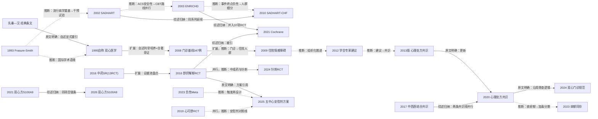

# D08 双心疾病：心血管病合并焦虑抑郁的中医药干预

> 心血管病与焦虑抑郁共病的管理被"双心医学"从精神科拉回心内科，中医以"心主神明/心主血脉"完成理论对接，证据形态以中成药与针刺RCT为主。当前证据仍以量表终点为主、确定性普遍为低，尚无以心血管硬终点为主要终点的中药/针灸RCT。2023年舒肝解郁胶囊单药负性Meta与2025年五中心安慰剂对照方案的启动，标志本方向正处于"升级设计再验证"的关口。

## 0 三分钟速读

1. **从哪里来**：中医"心主神明/心主血脉"经典条文（先秦—汉，本轮经电子版逐字核对）提供理论接口；"双心医学"概念按胡大一自称1995年在北京朝阳医院提出，最早可核公开自述文本为2017年，1995年无同期文献 [D08-N02]。
2. **为什么改变**：心内科大量胸痛/心悸患者查无器质性疾病、单治心脏疗效差；2008年门诊347例筛查给出约40%心理问题检出率，把个人主张变成可量化问题 [D08-N04]。
3. **如何分化**：西医"心理处方"共识线（2013版→2020版→2024门诊规范）与中西医结合共识线（2017）并行；干预分化为中成药、针刺、病机理论（病郁同存）与机制组学四条 [D08-N15][D08-N07][D08-N09][D08-N11][D08-N10]。
4. **现在研究什么**：安慰剂对照多中心RCT（2025年五中心舒肝解郁胶囊方案，148例，MACCE入次要终点）、7种中成药+SSRI网络Meta（2026年，65项RCT/5975例）、针刺HRV终点RCT（2024年，210例）与双心门诊规范化 [D08-N12][D08-E6][D08-N11]。
5. **用了什么数据**：HAMD/HAMA/HADS/PHQ-9等量表终点为主；HRV、440项细胞因子、肠道菌群、代谢组学作机制桥梁；注册库（ChiCTR/ITMCTR/ClinicalTrials.gov/PROSPERO）与19家三甲HIS真实世界数据补充 [D08-N08][D08-E4]。
6. **还有什么不知道**：无以死亡/再梗/MACCE为主要终点的中药或针灸RCT；已核实的双盲安慰剂试验仅60例1项+148例计划方案1项；合并分析异质性最高I²=98%，证据确定性普遍为低 [D08-E8]。

**覆盖边界**：纳入双心医学概念在中国的提出与演进、中医理论与郁证框架的对接、冠心病/ACS/AMI/PCI后/高血压合并焦虑抑郁的中医药与针灸干预、量表与心血管终点之争、国际psychocardiology参照系。不含：精神科原发性抑郁/焦虑障碍（如健脾解郁汤多中心RCT，PMID 36301455，人群为原发性轻中度抑郁，越出共病边界）；心脏康复功法归D09；急性心梗血运重建围术期用药主线归D02；心衰中成药主链归D03；QUEST试验（2019，PMID 31780034）终点为稳定冠心病MACE而非情志，归D01。

**本章口径**：证据检索截止2026-10-17；近期重点窗口2021-10-17至2026-10-17。阅读层级：L0=仅二手转述、L1=题录已核、L2=摘要已读、L3=原文部分章节已读、L4=全文已读；只到L0/L1的说法不写成"已核对原文"。本章节点20个（中国线14、国际线6）：L1×9、L2×7、L3×3、L4×1；其中8个为本轮补入的节点（2009住院基线、2012学会建议、2013版心理处方共识、SADHART 2002、CREATE 2007、Frasure-Smith 1993、DEPACS 2015、双心方2021前作），均为题录级。证据表共34行（关键节点20、近期代表研究8、入口综述6；入口E1、E2与节点N07、N09为同一文件，各计1行）。E1–E8为本章入口文献（见第10节）；其中入口综述6行在证据表中的节点编号为 D08-E3–D08-E8，与正文引用编号一致。**覆盖状态：基本完整但有标注缺口**——理由：六问（从哪里来/为什么改变/如何分化/现在研究什么/用了什么数据/还有什么不知道）均可据本章回答；中国线（经典理论接口、概念自述、流行病学基线、学会共识序列、中成药RCT、针刺、病机与机制）与国际线（起源流行病学—干预试验序列—跨病种方法学批评前史—学科与共识节点）的主要分支均有节点；缺口限于第8节已标注项（CNKI/万方未检索、部分节点仅题录级、ChiCTR注册页被拒、BMJ 1999全文未读、双心方向1990年代专门方法学批评未查到并已注明），完整性检查唯一建议改条目已落实、无未落实的必须改项。

## 1 源头：最初在研究什么

### 1.1 经典理论源头（被公认的奠基工作）

《素问·灵兰秘典论》"心者，君主之官也，神明出焉"与《素问·痿论》"心主身之血脉"，经ctext.org电子版逐字核对（L3）；《伤寒论·辨太阳病脉证并治中》第107条"伤寒八九日，下之，胸满烦惊，小便不利，讝语，一身尽重，不可转侧者，柴胡加龙骨牡蛎汤主之"亦逐字核对，原文确作"讝语"（L3）[D08-N01]。《金匮要略·妇人杂病脉证并治》"妇人脏躁，喜悲伤欲哭……甘麦大枣汤主之"经多个公开学术页一致转引（L2，未核对善本）。这些条文与两首经方构成后世双心叙事的中医话语接口：2020版心理处方共识中医部分写明"早在先秦时期的《黄帝内经》中就阐述了心主血脉与心主神明的双心理论"（转载全文，L3）[D08-N09]。限定：经典成书与传抄年代复杂，不能当作对现代"抑郁共病"的描述。

### 1.2 情志病方药源头（被公认的奠基工作）

甘麦大枣汤主"脏躁"、柴胡加龙骨牡蛎汤主"胸满烦惊"，是现代用于心血管病合并情志异常的两个经方出口；柴胡加龙骨牡蛎汤治疗冠心病合并焦虑抑郁的现代中文试验仅到中文题录/转述层（见第8节检索缺口），本轮未读全文。

### 1.3 "双心医学"概念（作者自称首次）

胡大一自称1995年——在北京朝阳医院创建心脏中心两年后——悟出并明确提出"双心医学"，把精神心理评估干预融入心内科实践，并以中医理论为直接思想资源：自述原句"中医不是讲心主神明，心主血脉吗？"随后试用氟西汀（百忧解）治疗反复胸痛患者 [D08-N02]。据其2021年自述（转载全文，本轮通读）：问题的起点是心内科大量胸痛/心悸患者查无器质性疾病、症状与早搏无因果关系（"病"与"症"分离），被诊断为心脏神经官能症而疗效差；其回顾CAST试验的教训与200余例13岁以下儿童室性早搏的临床观察，得出单治心脏不够、须同治精神的判断。限定语必须带足：**1995年为作者自称，无同期文献佐证**；最早可核公开自述文本为2017年8月5日梅斯医学专栏《普及落实"双心医学" 重视患者抑郁》（其中自述"我1995年在朝阳医院倡导并身体力行实施的'双心医学'（cardiopsychology）——care both heart and mind"，https://www.medsci.cn/article/show_article.do?id=9a1710e8122c ）及2017年专著《漫谈双心医学》（中国轻工业出版社，207页）；2021年《中华心血管病杂志》自述（49卷6期543-544页）为期刊正式文本。时间线只能写：1995（自称）→2017（专栏自述+专著）→2021（期刊自述）。三个文本相互印证的只是"作者反复自称1995年提出"，不是1995年本身有文献。

旁证与反向核查（本轮已核）：英文题名检索（psycho-cardiology＋China）最早命中2018年文献（PMID 29487305，题录级），未检得更早的胡大一双心概念英文文献；OpenAlex检索"心主神明"题名可见《中山大学学报》1990、1993、1996年"心主神明"与"脑主神明"之争系列论文——属纯中医理论内部讨论，不是与双心医学的对接文本，不构成反证。本轮另检得2006年《中华心血管病杂志》34卷12期"冠造阴性疑诊心绞痛共病抑郁的抗抑郁治疗研究"（PMID 17274900，题录级）——属实践性研究而非概念论述，可作1995年前后中国心内科已开始处理共病的旁证，不作为概念提出证据。调度线索所称"2006年前后概念论述"未检得对应文献（本轮已核）。

### 1.4 中国流行病学基线（目前最早找到的文献级证据）

2008年刘梅颜、胡大一等在胡大一门诊以SDS/SAS/HAMD/HAMA筛查347例：纯躯体病52.4%、纯心理障碍12.7%、躯体病共病心理障碍27.7%（合计约40%）；心理问题者中抑郁31例（8.9%）、焦虑62例（17.9%）、混合28例（8.1%）；纯心理问题者常被以心血管/功能性/消化疾病诊断处理 [D08-N04]。这份基线把"双心"从个人主张变成可量化的门诊流行病学，直接支撑后续共识与双心门诊建设。2009年同一团队补充报告住院急性/稳定期冠心病患者的情感障碍 [D08-N14]——与2008门诊样本为不同人群（门诊 vs 住院），非同一队列；其具体发生率本轮仅题录级核实。限定：单中心名医门诊样本，选择偏倚明显，不能外推全国。

### 1.5 国际源头（目前最早找到的文献级证据）

Frasure-Smith等1993年在JAMA报告心梗后抑郁对6个月生存的影响（270卷15期1819-1825页，题录级）[D08-N18]——恰构成胡大一自称1995年提出双心医学前后的国际学术语境；此后的国际干预试验线由此展开（见第2节转折二）。

### 1.6 中药RCT最早证据池（目前最早找到的文献）

据2016年《Chinese Journal of Integrative Medicine》系统评价（检索截至2014-09-30，摘要已读）转述：共纳入13项中药治疗冠心病合并抑郁的RCT、1095例，全部在中国开展；合并结果为单用中药4周无效（MD -1.06）、8周有效（MD -1.00），与抗抑郁药联用增效，不良事件更少 [D08-E4]。其中更早的单篇中文RCT原文未经公开库逐一核实（中文全文在付费墙内），该证据池的时间与规模判断完全依赖此系统评价的转述。这份系统评价也是本方向最早的英语系统评价，把散在的中文RCT第一次盘成可引用的证据集合。

## 2 关键转折：问题—新证据/新方法—认识变化—新问题

本节按问题演变组织，不按论文罗列；每步标注关系类型（验证/扩展/质疑/修正/分化/互补/并行/同一项目）与依据（原文明确/综述归纳/本报告推断），负性结果随行保留。

### 转折一：从"心脏神经官能症"到"双心"——概念与理论嫁接（扩展，原文明确）

问题：心内科大量胸痛/心悸患者查无器质性疾病、症状与早搏无因果关系，被诊断为心脏神经官能症而疗效差。据胡大一2021年自述（本轮通读转载全文）：其回顾CAST试验"病症分离"教训与200余例13岁以下儿童室性早搏的临床观察，自称1995年在北京朝阳医院提出双心医学，并显式援引中医"心主神明，心主血脉"作为思想资源 [D08-N02]。自述同时罗列了此后的建制动作（培养双心方向博士、设双心学组、创办双心医学杂志、长城会双心论坛、中德双心培训、2012年将双心融入心肺预防康复五大处方、"四问"工作法）——这些细节的唯一来源是该自述，按L0对待（见第6节）。经典条文与概念的对接属"原文明确"关系（自述原句引《素问》）[D08-N01]；"双心医学与中医理论的对接话语"以2021年自述为最早可核公开文本（2017年共识摘要层未核到该字样，本轮已核）。新问题：概念如何从个人主张变成可操作、可量化的临床对象——这直接引出转折三的门诊筛查。

### 转折二：国际线确立"改善抑郁≠改善心血管结局"（反证，综述归纳）

1993年Frasure-Smith等的流行病学把抑郁推向心血管预后危险因素 [D08-N18]；随后干预试验接连中性/负性：SADHART 2002（ACS/AMI人群舍曲林安全性确立、疗效证据有限，JAMA 288卷6期701-709页）[D08-N16]；ENRICHD 2003（2481例，CBT为主必要时加SSRI，随访平均29个月：抑郁评分HRSD -10.1 vs -8.4、社会支持ESSI 5.1 vs 3.4均优于常规照护（P<0.001），但无事件生存率75.8% vs 75.9%，差异无统计学意义）[D08-N03]；CREATE 2007（西酞普兰±人际心理治疗改善抑郁而心血管事件无获益）[D08-N17]；SADHART-CHF 2010（469例≥45岁LVEF≤45%心衰伴重性抑郁，舍曲林50-200mg/d vs 安慰剂12周、均含护士支持；HAMD组间差-0.4，95%CI -1.7~0.92，P=0.89；复合心血管状态P=0.78；舍曲林安全）[D08-N05]；Cochrane CD008012.pub4（2021）合并37项RCT：药物干预改善抑郁症状（SMD -0.83）与缓解（OR 2.06），但不改善死亡与心脏事件 [D08-E8]。这组结果规定了此后双心干预试验（含中医药）的终点讨论框架：量表获益与硬终点获益必须分开陈述；国内共识与综述普遍引述其负性结果，多数后续试验的终点设计以此为参照（本报告推断）。对ENRICHD负性结果的通行解释是常规照护组抑郁评分改善明显（稀释效应），且其未纳入中药 [D08-N03]；但"改善抑郁能否改善预后"这一检验本身，此后二十余年没有任何国际试验翻案。关系类型：ENRICHD→SADHART-CHF为扩展（推断：事件终点负性后转向特定人群）；SADHART→SADHART-CHF为同系列延续（综述归纳）。

### 转折三：中国基线与组织化——从主张到共识序列（扩展+建制化）

2008年门诊347例基线（纯躯体病52.4%、纯心理12.7%、共病27.7%）[D08-N04] 与2009年住院冠心病情感障碍数据 [D08-N14] 构成两条互补基线（非同一队列）。2012年胡大一、丁荣晶等发表学会层面《关注心血管疾病患者心理健康的专家建议》（中华心血管病杂志40卷2期89-91页，题录级）[D08-N13]——这是2008年基线与2013年共识之间首个全国性学会层面的组织化文件，补上了此前叙事在这一段的跳空。2013版《在心血管科就诊患者的心理处方中国专家共识》（刊出于中华心血管病杂志2014年42卷1期6-13页）为本轮所见最早的心理处方共识 [D08-N15]；2020版为其更新（原文明确），由三学会/学组联合署名，内容扩至"双心"急症处理、技能培训与互联网管理（CREDO研究）章节，并在西医共识文本内写入中医病机——心理精神疾病属"郁证""不寐""百合病""脏躁"范畴，"心肝失调是情志病发生的基本病机，病理因素多为痰、瘀、郁，治则以理气、活血、养心神为大法"，同时明确轻中度患者由受训心内科医师处理、重度转诊精神科的双向机制 [D08-N09]。中西医结合线由另一学组推进：中国中西医结合学会心血管病专业委员会双心学组（组长陈晓虎，江苏省中医院）2017年发布《双心疾病中西医结合诊治专家共识》——**本轮找到的最早的该类共识（题录级核实，全文未读；本轮未对更早同类学会文件做系统排查，故不写"首部"）**[D08-N07]；2024年《双心门诊建设规范中国专家共识》（丁荣晶通信作者，期刊官网已核）给出PHQ-9/GAD-7/PHQ-15/SSS分级分流流程图与A–D证据分级表，其参考文献并列2020心理处方共识与2017中西医结合共识（综述归纳：两条共识线并行）[D08-E3]。关系类型：2012建议→2013共识为组织化推进（推断）；2013→2020为更新（原文明确）；2017与2020为并行（综述归纳）。新问题：共识覆盖了"谁来筛、怎么转诊"，但"用什么药、证据几级"仍取决于各干预线自己的试验——引出转折四。

### 转折四：中药RCT从开放头对头到安慰剂对照，再到负性Meta与再设计（验证→质疑→修正）

2016年舒肝解郁胶囊vs舍曲林治疗AMI合并抑郁RCT（149例：76/73，24周）：有效率无显著差、不良事件率显著更低、心脏安全性相似；心脏安全评估含LVEF下降≥5%、血压、心率、P-R/QRS间期、QTc [D08-N06]。该试验被Europe PMC记录的被引16次（含2025年西苑方案与2026年综述），并进入Cochrane合并分析 [D08-E8]。其与国际抗抑郁安全研究在对照逻辑上互补（未发现原文承认受SADHART系列启发——本报告推断）。同辈证据池经2016年英语系统评价盘点（截至2014-09-30，13项RCT/1095例）：单用中药4周无效、8周有效，联合抗抑郁药增效，不良事件更少 [D08-E4]（单篇RCT据该系统评价转述）。2019年心可舒片双盲随机安慰剂对照RCT（60例冠心病血运重建后HADS-A/D≥8分者，12周，注册号ChiCTR-IPR-17010940见于摘要）：HADS-A/HADS-D与PHQ-9显著优于安慰剂，并检测440项外周血细胞因子（另设独立队列验证相关性），改善与trappin-2、脂联素、IL-1β、血小板生成素、ALCAM、NT-3、转铁蛋白变化相关，提示提高抗炎/促炎比值——为本轮已核实的首个安慰剂对照中成药试验 [D08-N08]；其后续被纳入心可舒PCI后Meta（2022，11项RCT/1000例，抑郁SMD -2.80但I²=98%，PMID 35717809）与焦虑抑郁Meta（2023，18项RCT/1907例，PMID 37072088）。2023年Meta（6项RCT/644例，检索至2021-06）转而判定：单用舒肝解郁胶囊改善HAMD劣于抗抑郁药（MD 2.12，95%CI 0.73~3.50；舍曲林亚组MD 2.15），仅在与降压药联用时优于单用降压药（MD -8.33），且单纯冠心病人群中舒肝解郁组心脏不良事件风险更高（RR 2.72，95%CI 1.07~6.94）[D08-E5]——单药替代路线受挫。回应是设计升级：2025年中国中医科学院西苑医院牵头五中心（西苑/中日友好/中山大学附属第八/福建省第三人民医院/徐州市中医院）双盲安慰剂RCT方案（148例，1:1，12周治疗+36周随访；主终点HAMD-17应答即减分率≥50%或<7；MACCE、SAQ、SF-36、MoCA、炎症、HPA轴、BDNF与血清代谢组学入次要；双注册ITMCTR2024000099+国家备案MR-11-24-037476；伦理批件2024XLA062-3；按SPIRIT 2025/CONSORT 2025撰写）[D08-N12]；方案参考文献第13条即2016年同类RCT（原文明确引用关系），样本量估算中对照组45.7%应答率引自2012年舍曲林冠脉支架后抑郁研究、试验组69%引自2009年舒肝解郁胶囊双盲安慰剂RCT（经PMC全文核对，两处来源不同，67例/组+10%脱落=74例/组）。新问题：负性Meta针对的是旧设计的开放头对头证据，安慰剂对照结果能否翻案，成为2026年之后本方向最大的悬而未决点。

### 转折五：针灸线以自主神经终点切入（并行，推断）

2024年针刺干预不稳定心绞痛PCI围术期三臂RCT（针刺/假针/对照，1:1:1，210例）：电针组LF/HF降低（P=0.014），针刺组SDNN index（average SDNN）、另一HRV指标、pNN50、HF升高（P=0.018/0.043/0.016/0.002）；三组HAMA均改善（P<0.001），针刺对量表终点的特异性未明确确立；IL-6（P=0.021）与AoPP（P<0.001）组间有差，hs-CRP、OX-LDL无差；终点还覆盖PSQI与糖代谢指标 [D08-N11]。注册主要终点（基线至术后7天HRV变化）与发表一致（ClinicalTrials.gov API已核）；两处需注意的口径问题：注册计划240例、实际入组210例，注册状态UNKNOWN、结果未回填；注册第二臂写Psychotherapy、发表写假针（placebo），两库口径不一致。与中成药线的关系为并行（同为心血管人群情志干预、干预手段不同）；其HRV主终点的选择把"客观自主神经指标能否替代量表"的讨论带进针灸分支，2026年已有系统评价继续汇总该类试验（8项RCT/759例，题录级）[PMID 42780566]。

### 转折六：病机理论与机制研究细化（分化，推断；机制线同项目延续）

2020共识"痰、瘀、郁"病机在2023年被"病郁同存"理论扩展为含"毒"的三期动态框架：两病独立共存且互为因果，按慢性潜隐期（痰）—病理进展期（瘀）—急性发作期（毒）定痰郁同治/瘀郁同治/毒郁同治，并明确双心疾病为"心之血脉与心之神明"同病（框架延续关系为本报告推断）[D08-N09][D08-N10]。摘要称该途径可同时改善器质损害与情绪障碍并调节微观证候指标，但摘要层未列支持性临床数据，全文在付费墙内未读。机制线上，双心方2021年以蛋白组学锁定S100A9 [D08-N20]，2026年在Phytomedicine（文章号158477）报告其改善心梗后抑郁的共同靶点机制（同项目链条，综述归纳）[PMID 42385427]；舒肝解郁胶囊2022年报告CUMS大鼠肠道菌群改变（题录级，Front Pharmacol文章号828595）[PMID 35770090]；网络药理方向2022年已有32项研究的Meta+网络药理合并分析，槲皮素、山柰酚等成分被提示同时作用于冠心病与情志靶点（摘要级）[PMID 35600859]。理论细化与证候分期话题与D11（证候客观化）交叉，机制多组学与D12交叉，此处点到为止。

## 3 分支图

实线=原文明确讨论或综述归纳的关系；虚线=本报告推断。

## 4 近五年重点（2021-10-17 至 2026-10-17）

### 4.1 安慰剂对照、多中心、双注册的中成药RCT（ACS/冠心病人群）

研究舒肝解郁胶囊等中成药对ACS/冠心病合并抑郁状态的疗效与安全性，背景是旧证据被2023年Meta判为负性（单药劣效+心脏不良事件RR 2.72）[D08-E5]。常用数据与设计：多中心双盲安慰剂RCT；ITMCTR＋国家医学研究登记备案信息系统双注册；按SPIRIT 2025/CONSORT 2025撰写方案；主终点仍为量表（HAMD-17应答），心血管结局与组学放次要。代表：2025年五中心方案（西苑医院牵头，148例计划，12周治疗+36周随访，MACCE/SAQ/SF-36/MoCA/炎症/HPA轴/BDNF次要+血清代谢组学亚研究，结果未出）[D08-N12]；心可舒片Meta（18项RCT/1907例，检索至2022-02，TSA+GRADE）：XKS联合西药降低HAMA（MD -7.60）、SAS（-10.05）、HAMD（-6.74）、SDS（-10.75），证据质量总体低，呼吁高质量双盲RCT [PMID 37072088]。分歧：负性Meta的判定与"升级设计再验证"路线直接冲突——同一制剂在开放头对头中"相当且更安全"（2016）与在Meta合并中"劣效且心脏事件更多"（2023）并存，等待安慰剂对照结果裁决。成熟度：发展中（旗舰试验结果未出）。

### 4.2 中成药联合SSRI的网络Meta与证据分级

研究7种中成药（舒肝解郁胶囊、解郁丸、归脾制剂、甜梦等）+SSRI的对比排序。常用数据与设计：网络Meta（netmeta/贝叶斯getmc）＋CINeMA置信度评估＋PROSPERO注册，数据库组合为CNKI/万方/VIP/CBM＋MEDLINE/Embase/CENTRAL。代表：2026年网络Meta（65项RCT/5975例，检索至2026-04-01）：全部中成药+SSRI较单用SSRI改善HAMD（MD -2.60~-6.20）与应答率（OR 1.8-5.0），解郁丸HAMD SUCRA最高；无不良事件比较达显著；应答率存在发表偏倚（Egger p=0.0002；HAMD p=0.5753），CINeMA多为低确定性 [D08-E6]；2024年网络Meta（198项RCT/8923例，摘要级）：归脾丸应答率SUCRA第一，证据质量低 [PMID 38633609]；2022年Meta+网络药理（32项研究）：对空白对照焦虑OR 3.22、抑郁OR 3.27，与西药相当，心绞痛发作频率/ECG改善，槲皮素、山柰酚等成分同时作用于冠心病与情志靶点 [PMID 35600859]。分歧：SUCRA排序为概率性、置信度低、应答率发表偏倚显著——综述内部对"排序能否指导临床"有保留；"联用增效"与"单药替代"是两个不同命题，排序结论不能回答单药问题。成熟度：发展中。

### 4.3 针灸与穴位刺激

研究针刺/电针对PCI围术期焦虑抑郁、HRV与炎症的影响。常用数据与设计：三臂RCT（针/假针/对照）＋注册库登记＋HRV/炎症客观终点；系统评价开始出现。代表：2024年三臂RCT（210例，HRV主终点，结果见转折五）[D08-N11]；吴茱萸穴位贴敷+双心护理RCT（82例1:1，Front Med 2025，题录级+本轮补核设计信息）[PMID 41488062]；2026年针刺改善PCI后心功能系统评价（8项RCT/759例，检索至2026年5月，题录级）[PMID 42780566，Front Med文章号1926216]。分歧：针刺特异性（vs假针）在量表终点上未明确确立——三组HAMA均改善意味着安慰效应/自然改善无法排除。成熟度：早期线索。

### 4.4 共病机制与多组学

机制研究从单指标转向菌群、代谢物、多靶点网络与组学，动物模型以CUMS（慢性不可预知轻度应激）和心梗后抑郁模型为主。代表：舒肝解郁胶囊改变CUMS大鼠肠道菌群（2022，16S rDNA，题录级）[PMID 35770090，Front Pharmacol文章号828595]；双心方S100A9蛋白组学前作（2021）[D08-N20]与2026年Phytomedicine共同靶点论文（同项目链条，题录级）[PMID 42385427]；2025年方案内置血清代谢组学（LC-MS/GC-MS）亚研究 [D08-N12]；外周血440项细胞因子的机制桥接（2019）见 [D08-N08]。分歧：机制证据以动物与网络预测为主，向临床终点转化无闭环——没有任何一项机制发现被前瞻性临床试验验证。成熟度：早期线索。

### 4.5 双心服务模式规范化与共识/指南国际化

研究双心门诊建设标准与量表分流路径。常用数据与设计：共识制定（证据分级表）＋门诊流程图（PHQ-9/GAD-7初筛、PHQ-15/SSS躯体症状评估、按分值分级处理或转诊）。代表：2024年双心门诊建设规范共识（PHQ-9/GAD-7/PHQ-15/SSS诊治流程+A–D证据分级，中华医学会心身医学分会双心学组+中国康复医学会心血管病预防与康复专委会，丁荣晶通信作者）[D08-E3]；中西医结合抑郁诊疗指南英文版2025年进入General Psychiatry（题录级）[D08-E7]；2025年ESC心理健康与心血管病临床共识（Eur Heart J 46卷41期4156-4225页）确认整合管理方向——据题录与德文评述（PMID 41484331）转述，本轮未见中医药推荐条目 [PMID 40878270]。分歧：国际共识与国内共识体系存在话语差（国际层面未见中医药条目），国内共识的门诊规范已发布但执行效果无数据。成熟度：门诊规范已发布、执行效果数据缺。

## 5 争议、负性结果与停滞路线

1. **舒肝解郁胶囊单药能否替代抗抑郁药**：一派（2016年RCT，149例）认为与舍曲林疗效相当且不良事件更少 [D08-N06]；另一派（2023年Meta，6项RCT/644例）判定单药劣于抗抑郁药（HAMD MD 2.12），且单纯冠心病人群中舒肝解郁组心脏不良事件RR 2.72（95%CI 1.07~6.94）[D08-E5]；2026年网络Meta显示与SSRI联用普遍增效（MD -2.60~-6.20）[D08-E6]。争议持续，等待ITMCTR2024000099多中心安慰剂对照RCT结果。
2. **终点选择：量表替代终点 vs 心血管硬终点**：国内试验几乎均以HAMD/HAMA/SDS/SAS/HADS/PHQ-9为主要终点；国际线（ENRICHD无事件生存75.8% vs 75.9%、SADHART-CHF P=0.89、Cochrane 37项RCT）反复显示改善抑郁未改善死亡/心脏事件；2025年方案首次把MACCE列入次要终点 [D08-N12]。以心血管硬终点为主要终点的中药或针灸RCT本轮未查到。
3. **证据质量**：Yeung等2014年（香港团队，J Psychiatry Res 57卷165-175页）汇总296项中药抑郁RCT，判定93.9%方法学质量低（modified Jadad<3），但合并显示中药单用优于安慰剂（HAMD MD -7.97）、与抗抑郁药相当（MD 0.01）且不良事件更少，常用方为逍遥散、柴胡疏肝散、甘麦大枣汤 [PMID 24974002]；心可舒PCI后Meta（11项RCT/1000例）抑郁终点SMD -2.80但I²=98% [PMID 35717809]；2026年网络Meta自身亦报告CINeMA低确定性与应答率发表偏倚（Egger p=0.0002）[D08-E6]。各方均呼吁双盲多中心大样本试验。
4. **注册终点与结果报告缺口**：已核对的注册-发表一致性总体良好（NCT03789344注册主要终点HRV与2024年发表一致；ITMCTR2024000099注册主终点HAMD-17应答与方案一致；本轮已核）；但NCT03789344计划240例实际入组210例，CT.gov状态UNKNOWN、结果未回填，注册第二臂（Psychotherapy）与发表第二臂（假针）口径不一致；ChiCTR注册页直接访问被拒（HTTP 405），ChiCTR-IPR-17010940注册终点未核。提示中文注册库结果回填的系统性缺口。
5. **针刺特异性未确立**：2024年三臂RCT三组HAMA均改善，针刺优于假针的量表证据未给出明确结论 [D08-N11]；HRV客观终点的组间差异能否转化为临床获益，无后续数据。
6. **停滞/断链路线**：乌灵胶囊在心脏手术人群的RCT（ChiCTR1800017989，2018年注册，CABG术后焦虑抑郁心脏心理康复）注册后结果论文未检得，证据链断裂（据注册快照转述，L0）；高血压合并焦虑抑郁的中药证据多停留在Meta方案层（PROSPERO CRD42021219704；方案PMID 33663107，检索至2020-12-31），完成的专科系统评价少；国际线"抗抑郁/心理干预改善心血管结局"的路线整体未获支持（ENRICHD/SADHART-CHF/Cochrane），该路线对中药的提示是：量表获益之外必须过硬终点检验，而目前没有中药试验完成这一检验。

## 6 传承线与国际线

**传承线**（接力链中凡仅出自胡大一自述的细节，均标"据自述"；自述文本本身已通读，但所述师承、任职、办刊、培训事实未经独立物证核验，按L0对待——合著论文之外的这些环节不升入事实层）：

1. 理论源：《素问》心主神明/心主血脉＋《伤寒论》107条柴胡加龙骨牡蛎汤＋《金匮要略》甘麦大枣汤 [D08-N01]。1990年代"心主神明 vs 脑主神明"的学刊讨论（《中山大学学报》1990/1993/1996，OpenAlex题录可见）属理论内部争论，未与双心概念对接。
2. 概念提出：胡大一自称1995年提出双心医学（据自述；最早公开文本2017年专栏与专著，2021年期刊自述）[D08-N02]。
3. 第一代接力（据2021年自述）：培养刘梅颜、张娟、马文林、丁荣晶、张俊蒙等双心博士；设立双心学组、创办双心医学杂志、办长城会双心论坛、开展中德双心培训（同济大学附属同济医院）；2012年将双心融入心肺预防康复五大处方；提出"四问"工作法。题录可旁证部分：刘梅颜/胡大一2008年门诊基线与2009年住院调查两篇合著（PMID 18843948、20137541，题录已核）；其余师承与办刊、培训细节维持"据自述"状态（见第8节待核线索）。
4. 组织化（西医"心理处方"线）：2013版心理处方共识（刊出2014）→2020版（中国康复医学会心血管病预防与康复专业委员会＋中国老年学学会心血管病专业委员会＋中华医学会心身医学分会双心学组联合署名，含急症处理、技能培训、CREDO互联网管理章节）→2024年双心门诊建设规范（丁荣晶通信作者，期刊官网已核；给出可执行的门诊流程图与证据分级表）[D08-N15][D08-N09][D08-E3]。这条线的特点是把双心从"理念"做成了"科室里的流程"。
5. 中西医结合线：中国中西医结合学会心血管病专业委员会双心学组（组长陈晓虎，江苏省中医院）→2017年中西医结合共识（通信作者陈晓虎，期刊官网已核题录；全文未读）[D08-N07]；2023年江苏省首届双心医学专业委员会成立，陈晓虎任主任委员（医院官网与学会通知网页，本轮检索所见）。此线把中药RCT实践升格为学会共识文件。
6. 理论细化：广州冼绍祥团队（末位作者）2023年"病郁同存"痰-瘀-毒分期论治 [D08-N10]。
7. 试验主线：心可舒片（ChiCTR-IPR-17010940注册，注册号见于2019年RCT摘要；双盲安慰剂RCT发表）；舒肝解郁胶囊（贯叶金丝桃＋刺五加）2016年AMI人群头对头→2025年中国中医科学院西苑医院/国家中医心血管病临床医学研究中心五中心安慰剂方案（双注册）[D08-N06][D08-N12]；针刺2024年NCT03789344。乌灵胶囊链条断于结果未发表（ChiCTR1800017989）。

总括：一条"经典理论→西医概念嫁接（自述）→流行病学→学会共识→中成药RCT与双心门诊"的接力链；除自述环节外，各环节均有可核文献或注册号。学科史层面对胡大一双心学科形成的完整叙事归X01横切方向，此处只保留与本方向直接相关的环节。

**国际线**：

1. 起源流行病学：Frasure-Smith等1993年心梗后抑郁与6个月生存 [D08-N18]。该文把抑郁从"生活质量问题"改写为"预后变量"，是整个psychocardiology领域的起点性证据。
2. 干预试验序列：SADHART 2002（ACS人群舍曲林安全性确立、疗效证据有限）[D08-N16]→ENRICHD 2003（2481例，CBT±SSRI，无事件生存75.8% vs 75.9%）[D08-N03]→CREATE 2007（西酞普兰±人际心理治疗，抑郁改善而心血管事件无获益）[D08-N17]→SADHART-CHF 2010（469例，舍曲林不优于安慰剂）[D08-N05]→DEPACS 2015（韩国ACS后抑郁艾司西酞普兰24周双盲安慰剂RCT，题录级）[D08-N19]→Cochrane CD008012.pub4（2021，37项RCT：药物改善抑郁症状SMD -0.83与缓解OR 2.06，不改善死亡/心脏事件）[D08-E8]。这一序列的读法：国际线先用流行病学确立"抑郁是危险因素"，再用二十年干预试验证明"治抑郁未见改善预后"，然后把注意力转向筛查与整合管理（服务模式），而非继续押注单一药物。
3. 中医药与国际证据体系的接触点：Cochrane CD008012.pub4纳入"艾司西酞普兰 vs 补心气口服液（Bu Xin Qi）"头对头、并引用2016年舒肝解郁胶囊AMI试验——中药作为对照/干预进入国际系统评价 [D08-E8]；中西医结合抑郁诊疗指南英文版2025年进入General Psychiatry [D08-E7]。
4. 海外系统评价：Yeung等（香港，J Psychiatry Res 2014;57:165-175）296项中药抑郁RCT：93.9%方法学质量低；合并中药单用优于安慰剂（HAMD MD -7.97）、与抗抑郁药相当（MD 0.01）、不良事件更少；常用方逍遥散、柴胡疏肝散、甘麦大枣汤 [PMID 24974002，摘要级]。
5. 方法学批评前史（跨病种，早于上条Yeung 2014）：本方向"296项中药抑郁RCT中93.9%方法学质量低而合并阳性"的证据形态，在国际上有更早的同源批评——Vickers等1998年系统核查MEDLINE 1966-1995年收录的对照试验：中国发表的非针灸试验99%报告阳性、无一项报告"治疗无效"（英格兰75%），提出发表偏倚解释（Control Clin Trials 19(2):159-166，PMID 9551280，摘要本轮已读，L2）；Tang、Zhan与Ernst 1999年在BMJ发表中医药RCT方法学质量批评（BMJ 319(7203):160-161，PMID 10406751，该文无摘要、题录层L1）。两文均为跨病种批评、非双心/情志专项（是否涵盖抑郁试验未确认），已在本报告D01/D03/D05/D07/D10/X01各章收录，此处仅作交叉引用、不另立节点（该前史与本方向证据形态的同源对应为本报告推断）；双心方向专门的1990年代方法学批评本轮未查到（检索记录见第8节）。
6. 学科与监管节点：psychocardiology学科史编辑部文章（Front Psychiatry 2022，PMID 36051553，题录）；2025年ESC心理健康与心血管病临床共识确认整合管理方向，据题录与德文评述（PMID 41484331）转述，本轮未见中医药推荐条目 [PMID 40878270]。
7. 海外（中国内地/香港以外）直接开展的CVD合并抑郁中医药RCT：本轮未查到。检索覆盖PubMed、Europe PMC、OpenAlex、ClinicalTrials.gov API（检索词涵盖Chinese herbal/traditional Chinese medicine/acupuncture×coronary/cardiac×depression/randomized，另做Cochrane数据库标签检索）。国际总体态度：以Cochrane与香港团队系统评价为代表，承认"值得进一步试验"但强调证据质量低；未见国际指南作出肯定推荐。

## 7 数据路径小结

**量表终点线**（情志疗效评价，单独陈述）：2008年现状调查用SDS/SAS/HAMD/HAMA [D08-N04] → 2016年RCT沿用HAMD [D08-N06] → 2019年引入HADS＋PHQ-9 [D08-N08] → 2024年共识流程用PHQ-9/GAD-7/PHQ-15/SSS分级分流 [D08-E3] → 2025年方案以HAMD-17应答（减分率≥50%或<7）为主终点 [D08-N12]。

**心血管与客观终点线**（与量表分开陈述）：心脏安全指标（LVEF下降≥5%、血压、心率、P-R/QRS间期、QTc）见2016年RCT [D08-N06]；外周血440项细胞因子见2019年RCT [D08-N08]；HRV（LF/HF、SDNN index等）为2024年针刺RCT注册主要终点 [D08-N11]；MACCE＋SAQ/SF-36/MoCA＋HPA轴/BDNF＋血清代谢组学（LC-MS/GC-MS）为2025年方案次要终点 [D08-N12]。以死亡/再梗/MACCE为主要终点者本轮未查到。

**设计演进**：横断面筛查（2008/2009）→开放头对头（2016）→双盲安慰剂小样本＋生物标志物（2019，60例）→多中心双盲安慰剂＋双注册（ITMCTR＋国家备案）＋组学亚研究（2025，148例计划）；针灸线以三臂设计（针/假针/对照）切入（2024）。

**注册与证据合成基础设施**：ChiCTR、ITMCTR（国际传统医学临床试验注册平台）、国家医学研究登记备案信息系统、ClinicalTrials.gov、PROSPERO（本轮见CRD42019131346、CRD42021219704、CRD420261299414）；系统评价数据库组合为CNKI/万方/VIP/CBM＋MEDLINE/Embase/CENTRAL。

**真实世界**：全国19家三级甲等医院HIS数据库抑郁共病分析（中国中药杂志2014年39卷18期3454-3461页）：抑郁共病患者中高血压24.67%、冠心病16.10%，中药以活血化瘀通络类使用率59.97%（摘要级，PMID 25532377）。

**机制数据**：外周血细胞因子（2019）、HRV（2024）、CUMS大鼠肠道菌群16S rDNA（2022）、蛋白组学S100A9（2021/2026）、网络药理＋分子对接（2022）、血清代谢组学（2025年方案亚研究）。

**早期中文与断链路径**（数据存在但不可核或不可得）：2016年系统评价所含13项中国RCT的原始数据（CNKI付费）；乌灵胶囊CABG术后RCT（ChiCTR1800017989，结果未发表）；柴胡加龙骨牡蛎汤中文Meta与RCT（辽宁中医杂志2021年Meta+TSA线索、2023年104例RCT线索——均仅中文题录层，未能定位英文题录或开放全文）。

判断：本方向的数据路径已完成一次整体迁移——从"单中心、开放对照、量表主终点"迁移到"注册规范的双盲安慰剂多中心RCT＋量表主终点＋心血管结局与组学次要终点"；但量表终点与心血管终点尚未在同一试验的主终点位置重合，这是与数据路径演进并行的一条未闭合线。

## 8 还不知道什么（领域证据缺口）与本报告的检索缺口

**领域证据缺口**：

1. 无以心血管硬终点（死亡/再梗/MACCE）为主要终点的中药或针灸RCT；唯一把MACCE列入次要终点的多中心安慰剂RCT（ITMCTR2024000099）结果未出 [D08-N12]。国际线已证改善量表不等于改善结局 [D08-E8]，中药试验尚未越过这一检验。
2. 双盲安慰剂对照试验极少：已核实的仅2019年心可舒（60例）与2025年方案（148例计划）；其余多为常规治疗开放对照，合并分析异质性极高（I²=98%），GRADE多低/极低。
3. 高血压合并焦虑抑郁的中药证据停留在Meta方案层（CRD42021219704；PMID 33663107）。
4. 海外（中国内地/香港以外）开展的CVD合并抑郁中医药RCT未查到；海外直接RCT证据现仅为抗抑郁药线（DEPACS [D08-N19]）。
5. 机制研究（菌群/网络药理/蛋白组学/代谢组学）以动物与预测为主，无临床终点闭环。

**本报告检索缺口**：

- **CNKI/万方未检索（执行纪律：不登录、不付费）对本章结论的影响**：(a) 2017年《双心疾病中西医结合诊治专家共识》全文与摘要未取得（期刊页摘要动态加载），其推荐条目只能按题录与2024年共识转引陈述；(b) 2023年"病郁同存"等中文理论文献只有摘要级；中文原始RCT（乌灵胶囊冠心病RCT、柴胡加龙骨牡蛎汤RCT、甘麦大枣汤心脏应用）仅到题录或中文平台转述（L0/L1）——2016年系统评价所含13项中国RCT无法逐一独立核验，本方向"最早中药RCT证据池"的规模与时间判断完全依赖该系统评价的转述；(c) 未被英文库收录的中文研究与学会文件可能存在，本章时间线（尤其2008年以前与共识序列）可能偏晚或有遗漏；若后续可获中文全文，本章所有"本轮找到的最早"类限定语都有被改写的可能。
- "双心医学"1995年同期文献未检得：查了PubMed（Hu DY＋psych/depress，仅2008/2021两篇题录）、Europe PMC、WebSearch。
- **第二轮补查（2026-10-17，检索5次）**：(a) Vickers 1998（PMID 9551280）与Tang/Zhan/Ernst 1999（PMID 10406751）经Europe PMC核实题录；Vickers摘要本轮已读（L2），Tang文无摘要、全文未读（L1），其是否涵盖抑郁试验未确认；两文已在本报告D01/D03/D05/D07/D10/X01各章收录，本章仅交叉引用（见第6节国际线第5条）。(b) 三路检索"双心方向专门的1990年代方法学批评"：psychocardiology/psychosomatic×题名（methodology/quality/publication bias）×1990-1999（命中12条）、traditional Chinese medicine/Chinese herbal×题名（depress/anxiety/coronary/cardiac）×1990-1999（命中9条）、题名（methodology/publication bias）×摘要（中药）×1990-1999（命中0条），逐条核对均非双心情志方向的方法学批评（多为德文心身康复质控与冠心病中药进展综述），故正文作"未查到"限定，不作"已补查批评原文"表述。
- ChiCTR注册页直接抓取被拒（HTTP 405）：心可舒注册试验（ChiCTR-IPR-17010940）的注册终点与发表一致性未核。
- **待核线索**（无可定位来源或未能溯源，不进正文叙事）：①科普页称"89%住院冠心病患者存在焦虑或抑郁情绪"，与已核门诊数据（共病27.7%＋纯心理12.7%）不符，未溯源到原始论文，疑为转述失真；②"刘梅颜任中华医学会心身医学分会双心学组组长"仅见网页转述，未核到任职文件；③"创办双心医学杂志"的刊名/收录状态与中德双心培训沿革仅出自自述；④中国康复医学会心血管病预防与康复专业委员会双心学组的成立年份未核到；⑤乌灵胶囊ChiCTR1800017989的结果论文未检得。

## 9 本章节点速查表

| 编号 | 年份 | 第一作者+题名简写 | 期刊 | 节点作用 | 设计/数据/分析单位 | 样本 | 关键结果 | 层级 | 核查状态 | PMID/DOI |
|---|---|---|---|---|---|---|---|---|---|---|
| D08-N01 | 先秦—汉 | （经典）心主神明/心主血脉条文 | 素问/伤寒论/金匮要略 | 理论接口 | 条文与方证/分析单位：条文·证候 | 条文3条+经方2首 | "心者，君主之官也，神明出焉"；"心主身之血脉"；107条胸满烦惊 | L3（甘麦L2） | 通过 | —（ctext.org） |
| D08-N02 | 1995（自称；公开文本2017/2021） | 胡大一双心医学自述 | 中华心血管病杂志 | 提出问题/形成分支 | 叙述性自述 | 自述提及200余例儿童室早 | 自称1995年提出；显式嫁接中医理论；四问工作法 | L4 | 通过 | DOI 10.3760/cma.j.cn112148-20210428-00381 |
| D08-N18 | 1993 | Frasure-Smith 心梗后抑郁与6月生存 | JAMA | 国际起源流行病学 | 前瞻队列/患者 | —（题录级） | 心梗后抑郁影响6个月生存 | L1 | 通过 | 8411525 |
| D08-N16 | 2002 | Glassman SADHART | JAMA | 国际安全性参照 | RCT安慰剂对照/患者 | —（题录级） | ACS人群舍曲林安全性确立、疗效证据有限 | L1 | 通过 | 12169073 |
| D08-N03 | 2003 | Berkman ENRICHD | JAMA | 国际反证 | RCT CBT±SSRI/患者 | 2481 | 抑郁评分改善，无事件生存75.8% vs 75.9% | L2 | 通过 | 12813116 |
| D08-N17 | 2007 | Lespérance CREATE | JAMA | 国际反证 | RCT 西酞普兰±IPT/患者 | —（题录级） | 抑郁改善，心血管事件无获益 | L1 | 通过 | 17244833 |
| D08-N04 | 2008 | 刘梅颜 心内科门诊心理问题现状 | 中华内科杂志 | 中国基线 | 横断面筛查/患者 | 347 | 共病27.7%+纯心理12.7%（约40%） | L2 | 通过 | 18843948 |
| D08-N14 | 2009 | 刘梅颜 冠心病急性或稳定期情感障碍 | 中华心血管病杂志 | 中国基线（住院） | 横断面/患者 | —（题录级） | 住院急性/稳定期冠心病情感障碍 | L1 | 通过 | 20137541 |
| D08-N13 | 2012 | 胡大一 关注心血管病患者心理健康专家建议 | 中华心血管病杂志 | 组织化节点 | 学会专家建议/文件 | —（题录级） | 学会层面关注与处理建议 | L1 | 通过 | 22490703 |
| D08-N15 | 2013（刊出2014） | 心理处方中国专家共识（2013版） | 中华心血管病杂志 | 共识线起点 | 学会共识/文件 | —（题录级） | 筛查-处理-转诊心理处方 | L1 | 通过 | DOI 10.3760/cma.j.issn.0253-3758.2014.01.003 |
| D08-N05 | 2010 | O'Connor SADHART-CHF | J Am Coll Cardiol | 国际疗效边界 | RCT安慰剂对照/患者 | 469 | HAMD组间差-0.4（P=0.89）；安全 | L2 | 通过 | 20723799 |
| D08-N06 | 2016 | Liu W 舒肝解郁vs舍曲林（AMI抑郁） | Int J Psychiatry Med | 中药头对头验证 | RCT/患者 | 149 | 有效率相当；不良事件更少；心脏安全相似 | L2 | 通过 | 28629293 |
| D08-N07 | 2017 | 双心疾病中西医结合诊治专家共识 | 中国全科医学 | 中西医结合建制化（本轮找到的最早） | 学会共识/文件 | —（全文未读） | 中西医结合诊治框架（学组组长陈晓虎） | L1 | 通过 | DOI 10.3969/j.issn.1007-9572.2017.03.y04 |
| D08-N08 | 2019 | Ma H 心可舒片双盲安慰剂RCT | Biomed Pharmacother | 安慰剂对照验证 | 双盲RCT/患者 | 60（细胞因子440项） | HADS/PHQ-9优于安慰剂；抗炎促炎比值机制 | L2 | 通过 | 30784924 |
| D08-N09 | 2020 | 心理处方中国专家共识（2020版） | 中华内科杂志 | 西医共识写入中医病机 | 学组共识/文件 | —（转载全文） | 郁证/脏躁范畴；心肝失调；痰瘀郁 | L3 | 通过 | DOI 10.3760/cma.j.cn112138-20200203-00050 |
| D08-N10 | 2023 | Zhong SJ 病郁同存分期论治（末位作者冼绍祥团队） | 中国中药杂志 | 病机理论分化 | 理论论著/证候分期 | —（摘要级） | 痰-瘀-毒三期治则 | L2 | 通过 | 38114161 |
| D08-N11 | 2024 | Pei JH 针刺PCI围术期RCT | Front Cardiovasc Med | 针灸分支 | 三臂RCT/患者 | 210（计划240） | LF/HF降低；SDNN index等升高；三组HAMA均改善 | L2 | 修正（rMSSD→SDNN index/ASDNN） | 38312234 |
| D08-N12 | 2025 | Yang Y 舒肝解郁ACS五中心方案 | Front Psychiatry | 当前旗舰方案 | 多中心双盲安慰剂RCT方案/患者 | 148（计划；5中心） | 主终点HAMD-17应答；MACCE等次要；结果未出 | L3 | 通过 | 41179812 |
| D08-N19 | 2015 | Kim DEPACS（韩国ACS抑郁） | J Clin Psychiatry | 海外抗抑郁RCT | 双盲安慰剂RCT/患者 | —（题录级） | 艾司西酞普兰24周（DEPACS） | L1 | 通过 | 25375836 |
| D08-N20 | 2021 | 双心方S100A9蛋白组学（心梗后抑郁大鼠） | Biomed Pharmacother | 机制线起点 | 动物实验+蛋白组学 | 模型大鼠（例数未核） | 锁定S100A9靶点 | L1 | 通过 | 34673424 |

注：N10 按题录缩写署名（Zhong SJ 等，末位作者属冼绍祥团队），中文姓名未逐一回查。

## 10 本章入口文献与检索截止

- **E1** 中国中西医结合学会心血管病专业委员会双心学组（通信作者陈晓虎）. 双心疾病中西医结合诊治专家共识. 中国全科医学, 2017, 20(14): 1659-1662. DOI: 10.3969/j.issn.1007-9572.2017.03.y04.（检索截止：未说明，共识制定文件；亦为本章节点 D08-N07）
- **E2** 中国康复医学会心血管病预防与康复专业委员会, 中国老年学学会心血管病专业委员会, 中华医学会心身医学分会双心学组. 在心血管科就诊患者心理处方中国专家共识（2020版）. 中华内科杂志, 2020, 59(10): 764-771. DOI: 10.3760/cma.j.cn112138-20200203-00050.（未说明，2013版共识的更新文件；亦为节点 D08-N09）
- **E3** 中华医学会心身医学分会, 中国康复医学会心血管病预防与康复专委会, 丁荣晶, 等. 双心门诊建设规范中国专家共识. 中国全科医学, 2024, 27(03): 253-261. DOI: 10.12114/j.issn.1007-9572.2023.0499.（未说明）
- **E4** Wang AL, Chen Z, Luo J, Shang QH, Xu H. Systematic review on randomized controlled trials of coronary heart disease complicated with depression treated with Chinese herbal medicines. Chin J Integr Med, 2016, 22(1): 56-66. PMID 26085199.（检索截止 2014-09-30，摘要写明）
- **E5** Liu Z, Gu C, Lei J. Meta-analysis of Shugan Jieyu Capsule for depression in patients with coronary heart disease. Medicine, 2023, 102(34): e34685. PMID 37653746.（检索截止 2021-06，摘要写明）
- **E6** Geng H, Li L, Lu C, Wang S. Comparative efficacy and safety of seven Chinese patent medicines combined with SSRIs for depressive disorder. Front Psychiatry, 2026, 17: 1872413. PMID 42666365. PROSPERO CRD420261299414.（检索截止 2026-04-01，摘要写明）
- **E7** Guidelines for the diagnosis and treatment of depressive disorders by integrating Chinese and Western medicine (English edition). Gen Psychiatr, 2025, 38(1): e101747. PMID 39944776.（未说明）
- **E8** Tully PJ, et al. Psychological and pharmacological interventions for depression in patients with coronary artery disease. Cochrane Database Syst Rev, 2021, 12: CD008012.pub4. PMID 34910821.（检索至 2020-08＋三个注册库至 2021-09）

编号对应：E1 与节点 D08-N07、E2 与节点 D08-N09 为同一文件，各计1行；E3–E8 为证据表中的入口综述行，节点编号 D08-E3–D08-E8，正文引用一律写作 [D08-Exx]。

检索执行日/报告截止日：2026-10-17；近期重点章节（第4节）按各入口综述检索截止之后补查的2022–2026年新证据展开。

## 12 复核修订记录（2026-10-17）

1. 机械质检｜入口引用编号与证据表对齐｜改前：正文以「E3」–「E8」短式引用入口综述（不带D08前缀），证据表入口综述行（D08-R21–R26）节点编号为空，D08-E3–E8 回查不到；改后：正文全部改为单个方括号的 [D08-E3]–[D08-E8]（含速读第4–6条），证据表 D08-R21–R26 行 node_id 分别补为 D08-E4/E5/E6/E7/E8/E3，6篇入口综述全部入表、正文与表内编号一字不差；第10节入口清单末尾补编号对应说明。
2. 机械质检｜复合括号引用拆开｜改前：「E4，单篇RCT据该系统评价转述」（限定语置于括号内）与「D08-N09→D08-N10」箭头连写；改后：[D08-E4]（单篇RCT据该系统评价转述，限定语移出括号）、[D08-N09][D08-N10]；全部节点引用均为单个 [D08-Nxx] 形式，逐一回查证据表 row_id/node_id 均存在。
3. 机械质检（连带图语法）｜分支图3条边标签去圆括号｜改前："扩展（推断）：门诊→住院人群""并行（推断）：中成药与针刺""并行（推断）：安慰剂对照线"；改后：括号改逗号（"扩展，推断""并行，推断"×2），边标签不再含圆括号。
4. 证据抽查｜D08-R31（针刺PCI后心功能Meta，PMID 42780566）｜改前：first_author 留空、题名用 PCI 缩写；改后：first_author 补 Chen Z（Chen Z, Nie J, Tian J），题名改官方全拼 percutaneous coronary intervention，其余字段未动。
5. 证据抽查｜D08-R34（2025 ESC 心理健康与心血管病临床共识，PMID 40878270）｜改前：first_author 作"（欧洲心脏病学会）"；改后：补注正式第一作者 Bueno H（ESC）。
6. 跨章关系｜causal_conflicts 第1条（"国际批评驱动"类因果句需加推断限定）｜本章经全文核对无此类因果句（涉及批评/驱动因果的表述仅在D01/D03/X01）；本章既有因果表述（如"这组结果规定了……（本报告推断）"、分支图"触发再设计"虚线边）均已带推断限定，未作改动。

**第二轮（完整性检查，2026-10-17）**

1. 落实完整性检查建议改｜国际线补1998-1999跨病种方法学批评前史｜改前：第6节国际线第4条（Yeung 2014质量批评）与原第5条（学科与监管节点，含ESC 2025共识）之间无批评前史，也无"未查到"限定；改后：新增国际线第5条"方法学批评前史（跨病种）"——Vickers 1998（Control Clin Trials 19(2):159-166，PMID 9551280，摘要本轮经Europe PMC已读，L2；中国非针灸试验99%阳性、无一项报告"治疗无效"、英格兰75%）与Tang/Zhan/Ernst 1999（BMJ 319(7203):160-161，PMID 10406751，该文无摘要、题录层L1），注明两文为跨病种批评、非双心情志专项（是否涵盖抑郁试验未确认）、已在本报告D01/D03/D05/D07/D10/X01各章收录，本章仅交叉引用不另立节点，同源对应标为本报告推断；原第5、6条顺延为第6、7条。
2. 落实"未查到"限定与第8节相应更新｜改前：第8节无本轮补查记录；改后：正文（国际线第5条末）注明"双心方向专门的1990年代方法学批评本轮未查到"；第8节"本报告检索缺口"新增"第二轮补查"条，记录两条PMID核实与三路1990年代检索（psychocardiology/psychosomatic×方法学题名×1990-1999命中12、中药×抑郁/焦虑/冠心病/心脏题名×1990-1999命中9、方法学/发表偏倚题名×中药摘要×1990-1999命中0），逐条核对均非双心情志方向批评，并写明"不作已补查批评原文表述"。
3. 覆盖状态重评｜改前：本章口径未标覆盖状态；改后：标注"基本完整但有标注缺口"并写明理由（六问可答、中外主要分支均有节点、缺口限于第8节已标注项）。
4. 证据表未改（data/evidence_D08.json保持34行不变）｜理由：两条批评文献沿用本章Yeung 2014先例，作正文PMID引用并标层级，不另立D08节点，避免与他章已入表条目重复；正文节点引用仍全部为单个 [D08-Nxx]。
5. 本轮检索合计5次（Europe PMC：EXT_ID双PMID核实1次、Vickers摘要1次、批评前史三路检索3次），未用PubMed E-utilities与浏览器类工具。
