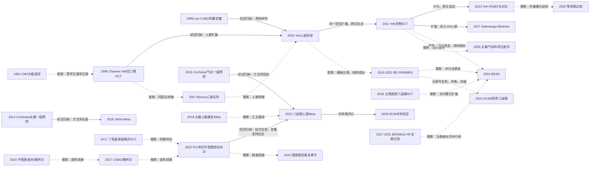

# D09 心脏康复与二级预防：传统功法与中医药

> **一句话判断**：传统功法（太极拳、八段锦为主线）的心脏康复研究从1996年AMI后小样本随机试验起步，2011年被百例RCT修正为"运动容量终点阴性、生活质量与自我效能阳性"，此后向拒绝康复人群、居家远程、HFpEF、剂量生理学与证据整合五条线分化。当前中国证据体量最大（八段锦心衰Meta达46项RCT/3597例，替代终点全线阳性），2022年PCI术后中西医结合共识把功法写成MET处方，但以死亡/住院为终点的大样本试验仍缺位。对临床医生最重要的一点：现有证据支持把功法作为康复的依从性与生活质量增强手段，尚不能作为降低硬终点的独立处方。

## 0 三分钟速读

① **从哪里来**：英文索引可查的最早功法-心脏生理学记录是1981年《中华医学杂志（英文版）》100例太极拳遥测心电分析 [D09-N18]；最早的心脏事件后康复随机试验是1996年英国Channer的126例AMI后三臂试验——非运动支持组8周完成率仅8%，太极组82% [D09-N01]。
② **为什么改变**：2011年Yeh百例RCT两个容量终点全部阴性（6分钟步行 P=0.95、峰值VO2 P=0.81）而生活质量显著阳性，把功法的价值从"有氧替代"改写为"心理行为与自我管理路径" [D09-N04]。
③ **如何分化**：HFpEF头对头（2013，n=16，实测太极摄氧仅4.3 vs 有氧9.4 mL/kg/min）[D09-N05]、拒入康复人群（2017）[D09-N11]、居家八段锦（2018台湾，n=80）[D09-N12]、大陆注册RCT推进到左室重塑终点（BE-PREMIER：ΔLVEDVi -5.1 mL/m²）[D09-N09]。
④ **现在研究什么**：居家/远程/可穿戴/患者-照护者二元交付 [D09-R01] [D09-R02]、HFmrEF/HFpEF与冠心病人群（BEAR 2024：常规康复+八段锦 6分钟步行 +25.0 vs +5.0 m）[D09-N14]、等耗氧剂量学（八段锦平均约8.2 mL/kg/min、双峰间歇）[D09-N16]、伞状综述证据分级 [D09-E05]。
⑤ **用了什么数据**：单中心小样本RCT → 注册多中心RCT（本轮交叉核对6项注册记录）→ CPET/ICG/加速计剂量测量 → 血清蛋白组学（80个差异蛋白）[D09-N09] → 46 RCT/3597人Meta与15篇SR/65项RCT伞状综述（GRADE）[D09-N15] [D09-E05]。
⑥ **还有什么不知道**：无以死亡/心衰住院为终点的大型功法RCT（最大120例、随访12周）；运动容量终点无头对头解决试验；HFpEF证据仅小样本；中文早期文献与更早共识全文（CNKI/万方未系统检索）不可核。

**覆盖边界**：纳入太极拳、八段锦、五禽戏、易筋经在冠心病、心衰、PCI/CABG后康复中的RCT与系统评价（含海外研究），功法剂量与生理学测量，中西医结合心脏康复模式与共识谱系，居家/远程功法康复。不含：功法降压效应（血压终点归D05专向，本章只在康复叙事中点到并指向D05）、双心心理康复主叙事（D08）、中药二级预防疗效评价（D01/D03/D06——芪参益气滴丸MISPS、麝香保心丸等仅交叉点到）。

**本章口径**：截止2026-10-17；近期重点窗口2021-10-17至2026-10-17。阅读层级说明：L0=仅二手转述；L1=题录已在数据库核实；L2=摘要已读；L3=原文部分章节已读；L4=全文已读。本章节点25个：L4×1、L3×2、L2×17、L1×5。**覆盖状态：基本完整但有标注缺口**——六个问题（从哪里来、为什么改变、如何分化、现在研究什么、用了什么数据、还有什么不知道）均可据本章回答；章节范围内主要分支（功法-心脏生理学与康复试验源头、心衰模板与容量终点转折、HFpEF/拒入人群/居家交付分化、大陆注册RCT与终点推硬、剂量生理学、证据整合与质量批判、共识制度线、国际政策线）均有节点与可核实来源；缺口限于第8节已标注项目（CNKI/万方未系统检索、2016/2017共识全文未读、部分近期条目仅题录层、Channer 1996与Barrow 2007全文扫描版不可得）与两条存疑条目（N22题录未经独立核实、N25注册号矛盾保留）——上述缺口不阻断任一主链转折的可核性。理由：第二轮完整性检查仅余1条建议改（N25的DOI占位符），已按建议补核为真实DOI（Europe PMC与Crossref双源核对），无主要分支缺节点或关键转折缺源。

## 1 源头：最初在研究什么

起点说法按类型分层（"目前最早找到"≠"公认奠基"，两者限定语不同）：

- **【目前最早找到的功法-心脏生理学记录】** 1981年Chinese Medical Journal《太极拳运动100例遥测分析》（94(9):589-592，PMID 6793323，L1，作者名本轮未核到）：100例太极拳练习者的遥测心电分析，被Yeh 2009系统综述收录为参考文献 [D09-N18]。它不是康复试验，不改变下一条的起点定位，但说明功法-心脏生理学测量早于康复临床试验15年。
- **【目前最早找到的康复RCT】** 1996年英国谢菲尔德Royal Hallamshire医院Channer等126例AMI恢复期三臂随机试验（吴式太极38/有氧41/非运动支持47）[D09-N01]。限定语：本轮经Europe PMC与OpenAlex两条路径检索1970-1995年，无更早的太极-心脏事件康复试验；更早的个案或非随机报告不能排除（Channer 1996全文为扫描版、出版商不开放，摘要层封顶L2）。
- **【台湾运动科学线起点】** 1999年台湾大学Lan等20例CABG术后前瞻对照（非随机）：实测太极强度48-57%心率储备（HRR），1年后VO2peak +10.3%，出勤3.8 vs 对照1.7次/周 [D09-N02]——本轮找到的最早功法长期剂量定量数据。
- **【被公认的奠基工作】** Yeh 2004年Am J Med 30例慢性心衰RCT [D09-N03]。奠基地位有原文直接支持：Yeh 2011全文Methods自述"沿用一项先导试验的标准方案"，其参考文献24即该文（本轮已核PMC全文）。
- **【官方转述的功法线起点】** 据贵州省体育局官网专题文章转述（L0，官方科普/宣传性叙述，未见同行评议文献独立核证）：八段锦源自古代导引术；2001年末国家体育总局健身气功管理中心委托北京体育大学成立八段锦新功法编创子课题组（组长杨柏龙），2003年7月人民体育出版社出版《健身气功·八段锦》，2003年10月在北京京西宾馆召开全国试行推广四种健身气功工作会议。本轮核实的临床RCT均以该2003年版为干预套路（未经同行评议文献独立核证编创过程本身）。
- **【当事人自述的制度线起点】** 据胡大一署名文章转述（原载《中华心血管病杂志》2021年49卷9期，经心脏康复网转载，转载版全文已读）：我国心脏康复启动于20世纪80年代，2012年重启时全国仅存8家心脏康复机构；1993年在北京朝阳医院建心脏中心。1980年代早期开创者（如曲镭）的原始文献本轮未能在PubMed核实（见第8节待核线索）。
- **【大陆功法RCT起点】** 大陆最早注册的八段锦心脏RCT为2016年广东省中医院BE-PREMIER（NCT02693795）[D09-N09]；PubMed可检索最早完成的心衰八段锦RCT为2018年台湾EJCN居家试验（n=80）[D09-N12]。中文期刊未入库的更早RCT不能排除（2012年eCAM八段锦血脂系统评价已收录中文试验，PMID 23304194，本轮仅题录层）。

## 2 关键转折：问题—新证据/新方法—认识变化—新问题

**转折1（1996-2007）：功法是不是"可交付的康复运动"？** Channer 1996的对照提示"有组织的运动形式本身"决定依从性：支持组完成率8% vs 太极82%、有氧73%（均P<0.001）[D09-N01]；Lan 1999给出本轮找到的最早长期剂量-反应数据（约50%HRR、实测每周近4次即可改善CABG后心肺功能）[D09-N02]。两线关系为并行（依据：综述归纳——Yeh 2009系统综述将两条线并列收录为早期证据）。Channer同一团队2007年把太极/气功推进到症状性心衰随机先导试验（Postgrad Med J 83(985):717-721；L1，摘要本轮未读，被Yeh 2009收录为其参考文献20）[D09-N17]，是AMI试验与心衰RCT之间最直接的桥接（同团队推进：题录与综述收录可证；"桥接"的叙事定位属本报告推断）。

**转折2（2004-2011）：心衰模板建立与容量终点修正（验证→修正）。** Yeh 2004确立"简化动作方案+常规治疗对照+6MWT/QoL/BNP终点"模板（n=30：MLHFQ组间差 -25分、6MWT +135 m、BNP -138 pg/mL，均P≤0.03）[D09-N03]；扩量为2011年百例试验（关系：同一研究项目，原文自述沿用先导方案，注册NCT00110227与发表一致）[D09-N04]。认识变化：两个容量终点阴性（6MWT P=0.95、峰值VO2 P=0.81）而MLHFQ（P=0.02）、运动自我效能（P<0.001）、情绪（P=0.01）阳性——功法价值从"有氧替代"改写为"心理行为与自我管理路径"；该文截至2026-10-17被引170次（Europe PMC计数）。新问题：阴性是"功法无效"，还是"强度不够"或"教育对照放大QoL组间差"？

**转折3（2013-2025）：剂量问题成为核心。** Yeh 2013在HFpEF头对头实测太极运动摄氧4.3 vs 有氧9.4 mL/kg/min（分化依据为摘要原文"太极在该人群从未被研究"；关系：从HFrEF分化出HFpEF分支）[D09-N05]；2025年等耗氧设计测得八段锦平均8.2 mL/kg/min（≈2.3 METs）、双峰间歇式、更低通气负荷与心输出量、更高动静脉氧差 [D09-N16]。两次实测相隔12年、读数同量级（关系：剂量量化路线延续，本报告推断），共同构成"容量终点难阳性而QoL/NT-proBNP获益"的生理学解释框架。

**转折4（2014-2016）：国际评价划界与方法学反差（质疑→方法学修正）。** Cochrane太极（2014，13试验1520人，无任何事件终点、随访≤1年，血压结局I²=96%，1项试验SBP反升5.2 mmHg）与气功（2015，11试验1369人，9项中文试验偏倚不可判定）均给出"证据不足、不能下结论" [D09-N06] [D09-N07]；同期中国团队Wang 2016在JAHA合并35项RCT/2249例，报告SBP -9.12 mmHg、MLHFQ -17.08，但6MWT置信区间跨零点（-153~270 m）[D09-N08]（血压终点只在此点到，降压证据谱系的专向整理归D05）。两Cochrane与该Meta本身并未互引；"质疑"关系系2026年伞状综述对其质量与人群差异的归纳（综述归纳）。后果：此后中国证据综合升级为PROSPERO预注册+RoB2+GRADE（综述归纳）[D09-E05]。

**转折5（2016-2024）：中国大陆进入注册RCT时代并把终点推硬（互补/并行）。** BE-PREMIER（2016注册/2021发表）把终点从步行与生活质量推进到左室重塑（ΔLVEDVi -5.1 vs +0.3 mL/m²，P<0.01）并附80个血清蛋白的组学层（ΔLVEDVi与MMP-9正相关、与CXCL1负相关；"首个显示八段锦改善STEMI后重塑"为原文自称）[D09-N09]；BEAR（2024）改为"常规心脏康复±八段锦"叠加设计、HFmrEF/HFpEF人群阳性（6MWD +25.0 vs +5.0 m）[D09-N14]。两者与美国线的模板迁移属结构相似与同期呼应（本报告推断，依据为协议文摘要句式与Yeh 2011高度一致；不写成已证因果）。同一时期注册-发表规范问题并行出现（见第5节）[D09-N25] [D09-N24]。

**转折6（2017-2022）：人群与交付分化（扩展）。** 拒入心脏康复人群的太极2期RCT（n=29，9个月保留率88-90%，中高强度体力活动+100~112 min/周获益、负荷试验无变化）[D09-N11]；台湾居家八段锦RCT（n=80，疲劳与QoL改善）[D09-N12]；香港冠心病人群"集体+居家"太极RCT（n=98，功能健康阳性；L2）[D09-R14]；中国家庭自助模式RCT（n=80，6MWD +60.2 vs +24.9 m）[D09-N10]。

**转折7（2016-2022-2024）：制度文本化（汇流，但非起点）。** 本轮核实的中西医结合专项共识谱系为：2016年《中西医结合Ⅰ期心脏康复专家共识》（国家心血管病中心组织、胡盛寿/陈可冀/高润霖/葛均波四位院士发起、人民卫生出版社出版专著；存在性经人卫临床助手公开检索页与《中国心血管疾病患者居家康复专家共识》公开PDF参考文献[54]交叉印证；全文未读，是否已含导引/运动处方未核；L1）[D09-N21] → 2017年《中西医结合冠状动脉旁路移植术Ⅰ期心脏康复专家共识》（中国循环杂志2017,32(4)，页码待补；公开学术库无题录、未经独立核实，仅同一来源链交叉印证；L1）[D09-N22] → 2018年《中国心脏康复与二级预防指南（2018精要）》（中华内科杂志57(11):802-810，摘要自述修订自2015版指南）→ 2022年《经皮冠状动脉介入术后中西医结合心脏康复专家共识》（中国康复医学杂志37(11):1517-1528；第一署名学会为中国康复医学会心脏介入治疗与康复专业委员会等三学会；PDF全文L4：西药处方表+四证型辨证中成药表+I/II/III期运动康复+导引MET处方+EECP；背景数据：2020年PCI 96.8万例、年增速超20%）[D09-N13]。**限定表述**：在本轮找到并核实的共识文本范围内，2022年共识是较早以MET处方形式系统纳入导引术（太极2-3 METs、单次5-90 min多为60 min、简化二十四式最常见）的代表性文本；更早的2016/2017共识全文未读、是否已含同类处方无法判定，故不能写"首次"。2024年国家报告提出"依托中医药优势探索中国特色心脏康复模式" [D09-R12]。各共识文本之间的谱系续接关系为推断（引用关系未逐一核到原文）。

**转折8（2018-2026）：证据整合与可信度批判（修正）。** Taylor-Piliae团队2018年EJCN太极心脏康复Meta（13项研究：有氧耐力SMD 1.12，95%CI 0.58-1.66；对非活动对照改善焦虑/抑郁/QoL；L2）[D09-N20] → 2025年CTM八段锦心衰Meta（46 RCT/3597例：6MWT +50.71 m [37.48-63.94]、LVEF +3.57%、NT-proBNP -139.49 pg/mL、MLHFQ -8.15分；亚组提示连续3个月干预效应最佳；摘要自称"首个综合Meta"）[D09-N15] → 2026年RCM伞状综述（15篇SR/65项原始RCT再合并，AMSTAR2/ROBIS/GRADE，检索至2025-03-31，含知网/SinoMed/万方/中国科技期刊数据库；结论：传统功法改善6MWT/MLHFQ/LVEF/BNP/VO2max，八段锦降NT-proBNP与易筋经升VO2max相对突出；同时明示既往SR方法学质量次优与样本重叠需谨慎解读）[D09-E05]。同路线的AMI-PCI专项SR（13研究/1293例，PROSPERO CRD42025634145：LVEF +6.20%、6MWD +60.21 m、心血管不良事件RR 0.40 [0.25-0.65]、NNT=5）[D09-R07]。关系判定：Cochrane 2015指出的方法学缺陷由预注册与GRADE部分回应（修正，综述归纳），但样本重叠是伞状综述新增的批评。

## 3 分支图

实线=原文明确讨论或综述归纳的关系；虚线=本报告推断。

## 4 近五年重点（2021-10-17 至 2026-10-17）

**T1 居家/远程与数字化交付（含患者-照护者二元干预）**
研究什么：以视频/APP/可穿戴/摄像头反馈交付的居家太极与八段锦，对象从患者扩展到"患者-家庭照护者"二元，终点含功能容量、自我效能与照护负担。已完成RCT：香港Liu/Chan/Chair 2022（EJCN，n=98社区冠心病，单盲，6周集体+6周居家太极，功能健康与运动自我效能阳性；L2）[D09-R14]——补上国际线只有美国试验、居家主题缺完成RCT的空白；美国Mindful Steps网络化计步身心干预可行性RCT（JMIR Form Res 2025；L1题录）[D09-R04]。方案与证据综合：BMJ Open 2026居家数字辅助二元太极RCT方案（NCT06876441，香港理工+青岛大学附院，患者/照护者/二元三层终点；L2）[D09-R01]；可穿戴远程监测八段锦心衰SR（Complement Ther Med 2026;100:103402；L1题录，另有2026年更正PMID 42409672）[D09-R02]；摄像头实时反馈八段锦6周先导（JMIR Form Res 2026;10:e101208；L1题录）[D09-R03]。常用数据与设计：RCT方案与先导RCT（含注册）、可行性/依从性混合设计。分歧：远程交付能否保住"教师纠正动作"要素（质性研究线索提示动作准确性依赖面对面指导）；监测强度与成本的可及性矛盾。成熟度：发展中（大样本完成性结局研究仍缺，代表条目部分仅题录层）。

**T2 HFmrEF/HFpEF与冠心病人群**
研究什么：射血分数轻度减低/保留心衰（含缺血性）与慢性冠脉综合征中功法对运动容量、QoL与神经内分泌指标的作用。代表研究：BEAR 2024多中心RCT（120入组/109完成，常规心脏康复±12周八段锦：6MWD +25.0 m [+6.14%] vs +5.0 m [+1.32%]、VO2无氧阈 +25.87% vs +3.94%、MLHFQ -16.8% vs -3.99%，均P<0.001）——本轮核到的首个以HFmrEF/HFpEF为目标、以常规康复为对照的八段锦阳性RCT [D09-N14]；Stress Health 2025头对头RCT（n=46慢性冠脉综合征，1:1随机，太极心脏康复 vs 常规运动心脏康复，12周每周3次，主终点知觉心理压力与氧化应激；L2）[D09-R15]——本领域已完成的小样本头对头，直接对应"对照类型"争议，但其终点不是运动容量。证据综合：身心运动心衰网络Meta（Front Public Health 2026;14:1802127；L1题录）[D09-R05]；六种传统功法×48 RCT高血压网络Meta（Ageing Res Rev 2026;115:103007；L1题录，D05交叉）[D09-R06]。分歧：HFpEF专项证据仍只有Yeh 2013（n=16）先导与混合人群试验；Cochrane 2024指出HFpEF在运动康复试验中长期代表不足 [D09-E08]。成熟度：发展中。

**T3 证据整合与质量批判**
研究什么：对2017-2025年涌现的功法心脏康复系统评价做再评价、再合并与证据分级。代表研究见第2节转折8 [D09-N20] [D09-N15] [D09-E05] [D09-R07]，另有长期八段锦安全性SR（J Integr Complement Med 2026;32(3):206-220；L1题录）[D09-R08]。常用数据与设计：伞状综述（AMSTAR2/ROBIS/GRADE+原始RCT再合并+Egger检验）、PROSPERO预注册专项SR。分歧核心：正面合并效应量（6MWT约+50~60 m）与方法学可信度（试验小、对照多为常规治疗、样本重叠、盲法不足）之间的张力；GRADE多降至中低证据。成熟度：综述方法层面成熟，证据本身仍发展中。

**T4 剂量、运动学与机制**
研究什么：八段锦/太极的代谢当量、通气-血流动力学特征、间歇强度模式；功法对血清蛋白组、炎症标志物与基因表达的影响。代表研究：等耗氧比较（n=30慢性心衰，9分钟八段锦 vs 等VO2功率车：VO2 8.2 vs 8.4 mL/kg/min持平，八段锦呈双峰间歇、呼吸频率/分钟通气量/VE-VCO2斜率更低、心输出量更低而动静脉氧差更高；L2）[D09-N16]；蛋白组学（BE-PREMIER副研究，80个差异血清蛋白）[D09-N09]；太极心血管机制证据图谱（Sci Rep 2026;16(1):6708，DOI本轮补核10.1038/s41598-026-35996-3；L1题录）[D09-R09]；太极与NF-κB驱动炎症基因表达SR（Front Immunol 2026;17:1702830；L1题录）[D09-R10]。分歧：机制研究以小样本血清组学与急性单次测试为主，能否外推长期训练效应存疑，且与临床终点缺乏衔接。成熟度：早期线索-发展中。

**T5 实施科学与政策（可及性、参与率、质控）**
研究什么：三阶段中西医结合康复的实施障碍、质控、支付与培训；功法社区推广；国际政策文本。中国侧：2022 PCI共识文本化（L4）[D09-N13]；居家康复共识（公开PDF存在已核、全文未读；L1）[D09-N23]；2024年《中国心血管健康与疾病报告2022》康复章节（J Geriatr Cardiol 2024;21(11):1003-1014：中心数量快速增长但知晓与参与率低、集中于经济发达地区三级医院；L2）[D09-R12]；CFIR 2.0实施障碍SR（J Multidiscip Healthc 2025;18:8067-8080；L1题录）[D09-R11]；居家远程心脏康复综述（中华心血管病杂志2024,52(9):1116-1119；L1题录）[D09-R13]。国际侧：AACVPR/AHA/ACC 2019《Home-Based Cardiac Rehabilitation》科学声明（Circulation 140:e69-e89；L1题录）[D09-R17]与AHA 2025《Cardiac Rehabilitation in Women》科学声明（Circulation 152；L2：女性参与障碍、非传统交付模式；摘要无太极字样）[D09-R16]——国际政策线呈两层结构：无功法专项声明，居家/参与声明可作间接锚点。分歧：共识推荐与社区真实能力（人员、设备、支付）的落差；功法在共识中的证据等级未明确标注。成熟度：发展中。

## 5 争议、负性结果与停滞路线

**争议1：八段锦试验的注册-发表一致性（本轮已核注册库，矛盾保留、未自行抹平）。**
（a）BEAR（NCT03229681）：回顾性注册（研究实际开始2017-05-02，注册2017-07-23），注册题名"慢性心衰二期康复"、注册状态UNKNOWN、主办为中国中医科学院西苑医院而2018协议文第一单位为北京市中西医结合第一医院，2024发表时题名改为"缺血性HFmrEF/HFpEF"；注册主终点（6MWT）与发表一致 [D09-N14]。
（b）Chen等2020年eCAM"序贯八段锦"RCT（96例、24周、SF-36终点；结果报告NT-proBNP多降约50 pg/mL，P=0.013）声明注册号NCT02693795，而该号在注册库对应BE-PREMIER（110例、12周干预、6个月LVEDVi终点、主办广东省中医院）——样本、干预、终点均不符。该文在本章标**存疑**，仅作为注册-发表矛盾的样本引用，不作为疗效证据 [D09-N25]。
（c）BESMILE-HF（NCT03180320）：2017-06-02注册（协议文2018年发表），协议计划200例、注册库现登记150例且状态RECRUITING，2021年仅发表18例先导（先导阳性：自我效能MD 3.2，95%CI 0.6-5.9；对照组peakVO2下降而干预组维持）[D09-N24]。
（d）Gentle CR研究（NCT02165254）：注册主终点全部为保留率/出勤/不良事件/可接受性等可行性指标，而发表以MVPA/体重/QoL为主要结果（属2期行为试验常见做法，但削弱"太极改善体力活动"结论的注册支持）[D09-N11]。
截至本轮（2026-10-17）未见作者更正或注册更新声明。

**争议2：功法能否改善心衰运动容量。** 阳性方：Yeh 2004（6MWT +135 m）、BEAR 2024（+25 vs +5 m）、CTM 2025 Meta（+50.71 m）；阴性方：Yeh 2011百例（P=0.95）、Salmoirago-Blotcher 2017（负荷试验无变化）。生理学解释线索：实测训练强度4.3-8.2 mL/kg/min、间歇式，低于多数持续有氧处方；阳性试验多用空白/常规治疗对照且多为6分钟步行。准确表述：**在运动容量终点（6MWT/峰值VO2）上尚无头对头解决试验；心理/氧化应激终点已有小样本头对头RCT（Stress Health 2025，n=46）**[D09-R15]。争议持续：伞状综述仍以6MWT/QoL为主要阳性结论但明示"方法学质量次优、样本重叠需谨慎解读" [D09-E05]。

**争议3：一级预防场景的适用边界。** Cochrane两篇"不能下结论"（2014/2015）与国内Meta普遍阳性并存（人群、对照类型与质量评价体系不同）；两项Cochrane评价2015年后未更新（本轮2026-10检索确认），该路线无大型长期硬终点试验跟进，实质停滞；伞状综述时代以GRADE降级方式部分吸收，未根本解决（其中血压结局专向归D05，此处点到）[D09-N06] [D09-N07] [D09-N08] [D09-E05]。

**负性/停滞路线清单**：
1. 太极作为心衰"有氧替代"改善运动容量的路线——百例RCT双容量终点阴性 [D09-N04]；
2. 拒入康复人群的有氧适能改善路线——6个月后负荷试验组内外均无变化，仅行为学与QoL获益 [D09-N11]；
3. 功法心血管一级预防路线——两Cochrane"不能下结论"后停滞 [D09-N06] [D09-N07]；
4. 中国心脏康复第一波（1980年代起步）——据胡大一自述，因医院运营模式改变被边缘化，2012年重启时全国仅存8家机构（当事人自述，未经独立复核）；
5. 大规模注册试验的完成率——BESMILE-HF计划200例缩水至注册150例、滞留RECRUITING；BE-PREMIER注册状态UNKNOWN、结果晚5年以探索性表述发表 [D09-N24] [D09-N09]。

## 6 传承线与国际线

**功法线（传承链）**：古代导引术与"治未病"理念（据贵州省体育局官网专题文章转述，L0，未见同行评议文献独立核证）→ 1950-1990年代气功临床应用多在高血压等慢病（PubMed可检索1993年《中国中西医结合杂志》气功治疗高血压英文题录PMID 8251724，属D05交叉，点到为止）→ 1981年CMJ太极遥测100例（英文索引可查的最早功法-心脏生理学记录，L1）[D09-N18] → 2001-2003年国家体育总局健身气功管理中心委托北京体育大学编创、2003年人民体育出版社出版《健身气功·八段锦》、2003年10月京西宾馆全国试行推广四种健身气功工作会议（均据官方文章转述，L0；官方文章同页记载2018年全国注册健身气功站点35314个、习练者499万余人，同为转述）→ 本轮核实的临床RCT（BE-PREMIER、BEAR、台湾EJCN等）均以2003年版为干预套路（此为题录可查事实；"标准化提供可复制干预物"的机制解释未经独立核证）→ 2016年广东省中医院（广州中医药大学第二临床学院）毛硕、张敏州团队注册BE-PREMIER（重塑终点+蛋白组学）[D09-N09] → 2017年西苑医院/北京市中西医结合第一医院注册BEAR（中国中医科学院系统）[D09-N14] → 瑞典Karolinska医学院与广东省中医院合作BESMILE-HF（2017-06-02注册）[D09-N24] → 北京中医药大学刘建平团队预注册AMI-PCI专项SR（CRD42025634145）[D09-R07]。2020年新冠期间张伯礼向方舱医院患者推荐八段锦（据官方文章转述，L0）。

**心脏康复制度线**：1980年代起步（早期人物原始文献未核实，见第8节）→ 1993年朝阳医院心脏中心（据胡大一自述）→ 2012年胡大一（北京大学人民医院）重启中国心脏康复（自述全国仅存8家机构；后建心肺预防康复示范培训基地、提出五大处方）→ 丁荣晶2017年"三级医院指导+社区驱动"家庭自助模式RCT（n=80）[D09-N10] → 共识/指南谱系：2012年《冠心病康复/二级预防中国专家共识》→ 2015年中国康复医学会心血管病预防与康复专业委员会指南（2018精要摘要自述其谱系）→ 2016年《中西医结合Ⅰ期心脏康复专家共识》（国家心血管病中心，四院士发起；L1）[D09-N21] → 2017年《中西医结合冠状动脉旁路移植术Ⅰ期心脏康复专家共识》（中国循环杂志2017,32(4)，页码待补；未经独立核实；L1）[D09-N22] → 2018年《中国心脏康复与二级预防指南（2018精要）》（中华内科杂志57(11):802-810）→ 2022年《经皮冠状动脉介入术后中西医结合心脏康复专家共识》（李宪伦［中日友好医院］、王显［东直门医院］、吴永健［阜外医院］、刘红旭［北京中医医院］等执笔；中国康复医学会**心脏介入治疗与康复**专业委员会、世界中联心脏康复/介入心脏病学专业委员会；把功法写成2-3 METs、单次5-90 min的处方并配气虚血瘀/痰浊血瘀/气阴两虚/心肾阳虚四证型中成药矩阵——含麝香保心丸、芪参益气滴丸、复方丹参滴丸等，药物部分属D01/D02/D03交叉点到）[D09-N13] → 2024年国家报告"依托中医药优势探索中国特色心脏康复模式" [D09-R12] → （2025年《老年慢性心力衰竭全周期康复专家共识》等线索未核，见第8节）。芪参益气滴丸心肌梗死二级预防试验（MISPS）项目存在性经OpenAlex核实到2007年中心随机化方法学中文论文（无DOI），主结果论文本轮未取得（D01/D03交叉）。两条线在2022年PCI共识文本汇流——但按本轮核实，汇流点之前已有2016/2017年国家级中西医结合共识文本，"汇流"应理解为文本化程度与处方颗粒度的推进，而非本方向的起点。

**国际线**：
- **英国**：Channer 1996（谢菲尔德，首个AMI后太极随机试验）[D09-N01] → 同团队Barrow 2007症状性心衰太极/气功随机先导（L1，被Yeh 2009收录为其参考文献20）[D09-N17]。
- **台湾**：Lan/赖金鑫团队1999年CABG剂量定量（48-57%HRR）[D09-N02]；2018年台北团队居家八段锦RCT（n=80）[D09-N12]。
- **美国哈佛/Beth Israel线**：Yeh与Wayne、Phillips受NCCAM/NCCIH连续资助（R01 AT002454、R34 AT007569、K24 AT009282），2004/2011/2013年三步走 [D09-N03] [D09-N04] [D09-N05]；Yeh 2009年首篇跨中英文库系统综述（含CNKI与北京/南京医学图书馆实地检索；英文库至2007-10、中文库至2005-06）[D09-E01]；2016年衍生自我效能/质性子研究；2025年续以Mindful Steps网络化干预 [D09-R04]。
- **美国Brown/Miriam线**：Salmoirago-Blotcher 2017拒入CR人群RCT（Wayne任太极专家并做保真度审计，抽查10%课程录像）[D09-N11]。
- **香港**：Liu/Chan/Chair 2022年冠心病"集体+居家"太极RCT（n=98，单盲，功能健康阳性；L2）[D09-R14]——海外独立完成RCT不限于美国。
- **Cochrane国际评价**：太极2014、气功2015（谨慎结论与方法学批评，国际指南谨慎态度的主要依据）[D09-N06] [D09-N07]；2024年心衰运动康复大盘更新（60试验8728人，检索至2021-12-13：全因死亡RR 0.93不显著、全因住院RR 0.69 [0.56-0.86]；HFpEF与女性长期代表不足）作为功法所在的背景证据 [D09-E08]。
- **欧洲-中国合作**：Karolinska医学院（BESMILE-HF）[D09-N24]；Mayo Clinic Olson参与BESMILE团队等耗氧生理学研究 [D09-N16]。
- **国际学界整合**：2023年秋哈佛医学院Osher中心首届"太极与气功科学"国际会议 → 2025年白皮书Part I（Wayne、Yeh等17位作者，J Integr Complement Med 31(7):499-520；综述功法在心肺健康等的证据状态并规划未来研究；L2）[D09-N19]——目前最系统的国际学界立场文件。
- **国际政策文本**：AACVPR/AHA/ACC 2019居家心脏康复科学声明（L1题录）[D09-R17]；AHA 2025女性CR科学声明（L2）[D09-R16]。两层结构：本轮仍未检索到AHA/ACC/EAPC/AACVPR对太极/八段锦进入心脏康复的专项科学声明或推荐条文；居家/参与声明可作间接锚点——"无专项推荐"不等于"无任何相关政策文本"。
- **格局判断**：海外研究以小样本严谨设计+行为学终点+可及性人群为特色，自身未产出大样本硬终点试验；大规模阳性证据几乎全部来自中国大陆试验——"海外方法严谨性+中国证据体量"互补但互不覆盖。

## 7 数据路径小结

**历史 vs 现在（八条路径）**：
1. **单中心小样本对照/随机试验（1996-2013）**：Channer 126例三臂、Lan 20例非随机对照、Yeh 30/100/16例RCT——对照从无运动支持组逐步升级为时间匹配教育、常规治疗、有氧运动。
2. **注册多中心RCT（2016起）**：NCT02693795、NCT03229681、NCT03180320、NCT00110227、NCT02165254、NCT06876441——本轮已交叉核对前5项注册记录与发表的终点一致性；终点从6MWT/QoL扩展到LVEDVi（超声）、NT-proBNP、CPET无氧阈。
3. **剂量与生理学测量**：功法剂量（频次×时长×周数）与对照类型分开记录如下表。

| 试验 | 功法剂量 | 对照类型 |
|---|---|---|
| N01 1996 | 8周共11次课 | 非运动支持组 |
| N02 1999 | 1年自主习练（实测3.8次/周；48-57%HRR） | 居家自定运动（1.7次/周） |
| N03 2004 | 12周×每周2次×60 min | 常规治疗 |
| N04 2011 | 12周×每周2次＋居家≥3次/周 | 时间匹配教育 |
| N05 2013 | 12周课程 | 有氧运动（头对头） |
| N09 2016/21 | 12周×每周2次×45 min | 常规运动 |
| N11 2017 | 12周×2次 vs 12周×3次+12周维持课 | 剂量自比（LITE vs PLUS） |
| N12 2018 | 12周×每周3次居家（35分钟视频） | 常规照护 |
| N24 2021先导 | 6周 | 常规照护 |
| R14 2022 | 6周集体＋6周居家 | 常规照护（单盲） |
| N14 2024 | 12周×每周2次×45 min | 常规心脏康复 |
| R15 2025 | 12周×每周3次 | 常规运动心脏康复（头对头） |
| N25 2020（存疑） | 24周序贯 | 常规（摘要层） |

   强度实测链：48-57%HRR（1999）→ 4.3 mL/kg/min（2013）→ 8.2 mL/kg/min≈2.3 METs、双峰间歇（2025）；共识处方参数：太极约2-3 METs、单次5-90 min（多为60 min）[D09-N13]。
4. **行为与保真度工具**：加速计（MVPA）、录像保真度抽查（10%课程）、问卷量表（MLHFQ/CASE/POMS/GAD-7/PHQ-9）。
5. **机制副数据**：血清蛋白组学（80蛋白，MMP-9/CXCL1）[D09-N09]、炎症指标与NF-κB通路基因表达SR [D09-R10]、证据图谱 [D09-R09]。
6. **证据综合**：2009年29项研究（Yeh）→ 2016年35 RCT/2249例（JAHA）→ 2018年13项研究（EJCN）→ 2025年46 RCT/3597例（CTM）→ 2026年15 SR/65 RCT伞状再合并（PROSPERO CRD420251003129、CRD42025634145）；网络Meta（48 RCT高血压、多功法心衰）。
7. **真实世界/实施数据**：国家报告统计 [D09-R12]、CFIR实施SR [D09-R11]、社区家庭模式RCT [D09-N10]。
8. **政策与规范文本**：共识/指南文本本身构成一类数据源（2022共识以公开PDF全文L4读取）；体育系统功法标准（2003版八段锦，官方文本）。
9. **中文文献特殊路径**：早期中文RCT经PubMed英文题录或中文库收录的系统评价间接可见；CNKI/万方全文不可得时只能到题录/摘要层（如实标L1/L2）。

## 8 还不知道什么（领域证据缺口）与本报告的检索缺口

**领域证据缺口**：
1. **硬终点缺位**：无以全因死亡/心梗复发/心衰住院为主要终点的大型功法RCT（现有最大120例、随访12周）[D09-N14]；"心血管不良事件RR 0.40"来自复合软事件小样本 [D09-R07]；运动康复大盘Cochrane 2024死亡RR 0.93不显著 [D09-E08]。
2. **HFpEF专项证据薄弱**：仅Yeh 2013（n=16）先导与混合人群（BEAR为HFmrEF/HFpEF合并）。
3. **对照类型不统一**：空白/常规治疗、时间匹配教育、常规心脏康复、有氧运动四类并存，效应量解释困难；运动容量终点的头对头解决试验缺位（心理/氧化应激终点已有小样本头对头 [D09-R15]）。
4. **共识推荐与真实世界能力落差**：社区人员、设备、支付体系不足；功法在共识中的证据等级未明确标注。
5. **2016/2017年共识全文未读**：是否已含导引推荐与运动处方参数无法判定——直接限制"2022共识在谱系中位置"的精确刻画；2017年CABGⅠ期共识题录另未经独立核实（公开学术库无题录）。

**本报告检索缺口（含CNKI/万方未检索的影响）**：本轮CNKI与万方仅经公开摘要页/二手收录间接可见，未做系统检索。影响：（a）1980年代中国心脏康复开创者（如曲镭）的原始文献无法核实，制度线起点只能依赖当事人2021年自述；（b）早期中文功法RCT（如2012年eCAM血脂SR收录的中文试验）只能到二手收录层；（c）共识谱系可能仍不完整；（d）中文期刊若存在更早的八段锦心衰RCT，本章"大陆最早注册/最早完成RCT"等限定语可能需要下调。

**待核线索（本轮无可定位来源或仅题录，不进正文叙事）**：约2017年"中西医结合心脏康复专家共识"同名单文本（未检索到，不排除记忆偏差或内部发布）；2017年《中西医结合冠状动脉旁路移植术Ⅰ期心脏康复专家共识》全文与页码（公开学术库无题录，纸本/中文库人工核对）；《稳定性冠心病中西医结合康复治疗专家共识》；《养心氏片在中西医结合心脏康复中应用的中国专家共识》；《老年慢性心力衰竭全周期康复专家共识》（康复学报2025）；丁荣晶参与的《经皮冠状动脉介入治疗术后运动康复专家共识》（约2016，网传条目）；1993年Texas Heart Institute Journal替代辅助治疗综述（PMID 8219823，仅题录）；芪参益气滴丸MISPS主结果论文（D01/D03交叉）；Barrow 2007与Channer 1996全文（扫描版不可得，摘要层封顶）；1981年CMJ遥测文的作者与内容细节（L1题录层）；福建中医药大学、上海体育学院功法团队的心脏康复代表文献（调度线索，未定位）。

## 9 本章节点速查表

| 编号 | 年份 | 第一作者+题名简写 | 期刊 | 节点作用 | 设计/数据/分析单位 | 样本 | 关键结果 | 阅读层级 | 核查状态 | PMID/DOI |
|---|---|---|---|---|---|---|---|---|---|---|
| N01 | 1996 | Channer KS，太极AMI后血流动力学 | Postgrad Med J | 本轮找到的最早康复RCT | 单中心三臂RCT/患者 | 126例（38/41/47）；11次课 | 支持组完成率8% vs 太极82%；仅太极组DBP负趋势 | L2 | 通过 | 8758013 |
| N02 | 1999 | Lan C，太极CABG后心肺功能 | Med Sci Sports Exerc | 最早剂量定量（本轮找到） | 前瞻对照非随机/患者 | 20例（9/11）；1年；48-57%HRR | VO2peak +10.3%；出勤3.8 vs 1.7次/周 | L2 | 通过 | 10331880 |
| N03 | 2004 | Yeh GY，太极心衰先导RCT | Am J Med | 心衰模板奠基（公认） | RCT/患者 | 30例（15/15）；12周×2次 | MLHFQ -25；6MWT +135 m；BNP -138 | L2 | 通过 | 15465501 |
| N04 | 2011 | Yeh GY，太极心衰百例RCT | Arch Intern Med | 容量阴性/行为阳性转折 | 多中心单盲RCT/患者 | 100例（50/50） | 6MWT P=0.95、VO2 P=0.81；MLHFQ/自我效能/情绪阳性 | L3 | 通过 | 21518942 |
| N05 | 2013 | Yeh GY，太极HFpEF头对头 | Congest Heart Fail | HFpEF分化＋强度实测 | RCT/患者 | 16例（8/8） | 6MWT +69 vs +10 m；摄氧4.3 vs 9.4 mL/kg/min | L2 | 通过 | 23057654 |
| N06 | 2014 | Hartley L，太极一级预防 | Cochrane Database Syst Rev | 一级预防边界 | SR/研究与参与者 | 13试验1520例（另3项进行中） | 无事件终点；结论"不能下结论" | L2 | 通过 | 24715694 |
| N07 | 2015 | Hartley L，气功一级预防 | Cochrane Database Syst Rev | 边界＋方法学批评 | SR/研究与参与者 | 11试验1369人 | 9项中文试验偏倚不可判 | L2 | 通过 | 26068956 |
| N08 | 2016 | Wang XQ，传统功法CVD Meta | J Am Heart Assoc | 中国证据国际化 | Meta/研究与患者 | 35 RCT/2249例 | SBP -9.12 mmHg；6MWT CI跨零点；MLHFQ -17.08 | L2 | 通过 | 26961239 |
| N09 | 2016/2021 | Mao S，BE-PREMIER设计+结果 | Cardiovasc Drugs Ther | 重塑终点＋组学（大陆首批注册） | 实用型RCT＋蛋白组学/患者 | 110例（56/54）；80个差异蛋白 | ΔLVEDVi -5.1 vs +0.3 mL/m²，P<0.01 | L2 | 修正（卷期补全30(3):315-322；35(1):21-32） | 27106833；32761487 |
| N10 | 2017 | 丁荣晶，家庭自助心脏康复 | 中华心血管病杂志 | 中国居家模式分支 | RCT/患者 | 80例（52/28）；3个月 | 6MWD +60.2 vs +24.9 m；规律运动50.26% vs 0 | L2 | 通过 | 28316177 |
| N11 | 2017 | Salmoirago-Blotcher E，拒入CR人群太极 | J Am Heart Assoc | 参与替代分支 | 2期RCT/患者 | 29例（13/16） | 保留率88-90%；MVPA +100~112 min/周；负荷试验无变化 | L3 | 通过 | 29021268 |
| N12 | 2018 | Chen DM，居家八段锦心衰RCT | Eur J Cardiovasc Nurs | PubMed可检索最早完成心衰八段锦RCT | RCT/患者 | 80例（39/41）；12周×3次居家 | 疲劳F=5.08 P=0.009；QoL F=9.11 P=0.001 | L2 | 修正（卷期17(5):456-466） | 29189045 |
| N13 | 2022 | 李宪伦等，PCI术后中西医结合心脏康复专家共识 | 中国康复医学杂志 | 制度文本化（导引MET处方） | 学会共识/共识条目 | 推荐5条；证型4类；分期3期 | 太极2-3 METs、单次5-90 min；四证型中成药矩阵 | L4 | 修正（DOI尾段1001-1242；第一学会名） | DOI 10.3969/j.issn.1001-1242.2022.11.013 |
| N14 | 2024 | Li J，BEAR八段锦HFmrEF/HFpEF | J Evid Based Med | 常规康复对照阳性 | 多中心RCT/患者 | 120入组/109完成 | 6MWD +25.0 vs +5.0 m；VO2AT +25.87% vs +3.94% | L2 | 通过（注册错位已核） | 38970325 |
| N15 | 2025 | Wang W，八段锦心衰Meta | Complement Ther Med | 最大规模定量整合 | SR/Meta/研究与患者 | 46 RCT/3597例 | 6MWT +50.71 m；LVEF +3.57%；NT-proBNP -139.49 | L2 | 通过 | 41176179 |
| N16 | 2025 | Chen X，等耗氧八段锦vs功率车 | Front Physiol | 剂量生理学成熟标志 | 横断面实验室比较/患者 | 30例 | 8.2 vs 8.4 mL/kg/min；双峰间歇；低通气负荷 | L2 | 通过 | 41049497 |
| N17 | 2007 | Barrow DE，太极/气功症状性心衰先导 | Postgrad Med J | N01团队向心衰桥接 | 随机先导RCT/患者 | 样本未核（摘要未读） | 题录已核；Yeh 2009收录为ref 20 | L1 | 通过（题录层） | 17989272 |
| N18 | 1981 | 不详，太极拳100例遥测分析 | Chin Med J | 最早功法-心脏生理记录（英文索引） | 遥测观察/患者 | 100例 | 题录已核；内容细节未核 | L1 | 通过（题录层） | 6793323 |
| N19 | 2025 | Wayne PM，太极气功科学白皮书Part I | J Integr Complement Med | 国际学界立场文件 | 会议白皮书/文献综合 | 17位作者 | 2023 Osher首届会议产物；心肺健康证据综述 | L2 | 通过 | 40091656 |
| N20 | 2018 | Liu/Taylor-Piliae，太极心脏康复Meta | Eur J Cardiovasc Nurs | 国际评价汇总基线 | SR/Meta/研究 | 13项研究 | 有氧耐力SMD 1.12（0.58-1.66） | L2 | 通过 | 29256626 |
| N21 | 2016 | 国家心血管病中心，中西医结合Ⅰ期心脏康复专家共识 | 人民卫生出版社（专著） | 共识谱系前移节点 | 专家共识/文本 | 四院士发起 | 存在性已核；全文未读 | L1 | 通过（存在性） | URL见证据表 |
| N22 | 2017 | （作者未核），中西医结合CABGⅠ期共识 | 中国循环杂志 | 谱系续接 | 专家共识/文本 | — | 公开学术库无题录，未经独立核实 | L1 | 存疑（页码待补） | 无（书目2017,32(4)） |
| N23 | — | 中国康复医学会等，心血管病患者居家康复专家共识 | （刊名未核） | 居家制度线一环 | 专家共识/文本 | — | 公开PDF存在已核；全文未读 | L1 | 通过（存在性） | URL见证据表 |
| N24 | 2017-2021 | 蒋雯等，BESMILE-HF协议＋先导 | Trials；Front Cardiovasc Med | 注册试验缩水/停滞样本 | RCT协议＋先导/患者 | 计划200→注册150；先导18例 | 先导自我效能MD 3.2；注册仍RECRUITING | L2 | 修正（注册日2017-06-02） | 29490680；34386535 |
| N25 | 2020 | Chen/Mao团队，序贯八段锦PCI后RCT | Evid Based Complement Alternat Med | 注册号复用矛盾样本 | RCT/患者 | 96例；24周 | SF-36改善；注册号与BE-PREMIER冲突 | L2 | 存疑 | 32714423；10.1155/2020/8171549 |

## 10 本章入口文献与检索截止

| 编号 | 入口文献 | 文中检索截止 |
|---|---|---|
| E01 | Yeh GY等. 太极与心血管疾病系统综述. J Cardiopulm Rehabil Prev 2009;29(3):152-160 | 英文库至2007-10；中文库至2005-06 |
| E02 | Hartley L等. 太极一级预防Cochrane. CDSR 2014;(4):CD010366 | CENTRAL 2013年11期；MEDLINE至2013-11；EMBASE至2013-12-06等 |
| E03 | Hartley L等. 气功一级预防Cochrane. CDSR 2015;(6):CD010390 | MEDLINE至2014-10；EMBASE至2014-11；亚洲库至2013-07 |
| E04 | Wang XQ等. 传统功法CVD Meta. J Am Heart Assoc 2016;5(3):e002562 | 摘要未说明检索截止日 |
| E05 | Zhao X等. 传统功法心衰伞状综述. Rev Cardiovasc Med 2026;27:46055 | 至2025-03-31（含知网/SinoMed/万方/中国科技期刊数据库） |
| E06 | Zhang Y等. 中药心脏康复叙述性综述. Front Cardiovasc Med 2026;13:1895271 | 未说明（叙述性综述） |
| E07 | PCI术后中西医结合心脏康复专家共识. 中国康复医学杂志 2022;37(11):1517-1528 | 专家共识（无系统检索策略；收稿2022-08-08） |
| E08 | Molloy C等. 心衰运动康复Cochrane. CDSR 2024;(3):CD003331 | 至2021-12-13 |

本章检索执行日2026-10-17。E05检索截止（2025-03-31）之后的2025-2026年新证据另行补查并逐条标注层级（见第4节与证据表）；入口E02/E03对应的Cochrane题目截至本轮未见更新。

## 12 复核修订记录（2026-10-17）

以下修订依据全报告复核时核对的结果逐条落实（来源｜改了哪里｜改前→改后要点）：

1. 证据抽查｜D09-N17（Barrow 2007）题录，正文转折1与证据表同步｜期号 83(986)→83(985):717-721；DOI 10.1136/pgmj.2007.061994→10.1136/pgmj.2007.061267（原DOI经Europe PMC与Crossref双源核对实指向另一篇论文；题名/作者/年份/页码/PMID本就正确）。
2. 证据抽查｜D09-N07及其入口行D09-E03，第10节E03行同步｜Cochrane期号 (7)→(6)（Europe PMC与Crossref双源核对为2015-06-11发表；其余内容一致）。
3. 证据抽查｜D09-R07题名｜缩写式描述（含SR/Meta与PROSPERO号）→官方完整题名"Is Baduanjin beneficial and safe for the rehabilitation of patients with acute myocardial infarction undergoing percutaneous coronary intervention? A systematic review and meta-analysis of randomised controlled trials"；PROSPERO号保留在证据行专字段；全部统计数字经摘要逐项核对无误、未改动。
4. 证据抽查｜D09-N22（2017年CABGⅠ期共识）｜核实状态 通过（存在性）→存疑：公开学术库无题录，证据行limitations注明"公开学术库无题录，待核线索（纸本/中文库人工核对）"，卷页注"页码待补"；正文转折7、第6节、第9节速查表与第8节缺口相应处注明"未经独立核实"，并列入第8节待核线索。页码经全报告复核时核对未能从任何可及公开来源获得，不臆补。
5. 跨章关系｜功法降压归章与D05的互指改为一致｜改前两章覆盖边界互指（D05写"功法降压归D09"、本章写"不含：功法降压效应（D05）"，形成循环引用）→改后本章写康复与运动容量终点，血压终点只点到并指向D05（覆盖边界、转折4、争议3三处相应注明；不改变任何数字）。
6. 机械质检｜正文引用节点格式｜复合方括号全部拆为单个方括号，共10处：[D09-R01/R02]、[D09-N15/E05]、[D09-N06/N07]×3、[D09-N25/N24]、[D09-N20/N15/E05/R07]、[D09-N06/N07/N08/E05]、[D09-N24/N09]、[D09-N03/N04/N05]；拆分后全部被引编号与证据表row_id逐一比对无一缺失，入口综述引用编号[D09-E01]/[D09-E05]/[D09-E08]与证据表入口行一字不差。

### 第二轮（完整性检查）

7. 完整性检查建议改｜D09-N25（2020年eCAM序贯八段锦RCT）DOI占位符｜证据表D09-N25行doi与volume_pages字段、第9节速查表N25行PMID/DOI列同步｜改前doi为"10.1155/2020/（以库为准）"、卷页为"2020（卷页以库为准）"、速查表仅有PMID→改后doi补真实DOI 10.1155/2020/8171549、卷页补"2020:8171549（文章号）"、速查表N25行补"32714423；10.1155/2020/8171549"。经Europe PMC（EXT_ID:32714423）与Crossref（10.1155/2020/8171549）双源核对：题名"Effect of Baduanjin Sequential Therapy on the Quality of Life and Cardiac Function in Patients with AMI After PCI"、期刊eCAM、年份2020、文章号8171549与PMID 32714423一致。核查状态维持"存疑"（该标记针对其声明注册号NCT02693795与BE-PREMIER注册记录的矛盾，与题录定位无关），仅作注册-发表矛盾样本引用、不作疗效证据的定位不变。
8. 连带｜"本章口径"补写覆盖状态声明｜按统一口径评为"基本完整但有标注缺口"并写明理由：六问可答、主要分支均有节点与可核来源，缺口限于第8节已标注项与N22/N25两条存疑条目，不阻断主链转折可核性；本轮检索合计3次（Europe PMC 2次、Crossref 1次），未新增清单以外的文献或数字。
