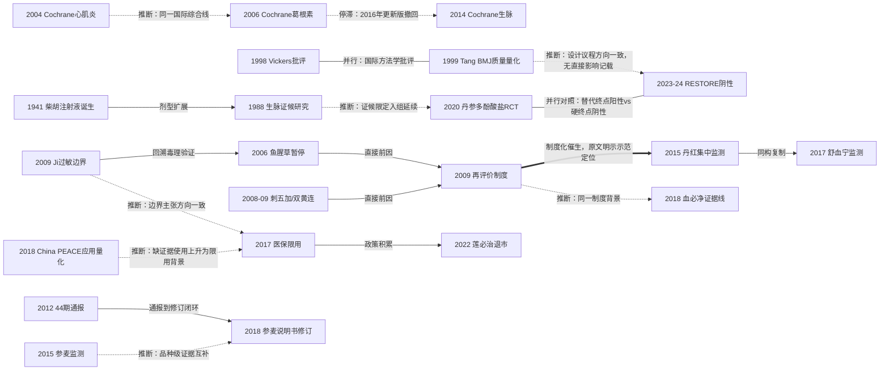

# D10 中药注射剂在心血管急危重症中的应用与安全性再评价

> **一句话判断**：中药注射剂1941年诞生于战争缺药环境（剂型史实，人物与地点细节据综述与纪念性史料转述），在心血管急危重症大规模应用——急性心梗患者24小时内静脉中药使用率2001-2011年从38.2%升到56.1%——之后，因2006-2009年连续安全事件转入监管转折：再评价制度、说明书修订、医保限用与万例级集中监测并行。2020年代方法学达标的安慰剂对照RCT交出阴性或仅次要终点阳性的成绩单，2022年出现首个再评价退市品种。对临床医生最重要的一点：心血管急危重症使用中药注射剂的疗效证据仍然薄弱，说明书警示语与医保限定条款（限二级及以上医疗机构、部分限"有明确的缺血性心脑血管疾病急性发作证据的患者"；品种数与条款未经独立核实，见第8节）是当前最硬的处方边界。

## 0 三分钟速读

①**从哪里来**：1941年柴胡注射液在太行山研制、1954年12月武汉制药厂工业化 [D10-N01]；1960年代丹参（复方丹参）注射液问世即用于冠心病心绞痛与心肌梗死 [D10-N01]；1988年陈可冀团队把证候分型引入生脉注射液冠心病研究 [D10-N02]。

②**为什么改变**：2006年鱼腥草注射液事件——2006-2008年2282例不良反应报告、其中死亡22例——触发全国暂停7个品种（国食药监安〔2006〕218号）[D10-N05]，2009年建立安全性再评价制度（国食药监安〔2009〕28号）[D10-N07]。

③**如何分化**：安全线走万例级医院集中监测（丹红30888例ADR发生率3.50‰、舒血宁30209例1.13‰）[D10-N10][D10-N12]；疗效线走安慰剂对照硬终点RCT（RESTORE梗死面积P=0.982全阴性）[D10-N17]；国际线2004-2014年产出的心血管相关Cochrane系统评价于2016年两篇撤回（withdrawn，流程性停止维护）后中断 [D10-N19][D10-N20]。

④**现在研究什么**：参附/参麦/心脉隆的脓毒症与心源性休克RCT（主要终点多阴性、死亡率仅次要终点阳性）、PCI围术期心肌保护、MRGPRX2类过敏机制、上市后真实世界安全监测。

⑤**用了什么数据**：监管通报/公告原文（44期通报508例严重报告）、万例级集中监测、自发报告库（广东559066例）、EHR倾向评分（瑞金154对）、注册RCT与贝叶斯网络Meta（心源性休克43项RCT/2707例）。

⑥**还有什么不知道**：没有任何一项以死亡率为主要终点、足把握度的安慰剂对照RCT支持常规使用；医保限用（品种数与条款未经独立核实，见第8节）的结局效应无定量评估；CNKI/万方未检索使中文监测证据停留在摘要层。

**覆盖边界**：纳入中药注射剂的历史与监管、安全性证据，及心血管急危重症（心源性休克、AMI/PCI围术期、心衰、脓毒症心肌损伤）的注射剂疗效证据。稳定性心绞痛系统疗效线见D01，心衰全程管理与口服中成药循证见D03，心肌炎与心肌病见D07，机制与网络药理见D12，学科史横切见X01——本章只在交界处点到为止。口服中成药与非注射剂型不在本章。

**本章口径**：执行日与检索截止2026-10-17；近期窗口2021-10-17至2026-10-17（仅用于重点展开，不限制历史追溯）。阅读层级：L0=仅二手转述、L1=题录已核实、L2=摘要已读、L3=原文部分章节已读、L4=全文已读。本章22个节点（L3×4、L2×11、L1×7）；证据表42行（关键节点22、入口综述7、近期代表研究13）。所有题录本轮经数据库核实；NMPA监管文件以官网原文或检索核实并逐处标注；层级取本轮核实的较低值。**覆盖状态（按统一口径重评，2026-10-17）：基本完整但有标注缺口**——理由：六问（从哪里来、为什么改变、如何分化、现在研究什么、用了什么数据、还有什么不知道）均可据本章回答；剂型史、监管制度、安全监测、疗效确证、国际综合线、支付端各主要分支均有节点，主链关键转折均可核实；缺口限于第8节已标注项目（CNKI/万方未检索、FDA/EMA官网未直接检索、Cochrane撤回声明未直读、Li H 2019具体数值未逐字复核、2017医保目录品种数与条款未经独立核实、RESTORE主结果仍为preprint、血必净线仅题录级），属证据可得性标注，不动摇脉络完整性；完整性检查提出的两条建议改均为表述层，已在本轮修正。

## 1 源头：最初在研究什么

按四类起点说法标注——

**被公认的奠基工作（人物/地点细节属二手转述）**：1941年柴胡注射液研制成功，标志中药注射剂诞生；通行叙事为1940年八路军129师卫生部长钱信忠提议将柴胡蒸馏制成针剂、次年在太行山制药所试制成功（初名"瀑澄利尔"）。据E1（Zheng W等，Chinese Medicine 2022;17:127，Table 1，本轮已核综述全文）与纪念性史料（光明网文摘报2018-06-09，L0）转述；研制单位在史料中两说并存（"八路军制药所"与"利华制药厂"），原始研制档案未见公开数字化版本 [D10-N01]。

**目前最早找到的文献（均有检索范围限定）**：

- **工业化起点**：1954年12月武汉制药厂将柴胡注射液工业化生产，为中国第一个工业化中药注射剂（据E1 Table 1转述，其引NMPA公告与行业史料；原档案未直接核读）[D10-N01]。
- **心血管品种起点**：丹参（复方丹参，丹参+降香）注射液问世于二十世纪六十年代、最初即主要用于冠心病胸闷、心绞痛与心肌梗死——据1996年《丹参（复方丹参）注射液的临床应用进展》综述题录（维普公开页，L1）；1960年代原始研制文献未数字化，具体研制单位与年份未核实。可核性的最早PubMed锚点是1984年复方丹参注射液治突发性耳聋的题录（PMID 6591500，非心血管适应证，仅作年代注脚）。
- **参麦注射液最早可核实记录**：1987年《中药通报》抗心律失常作用与毒性研究（Xing SL，12:48-50，PMID 2955941，L1，无摘要）。
- **生脉注射液最早可核实临床研究**：1988年陈可冀、陈玉卿（中国中医科学院西苑医院）在《中西医结合杂志》发表生脉注射液对冠心病心气虚/气阴两虚证患者心功能影响的研究（8:523-526,515-516，PMID 3248344，L1，无摘要；设计细节在中文原文，本轮未获取）[D10-N02]。

以上"最早"均限于PubMed/Europe PMC收录范围；1970-80年代《中医杂志》等中文临床文献可能更早但未被回溯收录（见第8节）。

**二手统计（是存量数字，不是"工作"）**：1980年代中药注射剂品种数约1400种（Bai 2008统计，经E1转引）；截至2022-07-06，NMPA数据库现存批准128个品种、872个批准文号、196家企业（据E1，L3）[D10-N01]。

**方剂源头**：生脉注射液源自生脉散（人参、麦冬、五味子），方名最早出自金代张元素《医学启源》（1186年），经李东垣《内外伤辨惑论》阐述推广；另有溯至唐代《千金方》的渊源说（均据现代古籍考证文章转述，《沈阳药科大学学报》公开页，古籍原文本轮未直读）。参附注射液源自参附汤、同属回阳益气急救方系（方源考订本轮未逐一核实，存疑）。

最初研究的问题因此有两个：一是把中药做成起效快、宜急症的注射剂型（休克、心衰、心梗）；二是把"证候分型"做进入组与分析单位——后者由 [D10-N02] 确立，成为此后生脉/参麦/参附类急救注射剂研究的标准范式。同时，注射给药绕过消化道屏障与肝脏首过效应，被E1的ADR章节明确列为后来过敏反应集中的技术根源。

## 2 关键转折：问题—新证据/新方法—认识变化—新问题

**（1）剂型范式建立→证候范式确立（扩展；依据：E1综述归纳+题录核实）**。1941年剂型可行、1954年工业化 [D10-N01]；1988年证候分层研究把"心气虚/气阴两虚"做成入组与分析单位，西苑医院团队由此介入益气注射剂心血管临床研究 [D10-N02]。

**（2）无量化证据支撑的应用扩张（问题浮现）**。China PEACE回顾性AMI研究（Spatz ES等，Circ Cardiovasc Qual Outcomes 2018;11(7):e004190，PMID 29848478，L2）：162家西医院AMI患者住院24小时内静脉中药使用率2001/2006/2011年为38.2%→49.1%→56.1%，99%的医院在用，丹参类占全部AMI患者的35.5%，二级医院使用OR 2.85（95%CI 1.98-4.11）；探索性分析未见与院内出血/死亡率的关联；作者结论"在缺乏获益或危害证据的情况下使用持续上升" [D10-N18]。使用率高点（2011年）出现在监管强化持续期仍在爬升——它给出的是"暴露规模"证据，并为支付端限用提供背景（时序相邻，因果不主张）。

**（3）国际方法学批评（质疑）**。Vickers等1998（Controlled Clinical Trials 19:159-166，PMID 9551280，DOI 10.1016/S0197-2456(97)00150-5，L2）：来自中国的非针刺试验99%阳性、无一报告"治疗无效"（英国75%、日本89%、俄/苏97%、台湾95%；非针刺部分405项，另针刺252项）[D10-N03]。Tang金陵/詹思延/Ernst 1999（BMJ 319:160-161，L3，本轮已读全文）：从100种中医药期刊抽28种手工检索1997年前全部期次，检出2938项RCT、估算全国近10000项；《中国中西医结合杂志》414篇质量提取显示盲法仅15%、半数以上未报基线与不良反应；49项针刺卒中试验漏斗图呈选择性发表；全文未单提注射剂 [D10-N04]。两文把含注射剂在内的中药试验证据标记为系统性偏倚高危来源，此后近二十年缺少针对注射剂的直接质量证据（直到2021年Gao等，见第6节国际线）。

**（4）安全事件→监管制度（修正/制度化；依据：NMPA原文与E1 Table 1时序）**。2006-06-01国食药监安〔2006〕218号通告全国暂停使用和审批鱼腥草注射液等7个注射剂；鱼腥草类注射剂2006-2008年ADR报告2282例、其中死亡22例（据E1转述，其引Wu J 2016）；国食药监办〔2006〕461号（2006-09-05）允许肌注剂型在修订说明书等完成后分步恢复 [D10-N05]。2008年10月云南红河州刺五加注射液事件（红河州第四人民医院6例严重ADR、3例死亡，涉事批次2个；官方通报转载查明涉及2008年7月昆明暴雨浸泡库存后更换包装标签继续销售——责任细节属政府网站/媒体转载级文本，L1）与2009年2月青海双黄连注射液事件（3例严重ADR、1例死亡；2009-02-12卫生部与SFDA联合紧急暂停）[D10-N06]。2008-12-24卫生部/SFDA《关于进一步加强中药注射剂生产和临床使用管理的通知》提出生产、配液、滴速、监护、过敏史询问全链条要求；2009-01-13国食药监安〔2009〕28号启动安全性再评价（生产工艺和处方核查、全面排查、评价性抽验、不良反应监测、说明书修订），2010年细化为7个技术指导原则 [D10-N07]。认识变化：从"只批不管"转入品种级风险管理制度。

**（5）适用边界与品种级警示（明确适用边界）**。Ji K等2009（Regulatory Toxicology and Pharmacology 55:134-138，PMID 19559066，L2）：收集9个感冒/上感适应证中药注射剂致严重过敏性休克与死亡的病例报告作风险分析（品种名细节在正文；摘要层面支持9品种），结论"风险不可接受"（should preclude its use in treating common colds and URTIs），并提出五条建议——按具体适应证而非辨证广谱使用、适应证应由双盲RCT确定、仅用于重症抢救而非轻症等 [D10-N08]。2012-01-10国家药品不良反应信息通报第44期（L3，官网原文已读）：生脉注射液2004-01-01至2011-09-30严重报告508例；全身性损害53.2%、呼吸系统20.7%、心血管系统11.4%、皮肤5.9%；过敏性休克90例+严重过敏样反应89例=179例（占35.2%）；不合理用药三类——超剂量9例（单次最高250ml）、混合用药20例（黄芪注射液最多见）、过敏体质用药15例 [D10-N09]。

**（6）集中监测范式（同一制度催生的项目群，非同一队列）**。2009年再评价要求企业用真实世界数据回答发生率与反应谱。丹红注射液30888例/37家医院/6省前瞻集中监测（Li XL等，Evid-based Complement Altern Med 2015;2015:610846，PMID 26508981，L2）：ADR发生率3.50‰、新发现ADR 17种、A型反应占57.75%，作者明示以此作为其他中药注射剂上市后监测的示范 [D10-N10]。参麦注射液32358例前瞻集中监测+4220例自发报告整合（Wang LX等，中国中药杂志 2015;40:4752-4756，PMID 27245017，L2）：发生率0.93‰，预警信号"气促/类过敏反应/潮红"，慢性肺心病、甲状腺疾病、合并脑血管病及联用喹诺酮类/青霉素类/前列地尔为可疑影响因素 [D10-N11]。舒血宁30209例/27家医院（Jiang JJ等，中国中药杂志 2017;42:2883-2888，PMID 29139252，L2）：ADR 34例、发生率0.113%（=1.13‰）、属罕见 [D10-N12]。血栓通30884例/33院/7省发生率4.14‰（Li C等，BMC Complement Altern Med 2018;18:277，PMID 30326892，本轮已对该文摘要核实）；古红注射液30000例多中心前瞻真实世界研究（PMID 41044700，L1题录）沿用同一范式。

**（7）支付端与说明书（政策工具）**。2017版国家基本医保目录（人社部发〔2017〕15号及其附件）首次对26个中药注射剂设支付限定（限二级及以上医疗机构，部分品种限"有明确的缺血性心脑血管疾病急性发作证据的患者"；目录原文与附件本轮未直读、公开学术库无题录，品种数与条款未经独立核实，全报告复核时核对判存疑）[D10-N13]。2018-04-26 NMPA 2018年第14号公告对参麦注射液说明书增加警示语并修订【不良反应】【禁忌】【注意事项】（L3，公告原文已读；官网发布2018-04-28）[D10-N14]——44期通报"建议企业修订"六年后闭环，并成为生脉、黄芪、丹参类等品种说明书修订潮的模板。

**（8）疗效确证与阴性转折（验证/反证，并行对照）**。丹参多酚酸盐STEMI直接PCI安慰剂对照RCT（Shen L等，Ann Transl Med 2020;8:1185，PMID 33241034，NCT03045562，绿谷制药申办，536例随机265vs271）：冠脉微循环灌注改善，梗死面积缩小趋势未达显著（P=0.070），LVEF无差异 [D10-N15]。RESTORE参附试验（设计文Rationale and design of the RESTORE trial，American Heart Journal 2023;260:9-17，PMID 36822255，NCT04493840，北京安贞申办；主结果medRxiv，DOI 10.1101/2024.07.01.24309807）：295例随机（CMR可评估273例，计划326例），梗死面积37.4±14.1% vs 37.5±14.5%（效应-0.04%，95%CI -3.45~3.37，P=0.982），TIMI血流/心肌灌注、ST段回落、CK-MB曲线下面积全部阴性，不良事件分布均衡 [D10-N17]。两试验设计同构（多中心、双盲、安慰剂对照、STEMI直接PCI、灌注/梗死终点），一替代终点阳性趋势、一CMR硬终点阴性，构成当前疗效不确定性的两极（并行，依据：注册库字段与两文摘要）。

**（9）制度后果（退出+常态化）**。2022-01-11 NMPA 2022年第2号公告注销莲必治注射液药品注册证书——2009年再评价建立13年后首例退市（穿心莲内酯类、非心血管品种，本章仅作制度节点）[D10-N16]。2023-12-18 NMPA组建已上市中药注射剂上市后研究和评价专家工作组（组长张伯礼、首批28人；据天津中医药大学官网，L2，https://institute.tjutcm.edu.cn/info/1042/1170.htm）。

**（10）国际证据综合线的建立与中断（分化/停滞）**。2004年Cochrane综述"Herbal medicines for viral myocarditis"（CD003711.pub2）覆盖参麦/生脉注射液，总体结论为证据不足，其中黄芪/丹参/参麦亚组方向阳性（与D07口径统一）[D10-N21]；2006年葛根素注射液治不稳定性心绞痛综述（Wang Q等，CD004196.pub2，PMID 16856037，19项RCT约1812例、全部为中国试验）结论"加入常规治疗可能有效"，但纳入试验方法学质量极低并提示发表偏倚 [D10-N19]；生脉注射液治心衰综述谱系为2007年首版Chen J等（PMID 17943836）→2014年更新Zhou Q等（PMID 24733159；中间2012版PMID 23152229亦为Chen J等）（CD005052），结论"联合常规治疗可能改善NYHA分级"但试验质量低 [D10-N20]。据Cochrane Library检索结果页转述，前两篇的后续更新版（2016年pub3/pub6）已撤回（withdrawn，流程性停止维护，撤回声明注明原因——作者团队无力更新、判为低优先级；withdrawal notice未直读）——国际证据综合线就此中断，撤回停滞同时列入第5节失败路线。

**（11）跨界政策节点**。2020年新冠诊疗方案推荐部分中药注射剂（以血必净等为主）用于重症/危重症（据E1 Table 1转述；适应证以感染性重症为主，跨界记录）。与血必净相关的脓毒症证据线（RCT Meta与证据综述，PMID 29860133/32860891/24778706，L1题录级）见 [D10-N22] 与第4节主题4。

## 3 分支图

实线=原文明确讨论或综述归纳；虚线=本报告推断。血必净线（N22）与集中监测线同属2009年再评价制度背景（推断）。

## 4 近五年重点（2021-10-17至2026-10-17）

**主题1：休克/脓毒症心肌损伤的参附·参麦·心脉隆RCT与真实世界研究（成熟度：发展中）**
研究什么：把益气类注射剂（参附为主）从心血管休克扩展到脓毒症/脓毒症心肌抑制（SIMD），终点为血管活性药剂量、微循环、舒张功能与死亡率。常用数据与设计：多中心/单中心RCT（安慰剂或生理盐水对照）、贝叶斯网络Meta、EHR倾向评分回顾队列。代表研究与结果：

- Xiong Y等2026（Critical Care Medicine，DOI 10.1097/ccm.0000000000007269，PMID 42456111，L2）：多中心RCT（华中4家三甲ICU），172例脓毒症，参附vs生理盐水；主要终点去甲肾上腺素等效剂量22.00 vs 20.00（P=0.16）阴性；ICU死亡率3.5% vs 11.6%（P=0.04）、28天死亡率15.1% vs 27.9%（P=0.04）为次要终点阳性。
- Huang P等2026（Chin J Integr Med 32(7):579-587，DOI 10.1007/s11655-026-4158-0，PMID 41870792，L2）：单中心开放标签RCT，乳酸4.5-7.0 mmol/L脓毒症休克122例1:1；主要终点28天全因死亡率41.0%（25/61）vs 50.8%（31/61），P=0.271阴性；7天死亡4.9% vs 16.4%（P=0.046）与第7天去甲肾上腺素剂量更低为次要终点阳性（主结果数值为本轮按更新摘要补记）。
- Li J等2026（BMC Infect Dis 26(1):606，DOI 10.1186/s12879-026-12782-0，PMID 41673625，L2）：上海瑞金医院EHR 2013-2023脓毒症队列、倾向评分匹配后154对，参附+集束化治疗28天死亡率9.74%（15/154）vs 22.73%（35/154），P=0.002——观察性证据，不能排除适应证混杂（匹配对数为本轮按更新摘要补记）。
- He J等2021（Shock 55(1):33-40，DOI 10.1097/shk.0000000000001592，PMID 32604224，L2）：心脉隆多中心双盲实用性RCT 192例（96vs96），第5天舒张功能不全发生率42.7% vs 63.5%（P=0.004）、BNP动态差异P=0.049；28天死亡率无差异（P=0.45）。
- 证据整合：E6（Yue L等，Front Pharmacol 2024;15:1348360，PMID 38476325，贝叶斯网络Meta，八库检索至2023-09-30，PROSPERO CRD42022347053）：43项RCT/2707例/6品种，参麦+西药（MD -1.05，95%CI -2.10~-0.09）与参附+西药（MD -0.81，-1.40~-0.25）较单纯西药降低院内死亡率，SUCRA排序参麦+西药居首；纳入试验几乎全为国内小样本。

分歧：主要终点（血管活性药剂量）与死亡率终点不一致；RCT次要终点死亡率获益与EHR观察性证据相互印证，但均不满足"死亡率为主要终点+足把握度+安慰剂对照"标准；心脉隆改善心肌功能却不改善28天死亡。

**主题2：AMI/PCI围术期注射剂：安慰剂对照方法学升级与阴性结果（发展中）**
研究什么：丹参多酚酸盐、参附等在STEMI直接PCI与选择性PCI围术期的心肌保护（梗死面积、心肌灌注、无复流/慢血流）。代表研究：

- RESTORE（[D10-N17]）：295例，CMR梗死面积P=0.982全阴性；主结果截至2026-10-17仍为preprint。
- 丹参多酚酸盐STEMI RCT（[D10-N15]）：536例，灌注改善、梗死面积P=0.070趋势。
- Ou Y等2020（Chin J Integr Med 26(9):656-662，PMID 32572777，注册号ChiCTR1800016992，L2）：NSTE-ACS选择性PCI随机149例（可评估60vs68），PCI相关严重心肌损伤/心梗11.7% vs 26.5%（P=0.035）；1月/1年MACE与全因死亡无差异。
- Cai T等2025（Front Cardiovasc Med 12:1619345，PMID 41573502，L2）：网络Meta（检索至2024-11-30），14种干预（13类中药注射剂+标准治疗）、5535例比较PCI后无复流/慢血流（排序细节见原文）。

分歧：造影/生化替代终点可阳性，CMR梗死面积、LVEF、MACE等硬终点阴性或不确定；5535例网络Meta的阳性排序与两个大型安慰剂RCT的谨慎结论并存。

**主题3：类过敏反应机制与可控化：MRGPRX2靶点、人源化模型与质量源头（机制早期线索→转化发展中）**
研究什么：首剂即发、非IgE介导类过敏反应的受体机制（肥大细胞MRGPRX2）、补体激活通路、致类过敏成分筛查与人源化评价模型。代表研究：E3（Zou F等，Chinese Medicine 2023;18:149，PMID 37953288，L2）——类过敏为中药注射剂最主要ADR类型、首剂即可发生，标准评价模型与技术指南缺位；Zhang Z等2025（Front Pharmacol 16:1670739，PMID 41089846，L2）——MRGPRX2关键受体、CRISPR-Cas9/造血干细胞移植人源化小鼠、LAD2与HEK293过表达体外筛查体系构成可控化评价路线。边界：类过敏与真过敏临床归因难分；动物模型种属差异假阴性刚有人源化方案，尚未进入品种准入标准。

**主题4：上市后安全证据体系常态化（数据生产成熟；解释框架发展中）**
研究什么：医保限用与说明书修订新常态下，用集中监测、登记、SRS信号挖掘与EHR持续量化品种级ADR发生率与危险因素。代表研究：E2（Cai X等，Front Pharmacol 2026;17:1856615，PMID 42568515，L2）——心血管中药心脏ADR证据体系"出奇薄弱"：过度依赖个案与自发报告、缺因果判定工具、真实世界证据未被监管充分利用；Li J瑞金EHR（见主题1）；古红30000例（PMID 41044700，L1题录）。

跨品种发生率谱（统一为千分率，逐一括注出处）：血栓通4.14‰（30884例，PMID 30326892）＞丹红3.50‰（30888例，PMID 26508981）＞舒血宁1.13‰（30209例，原报告写0.113%，PMID 29139252）＞参麦0.93‰（32358例，PMID 27245017）。发生率高低可能反映ADR判定标准与各中心培训口径差异，跨品种比较难分真伪 [D10-N11][D10-N12]。SRS信号挖掘的高信号品种（湖北2014-2019年数据中参麦、香丹、丹参、生脉、黄芪、血必净等；血必净严重ADR比12.63%）与集中监测低发生率之间的张力未解决（Huang R等，Sci Rep 2021;11:8875，PMID 33893351，L2）。

**主题5：证据整合的繁荣与RCT质量批评（数量成熟；结论可靠性争议未解）**
代表研究：Ma ZZ等2026（Front Cardiovasc Med 13:1921437，PMID 42688225，L2）——AMI后心衰网络Meta，62项RCT，比较心功能/炎症因子/心室重构终点的品种间相对效果；Lin S等2021（Front Pharmacol 12:659707，PMID 34916929，L2）——HFrEF贝叶斯网络Meta（检索至2021-08-03），107项RCT/9073例/6品种（黄芪、参附、生脉、参麦、心脉隆、益气复脉冻干），各品种替代终点排序分散、无全胜品种；Gao G等2021（Cardiovasc Drugs Ther 35:191-193，PMID 32785792，L1题录，Springer付费墙）——题名即对治疗心血管疾病（及COVID-19）的中药注射剂RCT质量提出"serious concerns"。分歧：NMA数量爆发与单项RCT质量低并存；Vickers批评（被引约430次，2025-2026年发表偏倚研究仍在引用）未被本土NMA充分吸收。

## 5 争议、负性结果与停滞路线

**争议1：整类存废——急救必需 vs 系统性风险（未决）**。存方：张伯礼2020-05-12在国家中医药管理局官网访谈称受医保限定、说明书修订、重点监控影响"临床应用大受影响"，应以证据回应质疑、重启上市后再评价（L2）；中药ADR报告中注射剂占比已连续数年下降。严限方：Ji 2009五条边界主张 [D10-N08]；Vickers/Tang整类证据质量质疑 [D10-N03][D10-N04]；2022年首例退市 [D10-N16]。现行共识落在"限急救限重症"（医保条款+说明书警示），整类存废与品种级淘汰仍在再评价过程中（2023专家工作组）。

**分母口径与对照基线（读"占比"必读）**：本章占比数字至少三种分母，逐一标注——(a)中药注射剂占中药ADR报告：2012-2017年>50%、2021年降至27.5%（据E1 Fig 2章节与2021年度报告，前者L3已核、后者经转载页核实）；(b)中药注射剂占全部注射剂ADR报告：2019年9.1%；(c)2017年注射剂占中药ADR报告54.6%（口服制剂37.6%）、中药严重报告中静脉注射给药占84.1%——据2017年度报告转载页（meeting.orthonline.com.cn/node/133758）转述，官方报告原文本轮未直读。占比是构成比、不是发生率，其下降可能由分母结构变化（口服中药报告增加、报告总数变化）驱动；"占比下降"与2017年限用时序相邻、因果未证。对照基线：2017年化学药品ADR报告中注射剂占66.7%，高于中药报告中的54.6%（同上转载页）；Li H等2019（Pharmacoepidemiol Drug Saf 28:1002-1013，PMID 31131950，L2）分析广东省2003-2017年559066例报告，中药注射剂严重ADR比例6.02%与常规注射剂6.72%相当，但未知/新ADR比例远高（46.74% vs 24.13%——该组数值在数据库摘要截断处未能逐字复核；"中药注射剂未知/新ADR比例更高"的一般结论经摘要支持）。因此"风险为该类药品独有"的印象不成立；该类药品的特殊性在未知/新反应比例与严重过敏聚集，而非构成比本身。

**争议2：RCT证据可信度——几乎全阳性的试验群 vs 方法学达标后的阴性（未决，本方向最核心）**。阳性证据群：43项心源性休克RCT（E6）、107项HFrEF RCT（PMID 34916929）均显示联合用药优于单用西药。质疑方：Vickers 1998（中国试验99%阳性、无一无效）[D10-N03]；Tang 1999（盲法仅15%、漏斗图偏倚）[D10-N04]；Gao 2021（题名即"serious concerns"，PMID 32785792）；参麦休克Meta仅3/30项RCT报告不良事件（E7，PMID 32186054，检索至2015年5月，有效率RR 1.25、病死率RD -0.10）；RESTORE安慰剂对照CMR终点P=0.982 [D10-N17]。小样本阳性试验与大型安慰剂对照阴性/弱阳性结果的矛盾，是当前疗效判断的主要障碍。

**争议3：死亡率获益的真实性——主要终点阴性、次要终点阳性（未决）**。支持方向：Xiong 2026（28天死亡率15.1% vs 27.9%，P=0.04，次要终点）；瑞金EHR PSM（9.74% vs 22.73%，P=0.002，观察性）。谨慎方：Xiong试验主要终点NEE剂量P=0.16阴性；Huang P 2026以28天死亡率为主要终点（P=0.271）阴性；PSM无法排除适应证混杂；心脉隆28天死亡无差异（P=0.45）。现有证据不能支撑以死亡率为由的常规使用；需以死亡率为主要终点、足把握度的安慰剂对照RCT确认。

**争议4：试验注册与发表终点一致性、注册数据更新缺位（部分改善）**。规范样本：NCT03045562（注册主要终点TIMI血流/心肌灌注分级与发表一致）与NCT04493840（注册主要终点"Infarct size (% of left ventricular mass)"与发表一致；两注册号均经ClinicalTrials.gov API核实）。缺位样本：2026年参附脓毒症RCT与部分新品种RCT在Europe PMC记录中未检出注册号字段；NCT01612533（参附2万例安全性登记，中国中医科学院申办）状态UNKNOWN、无结果上传。

**负性结果与失败路线**：

1. RESTORE全阴性（P=0.982；全部影像/生化终点）[D10-N17]；主结果截至2026-10-17仍为preprint，同行评议版本未见到。
2. 丹参多酚酸盐STEMI硬终点不确定（梗死面积P=0.070、LVEF无差异）[D10-N15]；选择性PCI试验心肌损伤下降（P=0.035）但1月/1年MACE与死亡无差异（PMID 32572777）。
3. 心脉隆动物研究2022年撤稿（Retraction，Front Physiol 2022;13:1006572，PMID 35991186，撤回DOI 10.3389/fphys.2020.595760）；临床SIMD试验28天死亡率无差异（PMID 32604224）。
4. 参附脓毒症RCT主要终点阴性：Huang P 2026（P=0.271）；Xiong 2026主要终点阴性（死亡率仅次要终点阳性）。
5. 国际Cochrane证据综合线2016年中断：葛根素/不稳定性心绞痛（pub3）与生脉/心衰（pub6）更新版撤回（withdrawn，流程性停止维护；据Cochrane Library检索结果页转述）[D10-N19][D10-N20]。
6. 品种退出与限用：鱼腥草7品种整类暂停（2282例报告/其中死亡22例）[D10-N05]、莲必治退市 [D10-N16]、2017年26品种医保限用 [D10-N13]；中药注射剂ADR报告占比从>50%（2012-2017）降至27.5%（2021，构成比口径，见上文）。
7. 登记无结果：NCT01612533（参附2万例安全登记）状态UNKNOWN；NCT02135835（参附急性心衰）、NCT02709798（参附STEMI心肌保护）截至2026-10-17无结果发表。

## 6 传承线与国际线

**传承线**（学术思想→名家/单位→方药/指南接力）：

1. **方剂源头**：生脉散（《医学启源》1186，李东垣推广；另有《千金方》渊源说）→参附汤（回阳益气急救方系；方源考订未逐一核实，存疑）。
2. **剂型诞生**：1941太行山柴胡注射液→1954年12月武汉制药厂工业化 [D10-N01]。
3. **心血管品种线**：1960年代丹参（复方丹参）注射液问世、最初即用于冠心病（陆瑞宝1996综述题录L1；上海系统在临床推广中有重要地位——属回忆性材料L0）→1988年西苑医院陈可冀/陈玉卿证候分层范式 [D10-N02]→2005年中科院上海药物研究所丹参多酚酸盐获新药证书（指纹图谱质控、适应证限定冠心病稳定型心绞痛心血瘀阻证；据SIMM成果页，L2）→复旦中山医院团队推进STEMI安慰剂RCT（NCT03045562，2020）[D10-N15]。
4. **安全性再评价学术线**：2010年张伯礼/商洪才团队（作者含Cheng CW、Li Youping）在J Evid-Based Med发表中药注射剂ADR系统回应（E5，DOI 10.1111/j.1756-5391.2010.01072.x）→2012年王永炎、张伯礼在"中药注射剂再评价关键科学问题高峰会议"肯定重大新药创制专项质量提升研究（报道ADR发生率降至5‰以下——新闻转述L0，未经独立复核）→中国中医科学院谢雁鸣/王连心团队完成参麦32358例 [D10-N11]、舒血宁30209例 [D10-N12]集中监测并注册参附2万例安全登记（NCT01612533，状态UNKNOWN）→河南中医药大学第一附属医院李学林团队完成丹红30888例 [D10-N10]与血栓通30884例（PMID 30326892）→2020-05-12张伯礼官网访谈呼吁重启上市后再评价、"为中药注射剂正名"（L2）→2023-12-18 NMPA专家工作组组长张伯礼、首批28人（天津中医药大学官网，L2）。
5. **疗效确证线**：北京安贞医院RESTORE（NCT04493840，2023设计/2024主结果阴性）[D10-N17]。

**国际线**：

1. **国际证据综合线（2004-2014年建立，2016年中断）**：2004年病毒性心肌炎Cochrane综述覆盖参麦/生脉注射液、总体结论证据不足，其中黄芪/丹参/参麦亚组方向阳性（CD003711.pub2）[D10-N21]→2006年葛根素注射液/不稳定性心绞痛Cochrane综述（PMID 16856037，19项RCT约1812例，"可能有效"但方法学质量极低+提示发表偏倚；2016年更新版撤回withdrawn）[D10-N19]→生脉注射液/心衰Cochrane综述谱系2007首版Chen J等→2014更新Zhou Q等（PMID 24733159，"可能改善NYHA分级"但试验质量低；2016年pub6撤回withdrawn）[D10-N20]。三篇结论一致指向"纳入证据质量低、需谨慎解释"，与下述批评线互证。
2. **试验质量批评线**：Vickers 1998（被引约430次）[D10-N03]→Tang 1999（BMJ全文，L3）[D10-N04]→Gao G等2021（Cardiovasc Drugs Ther，PMID 32785792，见D10-R38）是RESTORE [D10-N17] 所属疗效确证线之前的国际质量批评前史。
3. **国际期刊上的安全与使用记录**：Ji KM等2009 Allergy鱼腥草注射液致死性过敏通信（Allergy 64:816-817，PMID 19210362）[D10-N05]；Ji K等2009 RTP九品种严重过敏分析（PMID 19559066）[D10-N08]；Li H等2019 PDS广东559066例（PMID 31131950）；Huang R等2021 Sci Rep湖北信号挖掘（PMID 33893351）；Spatz等2018 China PEACE（PMID 29848478，国际期刊上的真实世界使用率与结局评估）[D10-N18]。
4. **海外验证现状**：海外对中药注射剂的介入以2004-2014年的Cochrane证据综合与持续至今的试验质量批评为主，结论均为"证据质量低、需谨慎解释"；两项心血管相关Cochrane综述2016年撤回（withdrawn）后，海外独立疗效验证呈空白。ClinicalTrials.gov API v2三品种检索（query.term="Shenmai injection" OR "Salvianolate" OR "Xueshuantong injection"，2026-10-17）返回10项研究、41条地点记录全部位于中国境内；参附/丹参多酚酸盐试验申办方均为中国境内机构（北京安贞、绿谷制药、中国中医科学院）。未查到任何中药注射剂获FDA/EMA上市批准的公开记录；FDA/EMA官网本轮未直接检索，该否定结论以上述检索范围为限（见第8节）。

## 7 数据路径小结

历史→现在八条路径：

1. **动物实验**：1987年参麦毒性研究（PMID 2955941）起步；2007年犬急性心源性休克模型显示生脉注射液改善MAP/CO/CI并缩小梗死面积（Ding XF等，中国中药杂志 2007;32:2298-2305，PMID 18309678，L2）；现为机制研究主场（网络药理学、代谢组、MRGPRX2人源化小鼠）。
2. **单中心临床观察/病例系列**：1980-1990年代主流（[D10-N02]等；题录级）。
3. **小样本RCT**：1990s-2010s爆发，Meta纳入30-107项（E7：30项RCT仅3项报告不良事件；PMID 34916929：107项），盲法率低、几乎无注册。
4. **多中心安慰剂对照RCT**：2017年后出现（NCT03045562、NCT04493840、NCT02135835），以造影/CMR/死亡率为终点。
5. **医院集中监测/登记**：2009年再评价催生的核心路径（丹红30888、参麦32358、舒血宁30209、血栓通30884、参附2万登记、古红3万例），产出有分母的ADR发生率 [D10-N10][D10-N11][D10-N12]。
6. **自发报告系统（SRS）**：国家年度报告（2021年中药ADR中注射给药占27.5%、静脉占其中97.2%）、广东559066例（PMID 31131950）、湖北信号挖掘（PMID 33893351）——无分母，只能做信号与构成比。
7. **EHR/医保真实世界数据**：瑞金医院EHR 2013-2023参附PSM（154对，PMID 41673625）；2017医保限定构成准自然实验数据源但因果评估缺位。
8. **政策文本**：NMPA通报/公告原文、医保目录条款——监管流行病学的一手材料（44期通报与2018年第14号公告本轮已读原文，218号/28号/2022年第2号以检索核实）。

口径提醒：集中监测的发生率（有分母）与SRS构成比（无分母）不可直接比较；EHR观察性证据不能排除适应证混杂；RCT结局受纳入试验质量制约（见争议2）。

## 8 还不知道什么（领域证据缺口）与本报告的检索缺口

**领域证据缺口**：

1. 心血管急救适应证缺乏以死亡率为主要终点、足把握度的安慰剂对照RCT：RESTORE以梗死面积为主要终点且阴性 [D10-N17]；2026年两项参附脓毒症研究一项主要终点阴性（死亡率仅次要终点阳性）、一项为回顾性PSM（观察性）；43项心源性休克RCT全为小样本替代终点试验（E6）。
2. 2017年医保限用与2022年退市对用量、市场份额与健康结局的因果定量评估缺位：公开文献以政策解读与占比描述为主；"占比下降"与限用时序相邻、因果未证，且可能被分母结构变化驱动。
3. 类过敏机制（MRGPRX2等）尚未进入品种准入标准；人源化评价模型刚有方案（PMID 41089846）。
4. 1940-1980年代原始档案与原始临床文献不可及：起点细节依赖纪念性史料与综述转述；丹参注射液研制单位与年份、生脉注射液早期工业化过程无公开原始记录。
5. 血必净等急危重症品种线（脓毒症/DIC）的全文证据未系统纳入本章（目前题录级，[D10-N22]）；其与参附线的相对定位需全文比较后才能判断。

**本报告检索缺口**：

1. **CNKI/万方未检索对本章结论的影响**：中文大规模监测研究（参麦32358例、舒血宁30209例、血栓通30884例）只能用到摘要层（L2），分品种ADR谱、分中心一致性、敏感性分析无法核对，"发生率跨品种比较"的解释力受限；1980-90年代及更早的中文原始临床文献（丹参注射液1960年代研制记录、生脉注射液1988年前的休克/心衰临床报道）无法回溯，使"最早可核实文献"被PubMed收录范围截断，起源叙事依赖二手综述；刺五加事件等原始调查报告也只有转载级文本。本章涉及中文期刊的判断均应按此折扣理解。
2. FDA/EMA官网未直接检索："无境外批准/验证"结论仅基于ClinicalTrials.gov三品种检索（10项研究/41条地点记录全部中国境内）与公开文献，不能排除官网渠道存在记录。
3. Cochrane三篇综述的withdrawal notice未直读，撤回原因的具体表述据Cochrane Library检索结果页转述。
4. Li H 2019 PDS具体数值（6.02%/6.72%、46.74%/24.13%）在数据库摘要截断处未能逐字复核，引用时已标注。
5. **待核线索**（无可定位来源或原文未获取，不进正文叙事）：2018年柴胡注射液说明书修订公告（增加"儿童禁用"等警示）原文页本轮未核到；2009版国家基本药物目录收载生脉注射液的目录原文；丹参多酚酸盐2005年上市前注册临床试验数据；生脉注射液1988年前的中文休克/心源性休克临床报道；张伯礼2018"中药注射剂再评价不可含糊"主题报告原文；2017年医保目录（人社部发〔2017〕15号及其附件）26个受限品种的完整名单逐条核对。
6. RESTORE主结果截至2026-10-17仍为preprint；若正式发表版本数字有变，应以期刊版为准。

## 9 本章节点速查表

| 编号 | 年份 | 第一作者+题名简写 | 期刊 | 节点作用 | 设计/数据/分析单位 | 样本（研究/患者/其他） | 关键结果 | 层级 | 核查 | PMID/DOI |
|---|---|---|---|---|---|---|---|---|---|---|
| N01 | 1941/1954 | 柴胡注射液诞生与工业化（剂型史实） | （非单篇论文；Zheng 2022 Table 1+光明网史料） | 剂型范式起点 | 剂型史/行业史料；品种 | 品种：1980s约1400种（二手统计）；2022-07-06现存128品种/872文号 | 剂型可行并工业化；研制单位两说并存 | L3+L0 | 通过 | url:光明网2018-06-09 |
| N02 | 1988 | 陈玉卿/陈可冀：生脉注射液冠心病证候心功能 | 中西医结合杂志 8:523-6,515-6 | 证候分层范式确立 | 住院患者按心气虚/气阴两虚分组观察；患者（证候亚组2类） | 样本量见原文（未获取）；证候亚组2类 | 评价两证型心功能影响（细节在中文原文） | L1 | 通过 | 3248344 |
| N03 | 1998 | Vickers：某些国家是否只发阳性结果 | Controlled Clin Trials 19:159-166 | 国际方法学批评起点 | MEDLINE摘要国别分层；发表试验 | 研究405（非针刺，自1100篇筛）；另针刺252 | 中国99%阳性、无一无效（英75%/日89%/俄97%/台95%） | L2 | 修正（DOI） | 9551280；10.1016/S0197-2456(97)00150-5 |
| N04 | 1999 | Tang/詹思延/Ernst：中医药RCT系统回顾 | BMJ 319:160-161 | 本土+国际合作质量量化 | 100刊抽28手工检索+414篇质量提取；发表试验 | 研究2938检出/估全国近10000；细读414；漏斗图49项 | 盲法仅15%；半数未报基线与不良反应；未提注射剂 | L3 | 通过 | 10406751；10.1136/bmj.319.7203.160 |
| N05 | 2006 | 鱼腥草注射液事件（218号暂停7品种） | （监管通告；Allergy 64:816-817） | 安全事件→监管转折起点 | ADR监测聚集信号；品种/病例 | 报告2282例（2006-2008，其中死亡22例，据E1转述）；暂停品种7 | 全国暂停；461号分步恢复肌注剂型 | L1 | 修正（文号218号） | 19210362；10.1111/j.1398-9995.2009.01942.x |
| N06 | 2008-09 | 刺五加/双黄连事件与全链条管理通知 | （监管通知与官方通报） | 事件扩展为行业系统风险 | 聚集信号+现场核查；品种/事件/机构 | 患者：刺五加6例（3死）、双黄连3例（1死）；刺五加涉事批次2 | 涉事批次叫停；使用限具备抢救条件机构 | L1/L0 | 通过 | url:NMPA 2008-12-24通知 |
| N07 | 2009 | 中药注射剂安全性再评价（28号文） | （监管文件） | 制度框架确立 | 工艺核查/排查/抽验/监测/说明书修订；品种（全部已上市） | 覆盖数百品种/上千文号 | 首次国家层面再评价；2010细化为7个指导原则 | L1 | 通过 | url:NMPA 20090113120001613 |
| N08 | 2009 | Ji K：九个感冒/上感注射剂严重过敏 | Regul Toxicol Pharmacol 55:134-138 | 明确适用边界 | 病例报告风险分析；病例（品种分层） | 报告：9品种严重过敏（含致死）病例；品种9 | 轻症使用"风险不可接受"；五条边界建议 | L2 | 通过 | 19559066；10.1016/j.yrtph.2009.06.008 |
| N09 | 2012 | 44期通报：生脉注射液严重过敏 | （NMPA ADR信息通报） | 心血管主力品种安全定量画像 | 国家ADR数据库汇总；病例报告 | 严重报告508例（2004-2011）；患者508例（其中过敏性休克90、严重过敏样89） | 全身损害53.2%；不合理用药3类（超剂量9/混滴20/过敏体质15） | L3 | 通过 | url:NMPA 20120110120001828 |
| N10 | 2015 | Li XL：丹红30888例集中监测 | eCAM 2015:610846 | 集中监测方法学模板 | 多中心前瞻医院集中监测；患者 | 30888例（37院/6省）；新ADR 17种 | ADR率3.50‰；A型57.75%；自述为再评价示范 | L2 | 通过 | 26508981；10.1155/2015/610846 |
| N11 | 2015 | Wang LX：参麦主动+被动监测整合 | 中国中药杂志 40:4752-4756 | 主动/被动监测整合 | 前瞻集中监测+SRS整合；患者+报告 | 集中监测32358例；SRS 4220例 | ADR率0.93‰；气促/类过敏/潮红为预警信号；联用喹诺酮/青霉素为可疑因素 | L2 | 通过 | 27245017；10.4268/cjcmm20152406 |
| N12 | 2017 | Jiang JJ：舒血宁30209例集中监测 | 中国中药杂志 42:2883-2888 | 监测范式复制（银杏叶类） | 多中心医院集中监测；患者 | 30209例（27院）；ADR 34例 | 发生率0.113%（=1.13‰）属罕见 | L2 | 通过 | 29139252；10.19540/j.cnki.cjcmm.20170705.012 |
| N13 | 2017 | 2017版医保目录26个中药注射剂限用 | （政策文件） | 支付端结构性限用 | 目录支付限定；品种 | 受限品种26 | 限二级及以上机构；部分限缺血性心脑血管急发证据 | L1 | 存疑（未经独立核实） | 人社部发〔2017〕15号及附件（目录条款，公开学术库无题录） |
| N14 | 2018 | 参麦注射液说明书修订（2018年第14号） | （NMPA公告） | 监测→通报→修订闭环 | 说明书修订行政程序；品种 | 修订条目：警示语+3项 | 过敏性休克写入禁忌与注意事项核心条款 | L3 | 通过 | url:NMPA 20180428155101359 |
| N15 | 2020 | Shen L：丹参多酚酸盐STEMI直接PCI RCT | Ann Transl Med 8:1185 | 方法学升级样本（替代终点阳性趋势） | 随机双盲安慰剂对照多中心；患者 | 536例（265vs271）；NCT03045562 | 微循环灌注改善；梗死面积P=0.070；LVEF无差异 | L2 | 通过 | 33241034；10.21037/atm-20-6081 |
| N16 | 2022 | 莲必治注射液注销注册证书（2022年第2号） | （NMPA公告） | 再评价产生退出后果 | 上市后评价→注销；品种 | 退市品种1 | 2022-01-11起停产停售停用 | L2 | 通过 | url:NMPA官网索引页 |
| N17 | 2023-24 | RESTORE：参附STEMI直接PCI CMR试验 | Am Heart J 2023;260:9-17（设计）/medRxiv（主结果） | 方法学达标的首个CMR硬终点阴性 | 随机双盲安慰剂对照多中心；患者 | 295随机（CMR可评估273）；10中心；NCT04493840 | 梗死面积-0.04%（-3.45~3.37）P=0.982全阴性 | L2 | 修正（设计文卷页） | 36822255；10.1101/2024.07.01.24309807 |
| N18 | 2018 | Spatz：China PEACE西医院AMI静脉中药使用 | Circ Cardiovasc Qual Outcomes 11:e004190 | 应用规模量化锚点 | 回顾性多横断面真实世界；患者/医院 | 医院162家；三个年份2001/2006/2011 | 使用率38.2%→49.1%→56.1%；丹参类35.5%；二级医院OR 2.85 | L2 | 通过 | 29848478；10.1161/CIRCOUTCOMES.117.004190 |
| N19 | 2006 | Wang Q：葛根素注射液治不稳定性心绞痛 | Cochrane DB Syst Rev CD004196 | 国际证据综合线（后撤回） | 系统评价；RCT | 19项RCT约1812例（据PubMed检索页转述） | "可能有效"但质量极低+发表偏倚；2016更新版撤回（withdrawn） | L2 | 通过 | 16856037；10.1002/14651858.CD004196.pub2 |
| N20 | 2014 | Zhou Q（2014更新；2007首版Chen J）：生脉注射液治心衰 | Cochrane DB Syst Rev CD005052 | 国际证据综合线（后撤回） | 系统评价（2007首版Chen J等/2014更新Zhou Q等）；RCT | 例数见原文（本轮题录/摘要层） | "可能改善NYHA分级"但质量低；2016 pub6撤回（withdrawn） | L2 | 通过 | 24733159；10.1002/14651858.CD005052.pub5 |
| N21 | 2004 | Liu J：草药治病毒性心肌炎 | Cochrane DB Syst Rev CD003711 | 国际综合线最早节点（D07交界） | 系统评价；RCT | 覆盖参麦/生脉注射液 | 总体结论证据不足，其中黄芪/丹参/参麦亚组方向阳性 | L1 | 通过 | doi:10.1002/14651858.CD003711.pub2 |
| N22 | 2018 | 血必净注射液脓毒症证据线（Meta+综述） | J Ethnopharmacol 等 | 品种证据线补充（急危重症） | RCT Meta+证据综述；研究 | 题名检索134命中（Europe PMC） | 脓毒症/DIC证据量最大品种之一；合并效应值本轮未读到（题录级） | L1 | 通过 | 29860133；10.1016/j.jep.2018.05.043 |

## 10 本章入口文献与检索截止

入口综述/数据源（E编号正文引用处同此）：

- **E1** Zheng W, Wu Y, Gao H, Ouyang D. Traditional Chinese medicine injections: where we are after 80-year development. Chinese Medicine 2022;17:127. PMID 36348487；DOI 10.1186/s13020-022-00681-w。叙述性综述，检索截止未说明；NMPA数据查询至2022-07-06。L3（全文XML已读）。
- **E2** Cai X等. Traditional Chinese medicine-induced cardiac adverse reactions: a critical review. Frontiers in Pharmacology 2026;17:1856615. PMID 42568515；DOI 10.3389/fphar.2026.1856615。检索截止未说明。L2。
- **E3** Zou F等. Pseudo-allergic reactions induced by Chinese medicine injections. Chinese Medicine 2023;18:149. PMID 37953288；DOI 10.1186/s13020-023-00855-0。检索截止未说明。L2。
- **E4** Jiang H等. Chinese herbal injection for cardio-cerebrovascular disease: Overview and challenges. Frontiers in Pharmacology 2023;14:1038906. PMID 36909150；DOI 10.3389/fphar.2023.1038906。检索截止未说明。L2。
- **E5** Bian Z, Shang H, Cheng CW, Wu T, Li Y, Zhang BL. Review of adverse reactions to injections of Chinese materia medica. J Evid-Based Med 2010;3(2):88-94. DOI 10.1111/j.1756-5391.2010.01072.x。检索截止未说明。L1（Crossref题录核实；全文未获取）。
- **E6** Yue L等. Comparative efficacy of Chinese herbal injections in cardiogenic shock: Bayesian network meta-analysis. Frontiers in Pharmacology 2024;15:1348360. PMID 38476325；DOI 10.3389/fphar.2024.1348360。八库检索至2023-09-30（文中明示）；PROSPERO CRD42022347053。L2。
- **E7** Li X等. Effectiveness and safety of Shenmai injection in treatment of shock: a meta-analysis. J Tradit Chin Med 2018;38(2):155-166. PMID 32186054；DOI 10.1016/j.jtcm.2017.05.001。检索至2015年5月（文中明示）。L2。

补充入口：Cochrane系统评价三篇（CD003711.pub2、CD004196.pub2、CD005052，各自更新至2016年撤回）；Spatz等2018（China PEACE，PMID 29848478）；《国家药品不良反应监测年度报告（2017年）》（经转载页转引，官方原文未直读）；ClinicalTrials.gov API v2三品种地点检索（2026-10-17）。

一手监管文件：国食药监安〔2006〕218号（2006-06-01）；国食药监办〔2006〕461号（2006-09-05）；卫生部/SFDA 2008-12-24通知；国食药监安〔2009〕28号（2009-01-13）；药品不良反应信息通报第44期（2012-01-10，原文已读）；NMPA 2018年第14号公告（2018-04-26，原文已读）；NMPA 2022年第2号公告（2022-01-11）；2017版国家基本医保药品目录（人社部发〔2017〕15号及其附件；条款未经独立核实）。

全部数据库检索执行日：2026-10-17。NMPA官网部分页面存在反爬限制，相应条目按检索摘要层级标注。

## 12 复核修订记录（2026-10-17）

全报告复核时核对，逐条修订如下（来源｜改了哪里｜改前→改后要点）：

1. 跨章一致性冲突｜生脉注射液治心衰Cochrane（CD005052）作者谱系：正文转折10、第6节国际线、第9节速查表N20行与证据表D10-R20｜改前"2007年首版、2014年更新（Zhou Q等，2012版PMID 23152229、2014版PMID 24733159）"→改后"2007年首版Chen J等（PMID 17943836）→2014年更新Zhou Q等（PMID 24733159）"，2012版PMID 23152229注明亦为Chen J等；删去2007首版归Zhou Q的说法（Europe PMC题录核对：PMID 17943836=Chen J, Wu G等；PMID 24733159=Zhou Q, Qin WZ等）。
2. 跨章关系（撤回性质措辞）｜全章与证据表D10-R19/D10-R20统一用词｜改前"Cochrane……2016年撤稿/已撤稿（withdrawn）"→改后"撤回（withdrawn，流程性停止维护，撤回声明注明原因——作者团队无力更新、判为低优先级）"，涉及速读③、转折10、分支图N19→N20边标签、失败路线5、第6节国际线与海外验证、第8节缺口3、第10节补充入口、速查表N19/N20；心脉隆动物研究2022年期刊Retraction仍写"撤稿"，不属Cochrane撤回。
3. 跨章一致性冲突｜2004年Cochrane病毒性心肌炎综述（CD003711.pub2）表述：转折10、第6节国际线、速查表N21行、证据表D10-R21｜改前"结论为无确切证据支持"→改后"总体结论为证据不足，其中黄芪/丹参/参麦亚组方向阳性"，与D07口径统一。
4. 证据抽查｜Cai T等2025无复流网络Meta的干预计数：证据表D10-R34（n_wounds_flaps_other与key_result）、正文第4节主题2｜改前"14类注射剂干预"→改后"14种干预（13类中药注射剂+标准治疗）"（Europe PMC摘要明言14种干预含standard treatment）。
5. 证据抽查（verdict=无法核实）｜2017版医保目录26品种限用：证据表D10-R13 verification_status"通过"→"存疑"，data_source补官方出处"人社部发〔2017〕15号及其附件"，limitations补注"公开学术库无题录，待核线索（纸本/中文库人工核对）"；正文转折7注明"品种数与条款未经独立核实"，第8节待核线索、第9节速查表N13行（核查列"通过"→"存疑"）、第10节一手监管文件清单同步补文号。
6. 跨章PMID比对｜证据表D10-R34（PMID 41573502）与D10-R24（PMID 42568515）first_author｜核对后确认本章已写"Cai T"/"Cai X"，与D02、D04写法一致，无需改动。
7. 机械质检｜正文引用格式：第6节试验质量批评线原复合写法"D10-N17前史"（整体包在一个方括号内）→层级移出括号，改写为"—— [D10-N17] RESTORE所属疗效确证线之前的国际质量批评前史"；分支图N07→N10边标签删去圆括号。其余正文引用均为"D10-N编号"形式的单个方括号引用，被引编号逐一比对证据表row_id/node_id均可回查，入口综述E1-E7编号与证据表node_id一字不差。

### 第二轮（完整性检查，2026-10-17）

依据 qa_completeness.json 中 D10 的 top_issues（两条均为建议改），逐条修订如下（来源｜改了哪里｜改前→改后要点）：

8. 建议改（Gao 2021句引用错位）｜第6节国际线试验质量批评线｜改前"Gao G等2021（Cardiovasc Drugs Ther，PMID 32785792）—— [D10-N17] RESTORE所属疗效确证线之前的国际质量批评前史"（[D10-N17]紧贴Gao文献著录，易被误读为该句出处标注；Gao 2021证据表有行D10-R38但正文未给行引用）→改后"Gao G等2021（Cardiovasc Drugs Ther，PMID 32785792，见D10-R38）是RESTORE [D10-N17] 所属疗效确证线之前的国际质量批评前史"，节点引用放回其指称对象RESTORE、Gao 2021补证据表行引用，正文引用保持单个 [D10-Nxx] 形式；证据表D10-R38行内容本已齐备，无需改动。
9. 建议改（标题句医保条款缺存疑限定）｜一句话判断与第0节速读⑥｜改前2017版医保目录26品种限用及"有明确的缺血性心脑血管疾病急性发作证据的患者"条款在标题句中作为事实直接陈述、单独阅读无限定语（D10-N13核查状态为存疑）→改后两处各补短限定"品种数与条款未经独立核实，见第8节"，与转折7、证据表D10-R13核查状态"存疑"、第8节待核线索5、速查表N13行口径一致；证据表无需改动。
10. 覆盖状态重评｜本章口径段｜按统一口径新增"覆盖状态：基本完整但有标注缺口"及理由（六问可答、主要分支均有节点、缺口均已在第8节标注；两条建议改为表述层，不影响脉络完整性）。本轮两条意见均不需要检索，未新增文献或数字，证据文件 evidence_D10.json 未改动。
