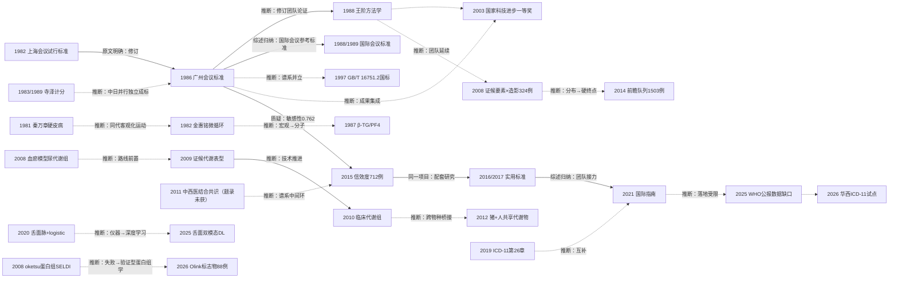

# D11 血瘀证与证候客观化：诊断标准、证候要素与现代化研究

> 血瘀证是中医证候客观化做得最彻底的一个"证"：从1982年全国会议试行标准到2021年国际指南，诊断条款、信效度数据、影像与组学证据链齐备，并进入ICD-11第26章。但四十年客观化至今没有产出一个经独立外部验证、被国际指南独立接受的血瘀证生物标志物。对临床医生最重要的一点：科研入组与证候分层至今仍在1986年会议标准与2016年实用标准之间选择，两套条款各有定量性能数据（敏感性中位0.762 vs 0.911）。

## 0 三分钟速读

1. **从哪里来**：1982年上海第一次全国活血化瘀研究学术会议制定《血瘀证诊断试行标准》（多来源转述一致，原文未获取）；本轮在PubMed可核的客观化最早题录经复核前移至1981年秦万章硬皮病研究（PMID 6219780），心血管线为1982年金惠铭微循环研究（PMID 6219827）[D11-N19][D11-N01]。
2. **为什么改变**：各家对"血瘀证"的操作定义互不相同、结果无法比较，催生全国统一条款（1986年广州会议修订）；1986标准敏感性中位仅0.762，被2015年712例信效度研究定量暴露，衔接出2016年《实用血瘀证诊断标准》[D11-N02][D11-N12][D11-N13]。
3. **如何分化**：四条线并行——标准谱系（国内条款/1997国家标准/日本计分/2021国际指南）、证候流行病学（2008年324例证候要素×冠脉造影）、组学（2008–2012年动物→临床→跨物种桥接）、AI四诊与机器学习（2020–2026）[D11-N17][D11-N05][D11-N16][D11-N07][D11-N10][D11-N15]。
4. **现在研究什么**：缺血性心衰血瘀证三组学（2025年两篇，作者6人重叠、疑似同一项目）、936人舌面双模态深度学习（外部AUC 0.896）、AI文献挖掘651篇234656例、Olink蛋白标志物四分组研究（2026年，88例）[D11-R01][D11-R02][D11-R05][D11-R07][D11-N23]。
5. **用了什么数据**：会议共识→单中心病例对照→横断面+冠脉造影→前瞻队列（1503例入组、37例事件）→组学（样本均≤100例）→机器学习+外部测试集→PROSPERO注册Meta（30项试验10323例）→ICD-11编码试点数据；两个1503例队列（2014前瞻队列、2025横断面）经摘要核实非同一队列、例数偶合 [D11-N11][D11-R01][D11-R06][D11-E03][D11-N22]。
6. **还有什么不知道**：无经国际多中心验证的标志物或指南条款；2025年两篇心衰组学疑似同一队列未经核实；1982/1986/1989三个标准的原始文本、1988年方法学论文原文均未获取（CNKI/万方未检索），相关叙述只能到题录与转述层 [D11-N02][D11-N04][D11-R01]。

**覆盖边界**：纳入血瘀证诊断标准的形成与修订（1982试行/1986修订/1988国际会议参考标准/2011共识/1997国家标准/2016实用标准/2021国际指南）、证候要素与冠心病分布演变的流行病学、客观化技术路线（微循环/流变学→血小板与凝血生化→代谢与蛋白组学→多组学→AI四诊）、证候量表信效度、ICD-11传统医学章节、日本瘀血（oketsu）与韩国血瘀问卷的国际线。不含：具体方药疗效与机制（归D12与各病种方向）；活血化瘀治疗冠心病/心梗/心衰的临床试验主线（归D01/D02/D03）；中药注射剂（归D10）；痰瘀互结与血脂异常/动脉粥样硬化主线（归D06，本章只交叉引用）。

**本章口径**：证据检索截止2026-10-17；近期重点窗口2021-10-17至2026-10-17。阅读层级：L0=仅二手转述、L1=题录已核、L2=摘要已读、L3=原文部分章节已读、L4=全文已读；只到L0/L1的说法不写成"已核对原文"。本章节点24个：L1×10、L2×11、L3×3（无L0主节点，N06含L0叙述成分）；其中8个为本轮补入（1997国家标准、2017标准比较文、1981秦万章、2008血瘀模型代谢组学、2008日本oketsu蛋白组学、2025 WHO公报、2026华西ICD-11试点、2026 Olink标志物）。证据表共43行（关键节点24、近期代表研究11、入口综述8）。D11-E01–D11-E08为本章入口文献（见第10节）。**覆盖状态（按统一口径重评）：基本完整但有标注缺口**——六问均可据本章回答，范围内主要分支（标准谱系、客观化指标、证候流行病学、组学、AI四诊、国际线）均有节点且关系逐边标注；缺口限于第8节已标注项（1982/1986/1989标准原文与2011共识未获、CNKI/万方未检索、寺泽1983日文原刊全文未获取、WHO ICD-11页面404、传承线1950–1970年代节点仅L0、国际指南SCM编号仅搜索快照），无主要分支缺节点或主链关键转折缺来源。

## 1 源头：最初在研究什么

本章把起点说法按四类分别标注：标准谱系起点、客观化指标起点、国际并行起点、组学起点。每类都区分"公认奠基"（多来源公认、但原文未必可获取）与"本轮检索最早"（数据库可核、但可能被未收录文献改写）两种性质，限定语随行。

### 1.1 标准谱系起点（被公认的奠基工作）

1982年第一次全国活血化瘀研究学术会议（中国中西医结合研究会，上海会议）制定《血瘀证诊断试行标准》，载《中西医结合杂志》1983年第3卷第3期；刊出位置存"封二"与"1983,3(3):172"两说，本轮均未获原刊核实。三个独立来源（高克俭2006综述摘要页[D11-E06]、辽宁中医杂志2017年标准比较文摘要[D11-N18]、西苑医院官网新闻稿[D11-E07]）对1982年首次制定说法一致，但原刊全文不在PubMed、CNKI全文不可得，属L0/L1层面的公认表述。1986年第二次全国会议（广州）修订为《血瘀证诊断标准》，刊于《中西医结合杂志》1987;7(3):129——本轮对《中西医结合杂志》1981–1992年血瘀题名41条逐条sweep，确认该条目不在PubMed（会议标准类文献未收录，这一阴性检索事实本轮已核）；其存在与内容经2017年标准比较文独立佐证 [D11-N02][D11-N18]。1988年血瘀证研究国际会议（北京）制定《血瘀证诊断参考标准》，刊出为《中西医结合杂志》1989;9(2):111（另引作《实用中西医结合杂志》1989;2(1):7）——原始条目至今未经数据库核实，题录仅据引文与2017比较文转述（本轮已核其核实边界）[D11-N02][D11-N18]。1988年王阶、陈可冀在《中西医结合杂志》8卷10期活血化瘀专刊发表《血瘀证诊断标准的研究》（PMID 3255534，页码8(10):585-587,589,580），把标准条目本身变成定量论证对象；作者按PubMed题录为Wang J、Chen RJ两人，第三作者翁维良仅见于引文补充、未经题录核实。同期同期刊出皮肤科血瘀证诊断标准（PMID 3255535，8(10):588-589,580），说明血瘀证标准化在1980年代已向跨专科扩展 [D11-N04]。1997年国家技术监督局发布国家标准《中医临床诊疗术语·证候部分》（GB/T 16751.2-1997），据2017年比较文转述，该标准在7篇血瘀证相关标准类文献中引用最多（523次），高于1986年会议标准——这是标准谱系中此前叙事遗漏的关键一环 [D11-N17][D11-N18]。

### 1.2 客观化指标起点（本轮检索最早，已经核查前移）

本轮在PubMed能核到的血瘀/活血化瘀临床与实验研究最早记录是1981年秦万章的硬皮病活血化瘀研究（《中西医结合杂志》1981;1(2):69-71，PMID 6219780，题录已核），病种在心内科之外，但把"血瘀客观化"的可核时间上限从1982年提前到1981年 [D11-N19]。"血瘀证证候×微循环"方向的最早题录仍是1982年金惠铭《微循环障碍与血瘀证证候及活血化瘀》（中西医结合杂志1982;2(3):182-184，PMID 6219827，题录级，无摘要）[D11-N01]。限定：表述为"本轮在PubMed/Europe PMC可核的最早记录"，1980年代更早的中文文献可能未被PubMed收录（见第8节）。

### 1.3 国际并行起点（日本计分路线，题录已定位）

寺泽捷年等1983年在《日本東洋医学雑誌》34(1):1-17发表「瘀血症の症候解析と診断基準の提唱」，提出瘀血（oketsu）计分诊断基准（该日文原刊题录本轮经CiNii与富山大学业绩表两路独立定位，全文未获取）；另有「瘀血の診断基準と病態解析」（治療学10卷增刊，1983）[D11-N05]。1989年以英文发表（Terasawa K, et al. Int J Orient Med, 1989, 14: 194-213，经Matsumoto 2008参考文献逐字核实），症状计分累计为oketsu score（≤20为非瘀血、>20为瘀血）[D11-N05][D11-N24]。日本基准（1983）晚于中国1982试行标准一年，两国各自独立成标，条款式与计分式路线不同，属并行而非传承（据[D11-E06]转述并列叙述；Matsumoto 2008明确称oketsu为日本汉方特有概念）[D11-N05][D11-N24]。

### 1.4 组学起点（本轮检索最早，已经核查前移）

血瘀证×代谢组学的最早可核记录经复核前移至2008年：Zhao X等以LC-MS检测急性血瘀大鼠模型尿代谢谱并观察中药Xindi软胶囊干预（J Chromatogr B, 2008, 873(2): 151-158，PMID 18762461，题录已核）——该研究为"血瘀模型+中药干预"的代谢组学，非证候鉴别 [D11-N20]。"证候鉴别表型"层面的起点为2009年Yan等大鼠心肌缺血"心血瘀阻/气阴两虚"代谢表型研究（Sci China Life Sci, 2009, 52(11): 1081-1090，PMID 19937207）[D11-N08]；临床冠心病血瘀证代谢组学起点为2010年简维雄等血浆GC-MS研究（中国中西医结合杂志2010;30(6):579-584，PMID 20815270）[D11-N09]。原限定语"不排除更早的中文未收录文献"经核查不再成立——更早记录已被PubMed收录并已列入谱系。

## 2 关键转折：问题—新证据/新方法—认识变化—新问题

按问题演变组织；每步标注关系类型（验证/扩展/质疑/修正/分化/互补/并行/同一项目）与依据（原文明确/综述归纳/本报告推断）；负性结果随行保留。

### 转折一：从各家自说到全国条款——标准谱系成形（1982–1997）

问题：各临床研究对"血瘀证"的操作定义互不相同，临床与实验结果无法比较。1982年试行标准（上海会议）首次给出全国通用条款；1986年广州会议修订（刊1987;7(3):129），条款含主要依据（舌质紫暗/瘀斑瘀点、固定性疼痛、肿块、血管异常、出血等）与其他依据、实验室依据（血液流变学、微循环等作为依据之一）——条款内容为据E06与多来源引文转述（原刊全文未获取）。认识变化：血瘀证从各家自说变成全国会议层面可执行条款。1988年王阶等在8卷10期专刊发表方法学论证（PMID 3255534），把标准修订本身变成研究对象；1988年北京国际会议参考标准（刊1989;9(2):111）把条款推向国际使用者；1997年GB/T 16751.2-1997国家标准把证候术语上升为国家标准。关系判定：1982→1986为修订（原文明确，据2017比较文）；1986→1988方法学论证为同一研究项目（推断：题名直指标准研究且作者为修订团队核心成员Wang J/Chen RJ）；1986→1989国际会议标准为扩展（综述归纳，据比较文并列）；1986与1997国标为谱系并立（推断）。新问题：条款含大量主观症状条目，其诊断性能不明——此问题悬置27年才被定量回答（转折六）[D11-N02][D11-N04][D11-N17][D11-N18]。

### 转折二：客观化从宏观到分子（1981–1989）

问题：血瘀证诊断完全依赖舌质紫暗、疼痛性质等主观条目，需要可测量的病理生理对应物。1981年秦万章在硬皮病中开展活血化瘀临床与实验研究（PMID 6219780，非心血管）[D11-N19]；1982年金惠铭把微循环测定引入血瘀证（PMID 6219827，题录级）[D11-N01]；1986年廖福龙血液流变学（PMID 2942285）、1987年胡婉英检测冠心病血瘀证血浆β-血栓球蛋白与血小板第4因子（PMID 2961476，题录级）、1988年吴锦血小板超微结构（PMID 3255537）把指标从宏观推进到血小板活化分子 [D11-N03]；1989年韩新民等以激光多普勒微循环定量+多因素分析显示血瘀证患者微循环流速明显减慢、与血小板聚集及红细胞变形性呈线性相关（PMID 2605736，摘要已读），同时指出微循环障碍为多种病理因素共同作用的结果——单指标非特异性在此已现端倪。关系判定：扩展（本报告推断，依据为题录时间序列与技术递进）。负性伏笔：单一流变学/微循环指标此后始终未能成为独立诊断依据（见第5节）。

### 转折三：学科确立——国家科技奖励（2003）

"血瘀证与活血化瘀研究"获2003年度国家科学技术进步奖一等奖（编号J-234-1-01；完成人陈可冀、李连达、翁维良、王阶、刘建勋等15人；完成单位中国中医研究院西苑医院；推荐单位国家中医药管理局）——科技部官方获奖目录本轮已核。"新中国成立以来中医药领域首个国家科技进步一等奖"的表述出自中国中医科学院官网，属二手叙述（L0，本轮未核到第二来源）。认识变化："证候客观化+病证结合"范式获得国家科研评价体系最高认可；2019年国家中医心血管病临床医学研究中心依托西苑医院获批，机构上承接该成果（时间衔接与机构承接据官网叙事转述，不写因果）[D11-N06]。

### 转折四：证候从标签到定量分布与硬终点（2008–2014）

问题：既往证候研究以"心血瘀阻/痰浊"等病名证型归类，颗粒度粗、与疾病客观指标脱节。2008年王阶等对324例冠心病患者做证候要素判定+冠脉造影：心血瘀阻（85.8%）与心气虚（79.6%）为前两位证候要素（其后依次心热壅塞41.1%、心痰浊38.0%、心气滞24.7%、心阳虚18.9%、心阴虚17.5%、心寒凝4.4%），且证候要素组合随Gensini评分呈规律演变轨迹 [D11-N07]；2011年周俊琴等扩大到2029例冠心病心绞痛（PMID 21823417，题录级）。2014年焦拥政等把分布研究推进到硬终点：1503例稳定性冠心病前瞻队列（1333例进入MDR分析，男959/女374），6–12个月随访发生心血管事件37例，基线血瘀+毒、基线血瘀+6月气虚等五组证候交互均与事件正相关（P<0.05）[D11-N11]。认识变化：血瘀证从"诊断标签"变成可映射影像严重度、进而关联硬终点的分层变量。关系判定：扩展（本报告推断，从横断面分布到前瞻队列）。限制随行：事件数仅37例、单中心、MDR在高维稀疏数据上有过拟合风险、无外部验证；2014年后本轮未再检得同规模前瞻证候-结局队列（见第8节）。

### 转折五：组学路线——动物、临床、跨物种桥接（2008–2012）

问题：血瘀证缺少整体水平的分子表型；动物证候模型能否代表临床患者备受质疑。2008年Zhao X等以LC-MS做急性血瘀大鼠尿代谢组学并观察中药干预（PMID 18762461）[D11-N20]；2009年Yan等在心肌缺血大鼠上区分"心血瘀阻"与"气阴两虚"两种证候代谢表型（GC/TOF-MS+PCA/PLS，缬氨酸、丝氨酸等10个代谢物为主要区分物；分组例数摘要未载）（PMID 19937207）[D11-N08]；2010年简维雄等推进到临床血浆：冠心病心血瘀阻证乳酸、β-羟丁酸、尿素、油酸、十八烷酸、花生四烯酸升高、柠檬酸降低，心血瘀阻 vs 非心血瘀阻四指标差异P<0.01（摘要核正值），花生四烯酸与证候正相关最强（PMID 20815270，Europe PMC被引17次）[D11-N09]；2011年王勇等在22头小型猪气虚血瘀慢性心肌缺血模型上重复该路线（PMID 21288451，摘要级）；2012年Zhao H等以GC-MS平行检测小型猪心梗模型与不稳定心绞痛患者血浆，从猪21个、患者20个差异代谢物中找到8个共享低表达代谢物，且8个即可替代完整代谢物集完成分组判别——为"动物模型→临床证候"外推提供可检验的分子桥（PMID 22675387）[D11-N10]。关系判定：动物→临床为扩展（推断，技术路线相同）；临床→桥接为验证（原文明确：平行设计、共享代谢物）。新问题：共享代谢物仅8个且方向单一（均低表达）、无独立验证——组学标志物的验证缺口自此贯穿至今。

### 转折六：标准的定量检验与代际更新（2011–2016）

问题：多个血瘀证标准并存，敏感性/特异度不明。2011年中国中西医结合学会活血化瘀专业委员会发布血瘀证中西医结合诊疗共识——**该共识本轮未获独立题录（PubMed/Europe PMC检索0命中），其存在仅经Luo 2015（criterion C="Consensus of Integrative Medicine on BSS Diagnosis in 2011"）与2017年标准比较文转述确认**。2015年Luo等在西苑医院712例多科室患者中以实用血瘀证标准（criterion A）对照1986标准（criterion B）与2011共识（criterion C）：criterion A研究者间诊断符合率91.96%（Kappa=0.82）、敏感性中位0.911（95%CI 0.888–0.930）；1986标准敏感性中位仅0.762（0.731–0.790）、特异性0.902（0.858–0.936）略高于criterion A的0.875（0.826–0.915）（PMID 26485909，摘要逐数核实）[D11-N12]。2016年中国中西医结合学会活血化瘀专业委员会发布《实用血瘀证诊断标准》，中文版载《中国中西医结合杂志》2016;36(10):1163（据西苑医院官网新闻稿转述）；同年发布冠心病血瘀证专项标准（Diagnostic criterion of blood stasis syndrome for coronary heart disease，Chin J Integr Med 2016;22(11):803-804，PMID 27783323，题录已核）；实用标准英文版（Practical diagnostic criterion of blood stasis syndrome）刊Chin J Integr Med 2017;23(4):243-244（PMID 27921194，题录已核）[D11-N13]。关系判定：1986标准→2015研究为质疑（原文明确：敏感性数据直接对照）；2015→2016为同一研究项目（信效度配套研究，题录作者共享Xu H、Chen KJ等）——信效度研究与标准发布同属一个团队项目、时间上前后衔接；不写"直接促成"。标准研制路径自此定型为"德尔菲修订→信效度检验→学会发布→中英文同步"，与1980年代会议共识形成代际差。新问题：金标准本身仍是临床判断，信效度检验无法摆脱循环论证；2016标准与2011共识、1997国标的条款差异清单未获取。

### 转折七：国际化——ICD-11与国际指南（2019–2026）

问题：传统医学（含证候诊断）在各国卫生统计中无国际编码；中国国内标准对国际研究者约束力弱。2019年5月第72届世界卫生大会通过ICD-11（2022年1月1日生效），第26章"Traditional medicine conditions - Module 1"为全新补充章节，含150种传统医学病症与196个证候条目（patterns，ICTM-CJK中日起源医学框架），编码须先给第01–25章诊断码再叠加TM1码（两篇开放全文已核，其中一篇由WHO分类负责人Jakob署名）[D11-N14][D11-E04][D11-E05]。2021年世界中联发布《国际血瘀证诊断指南》（2021-12-16发布；英文版Chin J Integr Med 2022;28(4):297-303，PMID 35357680；制定与解读同刊291-296页，PMID 35357679；中文版《世界中医药》2022;17(1):31-36）：主标准8条（含影像学血管闭塞或狭窄≥50%、血栓形成/梗塞/栓塞客观证据）+次要标准8条（含血流动力学/流变学/血小板/凝血/纤溶/微循环检测异常等），主要标准1条或次要标准2条即可诊断；条款全文经国家中医心血管病临床医学研究中心官网指南页阅读；工作组含12个国家和地区30名专家的细节出自西苑医院新闻稿（[D11-E07]，该页本轮被WAF拦截未能直接复核，维持转述层级）。发布方称其为世界中联首个证候类国际标准——**"首个"表述的第二来源均为转引，未经主办方之外独立核实，本章按自称对待**。关系判定：ICD-11与国际指南为互补（推断：分别解决编码与临床条款）；2016实用标准→2021国际指南为扩展（综述归纳：同一团队提案接力）。实施现状有据可查：2025年WHO官方期刊《Bulletin of the World Health Organization》署名论文论述ICD-11纳入传统医学后各国编码与统计数据缺口（PMID 41180267，题录已核，Europe PMC未载摘要）[D11-N21]；2026年华西医院发表ICD-11编码试点可行性评价（两个月试点、20名编码员问卷+访谈；92.30%主要诊断编码章节归属不变、41.10%编码涉后组配），证明截至2026年ICD-11在中国仍处试点阶段——注意该试点针对ICD-11总体编码而非专指TM第26章，TM1叠加码在常规死因/疾病登记中几乎未被使用的判断只能到"WHO承认数据缺口"层面（PMID 42236539，摘要已读）[D11-N22]。此前"实际各国实施率仍低"的无出处论断已按上述两篇改写。

### 转折八：四诊仪器化与AI（2020–2026）

问题：舌面脉信息长期依赖医师目测指感，重复性差。2020年Ren等以中医智能诊断仪器采集舌、面、脉参数，141例（痰瘀互结83/非痰瘀互结58）logistic回归：入选4个独立指标（裂纹长度LC、瘀斑点数NE、人中长LEP、右手脉h1），组合模型L=LC+57.58NE+4.53LEP+2.68Rh1，AUC=0.825（PMID 32614604）[D11-N15]。2021年日本千叶大学以舌像分析系统（TIAS）量化38例舌色+舌下静脉宽度，组合判别AUC大于任一单项（PMID 35308037）[D11-R04]。2025年Zhao M等936人舌+面双模态深度学习（MedSAM分割+特征门控融合+SHAP解释），内部AUC 0.945、外部测试集AUC 0.896（PMID 41333340）[D11-R05]；同年Mi Z等1503例入组（1435例纳入分组）冠心病横断面：气虚血瘀13.8%、气滞血瘀12.3%、心血瘀阻12.9%为三大血瘀类证型，LGBM证型预测验证集准确率72.51%（PMID 41602324）[D11-R06]。其1503例入组与2014年焦拥政前瞻队列（1503例入组/1333例分析 [D11-N11]）例数偶合、非同一队列：本文入组窗为2023年1月至2025年1月、横断面设计，焦文2014年刊出、前瞻队列伴6–12个月事件随访，设计与入组时间窗均不同，二者独立计证（两篇摘要本轮经Europe PMC复核）。关系判定：扩展（推断：传感器数据→深度学习）。主题级风险见4.2。

## 3 分支图

实线=原文明确讨论或综述归纳的关系；虚线=本报告推断。2011共识节点无编号（未获独立题录）。

## 4 近五年重点（2021-10-17 至 2026-10-17）

### 4.1 缺血性心衰/冠心病的血瘀证多组学

研究RNA-seq+DIA蛋白组+靶向代谢组构建血瘀证/气虚血瘀证的"基因-蛋白-代谢"网络。代表一：Wang A等2025年缺血性心衰血瘀证 vs 非血瘀证三组学（Front Mol Biosci 12:1627849，PMID 41158877）：435个差异基因、176个差异蛋白、40个差异代谢物，核心分子含F2/F8/F9/FN1与补体凝血级联，益气活血方交叉验证锁定F2、F8、F9、FN1为诊断治疗靶点 [D11-R01]。代表二：Wei J等2025年气虚血瘀三组学+机器学习（Chinese Medicine 20:93，PMID 40671145）：100例（气虚血瘀40/非气虚血瘀40/健康20），网络含6 mRNA、4蛋白、5代谢物，候选标志物HIF-1α、IL10、PAD4、FGA、FN1、F13A1等，标志物组合诊断AUC>0.863（验证集>0.75），通路为NETs形成、血小板激活、HIF-1与糖酵解 [D11-R02]。**存疑标注：两文作者高度重叠（Wei J、Wang A、Zhang Y、Yu R、Li B、Zhu M共6人同时署名），疾病、技术路线（RNA-seq+DIA+靶向代谢组）与发表年份相同，疑似同一招募项目的姊妹报告；两文的基金号、伦理批件与招募时间窗本轮未获取，未能确证。两文在证据表中互标"疑似同一项目（存疑）"，不作为相互独立的验证证据使用。**前置参照：Yang G等2022年冠心病痰瘀互结三组学（90例临床样本+ELISA扩样，网络33 mRNA、4蛋白、25代谢物；CSF1 AUC 0.9635、JNK1 0.9361可区分痰瘀互结证，花生四烯酸高表达，PMID 36523490）[D11-R03]。分歧：凝血/补体通路（Wang A）与NETs/HIF-1糖酵解（Wei J）孰为核心尚无定论；此前"各研究标志物集合几乎不重叠"的复现失败论断依赖两篇2025年论文相互独立的前提，在姊妹报告存疑未决的情况下，该论断降级为"有限且待确认的观察"；各研究样本量均≤100、无独立外部队列复现，这一限制不受同队列问题影响。成熟度：发展中。

### 4.2 四诊影像与机器学习的证候定量诊断

研究舌象/面色/脉象参数化后用回归、决策树、深度学习判别血瘀证/痰瘀互结证或直接判别冠心病。常用数据与设计：中医智能诊断仪器或标准化图像采集+logistic回归/深度网络（MedSAM分割、Swin特征）+ROC与外部测试集。代表：Ren 2020（AUC 0.825）[D11-N15]、Morita 2021（38例，组合优于单项）[D11-R04]、Zhao M 2025（936人，内部AUC 0.945/外部0.896）[D11-R05]、Mi Z 2025（1435例分组，LGBM准确率72.51%；其1503例入组与2014年焦拥政队列1503例为偶合、非同一队列，见转折八）[D11-R06]。**主题级过拟合与上限约束风险（据已核数字归纳）**：Zhao M 2025内部与外部AUC落差约5个百分点（0.945→0.896），本身就是过拟合信号；Ren 2020在141例小样本上做特征选择；多数高AUC模型的目标是"冠心病"而非"血瘀证"本身；证候判定金标准仍来自医师，模型性能上限受金标准可靠性约束。三者共同构成过拟合与上限约束风险；就本轮可核证据而言，已发表四诊AI模型均未达到可直接用于临床入组判定的外部验证标准。成熟度：发展中。

### 4.3 证候要素的文献挖掘与大样本人群分布

Che Q等2026年AI辅助文献挖掘2000–2023年651篇文献、234656例冠心病患者（J Evid Based Med 19(3):e70162，PMID 42415497，期号经核查修正）：血瘀、气虚、痰为跨病期核心证候要素；北方以气滞血瘀为主、湿润亚热带地区痰瘀互结加速；随时间向血瘀-痰互结范式转移 [D11-R07]。注意计数口径：651篇为文献篇数、234656例为文献汇总例数，属文献挖掘近似而非前瞻流行病学；文献挖掘继承出版偏倚与1982/1986/2011/2016多套标准混用的判定不一致问题。成熟度：早期线索。

### 4.4 血瘀证生物标志物的系统综合与假说重释

Xin QQ等PROSPERO注册Meta（检索至2020-06-01，CRD42019129452；30项试验10323例，Chin J Integr Med 2021;27(11):858-866，期号经核查修正）：平均血小板体积、分布宽度、聚集率、P选择素、纤维蛋白原、PAI-1、TXB2、6-keto-PGF1α及比值在血瘀证组更高，急性期APTT更短 [D11-E03]；各指标间异质性大。2026年Li H等以Olink Target 96炎症面板做四分组（健康对照/CAD血瘀/CAD非血瘀/非CAD血瘀各22例，共88例）+LASSO筛选候选标志物（J Tradit Chin Med，PMID 42015787，摘要已读）——标志物研究延续到2026年且样本仍<100、无外部验证 [D11-N23]。假说线：Kell、Pretorius等2025年提出血瘀证与慢性炎症性疾病纤维蛋白样微血栓（fibrinaloid microclots）直接关联的假说并综述天然产物干预（Pharmaceuticals 18(5):712，PMID 40430532；题录与假说性质已核，尚无临床验证）[D11-R08]。分歧：Meta显示6-keto-PGF1α在血瘀证组亦升高（与"血瘀=单纯促凝"直觉相反），提示血瘀证是促凝-纤溶-内皮多轴紊乱；微血栓假说未做临床验证。成熟度：发展中（证据综合成熟、原始标志物研究验证缺位）。

### 4.5 血瘀证/血瘀体质的肠道菌群与代谢关联

Sun C等2024年广东健康女性血瘀体质24例 vs 平和体质80例（104人，16S+血清代谢组）：血瘀体质者尿酸更高、HDLC更低，富集于Bacteroides优势肠型（PMID 38539207）[D11-R09]；He Y等2023年大鼠血虚血瘀模型（冰水浴+环磷酰胺）+桃红四物汤干预的菌群-代谢轴研究（PMID 37088809，题录与摘要层）[D11-R10]。分歧：体质（constitution）与证候（syndrome）两个概念在菌群研究中常被混用；样本均小，未在心血管患者中验证。成熟度：早期线索。

### 4.6 血瘀证诊断标准的国际化与专科化落地

2021国际指南（条款已读，见转折七）[D11-N16]；制定与解读专文（PMID 35357679，题录级）[D11-R11]；ICD-11实施侧证据（WHO公报2025、华西试点2026）[D11-N21][D11-N22]。分歧与缺口：国际多中心验证数据尚未发表；与ICD-11 TM编码的映射未公布；国际冠心病血瘀证（病证结合）诊断指南的立项与编号（SCM号）本轮仅见搜索快照、未获官网核实（见第8节）。成熟度：标准发布成熟；验证与落地早期。

## 5 争议、负性结果与停滞路线

1. **多版本标准并存、缺乏统一金标准**：1986会议标准、1997国家标准（GB/T 16751.2-1997，2017比较文中引用最多、523次）、2011共识、2016实用标准、2021国际指南并存，另有日本计分体系；2017年比较文对7篇标准类文献（含1986小川新方案、1988王阶、1988国际会议参考标准）的系统比较显示各标准有8项共同主症但条款互有出入 [D11-N18][D11-N17]。定量数据：1986标准敏感性0.762 vs 实用标准0.911（特异性0.902 vs 0.875，Kappa 0.82）[D11-N12]。金标准本身仍是临床判断，无法摆脱循环论证。争议未解决；2016/2021标准成主流但无强制力。
2. **ICD-11纳入传统医学章节之争**：支持方认为标准化编码利于安全、可计数与跨体系比较；2019年Nature社论批评其"可能适得其反"（may backfire），结合医学界在Reddy & Fan 2022中逐条回应（第26章150病症/196证候）[D11-N14][D11-E05]。实施侧：WHO官方期刊2025年承认传统医学ICD数据缺口 [D11-N21]；中国三甲医院到2026年仍在做ICD-11编码试点（92.30%章节归属不变、41.10%涉后组配；试点针对总体编码而非TM章）[D11-N22]。争议持续。
3. **证候客观化的还原论限度（总括性负性结论）**：**四十余年客观化研究没有产出一个经独立外部验证、被国际指南独立采纳的血瘀证生物标志物**——这一总括判断由以下已核证据支撑：单一基因层面无差异（CD14+CD16+单核细胞基因水平血瘀与非血瘀无差异、仅蛋白与TNF-α/IL-1层面升高，PMID 23878597，摘要已读）；SELDI蛋白指纹判别瘀血准确率仅69.8%（C5.0）/70.8%（PCA+C5.0），该技术路线此后未见血瘀证诊断后续系统研究（Matsumoto 2008全文Table 3）[D11-N24]；近五年多组学核心分子集合互不重叠（有限观察，见4.1存疑限定）且样本≤100；Xin 2021 Meta指标异质性大 [D11-E03]。当前主流转向多组学组合+外部验证，但验证缺口大。
4. **中医血瘀证与日本瘀血（oketsu）是否同物**：Matsumoto 2008原文称oketsu为日本汉方特有的病理生理概念，用症状计分（score>20为瘀血）并批评其"依赖主观判断的描述性定义"；中国学界以条款体系对应；两套标准条目与阈值不同 [D11-N05][D11-N24]。2021国际指南工作组含日韩专家但日方条款并入细节未公布 [D11-N16]。并行对话，未统一。
5. **停滞/失败路线清单**：①SELDI-TOF蛋白指纹（2000年代末，准确率<71%，被iPRM/ELISA验证型蛋白组学取代）[D11-N24]；②单基因层面证候标志物（转录层面证据不足，标志物需在蛋白/代谢功能层验证，PMID 23878597）；③以单一血液流变学/微循环指标直接定义血瘀证（非特异，多病理因素共享，韩新民1989已指出；后续标准均回到症状条款+多指标组合，2021国际指南把影像/血栓证据置于条款中心，PMID 2605736）。

## 6 传承线与国际线

**传承线**（接力链中凡仅出自机构官网人物页/新闻稿的细节，均标L0；本轮经PubMed作者检索（AUTH:'Chen KJ'，1970–1981）为0命中，说明该线1950–1970年代关键节点在英文数据库层面无题录可核，只能维持L0并与X01横切方向交叉核实）：

1. 方药与人物源头：王清任血府逐瘀汤、通窍活血汤的经典方药体系（清代，据方剂源流传述）；1950年代末–1963年中国中医科学院西苑医院心血管病研究室成立，郭士魁、赵锡武、岳美中为学术源头，陈可冀、翁维良与之共事形成活血化瘀治冠心病路线；翁维良引入血栓、血小板等血瘀高黏状态指标并将活血化瘀药三分类、总结十二法——以上均据中国中医科学院官网人物页转述（L0），原始首篇文献未定位（见第8节）。
2. 客观化运动扩展至全国（1980年代，题录可核）：金惠铭微循环（1982，PMID 6219827）[D11-N01]、廖福龙血液流变学（1986，PMID 2942285）、胡婉英β-TG/PF4（1987，PMID 2961476）[D11-N03]、吴锦血小板超微结构（1988，PMID 3255537）、李国贤肾炎164例血液流变学（1993，PMID 8111207，跨科适用性旁证）。
3. 标准谱系接力：1982试行（上海）→1986修订（广州）→1988方法学论证（王阶/陈可冀）→1988北京国际会议参考标准→1997国家标准→2011共识（题录未获）→2015信效度→2016实用标准→2021国际指南 [D11-N02][D11-N04][D11-N17][D11-N12][D11-N13][D11-N16]。
4. 单位与学科建制：中国中医研究院（院）西苑医院为完成单位的2003年国家科技进步一等奖 [D11-N06]；王阶后来所在的中国中医科学院广安门医院为冠心病证候要素研究重镇（2008年324例研究）[D11-N07]；2019年国家中医心血管病临床医学研究中心依托西苑医院获批（据官网转述，L0）。
5. 数据路径接力：王阶证候要素+冠脉造影（2008）→周俊琴2029例（2011，PMID 21823417）→焦拥政前瞻队列（2014）→简维雄等代谢组学（2010）→徐浩/陈可冀团队信效度与标准（2015/2016）→多组学与AI四诊（2020s）。
6. 后续方向：瘀毒病因（陈可冀团队2014年国家科技进步二等奖"心血管血栓性疾病瘀毒病因的创新研究"，据官网转述未经科技部目录核实；活血解毒干预PCI术后研究见PMID 34532749，疗效归病种方向）。

**国际线**（本方向国际线不以海外RCT评价中药为主，而是四条轨道）：

1. 日本独立研究传统：寺泽捷年1983年计分基准（《日本東洋医学雑誌》34(1):1-17，题录已定位；1989年英文版Int J Orient Med 14:194-213经Matsumoto 2008参考文献核实）[D11-N05]；Kosuge/Ishida 1984–1987年从活血化瘀药分离抗凝成分系列（Chem Pharm Bull，PMID 4042225-4042227、3594693-3594694；药理机制归D12，此处仅作背景）；Hikiami等2003年桂枝茯苓丸vs己酮可可碱改善瘀血患者红细胞变形性（PMID 13678228，题录级）；Matsumoto等2008年SELDI-TOF蛋白组学判别瘀血（准确率69.8–70.8%，全文已读，同时是失败路线节点）[D11-N24]；Morita等2021年舌色+舌下静脉影像量化瘀血（38例，PMID 35308037）[D11-R04]。
2. 韩国：Park YB等2013年开发信效度合格的血瘀证问卷并关联心率变异性（Complement Ther Med 21(6):633-640，PMID 24280472）；Jung J等2019年以血瘀临床数据开发韩国代谢综合征问卷（ECAM 2019:8761417，PMID 31263505）（均题录级）。
3. WHO与国际对话：ICD-11第26章（2019通过；150病症/196证候；ICTM-CJK框架）[D11-N14][D11-E04][D11-E05]；Nature 2019社论批评与Reddy & Fan 2022逐条回应 [D11-E05]；WHO公报2025年承认TM编码数据缺口 [D11-N21]；华西医院2026年ICD-11编码试点证明落地仍在试点阶段 [D11-N22]；2021国际血瘀证诊断指南工作组含韩国、美国等12个国家和地区30名专家（据新闻稿转述）[D11-N16]。
4. 西方生物化学界重释：Kell、Pretorius等2025年血瘀证=纤维蛋白样微血栓假说（未经临床验证）[D11-R08]。
5. 未查到的国际节点：FDA/EMA对血瘀证诊断的评价、Cochrane对血瘀证诊断标准的系统评价——本轮在Europe PMC（oketsu/diagnostic criteria/guideline/consensus等词）与PubMed检索均未见（阴性检索事实，本轮已核）。

## 7 数据路径小结

**历史上**：(1) 会议共识路径（1982–1989）：专家条款共识（1982试行、1986修订、1988国际会议参考标准），数据基础为专家经验与病例讨论，无前瞻数据库 [D11-N02]。(2) 客观指标路径（1981–1990s）：微循环、血液流变学、血小板活化蛋白、血小板超微结构——单中心病例对照小样本，多数无摘要 [D11-N01][D11-N03][D11-N19]。(3) 标准研制路径（1988–2022）：条目论证（王阶1988）→德尔菲+信效度验证（712例，Kappa 0.82）→学会/国际组织发布（2016、2021）[D11-N12][D11-N13][D11-N16]。

**现在**：(4) 证候流行病学路径：横断面+冠脉造影（324例；2029例）→前瞻队列+硬终点（1503例入组/1333分析/37事件）→AI文献挖掘大样本近似（651篇234656例，文献口径非前瞻）→单中心横断面+机器学习（1503入组/1435分组；与上述前瞻队列1503例为偶合、非同一队列）[D11-N07][D11-N11][D11-R07][D11-R06]。病种试验按证候分层的示例见Danlou片多中心RCT（ChiCTR1900023708，PMID 39559795，归D03详述）。(5) 组学路径：血瘀模型尿代谢组（2008）→证候鉴别动物表型（2009）→临床血浆GC-MS（2010）→跨物种桥接（2012）→三组学+机器学习+靶向验证（2025，两篇疑似同项目）——该路径至今没有外部验证成功的终点 [D11-N20][D11-N08][D11-N09][D11-N10][D11-R01][D11-R02]。(6) 四诊仪器与影像路径：舌面脉仪+logistic（AUC 0.825）→日本舌像系统→深度学习双模态（936人外部AUC 0.896）[D11-N15][D11-R04][D11-R05]。(7) 证据综合与注册路径：PROSPERO注册Meta（30试验10323例）；Olink平台蛋白标志物（88例）；ICD-11 TM1叠加码作为未来真实世界证候登记的国际路径（实施仍处试点）[D11-E03][D11-N23][D11-N14][D11-N22]。

患者数与专科计数分开记：队列研究的患者数（324/712/1503入组1333分析/141/100/88/104）不与证候要素比例（85.8%/79.6%等）、证候亚组比例（13.8%/12.3%/12.9%）、标准条款数（8+8）、文献口径汇总数（651篇/234656例）混计。

## 8 还不知道什么（领域证据缺口）与本报告的检索缺口

**领域证据缺口**：

1. 组学标志物缺乏独立大样本外部验证与前瞻诊断准确性研究：近五年代表性三组学研究样本均≤100，核心分子集合互不重叠（其中两篇2025年论文疑似同项目，见4.1存疑），Olink 2026年研究样本仍<100 [D11-R01][D11-R02][D11-N23][D11-E03]。
2. 2021国际血瘀证诊断指南无国际多中心验证报告，与ICD-11 TM编码无公开映射；制定过程原文（德尔菲轮次、各国专家构成明细）未获取 [D11-N16]。
3. 证候作为分层因素的前瞻队列证据稀少：2014年1503例/37事件之后，本轮未检得同规模前瞻证候-结局队列 [D11-N11]。
4. ICD-11传统医学章节（TM1叠加码）的真实世界使用率无公开数据；现有证据只到"WHO承认数据缺口"与"总体编码仍在试点"层面 [D11-N21][D11-N22]。

**本报告检索缺口**：

- **CNKI/万方未检索（执行纪律：不登录、不付费）对本章结论的影响**：1982试行标准、1986修订标准（1987;7(3):129）、1988国际会议参考标准（1989;9(2):111）三个标准只有题录与多来源转述，条款全文、页码细节（封二 vs 172两说）无法核对；1988年王阶方法学论文原文未获取，样本与方法不可核；2011共识未获独立题录；2017年标准比较文仅到摘要层。若后续可获中文全文，本章标准谱系的条款细节与"公认奠基"表述都可能被改写。
- 寺泽捷年1983年日文原刊仅定位题录（《日本東洋医学雑誌》34(1):1-17，CiNii/富山大学业绩表），全文未获取；计分条目内容经Matsumoto 2008转引。
- WHO官方ICD-11页面本轮直连失败（404），第26章血瘀相关具体码值未核对；TM章节事实改经两篇官方署名论文核实。
- 传承线1950–1970年代关键节点经PubMed作者检索（AUTH:'Chen KJ'，1970–1981）为0命中（阴性检索，本轮已核），该线只能维持L0并与X01交叉核实。
- **待核线索**（无可定位来源或未能溯源，不进正文叙事）：①国际血瘀证诊断指南的SCM标准编号与国际冠心病血瘀证指南立项号（SCM NP 2022-152、发布编号SCM 90-2025仅见搜索快照）；②中华中医药学会《血瘀证诊断标准》（ZYYXH/T系列）未查到标准编号与文本；③1982年会议届次全名、地点细节与试行标准刊出位置（封二/172两说）；④郭士魁、陈可冀1950年代末首倡活血化瘀治冠心病的首篇文献；⑤陈可冀团队2014年国家科技进步二等奖未经科技部目录核实；⑥2011共识的发布机构全称与刊载卷页；⑦1989;9(2):111的原始页面（403）。

## 9 本章节点速查表

| 编号 | 年份 | 第一作者+题名简写 | 期刊 | 节点作用 | 设计/数据/分析单位 | 样本 | 关键结果 | 层级 | 核查状态 | PMID/DOI |
|---|---|---|---|---|---|---|---|---|---|---|
| D11-N19 | 1981 | 秦万章 硬皮病活血化瘀临床与实验 | 中西医结合杂志 | PubMed最早血瘀客观化记录（非心血管） | 临床+实验/患者 | 题录未载例数 | 硬皮病活血化瘀有效（题录层） | L1 | 新增（核查补充） | 6219780 |
| D11-N01 | 1982 | 金惠铭 微循环障碍与血瘀证 | 中西医结合杂志 | 客观化起点（微循环方向最早题录） | 临床微循环观察/患者 | 题录未载 | 血瘀证存在外周微循环障碍（题录转述） | L1 | 通过 | 6219827 |
| D11-N02 | 1986（刊1987） | 第二届全国活血化瘀会议 血瘀证诊断标准 | 中西医结合杂志 | 全国通用标准（引用最广） | 会议共识条款/证候 | 条款若干 | 其后验证：敏感性0.762/特异性0.902（Luo 2015） | L1 | 存疑（不在PubMed已证实；后世引作〈参考标准〉者两说并存） | —（7(3):129，引文） |
| D11-N05 | 1983/1989 | 寺泽捷年 瘀血诊断基准 | 日本東洋医学雑誌/Int J Orient Med | 国际并行标准（计分路线） | 症状计分/患者（计分条目） | Matsumoto 2008中16例RA | oketsu score≤20/>20；16例RA中10例（62.5%）基线瘀血 | L3（1983原刊题录L1） | 通过（补1983原刊题录） | —（34(1):1-17；14:194-213） |
| D11-N03 | 1987 | 胡婉英 β-TG/PF4与冠心病血瘀 | 中西医结合杂志 | 生化指标路线起点 | 病例对照/患者 | 题录未载 | β-TG、PF4与冠心病血瘀证相关（题录转述） | L1 | 通过 | 2961476 |
| D11-N04 | 1988 | Wang J 血瘀证诊断标准的研究 | 中西医结合杂志 | 标准方法学论证 | 临床论证/患者·证候条目 | 原文未获取 | 对标准条目结构提出论证（转述） | L1 | 修正（页码补580；作者Wang J/Chen RJ） | 3255534 |
| S89 | 1988（刊1989） | 血瘀证研究国际会议 参考标准 | 中西医结合杂志 | 国际化条款（转述层） | 会议共识/证候 | — | 刊1989;9(2):111（未获数据库核实） | L1（引文） | 通过（标注核实边界） | — |
| D11-N17 | 1997 | 国家技术监督局 GB/T 16751.2-1997 | 国家标准 | 证候术语国家标准 | 标准条目/证候术语 | 证候术语条目 | 7篇血瘀标准类文献中引用最多（523次，据2017比较文转述） | L1 | 新增（核查补充） | —（GB/T 16751.2-1997，国家技术监督局1997） |
| D11-N06 | 2003 | 血瘀证与活血化瘀研究（一等奖） | 科技部获奖目录 | 学科确立 | 项目集成/研究项目 | 完成人15人 | 一等奖J-234-1-01（官方目录已核） | L1（叙述L0） | 通过 | —（most.gov.cn目录） |
| D11-N07 | 2008 | Wang J 证候要素×冠脉造影324例 | Chin J Integr Med | 证候流行病学范式 | 横断面+造影/患者 | 324 | 心血瘀阻85.8%、心气虚79.6%；Gensini演变轨迹 | L2 | 通过 | 19082799 |
| D11-N20 | 2008 | Zhao X 血瘀模型尿代谢组学 | J Chromatogr B | 血瘀×代谢组学最早 | LC-MS/动物 | 大鼠（例数未核） | 急性血瘀模型代谢谱改变+中药干预 | L1 | 新增（核查补充） | 18762461 |
| D11-N24 | 2008 | Matsumoto oketsu蛋白组学 | Evid Based Complement Alternat Med | 国际线节点+失败路线 | SELDI-TOF/患者 | 16例RA | 判别准确率69.8–70.8%；批评计分主观性 | L3 | 新增（核查补充） | 18955217 |
| D11-N08 | 2009 | Yan 心肌缺血证候代谢表型 | Sci China Life Sci | 证候鉴别表型起点（动物） | GC/TOF-MS+PCA/PLS/动物 | 大鼠（例数摘要未载） | 两证候代谢谱明确分开；10个区分代谢物 | L2 | 通过 | 19937207 |
| D11-N09 | 2010 | 简维雄 冠心病心血瘀阻血浆代谢组 | 中国中西医结合杂志 | 临床代谢组起点 | GC-MS/患者 | 三组（例数摘要未完整给出） | 11个差异代谢物；花生四烯酸正相关最强；血瘀vs非血瘀P<0.01 | L2 | 通过（P值按摘要核正） | 20815270 |
| D11-N10 | 2012 | Zhao H 猪+人共享代谢物桥接 | Evid Based Complement Alternat Med | 跨物种验证 | GC-MS平行/动物+患者 | 猪21/患者20/共享8 | 8个共享代谢物可完成分组判别 | L2 | 通过 | 22675387 |
| D11-N11 | 2014 | 焦拥政 证候演变×心血管事件 | Chin J Integr Med | 硬终点验证 | 前瞻队列+MDR/患者 | 1503入组/1333分析/37事件 | 五组证候交互与事件正相关（P<0.05） | L2 | 通过（1503例与2025年Mi Z横断面偶合、非同一队列） | 24599819 |
| D11-N12 | 2015 | Luo 实用血瘀证标准信效度 | 中国中西医结合杂志 | 新旧标准定量比较 | 诊断对照+Kappa+贝叶斯/患者 | 712；3套标准 | 敏感性0.911 vs 0.762；Kappa 0.82 | L2 | 通过 | 26485909 |
| D11-N13 | 2016（中文版）/2017（英文版） | 活血化瘀专委会 实用血瘀证诊断标准 | Chin J Integr Med | 修正：经验证的学会标准发布 | 学会标准/证候条款 | 主条款若干 | 敏感性0.911/特异性0.875（基础数据N12）；冠心病专项标准另见2016;22(11):803-804（PMID 27783323） | L1 | 修正（英文名-PMID对应回正） | 27921194 |
| D11-N18 | 2017 | 历年血瘀证诊断标准类文献比较 | 辽宁中医杂志 | 标准谱系系统比较 | 文献计量/标准类文献 | 7篇标准 | GB/T 16751.2引用523次最多；共同8项主症 | L2 | 新增（核查补充） | DOI 10.13192/j.issn.1000-1719.2017.04.005 |
| D11-N14 | 2019 | WHO ICD-11第26章 | WHO ICD-11 | 证候进入国际分类 | 分类条目/条目 | 150病症/196证候 | 2019年5月WHA通过；补充章节 | L3 | 通过 | 34753471（Harrison）/35773641（Reddy） |
| D11-N15 | 2020 | Ren 舌面脉定量诊断 | J Altern Complement Med | 四诊仪器化+回归模型 | 仪器参数+logistic/患者 | 141（83/58） | 4指标组合AUC 0.825 | L2 | 通过 | 32614604 |
| D11-N16 | 2021 | 世界中联 国际血瘀证诊断指南 | Chin J Integr Med/世界中医药 | 国际组织标准 | 国际共识/证候条款 | 主8条+次8条；12国家地区30专家（转述） | 影像≥50%与血栓证据首次入条款；"首个"为发布方自称 | L2 | 通过（"首个"加限定） | 35357680 |
| D11-N21 | 2025 | Lee YS 传统医学ICD数据缺口 | Bulletin of the WHO | 国际线：实施缺口 | 官方期刊论文/文本 | — | ICD-11纳入TM后各国编码与统计数据缺口 | L1 | 新增（核查补充） | 41180267 |
| D11-N22 | 2026 | Ming X 华西ICD-11试点 | Scientific Reports | 国际线：落地试点 | 试点评价+问卷访谈/编码员 | 编码员20名；试点2个月 | 92.30%章节归属不变；41.10%涉后组配（总体编码非TM章） | L2 | 新增（核查补充） | 42236539 |
| D11-N23 | 2026 | Li H Olink血瘀标志物 | J Tradit Chin Med | 标志物研究延续 | Olink+LASSO/患者 | 88（四组各22） | 候选蛋白标志物筛选；无外部验证 | L2 | 新增（核查补充） | 42015787 |

注：S89为谱系条目（未获数据库核实，不作独立编号节点）；1982试行标准的刊出细节见第1.1节与第8节。近五年代表研究（D11-R01–R11）与入口综述（D11-E01–E08）见证据表 evidence_D11.json。

## 10 本章入口文献与检索截止

- **D11-E01** Chen KJ (陈可冀). Blood stasis syndrome and its treatment with activating blood circulation to remove blood stasis therapy. Chin J Integr Med, 2012, 18(12): 891-896. PMID 23238996. DOI 10.1007/s11655-012-1291-5.（叙述性综述，检索截止未说明）
- **D11-E02** Li SM, Xu H, Chen KJ. The diagnostic criteria of blood-stasis syndrome: considerations for standardization of pattern identification. Chin J Integr Med, 2014, 20(7): 483-489. PMID 24610412. DOI 10.1007/s11655-014-1803-9.（期号经核查修正；未说明）
- **D11-E03** Xin QQ, Chen X, Yuan R, et al. Correlation of platelet and coagulation function with blood stasis syndrome in coronary heart disease: a systematic review and meta-analysis. Chin J Integr Med, 2021, 27(11): 858-866. PMID 34532747. DOI 10.1007/s11655-021-2871-2.（期号经核查修正；检索截止2020-06-01，PROSPERO CRD42019129452）
- **D11-E04** Harrison JE, Weber S, Jakob R, Chute CG. ICD-11: an international classification of diseases for the twenty-first century. BMC Med Inform Decis Mak, 2021, 21(Suppl 6): 206. PMID 34753471. DOI 10.1186/s12911-021-01534-6.（官方进程叙述）
- **D11-E05** Reddy B, Fan AY. Incorporation of complementary and traditional medicine in ICD-11. BMC Med Inform Decis Mak, 2022, 21(Suppl 6): 381. PMID 35773641. DOI 10.1186/s12911-022-01913-7.（卷号经核查修正；政策进程叙述）
- **D11-E06** 高克俭. 血瘀证诊断研究现状及进展. 天津中医药, 2006年第5期. DOI 10.11656/j.issn.1672-1519.2006.05.42.（叙述性综述，官网摘要页已读；未说明）
- **D11-E07** 中国中医科学院西苑医院. 世界中医药学会联合会《国际血瘀证诊断指南》发布（医院新闻，2021-12-22）. https://www.xyhospital.com/Html/News/Articles/3543.html.（新闻稿；本轮复核被WAF拦截，维持转述层级）
- **D11-E08** Chen KJ (陈可冀). [Trends in studies of activation of blood circulation and treatment of stasis]. 中西医结合杂志, 1983, 3(3): 134-139. PMID 6225543.（早期学科综述，题录级）

检索执行日/报告截止日：2026-10-17；近期重点章节（第4节）覆盖2021-10-17至2026-10-17，其中标志物主题的Meta证据检索截止为2020-06-01（D11-E03原文写明），2025–2026年原始研究已补入同一主题。

## 12 复核修订记录（2026-10-17）

1. 跨章一致性｜转折六（第64行）与速查表、分支图、证据表N13行同步｜实用血瘀证标准英文版与冠心病专项标准的PMID-名称-年份原先对调：改前实用标准英文版=CJIM 2016;22(11):803-804（PMID 27783323）、冠心病专项=2017;23(4):243-244（PMID 27921194）；改后冠心病血瘀证专项标准=PMID 27783323（Chin J Integr Med 2016;22(11):803-804）、实用血瘀证诊断标准英文版=PMID 27921194（2017;23(4):243-244，中文版2016;36(10):1163）。全报告复核时以MEDLINE题录核对，两条均经PubMed再核实（分支图N13节点标签同步为"2016/2017 实用标准"）。
2. 证据抽查｜证据表N02行（limitations、verification_status）与速查表N02行｜D11-N02题名两说的处理：N02保留《血瘀证诊断标准》（1986广州会议修订，刊1987;7(3):129）不改题名；limitations注明"后世引用中亦有作〈参考标准〉者，原刊无在线题录，两说并存"；核查状态由"通过"改"存疑"。标准谱系年份全章统一口径：1982年制定（刊1983）、1986年广州会议修订（刊1987;7(3):129）、1988年北京国际会议《血瘀证诊断参考标准》（刊1989;9(2):111）、GB/T 16751.2-1997、2016年实用标准中文版/2017年英文版（PMID 27921194）、2016年冠心病血瘀证专项标准（PMID 27783323）、2021年世界中联国际诊断指南——正文第1.1节、转折一、转折六、第6节既有表述与该口径一致，未再改动。
3. 跨章PMID比对｜证据表N12行、E05行｜PMID 26485909的year字段核对为发表年2015、PMID 35773641的year字段核对为2022（PubMed复核），两行原值已正确、无需改动；2019年ICD-11通过的事件年写在N14行key_result，不在文献行年份位。
4. 证据抽查｜证据表N17行volume_pages与速查表N17行｜D11-N17（GB/T 16751.2-1997）无PMID/DOI属国家标准：volume_pages由"标准号GB/T 16751.2-1997"补为"标准号GB/T 16751.2-1997（国家技术监督局1997年发布）"，速查表PMID/DOI列同步补发布机构与年份；不作待核。
5. 机械质检｜正文引用编号全文与第10节｜入口综述引用统一改为与证据表row_id一字不差：正文原E03、E04、E05、E06、E07式的短编号引用全部改为[D11-E03]–[D11-E07]式，散文式"E06/E07"改括号引用；第10节入口文献标签由E1–E8改为D11-E01–E08，第0节速读与速查表注、检索截止段同步；节点引用本已全部为单个方括号[D11-Nxx]/[D11-Rxx]形式，无复合写法需拆分；全部被引编号均可在evidence_D11.json的row_id/node_id找到。

**第二轮（完整性检查）**

1. 同队列核查｜证据表D11-N11行与D11-R06行limitations、正文速读5/转折八/4.2/第7节、速查表N11行｜2014年焦拥政前瞻队列（1503例入组/1333例分析，PMID 24599819）与2025年Mi Z横断面（1503例入组/1435例分组，PMID 41602324）同为1503例的关系核查：经Europe PMC两篇摘要复核，焦文为前瞻队列、2014年刊出（入组远早于2023年），Mi文入组窗为2023年1月至2025年1月、横断面设计，设计与入组时间窗均不相交，判定**非同一队列、1503例为偶合**；两行same_cohort_as维持空，limitations各注明"与对方非同一队列（设计、时间窗不同，1503为偶合），二者独立计证"，两篇继续作为相互独立证据使用，不触碰"同一队列不重复计为独立证据"红线。
2. 覆盖状态重评｜本章口径｜按统一口径重评为"基本完整但有标注缺口"，理由见本章口径段：六问均可据本章回答、主要分支均有节点，缺口限于第8节已标注项。
3. 本轮补充检索共2次（Europe PMC摘要层：EXT_ID:24599819、EXT_ID:41602324），未新增文献或数字，第8节检索缺口清单无变化。
