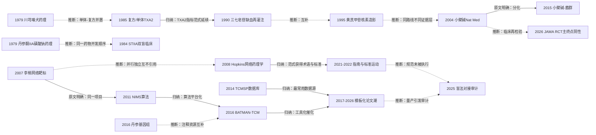

# D12 中药作用机制与现代药理：从单体到网络药理与多组学

> 本方向回答"中药为什么起效"。它有两条源头：其一，1970-1980 年代把川芎、丹参、三七、葛根中的单一成分做成心血管药物（PubMed 可检索范围内最早的药理报告为 1979 年，PMID 539430、506727；三七总皂苷、葛根素的更早药理经本轮复核分别前移至 1983、1981 年；各线研制史均据机构官网与行业转述，L0）；其二，2004 年小檗碱以"上调肝 LDLR"新机制登上 Nature Medicine，把中药单体研究推入国际主流。2020 年代"网络药理学"论文爆发（PubMed 2023-2026 年 14,467 篇），但方法学审计证明主流论文的核心验证环节（盲法分子对接）预测力接近随机，临床终点级检验极少——对临床医生最重要的一点：机制论文数量不等于证据，引用前先查它有无湿实验或临床闭环。

## 0 三分钟速读

① **从哪里来**：单体成药线——川芎嗪 1979 年麻醉犬药理 [D12-N01]、丹参酮 IIA 磺酸钠 1979 年药理并于 1984 年完成冠心病双盲试验 [D12-N02][D12-N03]、三七总皂苷最早药理 1983 年（PMID 6679973，本轮复核前移自 1989 年说）、葛根素最早心血管药理 1981 年血小板研究（PMID 6459876，前移自 1984 年说）；网络药理线——李梢 2007 [D12-N09] 与 Hopkins 2008 [D12-N10] 两线并行、互不引用。

② **为什么改变**：单靶点还原式研究处理不了"多成分-多靶点"的复方问题；2004 年小檗碱证明老成分可有全新机制（32 例患者 3 个月总胆固醇降 29%，经转录后上调肝 LDLR，不同于他汀）[D12-N08]，"老成分新机制"成为本方向最有影响力的路径。

③ **如何分化**：从宿主靶点（LDLR/AMPK）分化出肠道菌群介导 [D12-N12]；概念层并行出网络靶标/网络药理学 [D12-N09][D12-N10]，继而生成分数据库与平台（TCMSP [D12-N17]、BATMAN-TCM [D12-N14]、丹参基因组 [D12-N13]）；2020 年代铁死亡等程序性细胞死亡成为机制论文的主战场。

④ **现在研究什么**：网络药理学模板论文与质量治理并存（盲法对接审计：构象成功率 34%-47% vs 定点位 90.2% [D12-N16]）；小檗碱临床再检验（2026 年 n=337 多中心 RCT 器官脂肪主终点阴性 [D12-R12]）；AI×网络药理与多组学。

⑤ **用了什么数据**：麻醉犬/大鼠/离体心脏（1979-1990）→ 患者-动物-细胞三层设计（2004）→ 16S 菌群 OTU（2015）→ 植物基因组与在线数据库（2014-2016）→ 注册 RCT（NCT05647915）、对接基准集（CASF-2016）与单细胞组学（2020 年代）。

⑥ **还有什么不知道**：单体转化成功率、网络药理学预测的实验验证率均无已发表量化；除小檗碱外，四条老单体产品线自 1980-1990 年代后无同级别确证 RCT；上市后安全证据薄（葛根素注射液急性心衰系统评价：8 RCT/614 例，不良反应率 11.9% vs 9.8%，纳入研究方法学质量差 [D12-R21]；再评价细节归 D10）。

**覆盖边界**：纳入——中药有效成分（川芎嗪、丹参酮 IIA 磺酸钠、三七总皂苷、葛根素、黄芪甲苷、小檗碱）的分离、成药与机制研究史；"活性成分追踪→复方机制→网络靶标/网络药理学→多组学/系统药理学"的方法演进；基础研究量与临床转化的鸿沟及其方法学批评。不含——各成分与中成药的临床疗效线（D01-D09 交接）、证候客观化（D11）、中药注射剂上市后安全性再评价与监管细节（D10，本章只在第 5、6 节点到为止）。

**本章口径**：证据截止 2026-10-17；近期重点窗口 2021-10-17 至 2026-10-17（仅用于重点展开，历史追溯不设起点）。阅读层级：L0=仅二手转述、L1=题录已在数据库核实、L2=摘要已读、L3=原文部分章节已读、L4=全文已读。本章关键节点 17 个：L1 7 个、L2 8 个、L3 2 个（按证据表实计）；另收入口综述 8 篇、近期代表研究 24 项，证据表共 49 行。本章无"存疑"级条目；两说并存处（葛根素获奖年份 1996/1997 等）已并列注明。凡 L0/L1 说法均注明"据转述"或"题录级"。覆盖状态（第二轮按统一口径重评）：**基本完整但有标注缺口**——六问（从哪里来、为什么改变、如何分化、现在研究什么、用了什么数据、还有什么不知道）均可据本章回答；四条单体线、小檗碱新机制及其菌群分化、网络靶标/网络药理学两条并行线、工具化与模板化、治理与定量反证、多组学基础设施等章节范围内主要分支均有节点与可核实来源；缺口限于第 8 节已标注项（CNKI/万方未检索、两篇概念奠基文献全文付费未读、研制史一手材料未获得、两个量化锚点未做代理计算、本轮仅做发文量口径互注未新增检索），不构成主要分支缺节点或主链关键转折缺可核实来源。

## 1 源头：最初在研究什么

起点说法按四类标注：**A. 目前最早找到的文献**（限定本轮 PubMed/Europe PMC/OpenAlex 可检索范围）；**B. 被公认的奠基工作**；**C. 存在争议的首次**；**D. 据二手转述、一手文献未定位的源头**。"最早找到"不等于"公认奠基"，两者分开陈述。

**川芎嗪（四甲基吡嗪）线**：常被引为开发起点的《中华医学杂志》1977 年川芎嗪治疗缺血性脑血管病临床报告属 D 类——本轮 PubMed（含 Chung Hua I Hsueh Tsa Chih 期刊字段检索）与 OpenAlex 均未检到题录，二手检索摘要仅提示"约 1977 年第 8 期、218 例报告"，卷期页不能确认（见第 8 节待核线索）。A 类起点：1979 年《药学学报》14(10):624-627"四甲基吡嗪对麻醉犬心血管系统的作用（初步研究）"，第一作者 Wang BZ（王秉文），于占久为末位作者（PMID 539430）[D12-N01]。限定语：该化合物本身 1962 年已由日本学者 Kosuge 与 Kamiya 从纳豆杆菌代谢物中发现（PMID 14458749），川芎并非其最早来源。

**丹参酮 IIA 磺酸钠线**：A 类起点为 1979 年《药学学报》14(5):277-283 的药理研究，第一作者 Chen WZ（PubMed 著录排印为"Ghen Wz"），丁光生为末位/资深作者（PMID 506727）[D12-N02]；"1970 年代上海将水不溶性丹参酮 IIA 磺化为水溶性钠盐"的研制史属 D 类（据行业转述，研制者名单未经档案核实）。1984 年上海协作组冠心病双盲试验（PMID 6381893）为该线临床转化节点 [D12-N03]。

**三七总皂苷（血塞通）线**：A 类起点本轮复核后前移为 1983 年《药学学报》18(11):818-822 麻醉犬血流动力学研究（三七根、叶、花与皂苷的作用，PMID 6679973）——此前"1989 年最早"系检索词表漏掉血流动力学/抗心律失常类标题词所致；1984 年《中国药理学报》续有抗心律失常（PMID 6087608）与心脏血流动力学（PMID 6239510）报告；1989-1990 年《中国药理学报》系列（心肌动作电位、缺血再灌注损伤、TXA2/PGI2；PMID 2816411、2641849、2403009、2119543）构成缺血再灌注定量证据线 [D12-N06]。"昆药集团 1970 年代分离总皂苷、1983 年首家临床应用、1985 年注册血塞通"属 D 类（据新华网与行业报道转述，PubMed 未收录研制原始文献）。

**葛根素线**：A 类起点本轮复核后前移为 1981 年《中国医学科学院学报》3(Suppl 1):44-47 葛根素对血小板聚集与 5-HT 释放的作用（PMID 6459876；同期另有药代动力学报告 PMID 6459877）；更早的 1979 年《药学学报》14(6):349-355 为葛根素代谢研究（PMID 517131）。1984《药学学报》19(11):801-807（PMID 6544546）与 1985《中华医学杂志英文版》（PMID 3938713，与麻省总医院 Powell、O'Keefe 合作）仍是"急性心肌缺血犬区域心肌血流定量研究"的最早记录 [D12-N04]。"中国医学科学院药物研究所研制、1993-04-21 注射液获卫生部批准上市（化药四类）、获国家科技进步三等奖"属 D 类（据药物所官网；获奖年份有 1996 与 1997 两说，保留两说）。

**黄芪甲苷线**：A 类起点为 1995 年上海医科大学华山医院以核素心室造影评价黄芪甲苷注射液治疗心衰（n=19 患者，PMID 8732134）[D12-N07]，是本轮能找到的最早的成分级心血管临床影像研究（1987/1989 年的黄芪注射液研究为属级粗提取物，非成分级、非影像终点）。

**小檗碱降脂线**：B 类公认奠基——Kong 等 2004 年 Nature Medicine（PMID 15531889，被引本轮实测 1029）[D12-N08]；2023 年 Drugs 系统评价与 2026 年 JAMA Network Open RCT 均以此为小檗碱证据链起点叙述。

**网络靶标/网络药理学线**：C 类存在争议的首次。中文线：李梢（清华）与王永炎（中国中医科学院）合作，2007 年在 IET Systems Biology 把证候放进神经-内分泌-免疫网络框架（PMID 17370429，被引 258；摘要本轮已读，IEEE/IET 全文付费未读）[D12-N09]；国际线：Hopkins 2008 年在 Nature Chemical Biology 提出 network pharmacology 为药物发现新范式（PMID 18936753，被引本轮实测 3100）[D12-N10]。两线经参考文献核对为独立并行：Hopkins 2008 全部 117 条参考文献经逐条核对无任何中医药/证候/李梢条目，且李文早一年发表；"先后"之争更多是叙事权之争，本轮未查到直接交锋文献。

**标准化起点**：世界中医药学会联合会《网络药理学评价方法指南》2021 年发布（标准号 SCM0061-2021，2021-03-09 认证通过、2021-04-15 发布公告；李梢牵头、2018 年起筹备）[D12-N15]。"网络药理学领域第一个国际标准"为中文文献与清华官网口径，本轮未见国际期刊独立使用同一表述。

## 2 关键转折：问题—新证据/新方法—认识变化—新问题

**转折一（1970s-1980s）："起作用的是哪一成分？"——从药材到单体、再到对照临床。** 川芎嗪与丹参酮 IIA 磺酸钠的动物药理（[D12-N01]、[D12-N02]，均 L1 题录级）把研究对象从药材变成结构明确的单体，使后续药理、临床与制剂研究有了可重复对象；1981-1985 年川芎嗪密集跟进（血小板实验性血栓 PMID 6462022、麻醉犬心血流动力学 PMID 7102333、血小板膜流动性 PMID 3834748、钙拮抗样作用 PMID 3159499），丹参酮 IIA 磺酸钠亦续有急性心梗犬冠脉侧支/梗死面积（PMID 6461196、6461197）与心肌电-机械特性（PMID 2955642）等系列。1984 年上海协作组双盲试验（[D12-N03]）把中药来源单体按"动物药理→双盲临床"的现代药政路径走通，比当时普遍的单臂无对照报告高一档证据等级。注意：1979 药理→1984 临床的"开发顺序"是**本报告推断**（同一化合物的时间先后与开发逻辑；两文均无摘要，1984 论文是否实际承接 1979 药理结论无法从题录核实）。新问题：此后该药未见同级别（双盲、注册、国际多中心）确证试验（本轮 PubMed 检索未见），证据等级靠长期常规使用而非升级试验维持——这条停滞路线延续至今。

**转折二（1980s-1990s）："机制用什么指标量化？"——从血流动力学到分子指标、再到客观影像。** 陈可冀团队 1985 年把活血化瘀复方与川芎嗪对 TXA2 生成的影响并置研究（[D12-N05]），确立类二十烷酸指标范式；此后 TXA2/PGI2 成为葛根素（1990 年临床观察，PMID 2364466）与三七（PMID 2119543）研究的标准机制读数。三七总皂苷 1990 年缺血再灌注系列把机制落到脂质过氧化：在体大鼠 PNS 100/200 mg/kg 显著缩小梗死面积，离体心中 PNS 12.5/25 mg/L、人参皂苷 Rb1 10 mg/L、Rg1 10 mg/L 降低 CPK 释放、减轻钙蓄积与 MDA 生成、防止 SOD 活性下降（[D12-N06]，摘要级）；1990-1995 年同刊续有动作电位/慢内向电流（PMID 2816411、2641849）、ATP 酶（PMID 1668565、7801779）与 Rg1 室颤阈值（PMID 8701769）系列。1995 年黄芪甲苷以核素心室造影把"成分→心衰"量化到容积与射血参数（19 例患者，LVEDV 降 11.74±18.39 ml、LVESV 降 9.35±18.01 ml，心率 88.21±17.19 降至 64.55±13.06 次/分，PER 由 1.80±0.86 升至 1.95±0.85 u/s，均 P<0.05）[D12-N07]。"总皂苷/单体皂苷→客观终点"范式自此成型。

**转折三（2004-2015）："单体如何进入国际主流？"——老成分新机制及其分化。** 小檗碱 Nature Medicine 论文以患者-动物-细胞三层证据（32 例高胆固醇患者口服 3 个月：TC 降 29%、TG 降 35%、LDL-C 降 25%；高脂血症金黄地鼠：TC 降 40%、LDL-C 降 42%，肝 LDLR mRNA 升 3.5 倍、蛋白升 2.6 倍；机制为 SREBP 非依赖、ERK 激活依赖的转录后 LDLR mRNA 稳定）改写了黄连素"止泻植物碱"的定位 [D12-N08]。此后两条分化：韩国 KRIBB 团队 2006 年在 Diabetes 独立报告小檗碱激活 AMPK 的代谢效应（db/db 小鼠、3T3-L1 与 L6 细胞，PMID 16873688）；2015 年赵立平团队把机制扩展到肠道菌群——高脂饮食大鼠中 134 个响应 OTU、其中 60 个被小檗碱与二甲双胍共同下调，短链脂肪酸产生菌在小檗碱组显著富集（[D12-N12]；其摘要首段明确接续 berberine"经菌群起效"的新说法，属原文明确的分化关系）。新问题：口服生物利用度极低为何仍全身有效——菌群给出机制出路，也把"因果性"难题带进人体检验。

**转折四（2007-2016）："复方机制能否计算？"——概念并行、算法化与工具化。** 李梢 2007 证候网络框架 [D12-N09] 与 Hopkins 2008 范式术语 [D12-N10] 并行提出后，同一课题组 2011 年发表 NIMS 算法：以疾病网络为靶标、对 63 个药物成分两两组合打分，恢复 5 个已知协同药物对，青藤碱候选组合获实验验证，摘要自称"首次提出网络靶标范式替代单靶点虚拟筛选"（[D12-N11]，开放全文已读；同年《中国中药杂志》36(15):2017-2020 中文宣言把"网络靶标"宣称为中医药网络药理学起点，PMID 22066431，同一项目）。2014 年 TCMSP 数据库（J Cheminform 6:13，PMID 24735618）[D12-N17] 与 2016 年 BATMAN-TCM 在线平台（自称第一个在线中药生物信息学分析工具；芪参益气滴丸示范案例首次把心血管保护与肾素-血管紧张素系统相联并配实验验证，被引本轮实测 579）[D12-N14] 把网络药理学从课题组算法变成公共服务；同期中国中医科学院中药研究所建 ETCM（NAR 2019，PMID 30365030）、北京中医药大学与中科院计算所建 SymMap（NAR 2019，PMID 30380087）。PubMed"network pharmacology"[tiab] 计数随之跳升：2017-2019 年 512 篇 → 2020-2022 年 3,849 篇 → 2023-2026 年 14,467 篇（本轮复现；检索式 PubMed"network pharmacology"[tiab]、窗口 2023-2026 年，与第 8 节缺口 1"约 14,006 条"非同一口径——彼处为标题字段、近五年窗口（2021-10-17 至 2026-10-17），两数不可直接相比）。新问题：工具化降低门槛，模板化量产埋下质量危机。

**转折五（2015-2016）："能否往上游走？"——基因组与多组学。** 丹参基因组两轮测序（2015 GigaScience 杂交拼接草图 PMID 26673920；2016 Molecular Plant 短报文 PMID 27018390；两轮由不同团队先后完成）把丹参建成药用模式植物，使机制研究上游化到丹参酮/丹酚酸的生物合成与代谢工程（2020 年代衍生出基因编辑与合成调控研究，如 prime editing PMID 41987526、SmCPK24 促进丹参酮合成，Industrial Crops and Products 2026;239，Europe PMC AGR 库记录 ID IND609420151，非 PMID）[D12-N13]。

**转折六（2021-2025）："爆发之后如何治理、如何被检验？"——标准出台与定量反证同时出现。** 2021 年 WFCMS《网络药理学评价方法指南》（SCM0061-2021）与 2022 年《中国中药杂志》47(1):7-17 配套综述给出方法学可靠性定义 [D12-N15]；2022 年 Frontiers in Pharmacol 编辑部文章呼吁"计算+实验结合"设定新标准（署名含李梢，显示期刊层标准运动与清华线同源，PMID 36339546）[D12-R23]；2024/2025 年《中药新药研发中网络药理学应用专家共识》跟进（中文版 PMID 39701688、英文版 PMID 39986690）[D12-R02]。但 2025 年 Che 与 Zhang 用 CASF-2016 基准集定量证明：模板论文普遍使用的盲法对接构象成功率（RMSD<2 Å）仅 34%-47%（同集定点位对接 90.2%），亲和力与实验值相关系数 0.387 vs 0.604，并逐篇审计 2024 年该刊 35 篇题名含 network pharmacology 的对接论文——盲法与任意亲和阈值普遍（[D12-N16]，开放全文已读）。指南发布 3 年后主流期刊仍普遍违反基本对接方法学（35 篇均发表于指南之后）——规范性文件未被执行（本报告推断）。同期临床再检验给出负性锚点：小檗碱多中心 RCT 主终点阴性（见第 4 节主题 5）；两篇单体机制论文撤稿（丹参酮 IIA 磺酸钠心梗后重塑论文、葛根素 PPARα 慢性心衰论文，PMID 40046745、40636833）。

## 3 分支图

实线＝原文明确讨论或材料归纳（有出处）；虚线＝本报告推断。

## 4 近五年重点（2021-10-17 至 2026-10-17）

**主题 1：网络药理学爆发与质量治理。** 研究什么：以"成分-靶点-通路＋分子对接＋湿实验"模板解析中药机制；批评侧以基准测试、逐篇方法审计与文献计量检验其可靠性。常用数据与设计：TCMSP/ETCM/SymMap/BATMAN-TCM 数据库＋STRING/DisGeNET＋AutoDock Vina 对接＋动物或细胞验证；批评侧用 CASF-2016 基准集与单刊逐篇审阅。代表研究：Che & Zhang 2025 审计 35 篇 2024 年论文并做基准测试（盲法对接构象成功率 34%-47% vs 定点位 90.2%，亲和力相关 0.387 vs 0.604）[D12-N16]；Panossian 2025 批评性综述列 (I)-(VII) 七条局限（成分指纹可重复性、纯计算预测需动物闭环、只引综述扭曲科学史、P-gp 外排可抵消网络效应等，开放全文已读）[D12-E2]；Miao 2022 Web of Science 文献计量（中国发文量第一，提示槲皮素等数据库高频成分致结果偏倚，PMID 35754692）[D12-R01]。分歧：建制方称领域已标准化（指南 SCM0061-2021、专家共识 [D12-R02]），方法学批评方以定量证据指核心验证环节预测力接近随机、指南为推荐性且执行无独立评估。成熟度：论文产出过饱和（2023-2026 年 14,467 篇），治理与质控仍在追赶。

**主题 2：AI×网络药理学。** 研究什么：用机器学习/深度学习/图神经网络改造靶点预测、方剂推荐与证候生物学解析（寒热证候网络为示范场景）。代表研究：Zhang 等 2024 Brief Bioinform 把 AI 方法分为网络关系挖掘/网络靶标定位/网络靶标导航三类（被引本轮实测 490）[D12-E7]；Cui 等 2025 跨尺度（分子-细胞-组织-患者）综述（PMID 41322006）[D12-R03]；Zhao W、Wang B、Li S 2024（Chin Herb Med 16(4):558-560，PMID 39606265，第一作者与页码本轮已核更正）[D12-R04]；Shao X 等 2025（Chin J Nat Med:1358-1376，PMID 41260784；期刊归属本轮已核更正为 Chin J Nat Med）[D12-R05]。分歧：AI 综述普遍承诺"精准化"，批评性综述（[D12-E2]）指出若上游数据库与验证环节不解决，AI 只会加速不可靠预测的生产。成熟度：早期-发展中；心血管领域的前瞻闭环验证罕见。

**主题 3：肠道菌群-成分-代谢轴（小檗碱为样板）。** 研究什么：口服生物利用度低的小檗碱与皂苷类经菌群代谢/菌群结构重塑发挥代谢与心血管作用；从动物机制走向人体 RCT 菌群终点。常用数据与设计：16S/宏基因组＋短链脂肪酸代谢组（动物）；随机双盲安慰剂 RCT＋粪便测序（人体）；系统评价。代表研究：2015 年大鼠 134 个响应 OTU [D12-N12]；人体 RCT 中间节点——小檗碱＋益生菌联合干预高血糖人群并测菌群终点（Genome Med 2021;13，PMID 34365978，DOI 10.1186/s13073-021-00942-7；本轮材料仅载题录，第一作者与样本量待考）[D12-R20]；葛根芩连汤降糖作用经菌群归因于小檗碱（Xu X 等，GPB 2020;18(6):721-736，被引 124，"复方→单体→菌群"闭环示例）[D12-R06]；ApoE-/- 小鼠抗动脉粥样硬化经菌群（Shi Y 等，Biomed Pharmacother 2018;108:1556-1563，被引 94）[D12-R07]；2026 年系统评价汇总 7 项 RCT（各臂 34-446 人）：6/7 见菌群组成显著改变（γ-变形菌富集、丁酸产生菌减少等），但作者明言 cannot establish causality、改变并非 uniformly favourable，定位 hypothesis-generating（检索至 2026-01-10，PROSPERO CRD42024524143）[D12-E8]。分歧：动物层面机制一致性好，人体 RCT 菌群终点方向不一致（有的丁酸菌反被耗竭）。成熟度：发展中。

**主题 4：程序性细胞死亡（铁死亡/焦亡/自噬）成为机制主战场。** 研究什么：经典单体（葛根素、黄芪甲苷、丹参酮 IIA、槲皮素等）对心肌缺血再灌注、心衰、动脉粥样硬化中铁死亡（GPX4/SLC7A11/System Xc-、Nrf2/HO-1）与焦亡、自噬通路的作用。常用数据与设计：H9c2 细胞系/原代心肌细胞 OGD-R 模型＋小鼠 LAD 结扎再灌注模型；铁死亡指标（MDA、4-HNE、GSH、ROS、GPX4、铁）＋ferrostatin-1 阳性对照；常配网络药理学选靶。代表研究：葛根素抑制铁死亡减轻 I/R 损伤（H9c2 OGD/R＋小鼠 30 min 缺血/24 h 再灌注，降低梗死面积、CK-MB/AST/LDH、MDA、4-HNE 与 Ptgs2 mRNA，升 GPX4 蛋白，与 Fer-1 等效；Biol Pharm Bull 2023;46(4):524-532，被引 35）[D12-R08]；黄芪甲苷经铁死亡相关靶点改善慢性心衰大鼠（Sci Rep 2024;14:20787）[D12-R09]；丹参酮 IIA 经 Sirt1/p53/GPX4 轴抑制铁死亡改善心衰（Am J Chin Med 2026）[D12-R10]；黄芪甲苷经 14-3-3η/GPX4 轴减轻 I/R 线粒体功能障碍（Phytomedicine 2026;158082）[D12-R11]。分歧与隐忧：产出高度模板化（同一通路框架换成分/换通路组合），独立重复与剂量-暴露对应研究少；两条撤稿记录（[D12-R18]、[D12-R19]）提示该产出模式的可靠性风险。成熟度：作为论文产出模式已成熟，临床转化未定。

**主题 5：小檗碱临床再检验与制药化。** 研究什么：把临床证据从早期小样本开放研究推进到注册 RCT、性别分层 Meta 与复方制剂工业开发。代表研究：Blais 等 Drugs 2023 系统评价（检索至 2022-12-13；18 项 RCT、n=1788，其中 15 项即 83% 来自中国内地/香港；LDL-C -0.46 mmol/L、TC -0.48、TG -0.34、ApoB -0.25、HDL-C +0.06，HDL 效应存在性别差异）[D12-E3]；Lei 等 JAMA Network Open 2026 多中心双盲 RCT（中国 11 家医院、n=337、小檗碱 1 g/d×6 月、注册号 NCT05647915）：主终点内脏脂肪面积组间差 1.4%（97.5%CI -2.4~5.2）与肝脂肪含量 0.9% 均不优于安慰剂；次要终点 LDL-C -7.72 mg/dL、ApoB -3.42 mg/dL、hs-CRP -0.072 mg/dL 显著改善，安全性好 [D12-R12]；Mai 等 HTD1801（小檗碱＋UDCA 等量复方）phase Ib 随机双盲试验（n=48：36 例剂量组＋12 例二甲双胍联用组；ChiCTR2500110932 回顾性注册；耐受性好，联用组空腹血糖 -1.271 mmol/L、LDL-C -0.623 mmol/L）[D12-R13]；Rev Port Cardiol 2026 编评呼吁网络药理学预测进入现代临床前转化验证（PMID 41520828）[D12-R14]。分歧：Meta 显示一致的轻-中度降脂信号 vs 高质量 RCT 器官脂肪主终点阴性——"降脂有效但对器官/硬终点未证明"是当前核心落差。成熟度：发展中。

**主题 6：多组学与数据库基础设施。** 研究什么：药用植物基因组与成分生物合成、单细胞/转录组多组学解析单体作用、中药知识库持续升级。代表研究：丹参基因组 [D12-N13]；ETCM v2.0（Acta Pharm Sin B 2023;13(8):2559-2571，被引 92）[D12-R15]；BATMAN-TCM 2.0（NAR 2024;52(D1):D1110-D1120，被引 151）[D12-R16]；小檗碱动脉粥样硬化转录组＋单细胞＋在体整合研究（Yao D 等，Funct Integr Genomics 2026;233，DOI 10.1007/s10142-026-02019-3）[D12-R17]。分歧：数据库资源丰富但成分含量、炮制与配伍动态未纳入（[D12-R01] 与 [D12-E2] 共同指出的系统性偏差源）；单细胞/多组学结论多为关联性。成熟度：发展中。

## 5 争议、负性结果与停滞路线

1. **网络药理学质量与可重复性之争（未决）**。建制方：指南（SCM0061-2021）、专家共识与编辑部标准运动 [D12-N15]/[D12-R02]/[D12-R23]；方法学批评方：盲法对接定量审计（成功率 34%-47% vs 90.2%，r=0.387 vs 0.604）[D12-N16]、七条系统批评 [D12-E2]、槲皮素等高频成分偏倚 [D12-R01]。2024 年论文仍普遍违规，标准执行无独立评估。撤稿实例：丹参酮 IIA 磺酸钠减轻心梗后病理性重塑的多信号通路论文于 2025 年撤稿（Front Pharmacol，PMID 40046745）[D12-R18]；葛根素经 PPARα 抑制慢性心衰心肌凋亡论文已标记撤稿（Exp Ther Med，PMID 40636833）[D12-R19]。
2. **小檗碱证据等级之争（未决）**。降脂信号在 Meta 层稳健（18 项 RCT，LDL-C -0.46 mmol/L）[D12-E3]，但 n=337 RCT 的器官脂肪主终点阴性 [D12-R12]；小檗碱是否进入指南级降脂治疗未解决；菌群终点的因果性亦未建立 [D12-E8]。
3. **概念优先权叙事（两说并存）**。中文叙事（清华官网、《中国中药杂志》综述口径）称李梢 2007 年率先提出网络靶标并"率先制定第一个国际标准"；国际叙事以 Hopkins 2008 为概念起点（被引 3100 vs 258）。可核实的客观事实：两条线独立、互不引用（Hopkins 117 条参考文献逐条核对无中医药条目）；"第一个国际标准"表述出自标准制定方一侧，未见国际期刊独立使用。
4. **负性与停滞路线**。①小檗碱器官脂肪/体重临床终点阴性 [D12-R12]；②盲法对接作为验证环节基本不构成证据 [D12-N16]；③丹参酮 IIA 磺酸钠 1984 年双盲试验后无同级别确证试验，靠长期常规使用维持地位（2021 年获中国中西医结合学会科技奖二等奖的说法仅见行业转述，L0）；④单体机制基础论文出现撤稿（见第 1 条）。
5. **上市后安全线（点到为止，细节归 D10）**。四条单体产品线（川芎嗪、丹参酮 IIA 磺酸钠、三七总皂苷、葛根素注射液）均先于现代证据分级制度上市（产业信息据行业转述，L0）。以葛根素注射液为例：急性心衰系统评价汇总 8 项 RCT/614 例，不良反应率 11.9% vs 9.8%（RR 1.16，95%CI 0.66-2.05），GRADE 中等，纳入 RCT 方法学质量差（PMID 35958424）[D12-R21]；其溶血问题已有专门机制研究（氯离子通道，PMID 30788926）[D12-R24]。行业级监管背景与 D10 同口径：2006 年鱼腥草注射液等 7 个注射剂全国暂停（国食药监安〔2006〕218号）、2009 年中药注射剂安全性再评价制度启动（国食药监安〔2009〕28号）、2012 年药品不良反应信息通报第 44 期（生脉注射液）、2017 版国家基本医保目录对 26 个中药注射剂设支付限定。监管事件与安全性再评价细节见 D10。

## 6 传承线与国际线

**传承线（"药材→单体→成药→平台"四段接力）**：
- **1970 年代单体成药期**：北京制药工业研究所等从川芎分离川芎嗪（四甲基吡嗪）用于缺血性脑血管病（《中华医学杂志》1977 年源头文未能定位，L0）；上海将丹参酮 IIA 磺化为水溶性钠盐（研制史 L0）；云南昆明分离三七总皂苷并于 1985 年注册"血塞通"（研制史 L0）；北京中国医学科学院药物研究所研制葛根素注射液（1993 年获批，获奖年份两说，L0）。
- **1980-1990 年代机制指标期**：中国中医科学院西苑医院陈可冀团队把活血化瘀复方与川芎嗪对 TXA2 生成的影响并置研究（PMID 3157500）[D12-N05]；上海医科大学华山医院 1995 年以核素心室造影评价黄芪甲苷注射液（19 例，PMID 8732134）[D12-N07]。
- **2000-2010 年代国际化与系统化期**：中国医学科学院团队（通讯蒋建东）以小檗碱新机制登上 Nature Medicine（被引 1029）[D12-N08]；上海交通大学赵立平团队开启菌群分支 [D12-N12]；清华李梢 2007/2011 年网络靶标与 NIMS 算法 [D12-N09][D12-N11]、2016 年与北京蛋白质组研究中心、北京中医药大学、北京大学等推出 BATMAN-TCM（芪参益气滴丸示范）[D12-N14]；同期中国中医科学院中药研究所建 ETCM、北京中医药大学＋中科院计算所建 SymMap（NAR 2019，PMID 30365030、30380087）。
- **2020 年代治理期**：李梢主持 WFCMS《网络药理学评价方法指南》（SCM0061-2021）[D12-N15]；2024/2025 年新药研发专家共识 [D12-R02]。

产品与机构对应：川芎嗪注射液、丹参酮 IIA 磺酸钠注射液（上药第一生化生产）、血塞通系列（昆药）、葛根素注射液、黄芪甲苷制剂——四条产品线均先于现代证据分级制度上市，后续机制研究反成其主要学术支撑（产业信息据行业转述，L0）。**研制史（1970 年代各线）全部为二手转述，本轮未获得一手文献；可升级路径为专利库、国家科技奖励公报、药监/卫生部批文公开记录与院所志**（见第 8 节）。上市后安全证据的锚点见第 5 节第 5 条（细节归 D10）。

**国际线（均本轮实查核实）**：
- **平行发现**：尼日利亚 Ibadan 大学团队 1980-1981 年在 Planta Med 独立报道从大戟科植物 Jatropha podagrica 茎中分离的四甲基吡嗪的抗菌、神经肌肉与心血管作用（PMID 7367488、7367493、7201650、7280088）——同一化合物的另一学术体系平行研究。
- **独立验证**：Mayo Clinic 1985 年以 27 只开胸犬系统验证四甲基吡嗪的体循环与冠脉扩血管作用（平均主动脉压 92→62 mmHg、冠脉血流 37.3→74.1 ml/min；β 阻断与去神经处理后效应仍存；PMID 2413290，摘要已读）——中国之外的独立机制确认。
- **合作验证**：麻省总医院 Powell 实验室（O'Keefe）与中国医学科学院药物研究所范礼理合作的葛根素急性心肌缺血犬区域心肌血流研究（1985 Chin Med J，PMID 3938713）[D12-N04]。
- **机制分支独立开拓**：韩国 KRIBB 团队 2006 年独立报告小檗碱激活 AMPK（db/db 小鼠、3T3-L1 与 L6 细胞，PMID 16873688）。
- **概念框架**：英国学者 Hopkins 2008 年提出 network pharmacology [D12-N10]；其 117 条参考文献无中文中药线，两线独立。
- **国际证据再审查**：Drugs 2023（检索至 2022-12-13）与 Nutrients 2026（检索至 2026-01-10）两个国际系统评价对小檗碱独立分级，后者明言 cannot establish causality；JAMA Network Open 2026 刊发小檗碱多中心 RCT（主终点阴性，NCT05647915）[D12-R12]。
- **国际批评（期刊层证据始于 2022-2023，非 2025 年才出现）**：2022 年 Front Pharmacol 编辑部"设定新标准：计算+实验结合"（署名含李梢，期刊标准运动与清华线同源，PMID 36339546）[D12-R23]；2023 年阿根廷 CONICET 学者对一篇两味中药网络药理学研究的公开质疑性评论（Transl Cancer Res 2023;12(12):3249-3254，PMID 38197069）[D12-R22]；2025 年瑞典/瑞士背景药理学家 Panossian 的系统批评 [D12-E2]。另：本轮在 Nat Chem Biol/Nat Rev Drug Discov/Nat Med 中除 Hopkins 2008 原文外，未见对网络药理学的编辑态度性文献（阴性检索结果，如实记录）。
- **本轮未查到**：Cochrane Library 对上述单体心血管疗效的系统评价；FDA/EMA 对小檗碱或丹参酮 IIA 磺酸钠的正式审评结论（检索限于 PubMed/Europe PMC，如实记为本轮未查到）。

## 7 数据路径小结

**历史上 vs 现在**：
- **1970-1990 年代**：整体动物药理为主——麻醉犬血流动力学（四甲基吡嗪 1979/1982，PMID 539430、7102333 [D12-N01]；Mayo 犬 27 只，PMID 2413290）；心肌缺血/再灌注大鼠与离体灌流心脏（三七总皂苷 1990，PMID 2403009）；血小板功能与类二十烷酸生化读数（TXA2/PGI2：PMID 3157500、2364466）；早期小样本人体试验（丹参酮 IIA 磺酸钠 1984 双盲，例数不可得；黄芪甲苷 1995 核素造影 n=19 患者）。
- **2000 年代**：患者-动物-细胞三层设计（小檗碱 2004：32 例患者＋金黄地鼠＋人肝癌细胞系）；细胞信号通路（AMPK，Diabetes 2006）。
- **2010 年代**：网络计算＋小规模湿实验闭环（NIMS 2011：63 个成分的配对＋血管新生过程）；菌群 16S/OTU（2015：134 个 OTU）；药用植物基因组（丹参 2015/2016）；在线数据库平台（TCMSP 2014、BATMAN-TCM 2016、ETCM/SymMap 2019）。
- **2020 年代**：模板化"网络药理学＋分子对接＋湿实验"（2023-2026 年 14,467 篇；2024 年单刊 35 篇被方法学审计）；程序性细胞死亡通路动物研究（H9c2 细胞系＋小鼠 I/R＋ferrostatin-1 对照）；注册 RCT 与系统评价（NCT05647915 n=337；PROSPERO CRD42021293218、CRD42024524143）；方法学审计数据（CASF-2016 对接基准＋35 篇论文审阅）。

**单位口径**：动物数、细胞系与临床患者数在证据表中分列（n_patients/n_animals_lab/n_wounds_flaps_other 字段）；同一项目多篇报告标同一队列，不重复计为独立证据——三七 1990 同系列两篇（PMID 2403009 与 2119543）、NIMS 2011 与同年中文宣言（PMID 21689469 与 22066431）、丹参基因组两轮（PMID 27018390 与 26673920，实为不同团队的两轮测序）、指南综述同文异用（PMID 35178906）均已标注。证据弱点贯穿各期：早期研究无注册与预设终点；网络药理学预测多无前瞻闭环；菌群/多组学结论多为关联。

## 8 还不知道什么（领域证据缺口）与本报告的检索缺口

**领域证据缺口**：
1. **机制研究海量但临床终点验证极少**：近五年本方向 PubMed 标题口径约 14,006 条（标题字段、窗口 2021-10-17 至 2026-10-17；与第 2 节转折四"14,467 篇"为不同口径——彼处为 [tiab] 字段、2023-2026 年窗口，两数不可直接相比），而代表单体（丹参酮 IIA 磺酸钠、葛根素、三七总皂苷）自 1980-1990 年代后均无同级别确证 RCT（本轮检索未见）；仅小檗碱有 2026 年 n=337 RCT，且主终点阴性 [D12-R12]。
2. **网络药理学预测缺乏前瞻性闭环**：指南与共识均为推荐性，其执行效果无独立评估；盲法对接滥用在 2024 年主流期刊论文中仍普遍 [D12-N16]。
3. **数据库静态化偏倚**：成分含量、炮制与配伍动态未纳入，槲皮素等高频数据库成分造成系统性偏倚 [D12-R01][D12-E2]。
4. **两个量化锚点暂不可得**：截至本轮，未查到已发表的"单体转化成功率"（本方向研究过的单体数量与最终成药数量之比）与"网络药理学预测实验验证率"（预测的成分-靶点/组合被湿实验证实或证伪的比例）量化研究（检索含 evidence map/systematic survey/current status 类检索式，阴性）；[D12-N16] 测的是对接环节本身，不是预测-验证闭环率。可行的代理指标（文献计量计算"含湿实验验证论文占比"）本轮未做。这两个数字目前只能视为未知。

**本报告检索缺口**：
5. **CNKI/万方未检索的影响**：受访问限制，中文全文库未检索。后果有三：①1970-1990 年代中文原始文献多数只能到 PubMed 题录级（PMID 539430、506727、3157500、6381893 均无摘要），早期研究的剂量、样本量与阴性结果不可核；②《中华医学杂志》1977 年川芎嗪临床源头文无法定位，单体成药线的最早一环只能标 L0；③中文期刊层的方法学批评与阴性结果线整体缺位，本章呈现的"批评"全部来自英文期刊，中文界的自我批评可能被系统性低估。凡涉及"最早""未见""只有"的判断，均应在此背景下理解为"PubMed/Europe PMC/OpenAlex 可检索范围内"。
6. **两篇概念奠基文献全文未读**：Hopkins 2008（Nature 付费墙）与李梢 2007（IEEE/IET 付费墙），其框架论证只能依据摘要（L2）、参考文献列表与二手叙述。
7. **研制史一手材料未获得**：四条产品线的 1970 年代研制史均为 L0 转述；专利库、国家科技奖励公报、批文公开记录与院所志是可升级路径，本轮未获得。
8. **待核线索**（无可定位来源，未入正文叙事）：《中华医学杂志》1977 年前后川芎嗪治疗缺血性脑血管病临床论文（二手提示约 1977 年第 8 期"218 例报告"）；李梢 1999 年"中医药与分子网络相关"假说（仅官网与访谈转述）；昆药集团 1970 年代分离三七总皂苷/1983 年首家临床/1985 年注册细节；丹参酮 IIA 磺酸钠研制者名单与 2021 年获奖说；葛根素获奖年份两说（1996 官网 vs 1997 百科）；BATMAN-TCM 芪参益气滴丸案例湿实验细节（全文未逐节核对）；Genome Med 2021 小檗碱＋益生菌 RCT 的第一作者与样本量（本轮材料仅题录）。

## 9 本章节点速查表

| 编号 | 年份 | 第一作者+题名简写 | 期刊 | 节点作用 | 设计/数据/分析单位 | 样本 | 关键结果 | 阅读层级 | 核查状态 | PMID/DOI |
|---|---|---|---|---|---|---|---|---|---|---|
| D12-N01 | 1979 | Wang BZ（王秉文）·四甲基吡嗪对麻醉犬心血管系统的作用（初步研究） | 药学学报 14(10):624-627 | 建立方法：川芎→单体的动物药理起点 | 麻醉犬在体实验/动物 | 动物数未报告 | 题录证实开展"初步研究"；数值不可核 | L1 | 修正（第一作者署名归） | PMID 539430 |
| D12-N02 | 1979 | Chen WZ（PubMed 著录 Ghen Wz）·丹参酮 II-A 磺酸钠药理研究 | 药学学报 14(5):277-283 | 建立方法：结构改造造新药路线 | 动物药理系列首篇/动物 | 动物数未报告 | 题录证实为奠基报告；数值不可得 | L1 | 修正（第一作者署名归） | PMID 506727 |
| D12-N03 | 1984 | Shanghai Cooperative Group（团体作者）·丹参酮 IIA 磺酸钠冠心病双盲试验 | J Tradit Chin Med 4(1):20-24 | 重要验证：单体双盲临床 | 双盲对照试验/患者 | 患者数未报告（无摘要） | 题录证实双盲设计、结论有效；终点数据不可得 | L1 | 通过 | PMID 6381893 |
| D12-N04 | 1985 | Fan LL（范礼理）·葛根素对急性心肌缺血犬区域心肌血流与血流动力学的作用 | Chin Med J 98(11):821-832 | 建立方法+分支：中国成分+海外方法学 | 急性心肌缺血犬/动物 | 动物数未报告 | 题录证实研究设计；数值不可得 | L1 | 修正（第三作者按 PubMed 著录为 Powell WW） | PMID 3938713 |
| D12-N05 | 1985 | Wu YS（吴余升）、Chen KJ（陈可冀）·活血化瘀复方及其有效成分川芎嗪对 TXA2 生成的影响 | 中西医结合杂志 5(3):169-171,133 | 改变认识：复方与单体并置、TXA2 指标范式 | 动物/生化检测 | 动物数未报告 | 题录证实并置比较；数值不可得 | L1 | 通过 | PMID 3157500 |
| D12-N06 | 1990 | Li X·三七总皂苷对大鼠心肌缺血再灌注损伤的保护作用 | 中国药理学报 11(1):26-29（同系列 11(1):29-32，第一作者 Shi L） | 重要验证：血塞通缺血再灌注定量药理 | 在体+离体大鼠心脏/动物 | 动物分组数未报告；人参皂苷 2 种（Rb1、Rg1） | PNS 100/200 mg/kg 缩小梗死面积；离体 PNS 12.5/25 mg/L、Rb1/Rg1 10 mg/L 降 CPK/Ca2+/MDA、防 SOD 下降 | L2 | 修正（同系列第一作者 Shi L） | PMID 2403009 |
| D12-N07 | 1995 | Luo HM（罗海明）·黄芪有效成分治疗心衰的核素心室造影观察 | 中国中西医结合杂志 15(12):707-709 | 重要验证：成分级+客观影像终点 | 单臂治疗前后对照/患者 | 19 例患者 | 15 例症状减轻；LVEDV -11.74±18.39 ml、LVESV -9.35±18.01 ml；HR 88.21→64.55 次/分；PER 1.80±0.86→1.95±0.85 u/s | L2 | 修正（PER 基线 SD 更正为 0.86） | PMID 8732134 |
| D12-N08 | 2004 | Kong W（孔炜）、通讯 Jiang JD（蒋建东）·小檗碱经独特机制降胆固醇 | Nature Medicine 10(12):1344-1351 | 改变认识：老成分新机制国际化 | 患者+动物+细胞三层 | 32 例患者；金黄地鼠（只数未报告）；肝细胞系 | 患者 TC -29%/TG -35%/LDL-C -25%；地鼠 LDLR mRNA 3.5 倍、蛋白 2.6 倍；SREBP 非依赖、ERK 依赖转录后机制 | L2 | 通过 | PMID 15531889 |
| D12-N09 | 2007 | Li S（李梢，合作者含王永炎）·神经-内分泌-免疫网络语境下的证候 | IET Systems Biology 1(1):51-60 | 提出问题/建立方法：证候→可计算网络 | 文献挖掘+拓扑比较+CIA 大鼠验证/分子网络 | — | 摘要为定性叙述（寒/热证候网络）；被引 258；抽样核读的引用以中医药网络药理学研究为主 | L2 | 修正（层级升 L2，摘要在库） | PMID 17370429 |
| D12-N10 | 2008 | Hopkins AL·网络药理学：药物发现新范式 | Nature Chemical Biology 4(11):682-690 | 改变认识：国际概念起点 | 概念评述 | — | 被引本轮实测 3100；117 条参考文献逐条核对无中医药/证候条目 | L2 | 修正（层级升 L2，摘要在库） | PMID 18936753 |
| D12-N11 | 2011 | Li S（李梢）·网络靶标筛选协同药物组合（NIMS） | BMC Systems Biology 5(Suppl 1):S10 | 建立方法：网络靶标算法化 | 63 个成分两两组合+血管新生案例+实验验证/药物组合对 | 63 个成分；实验验证动物例数未报告 | 恢复 5 个已知协同对；青藤碱候选组合获实验验证；对背景网络与拓扑参数稳健 | L3 | 通过 | PMID 21689469 |
| D12-N12 | 2015 | Zhang X、通讯 Zhao L（赵立平）·小檗碱与二甲双胍调节高脂大鼠肠道菌群 | Scientific Reports 5:14405 | 形成分支：菌群介导机制 | 高脂饮食大鼠 16S/OTU 分析/动物+OTU | 134 个响应 OTU；动物每组只数未报告 | 两药相似重塑菌群、降多样性；60/134 OTU 共同下调；SCFA 产生菌在小檗碱组显著富集 | L2 | 通过 | PMID 26396057 |
| D12-N13 | 2016 | Xu H、通讯 Song J（宋经元）·丹参基因组序列分析 | Molecular Plant 9(6):949-952 | 建立方法/形成分支：基因组上游化 | de novo 测序、组装与注释/物种（基因组） | — | 无摘要（短报文）；丹参成为药用模式植物 | L1 | 通过 | PMID 27018390 |
| D12-N14 | 2016 | Liu Z、通讯 Gu J（李梢团队）·BATMAN-TCM 在线分析平台 | Scientific Reports 6:21146 | 建立方法：工具化、平台化 | 在线平台（靶点预测+富集+可视化）+芪参益气滴丸示范/数据库 | — | 自称第一个在线中药生物信息学分析工具；案例首次揭示与肾素-血管紧张素系统相关（配实验验证）；被引实测 579 | L2 | 通过 | PMID 26879404 |
| D12-N15 | 2022 | Wang ZY…Li S（李梢）·网络药理学评价方法指南指导下的新时代发展 | 中国中药杂志 47(1):7-17 | 明确边界：国际标准+官方叙述 | 团体标准（SCM0061-2021）+理论综述 | — | 摘要原句"率先制定网络药理学第一个国际标准"；界定计算-实验-临床结合模式 | L2 | 通过 | PMID 35178906 |
| D12-N16 | 2025 | Che X, Zhang L·盲法对接在多数网络药理学分析中被不当使用 | Frontiers in Pharmacology 16:1566772 | 重要反证：定量划定可靠性边界 | CASF-2016 基准测试+35 篇论文方法学审阅 | 35 篇论文 | 盲法对接成功率（RMSD<2 Å）34%-47% vs 定点位 90.2%；亲和力 r=0.387 vs 0.604 | L3 | 通过 | PMID 40196361 |
| D12-N17 | 2014 | Ru J…Yang L·TCMSP：草药来源药物发现的系统药理学数据库 | Journal of Cheminformatics 6:13 | 建立方法：模板化论文最常用数据源（补录节点） | 数据库/平台 | — | 模板化网络药理学论文的基础数据源（文献计量与 35 篇审计覆盖论文大量使用） | L1 | 通过（补录） | PMID 24735618 |

## 10 本章入口文献与检索截止

| 编号 | 文献 | 用途 | 阅读层级 | 文中检索截止 |
|---|---|---|---|---|
| D12-E1 | Zhai Y, Liu L, Zhang F, et al. Network pharmacology: a crucial approach in traditional Chinese medicine research. Chinese Medicine 2025;20:8（PMID 39800680；DOI 10.1186/s13020-024-01056-z） | 网络药理学数据库与方法总览、挑战 | L2 | 未说明（文中称检索 WoS/PubMed/CNKI 近二十年） |
| D12-E2 | Panossian A. Trends and Pitfalls in the Progress of Network Pharmacology Research on Natural Products. Pharmaceuticals 2025;18(4):538（PMID 40283973） | 网络药理学七条系统批评（开放全文已读） | L3 | 未说明 |
| D12-E3 | Blais JE, Huang X, Zhao JV, et al. Berberine for dyslipidemia: SR & MA of RCTs. Drugs 2023;83(5):403-427（PMID 36941490） | 小檗碱降脂临床证据现状 | L2 | 2022-12-13（PROSPERO CRD42021293218） |
| D12-E4 | Wang ZY, Wang X, Zhang DY, Hu YJ, Li S. 中医药网络药理学：指南指导下的新时代发展. 中国中药杂志 2022;47(1):7-17（PMID 35178906；与 D12-N15 同文） | 网络靶标发展史与首个国际标准官方叙述 | L2 | 未说明 |
| D12-E5 | Li S, Zhang ZQ, Wu LJ, et al. Understanding ZHENG in the context of neuro-endocrine-immune network. IET Syst Biol 2007;1(1):51-60（PMID 17370429；与 D12-N09 同文） | 中文"网络靶标"线的国际发表源头 | L2 | 原始研究，无检索截止 |
| D12-E6 | Hopkins AL. Network pharmacology: the next paradigm in drug discovery. Nat Chem Biol 2008;4(11):682-690（PMID 18936753；与 D12-N10 同文） | "网络药理学"国际概念起点 | L2 | 概念评述，无检索截止 |
| D12-E7 | Zhang P, Zhang D, Zhou W, et al. Network pharmacology: towards the AI-based precision TCM. Brief Bioinform 2024;25(1):bbad518（PMID 38197310） | AI×网络药理学方法三分类 | L2 | 未说明 |
| D12-E8 | Candrea AR, Gavrilaș LI, Frumuzachi O, et al. Berberine, gut microbiota modulation and cardiometabolic outcomes: SR of RCTs. Nutrients 2026;18(12):1858（PMID 42356246） | 小檗碱-菌群 RCT 证据现状 | L2 | 2026-01-10（PROSPERO CRD42024524143） |

本章检索截止 2026-10-17（PubMed/Europe PMC/OpenAlex/Crossref 实查；CNKI/万方未检索，影响见第 8 节）。

## 12 复核修订记录（2026-10-17）

1. 证据抽查｜证据表 D12-044 行（葛根素 PPARα 慢性心衰论文撤稿标记，PMID 40636833）｜first_author 由空→He L；volume_pages 由空→30(3):166。撤稿声明著录为 Exp Ther Med 2025;30(3):166，撤稿针对 DOI 10.3892/etm.2019.7984，全报告复核时核对。
2. 跨章关系｜第 5 节第 5 条"上市后安全线（点到为止，细节归 D10）"｜原句仅"监管事件与安全性再评价细节见 D10"→补列与 D10 年份、文号一致的四个行业级锚点：2006 年鱼腥草注射液等 7 个注射剂全国暂停（国食药监安〔2006〕218号）、2009 年安全性再评价制度启动（国食药监安〔2009〕28号）、2012 年药品不良反应信息通报第 44 期（生脉注射液）、2017 版国家基本医保目录对 26 个中药注射剂设支付限定；细节仍归 D10。
3. 机械质检｜正文引用格式｜4 处复合引用拆为单个方括号：[D12-N02/N03]→[D12-N02][D12-N03]（第 0 节①）、[D12-N09/N10]→[D12-N09][D12-N10]（第 0 节③）、[D12-N09/N11]→[D12-N09][D12-N11]（第 6 节）、[D12-R01、D12-E2]→[D12-R01][D12-E2]（第 8 节缺口 3）；拆分后逐个核对，正文被引编号均能在 evidence_D12.json 的 row_id/node_id 找到，入口综述引用编号（[D12-E2]、[D12-E3]、[D12-E7]、[D12-E8]）与证据表入口行 node_id 一字不差。

**第二轮（完整性检查）**

4. 口径互注｜第 8 节缺口 1 与第 2 节转折四｜完整性检查意见：两个网络药理学发文量数字口径不同（缺口 1 为近五年 PubMed 标题口径约 14,006 条，转折四为 PubMed"network pharmacology"[tiab] 2023-2026 年 14,467 篇），各自语境有标注但相隔两节且未互指，易被读者当作同一口径下的矛盾数字。落实：缺口 1 处括注两数的字段（标题 vs [tiab]）与窗口（2021-10-17 至 2026-10-17 vs 2023-2026 年）差异并互指转折四；转折四处对称补写检索式与窗口并回指缺口 1。两数数值保持原值，未新增检索与文献；两处计数无证据表对应行，证据表不改。
5. 覆盖重评｜本章口径｜按统一口径重评覆盖状态为"基本完整但有标注缺口"：六问均可据本章回答，章节范围内主要分支均有节点与可核实来源；缺口限于第 8 节已标注项（中文库未检索、两篇奠基文献全文付费未读、研制史 L0 转述、两个量化锚点未做代理计算），无主要分支缺节点或主链关键转折缺可核实来源的情形。理由已写入本章口径段。
