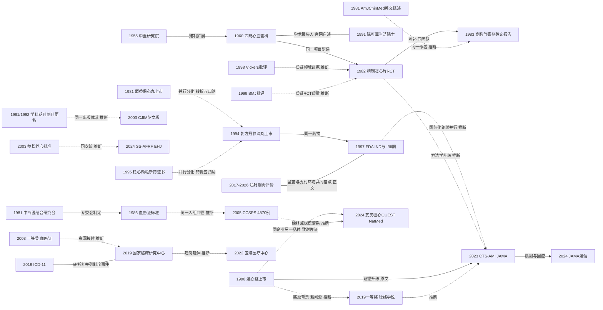

# X01 中国中医心内科学科的形成、名家、方药产业与关键事件（横切）

> 一句话判断：中国中医心内科六十余年的骨架是"建制—标准化—产业化—国际化"四步：1955年中医研究院与1960年西苑医院心血管科完成组织建制，1982年双盲RCT与1986年《血瘀证诊断标准》解决方法与测量问题，1981—2003年六个心血管中成药品种上市并获2003年度国家科技进步一等奖（血瘀证与活血化瘀研究，科技部目录一手；2019年另一项一等奖仅新闻源、存疑，不属本窗口），2019—2024年ICD-11、国家临床医学研究中心与JAMA/Nat Med大型RCT把学科推入国际证据体系。当前处在"证据登顶刊与国际审视并存"的阶段；对临床医生最重要的一点是：本章全部事件按来源分层核实并制成底账表，可直接作为各病种方向引用的事件底稿。

## 0 三分钟速读

① **从哪里来**：1955年10月19日中医研究院成立[X01-N01]，1960年其附属医院西苑医院设心血管科（据机构官网与北京市中医药管理局2023年表述为我国成立最早的中医和中西医结合心血管病专科——机构/政府自述，广安门医院自述其科建于1969年）[X01-N02]；1981年学会与学科期刊同年建立[X01-N06][X01-N17]。
② **为什么改变**：疗效评价从经验走向可测量——外部压力是1990年代国际方法学批评（中国对照试验几乎全部阳性的系统评价、BMJ对中医药RCT质量的批评）[X01-N25][X01-N26]，内部激励是国家奖励与注册制度（2003、2019两个国家科技进步一等奖；1997年FDA IND路径）[X01-N10][X01-N23][X01-N09]。
③ **如何分化**：血瘀证-活血化瘀主线（西苑）之外分化出络病理论支线（石家庄以岭：通心络1996、参松养心2003、芪苈强心）与麝香保心丸（上海，1981）、速效救心丸（天津，1982）、复方丹参滴丸（天士力，1994）、稳心颗粒（1995）、血脂康（红曲）等产业支线。
④ **现在研究什么**：学科级事件集中在大型硬终点RCT登顶刊（CTS-AMI，JAMA 2023，3797例；2024年芪苈强心QUEST治疗HFrEF，Nat Med，3110例）[X01-N15][X01-N16]、中药注射剂循证再评价与支付收紧[X01-N28]、以及T89美国III期完成后多年无结果发表的停滞[X01-N09]。
⑤ **用了什么数据**：无对照病例总结→1970年代多中心协作→注册RCT（NCT/ChiCTR注册并核对终点一致性）→系统评价（近20年55篇RCT、36261例）→集采等政策真实世界数据。
⑥ **还有什么不知道**：T89美国III期结果未发表；1982年以前原始文献未数字化、学科源头只能锚定在转述级；两个学会分支成立年份无官方来源；中药注射剂再评价的结局未评估。

**覆盖边界**：纳入学科建制、关键事件、期刊与制度沿革、人物学术任职与合作谱系的文献锚点、标志性方药的研发单位与上市/注册年份、国家奖励与国际节点。不含各病种疗效研究细节（归D01–D09）、证候客观化技术细节（D11）、机制与组学（D12）、中药注射剂临床应用与安全性细节（D10）——交叉处只点到为止。

**本章口径**：执行/截止日2026-10-17；近期窗口2021-10-17至2026-10-17。阅读层级：L0=仅二手转述，L1=题录核实，L2=摘要已读，L3=原文部分章节/全文XML已读，L4=全文（含页码）已读。本章节点28个：一手来源（L3–L4）11个、摘要级（L2）6个、题录级（L1）7个、转述级（L0）4个。原有16节点经独立复核：13个通过、3个修正（均为期刊载体/ISSN/作者题录错误，事实本体成立）；新核实事件5项、新增学科级事件12项。方药年份事件8项按核查后状态重计：一手来源6项（其中上市年口径3项、批准年口径2项、创制口径1项）、未核实2项；无仅题录级的方药年份。覆盖状态（第二轮完整性检查重评）：**基本完整但有标注缺口**——六问（从哪里来、为什么改变、如何分化、现在研究什么、用了什么数据、还有什么不知道）均可据本章回答；章节范围内主要分支（建制、标准化、产业化、国际化、国际批评线、政策与支付线）均有节点且与证据表28个关键节点一一对应；缺口限于第8节已标注项（CNKI/万方未检索、1986年标准与1970年代协作组原文未数字化、ChiCTR程序化不可读、2019年一等奖仅新闻源存疑、注射剂再评价政策一手原文未调取等），无"主要分支缺节点"或"主链关键转折无可核实来源"级缺口。理由：两处建议改（一句话判断获奖表述、分支图孤立节点）已落实，正文与转折七、底账表口径一致。

## 1 源头：最初在研究什么

起点说法按四类标注：

- **建制起点（机构/政府来源）**：1960年西苑医院心血管科成立。据院史转述（L0）为"我国最早的中医心血管病专科"；北京市中医药管理局（2023）使用"我国成立最早的中医和中西医结合心血管病专科"的政府来源表述；广安门医院自述其心血管科建于1969年（晚9年）。本轮未发现更早建制主张，但"最早"属机构表述而非文献可证命题，可能被新史料修正。
- **公认奠基（多源学术史）**：1982年精制冠心片双盲RCT。除机构表述外，两部学术史（James Lind Library中国对照临床试验史、香港浸会大学CMCRI中国对照试验发展史，均系转述）将其列为"广受认可的中医药领域第一个随机双盲（安慰剂）对照临床试验"；同批学术史指出1950—60年代已出现中医药对照试验（非双盲）。故准确表述是“广受认可的第一个双盲（安慰剂）RCT”（限定语与D01一致）；两种更早说法均未获原始文献核实——1970年代协作组双盲研究（述评转述，未核实）与1980年冠心2号RCT（作者自述，存疑、原始题录未获），本章诸说并注（见第5节）。
- **目前最早找到的文献**：《中西医结合杂志》1981年7月创刊（NLM著录收录自v1n1 Jul 1981）[X01-N06]；陈可冀1981年Am J Chin Med英文综述（PMID 6307037）为本轮找到的最早向英语世界系统介绍中医药冠心病治疗的期刊文献[X01-N18]（1982年另有Ancient Science of Life综述，PMID 22556489）；1986年《血瘀证诊断标准》（广州会议修订，刊1987;7(3):129）是目前最早找到的证候标准化文献（原始条文未数字化，据2015年论文转引，L2；《血瘀证诊断参考标准》为1988年北京国际会议版，刊1989;9(2):111，两者为不同条目）[X01-N05]。
- **公认奠基（制度，双源）**：中国中西医结合研究会1981年成立——年份有期刊文献原文句（"coordinated by the Chinese Association of Integrative Medicine since late 1981"，BMC Complement Altern Med 2013）与学会官网转述（"1981年11月"）双源；"11月"与"1990年更名学会"两细节仅官网单源转述[X01-N17]。

最初研究的具体问题有三：冠心病心绞痛的活血化瘀治疗（冠心2号方及其精制制剂）、心绞痛急性发作的速效吸入制剂（宽胸气雾剂）、血瘀证的客观定义。据期刊述评转述（E03述评PDF第82页；未核实），1970年代西苑医院心血管中心联合国内先进的西医医院开展活血化瘀制剂治疗心绞痛的多中心、双盲随机对照研究；协作组原始论文未数字化，无法回溯，该时期只能由1982年RCT间接锚定。

"最早找到"与"公认奠基"的区别：前者指本轮检索所能定位的最早可引记录（可能被未数字化的中文史料推翻）；后者指多来源一致认定的地位表述——凡带"第一个/最早/最高"字样者，本章一律标明其出处性质（机构自述/学术史转述/官方名录）。

这三个初始研究对象在此后各有可核实的延续：冠心2号/精制冠心片一线延续至2017年JACC综述对中成药证据的总体框架叙述（据E01转述）与2009年冠心2号专病综述（Chin J Integr Med，PMID 20082256，题录级佐证其仍在使用）及精制冠心片网络药理研究（PMID 31772600，题录级）；宽胸气雾剂一线在2014年有多中心RCT（PMID 24812891，题录级）与2020年网络药理研究（PMID 32526337，题录级）；血瘀证一线经1986年《血瘀证诊断标准》→2011共识→2017年英文版实用标准（PMID 27921194）与冠心病血瘀证专用标准（PMID 27783323）接续，成为D11的专门领域。换言之，源头阶段的三个问题至今仍是学科的三个主战场，只是测量和数据路径完全换代了。

## 2 关键转折：问题—新证据/新方法—认识变化—新问题

先说驱动因素的读法：各转折背后可见三类反复起作用的动力——外部学术压力（国际方法学批评逼出严格设计）、制度激励（国家奖励与研究平台体系决定资源流向）、监管与支付环境（FDA注册路径、注射剂再评价与医保限付改变产业行为）。三者在材料中可核实的锚点分别是[X01-N25][X01-N26]、[X01-N10][X01-N14][X01-N23]、[X01-N09][X01-N28]；把某一具体转折归因于单一动力处均属推断，下文逐处标注。

**转折一：有没有国家级研究母体（1955—1960，建制）**。问题：中医研究散在个体、无国家基地。事件：1955年中医研究院成立（1985年更名中国中医研究院、2005年更名中国中医科学院）[X01-N01]→1960年西苑医院心血管科建制[X01-N02]。关系：建制扩展（综述归纳）。此后冠心2号、精制冠心片、血瘀证标准、国家临床研究中心均以该科室为组织载体。

**转折二：疗效能不能被对照测量（1970s—1982，方法学建立）**。问题：活血化瘀疗效评价靠症状印象。事件：1982年精制冠心片双盲安慰剂对照治疗112例冠心病心绞痛的研究发表于《中华心血管病杂志》10(2):85-89（PMID 6751749）[X01-N03]。两个并注：MEDLINE题录仅著录Chen KJ一人，中文原文署名据学术史转述为多人（陈可冀、钱振淮、张问渠等），不应据MEDLINE写成单人研究；原文无摘要、全文未数字化，疗效具体数字本轮未读到。关系：对70年代协作组研究的方法学升级（同一项目谱系，据机构官网成果表述与E03述评）。驱动因素：与国际循证方法传入及院内西医协作有关（推断）。

**转折三：证候能不能标准化（1986→2015，测量工具）**。问题：血瘀证无统一定义，多中心研究无法统一入组。事件：1986年中国中西医结合研究会活血化瘀专业委员会在广州会议修订《血瘀证诊断标准》（刊1987;7(3):129）[X01-N05]。谱系年份统一口径（全报告复核时核对）：1982年制定（刊1983）→1986年广州会议修订《血瘀证诊断标准》（刊1987;7(3):129）→1988年北京国际会议制定《血瘀证诊断参考标准》（刊1989;9(2):111）→GB/T 16751.2-1997→2016年实用标准中文版/2017年英文版（PMID 27921194）、2016年冠心病血瘀证专项标准（PMID 27783323）→2021年世界中联国际诊断指南。扩展验证：2015年西苑712例信度效度研究——1986标准（criterion B）敏感度中位0.762（95%CI 0.731-0.790）、特异度0.902（0.858-0.936）；新实用标准（criterion A）敏感度0.911（0.888-0.930）、特异度0.875（0.826-0.915）；判定者间符合率91.96%、Kappa=0.82（PMID 26485909摘要）。关系：同一标准的后续检验。此后2011年共识、2017年英文版实用标准（PMID 27921194）与冠心病血瘀证专用标准（PMID 27783323）接续。

**转折四：国际审视第一波（1998—1999，质疑）**。问题：中国产临床试验的证据可信度。事件：Vickers等系统评价1966—1995年MEDLINE收录的中国对照试验，发现几乎全部报告阳性结果（Control Clin Trials 1998;19(2):159-166）[X01-N25]；Tang、Zhan、Ernst在BMJ批评中医药RCT的方法学质量（BMJ 1999;319(7203):160-161）[X01-N26]。关系：对本领域全部既有试验产出（含[X01-N03]一代研究）的质疑——两文的批评对象是领域整体证据而非具体品种，其与具体节点的对应为本报告推断。这是学科"登顶刊"之前必须面对的外部压力，也是其后大型严格RCT路线的背景之一（推断；属时间先后关系，非文献自述因果）。

**转折五：成药产业化（1981—2003，分化并行）**。六个心血管中成药品种的年份事件（口径各异，逐条见底账表）：麝香保心丸1981年上市（上海；据期刊全文句"since its marketing in 1981"）[X01-N22]；速效救心丸1982年获批准（天津中新药业第六中药厂；期刊全文句，批准年口径）；复方丹参滴丸1994年上市（天士力）[X01-N07]；稳心颗粒1995年获卫生部新药证书并上市（据2017年CMJ专家共识原文句）[X01-N20]；通心络胶囊"dates back to 1996"（石家庄以岭，创制口径——吴以岭以络病理论组方，加全蝎、蜈蚣、水蛭等虫类通络药）[X01-N08]；参松养心2003年获SFDA批准为抗心律失常药（Z20030058，批准文号级）[X01-N21]。关系：不同地域、企业、理论框架下的并行分化；此后同系品种向心衰（芪苈强心）、房颤（参松养心）等病域扩展（推断）。

**转折六：国际注册路径开启与停顿（1997—2016，并行/停滞）**。1997年FDA受理复方丹参滴丸IND（编号56956；年份仅一源期刊明载，未查FDA原始档案）→美国II期15家中心125例完成（注册库enrollment 124，两说并存）→III期（NCT01659580，T89/Dantonic，登记1004例）2012年8月启动，完成时间期刊表记2016年3月、注册库记2016年12月（两说并存）[X01-N09]。此后截至本轮检索无同行评审全文、无获批记录、注册库无结果上传——国际化叙事在此停顿（负性事件）。关系：与国内"登顶刊"路线并行（推断）。

**转折七：国家奖励的制度认定（2003、2019，制度）**。2003年度国家科技进步一等奖（编号J-234-1-01）"血瘀证与活血化瘀研究"：完成单位中国中医研究院西苑医院，主要完成人陈可冀、李连达、翁维良、王阶、刘建勋等，推荐单位国家中医药管理局——科技部官网获奖目录（一手来源）与期刊述评原文互证[X01-N10]。2019年度国家科技进步一等奖"中医脉络学说构建及其指导微血管病变防治"（吴以岭团队，2020年1月颁奖）——仅有新闻转述（L0），科技部原始名单本轮未调取，未经独立复核[X01-N23]。两奖分属两支学术路线与两类完成主体（公立研究院所；企业深度参与的团队——后者由新闻转述与2024年芪苈强心QUEST（HFrEF）论文致谢“石家庄以岭药业提供部分资助”的期刊记载并读得出，属推断）。本章对称呈现两奖，不因来源等级差异只展开一支。2019年奖是通心络/参松养心/芪苈强心三品种后续大型RCT的共同奖励背景（推断），补上它之后，络病支线1996—2023年之间的"学术支线升格"过程才可解释。

**转折八：硬终点证据（2005，验证）**。CCSPS：66家中心、4870例心肌梗死后患者（血清胆固醇4.40–6.47 mmol/L）、1996年5月—2003年12月、平均随访4年；主要终点（非致命心肌梗死+冠心病死亡）5.72%对10.41%，相对风险降低45.1%（摘要原文P值照录为P = 0.0000）；冠心病死亡降低31.0%、非致命MI降低60.8%[X01-N12]。关系：把中药心血管研究从替代终点推进到硬终点，4870例的规模纪录此后保持十余年；各亚组报告（中华内科杂志2006、J Am Geriatr Soc 2007、J Clin Pharmacol 2009、Ann Med 2010等）同队列不重复计数。国际重复的尝试是2014年美国多中心随机安慰剂对照血脂康研究（J Clin Lipidol 2014;8(6):568-575，PMID 25499939，题录级）——非中国人群的调脂有效性获国际期刊报告，但其规模与终点设计均不能与CCSPS对读；调脂之外的效应机制（如抗炎假说）在可读来源中讨论不足，属遗留问题。

**转折九：国际制度身份与国家研究网络（2019—2022，制度）**。ICD-11于2019年5月25日由世界卫生大会通过、2022年1月1日生效，首次纳入传统医学章节（WHO新闻稿载通过与生效日期、未提章节名；章节事实以期刊文献转述为准）[X01-N13]。同年5月国家中医心血管病临床医学研究中心获批依托西苑医院建设（首批国家中医临床医学研究中心之一，中心主任陈可冀；机构官网自述，L0，科技部批文未调取）[X01-N14]；2022年2月24日西苑医院山西医院（国家中医区域医疗中心，心血管方向）揭牌（据机构官网页转述，L1，页面经检索确认存在、未全文核读）[X01-N24]。关系：建制线从医院科室→学会→国家研究网络→区域输出网络的扩展；CTS-AMI（124家医院）与2024年芪苈强心QUEST（HFrEF，133家医院）展示了该协同网络的运行规模（推断关联）。

**转折十：证据层级跃迁与国际质询并存（2023—2024，验证+质疑）**。CTS-AMI（通心络治疗STEMI，124家医院，2019-05-23启动、2021-09-30主要完成，3797例随机/3777例主分析，平均61岁、男性76.9%；30天MACCE 3.4%对5.2%，RR 0.64[0.47-0.88]，RD -1.8%；心源性死亡3.0%对4.2%，RR 0.70；1年MACCE 5.3%对8.3%，HR 0.64[0.49-0.82]；1年心源性死亡4.5%对6.1%，HR 0.73；30天卒中、大出血、支架内血栓差异无统计学意义；药物不良反应2.1%对1.1%，P=.02）登JAMA[X01-N15]；2024年芪苈强心QUEST（HFrEF，133家医院，3110例，NT-proBNP≥450 pg/ml且LVEF≤40%，中位随访18.3个月；主要复合结局25.02%对30.03%，HR 0.78[0.68-0.90]；心衰住院15.63%对19.16%，HR 0.76[0.64-0.90]；全因死亡率HR 0.84[0.70-1.01，P=0.058]）登Nat Med[X01-N16]；SS-AFRF（参松养心用于持续性房颤消融后，66中心920例，12个月房性心动过速复发无事件率85.5%对77.7%）登Eur Heart J（疗效细节归D04）。半年后JAMA通信栏出现两封国际质疑信与作者回复（Zakiev等PMID 38506843；Asham/Entezari-Maleki PMID 38506789；Chen等回复PMID 38506845）[X01-N27]。关系：证据升级与质疑并存——"2023年后国际讨论止于审慎乐观"的印象不成立；质疑与回应构成顶刊叙事的延续部分。方法学上，从1982年112例无注册双盲RCT到2023年3797例NCT注册且注册终点与发表核对一致，四十年间的规范升级是这一跃迁的可核实基础（推断关系）。

**转折十一：政策收紧（约2017—2026，制度/负性）**。中药注射剂经历安全性风波后进入全国性循证再评价与医保支付收紧阶段；国际顶刊以Letter形式报道该政策（Nat Med 2026;32(2):392-393，PMID 41507575，题录级）[X01-N28]。这是心血管中药注射剂从规模扩张转向证据再评价的制度转折；政策一手原文（药监局公告、医保限付条款）本轮未调取，过程细节未经独立复核。关系：负性/制度事件，构成D10的学科级背景（细节归D10）。

## 3 分支图

实线=原文明确讨论或综述归纳的关系；虚线=本报告推断；边上标关系类型。

第二轮补边注：N22、N20、N28、N13 原为孤立节点，现按转折五"不同地域、企业、理论框架下的并行分化"、转折九"国际制度身份与国家研究网络"并列、第2节驱动因素"监管与支付环境锚点[X01-N09][X01-N28]"补边；边标签标关系类型与依据等级（归纳/正文），未新增节点。

## 4 近五年重点（2021-10-17 至 2026-10-17）

按学科级事件组织（机制与组学研究细节归D12，各病种疗效归D01–D09，此处只记学科级事实）。

**T1 大型RCT登顶刊与国际质询（2023—2024；成熟度：证据已发表、独立重复未见）**。研究什么：通心络治STEMI、芪苈强心治HFrEF、参松养心用于房颤消融后，均以硬终点/临床结局为主要终点。数据与设计：多中心双盲安慰剂对照（叠加标准治疗），全国60—133家医院，ClinicalTrials.gov/ChiCTR注册，事件驱动随访12—18个月。代表研究：CTS-AMI（JAMA 2023，3797例随机，30天MACCE RR 0.64[0.47-0.88]，1年MACCE HR 0.64[0.49-0.82]；注册库登记enrollment 3796与论文3797两说并存，注册主要终点与发表一致，本轮已核）[X01-N15]；2024年芪苈强心QUEST（HFrEF，Nat Med 2024，3110例，HR 0.78[0.68-0.90]；注册号ChiCTR1900021929与注册日期2019-03-16经全文核实；全因死亡率HR 0.84[0.70-1.01，P=0.058]未达显著）[X01-N16]；SS-AFRF（EHJ 2024，920例，HR约0.6[0.4-0.8]，P=0.001；疗效细节归D04）。三个试验共同指向的格局：同一企业（以岭）三品种分治心梗、心律失常、心衰三个病域并各自登顶国际期刊，而2003年获一等奖的活血化瘀体系未在同一窗口产出同级试验——两支路线的"顶刊化"节奏不同步，是理解当前格局的关键（推断）。分歧：全部中心位于中国、安慰剂叠加标准治疗的外推性、中药气味对盲法维持的挑战、CTS-AMI不良反应更多（2.1%对1.1%，P=.02）与芪苈强心QUEST全因死亡未达显著——除2023年两篇JAMA配套评论（Curfman PMID 37874581；Bach PMID 37874582）外，2024年通信栏两封质疑信与作者回复[X01-N27]说明国际讨论仍在进行。

**T2 学科建制与制度落地（2019—2022；成熟度：建制已成型，网络产出待评估）**。国家中医心血管病临床医学研究中心2019年5月获批（机构自述）[X01-N14]；国家中医区域医疗中心西苑山西医院2022年2月24日揭牌[X01-N24]；ICD-11传统医学章节2022年1月1日生效[X01-N13]，落地工具研究已有先例——PIPE-11规则推理临床决策支持系统用于传统医学章节实施（Choi SH，J Integr Med 2020;18(6):455-458，PMID 32891598，摘要级；窗口前文献，作为落地证据基础）。分歧：中医类区域医疗中心的输出效果无公开评估数据（本轮未检索到）。

**T3 证据综合与证据图谱（成熟）**。近20年55篇RCT、36261例的系统综述（Front Cardiovasc Med 2024;11:1419169）判断部分中成药降低冠心病、卒中、心衰硬终点且总体不增加不良事件风险[X01-E04]；通心络AMI系统评价以CTS-AMI为核心证据汇总（Front Pharmacol 2025;16:1632809，全文引言/方法已读）；中成药RCT证据图谱（J Evid Based Med 2026;19(3):e70151，题录级）给出证据分布与缺口可视化；品种层面另有复方丹参滴丸26篇RCT系统评价（2022，PMID 36120120，题录级）与血脂康系统更新（APSB 2024，PMID 39525586，题录级）。分歧：纳入RCT质量不均（多为中国单中心/小样本），偏倚风险与临床可用性之间存在解释分歧——系统评价的汇总阳性结论依赖的大样本主要就是T1那几项试验，证据基础的集中度本身是风险（推断）。

**T4 政策环境：注射剂再评价与集采（早期线索）**。中药注射剂循证再评价成为制度事件并被国际顶刊报道（Nat Med 2026 Letter）[X01-N28]；化药集采对中成药市场格局的外溢影响有政策分析（Health Care Sci 2025;4(1):14-24，题录级）。分歧：政策与临床结局之间缺丽数据链接。

**T5 国际化注册的停顿（负性）**。T89（复方丹参滴丸）美国III期2016年完成后无同行评审结果、无获批记录、注册库无结果上传[X01-N09]；窗口内唯一新增注册事件为T89急性高山病预防试验（NCT04993729，2021-07-21启动，853例，状态COMPLETED，无结果上传）。国际化注册路线整体处于停顿（据注册库本轮检索）。

## 5 争议、负性结果与停滞路线

1. **T89美国III期停顿**：2016年完成后（完成时间两说：期刊表2016-03、注册库2016-12）无全文、无获批记录、无结果上传。企业侧与期刊综述曾称其为"全球首个完成FDA III期的复方中药"；监管侧结论无公开记录（截至本轮检索）。
2. **CTS-AMI的外推性与2024年质疑**：124家中心全部在中国、安慰剂+标准治疗设计、ADR偏多；2024年JAMA两封通信（PMID 38506843、38506789）与作者回复（PMID 38506845）是国际讨论的延续，独立重复试验未见（题录级）。
3. **注册主要终点一致性核查状态不一**：CTS-AMI（NCT03792035）已核对一致；2024年芪苈强心QUEST注册页ChiCTR程序化不可读，注册日期与注册号经论文全文核实、注册终点与发表一致性未经注册库直接核对——两个“同名QUEST”（2019年清心解瘀颗粒QUEST，稳定性冠心病，Complement Ther Med；与本试验2024年芪苈强心QUEST，HFrEF，Nat Med）另见待核线索。
4. **“中医药领域第一个RCT”的时间归属诸说**：通行表述为1982年精制冠心片研究是“广受认可的首个随机双盲（安慰剂）RCT”（限定语与D01一致）；两种更早说法均未获原始文献核实——1970年代西苑已开展多中心双盲随机研究（E03述评转述，未核实）与1980年冠心2号RCT（作者自述，存疑、原始题录未获）。诸说关系无法用现存题录厘清，本章并存呈现、不裁定。
5. **中药注射剂证据不足与政策收紧**：据E03述评转述（PDF第83页），按Cochrane Handbook标准评价1980—2007年注射剂治疗AMI病死率的文献，289篇检出、仅4篇符合纳入、以替代指标为主，证据强度不足以支持推荐（其引用高铸烨等系统评价，中国中西医结合杂志2008;28(12):1069-1073）；其后进入全国性再评价与医保支付收紧[X01-N28]。这是学科级负性路线，临床细节归D10。
6. **国际批评线**：Vickers 1998（中国试验几乎全阳性）与Tang-Ernst 1999（RCT方法学质量）构成领域级争议背景；JAMA 2024通信是其在顶刊时代的延续。批评对象为证据产出整体，不针对单一品种。
7. **人物信息的两处并注**：郭士魁生卒年"1915—1981"之说与其1983年第一作者论文存在先后张力，仅能并注、不予裁定（本轮未检得可引纪念文献）；1982年RCT的MEDLINE单人署名与中文原文多人署名并存，引用宜写"陈可冀等"。
8. **两大一等奖来源等级不对称**：2003年奖有科技部官网目录一手来源；2019年奖仅新闻转述（L0）。本章如实标注，不因叙事需要拔高后者。
9. **体系并立与分流**：本学科的学术组织存在中西医结合（中国中西医结合学会，1981年成立已核实）与中医药（中华中医药学会心病分会，成立年份无可定位来源）两套系统，加上企业深度参与的研究团队（以岭药业：2024年芪苈强心QUEST论文致谢载其提供部分资助，期刊原文；其余企业关联多为转述），学科组织呈多中心格局；两套学会系统各自产出指南、标准与奖励叙事，交叉引用时须写明出处体系。此为结构性事实的描述，各分支成立年份均待核（见第8节）。

## 6 传承线与国际线

**传承线（区分"合作锚点"与"传承叙述"两类）**：
- 合作锚点（文献可核实）：郭士魁—陈可冀—翁维良1983年Planta Medica同篇署名（Guo SK, Chen KJ, Weng WL, Zhang WQ, Yu YQ，Planta Medica 1983;47(2):116，PMID 6844452，DOI 10.1055/s-2007-969967）——同篇署名证明合作关系可核实；1982年RCT题录（MEDLINE著录Chen KJ）；2014年度冠心病中西医结合学术综述署名Li SM, Xu H, Chen KJ（PMID 25335323）；西苑—广安门等单位的1980s活血化瘀系列英文题录（PMID 2954711、3157500等）。
- 传承叙述（机构自述/二手，未经独立核实）：师承关系本身（郭士魁→陈可冀→翁维良→史大卓/徐浩等）据机构官网与综述叙述；陈可冀1978年任西苑心血管病研究室主任、1991年当选中国科学院学部委员（院士）——据中科院学部官网院士名录（casad.cas.cn）与中国中医科学院官网人物页（官方名录转述，L0）[X01-N19]；学会任职：首届会长季钟朴、第四五届会长陈可冀（学会官网转述；本轮复核时官网抓取未复现）。
- 其他一脉：史载祥（中日友好医院）以"升陷祛瘀"立论，2025年有升陷祛瘀方治疗HFrEF的注册试验（PMID 40502625，题录级）。
- 机构-制剂延续关系（合作锚点的另一形态）：西苑官网成果列表同时列出精制冠心片与宽胸气雾剂，构成"口服长期治疗+急救吸入"的互补布局（据机构官网转述）；1983年同篇署名的三人在其后年份各有英文题录（如1985—1988年川芎颗粒、活血复方对血小板聚集/血栓素的实验报告，PMID 2954711、3157500，题录级），显示该合作网络在机制实验层面的延续。
- 未展开：邓铁涛（痰瘀相关）、颜德馨、路志正等流派的心血管学术思想本轮未检得可引的亲撰题录，仅有二手转述，不做展开（待核线索）。

**国际线**：
- 正面节点：1981年陈可冀Am J Chin Med英文综述（最早可引英语世界介绍）[X01-N18]→1982年Ancient Science of Life综述（PMID 22556489）→1983年Planta Medica宽胸气雾剂报告[X01-N04]→1997年FDA受理复方丹参滴丸IND 56956→美国II期125例→III期2012—2016（停顿）[X01-N09]→2013年通心络在越南注册并纳入当地医保（据Front Pharmacol 2023表格，海外纳入医保首例中成药）→2014年血脂康美国多中心随机安慰剂对照研究（J Clin Lipidol 2014;8(6):568-575，题录级）→2019年ICD-11通过[X01-N13]→2023—2024年JAMA/Nat Med/EHJ大型RCT。
- 国际批评与回应：1998年Vickers等发表偏倚系统评价[X01-N25]→1999年Tang-Ernst BMJ方法学批评[X01-N26]→2024年JAMA两封质疑通信与作者回复[X01-N27]。批评对象是领域证据整体；把这条线与国际节点并列呈现，才能避免"登顶刊成功史"的偏斜。
- 政策国际报道：Nat Med 2026 Letter报道中国中药注射剂循证再评价[X01-N28]。
- 未检得：针对上述品种的Cochrane系统评价或EMA态度文件（本轮未检索到；不敢断言没有，记为缺口）。

## 7 数据路径小结（历史上 vs 现在）

(1) 个案与经验总结（1950—60年代，无对照，未数字化）；(2) 1970年代多中心协作组对照研究（仅存转述）；(3) 1982年双盲安慰剂RCT（112例）——对照方法确立；(4) 1980年代动物与机制实验（川芎颗粒、活血复方对血小板聚集/血栓素，PMID 2954711、3157500，题录）；(5) 证候量表/诊断标准作为测量工具（1986标准→2015年712例信度效度检验）；(6) 大型硬终点RCT（CCSPS，66中心4870例，1996—2003）；(7) 注册库时代RCT（NCT03792035、ChiCTR1900021929、SS-AFRF）——注册主要终点与发表一致性的核对成为标准动作（CTS-AMI已核对一致；ChiCTR页面程序化不可读）；(8) 系统评价/Meta与证据图谱（55 RCT/36261例总览）；(9) 真实世界与政策数据（集采研究）；(10) 多组学/网络药理/AI文献挖掘（归D12）。突出缺口：1980年代以前中文原始数据无电子化路径，源头事件只能锚定在转述级；ChiCTR无程序化接口导致注册核对能力受限。

## 8 还不知道什么（领域证据缺口）与本报告的检索缺口

**领域证据缺口**：(1) T89美国III期结果与FDA决定记录（2016年后无公开全文）；(2) 1982年以前原始文献未数字化，协作组研究不可回溯；(3) 中国中西医结合学会心血管病专业委员会与中华中医药学会心病分会的成立年份无官方来源；(4) ChiCTR注册信息无法程序化核对；(5) 麝香保心丸研发单位谱系与1970年代研制过程无可引文献；(6) 中药注射剂再评价的评估结果与医保限付的实际效果（政策一手原文未调取）。

**本报告检索缺口**：
- **CNKI/万方未检索的影响**：本章多篇关键中文材料（1986年血瘀证标准原文、1982年精制冠心片RCT全文、中文期刊创刊与获奖记载、学会成立文件、"十一五"重点专科名单、流派亲撰文献）只存在于中文文献库或纸本；因CNKI/万方全文不可得，这些事件只能改用英文题录、期刊转述载体（如E03述评PDF）或机构官网锚定，阅读层级被整体封顶在L0—L2。凡正文写"据E03转述""据院史转述（L0）"处，均属此类替代锚定。
- **学会档案不可得**：学会官网（caim.org.cn）在本轮复核时TLS连接被重置，无法复现此前抓取；"1981年11月成立""1990年更名学会"仍为官网单源转述（成立年份另有BMC Complement Altern Med 2013原文句"since late 1981"双源）。中科院学部院士名录仅获域名级官方页，未存档全文。
- **待核线索**（无可定位来源，不入正文叙事）：1971年北京地区防治冠心病协作组成立年份（仅新闻/访谈）；心血管病专业委员会"1981年即设"说；中华中医药学会心病分会2006年成立说（非官方转载页）；"十一五"重点专科2007—2008年公布说（仅医院自述）；芪苈强心胶囊获批年份（约2004年说与2008–2010年说并存，批件号未核；2004年说经多轮全文检索0命中）；血脂康1995年上市批准说（仅1995年首篇临床报告经APSB 2024参考文献表核实为题录级）；速效救心丸研制人姓名（仅百科/新闻页）；麝香保心丸源于宋代苏合香丸及华山医院研制谱系说；《中医杂志》NLM著录未定位；郭士魁生卒年（1915—1981，与1983年论文张力）；"清心解瘀颗粒QUEST"与芪苈强心QUEST同名混淆警示。

## 9 本章节点速查表（事件底账表）

核实状态图例：**一手**=政府/学会/期刊一手来源（L3–L4）；**题录/摘要**=期刊题录或摘要（L1–L2）；**转述**=机构官网/院史/新闻转述（L0）；**未核实**=本轮无可定位一手来源。节点编号对应正文引用。

| 年份 | 事件 | 核实状态 | 来源 |
|---|---|---|---|
| 1955 | 中医研究院成立（10-19）；1985更名中国中医研究院、2005更名中国中医科学院 [X01-N01] | 一手（期刊摘要，L2） | 中华医史杂志2015;45(6):352-355，PMID 26813325 |
| 1960 | 西苑医院心血管科成立；自述“最早的中医心血管病专科”（广安门自述1969并存）[X01-N02] | 转述（L0） | 西苑医院官网；北京市中医药管理局（2023） |
| 1970s | 活血化瘀多中心协作研究、冠心2号研制 | 转述（据E03述评转述，未核实；原始文献未数字化） | 环球中医药2009;2(2):82（PDF全文L4） |
| 1981.7 | 《中西医结合杂志》创刊（ISSN 0254-9034；1992更名接续为《中国中西医结合杂志》ISSN 1003-5370）[X01-N06] | 一手（NLM著录，L3） | NLM Catalog 8207427/9211576 |
| 1981 | 中国中西医结合研究会成立（“11月”仅官网单源；年份有期刊双源“since late 1981”）；1990年更名学会（官网转述）[X01-N17] | 一手（年份，L3）+转述（月份） | BMC Complement Altern Med 2013;13:132（PMC3689083）；学会官网 |
| 1981 | 麝香保心丸上市（上海）[X01-N22] | 一手（期刊全文句，L3） | Front Pharmacol 2022;13:1002713，PMID 36452225（PMC9701736复核） |
| 1981 | 陈可冀英文综述：中医药治冠心病进展 [X01-N18] | 题录（L1） | Am J Chin Med 1981;9(3):193-196，PMID 6307037，DOI 10.1142/S0192415X81000251 |
| 1982 | 精制冠心片双盲安慰剂对照治疗112例心绞痛（“广受认可的首个随机双盲（安慰剂）RCT”；两种更早说法并存：1970年代协作组双盲（述评转述，未核实）、1980年冠心2号RCT（作者自述，存疑））[X01-N03] | 题录（L1）；“第一个”为机构自述+学术史转述 | 中华心血管病杂志1982;10(2):85-89，PMID 6751749 |
| 1982 | 速效救心丸获批准（天津中新药业第六中药厂；批准年口径） | 一手（期刊全文句，L3） | PMC11451125（1982年批准原句） |
| 1983 | 宽胸气雾剂即刻疗效英文报告（郭士魁-陈可冀-翁维良同篇署名）[X01-N04] | 题录（L1） | Planta Medica 1983;47(2):116，PMID 6844452，DOI 10.1055/s-2007-969967 |
| 1986 | 《血瘀证诊断标准》广州会议修订（活血化瘀专委会；刊1987;7(3):129；《血瘀证诊断参考标准》另属1988年北京国际会议版，刊1989;9(2):111，两者为不同条目）[X01-N05] | 转引（据2015年论文转引，L2；标准原文未数字化） | PMID 26485909摘要（criterion B） |
| 1991 | 陈可冀当选中国科学院学部委员（院士）[X01-N19] | 转述（官方名录，L0） | 中科院学部官网casad.cas.cn院士名录；中国中医科学院官网 |
| 1992 | 期刊更名/接续为《中国中西医结合杂志》（MEDLINE收录1992-2017）[X01-N06] | 一手（NLM著录，L3） | NLM Catalog 9211576 |
| 1994 | 复方丹参滴丸上市（天士力；上市年口径；“累计使用超4.5亿人次”为企业公布使用量口径，人次≠患者数）[X01-N07] | 一手（期刊全文句，L3） | Chin Med J (Engl) 2017;130(8):972-978，PMID 28397728（PMC5407045） |
| 1995 | 稳心颗粒获卫生部新药证书并上市 | 一手（共识全文句，L3） | Chin Med J (Engl) 2017;130(2):203-210，PMID 28091413（PMC5282678） |
| 1995 | 血脂康上市/批准年份 | 未核实（仅1995年首篇临床报告为题录级线索） | 中国实验方剂学杂志1995（经APSB 2024参考文献表，PMC11544391） |
| 1996 | 通心络胶囊创制（石家庄以岭；“dates back to 1996”创制口径，上市/创制两可，NMPA批准记录未调取）[X01-N08] | 一手（期刊全文句，L3；口径存限定） | Medicine (Baltimore) 2023;102(41):e35405，PMID 37832041（PMC10578693） |
| 1997 | FDA受理复方丹参滴丸IND 56956（年份仅一源期刊明载，未查FDA档案）[X01-N09] | 一手（期刊全文句，L3；单源年份） | PMC4846759（2016，Synergism of Chinese Herbal Medicine） |
| 2003 | “血瘀证与活血化瘀研究”获2003年度国家科技进步一等奖（J-234-1-01；完成单位西苑医院；完成人陈可冀、李连达、翁维良、王阶、刘建勋等）[X01-N10] | 一手（科技部官网目录L3+期刊PDF L4双源） | most.gov.cn获奖目录（t20080214_59048）；环球中医药2009;2(2):82 |
| 2003 | 参松养心获SFDA批准为抗心律失常药（Z20030058；批准文号级）[X01-N21] | 一手（论文全文句，L3） | Evid Based Complement Alternat Med 2019;3917282，PMID 30949218（PMC6425419） |
| 2003 | Chinese Journal of Integrative Medicine（英文版）建刊（NLM记录[2003]-；前身英文版1995-2002独立记录ISSN 1006-6497；MEDLINE自2005年v11n1收录）[X01-N11] | 一手（NLM著录，L3） | NLM Catalog 101181180/9514013 |
| 2005 | CCSPS结果发表（66中心、4870例、主要终点相对风险降低45.1%）[X01-N12] | 摘要（L2） | 中华心血管病杂志2005;33(2):109-115，PMID 15924803 |
| 2010前后 | T89美国II期完成（15家中心125例；注册库enrollment 124两说）[X01-N09] | 一手（期刊全文+注册库，L3；细节两说） | PMID 28397728；NCT00797953 |
| 约2004–2010 | 芪苈强心胶囊获批（年份两说并存，批件号未核） | 未核实（约2004年说与2008–2010年说并存；2004年说经多轮全文检索0命中） | D03章两说并记；全报告复核时核对 |
| 2013 | 通心络在越南注册并纳入当地医保（海外医保首例中成药） | 一手（期刊表格，L3） | Front Pharmacol 2023;14:1195364（PMC10232835） |
| 2016 | T89美国III期完成（期刊表2016-03与注册库2016-12两说；登记1004例）；此后无结果发表、无获批记录 [X01-N09] | 一手（L3）；结果缺失=未核实 | NCT01659580；Front Pharmacol 2023表格 |
| 2019.5.25 | ICD-11由世界卫生大会通过（2022-01-01生效；传统医学章节事实以期刊转述为准）[X01-N13] | 一手（WHO官网L3）+摘要（L2） | WHO news 2019-05-25；BMC Med Inform Decis Mak 2022;21(Suppl 6):381，PMID 35773641 |
| 2019.5 | 国家中医心血管病临床医学研究中心获批依托西苑（首批，主任陈可冀；2020年5月起设分中心）[X01-N14] | 转述（L0） | 西苑医院官网 |
| 2019年度 | “中医脉络学说构建及其指导微血管病变防治”获国家科技进步一等奖（吴以岭团队；2020年1月颁奖）[X01-N23] | 未核实一手（新闻转述L0；科技部名单未调取） | news.sciencenet.cn/htmlnews/2020/2/434894.shtm |
| 2022.2.24 | 西苑医院山西医院（国家中医区域医疗中心，心血管方向）揭牌 [X01-N24] | 转述（L1，页面经检索确认、未全文核读） | 西苑医院官网Articles/3984 |
| 2022.1.1 | ICD-11生效；落地工具研究先例：PIPE-11决策支持（J Integr Med 2020） | 摘要（L2） | PMID 32891598，DOI 10.1016/j.joim.2020.08.003 |
| 2023 | CTS-AMI发表JAMA（124家医院，3797例随机/3777主分析；注册终点一致已核；注册库enrollment 3796两说）[X01-N15] | 摘要（L2）+注册库核对 | JAMA 2023;330(16):1534-1545，PMID 37874574，NCT03792035 |
| 2024 | 2024年芪苈强心QUEST（HFrEF）发表Nat Med（133家医院，3110例；注册号与注册日期2019-03-16经全文核实）[X01-N16] | 一手（全文核，L3） | Nat Med 2024;30(8):2295-2302，PMID 39095596（PMC11333273） |
| 2024 | SS-AFRF发表Eur Heart J（66中心920例） | 摘要（L2） | Eur Heart J 2024;45(40):4305-4314，PMID 39178138 |
| 2024 | JAMA通信栏两封国际质疑信与作者回复 [X01-N27] | 题录（L1） | PMID 38506843、38506789；回复PMID 38506845 |
| 1998 | Vickers等：中国对照试验几乎全部阳性的系统评价 [X01-N25] | 摘要（L2） | Control Clin Trials 1998;19(2):159-166，PMID 9551280 |
| 1999 | Tang/Zhan/Ernst在BMJ批评中医药RCT方法学质量 [X01-N26] | 题录（L1；该文无摘要，全文未读） | BMJ 1999;319(7203):160-161，PMID 10406751 |
| 约2017–2026 | 中药注射剂全国性循证再评价与医保支付收紧（Nat Med Letter报道；政策一手原文未调取）[X01-N28] | 题录（L1）；过程细节未经独立复核 | Nat Med 2026;32(2):392-393，PMID 41507575，DOI 10.1038/s41591-025-04122-7 |
| 2025–2026 | 证据综合层：通心络AMI系统评价（Front Pharmacol 2025）、中成药RCT证据图谱（J Evid Based Med 2026）、集采政策分析（Health Care Sci 2025） | 题录/全文（L1–L3） | PMID 41199814；42394471；40026643 |

**底账计数**：事件39行。方药年份事件8项：一手来源6项（麝香保心丸1981上市、速效救心丸1982批准、复方丹参滴丸1994上市、稳心颗粒1995新药证书+上市、通心络1996创制口径、参松养心2003批准Z20030058）；未核实2项（芪苈强心获批年份：约2004年说与2008–2010年说并存、血脂康上市批准年份）；仅到题录的方药年份0项（血脂康1995年首篇临床报告为题录级线索，但其上市年份本身未核实）。国家级奖励2项：1项一手（2003，J-234-1-01）、1项未核实一手（2019，新闻L0）。国际批评事件3项全部有可定位来源（1项L2、2项L1）。

## 10 本章入口文献与检索截止

| 编号 | 入口文献（经核查修正后著录） | 类型 | 文中检索截止 |
|---|---|---|---|
| E01 | Yu J, Song P, Perry R, et al. TCM for Cardiovascular Disease: Evidence and Potential Mechanisms. J Am Coll Cardiol. 2017;69(24):2952-2966. PMID 28619197 | 叙述性综述 | 未说明 |
| E02 | Wang ZR, Li JW, Chen KJ. 回顾20世纪中国中西医结合医学发展的历史. 中国中西医结合杂志. 2005;25(11):1033-1037. PMID 16355626 | 学术史料综述 | 未说明 |
| E03 | 史大卓, 郭艳. 血运重建时代急性冠脉综合征的中西医结合防治. 环球中医药. 2009;2(2):81-84.（PDF全文已读，L4） | 期刊述评 | 未说明（述评） |
| E04 | Liu Z, et al. TCM for cardiovascular disease: efficacy and safety. Front Cardiovasc Med. 2024;11:1419169. PMID 39691499 | 系统综述（55 RCT/36261例） | 约2024年（含2023-2024大型试验） |
| E05 | Wu S, Wang C, Bai D, Chen N, Hu J, Zhang J. Perspectives of international multi-center clinical trials on TCHM. Front Pharmacol. 2023;14:1195364. PMID 37274102 | 综述（开放全文） | 截至2023年注册/上市状态 |
| E06 | Writing Group of Recommendations of Expert Panel from Chinese Geriatrics Society. Recommendations on the Clinical Use of Compound Danshen Dripping Pills. Chin Med J (Engl). 2017;130(8):972-978. PMID 28397728 | 临床应用建议 | 覆盖至2016年 |
| E07 | WHO. World Health Assembly update, 25 May 2019. | 政府间组织官网文件 | 官网新闻即原始记录 |
| E08 | Reddy B, Fan AY. Incorporation of complementary and traditional medicine in ICD-11. BMC Med Inform Decis Mak. 2022;21(Suppl 6):381. PMID 35773641，DOI 10.1186/s12911-022-01913-7（证据表明细并入X01-R13） | 期刊综述（开放获取） | 未说明（叙述性） |

本章全部数字与事件的可溯源明细见证据表 `/Users/terry/ai-research-army/docs/strategy/中医心内科研究脉络/data/evidence_X01.json`；交叉引用的病种细节见D01–D12各章。

## 12 复核修订记录（2026-10-17）

以下修订依据全报告复核结果逐条落实，出处性质均为“全报告复核时核对”。

1. 跨章一致性｜第0节一句话判断、第1节“目前最早找到的文献”、第2节转折三、第9节底账表1986行、证据表X01-R05｜1986年标准名称｜改前“1986年血瘀证诊断参考标准”→改后“1986年《血瘀证诊断标准》（广州会议修订，刊1987;7(3):129）”；《血瘀证诊断参考标准》明确留给1988年北京国际会议版（刊1989;9(2):111，两者为不同条目）；谱系年份统一口径：1982年制定（刊1983）→1986年修订→1988年参考标准→GB/T 16751.2-1997→2016年实用标准中文版/2017年英文版（PMID 27921194）、2016年冠心病血瘀证专项标准（PMID 27783323）→2021年世界中联国际诊断指南。
2. 跨章一致性｜第8节待核线索、第9节底账表新增“约2004–2010”一行并更新计数｜芪苈强心获批年份｜改前仅收“2004年上市说”→改后补收2008–2010年说，统一写“未核实（约2004年说与2008–2010年说并存，批件号未核）”；底账计数38行→39行。
3. 机械质检（PMID比对6处）｜证据表X01-R05/R13/R20/R21/R22/R28｜year字段｜事件年改为文献发表年：PMID 26485909写2015、35773641写2022（X01-R13与X01-R36两行合并为一行，兼作入口文献E08核实载体）、28091413写2017、30949218写2019、36452225写2022、41507575写2026；事件年（1986/2019通过·2022生效/1995/2003/1981/约2017–2026）移入key_result与role；first_author按题录填（Luo J、Reddy B、Zhang F、Wei J、Chen C等，不写机构与“核实载体”字样）。
4. 证据抽查｜证据表X01-R34｜doi字段｜改前空→改后10.4103/0366-6999.204106。
5. 跨章关系｜第1节“公认奠基”、第5节争议4、第9节底账表1970s与1982行、第2节转折四｜“首个双盲RCT”与“硬终点试验动因”限定语｜与D01统一为“广受认可的首个随机双盲（安慰剂）RCT”；1970年代协作组双盲说（述评转述，未核实）与1980年冠心2号RCT说（作者自述，存疑、原始题录未获）两种更早说法以未核实/作者自述入底账；转折四补“属时间先后关系，非文献自述因果”。
6. 跨章关系｜第0节速读④、第2节转折七/九/十、第3节分支图、第4节T1、第5节争议3、第6节体系并立与底账表2024行｜QUEST裸名｜一律写全名：2024年芪苈强心QUEST（HFrEF，Nat Med）或2019年清心解瘀颗粒QUEST（稳定性冠心病，Complement Ther Med），不再用裸名。
7. 机械质检｜全文引用编号｜复合写法拆分｜改前正文存在方括号连写逗号形式（如X01-N06与N17同括、N25与N26同括、N10/N23/N09同括、N15与N16同括、N10/N14/N23同括、N09与N28同括，以及“Nat Med 2026 Letter”与X01-N28同括）→改后全部拆为单个方括号连写或把文字说明移出括号；底账表裸编号统一扩为X01-Nxx全称形式；被引编号逐一回查证据表row_id/node_id均在（含X01-E04与X01-R32一字不差）。

### 第二轮（完整性检查）

1. 一句话判断｜第0节行3｜2019年一等奖误并入1981—2003时间窗｜改前“1981—2003年六个心血管中成药品种上市并两次获国家科技进步一等奖”→改后“1981—2003年六个心血管中成药品种上市并获2003年度国家科技进步一等奖（血瘀证与活血化瘀研究，科技部目录一手；2019年另一项一等奖仅新闻源、存疑，不属本窗口）”。单独阅读标题句不再误置获奖时间，与转折七、底账表（2003一手/2019存疑分列）口径一致；证据表X01-R10（一手）与X01-R23（存疑）原状即符合新口径，无对应改动。
2. 分支图｜第3节mermaid｜N22麝香保心丸、N20稳心颗粒、N28注射剂再评价、N13 ICD-11四节点孤立｜补边4条：N22、N20各以“并行分化 转折五归纳”连向N07（依据转折五“不同地域、企业、理论框架下的并行分化”）；N28以“监管与支付环境共同锚点 正文”连N09（依据第2节驱动因素段落：该动力可核实锚点为[X01-N09][X01-N28]，另据跨章关系表该锚点链指向D01 T89与D10医保限付）；N13以“转折九并列制度事件”连N14（依据转折九将ICD-11与国际制度身份、国家研究网络并框叙述）。边标签只含关系类型与依据等级，未用竖线、方括号、双引号、圆括号；未新增节点、文献或数字，图后附补边注一行。
3. 覆盖状态重评｜本章口径｜按统一口径重评为“基本完整但有标注缺口”，理由已写入本章口径段末：六问均可据本章回答、主要分支均有节点、缺口限于第8节已标注项，两处建议改落实后无“主要分支缺节点”或“主链关键转折无可核实来源”级缺口。
4. 检索｜本轮0次检索：两处建议改均为文字与图内修订，无需新增检索；2019年一等奖按补充指令维持“仅新闻源、存疑”不升级，第8节相关缺口标注原状保留。
