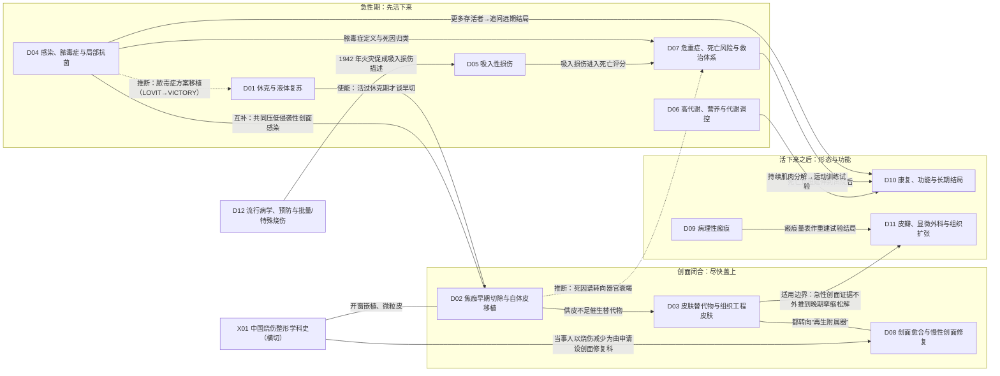

# A 烧伤整形科研究总览（一页版）

> **一句话判断**：烧伤整形科的研究是沿着一个问题链长出来的——先问“烧伤病人为什么早期就死”（补液与休克），再问“活过休克期之后死于什么”（创面感染、吸入损伤、器官衰竭），然后问“创面怎样尽快闭合”（切痂、植皮、替代物），最后问“活下来之后怎样”（瘢痕、功能、心理、长期健康）。今天各方向大多处在**重新校准**阶段：单中心阳性的疗法在多中心随机试验中阴性或提前终止，指南常走在直接证据前面；中国在大面积烧伤救治与创面修复上有原创技术，但缺少独立验证和全国登记。
>
> **截止与口径**：报告截止 2026-09-29；近期窗口 2021-09-29 至 2026-09-29；文献统计见 E。本报告是“主要链条已建立、缺口逐项标注”的版本，**不是完整版**：12 个条目为“基本完整但有标注缺口”，D08 为“部分”；中文数据库未检索，1950–1970 年代的苏联文献线基本未覆盖，部分奠基原文只到题录（逐方向覆盖状态见 F5）。

## A1 方向地图

图例：实线＝有原文或综述明确依据的关系；虚线＝章节推断；无箭头的线＝互补或共享数据。每条关系的具体依据（章节行号与文献）见 `data/qa_relations.json`，完整的 39 条关系与全科分支图见 C。

## A2 十三个条目一览

| 方向 | 研究什么 | 从哪里来 | 为什么变、怎样分化 | 现在研究什么 | 主要数据与设计 | 最大的未知 | 覆盖 |
|---|---|---|---|---|---|---|---|
| **D01 休克与液体复苏** | 头 48 小时补多少、补什么、看什么调 | 1920 年代“死于失液还是毒素”两说并存；1947 年按面积、1952 年按体重×面积计量补液 [D01-N02][D01-N03] | 1968 年 Parkland 成北美主流；补过量的担忧 1940 年代就有，2000 年后有数据（fluid creep、腹腔间隔室综合征），分出高渗、胶体、维生素 C、有创监测、决策软件等减液路线 | 白蛋白减液（ABRUPT2，提前终止）；大剂量维生素 C 出现伤害信号（VICTORY）；低起始量；内皮糖萼 | 灾难伤员观察、犬实验、小 RCT → 多中心 RCT、设备数据库、行政数据 | 本章收录的随机证据中，没有一种复苏策略显示死亡下降 | 基本完整，有标注缺口 |
| **D02 早期切除与植皮** | 何时切、怎么切、切完怎么盖 | 1940 年代前等焦痂自行分离；1929 年电烧伤、1942 年热力烧伤最早的即刻切除记录 [D02-N02][D02-N04] | 1960 年随机分配未证实获益；1970 年切线切除；1986 年历史对照与 1989 年 RCT；中国走出开窗嵌植与微粒皮 | 手术时机（登记库结论相反）；酶学清创；Meek vs 网状皮 RCT；水刀 | 病例系列、24–149 例随机试验 → 登记库、多中心前瞻队列 | 大面积成人早切的随机证据 1989 年后几乎空白 | 基本完整，有标注缺口 |
| **D03 皮肤替代物** | 自体皮不够时拿什么盖 | 1938 年起的异体皮临时覆盖（Bettman 1938 只到题录），1943 年观察到第二批异体皮被加速排斥 [D03-N01][D03-N02] | 1975 年角质形成细胞培养、1981 年胶原-GAG 人工真皮；培养表皮覆盖率低，衍生出复合皮、细胞悬液、合成真皮、猪皮等并行线 | BTM vs Integra；异体细胞产品上市后落差；基因编辑猪皮首批人体数据（会议摘要/预印本） | 病例系列、患者内配对随机 → 上市后监测、登记库 | 能否降低大面积烧伤死亡没有随机证据 | 基本完整，有标注缺口 |
| **D04 感染与局部抗菌** | 细菌从哪来、怎么区分定植与侵袭、怎么挡 | 1930 年代专题文献；1948 年病房感染控制 [D04-N01] | 1964–1968 年三种局部抗菌剂；此后诊断口径、全身预防、肠源性感染（中美并行）、真菌、免疫预防、脓毒症定义多线并行 | 脓毒症标准再验证（阳性预测值 2.5–6.0%）；耐药菌基因组流行病学；噬菌体；靶向测序 | 动物模型、交替分配 → 25 年机构时序、行政库、全基因组测序 | 重度烧伤全身预防缺高质量 RCT；脓毒症定义没有共同参照 | 基本完整，有标注缺口 |
| **D05 吸入性损伤** | 烟雾与热对气道、肺的损伤，CO/氰化物中毒 | 1942 年 Cocoanut Grove 火灾后 MGH 报告：7 例死亡全部死于肺部并发症 [D05-N01] | 1970 年代氙扫描、支气管镜诊断；1987 年量化死亡贡献；诊断、局部药、通气、解毒、动物模型五线并行 | 支气管镜分级可靠性（评估者一致性 k=0.30）；雾化肝素小 RCT；灌洗；通气实践 | 灾难病例、犬/羊实验、小 RCT（最大 88 例）、登记库 | 没有统计效能足够的多中心 RCT（国际雾化肝素试验入组 13 例终止） | 基本完整，有标注缺口 |
| **D06 代谢与营养** | 伤后高代谢怎么来、怎么控制 | 1930 年骨折后氮丢失测量；1948 年烧伤负氮平衡归因于摄入不足（两说） [D06-N01][D06-N02] | 1974 年代谢舱证实儿茶酚胺驱动；营养、药物（生长激素、普萘洛尔、氧雄龙、胰岛素）、持续时间三线并行；生长激素在成人 ICU 增加死亡 | 谷氨酰胺 1200 例阴性后的重估；普萘洛尔能否延伸到成人硬结局；氧雄龙撤销后替代 | 代谢病房、同位素、Galveston 单中心儿童 RCT → 多中心 RCT、电子病历网络 | 成人普萘洛尔缺多中心硬结局试验；药物证据集中于一家中心 | 基本完整，有标注缺口 |
| **D07 危重症与救治体系** | 谁会死、死于什么、烧伤中心与登记 | 1949 年 794 例定义 LA50 [D07-N01]；1961 年 Baux 评分（学位论文，二手）[D07-N03] | 创面感染被压下去后，器官衰竭的比例凸显（作者判断，不是因果证明）；评分、登记、机制（基因组风暴、小鼠模型之争）、阈值与老年四线 | 评分再校准与机器学习（多为内部验证）；老年与虚弱；中心比较；姑息治疗 | 单单元连续病例 → 全国登记（BCQP 103 中心）、行政库、多中心转录组 | 同等严重度下生存是否仍在改善（各中心结论相反）；中国没有全国登记 | 基本完整，有标注缺口 |
| **D08 创面愈合与慢性创面** | 创面靠什么愈合、为什么停在不愈 | 1917/1922 年敷料与白细胞研究；1962 年湿性愈合（原文未读） [D08-N19][D08-N01] | 生长因子效果有限；负压、病因治疗、微环境、再生与中国专科化分头发展；负压在骨折/切口大型 RCT 中阴性 | 负压按创面类型重新校准；糖尿病足新疗法；单细胞组学；AI 预后模型（全部高偏倚） | 动物、无对照系列 → 企业注册 RCT、英国务实 RCT、单细胞测序 | 高压氧结论不一；中国无社区患病率；证据多来自糖尿病足，外推要谨慎 | 部分 |
| **D09 病理性瘢痕** | 增生性瘢痕与瘢痕疙瘩为什么长、怎么防治 | 本轮找到的最早以 keloid 为题的文献是 Addison 1854（文中称该词由 Alibert 更早提出，Alibert 原文未找到，存疑）[D09-E11]；最早找到的治疗记录是 1903 年例会报告的 X 线照射（约 1901 年开始，不是首次使用）[D09-N19]；烧伤增生性瘢痕线的早期系统工作在 1966–1975 年（Larson 1971 等只到题录）[D09-N03] | 1990 年 VSS、1994 年 α-SMA 分开两病；压力衣 Meta 无差异、TGF-β3 III 期失败；机械转导与谱系研究早于失败并行出现 | 单细胞/空间组学；维替泊芬（猪模型）；早期激光；注射方案网状 Meta；多祖源 GWAS | 活检、动物模型、半瘢痕自身对照（10–20 人）、GWAS、全国住院库 | 压力衣与硅酮效果大小；尚无获批的抗瘢痕疗法 | 基本完整，有标注缺口 |
| **D10 康复与长期结局** | 活下来之后的功能、心理、工作与寿命 | 1943 年火灾幸存者精神科观察；1866 年起的夹板防挛缩 [D10-N01][D10-N18] | “只看死亡不够”促成 1982 年专用量表、1994 年 Burn Model System；七条线交叠出现 | 核心结局集（2022）；早期活动与运动；出院后死亡、精神障碍、心血管事件；返岗 | 访谈、量表开发、小 RCT → 多中心纵向库、人群关联数据、电子病历网络 | 夹板到底能否防挛缩；运动/VR 的长期获益 | 基本完整，有标注缺口 |
| **D11 皮瓣、显微与扩张** | 缺损与挛缩用什么带血供组织补 | 1842 年烧伤畸形手术（题录）、1863 年远位皮瓣 [D11-N19][D11-N01] | 技术多先在创伤、肿瘤、乳房重建中建立再移植到烧伤；轴型→游离→穿支→螺旋桨，另有扩张与预扩张；中国贡献前臂皮瓣、大腿皮瓣、超薄皮瓣 | 急性期游离皮瓣安全性；挛缩用皮瓣还是植皮；预扩张穿支皮瓣；脂肪移植 | 个案、尸体注射 → 单中心系列、比例 Meta；随机试验只有少数几项 | 各种重建方式缺长期比较；急性期时机证据矛盾 | 基本完整，有标注缺口 |
| **D12 流行病学与预防** | 谁被烧伤、能否预防、批量伤员接得住吗 | 1942 年 Cocoanut Grove；1947 年时间-温度阈值；1950 年代英国取暖器护栏法 [D12-N01][D12-N02][D12-N17] | 被动预防、报警器、中低收入国家炊事、故意烧伤、灾难与战伤五线并行 | GBD 同源二次分析；中低收入国家登记；备灾；锂电池等新致伤原因 | 事件报告、入户测温、整群 RCT、登记、GBD 模型 | 教育与安全设备能否降低伤害发生率；中国缺全国代表性发病率 | 基本完整，有标注缺口 |
| **X01 中国学科史** | 中国烧伤整形怎样成为学科、为何转向创面修复 | 1958 年广慈医院抢救邱财康被学科共同体定为起点 [X01-N18] | 1960–80 年代解决“自体皮不够”（开窗嵌植、微粒皮）；2019 年设创面修复科、2022 年主刊更名 | 创面修复科建设述评；主刊计量；多中心病案流行病学 | 单中心系列、当事单位专著 → 多中心病案库、问卷普查 | “治愈率世界领先”无统一口径比较；设科后结局无评价 | 基本完整，有标注缺口（结构完整；中文库未检索，史料依赖当事单位回忆） |

注：“从哪里来”一列的年份都是本轮在 PubMed、Europe PMC、OpenAlex、PMC 扫描存档能找到的最早文献或综述公认的奠基工作，不是绝对的“第一篇”；每条的四类起点分类（最早找到／公认奠基／作者自称首次／有争议的首次）与阅读层级见各章第 1 节。“覆盖”一列的评级口径见 F5。

## A3 全科层面的问题转向

以下转向由跨章关系检查归纳，每条都能回查到至少两章的原文段落（依据行号见 `data/qa_relations.json` 的 field_level_turns）：

1. **约 1920–1960 年代：从“为什么早期就死”到“活过休克期之后死于什么”**。补液公式成形后，创面败血症和呼吸道损伤成为主要问题，研究转向切痂闭合、局部抗菌与吸入损伤诊断（D01、D02、D04、D05）。
2. **1970–2000 年代：从“救命”到“活下来之后怎样”**。局部抗菌和早切带来更多大面积存活者，作者们明确写出“只看死亡已经不够”，于是有了专用量表、随访库和以减少挛缩为目标的覆盖与重建（D10、D09、D11、D03）。
3. **1987–2010 年代：死因研究从“创面感染”转向“器官衰竭与持续炎症”**，感染研究随之转向脓毒症定义，代谢研究延伸到伤后 2–3 年（D07、D04、D06）。
4. **2000–2020 年代：从“多给以求补足”到“避免过度”**：补液、热量、血糖、输血都出现这一变化（D01、D06、D02/D07；各章之间没有互相引用，是复核时的并列归纳）。
5. **1980 年代至今：目标从“覆盖、闭合”扩展到“再生组织与附属器”**，但人体证据多停在小样本或动物阶段（D03、D08、D09、D11）。
6. **1990 年代至今：数据从单中心病例系列转向登记库、行政库、电子病历网络和多中心 RCT**（多数方向）。
7. **2010 年代至今：进入“重新校准”阶段**——RE-ENERGIZE、ABRUPT2、VICTORY、HEPBURN、TGF-β3 III 期，以及负压领域的 WOLLF/WHIST/SWHSI-2（这三项是开放骨折、骨折术后切口和二期愈合手术创面人群，不是烧伤人群）等多中心试验阴性或提前终止（D01、D04、D05、D06、D07、D08、D09）。
8. **中国：1958–1980 年代解决“大面积能否救活、自体皮不够怎么办”；2018 年后，当事人以“烧伤减少”为理由（依据未公开；本轮只见 196 家非概率抽样医院的入院数下降）推动转向“烧伤＋慢性创面修复”**（X01、D02、D08）。

## A4 给临床医生的六条阅读提醒

1. **死亡率下降是多因素的**。1960–70 年代以后的死亡下降，不同作者分别归因于局部抗菌药、早期切痂、复苏或多项进步共同作用；这些归因大多来自历史对照，本报告不做单因归因（跨章说明见 C6）。
2. **看清终点**。很多“阳性”结果落在液量、覆盖率、瘢痕评分等替代终点上；以死亡、功能为终点的随机证据普遍很少（D01、D03、D09）。
3. **注意证据集中在少数中心**。例如代谢药物证据主要来自 Galveston 单中心儿童试验（D06），儿童 TBSA 阈值主要来自同一机构（D07），fluid creep 的早期实证集中在一个团队（D01），第三军医大学补液公式的评价都来自原创单位（D01）。同一队列的多篇报告在各章已标注，不应重复计数。
4. **多中心试验常常“阴”或“停”**。提前终止与入组困难本身就是信息：它提示问题定义、人群异质或实施可行性上的困难，而不只是“疗法无效”。
5. **登记库与行政库结论可能相反**。例如早切时机，法国前瞻队列与日本行政库给出相反结论（D02）；登记研究常只分析存活到某时点的患者（D03）。读这类研究先看分析人群和混杂控制。
6. **中国线：原创多、独立验证少**。开窗嵌植、微粒皮、休克期切痂、本土补液公式、创面修复科建设都有原创性，但多数评价出自当事团队，中文原始文献本轮也未系统检索（X01、F6）。

## A5 怎样用这份报告

- 只想知道一个方向的来龙去脉：读该章开头的“一句话判断”和“0 三分钟速读”。
- 想核对某个说法：按 [Dxx-Nxx] 编号到该章第 9 节速查表，或到 `D_关键文献证据表.csv` 找 PMID/DOI 和阅读层级（L0–L4）。
- 想知道哪些地方没查到：看各章第 8 节和 F 部分。
- 数量与期刊：看 E（只是 PubMed 口径的量级与趋势）。
