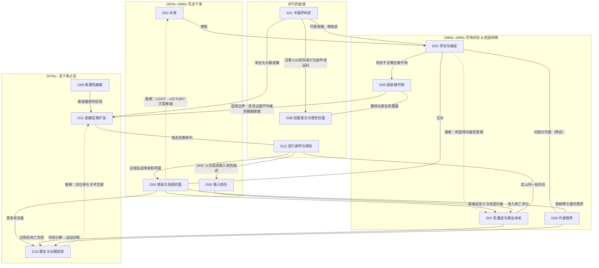

# C 时间线与分支图

> **一句话判断**：把 13 章的节点放在一条时间轴上，能看到四个密集期——1940 年代（补液公式、异体皮、火灾伤员观察）、1960 年代后半（局部抗菌剂、切线切除的前夜、中国大面积救治起步）、1970–80 年代（早切证据、培养表皮与人工真皮、轴型/游离/穿支皮瓣、扩张器、专用量表，几乎所有方向的工具都在这时成形）、2010 年代以后（多中心试验与登记库检验，许多“阳性”被重新校准）。方向之间的关系多数是**并行与互补**，真正有原文依据的“甲推动乙”关系只有十几条；本页把有依据的关系、推断的关系和互相矛盾的因果说法分开列出。

**怎么读**：
- 节点编号 [Dxx-Nxx]、[Dxx-Rxx]、[Dxx-Ex] 对应各章第 9 节速查表与 `D_关键文献证据表.csv`；年份一般是发表年，事件年与发表年不同时会注明。
- 本页只选各年代的代表节点；13 章共 439 个时间线条目的完整列表见 `data/C_timeline_items.csv`。
- 每章自己的分支图在各章第 3 节；本页只画方向之间的关系。
- 关系依据强度三级：**原文或综述明确**（原文或入口综述写明了这层关系）/**章节推断**（章节作者按时间与内容推断）/**仅时间先后**（本报告不据此写因果）。

## C1 全科分支图（方向之间）

图例：实线箭头＝原文或综述明确的驱动/扩展；无箭头实线＝有依据的互补或共享数据；虚线＝章节推断。图中只画了 23 条，全部 39 条见 C3。D04→D01 的虚线对应 C3 第 10 条（C3 表中按章节记为 D01↔D04 共享方法；方案来源是脓毒症试验 LOVIT，移植到烧伤复苏试验 VICTORY，所以图中箭头从 D04 指向 D01）。

## C2 各年代代表节点

| 年代 | 急性期（D01 D04 D05 D06 D07） | 创面闭合（D02 D03 D08） | 瘢痕、功能与重建（D09 D10 D11） | 流行病学与预防（D12） | 中国线（X01 与各章中国节点） |
|---|---|---|---|---|---|
| **1900 年以前** | 18–19 世纪补液记载只有二手转述（D01 第 1 节，L0） | 1875 Wolfe 全厚皮（背景）[D02-N01] | 1842 Mütter 烧伤畸形手术 [D11-N19]（题录）；1854 keloid 术语（存疑）[D09-E11]；1863 Wood 远位腹部皮瓣修复腕部挛缩 [D11-N01]；1866 夹板防挛缩短文（D10 第 1 节） | 1887 Fell《Treatment of Burns—Lessons from the “Richmond” Fire》（PMID 36668429，题录，见 D12 第 1 节） | — |
| **1900–1945** | 1921 Robertson“毒素休克”与输血（D01）；1923 Underhill 血液浓缩 [D01-N01]（二手）；1930 Cuthbertson 伤后氮丢失 [D06-N01]；1942 年 Cocoanut Grove 火灾，1943 年 MGH 系列：39 例住院、7 例死亡均死于肺部并发症 [D05-N01]；1945 Moritz 犬热暴露实验 [D05-N02] | 1917/1922 Carrel 敷料与白细胞 [D08-N19]；1929 Wells 电烧伤立即切除植皮 [D02-N02]；1941 Padgett 鼓式取皮机 [D02-N03]；1942 Young 热力烧伤即刻切除 [D02-N04]；1942 Brown & McDowell 异体皮临时覆盖 [D03-N01]（题录）；1943 Gibson & Medawar 异体皮加速排斥 [D03-N02] | 1903/1904 Harsha X 线治瘢痕疙瘩 [D09-N19]；1916–1945 管状皮瓣与二战重建 [D11-N20]（二手）；1943 Cobb & Lindemann 火灾幸存者精神科评估 [D10-N01] | 1942 Cocoanut Grove（1943 Faxon 医院应对报告）[D12-N01] | 1934 前后整形外科建立（年份有三说）[X01-N15]（二手） |
| **1946–1969** | 1947 Cope & Moore 按面积补液 [D01-N02]；1949 Bull & Squire 定义 LA50 [D07-N01]；1952 Evans、1953 Brooke [D01-N03][D01-N04]（二手）；1961 Baux 评分 [D07-N03]（二手）；1962 MGH 932 例：呼吸道损伤为首要死因 [D05-N19]；1964 Teplitz 创面脓毒症大鼠模型 [D04-N03]（二手）；1965 硝酸银、磺胺米隆，1968 磺胺嘧啶银 [D04-N04]（二手）[D04-N05]（题录）[D04-N06]（题录）；1967 耗氧与儿茶酚胺相关 [D06-N18]；1968 Parkland [D01-N06] | 1947 Cope 38 例/52 创面：拖得越久植皮越差 [D02-N05]；1960 Jackson 随机分配未证实早切获益 [D02-N06]；1962 Winter 湿性愈合（原文未读）[D08-N01]（二手）；1963 Hinman 人体验证 [D08-N02]（题录）；1964 Tanner 网状皮 [D02-N07]（题录）；1967 起苏联真空法 [D08-N24]（题录） | 1963 陈中伟断手再植 [D11-N02]（题录）；1966 曲安奈德注射、持续加压 [D09-N01]（题录）[D09-N21]（题录）；1969 热塑夹板 [D10-N02]（题录） | 1947 Moritz & Henriques 时间-温度阈值 [D12-N02]；1956 Colebrook 2000 例与 1952 年取暖器护栏法 [D12-N17] | 1958 广慈医院（今瑞金医院）抢救邱财康（89% TBSA、III 度 23%）[X01-N18]（二手）；1958–1962 全国交流会与协作组 [X01-N19]；1962 Chang TS 大面积焦痂切除 [D02-N21]（题录） |
| **1970–1989** | 1970 Monafo 高渗盐水 [D01-N07]（二手）；1970 防水膜否定蒸发散热主因 [D06-N19]；1974 Wilmore 代谢舱 α/β 阻断 [D06-N03]；1974 定量活检 [D04-N07]（二手）；1975 支气管镜诊断 [D05-N04]；1975 MOF 概念（外科）[D07-N22]（题录）；1982 ABSI [D07-N04]（题录）；1983 Goodwin 晶体 vs 胶体 RCT [D01-N08]；1984 绵羊烟雾模型 [D05-N06]；1984 细菌移位 [D04-N10]；1987 培养阳性仅 36% 有组织学侵袭 [D04-N13]；1987 Shirani 1058 例量化吸入损伤死亡贡献 [D05-N07] | 1970 Janzekovic 切线切除 [D02-N08]（题录）；1975 Rheinwald & Green 角质形成细胞培养 [D03-N03]；1981 首例自体培养表皮治疗烧伤、胶原-GAG 人工真皮 [D03-N04][D03-N05]；1984 Gallico 大面积儿童 CEA [D03-N07]（二手）；1986 MGH 1103 例历史对照 [D02-N13]；1986–1989 生长因子试验起步 [D08-N03][D08-N04]；1988 人工真皮 11 中心随机 [D03-N09]；1989 Herndon 成人早切 RCT [D02-N14] | 1971 肌成纤维细胞 [D09-N02]（题录）；1971 压力衣 [D09-N03]（题录）；1971 Andreasen 长期精神随访 [D10-N03]；1972 轴型皮瓣 [D11-N03]（题录）；1973 游离皮瓣 [D11-N04]（题录）；1975 首篇烧伤游离皮瓣 [D11-N21]；1981 筋膜皮瓣、肌肉血供分型 [D11-N06][D11-N05]；1982 BSHS 量表 [D10-N04]；1982 Radovan 扩张器 [D11-N08]；1983 硅酮凝胶 [D09-N06]；1987 angiosome [D11-N10]；1989 穿支皮瓣（首次有争议）[D11-N12] | 1977 睡衣阻燃标准后转诊下降 [D12-N03]；1978 自来水烫伤与限温建议 [D12-N04]；1987 媒体宣传只改认知 [D12-N05] | 1979/1980 瑞金开窗嵌植外文报告（自称改良 Mowlem-Jackson 法）[D02-N09]（题录）[X01-N20]；1981 杨果凡前臂皮瓣 [D11-N07]（题录）；1983 自体-猪皮混合移植 [D03-N06]（题录）；1984 宋业光大腿皮瓣 [D11-N09]；1985 张涤生烧伤扩张 [D11-N29]（题录）；1985 合刊《中华整形烧伤外科杂志》[X01-N22]；1986 微粒皮 [D02-N12]（题录）[X01-N08]；1986 内源性感染研究 [D04-N11]；1989 单中心 2630 例 LA50 82.8% [X01-N24] |
| **1990–2009** | 1990 生长激素儿童 RCT [D06-N06]；1995 Huang 高渗钠伤害信号 [D01-N10]；1998 Ryan 三因素 [D07-N08]；1998 无菌性 MOF [D07-N09]；1999 生长激素增加 ICU 成人死亡 [D06-N07]；2000 fluid creep 数据、维生素 C、腹腔间隔室综合征 [D01-N11][D01-N12][D01-N13]；2001 普萘洛尔 [D06-N08]；2004 ITBV 目标 RCT 反增液量 [D01-N14]；2006 ALBUR [D01-N15]；2007 ABA 脓毒症定义 [D04-N16]；2007 AIS 分级 [D05-N12]；2008 雾化肝素成人无获益 [D05-N14] | 1991 儿童烫伤 RCT 支持延迟切除 [D02-N15]；1993 改良 Meek [D02-N16]；1993 CEA 确切覆盖仅 4.7% [D03-N10]（题录）；1993 负压封闭引流 [D08-N06]；1995/1998 PDGF [D08-N08][D08-N11]；1997 现代负压系统 [D08-N09]；1998 rbFGF 烧伤 RCT [D08-N12]；2001 MEBO 新加坡 RCT P=0.11 [D08-N13]；2006 早切 Meta [D02-N18]；2007 中国组织工程皮肤 [D03-N14]；2009 MSC 再生汗腺 5 例 [D08-N16]（题录） | 1990 VSS [D09-N07]；1991 螺旋桨皮瓣 [D11-N13]；1994 α-SMA 分开两种瘢痕 [D09-N09]；1995 脉冲染料激光 [D09-N10]（题录）；2000 VR 镇痛 [D10-N06]；2001 儿童运动 RCT、BSHS-B [D10-N07][D10-N08]；2002 672 块股前外侧皮瓣 [D11-N14]；2004 POSAS、点阵光热解 [D09-N11][D09-N12]；2006 首例面部移植 [D11-N15]；2007 BMS 数据库 [D10-N11]；2009 压力衣 Meta 整体无差异 [D09-N14] | 1991 热水器预设立法 [D12-N06]；2002 伦敦报警器整群 RCT 阴性 [D12-N08]；2009 个体数据 Meta [D12-N20] | 1998 慢性溃疡流调 [D08-N10]；2000 烧伤与整形分刊 [X01-N27]；2001 Lancet 表皮去分化 [X01-N11]（题录）；2005 中日双中心比较 [X01-N13]；2008 第三军医大学补液公式评价 [D01-N16] |
| **2010–2020** | 2010 修订 Baux [D07-N12]；2010 HFPV vs 小潮气量 RCT [D05-N15]；2011 基因组风暴 [D07-N13]；2011 高代谢持续 2–3 年 [D06-N14]；2012 儿童 TBSA 阈值 [D07-N14]；2013/2015 小鼠模型之争 [D07-N15][D07-N16]；2014 监测终点 SR [D01-N30]；2015 白色脂肪褐变 [D06-N15]；2019 PhagoBurn 提前终止 [D04-N18]；2020 HEPBURN 入组 13 例终止 [D05-N18] | 2014 酶学清创多中心 RCT [D02-N19]；2016 日本 CEA 上市后监测 [D03-N22]；2018 ReCell 12 中心 RCT [D03-N15]（题录）；2018 WOLLF、2020 WHIST 负压阴性 [D08-N18]（题录）[D08-N32]；2010/2016 高压氧双盲 RCT 结论相反 [D08-N29][D08-N30] | 2010 瘢痕疙瘩 GWAS [D09-N15]（题录）；2011 FAK 机械转导，同年 TGF-β3 III 期失败 [D09-N16]；2014 荷兰 1768 例重建 10 年 [D11-N24]；2015 成纤维细胞谱系 [D09-N17]；2015 西澳、2019 安大略出院后长期死亡 [D10-N12][D10-N14]；2017 皮瓣 vs 全厚皮 RCT [D11-N26]；2017 脂肪移植双盲试点阴性 [D09-N34] | 2015 八仙乐园（2016 全国床位调度报告）[D12-N12]；2020 GBD 2017 全球估计 [D12-N14]；2020 WHO 全球烧伤登记 [D12-N15] | 2013 Burns & Trauma 创刊 [X01-N30]；2014 昆山粉尘爆炸 [X01-N31]；2018“战时治烧伤、平时治创面”[X01-N32]；2019 国卫办医函〔2019〕865 号设创面修复科 [X01-N14]；2020 昆山 18 个 ICU 167 例 LA50 95.8% [X01-N33] |
| **2021–2026（近期窗口）** | 2022 RE-ENERGIZE 谷氨酰胺 1200 例阴性 [D06-N16]；2024 ABA 复苏指南（检索至 2022-05-17）[D01-E1]；2026 ABRUPT2、VICTORY 均提前终止 [D01-N19][D01-N20]；2026 三套脓毒症标准阳性预测值 2.5–6.0% [D04-R02][D07-R14]；2023 国际吸入损伤专家清单 [D05-E5]；2025 支气管镜分级一致性 k=0.30 [D05-R02]；2024 BCQP 103 中心 [D07-R07] | 2021 StrataGraft III 期 [D03-N16]；2022 BTM 前瞻研究、基因编辑猪皮首批人体（会议摘要/预印本）[D03-N17]（题录）[D03-N18][D03-N19]（题录）；2022 切口负压 Cochrane [D08-R01]；2024 DETECT 酶学清创 [D02-R08]；2025 SWHSI-2 负压阴性 [D08-R03]；2025 Meek vs 网状皮 RCT [D02-R16]；2026 早切时机前瞻队列 [D02-R06] | 2021 En1/YAP 与维替泊芬 [D09-N18]；2021 锁骨上皮瓣 vs 植皮 RCT [D11-N28]；2022 烧伤核心结局集 [D10-N16]；2024 武汉急性期运动 RCT [D10-N17]；2025 多祖源 GWAS [D09-R13]；2026 注射方案网状 Meta [D09-R11] | 2022 孟加拉儿童非致死烧伤 [D12-R08]；2024 定义不同发生率 5.92% vs 2.23% [D12-R28]；2026 GBD 2021 中国分省 [D12-R04] | 2022 主刊更名《中华烧伤与创面修复杂志》[X01-N34]；2022 主刊计量：全身治疗类占比 84.0%→40.3% [X01-R06]；2022 196 家医院病案流行病学 [X01-R07]；2026 气道灌洗专家共识 [D05-R21] |

**怎么读这张表**：同一格里的节点只是时间上相邻，**同处一格不等于有因果关系**；有依据的关系见 C3。“最早”一类说法都带限定（本轮能检到的范围内），详见各章第 1 节。

## C3 方向之间的关系（全部 39 条）

依据强度的判断与行号来自全报告复核时的跨章关系检查（`data/qa_relations.json`）。**行号是复核当时的行号，此后两轮章节修订已使行号偏移，回查时请以依据中的节点编号（[Dxx-Nxx] 等）为准。**C5 第 6 条“真皮替代物能改善瘢痕和挛缩结局”已在修订中按适用场景拆分：急性创面见 D03，晚期挛缩松解见 D11，两者不算冲突。

| # | 从 | 到 | 关系 | 依据强度 | 依据（章节:行号 与文献） |
|---|---|---|---|---|---|
| 1 | D01 | D02 | 驱动（使能条件） | 原文或综述明确 | D02:9（速读第2条：Young 1942 [D02-N04] 称血浆复苏让大面积烧伤患者活过休克期，却在1–3个月内死于开放创面败血症）；D02:57（使能条件：患者要先活过休克期，复苏见 D01） |
| 2 | D04 | D02 | 互补（共同作用于侵袭性创面感染及死亡下降） | 原文或综述明确 | D04:75（Pruitt & McManus 1992 [D04-E03]：局部化疗、及时切痂和闭合使侵袭性创面感染及相关死亡下降；Williams 2009 PMID 19919684 把死亡下降归于多项进步共同作用）；D07:87（同一综述 [D07-N23]） |
| 3 | D02+D04 | D07 | 驱动（死因谱变化：侵袭性感染下降后器官衰竭占比凸显） | 章节推断 | D07:8（速读第2条，引 Pruitt 1992 [D07-N23]、Merrell 1987 [D07-N26]、Sheridan 1998 [D07-N09]）；D07:87–88 |
| 4 | D04 | D10 | 驱动 | 原文或综述明确 | D10:8；D10:59（Andreasen 1971 [D10-N03] 原文 p.785：Sulfamylon、硝酸银等局部抗菌药让 40% TBSA 以上的年轻患者多能存活，因此需要追问远期结局） |
| 5 | D04 | D07 | 共享数据/共享定义（脓毒症定义与死因归类） | 原文或综述明确 | D04:103、D04:304、D04:367（Williams 2009、Kallinen 2012，死因归类交 D07）= D07:89 [D07-N29]；ABA 2007 共识 D04:133 [D04-N16] = D07:91 [D07-N35]；TriNetX 527,197 例 D04:11 [D04-R02] = D07:10 [D07-R14] |
| 6 | D05 | D07 | 扩展/共享方法（吸入损伤进入死亡评分） | 原文或综述明确 | D05:70（Osler 2010 PMID 20038856：修订 Baux 中吸入损伤相当于 +17 岁或 +17%TBSA，交 D07）；D07:62 [D07-N12]；D07:61（Ryan 1998 的 3 个危险因素中有吸入伤 [D07-N08]） |
| 7 | D05 | D01 | 交叉未决（交出后 D01 没有对应小节） | 原文或综述明确 | D05:282（吸入损伤是否需要更多复苏液：Navar 1985 PMID 4073365 vs Xiao 2024 [D05-R22]，交 D01）；D05:307（Pan 2020，交 D01）；D01:18（D01 把吸入性损伤列为不含）；D01:153（Merrell 1986：吸入伤使儿童死亡升高 [D01-N09]） |
| 8 | D12 | D05 | 驱动（批量火灾促成对吸入损伤的首次较全面描述） | 原文或综述明确 | D12:34 与 D05:33（同一篇 Saffle 1993 [D12-E8]/[D05-E3]）；D05:55（Phillips & Cope 1962 p2：这次火灾首次让 MGH 重视呼吸道损伤 [D05-N19]） |
| 9 | D01/D05/D10/D12 | D01/D05/D10/D12 | 共享数据（1942 年 Cocoanut Grove 火灾 MGH 同一批伤员） | 原文或综述明确 | D01:67（Cope & Rhinelander 1943 PMID 17858237，7 例死亡归因于肺损伤，按面积给血浆）；D05:53 [D05-N01 Aub 1943]；D10:33 [D10-N01 Cobb & Lindemann 1943]；D12:52 [D12-N01 Faxon 1943] |
| 10 | D01 | D04 | 共享方法（脓毒症方案移植到烧伤复苏） | 章节推断 | D01:18；D01:130（LOVIT [D01-N33] → VICTORY [D01-N20]：给药方案和主要结局定义相同，部分作者重叠） |
| 11 | D01 | D04 | 扩展（延迟复苏与细菌移位） | 原文或综述明确 | D04:330（Yang H 1997 PMID 9594282：延迟复苏组氧自由基、内毒素升高，大鼠移位增加，与 D01 交叉） |
| 12 | D02 | D06 | 扩展（两说并存：早期切痂对代谢的影响） | 原文或综述明确 | D06:80（Hart 2003 [D06-S30]：儿童早切不降 REE、减轻肌肉分解；Gao 2004 [D06-S53]：成年男性早切组 REE 较低）；D06:271；D02:295（Chen 2011 PMID 21252690：休克期切痂降低胰岛素抵抗，交叉 D06） |
| 13 | D04 | D06 | 共享数据/互补（肠屏障、肠源性感染与早期肠内营养） | 原文或综述明确 | D06:297（Peng YZ 2001 [D06-S50]，与 D04 交叉）；D04:303（肠源性感染争议中以 Peng 2001 的乳果糖/甘露醇比和内毒素作为间接临床证据）；D06:44（“肠源性高代谢”理论，依据是大鼠实验） |
| 14 | D06 | D07 | 共享数据 | 原文或综述明确 | D06:10 [D06-N16] 与 D07:291 [D07-R16]，同为 RE-ENERGIZE 1200 例阴性 RCT |
| 15 | D06 | D10 | 驱动/互补（持续的肌肉分解引出运动训练试验） | 原文或综述明确 | D10:83（Suman 2001 摘要背景：常规物理和职业治疗下，肌肉分解和无力仍持续，机制交 D06）；D06:16（出院后运动康复交 D10） |
| 16 | D06 | D01 | 交叉未决（β 阻断的给药时机与休克期） | 原文或综述明确 | D06:96（Xiao 2011 [D06-S54]：大鼠伤后 0.5 小时给普萘洛尔，心肌和器官损伤加重，与 D01 交叉） |
| 17 | D02 | D03 | 分化/互补（供皮不足催生替代覆盖物） | 原文或综述明确 | D03:3、D03:91（Burke 1981 [D03-N05] 原文提出的问题：切痂后没有足够的自体皮，中厚皮愈合后会挛缩）；D02:100–107（2.5 节切完怎么盖：Alexander 1981 异体皮覆盖 [D02-N10]）；D02:18（人工真皮等交 D03） |
| 18 | X01 | D02/D03/D07 | 共享数据（中国大张异体皮开窗嵌植与微粒皮） | 原文或综述明确 | D02:104–105 [D02-N09][D02-N12]；X01:58–60 [X01-N20][X01-N08]；D07:357（Sheng 2013 转述，技术交 D02/D03）；D03:16（“中国法”混合移植的学科史交 X01） |
| 19 | D03 | D08 | 共享数据/并行（都从“覆盖、闭合”转向“再生附属器”） | 原文或综述明确 | Sheng 2009 汗腺再生：D03:44、D03:130 [D03-N23] 与 D08:119 [D08-N16] 为同一篇；D03:127（2.8 节“从覆盖到再生”）；D08:116（2.7 节“从闭合到再生”） |
| 20 | D03 | D08 | 分化（活细胞皮肤等效物的下游产品转向慢性创面） | 章节推断 | D03:41（Bell 1981，主要下游产品用于慢性创面）；D03:290（Dermagraft 主要用于慢性创面，已退市） |
| 21 | D03 | D04 | 交叉（真皮模板的感染风险） | 原文或综述明确 | D03:10、D03:278（BTM 感染率 22.8% vs Integra 2.96%，极低质量证据 [D03-E10]）；D03:16（BTM/Integra 感染交 D04） |
| 22 | D03 | D11 | 质疑/适用边界（真皮替代物用于晚期挛缩松解） | 原文或综述明确 | D11:146（Almeida 2023 四臂 RCT [D11-R05]，与 D03 交叉）；D11:311；D03:16（Integra/BTM 用于瘢痕松解交 D11） |
| 23 | D09 | D11 | 共享方法（瘢痕量表作为重建试验的结局指标） | 原文或综述明确 | D09:81–83（VSS [D09-N07]、POSAS [D09-N11]）；D11:144（Stekelenburg 2017 用 POSAS 观察者评分 [D11-N26]）；D11:146（Almeida 2023 用 VSS） |
| 24 | D09 | D10 | 互补（瘢痕与压力治疗交 D09，功能康复交 D10） | 章节推断 | D09:16；D10:16；D10:376（中国康复从压力疗法起步，细节交 D09）；D10:43（Jones 2017 瘢痕结局属 D09 交叉） |
| 25 | D10 | D11 | 交接（异位骨化的手术处理） | 章节推断 | D10:69（BMS 2979 例中 HO 3.5% [D10-N24]，手术处理交 D11） |
| 26 | D11 | D12 | 互补（电击伤需要单独分析） | 原文或综述明确 | D11:138（Baumeister 2005 [D11-N23] 与 Perrault 2020 [D11-N27] 都指向电击伤，与 D12 交叉）；D12:116（电烧伤病例系列与 Arnoldo 2004 [D12-N09]，修复技术交 D11/D02） |
| 27 | X01 | D11 | 共享数据（中国显微外科与股部皮瓣） | 原文或综述明确 | D11:338（与 X01 横切交叉）；X01:89 [X01-N12] 与 D11:111 [D11-N09] 同为宋业光 1984 股部皮瓣 |
| 28 | D12 | D02/D07/D10/X01 | 共享数据（2014 年昆山铝粉尘爆炸同一批伤员） | 原文或综述明确 | D12:60 [D12-N13]；D02:214 [D02-R07]；D07:360 [D07-N19, R19–R22]；D10:382 [D10-N29]；X01:75 [X01-N33] |
| 29 | D12 | D10 | 共享数据（八仙灾后随访） | 原文或综述明确 | D12:241（八仙 5 年随访，PTSD 13.1% [D12-R13]，详交 D10）；D10:387 |
| 30 | D12 | D04 | 扩展（远程后送带来多重耐药菌） | 原文或综述明确 | D12:56（巴厘岛爆炸伤员后送悉尼 Concord 医院，出现该单元以前没见过的多重耐药菌 [D12-N23]，感染交 D04） |
| 31 | D07 | D10 | 扩展（死亡负担从住院期延伸到出院后） | 原文或综述明确 | D07:373（Duke 2015、Mason 2019 交 D10）；D10:113（Duke 2015 结论：只靠住院死亡数据会低估）；D10:117–118 [D10-N12][D10-N14] |
| 32 | D07 | D12 | 共享方法（修订 Baux 用于全球登记的资源分组比较） | 原文或综述明确 | D12:111（Gibson 2020 WHO GBR：修正 Baux 59.4 vs 45.3 [D12-N15]）；D07:62 [D07-N12]；D12:17（死亡评分交 D07） |
| 33 | D04/D07/D12 | D04/D07/D12 | 共享数据/同一机构起点（Colebrook 的伯明翰 MRC 烧伤单元） | 原文或综述明确 | D04:38、D04:62 [D04-N01 感染控制]；D07:37、D07:53 [D07-N20；Bull & Squire 1949 LA50 数据来自 Colebrook 主持的单元 D07-N01]；D12:36、D12:69 [D12-N17 取暖器护栏立法] |
| 34 | X01 | D08 | 驱动（烧伤减少，转向创面修复专科化） | 原文或综述明确 | X01:95–98（付小兵 2018 [X01-N32]“战时治烧伤、平时治创面”；865 号文 [X01-N14]）；D08:329–332 [D08-N35][D08-E12]；D08:9 |
| 35 | X01 | D08 | 共享数据（Fu 2001 表皮细胞去分化） | 原文或综述明确 | X01:101 [X01-N11]；D08:118 |
| 36 | D08/X01/D04 | D08/X01/D04 | 共享数据（MEBO 新加坡 RCT） | 原文或综述明确 | D08:125 [D08-N13]；X01:82 [X01-N28]；D04:334 |
| 37 | D05 | D10 | 交接（远期喉气管并发症与康复训练） | 章节推断 | D05:258、D05:264、D05:343（Zhen 2023 [D05-R18]、埃及小型康复 RCT [D05-R26]，交 D10） |
| 38 | D02 | D07 | 互补（切痂术中输血策略） | 原文或综述明确 | D02:229（TRIBE 限制性输血 RCT，Palmieri 2019 PMID 30371811，交叉 D07） |
| 39 | X01 | D01/D07 | 共享方法（面积估算口径影响 LA50 比较） | 原文或综述明确 | X01:77（中国早期自订“rule of nine or ten”，细节交 D01）；D07:357（“中国九分法”便于中心间比较 LA50 [D07-E7]）；X01:29（Evans 公式把 >50%TBSA 按 50% 计算） |

## C4 全科层面的问题转向

| 时期 | 变化了什么 | 涉及方向 |
|---|---|---|
| 约 1920–1960 年代 | 从“烧伤早期为什么死、怎样补液”转到“活过休克期之后死于什么”：创面败血症与呼吸道损伤成为主要问题，研究转向切痂闭合、局部抗菌与吸入损伤诊断 | D01、D02、D04、D05、X01 |
| 1970–2000 年代 | 从“救命”到“活下来之后怎样”：功能、瘢痕、挛缩、心理、返岗成为独立问题；出现专用量表、随访库和以减少挛缩为目标的覆盖与重建 | D10、D09、D11、D03（D04 为驱动） |
| 1987–2010 年代 | 死因研究从创面感染转向器官衰竭与持续炎症；感染研究转向脓毒症定义；代谢研究延伸到伤后 2–3 年 | D07、D04、D06 |
| 2000–2020 年代 | 从“多给以求补足”到“避免过度”：补液、热量、血糖、输血（各章之间无互引，为并列归纳） | D01、D06、D02、D07 |
| 1980 年代至今 | 目标从“覆盖、闭合”扩展到“再生组织与附属器”，人体证据多在小样本或动物阶段 | D03、D08、D09、D11 |
| 1990 年代至今 | 数据从单中心病例系列转向登记库、行政库、电子病历网络和多中心 RCT | 多数方向 |
| 2010 年代至今 | “重新校准”：单中心阳性的疗法在多中心试验中阴性或提前终止（负压领域的 WOLLF/WHIST/SWHSI-2 为骨折与手术切口人群，不是烧伤人群）；指南与共识走在直接证据前面 | D01、D04、D05、D06、D07、D08、D09 |
| 中国：1958–1980 年代；2018–2022 年 | 先解决“大面积能否救活、自体皮不够怎么办”；2018 年后当事人以“烧伤减少”为理由（依据未公开；本轮只见 196 家非概率抽样医院入院数下降）推动重心转向“烧伤＋慢性创面修复” | X01、D02、D08 |

每条的具体依据（章节:行号）见 `data/qa_relations.json` 的 field_level_turns。

## C5 不确定或互相矛盾的因果说法

复核发现 8 处跨章因果说法互相矛盾或缺少限定，已在修订阶段逐章处理（处理记录见各章第 12 节“复核修订记录”）。下表是复核时的原始发现：

| # | 跨章说法 | 涉及位置（复核时行号） | 为什么冲突 | 处理 |
|---|---|---|---|---|
| 1 | MGH 1974–84 年死亡率从 24% 降到 7%，校正病例构成后，治疗时期效应仍然独立（Tompkins 1986，常被当作支持早切体系的证据） | D07:55、D07:81（D07-N06，列入“改善派”）vs D02:75（D02-N13） | 两章引用的是同一篇论文。D02 指出，这篇论文摘要说改善与面积构成变化无关，但正文 p.274 写平均 %BSA 从 32% 降到 16%，并且“可部分解释”死亡下降，文内自相矛盾；D02 还指出“年份”项包含营养、ICU、抗菌等所有同期改进，不能单独归因于切除。D07 没有带上这两条限定，直接写成“校正病例构成后时期效应仍独立”。对同一篇文献的因果力度，两章判断不一致。 | 在 D07 2.4 节 N06 处补上 D02-N13 的两条限定（摘要与正文矛盾；年份项混合了同期改进），并统一两章证据表中这条文献的 key_result 与 limitations。 |
| 2 | 1960–70 年代烧伤死亡下降由什么带来：局部抗菌药、早切、复苏，还是多种改进共同作用 | D10:8、D10:59（把 Andreasen 1971“局部抗菌药让 >40%TBSA 年轻患者多能存活”写成驱动）；D07:82（Rashid 2001 转述伯明翰 1971 年的改善归因于 0.5% 硝酸银）；X01:76（Saitoh 2005 把长海存活率归因于早期气管切开和微粒皮）vs D04:9、D04:75（历史对照不能单独归因于局部药；Williams 2009 认为多项进步共同作用；Cancio 2021 只是作者观点）；D02:75；D07:8 | D04、D02、D07 速读都加了“不能单独归因”的限定。D10 在速读和 2.1 节把原作者的单因归因当作驱动呈现，没有提醒读者参照 D04 的限定；D07 转述 Rashid 的归因时没有标明这是历史对照上的作者判断。读者跨章会读到三种各自单一的归因。 | D10:8/59 写明“这是 Andreasen 的归因；同期死亡下降的归因见 D04 2.2，不能单独归于局部药”。D07:82 标明 Rashid 的说法是作者归因、依据是历史对照。A 总览加一条跨章说明：死亡下降是多因素的，本报告不做单因归因。 |
| 3 | 20 世纪中叶（器官衰竭时代之前）烧伤的首要死因是创面感染 | D07:85（2.5 节标题“死因谱变了：从创面感染到器官衰竭”）；D02:9；D04:9、D04:69 vs D05:8、D05:55（Phillips & Cope 1962 [D05-N19]：MGH 1939–58 年 932 例中，呼吸道损伤一直是首要死因，创面脓毒症第二；NRC 小组指出尸检漏诊呼吸道损伤） | D07 的死因谱叙事从“创面感染”起步，依据主要是 USAISR/Pruitt 体系；它没有纳入 D05 的 MGH 死因审计，也没有说明结论依赖中心和尸检方法。D05 则写明，不同地区对呼吸道损伤的重视程度不同。两章对同一时期的主要死因给出不同起点，也没有互相限定。 | D07 2.5 节加一句：“起点叙事主要依据 USAISR 与 Pruitt 综述；MGH 1962 年死因审计把呼吸道损伤列为首要死因（D05-N19），死因构成随中心和尸检方法而不同。”D05 2.1 节反向注明它与 D07 叙事的差异。 |
| 4 | 早期切痂能减少创面感染和脓毒症 | D06:80（Hart 2003 [D06-S30]：早切加积极肠内喂养减少创面定植与脓毒症）；D04:75、D07:87（Pruitt 1992：及时切痂和闭合使侵袭性创面感染下降）vs D02:213（法国 6 中心 448 例前瞻队列：早切组脓毒症/感染性休克更多，53% vs 32% [D02-R06]）；D02:80（Herndon 1989 会后讨论中 Monafo 指出脓毒症发生率无差异）；D02:70（Jackson 1960 没有证实早切减少感染）；D02:89 | 同一个因果问题，三章给出的方向不同，而且互不引用。D06 的 Hart 2003 是按转入时间分组的队列，干预是早切加喂养的组合，不能单独归因于早切；D02-R06 的早切组可能存在指征混杂。D02 把“早切获益是否被更多的脓毒症抵消”列为新问题，但没有收录 D06 的相反证据。 | D06:80 注明这是组合干预、队列设计，并指向 D02 中方向相反的证据。D02 5.1 争议表新增一行“早切与感染/脓毒症”，并列 D02-R06、Herndon 1989、Hart 2003（D06-S30）和 Pruitt 1992。 |
| 5 | 微粒皮的挛缩信号来自与原团队无关的第三方研究（Yeh 1990 大鼠比较：中国式间植的挛缩少于微粒皮） | D02:106、D02:298（称“证据来自第三方研究”“中西交流的直接证据”，PMID 2373729）vs X01:37、X01:61（Fang CH 是张明良 1988 年论文的合作者，Fang/Alexander 系列“不是独立的国外验证”；X01 引的是另一篇 Fang 1990 Burns，PMID 2383359，比较对象是整张同系皮） | 本次复核查询 PubMed 题录：Yeh 1990 的作者是 Yeh FL、Yu GS、Fang CH、Carey M、Alexander JW、Robb EC，其中就有 Fang CH。所以 D02 的“第三方”说法与 X01 的独立性判断相矛盾。两章各引一篇 1990 年大鼠研究，互不提及，比较对象也不同。 | D02 删去“第三方”，改为“作者与微粒皮原团队有重叠（Fang CH）”。两章互相补引另一篇 1990 年研究，并写明各自的比较对象（中国式间植 vs 整张同系皮）。 |
| 6 | 真皮替代物能改善瘢痕和挛缩结局 | D03:97、D03:277（van den Bosch 2024：急性烧伤 ADM vs STSG，6 个月瘢痕评分 −1.95；Heimbach 1988 1 年时增生性瘢痕较少；Branski 2007 儿童 RCT 瘢痕改善；“瘢痕获益有中等质量证据”）vs D11:148、D11:311（Almeida 2023 四臂 RCT：替代物加植皮与单纯植皮无差异；“替代物的获益未被 RCT 证实”） | 两章的场景不同：D03 是急性切痂创面，D11 是伤后 ≥1 年的挛缩松解。但 D11 的结论句没有限定场景，读者会以为它与 D03 的结论相反。 | D11:311 改为“在晚期挛缩松解场景中，替代物加植皮的获益未被 RCT 证实（急性创面的瘢痕证据见 D03 2.4）”；D03 5.1 注明急性期证据不外推到晚期挛缩。 |
| 7 | 自体脂肪移植能改善烧伤瘢痕 | D11:284–293（4.4 节：原始研究普遍报告改善；Abouzaid 2022 RCT 报告瘢痕质地改善、挛缩更少；El Sewify 2025 汇总的 14 项研究全部报告改善）vs D09:347（Gal 2017 随机双盲安慰剂对照试点：8 名儿童单次脂肪移植与生理盐水无差异，停止入组 [D09-N34]） | D11 标注“与 D09 交叉”，却没有引用 D09 的阴性双盲试验，“原始研究普遍报告改善”的说法与 D09-N34 冲突；两者对象不同（急性创面 vs 成熟瘢痕），D11 也没有说明。 | D11 4.4 补引 D09-N34，并按“急性创面”和“成熟瘢痕”两种适应证分开写；“普遍报告改善”改为“开放标签或主观评估的研究多报告改善，唯一双盲安慰剂对照试点为阴性”。 |
| 8 | 吸入损伤是独立的死亡危险因素（相当于 +17 岁或 +17%TBSA） | D07:61–62（Ryan 1998、修订 Baux [D07-N12]，称为最广泛接受的评分）vs D05:70、D05:274（Galeiras 2020 Meta：按严重度校正后关联不显著 [D05-E4]；“未解决，交 D07”） | D05 把“吸入损伤是否独立致死”作为未决问题交给 D07，D07 只以评分系数呈现，没有讨论严重度混杂和诊断标准不统一。读者可能把预测权重读成独立的因果效应。 | D07 2.2 节加一句：“评分中吸入损伤的权重是预测系数，不等于独立因果效应；混杂与诊断标准问题见 D05 2.3。” |

**本报告对这些问题的统一立场**：
1. 20 世纪中叶以后的烧伤死亡下降是多种改进共同作用的结果；局部抗菌、早期切痂、复苏改进、烧伤中心化各自的贡献，现有证据多为历史对照，本报告不做单因归因。
2. “死因从创面感染转向器官衰竭”是 USAISR 与 Pruitt 综述的叙事；MGH 的死因审计把呼吸道损伤列为 1939–1958 年的首要死因。死因构成随中心、年代和尸检方法而不同。
3. 早期切痂与感染/脓毒症的关系，现有证据方向相反（综述判断与组合干预队列 vs 2026 年法国前瞻队列），属于未决问题。
