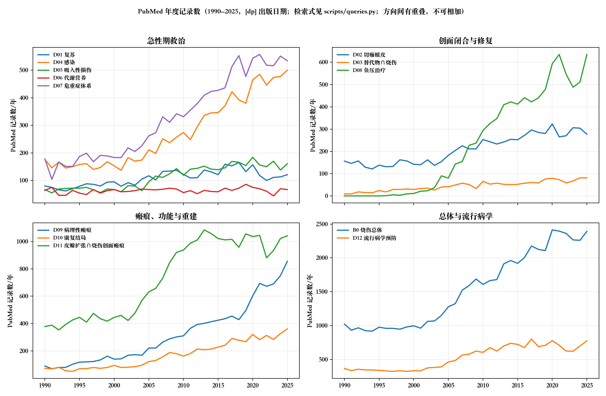
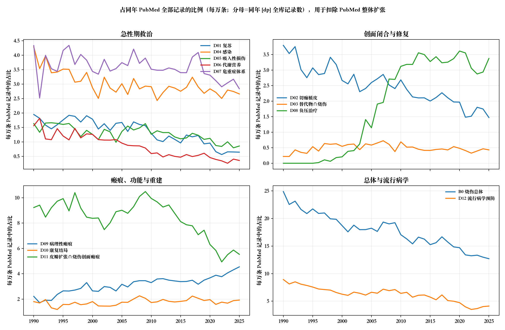

# E 文献数量与期刊背景

> **一句话判断**：按 PubMed 口径，烧伤研究的年发文量在涨，但**占整个 PubMed 的比例从 1990 年到 2025 年下降了约一半**（每万条记录从 24.9 条降到 12.7 条）；同期占比上升的只有病理性瘢痕、负压创面治疗、慢性创面和皮肤替代物这几条“创面与瘢痕”线。当前烧伤研究约四分之一发在两本专刊（Burns、JBCR）上，其余分散在整形、创面、重症和大量综合性开放获取期刊中。
> **读这一章之前要知道**：这里的数字只说明“在一个数据库、一组检索式下有多少条记录”，不是“这个领域有多少研究”；方向之间有重叠，不能相加；期刊指标不能用来评价单篇研究或历史贡献。

## E0 口径

| 项目 | 取值 |
|---|---|
| 数据库 | PubMed（NCBI E-utilities `esearch` 计数、`esummary` 取期刊字段）。未检索 Embase、Web of Science、Scopus、CNKI、万方（见 E7） |
| 检索式 | 唯一真源 `scripts/queries.py`；PubMed 翻译后的检索式存于 `data/pubmed/counts_meta.json` |
| 日期字段 | `[dp]` Publication Date |
| 三个时间口径 | 报告截止日 2026-09-29；近期窗口 2021-09-29 至 2026-09-29（滚动五年）；文献统计窗口 = PubMed 全部年份至查询日（年度图只画 1990–2025 完整年份） |
| 查询日期 | 计数：2026-09-29 下午；PMID 集合与期刊字段：2026-09-29 晚间。两次查询相隔数小时，PubMed 每日新增记录，同一检索式两次结果可相差 1–4 条（例：B0 近期窗口 10,694 → 10,696） |
| 去重规则 | 同一 PMID 只计一次；“方向并集”用 PMID 集合求并，不做跨库去重 |
| 分析单位 | PubMed 记录（一篇文献一条）；不是研究数、不是患者数；同一队列的多篇报告在这里各算一条 |

**BURN 检索块的构造**（影响所有带“烧伤”限定的方向）：MeSH `Burns` 去掉下位词 `Sunburn`（晒伤，3,285 条，属皮肤光生物学）+ 烧伤特异的题名/摘要短语（`"burn injury"`、`TBSA`、`scald` 等 35 个）。没有用裸词 `burn[tiab]`：它会命中 “burn-out”（职业倦怠）等，2015–2024 年只靠题名/摘要命中的记录抽样 40 条，约 1/3 与烧伤有关；改用特异短语后同口径抽样 40 条，6 条明确无关、3 条边缘相关（随机种子 11，抽样日 2026-09-29）。所以 B0 仍含少量噪声，B0_mesh 更干净但漏掉尚未标引的新记录。

## E1 各方向的规模与证据形态

下表每一行是一条独立检索式。**行与行之间有重叠，任何两行都不能相加。**“不限烧伤”的检索式（D03、D05、D08a、D08b、D09、D11）包含大量非烧伤来源的文献（如糖尿病足、乳房再造），反映的是整个技术领域的规模，不是烧伤整形科自己的产出。

| ID | 口径 | 全部年份 | 近期窗口 | 近期占比 | 综述 全/近 | 系统综述 全/近 | Meta 全/近 | RCT 全/近 | 指南或共识 全/近 |
|---|---|---:|---:|---:|---|---|---|---|---|
| B0_mesh | 烧伤总体（仅 MeSH，去晒伤） | 63,253 | 6,152 | 9.7% | 5,417/872 | 661/292 | 279/151 | 1,354/237 | 73/14 |
| B0 | 烧伤总体（MeSH＋短语） | 76,469 | 10,694 | 14.0% | 7,171/1,560 | 772/346 | 328/171 | 1,516/274 | 90/17 |
| P0 | 整形重建外科总体（背景，主题词覆盖很宽） | 309,391 | 59,233 | 19.1% | 36,675/9,503 | 8,534/4,287 | 5,452/2,703 | 11,194/2,656 | 318/75 |
| D01 | 烧伤休克与液体复苏 | 5,588 | 527 | 9.4% | 875/124 | 51/16 | 20/5 | 105/10 | 14/3 |
| D02 | 早期切痂与自体皮移植 | 10,064 | 1,337 | 13.3% | 1,052/202 | 105/53 | 49/29 | 316/47 | 4/2 |
| D03 | 皮肤替代物（不限烧伤） | 10,704 | 2,395 | 22.4% | 1,432/402 | 189/83 | 108/51 | 267/49 | 6/2 |
| D03b | 皮肤替代物 ∩ 烧伤 | 1,592 | 331 | 20.8% | 312/77 | 32/18 | 15/11 | 54/5 | 0/0 |
| D04 | 感染、脓毒症与局部抗菌 | 12,503 | 2,296 | 18.4% | 1,707/389 | 199/84 | 110/45 | 348/47 | 16/4 |
| D05 | 吸入性损伤（不限烧伤） | 4,354 | 744 | 17.1% | 558/95 | 49/16 | 21/11 | 85/10 | 4/0 |
| D06 | 高代谢、营养与代谢调控 | 2,873 | 278 | 9.7% | 544/78 | 52/21 | 37/13 | 207/14 | 8/1 |
| D07 | 危重症、死亡风险与救治体系 | 12,980 | 2,483 | 19.1% | 1,731/378 | 212/84 | 118/51 | 208/27 | 27/4 |
| D08a | 慢性/难愈性创面（不限烧伤） | 55,648 | 13,252 | 23.8% | 9,691/3,110 | 1,528/678 | 852/420 | 2,262/478 | 162/31 |
| D08b | 负压创面治疗（不限烧伤） | 7,938 | 2,647 | 33.3% | 1,338/482 | 308/151 | 214/128 | 352/107 | 18/3 |
| D09 | 病理性瘢痕（不限烧伤） | 12,417 | 3,406 | 27.4% | 1,721/587 | 216/124 | 118/65 | 346/93 | 8/2 |
| D10 | 康复、功能与长期结局 | 6,801 | 1,487 | 21.9% | 985/303 | 174/96 | 61/44 | 295/93 | 10/3 |
| D11 | 皮瓣、显微外科与组织扩张（不限烧伤） | 85,634 | 13,676 | 16.0% | 7,634/1,825 | 1,231/622 | 683/370 | 1,565/303 | 25/5 |
| D11b | 皮瓣/扩张 ∩（烧伤或瘢痕或挛缩或创面） | 27,034 | 4,141 | 15.3% | 2,339/502 | 331/166 | 180/100 | 363/86 | 4/1 |
| D12 | 流行病学、预防与批量/特殊烧伤 | 24,177 | 3,114 | 12.9% | 2,400/417 | 278/107 | 141/61 | 361/58 | 33/8 |

来源：`data/pubmed/counts_pubtype.csv`（查询日 2026-09-29）。文献类型按 PubMed Publication Type 计，依赖标引，近期记录可能尚未标全。

**能读出的三点**（都是计数层面的描述，不是质量判断）：

1. **近期窗口占比低的方向是“老方向”**：复苏（D01）和代谢（D06）近五年只占各自全部记录的约 9–10%，远低于负压（33%）、病理性瘢痕（27%）、慢性创面（24%）。这与各章的判断一致：复苏和代谢的主要问题框架在 1990 年代以前已经形成（见 D01、D06 章）。
2. **随机试验在急性期方向很少**：D01 近五年 RCT 类型记录 10 条、D05 10 条、D06 14 条；D01 章收录的两项多中心 RCT（ABRUPT2、VICTORY）都提前终止。与之相比，D08b 负压近五年有 107 条 RCT 类型记录，但多数不是烧伤人群。
3. **“系统综述＋Meta”在近期快速堆积**：以 D09 为例，全部年份 216 条系统综述中 124 条（57%）出现在近五年；D08b 为 151/308（49%）。二次研究的增长快于原始 RCT 的增长，这是需要警惕的信号（重复汇总同一批小试验），各章在“近五年”一节里有具体例子。

## E2 近期窗口的去重总量

| 指标 | 数值 |
|---|---:|
| 12 条方向检索式（D01、D02、D03b、D04、D05、D06、D07、D08b、D09、D10、D11b、D12）的 PMID 并集 | **16,987** |
| 同样 12 条检索式计数的简单相加（只用来说明重叠，不是总量） | 22,795 |
| B0 烧伤总体（MeSH＋短语）近期窗口 | 10,696 |
| 并集中不在 B0 里的记录（主要来自不限烧伤的瘢痕、负压、吸入等口径） | 9,489 |

来源：`data/pubmed/recent_union_summary.csv`；两两重叠矩阵见 `data/pubmed/recent_overlap_matrix.csv`（例：D07 与 D12 重叠 1,243 条，D04 与 D07 重叠 811 条）。PMID 集合按自然年切片抓取，并逐一校验“抓到的 PMID 数 = 同一检索式的计数”（`data/pubmed/pmid_fetch_checks.csv`）。

**所以**：“烧伤整形科近五年在 PubMed 上约有 1.7 万条相关记录”是一个带口径的说法（12 条检索式的并集，含不限烧伤的瘢痕/负压/替代物/吸入/皮瓣文献中与创面瘢痕相关的部分）；只算烧伤本身约 1.07 万条。两个数都不含中文数据库。

## E3 年度趋势：绝对数与相对占比

分母（同年 PubMed 全部记录数）见 `data/pubmed/pubmed_total_by_year.csv`；1990 年 PubMed 全库约 41 万条，2025 年约 188 万条。

| 口径 | 每万条 PubMed 记录中的占比：1990 | 2025 | 变化 |
|---|---:|---:|---|
| B0 烧伤总体（MeSH＋短语） | 24.89 | 12.71 | 约 −49% |
| B0_mesh 烧伤总体（仅 MeSH） | 22.68 | 7.09 | 约 −69%（部分来自新记录尚未标引） |
| D01 复苏 | 1.95 | 0.64 | 下降 |
| D02 切痂植皮 | 3.80 | 1.47 | 下降 |
| D06 代谢营养 | 1.56 | 0.36 | 下降 |
| D12 流行病学预防 | 8.93 | 4.12 | 下降 |
| D09 病理性瘢痕（不限烧伤） | 2.21 | 4.54 | 上升 |
| D08a 慢性创面（不限烧伤） | 8.56 | 17.42 | 上升 |
| D08b 负压（不限烧伤；1990 年尚无此概念） | 0.00 | 3.37 | 上升 |
| D03 皮肤替代物（不限烧伤） | 1.31 | 2.77 | 上升 |
| D10 康复结局 | 1.80 | 1.92 | 基本持平 |

**怎么读**：烧伤研究的绝对量在涨，但涨得比整个生物医学文献慢，所以相对份额在缩；份额在涨的是“创面与瘢痕”这一组，且多数增长来自不限烧伤的人群（糖尿病足、外科切口、美容/皮肤科瘢痕）。这与 X01 章记录的学科动向——2019 年设立“创面修复科”、2022 年主刊更名为《中华烧伤与创面修复杂志》——方向一致，但本节的计数**不能证明**两者之间的因果关系。

**不能这样读**：
- 不能把 1975 年以前与之后的数量直接比较。PubMed 早期记录多数没有摘要，题名/摘要检索只能命中题名；不少 MeSH 主题词是后来才启用的（例：D11 从 1970 年代 428 条跳到 1980 年代 9,353 条，主要反映“Surgical Flaps”等主题词开始标引，而不是研究量突然暴增）。表中 1990 年以后的年度数更可比。
- 不能把“份额下降”读成“研究质量下降”或“领域衰落”；它只说明相对规模。

## E4 历史发表载体（B0 烧伤总体，按年代的前 10 期刊）

> 本节表格由 `scripts/pubmed_pmids_journals.py` 生成（`data/pubmed/historical_top_journals_B0.csv`）。

| 年代 | B0 记录数 | 语种前 4（记录数） | 前 5 期刊（记录数，占该年代比例） | Burns＋JBCR（含前身）合计占比 |
|---|---:|---|---|---:|
| ≤1949 | 662 | 英 498、法 66、西 37、德 31 | Annals of surgery（39，5.9%）；The Medical and physical journal（27，4.1%）；American journal of surgery（17，2.6%）；British medical journal（17，2.6%）；Provincial medical & surgical journal（15，2.3%） | 0.0% |
| 1950s | 2,591 | 英 1202、未标 486、法 200、俄 196 | Khirurgiia（64，2.5%）；Annals of surgery（54，2.1%）；Comptes rendus des seances de la Societe de biol（44，1.7%）；American journal of surgery（42，1.6%）；Surgical forum（40，1.5%） | 0.0% |
| 1960s | 5,040 | 英 2266、俄 857、德 554、法 465 | Khirurgiia（110，2.2%）；The Journal of trauma（102，2.0%）；Patologicheskaia fiziologiia i eksperimental'nai（78，1.6%）；Plastic and reconstructive surgery（76，1.5%）；Surgical forum（76，1.5%） | 0.0% |
| 1970s | 7,332 | 英 4196、俄 1109、德 669、法 428 | The Journal of trauma（310，4.2%）；Plastic and reconstructive surgery（132，1.8%）；Vestnik khirurgii imeni I. I. Grekova（113，1.5%）；Khirurgiia（96，1.3%）；Voenno-meditsinskii zhurnal（93，1.3%） | 0.0% |
| 1980s | 8,777 | 英 5889、俄 1058、德 419、中 394 | Burns, including thermal injury（560，6.4%）；The Journal of burn care & rehabilitation（483，5.5%）；The Journal of trauma（401，4.6%）；Zhonghua zheng xing shao shang wai ke za zhi（243，2.8%）；Klinicheskaia khirurgiia（177，2.0%） | 11.9% |
| 1990s | 9,592 | 英 7420、中 648、俄 506、法 305 | Burns（1264，13.2%）；The Journal of burn care & rehabilitation（977，10.2%）；Zhonghua zheng xing shao shang wai ke za zhi（430，4.5%）；The Journal of trauma（256，2.7%）；Plastic and reconstructive surgery（161，1.7%） | 23.4% |
| 2000s | 12,103 | 英 10077、中 957、俄 257、德 240 | Burns（1855，15.3%）；Journal of burn care & research（636，5.2%）；Zhonghua shao shang za zhi（586，4.8%）；The Journal of burn care & rehabilitation（460，3.8%）；Plastic and reconstructive surgery（253，2.1%） | 24.4% |
| 2010s | 16,781 | 英 15025、中 887、法 239、德 158 | Burns（2746，16.4%）；Journal of burn care & research（1439，8.6%）；Zhonghua shao shang za zhi（638，3.8%）；Annals of burns and fire disasters（334，2.0%）；PloS one（180，1.1%） | 24.9% |
| 2020–2026* | 14,180 | 英 13505、中 414、法 78、德 44 | Burns（1892，13.3%）；Journal of burn care & research（1455，10.3%）；Cureus（261，1.8%）；Annals of burns and fire disasters（222，1.6%）；European burn journal（205，1.5%） | 23.6% |

说明：“2020–2026*”为不完整年代（截至查询日 2026-09-29）。“Burns＋JBCR”只统计进入该年代前 10 的这两本专刊及其前身（Burns, including thermal injury；J Burn Care Rehabil），前 10 以外的记录未计入。语种来自 PubMed 的 language 字段，“未标”为该字段缺失。

**能读出的三点**：
1. **专刊出现前后的载体变化**：1970 年代以前，烧伤文献分散在综合外科期刊（Annals of Surgery、American Journal of Surgery、Surgery, Gynecology & Obstetrics、J Trauma）和各国外科期刊中；Burns（1974 年创刊）与 J Burn Care Rehabil（1980 年创刊）出现后，1990 年代起两本专刊合计约占烧伤记录的四分之一，这一比例到今天大体未变。
2. **1950–1970 年代有一条规模不小的苏联文献线**：俄语记录在 1960 年代占 857/5,040、1970 年代占 1,109/7,332，Khirurgiia、Vestnik khirurgii、Voenno-meditsinskii zhurnal、Patologicheskaia fiziologiia 等进入前 10。**本报告各章基本没有覆盖这条线**（D01 已把“苏联烧伤休克研究”列为检索缺口），这是全报告的一个结构性缺口，见 F6。
3. **中文记录的起落**：中文记录从 1980 年代（394 条，主要来自 1985 年创刊的《中华整形烧伤外科杂志》）增至 2000 年代（957 条），2020 年代降至 414 条；同期发生了刊名更替（《中华烧伤杂志》2021 年止，更名后的《中华烧伤与创面修复杂志》2022 年起被 MEDLINE 收录），下降可能与此有关，但具体原因本报告未核实；无论如何，这一变化不能直接读作中国烧伤研究减少（中文期刊大部分不在 PubMed）。

## E5 当前代表期刊（近期窗口 2021-09-29 至 2026-09-29）

各方向近期记录中占比最高的期刊（完整前 15 见 `data/pubmed/recent_top_journals.csv`）：

| 方向（近期记录数） | 前 3 期刊（记录数，占该方向近期记录比例） |
|---|---|
| B0 烧伤总体（10,696） | Burns（1,397，13.1%）；J Burn Care Res（1,148，10.7%）；Cureus（231，2.2%） |
| D01 复苏（527） | Burns（81，15.4%）；J Burn Care Res（75，14.2%）；Eur Burn J（21，4.0%） |
| D02 切痂植皮（1,337） | Burns（210，15.7%）；J Burn Care Res（207，15.5%）；中华烧伤与创面修复杂志（45，3.4%） |
| D04 感染（2,297） | Burns（219，9.5%）；J Burn Care Res（208，9.1%）；Cureus（61，2.7%） |
| D05 吸入性损伤（745） | J Burn Care Res（115，15.4%）；Burns（86，11.5%）；Cureus（29，3.9%） |
| D06 代谢营养（278） | J Burn Care Res（35，12.6%）；Burns（30，10.8%）；中华烧伤与创面修复杂志（11，4.0%） |
| D07 危重症体系（2,483） | J Burn Care Res（408，16.4%）；Burns（407，16.4%）；Ann Burns Fire Disasters（69，2.8%） |
| D08a 慢性创面（13,254） | Int Wound J（690，5.2%）；J Wound Care（549，4.1%）；Int J Low Extrem Wounds（389，2.9%） |
| D08b 负压（2,647） | Cureus（149，5.6%）；Int Wound J（119，4.5%）；Plast Reconstr Surg（80，3.0%） |
| D09 病理性瘢痕（3,406） | Aesthetic Plast Surg（142，4.2%）；Burns（127，3.7%）；J Cosmet Dermatol（98，2.9%） |
| D10 康复结局（1,487） | Burns（277，18.6%）；J Burn Care Res（248，16.7%）；Eur Burn J（56，3.8%） |
| D11b 皮瓣扩张 ∩ 烧伤创面瘢痕（4,141） | J Plast Reconstr Aesthet Surg（256，6.2%）；Ann Plast Surg（221，5.3%）；Microsurgery（184，4.4%） |
| D12 流行病学预防（3,116） | Burns（505，16.2%）；J Burn Care Res（408，13.1%）；中华烧伤与创面修复杂志（65，2.1%） |

**读法**：烧伤急性期各方向（D01、D02、D05、D07、D10、D12）有 25–35% 的记录集中在 Burns 和 JBCR 两本专刊；创面（D08）、瘢痕（D09）、皮瓣（D11）方向没有这种集中，文献分散在创面、整形、美容与皮肤科期刊中，说明这几条线的“学术共同体”本来就跨科室。Cureus 等综合性开放获取期刊在多个方向进入前三，是近期的新现象；期刊名出现在前列只说明发文数量，不说明质量。D12 前列中的《Experimental Eye Research》来自 MeSH `Burns` 下的“眼烧伤”（多为化学烧伤动物模型），属检索口径带入。

## E6 期刊背景：创刊、更名与收录状态

历史载体与当前代表期刊的沿革（NLM Catalog，查询日 2026-09-29；“MEDLINE 现收录”指 NLM Catalog 的 currentindexingstatus 字段，Y=当前被 MEDLINE 标引）：

| 期刊 | 刊期（NLM Catalog） | 更名/沿革 | MEDLINE 现收录 |
|---|---|---|---|
| Annals of Surgery | 1885– | — | 是 |
| Surgery, Gynecology & Obstetrics | 1905–1993 | NLM 接续记录：由 Journal of the American College of Surgeons 接续（后者 1994–） | 否（已更名） |
| Archives of Surgery | 1920–1950；1960–2012 | NLM 接续记录：由 JAMA Surgery 接续 | 否（已更名） |
| Journal of Trauma | 1961–2011 | NLM 接续记录：由 J Trauma Acute Care Surg 接续（后者 2012–） | 否（已更名） |
| British Journal of Plastic Surgery | 1948–2005 | 2006 年起为 J Plast Reconstr Aesthet Surg | 否（已更名） |
| Plastic and Reconstructive Surgery | NLM 记录起始 1963 | 更早的刊名沿革本表未核 | 是 |
| Burns | 1974–1988 刊名为 “Burns, including thermal injury”；1989– 现名 | NLM 刊名全称含 “journal of the International Society for Burn Injuries” | 是 |
| J Burn Care Rehabil → J Burn Care Res | 1980–2005 → 2006– | NLM 记录：自 1991 年起为美国烧伤协会（ABA）官方刊物 | 是（JBCR） |
| Wound Repair and Regeneration | 1993– | — | 是 |
| International Wound Journal | 2004– | — | 是 |
| Advances in Wound Care | 2011– | — | 是 |
| Annals of Plastic Surgery | 1978– | — | 是 |
| Burns & Trauma | 2013– | NLM 记录的出版国为英国；主办单位本表未核 | 否（NLM 记录显示当前未被 MEDLINE 标引；但 PubMed 可检到其文章，例如在 D06 近期前列期刊中出现） |
| Scars, Burns & Healing | 2015– | — | 否 |
| European Burn Journal | 2020– | — | 否 |
| 中华整形烧伤外科杂志 | 1985–1999（ISSN 1000-7806） | 2000 年拆分为下面两刊 | 否（已停刊） |
| 中华烧伤杂志 | 2000–2021（ISSN 1009-2587） | 2022 年更名为中华烧伤与创面修复杂志 | 否（已更名） |
| 中华烧伤与创面修复杂志 | 2022–（ISSN 2097-1109） | — | 是 |
| 中华整形外科杂志 | 2000–（ISSN 1009-4598） | — | 否 |

来源：`data/pubmed/journal_background.csv`（按 ISSN 查询 NLM Catalog；个别 ISSN 同时返回无关记录，本表已人工剔除，例如 0735-6757 返回的《Human Pathology》）。

## E7 期刊指标

| 期刊 | OpenAlex 2yr_mean_citedness | OpenAlex h_index | 说明 |
|---|---:|---:|---|
| Annals of Surgery | 5.46 | 457 | |
| Burns | 1.98 | 150 | |
| J Burn Care Res | 0.57 | 95 | **异常偏低**：与 Burns 同类期刊相比不合常理，疑似 OpenAlex 的来源记录在出版社变更后被拆分，不宜解读 |
| Burns & Trauma | 12.55 | 72 | 开放获取、近年快速增长；该值未经其他来源核对 |
| Plastic and Reconstructive Surgery | 1.72 | 310 | |
| J Plast Reconstr Aesthet Surg | 1.92 | 120 | |
| Annals of Plastic Surgery | 1.61 | 139 | |
| Wound Repair and Regeneration | 4.16 | 158 | |
| International Wound Journal | 2.45 | 117 | |
| Advances in Wound Care | 6.41 | 105 | |
| Journal of Wound Care | 1.62 | 104 | |
| European Burn Journal | 1.65 | 13 | |
| Scars, Burns & Healing | 1.52 | 28 | |
| 中华烧伤与创面修复杂志 | 未知 | 未知 | OpenAlex 无可用指标 |
| 中华整形外科杂志 | 未知 | 未知 | OpenAlex 无可用指标 |

**指标口径**：`2yr_mean_citedness` 是 OpenAlex 按其自有引文数据计算的“前两年所发作品在最近一年的平均被引”，定义接近但**不等于** Clarivate JCR 影响因子；`h_index` 为 OpenAlex 全部年份。**指标对应的统计年份**：OpenAlex 接口只返回查询时的当前值，没有注明对应哪一年，本表按“2026-09-29 查询时的当前值，统计年份未知”处理。查询日 2026-09-29，来源 `https://api.openalex.org/sources/issn:<ISSN>`，原始值见 `data/pubmed/journal_background.csv`。

**未取得的指标**：
- **JCR 影响因子**：需订阅；尝试从出版社页面获取时，Elsevier（ScienceDirect）对自动访问和内置浏览器访问都返回拒绝页，未绕过。本报告不给出任何 JCR 数值。
- **SCImago SJR**：网站有 Cloudflare 人机验证，未绕过，未取得。
- **中文核心期刊等级（北大核心、CSCD 等）**：本轮未查。

**使用限制**：期刊指标只描述今天的期刊，不能用来评价 1940–1990 年代发表在同一刊物上的奠基工作，也不能替代对单篇研究设计与数据的判断。各章的证据评价以研究本身（设计、样本、分析单位、局限）为准，不以期刊档次为准。

## E8 覆盖限制（本节数字不能回答的问题）

1. **单库口径**：只有 PubMed。未检索 Embase（欧洲药械文献较全）、Web of Science/Scopus（引文分析）、CNKI/万方（中文原创文献主体）。中文期刊只有被 MEDLINE 收录的部分（如中华烧伤杂志/中华烧伤与创面修复杂志）进入统计。
2. **检索式敏感度与特异度未系统评估**：只对 B0 的题名/摘要部分做过 40 条抽样；各方向检索式没有做金标准验证。计数应看作“量级与趋势”，不是精确总量。
3. **标引时滞与主题词变迁**：近期记录可能尚未完成 MeSH 与文献类型标引；主题词启用年份不同会造成历史断层（见 E3）。
4. **记录≠研究**：同一试验的多篇报告、会议摘要、勘误、评论都算记录；各章证据表才按研究/报告/患者分开计数。
5. **1946 年以前**：PubMed 对 1946 年前文献收录有限（OLDMEDLINE 部分回溯），“≤1949”一栏的数字不代表当时的实际发表量。各章对早期源头的追溯另用 PMC 扫描存档、OpenAlex、Crossref 与史料综述，不依赖本节计数。
