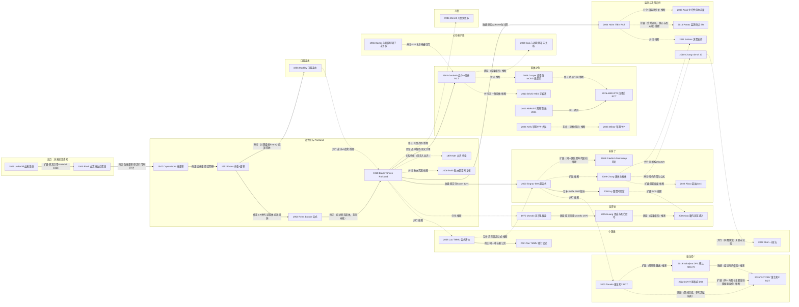

# D01 烧伤休克与液体复苏

> **一句话判断**：这个方向研究“烧伤后头 48 小时给多少液、给什么液、看什么指标调整”。主线是：1947–1968 年美国形成按烧伤面积和体重估算补液量的公式，Parkland（第一天纯晶体）在北美成为主流；补液过量的担忧一直存在，2000 年后“fluid creep（补液量悄悄超过公式）”和腹腔间隔室综合征有了数据，先后试过的减液办法包括高渗盐、白蛋白/血浆、维生素C、有创监测和决策软件。**本章收录的随机试验和 RCT 合并分析中，没有一项复苏策略显示死亡下降**，多数只在液量上显示差异（公式原文对过量的早期警告见第 1 节与 2.5，各国并行做法见 2.3）。
> **对临床医生最重要的一点**：ABA 2024 指南（检索至 2022-05-17）建议起始 2 mL/kg/%TBSA、可考虑白蛋白，它依据的终点主要是液量，不是死亡；2026 年 VICTORY 试验检验的是与脓毒症 LOVIT 试验相同的大剂量维生素C 方案，主要结局未达统计学显著，次要结局 28 天死亡升高（试验提前终止），它没有检验日本 Tanaka 的 24 小时减液方案。ABRUPT2、VICTORY 仅读到摘要（L2），全文细节待核。
> **阶段**：公式与“补多了”问题已有八十多年积累；白蛋白减液刚有一项提前终止的多中心 RCT 支持；内皮机制、血浆、决策支持、儿童与资源受限场景仍是早期线索。**本章覆盖状态：基本完整但有标注缺口**——主要链条都有节点，早期原文已有 11 篇经 PMC 扫描页读到（第 11 节）；Underhill 1923、Reiss 1953、Markley 1956、Monafo 1970 与中国公式起源仍停在题录或二手层级，已在 8.2 逐项标注（评级理由见“本章口径”）。

## 0 三分钟速读

1. **从哪里来**：1920 年代的问题是“烧伤后头几天为什么死”。毒素说与失液说并存：Robertson 1921 用输血和“放血-输血”去除毒素，Underhill 在 20 多名剧院火灾伤员中看到血液浓缩，于是每天强行补液 4–8 L（1927 原文，[D01-N01] 的同一批资料）。
2. **为什么改变**：按血液浓缩计算的血浆公式只补“此刻的缺口”，不计此后继续丢失的量（Cope & Moore 1947 原文的批评）；于是改为按烧伤面积预估，每 1%TBSA 给血浆 75 mL + 电解质液 75 mL [D01-N02]。Evans 1952 在按面积补液后见到 4 例严重肺水肿，于是加入体重，改为胶体 1 + 电解质液 1 mL/kg/%TBSA [D01-N03]。
3. **如何分化**：1968 年 Parkland 公式第一天只用平衡盐（4 mL/kg/%TBSA），成为北美主流 [D01-N06]；此后分出高渗钠、胶体、维生素C、有创监测、决策支持、低起始量、口服补液等减液路线（见 2.6 表），各路线的结果互不一致。
4. **现在研究什么**：怎样少补而不补不够。白蛋白减液有一项提前终止的多中心 RCT 支持（ABRUPT2：液量少 1.5–2.1 mL/kg/%TBSA，死亡无差异）[D01-N19]；VICTORY 试验的大剂量维生素C 方案出现 28 天死亡升高的信号 [D01-N20]。ABRUPT2、VICTORY 仅读到摘要（L2），全文细节待核。
5. **用了什么数据**：1940–1990 年代靠灾难伤员观察、单中心病例系列、犬实验和小样本 RCT（如 Goodwin 1983，79 例）[D01-N08]；2020 年代才有多中心 RCT、设备数据库和国家行政数据（见第 7 节）。
6. **还有什么不知道**：本章收录的 RCT 与 RCT 合并分析中，没有一项复苏策略显示死亡下降；Cope & Moore 1947 已提出“细胞外液增加不超过 50%”的安全界，但“补多少刚好”至今没有随机证据（见第 8 节）。

**覆盖边界**：
- 纳入：烧伤休克病理生理认识（血液浓缩、血浆丢失、毛细血管渗漏、内皮糖萼、复苏期心功能）；补液公式（Cope-Moore、Evans、Brooke/改良 Brooke、Parkland、Monafo 高渗、儿童 Cincinnati/Galveston、中国第三军医大学公式及其修订、简化急救公式）；液体种类（晶体、白蛋白、血浆、羟乙基淀粉、高渗盐）；复苏终点与监测（尿量、经肺热稀释/ITBV、超声、微循环）；过度复苏与腹腔间隔室综合征；高剂量维生素C；计算机决策支持；儿童；口服/肠内复苏与资源受限场景；近五年指南与试验。
- 不含（交给其他方向）：吸入性损伤本身（D05）；脓毒症与脓毒性休克（D04，但 LOVIT→VICTORY 的方案移植在本章标为跨方向关系）；高代谢与营养（D06）；死亡评分、救治体系与登记库建设（D07）。

**本章口径**：
- 报告截止/执行日：2026-09-29。近期重点窗口：2021-09-29 至 2026-09-29，只用于第 4 节展开，不限制历史追溯。文献统计窗口：PubMed 全部年份至 2026-09-29，另单列近期窗口（见 10.2）。三者分开处理。
- 阅读层级：L0=仅二手转述；L1=题录已在数据库核实；L2=摘要已读；L3=原文部分章节已读；L4=全文已读。只到 L0/L1 的，正文写“据某来源转述”，不写成“已核对原文贡献”。
- 核查状态：**通过/修正**=题录与摘要数字已逐条核对（修正项已用修正值）；其中 N24（数字部分）、N25、N29、N30、N33、R13–R15、R20–R21、E14–E16 由后期补充检索加入，数字已对照 PubMed 摘要或 PMC 全文核对后记为“通过”，但未经第二人独立复核。**存疑**=由后期补充检索加入、未经第二人独立复核、摘要也未保存的条目，只能按补充检索时的转述使用，正文标〔未复核〕；这不等于内容被判错误。另有少数说法没有可定位来源（无 PMID/DOI/卷页，也不是某篇入口综述某一节的转述），已移出正文，列在 8.2 的“待核线索”。
- 文中“本轮已核”=本轮对照题录、摘要或原文核对过；“本轮未核”=本轮没有核对；“原文 p.xx”=2026-09-29 原文精读补充轮读到的扫描页页码（见第 11 节）。
- 本章节点 34 个：L1 5 个（N01、N05、N07、N22、N23），L2 24 个，L4 5 个（N21 Black 1940、N02 Cope & Moore 1947、N03 Evans 1952、N08 Goodwin 1983、N10 Huang 1995，均经 PMC 扫描页通读；N03、N08、N10 的会后讨论页 PMC 未收全）。N01 的 1923 原文仍只读到开篇段，但同一研究者对同一批资料的 1927 年讲演稿已通读。另有近期代表研究 26 条（L1 1、L2 25；其中 R24–R26 发表在窗口外，只作背景；R01、R18 的在线日期早于窗口起点）、入口综述/指南 16 条（L2 9、L3 2、L4 5），以及本轮新增的辅助文献 11 条（原文已读 6 条：Robertson 1921、Underhill 1927、Elkinton 1940、Lam 1941 为 L4，Cope & Rhinelander 1943、Cope & Moore 1944 为 L3；来源门补到 PMID 的 5 条：Baxter 1979 为 L1，Carvajal 1980、Bowser-Wallace 1985、Huang YS 1999、Sánchez 2013 为 L2）。全部 87 条见 `data/evidence_D01.json`。
- 引用写法：[D01-Nxx]=关键节点，[D01-Rxx]=近期代表研究，[D01-Ex]=入口综述/指南；只出现一次的辅助文献直接给 PMID 或 DOI。
- **覆盖状态（2026-09-29 按全报告统一口径重评）：基本完整但有标注缺口**（此前自评为“部分结果，不是完整版”）。
  - 统一口径：“基本完整但有标注缺口”=六个问题（从哪里来、为什么改变、如何分化、现在研究什么、用了什么数据、还有什么不知道）都能据本章回答，章节范围内的主要分支都有节点，缺口限于个别原文未读、中文库未查、部分近期补查未做等已在第 8 节标注的项目；“部分”=章节范围内至少有一个主要分支没有节点，或主链上的关键转折缺少可核实来源，导致读者无法据本章回答六问之一。
  - 理由一（六问）：六问分别由 0 速读第 1–6 条展开到第 1、2、4、7、8 节回答。
  - 理由二（分支）：覆盖边界所列分支——公式谱系、胶体（白蛋白/血浆/羟乙基淀粉）、高渗钠、维生素C、有创监测与决策支持、补液过量与腹腔间隔室综合征、复苏期心功能、内皮机制、儿童、口服/资源受限、中国本土公式、近五年指南与试验——都有关键节点或近期代表研究（见第 3 节分支图与第 9 节）。
  - 理由三（主链来源）：主链关键转折（Underhill 失液说、Cope & Moore 按面积、Evans 加体重、Parkland、fluid creep 与腹腔间隔室综合征、ABRUPT2、VICTORY）都有 PMID 或 DOI；早期原文已有 11 篇经 PMC 扫描页读到（第 11 节：9 篇通读、2 篇读了主要部分），关键节点中 Black 1940、Cope & Moore 1947、Evans 1952、Goodwin 1983、Huang 1995 为全文（L4）。
  - 剩余缺口（均已在 8.2 标注）：Underhill 1923 正文、Reiss 1953、Markley 1956、Baxter & Shires 1968 全文、Monafo 1970、1978 年 NIH 共识未读；1995 年以后的节点停在摘要层级（含 ABRUPT2、VICTORY）；毛细血管渗漏时程与胶体时机之间缺原始机制节点（2.8）；中国 TMMU/瑞金/南京公式的提出年代与原始文献未找到，万方、知网未检；苏联文献未纳入。其中中国公式起源缺失使中国线在公式层面的“从哪里来”只能回答到公式名称、1958 年起点叙事（二手来源）与 2008 年以后的评价研究，但中国线已有 N16、N32 两个节点，缺的是起源文献而不是整条分支，属于“中文库未查”一类，所以不据此降为“部分”。
  - 报告级覆盖表（F 部分）D01 行在本次修订时仍写“部分”，需在报告级同步（不在本章修订范围）。

---

## 1 源头：最初在研究什么

**判断**：最初的问题是“烧伤后头几天为什么死”。到 1931 年，Blalock 仍把毒素吸收称为当时的主流理论；Underhill 把血液浓缩（失液）提到首位，被多篇综述认定为补液思想的奠基工作。但“失液说取代毒素说”不是一夜完成的：1921–1931 年两种框架并存，而且补液本身早于失液说——Robertson 1921 原文写到，当时已为“稀释毒素”静脉或皮下给盐水、葡萄糖液（p.745）。连 Underhill 1927 原文也没有排除毒素：他写道，补液究竟是纠正了血液浓缩，还是把毒素稀释排出，“留待将来解决”（p.846）。本轮找到的以“失液”为理由的最早一手文献是 1923 年 Underhill；18–19 世纪的补液思想只有二手转述。对补液过量的担忧也起于这一时期的公式原文：Black 1940 写过量补液与补液不足同样危险（p.695），Cope & Moore 1947 称面积公式最重要的缺点是“没有任何克制的概念”（p.1035），详见 2.5。

| 说法 | 分类 | 依据与限定 | 层级 |
|---|---|---|---|
| 18 世纪 van Swieten 用灌肠给烧伤患者补液；1855 年 von Buhl 把烧伤失液类比霍乱并主张补盐水 | 存在争议的首次 | 仅见 Romanowski 2017 [D01-E5] 转述；van Swieten 的出处本身是二次文献（Elgjo 2003），von Buhl 引为 Ztschr f rat Med 1855;6:77。两条检索路径（Europe PMC 1800–1935 年题名、Crossref 书目）都没找到 1905 年前的一手烧伤补液文献。另据 Elkinton 1940 原文引言：Baraduc 1862 已描述烧伤后血液变稠，并主张防止创面失液、恢复血容量；Tappeiner 1881、Locke 1902 报告了烧伤血液浓缩；Underhill 1923 是“再次”强调其治疗与预后意义（p.150、156；这些早期原文本轮未读） | L0 |
| Sneve H. The treatment of burns and skin grafting. JAMA 1905;45:1（DOI 10.1001/jama.1905.52510010001001） | 待核线索，不能归类 | 本轮只读到开篇段（烧伤死亡率近 100% 与分度），没有涉及补液；它是否主张补盐水，本轮没有来源支持 | L1 |
| 烧伤被看作“毒素休克”、用输血治疗（Robertson B. Can Med Assoc J 1921;11:744-750，PMID 20313222） | 目前最早找到的文献（就“毒素休克+输血”框架） | 原文（多伦多儿童医院）：回顾 24 h 内入院的 100 例连续烧烫伤儿童，原发休克死亡 13 例、“毒素休克”死亡 19 例（另 3 例死于其他原因），74% 的重度烧伤在 4 岁及以下（p.744）；引 Weiskotten 1919 病理研究推断血中有毒素（p.745）；为稀释毒素给盐水、葡萄糖液，重症无效，改用输血或“放血-输血”，7 例中 5 例完全恢复；作者承认例数很少、方法仍在试验（p.749–750） | L4 |
| 烧伤早期死亡主要源于失液（Underhill） | 被公认的奠基工作 | Lee 2014 [D01-E4] 写“补液必要性首先由 Underhill 认识”，Kramer 2010 [D01-E3]、Romanowski 2017 [D01-E5] 也以他为起点。本轮找到的最早 Underhill 烧伤文献为 1923 年 Arch Intern Med（开篇段可读）[D01-N01]；1927 年 Ann Surg 讲演稿（PMID 17865791，PMC 扫描页通读）说明 1923 年文章报告的是 New Haven 一场剧院火灾的 20 余名伤员（p.844 脚注），并写明其思路来自一战毒气伤中的血液浓缩研究（p.843） | 1923 原文 L1+开篇段；1927 讲演稿 L4 |
| 烧伤低血压源于局部液体丢失（Blalock 1931 犬实验，Arch Surg 22(4):610，DOI 10.1001/archsurg.1931.01160040086005） | 目前最早找到的文献（动物实验一线） | 只读到开篇段：转述 Bardeen 1898 总结的四种死亡理论（皮肤功能丧失、血管运动衰竭、红细胞损伤血栓、毒血症），并写当时主流仍是毒素吸收；“局部失液”的结论本轮未核，不列为节点 | L1+开篇段 |
| 按血液指标估算血浆量（Black 1940 BMJ、Elman 1940 JAMA、Lam 1941 Ann Surg） | 目前最早找到的该类公式文献 | 综述称：Romanowski 2017 转述这些公式按体重与血清蛋白或血细胞比容计算、不考虑面积。原文为：Black 1940 按血红蛋白推算血浆缺额，假定血容量 5 L、血浆 3 L，不含体重；并规定血液浓缩超过 10% 且烧伤面积达到一个肢体以上才给血浆（p.695）。Lam 1941 只报告 2 例，所用公式是 Elkinton、Wolff & Lee 1940 的公式，不是 Lam 自创（p.1089）；Elkinton 1940 原文（PMID 17857619，已通读）的公式按体重、血细胞比容、血浆蛋白推算蛋白缺额，假定正常血浆量为体重的 5%，不含面积（p.152–153）——Romanowski 的描述与 Elkinton 公式相符，与 Black 公式不符。Elman 题录本轮已核为 1940 年（早期稿误写 1941），原文未读 [D01-N21] | Black、Lam 原文 L4；Elman L1 |
| 补液量按烧伤面积计算（Cope & Moore 1947） | 被公认的奠基工作（综述）；原文自述是对 1942 年一项建议的修改 | Lee 2014 与 Romanowski 2017 均认定。原文脚注：1942-01-07 美国国家研究委员会（NRC）烧伤会议（Ravdin 主持）同意向军方推荐面积公式，并称这是烧伤面积“第一次”成为休克治疗的主要依据；Harkins 根据其使用血液浓缩公式和面积急救公式的经验，算出 ≥10%TBSA 者每 10% 面积 24 h 给血浆 1,000 mL；作者说其公式都是这一建议的修改（p.1013）[D01-N02]。按面积给血浆已用于 Cocoanut Grove 夜总会火灾伤员（1942 年火灾，1943 年 Ann Surg 系列报告；每 10%TBSA 24 h 血浆 500 mL，Cope & Rhinelander 1943 原文 p.916） | L4 |
| Evans 1952“首次把体重纳入公式” | 综述声称首次（原文未自称） | Evans 原文没有自称“首次”，而是说此前没有充分重视 Cope & Moore 关于“面积公式忽视体重差异、≥50% 面积须格外谨慎”的警告（p.804）。更早的 Elkinton 1940 公式已含体重（Elkinton 原文 p.153；Lam 1941 原文 p.1089 转引），Cope & Moore 1947 的第二个公式也以体重的 10% 估算创面水肿量（p.1036）。所以准确说法只能是“综述称首次以体重×面积计量”[D01-N03] | L4 |
| Parkland 1968“第一个不含胶体的公式” | 作者/综述声称首次（有反例） | 这是 Romanowski 2017 的说法；Moyer、Markley 等 1940–50 年代的口服或静脉盐水方案（Kramer 2010 转述）同样不含胶体，Evans 1952 引文目录也列有 Fox 1944 口服乳酸钠、Moyer 1951 等盐水文献（p.815，内容未读）；Romanowski 又把“单数字公式”首创归于 Gelin（年份未给，原文未核）。Parkland 被公认为北美纯晶体主流的奠基工作 [D01-N06] | L2 |
| “fluid creep”一词由 Pruitt 提出 | 被公认的命名（据后续文献转述） | Friedrich 2004 摘要原句 “Pruitt has called this phenomenon 'fluid creep'” [D01-N24]；Pruitt 2000 社论（PMID 11003341）正文未读，首次用词的文献未确证；Pruitt 1976 题名已质问“临床成功是否以过量为代价”（PMID 1019629） | L2（归属）；L1（Pruitt 原文） |
| 中国：1958 年上海广慈医院（今瑞金医院）抢救邱财康，是中国烧伤学科的起点 | 被公认的奠基工作（学科共同体公认） | 期刊来源有 Sheng 2013（亲历者回顾，Burns Trauma，PMID 27574625，全文 L4）、Sun 2018（纪念文，中华烧伤杂志，PMID 30481908，摘要 L2）和 Guo & Jiang 2021 [D01-E13]（L3），都是二手叙述；原始病例报告未找到。Sheng 2013 与 Sun 2018 均写 89%TBSA，其中 III 度（全层）23%，Guo & Jiang 2021 写 89%TBSA；网页另有 89.3% 的写法（L0）。Sun 2018 摘要称中国现代烧伤学科从 1958 年起步。文汇报 2018 等网页写通过增加补液尤其血浆度过“休克关”（L0） | 转述来源 L4（Sheng 2013）/L2（Sun 2018）；原始病例 L0 |
| 该病例是“世界首例”“改写了世界纪录” | 作者自述首次，无对照 | Sun 2018 摘要写该病例“首获成功，改写了世界纪录”；Guo & Jiang 2021 称“当时外文文献尚未见治愈 >80%TBSA 的报道”。两者都没有给出与同期国外病例比较的依据；Sheng 2013 没有写“世界首例”。“国际承认”说法没有一手文献 | 转述来源 L4（Sheng 2013）/L2（Sun 2018）；原始病例 L0 |

**“最早找到”与“公认奠基”的区别**：Underhill 是综述公认的奠基人，但他的工作年代在三篇综述里写法不一——Lee 2014 写 1921 年 Rialto 剧院火灾并引 1927 年 Ann Surg 文（PMID 17865791），Romanowski 2017 写“1930 年代”并引 1930 年 JAMA，Kramer 2010 引 1923 年 Arch Intern Med。本轮能找到的最早一篇是 1923 年，其开篇段（经 OpenAlex 读取）写：广泛浅表烧伤后血液迅速浓缩，这一此前未被考虑的因素对烧伤综合征最重要，这一观点源自一战时对毒气造成血液浓缩的研究。开篇段没有提 Rialto 火灾。1927 年文章（原文已通读）是作者在美国化学会纽约分会的讲演稿（p.840），不是新的研究：它说资料来自“New Haven 的一场剧院火灾”的 20 余名伤员，细节已发表于 1923 年 Arch Intern Med（p.844 脚注），但没有写剧院名称和火灾年份。所以 Lee 2014 所说的“1921 年 Rialto 剧院火灾”与原文的“New Haven 剧院火灾”可能是同一事件，名称与年份原文未写。“水疱液成分似血浆、死于失液而非毒素”这一具体发现，两篇综述分别挂在 1927 年和 1930 年的文章上。综述称如此；1927 原文为：丢失的液体是“稀释的血浆”，这一判断来自作者对毒气伤的观察（p.848），水疱只被列为失液途径之一（p.847），而且作者明确没有排除毒素作用（p.846）。所以“死于失液而非毒素”比 1927 原文说得更肯定 [D01-N01]。1930 年 JAMA 文章本轮未读，本章保留几说，不裁决。

---

## 2 关键转折：问题—新证据/新方法—认识变化—新问题

下面按“问题怎么变”组织，而不是按论文先后罗列。每一步注明关系类型和依据：“综述归纳”=入口综述明确这样叙述；“原文明确/原文引用”=节点摘要或原文里直接写出、或后一篇原文直接引了前一篇（原文页码见正文）；“推断”=本报告根据时间和内容推断，没有原文互引证据。出版先后不等于因果。

### 2.1 烧伤早期为什么死：毒素说与失液说并存（约 1898–1931）

- **原有问题**：据 Blalock 1931 开篇段转述，1898 年 Bardeen 总结了四种烧伤死亡理论，到 1931 年主流仍是毒素吸收。Robertson 1921（原文已读，PMID 20313222）在多伦多儿童医院的 100 例连续烧烫伤儿童中，把“毒素休克”列为多于原发休克的死因（19 vs 13 例，p.744）；为“稀释毒素”给盐水或葡萄糖液，重症无效，于是改用输血或“放血-输血”（p.745），7 例中 5 例恢复（p.750）。
- **新证据**：Underhill 1923 用血液浓缩说明失液是关键 [D01-N01]。1927 年讲演稿（原文已读）补充了做法与局限：以血液浓缩超过正常值 125% 为危险线把伤员分组（p.844–845），经口、皮下、静脉、直肠强行补液每天 4–8 L，接受这种治疗的伤员全部恢复（p.845）；作者承认没有对照组，只拿一名在家中未强行补液、第 8 天血红蛋白仍达 163% 的伤员作比较（p.846）。综述把“水疱液似血浆、死于失液而非毒素”挂在 1927、1930 年文章上；1927 原文的说法较弱，见第 1 节。
- **认识变化**：补液目标从“中和毒素”转向“补回丢失的血浆样液体”，血细胞比容成为补液指标（据 Lee 2014、Romanowski 2017 转述）。Underhill 1927 原文已把失液归因于毛细血管通透性改变（p.848），并断言毛细血管壁 24–48 小时内自行修复、这段时间须持续补液（p.849），但没有给出测量数据。
- **关系**：毒素框架与失液框架在 1921–1931 年并行，不是单线替代（依据：Robertson 1921 原文、Underhill 1927 原文 p.846 对毒素的保留、Blalock 1931 开篇段；关系判断为推断）。
- **新问题**：补多少？用什么液？

### 2.2 补多少：从“按血液指标”到“按面积×体重”（1940–1953）

- **原有问题**：1940 年代的血浆公式按血液指标估算。综述称这些公式按体重与血清蛋白/血细胞比容计算、不看烧伤面积（Romanowski 2017）；原文为：Black 1940（牛津，8 例烧烫伤，7 例用血浆或血清）按血红蛋白推算血浆缺额、假定血容量 5 L，并要求血液浓缩超过 10% 且面积达一个肢体以上才给血浆（p.693、695）；Lam 1941 的 2 例用的是 Elkinton 1940 含体重的公式（p.1089）；Elkinton 1940（费城宾夕法尼亚医院，5 例 10%–25%TBSA）原文按体重、血细胞比容和血浆蛋白推算蛋白缺额（p.152–153），这才是综述所描述的那类公式 [D01-N21]。Cope & Moore 1944（原文方法与总结已读，PMID 16695098）在麻醉犬的后肢热水烫伤模型中，用放射性溴标记染料同时测血液与淋巴，发现烫伤肢体淋巴中的胶体浓度急剧上升，接近无机离子，即局部毛细血管对胶体变得像对离子一样通透；远处（未烧伤区）通透性升高只在 1 次实验的休克晚期出现，作者称这部分结果只是初步的（p.255–256）。据 Kramer 2010 转述，Pearl Harbor 与 Cocoanut Grove 后大批伤员的死亡率令外科医生不满（L0）。
- **新方法**：Cope & Moore 1947（麻省总医院，19 例，其中 16 例面积 25%–85%、5 例死亡，p.1012）把补液量与烧伤面积挂钩。综述称公式基于 1942 年 Cocoanut Grove 夜总会火灾伤员；原文为：面积公式“依据 1942–43 年治疗大面积烧伤的经验”采用试行（p.1013），本文 19 例的病例号都属于“Cocoanut Grove 火灾之后”的序列（p.1015 脚注；文中可见病例号 135–281）。Cocoanut Grove 伤员（病例号 1–39）的处理见 Cope & Rhinelander 1943（Ann Surg 117:915-928，PMID 17858237，本轮读了 p.915–919、926–928）：麻省总医院当时已按面积给血浆，每 10%TBSA 24 h 给血浆 500 mL，因血浆用等量盐水稀释，合计每 10% 给液 1,000 mL（p.916）；同文论证按血液指标的公式（Harkins、Elkinton、Black）不计此后几小时的渗漏，应以面积为基础、与血液测定结合（p.918）；7 例死亡发生在入院后 13–62 h，均归因于肺部损伤（p.917、928）。所以“基于 Cocoanut Grove”有原文支持，但 1943 年的剂量与 1947 年公式不同（1947 年为每 10% 血浆 750 mL + 电解质液 750 mL）。Cope & Moore 1947 原文同样批评按血液浓缩的公式只补回测量时的缺口、不计此后继续丢失的血浆，伤后半小时就诊者反而只得到少量液体（p.1013）。公式为：普通体型成人每 1%TBSA 第一个 24 h 给血浆 75 mL + 不含胶体的等渗电解质液 75 mL，前 8 h 给一半，第二个 24 h 给第一天的一半，另每 24 h 给 2,000 mL 维持尿量（p.1013–1014）；这与 Romanowski 正文“每 1%TBSA 150 mL、血浆盐水各半、前 8 h 一半”及其表 1 一致 [D01-N02]。原文还提出第二个公式：面积 ≥30% 者按体重的 10% 估算创面水肿量，另按面积分三档加外部丢失，其中 2/3 给血浆（p.1036）。面积估算：综述称 Lund-Browder（1944）与九分法是公式可行的前提（Lee 2014）；原文为 Cope & Moore 1947 用的是 Berkow 1924 表（p.1015 脚注），Evans 1952 用的是 Lund-Browder 表和据 Wallace“九分法”改编的简图（p.807–808）。
- **修正**：Evans 1952（弗吉尼亚医学院，两年收治 252 例，选取较重的 68 例，p.804）先按 Cope-Moore 面积公式给液，4 例早期发生严重肺水肿、2 例死亡（p.804–805 表 I）；再依据 Brooks 犬实验中伤后 6 h 约每 %TBSA 每 kg 丢失 1 mL 血浆（p.805），改为胶体（血浆、血浆代用品或全血）1 + 0.9% 盐水 1 mL/kg/%TBSA + 5% 葡萄糖水 2,000 mL，第二天胶体与盐水减半 [D01-N03]；面积超过 50% 仍按 50% 计算，尿量目标每小时 25–50 mL（p.806、808–809）。68 例中死亡 22 例，其中面积 ≥60% 的 11 例全部死亡（p.806 表 III、p.810）。作者强调公式“只是指导，不是不可违背的规则”（p.809）。“mL/kg/%TBSA 从此成为通用单位”是本报告推断，综述只说“加入体重”。Reiss 1953（Brooke 军医院）改用乳酸林格、胶体降到约 1/4：LR 1.5 + 胶体 0.5 mL/kg/%TBSA + 2000 mL [D01-N04]；其开篇段承认当时对烧伤液体丢失成分的认识“零碎且带推测性”。
- **认识变化**：补液从“按血液指标事后纠正”变成“按面积预估”，形成“烧伤丢失量+维持量分开算”的二数字公式和“前 8 小时给一半”的节奏（Romanowski 2017 归纳；Cope & Moore 1947 原文 p.1014 写明“前 8 h 给一半”是为了配合预期的渗出速度）。每小时尿量作为调整依据也在这时出现：Cope & Moore 1947 用留置导尿记录每小时尿量，50–200 mL/h 为足够，30 mL/h 以下持续 3 h 须加量，超过 200 mL/h 持续 6 h 为过量（p.1037）。
- **关系与限定**：Lee 2014 把 Cope-Moore→Evans→Brooke 写成逐步修正的谱系（综述归纳）。原文核实到的部分：Cope & Moore 1947 引 Black 1940、Elkinton 1940 等血液浓缩公式并加以批评（p.1013、1045 参考文献 17–19）；Evans 1952 引 Cope & Moore 1947 并明确以其警告为修改理由（p.804）。Evans→Reiss（Brooke）之间是否互引，因 Reiss 原文未读，本轮**未核**。Lee 2014 称 Moore 先发展按面积的公式、Evans 再加体重，这一顺序与原文一致；但它为此引的 Moore 文献是 1970 年的“body-weight burn budget”（PMID 4922821），年份错位。
- **新问题**：血浆（胶体）到底是不是必需？

### 2.3 要不要血浆：盐水路线、Parkland 与地域并行（1940s–1979）

- **原有问题**：二战后血浆被认为是最佳复苏液，但血浆供应与大批伤员场景受限（Kramer 2010 转述）。原文佐证：Evans 1952 称全血是其大面积烧伤静脉治疗方案的“支柱”（p.812），同时把原子战争可能造成数千烧伤伤员、血浆供应有限列为寻找简单公式和血浆代用品的理由（p.804、812），并写明“烧伤患者到底需要多少盐”仍有争议（p.804）。Cope & Moore 1947 开篇也提到当时的治疗从“大量钠离子”到“大量输全血”各有热潮（p.1010）。
- **新证据一（口服盐水）**：据 Kramer 2010 转述，Rosenthal 在 NIH 做了小鼠烧伤实验，Moyer、Fox 有临床报告，1950 年美国 Surgery Study Section 共识支持口服盐水（均 L0）；Evans 1952 引文目录列有 Rosenthal 1942（Pub Health Rep 57:1923）、Fox 1944（JAMA 124:207，口服乳酸钠）、Moyer 1951（NRC 烧伤研讨会），说明这些文献存在，内容本轮未读（p.815）。Cope & Moore 1947 也优先经口给电解质液（1/3 碳酸氢钠、2/3 氯化钠的等渗液，p.1014）。Markley 1956 在秘鲁做了交替分配对照试验：口服碳酸氢盐化等渗盐水 111 例（儿童 55、成人 56），对照组“规模相当”、按 Evans 公式静脉输血浆或全血加部分盐水；口服量固定 110 mL/kg/24 h（相当于 27%TBSA 按 Parkland 计算的量），48 小时死亡率与对照“相等或更好”，但 >50%TBSA 者似未能充分复苏（全部据 Kramer 2010 转述）[D01-N05]。关系：Markley 的对照组就是 Evans 公式，所以它与 N03 是**并行**关系（对照组按 Evans；综述归纳），不是与 Cope-Moore 的直接对照。
- **新证据二（Parkland）**：Baxter & Shires 1968 用犬烧伤实验测功能性细胞外液，并结合临床观察，Summary 段写：恢复功能性细胞外液所需平衡盐量比预期更多、更快；伤后 24–30 小时内循环状态与功能性细胞外液密切相关，此后与补液无关 [D01-N06]。原始方案（Saffle 2007 转述）：第一天 LR 4 mL/kg/%TBSA，**第二天血浆 0.3–0.5 mL/kg/%TBSA**；Baxter 自己报告 12% 患者需要 >4.3 mL/kg/%TBSA（Engrav 2000 转述）。
- **关系的两种写法**：Lee 2014 把 Parkland 写成“Baxter 和 Shires 完全去除胶体”，即 Brooke 谱系的下一步（综述归纳）；但 Parkland 摘要显示它来自独立的犬功能性细胞外液实验，Kramer 2010 把 Rosenthal 与 Baxter & Shires 并称为“主张大量晶体优于血浆的先驱”。因此本章把 N04→N06 标为“修正（综述称去胶体，互引未核）”，把盐水路线与 Parkland 标为同一问题下的并行路线（推断）。
- **认识变化**：北美第一天去除胶体、以大量平衡盐为主。Boehm 2021 [D01-E2] 指出，其后被简化为“4 mL/kg + 尿量 50 mL/h”，原研究中的血流动力学监测部分常被忽略；Saffle 2007 [D01-E6] 指出现代版本删掉了第二天胶体。
- **地域并行（不是北美单线）**：
  - 英国：Lee 2014 提到 Muir-Barclay 血浆公式，正文写 1962 年但所引为 1974 年第 2 版专著，年代待核（L0）。
  - 使用率：Haberal 2010 [D01-E16] 写 Parkland 在英国和爱尔兰 78% 的烧伤单位使用，美加调查也是 78%（所引调查年份本轮未记录）。
  - 欧洲：Boldt 2008 问卷（20 国 187 个单位，回收率 43%）显示约 50% 用改良公式，白蛋白“常用”38%、HES“常用”34%，FFP 为首选胶体的占 12%，没有统一方案 [D01-N28]〔未复核〕。注意：第一作者 Boldt 有大量论文被撤稿——Europe PMC 以作者名“Boldt J”检到 198 条标为撤稿的记录（同名作者未逐一区分）；本条在 PubMed 与 Europe PMC 截至 2026-09-29 未标撤稿（两项均本轮已核）。
  - 中国：第三军医大学公式一直含胶体（见第 6 节）。
- **分化**：Monafo 1970 提出高渗乳酸盐水（Na 250 mEq/L），开出“少给水、多给钠”的路线 [D01-N07]（原文未读；与 Parkland 的关系为推断）。Huang 1995 原文引言把这一路线追溯到 Moyer 等“钠负荷而非液量是有效复苏的主要决定因素”的研究，并引 Monafo 1970、1973、1984 为高渗方案来源（p.544，参考文献 7–10）。
- **制度性节点（待读）**：1978 年 NIH 共识发展会议液体复苏小结（J Trauma 1979;19 增刊:876-877，PMID 490711，L1）[D01-N23]〔未复核〕。Huang 1995 原文称以乳酸林格为主的等渗路线“得到 NIH 共识会议认可”，所引为同一增刊 862–875 页（p.544，参考文献 6）；这是 1995 年作者的概括，共识原文仍未读。同一增刊还有 Baxter 1979“液体复苏、烧伤面积与生理年龄”（PMID 490702，仅题录，本轮来源门补到）。Chung 2009 摘要所说“共识允许 2–4 mL/kg/%TBSA”是否出自这次会议，本轮没有核实，不写因果。ABA 2008 指南（Pham TN，PMID 18182930）也只核到题录。
- **新问题**：胶体到底有没有用？实际补了多少？

### 2.4 胶体有没有用：两轮随机试验，终点不同，结论不同（1983–2026）

- **第一轮（1983–2013，以肺水、器官功能为终点）**：
  - Goodwin 1983（美国陆军外科研究所，原文已通读）单中心 RCT 79 例，按随机数字表分配乳酸林格或 2.5% 白蛋白-乳酸林格（p.521）：白蛋白组液量更少（2.98 vs 3.81 mL/kg/%TBSA，p<0.01，p.522 表 1），但肺水在 7 天内进行性增加（p<0.0001），晶体组不变（p.524）；阶段 1 的 29 例中射血分数正常、Vcf 超常，该阶段两组液量差异不显著（3.12 vs 3.94，p.523）[D01-N08]。原文还有摘要没写的内容：两组起始估计都是 2 mL/kg/%TBSA，再按尿量 30–50 mL/h 调整（p.525）；受试者均为无心脏病史的年轻成人，吸入伤经支气管镜和氙扫描排除（p.522、525）；阶段 2 胶体组 25 例中 11 例、晶体组 25 例中 3 例在住院后期死亡，作者说例数不足以做统计，但原始死亡数据提示加胶体可能有后期有害作用，结论是晶体“看来是首选”（p.524、528）。**本章不写“否定了复苏期心肌抑制”**，只写“该 29 例的 EF/Vcf 测量中未见收缩抑制”，理由见 2.7。
  - Cooper 2006（ALBUR）多中心非盲 RCT 42 例：5% 白蛋白未降低第 0–14 天最低 MODS（p=0.73）[D01-N15]。
  - O'Mara 2005 前瞻随机研究 31 例（按 Parkland 给晶体 vs 给血浆）：晶体组腹内压升高 26.5 vs 血浆组 10.6 mmHg，液量 0.26 vs 0.21 L/kg（PMID 15920417，本轮已核摘要）。
  - Béchir 2013 双盲 RCT 48 例：羟乙基淀粉 130/0.4 未见省液（3 天总量 19,535 vs 21,190 mL，P=0.39），肾功能、ARDS、死亡无差异 [D01-N34]。
  - Lee 2014 转述 Cochrane 2013 版：胶体无硬结局获益（L0；2018 版 Lewis SR，PMID 30073665，仅题录）。
  - **认识变化**：北美长期不常规早期用胶体。这是本报告的归纳：Goodwin 1983 原文结论称晶体“看来是首选”（p.528），Cooper 2006 未见获益；“长期”的时间跨度没有可定位的调查来源，本轮未核。关系 N06→N08 为原文引用（Goodwin 参考文献 6 即 Baxter & Shires 1968），N08→N15 为推断。
- **第二轮（2021–2026，以液量为终点）**：
  - 问题重启的原因之一是 fluid creep（2.5 节）。Saffle 2007 认为胶体可减少 fluid creep；ABRUPT 2023（21 中心 379 例观察）发现 2/3 患者用白蛋白，白蛋白组更老、面积更大、SOFA 更高，液量 5.2 vs 3.7 mL/kg/%TBSA/24 h，白蛋白改善入出比——这是指征混杂下的关联 [D01-R01]。
  - ABRUPT2 2026（27 中心 RCT）：99 例（白蛋白 48、LR 51），因 19/27 个中心入组下降提前终止；LR 组 51% 交叉到白蛋白；ITT 下 LR 组 24/48 小时液量分别高 1.5（0.59–2.3）与 2.1（1.0–3.1）mL/kg/%TBSA；死亡、愈合时间、急性肾损伤无差异 [D01-N19]。这是本章收录的白蛋白 RCT 中规模最大的一项；“首个现代多中心 RCT”一说未核实（Cooper 2006 也是多中心 RCT）。结论只能写“随机证据支持白蛋白降液量（非盲、高交叉、提前终止）”。
  - **关系**：N15→N19 标“修正（终点不同）”，推断——以 MODS/死亡为终点时白蛋白无差异，以液量为终点时有差异，两者并不矛盾。
- **新问题**：白蛋白还是血浆？液量减少能否转化为硬结局？（见 4.1）

### 2.5 补多了：从 1940 年代的警告到 fluid creep 与腹腔间隔室综合征（1940–2016）

- **担忧早于数据，而且早于 Parkland**：原文精读显示，公式的奠基者自己就在警告过量。Elkinton 1940 已写到过量的无蛋白盐水只会加重已有的水肿（p.151），并引 Glover 1932、Trusler 1939 关于盐水致水肿和“水中毒”的警告（p.152，二者原文未读）。Black 1940 写道，过量补液与补液不足同样危险，建议按血红蛋白估算后分次给、观察颈静脉充盈，静脉滴注不超过 1–2 天（p.695）。Cope & Moore 1947 报告 2 例“过度热心”补液者（其中 1 例死亡，p.1027–1031），总结称面积公式最重要的缺点是“没有任何克制的概念”，其困难来自过度治疗（p.1035）；细胞外液扩张超过 50% 的 3 例全部死亡，因此建议补液以细胞外液增加不超过 50% 为限（p.1031、1035），并把每小时尿量超过 200 mL 持续 6 h 视为过量（p.1037）。Evans 1952 把计算上限定为 50%TBSA，并称认识到过度治疗会使细胞外液过度扩张（p.811–812）。其后 Pruitt 1976 题名质问“临床成功是否以过量为代价”（PMID 1019629，L1）；Baxter 1968 原报告已有 12% 需要 >4.3 mL/kg/%TBSA；Goodwin 1983 显示胶体组肺水增加。所以“补多了”的担忧至少可追溯到 1940 年代，不是 1990 年代才“反转”；2000 年后变化的是有了多中心描述数据和腹内压测量。
- **第一批数据（2000 年）**：Engrav 2000 汇集本中心 11 例和另外 6 个中心（28 个受邀中心中 6 个回应）的 50 名成人：29/50（58%）超过 4.3 mL/kg/%TBSA，而 Baxter 原报告为 12%；作者列出四种可能原因但未能解释 [D01-N11]。关系：对 Parkland 实际执行的**质疑**（原文明确引 Baxter 12%）。
- **致命并发症**：Ivy 2000 前瞻测 10 例膀胱压：7 例腹内高压（>25 mmHg），2 例 80%TBSA 发生腹腔间隔室综合征需减压；建议输液 >0.25 L/kg 后测膀胱压（后被 Chung 2009 称为 Ivy index 250 mL/kg）[D01-N13]。PubMed 记录显示 Pruitt 2000 社论“pushing the pendulum back”（PMID 11003341）是针对这篇的评论。Wise 2016（PMID 26588479）在 56 例机械通气烧伤患者中报告腹内高压 78.6%、ACS 28.6%、ACS 者死亡 62.5%（本轮已核摘要）。
- **命名与“新现象”判断**：Friedrich 2004 摘要写“Pruitt has called this phenomenon 'fluid creep'”；同一中心（Harborview）1975–78 年 11 例 vs 2000 年 11 例配对：3.6 vs 8.0 mL/kg/%TBSA，作者称 fluid creep“相对新近”[D01-N24]。Sullivan 2004（PMID 15302427）用**同一 22 例**报告阿片用量同步增加（“opioid creep”）。这两篇与 Engrav 2000 出自同一团队——“fluid creep 是新现象”的判断，依据只是单中心 22 例配对。
- **起始量效应**：Chung 2009（美国陆军外科研究所，USAISR）军人伤员：105 例 >20%TBSA → 73 例开始填流程单 → 58 例填完整 → 剔除 6 例后分析 52 例。起始改良 Brooke（2 mL）组 vs Parkland（4 mL）组实际 24 h 液量 16.9 vs 25.0 L，3.8 vs 5.9 mL/kg/%TBSA；超过 Ivy index 者 29% vs 57%；多变量分析中超过 Ivy index 是死亡的独立预测因素（AUC 0.807）；两组间并发症与死亡未见差异 [D01-N17]。关系：对 fluid creep 的扩展（推断）。
- **原因之争（未决）**：阿片用量增加（Sullivan 2004）、起始量过大（Chung 2009）、公式被误用或删除第二天胶体（Saffle 2007）、护理执行——Faraklas 2012 题名称“并非护理错误”（PMID 22240507，摘要未读）。多为小样本回顾。
- **认识变化**：问题从“补不够”转到“补过量”，绝对液量阈值（mL/kg）和腹内压进入监测。ABA 2024 指南推荐选择性监测腹内压和眼内压 [D01-E1]。
- **新问题**：怎样少补而不补不够？

### 2.6 怎样少补：减液路线的分化与各自结果（1970–2026）

| 路线 | 最早节点 | 支持减液或获益的证据 | 相反、负性或未决证据 | 截至 2026-09-29 的状态 |
|---|---|---|---|---|
| 高渗钠 | Monafo 1970 [N07] | Oda 2006：3.1 vs 5.2 mL/kg/%TBSA，腹内高压 14% vs 50%（单中心非随机，36 例）[N25]；Kao 2018 Meta 10 项 RCT 502 例：24 h 液量 MD −0.54 [E10] | Huang 1995 历史对照 213 例：48 h 累计液量相近（6.6 vs 7.5），肾衰 40.0% vs 10.1%，死亡 53.8% vs 26.6% [N10]；Kao 2018 死亡无差异 | **证据互相矛盾、停滞**；无大型 RCT 裁决 |
| 胶体（白蛋白/血浆/HES） | Goodwin 1983 [N08] | ABRUPT2 液量降 1.5–2.1 mL/kg/%TBSA [N19] | 肺水增加 [N08]；MODS 无差异 [N15]；HES 无省液 [N34]；死亡无差异 [N19][R02] | 白蛋白减液有 RCT 支持；硬结局与血浆未决（4.1） |
| 高剂量维生素C | Tanaka 2000 [N12] | Tanaka 37 例 RCT：3.0 vs 5.5；Kahn 2011 33 例回顾 5.3 vs 7.1（PMID 21131846）；Nakajima 2019 DPC >10 g 阈值住院死亡 RR 0.79 [N31] | Nakajima >24 g 阈值 RR 0.83 不显著；Flores 2022 72 h 总量无差异 [R09]；Adibfar 2021 血管活性药增加 [R24]；VICTORY 2026 次要结局死亡升高 [N20] | LOVIT/VICTORY 方案出现伤害信号；Tanaka 式 24 h 减液方案没有新 RCT（4.3） |
| 有创监测/目标导向 | Holm 2004 [N14] | Arlati 2007 借监测少补：3.2 vs 4.6，MODS 更低（24 例）[N26]；Paratz 2014 全部研究合并死亡 RR 0.58（0.42–0.85）[N30] | Holm 2004 RCT 50 例：给液更多、前负荷未改善、结局无差异 [N14]；Paratz 仅合并 RCT：RR 0.72（0.43–1.19）不显著；ABA 2024 不推荐用 TPTD 变量指导复苏 [E1] | **证据互相矛盾**；同一监测工具分成“补到正常”和“借监测少补”两支 |
| 算法/决策支持 | Salinas 2011 [N18] | CDSS 组液量更低（历史对照）[N18]；Burn Navigator 依从者 24 h 总液 4.68 [R10] | 无随机对照；Greenhalgh 2024 称现代设备未能改善结局超过每小时尿量 [E14] | ABA 2024 弱推荐；发展中（4.4） |
| 低起始量 | Chung 2009 [N17]（更早的 Goodwin 1983 RCT 两组起始估计已为 2 mL/kg/%TBSA，原文 p.525 [N08]） | 起始 2 mL 组液量更少 [N17][R05]；ABA 2024 推荐 2 mL/kg/%TBSA [E1] | 2 mL 起始组休克 12% [R05]；无 RCT；Cancio 2024 就指南致信（PMID 39114913，内容未读） | 指南已改，随机证据缺（4.2） |
| 口服/肠内 | Markley 1956 [N05] | 历史病例系列乐观（Kramer 2010：12 项研究 >700 例）[E3] | 现代人类 RCT 仅 3 项 100 例，死亡 OR 1.33（0.33–5.36）[E8] | 长期停滞，仅用于资源受限场景讨论（4.6） |

逐条说明：

- **高渗钠**：Huang 1995（阿拉巴马大学伯明翰分校烧伤中心，原文已通读）参考文献 8 即 Monafo 1970，引言把 Monafo 系列列为高渗方案来源（p.544、554），所以 N07→N10 由推断改为原文明确的“质疑”[D01-N10]。原文补充：高渗组用乳酸林格加醋酸钠（Na 290 mEq/L），起始速度按与 Parkland 相同的钠负荷（0.52 mEq/kg/%TBSA）计算（p.544）；高渗组 26 例肾衰中 13 例发生在伤后第 1 周（p.553 图 5）；作者承认研究非前瞻、非随机、各组时期不同，吸入伤诊断方法前后也不同（后期改用支气管镜），但认为年龄、面积、吸入伤比例可比、由同一名烧伤外科医生主管（p.550–552）；结论为不能推荐高渗盐复苏，仅提到早期小量输注或许有用（p.553）。Huang 的伤害信号来自单中心、不同时期对照，存在时代混杂；Oda 2006 方向相反，但也是单中心、非随机、36 例 [D01-N25]；Kao 2018 的“hyperosmotic”是否包含胶体溶液，摘要未清楚界定 [D01-E10]。三者设计都弱，本章不把这条路线定为“已失败”，而定为“证据矛盾、停滞”。
- **维生素C**：Tanaka 2000 是目前找到的最早正式发表的人类随机研究（更早的 Mann 1997 年会议摘要 J Burn Care Rehabil 1997;S87 设计未核，据 Romanowski 2017 参考文献 76）；它的局限是单中心 37 例、维生素C 组面积更大（63% vs 53%）、未以死亡为结局 [D01-N12]。VICTORY 2026 的给药方案（50 mg/kg 每 6 h × 96 h）和主要结局定义（28 天死亡+持续器官功能障碍）与脓毒症 LOVIT 试验（NEJM 2022，872 例，主要复合结局 RR 1.21，1.04–1.40）相同，部分作者和协作者重叠 [D01-N33][D01-N20]。所以 VICTORY 是把脓毒症方案移植到烧伤，而不是重复 Tanaka 的 66 mg/kg/h 连续 24 小时减液方案；VICTORY 参考文献列有 Tanaka 2000，但摘要没有点名它，也没有报告复苏液量。N12→N20 的关系因此标为“质疑（部分回应，参考文献层面）”——质疑只针对 LOVIT/VICTORY 方案，VICTORY 没有检验 Tanaka 方案；LOVIT→VICTORY 标为“扩展（同一方案与主要结局移植到烧伤）·推断”；Nakajima 2019→VICTORY 标为“质疑（结论方向相反）·推断”。
- **有创监测**：Holm 2004 说明“把前负荷补到正常”只会加更多晶体而前负荷不改善 [D01-N14]；Arlati 2007 用同类血流动力学监测做“允许性低血容量”，反而少补 [D01-N26]；Boehm 2021 转述的 Sanchez 等 132 例研究，本轮已补到题录并读摘要：Sánchez 2013（Crit Care 17:R176，PMID 23947945）为 3 年前瞻队列（132 例连续病例），以平均动脉压、尿量、经肺热稀释（CI >2.5 L/min/m²、ITBVI >600 mL/m²）和乳酸调整补液，作者结论是按“低于正常”的前负荷目标复苏看来安全、可避免不必要的液体——属“借监测少补”一支，非随机。Paratz 2014 系统综述（1990 至 2014-01，8 项实证研究）的两套合并结果不一致，摘要并写明所有研究都没有对结局评估者设盲（本轮已核摘要）[D01-N30]；它是否纳入 Holm 与 Arlati，本轮未核。
- **决策支持**：USAISR 团队先后做了回顾流程单（Chung 2009）、液体-尿量反应模型与开环决策支持（Salinas 2011：39 例建模 + 32 例使用，历史对照）[D01-N18] 和简化起始速率“rule of 10”（10 万组模拟数据中 87.8% 落在改良 Brooke 与 Parkland 之间）[D01-N29]。三者是同一机构的不同研究，不是同一队列，也没有证据表明属于同一研究项目。
- **负性路线**：羟乙基淀粉（N34）是本方向证据最清楚的负性结果之一：双盲 RCT 未见省液，硬结局无差异。

### 2.7 并行子线：复苏期心脏是否受抑制（1966–2013，部分互引已核）

- Parkland 提出者 Baxter 本人 1966 年有“烧伤休克血清心肌抑制因子”题录（Surg Forum 17:1-2，PMID 5920908，L1）[D01-N22]〔未复核〕。
- Goodwin 1983 在 29 例中用超声心动图未见收缩抑制，作者摘要用词是“refute”（反驳）复苏期心肌抑制说（p.520）[D01-N08]。但受试者都是无心脏病史的年轻成人、排除了吸入伤（p.525），所以本章只写“该组未见收缩抑制”。原文核实到的对话关系：Goodwin 引作“循环心肌抑制因子”说来源的是 Baxter & Shires 1968 与 Baxter 1974（参考文献 6、7，p.521、528），不是 N22 的 1966 题录；会后讨论中 Baxter 本人发言，称心肌衰竭只见于极大面积或面积较小的老年伤员，在正常生理年龄组其团队的观察与 Goodwin 一致（p.529）。
- 之后有相反的小样本证据：Bak 2008（瑞典 10 例机械通气成人，按 Parkland 复苏，经食道超声示半数有肌钙蛋白释放和室壁运动异常，二尖瓣血流提示限制性舒张功能）[D01-N27]〔未复核〕；Howard 2013（26 名儿童，62% 射血分数≤50%，与 ICU 住院 67 vs 34 天相关，PMID 23237822）〔未复核〕。
- 中国“休克心”：Huang YS 1999（J Trauma 46:428-432，PMID 10088845，本轮来源门补到题录并读摘要，L2）来自第三军医大学西南医院烧伤研究所：30% 三度烧伤大鼠伤后 3–24 h 肌钙蛋白 T、心肌肌球蛋白轻链 1、CK-MB 显著升高，TNF、内皮素/NO 比值、丙二醛同向变化，作者结论是严重烧伤后早期即有心肌细胞破坏、炎症介质可能参与。“休克心”一词见同团队 Huang 2000 中文文章题名（中华烧伤杂志 16:275-278，PMID 11876884，摘要已读：动物实验加前瞻临床的系列研究，结论为烧伤休克期已有心肌细胞器质性损害）。
- **关系**：Goodwin 与 Baxter 之间有原文可查的直接对话（见上）；Bak、Howard、中国“休克心”研究与前两者之间是否互引，本轮未核。本章不把它们写成“中国 vs Goodwin”的孤立对立。

### 2.8 机制线：从毛细血管通透性到内皮糖萼（1927–2026）

- Underhill 1927 讲演稿已把失液归因于毛细血管通透性改变（p.848），但依据是毒气伤观察的类推，没有烧伤测量数据。Cope & Moore 1944（J Clin Invest 23:241-257，PMID 16695098，原文方法与总结已读，L3）是本章读到原文的最早烧伤通透性实验（Elkinton 1940 引言列有更早的动物研究，如 Underhill、Kapsinow & Fisk 1930 的染料通透性实验、Blalock 1931 的水肿液蛋白测定，p.150–151，均未读）：犬后肢烫伤后，该肢淋巴中放射性标记胶体浓度急剧上升，说明局部毛细血管对胶体的通透性接近对离子；远处通透性升高只在 1 次实验中出现，作者称为初步结果（p.255–256）。
- Cartotto 2022 [D01-E7] 把内皮病/糖萼列为近二十年最重要的机制认识，并称白蛋白、血浆、维生素C 对 fluid creep 的效果“混杂”。
- 糖萼与液量：Osuka 2018（39 例，窗口外）入院 syndecan-1 与年龄、液量相关，并独立预测液量 [D01-R25]；Kelly 2024 大鼠实验中早期 FFP 减少 SDC-1 脱落和渗漏；晚期 FFP 未减少 Evans 蓝渗漏，摘要未报告晚期 FFP 对 SDC-1 的影响 [D01-R15]（见 4.5）。
- **渗漏时程与给胶体时机**：Elkinton 1940（Ann Surg 112:150-157，PMID 17857619，原文通读，L4）是本章找到的最早把两者连起来的原始临床研究。作者在 5 例 10%–25%TBSA 伤员伤后不同时间输血浆，按血细胞比容与血浆蛋白推算血浆量，看输入的蛋白能否留在血管内（p.150、153）；例如 1 例在第 21–22 小时输血浆 1,400 mL，大部分蛋白 6 小时内又丢失（p.154）。结论是血浆蛋白丢失持续到伤后第 31–40 小时，此前宜小量、重复输血浆以防过度血液浓缩，40 小时后毛细血管恢复对蛋白的不通透，再按公式一次补足（p.156）。作者自己说，这段时间是否是受损毛细血管的普遍生物学特性，现有证据无法判断（p.156）。它主张的是“早期小量给血浆”，不是“第一天不给胶体”。
- **缺口**：除 Elkinton 1940 这项 5 例研究外，从 1944 到 2018 年之间，本章**没有**找到一个说明“第一天为什么不用胶体（毛细血管渗漏的时程）”的原始机制节点（独立审阅中指出的缺口）。原文精读找到的其他材料只是关于渗漏时程的说法，没有把它与胶体时机相连：Underhill 1927 断言毛细血管壁 24–48 h 内自行修复（p.849，无数据）；Cope & Moore 1947 据实验与临床观察称水肿形成约在第 36 小时停止，组织间隙扩张在 48 h 内达到最大（p.1014、1020），但其公式第一天仍给一半血浆；Goodwin 1983 引言称伤后 18–24 h 内血浆向组织丢失的速度不受补液影响、此后毛细血管完整性恢复（p.520，所引 Pruitt 1971 本轮未读）。因此本章仍不写“因为渗漏时程，所以第一天不给胶体”这条因果；2000 年后胶体回归的直接依据，本章只写到 fluid creep 与液量终点（2.4、2.5），机制层面只有 E7 的综述判断和近期动物、生物标志物研究。

### 2.9 人群与场景边界

- **儿童**：Merrell 1986 回顾 177 名儿童：平均液量 5.8±0.25 mL/kg/%TBSA、钠 1.06 mEq/kg/%TBSA，均高于同期成人；平均面积 27%；复苏期死亡 7%、住院死亡 15%、LA50 64%TBSA；吸入伤使死亡升高（29% vs 7%）[D01-N09]。其摘要比较的是同期成人，没有提 Parkland，N06→N09 的“修正”关系为推断。之后出现按体表面积计算的儿童公式（Galveston、Cincinnati），Romanowski 2017 称两者从未头对头比较 [D01-E5]。本轮来源门补到 Carvajal 1980（Surg Gynecol Obstet 150:379-384，PMID 7355364，摘要已读 L2）：回顾 30 名重度烧伤儿童的液体平衡资料，公式按体表面积和烧伤面积而非体重计算，维持量与烧伤丢失量分成两个独立数字，所用等渗液含 12.5 g 人白蛋白，并淡化每小时尿量作为监测指标；未见与补液直接相关的并发症，5 例死于脓毒症。摘要没有出现“Galveston”一词、也未列作者单位，把它称为 Galveston 公式的对应关系本轮未在原文核到；Shen 2023 摘要把 Galveston 与 Cincinnati 并列为公认儿童公式 [D01-R21]。Stutchfield 2019 系统综述只找到 7 项涉及儿童复苏终点的研究，没有研究比较不同尿量目标（PMID 30262511）。
- **老年**：早期原文已单独提醒老年：Evans 1952 的“50 法则”要求对 50 岁以上或面积超过 50% 者格外谨慎（p.811）；Cope & Moore 1947 对 68 岁、83 岁两名伤员有意限制补液，两人均死于创面感染与支气管肺炎（p.1031–1033）。本轮来源门补到两条题录：Baxter 1979“液体复苏、烧伤面积与生理年龄”（J Trauma 19 增刊:864-5，PMID 490702，属 1978 年 NIH 共识会议增刊，仅题录 L1）；Bowser-Wallace 1985（J Trauma 25:22-26，PMID 3965735，摘要已读 L2）：26 名 60 岁以上、面积 ≥30% 的成人用高渗乳酸盐水复苏，10 例放 Swan-Ganz 导管，24 h 内心指数低于年龄校正正常值、肺毛细血管楔压 <5 mmHg，但 92% 尿量正常或超常，81% 存活过复苏期；无对照。另有 Osuka 2018（糖萼脱落随年龄增加）、Adibfar 2021（年龄与血管活性药相关），没有老年专门试验。
- **资源受限与群体伤**：见 4.6。

---

## 3 分支图

图例：实线 = 原文明确讨论或综述归纳的关系；虚线 = 本报告推断；边上写关系类型。关系类型统一用八类（验证、扩展、质疑、修正、分化、互补、并行、同一项目），括号或冒号后是具体依据或原词；“关系待核”表示两节点之间连这八类也无法判定，保留虚线。“互引未核”表示综述把它们排成谱系，但原文之间是否互相引用没有核实；“原文引用”表示后一篇原文的参考文献或正文直接引了前一篇（页码见正文）。〔未复核〕节点由后期补充检索加入，未经第二人独立复核。

---

## 4 近五年重点（2021-09-29 至 2026-09-29）

**窗口内的量**：在本章方向检索式下，PubMed 近期窗口共 287 条，其中 RCT 发表类型 5 条、SR/MA 6 条（口径见 10.2）。ABA 2024 指南检索截止于 2022-05-17，本章按这个日期之后补查了 ABRUPT2、VICTORY 等研究；没有用指南的发表年代替检索截止日。

### 4.1 白蛋白与血浆：胶体之争重启

- **研究什么**：早期或“补救性”加入 5% 白蛋白或新鲜冰冻血浆，能否降低液量、改善尿量和入出比；是否影响死亡和急性肾损伤；白蛋白与血浆哪个更好。
- **数据与设计**：多中心 RCT（ABRUPT2）、多中心前瞻观察（ABRUPT）、国家行政数据库倾向匹配（日本 DPC）、单中心回顾队列、系统综述/Meta、小样本微循环观察、动物实验。
- **代表研究**：
  - ABRUPT2：99 例，液量降 1.5/2.1 mL/kg/%TBSA，硬结局无差异，提前终止，51% 交叉 [D01-N19]。仅读到摘要（L2）；本文不在 PMC，Europe PMC 标为需订阅（2026-09-29 查），液量、交叉、提前终止原因等全文细节待核。
  - ABRUPT：379 例观察，2/3 用白蛋白，白蛋白组病情更重、液量更多，指征混杂（在线 2021-08-19，卷期 2023）[D01-R01]。
  - Nakamura 2024：日本 DPC 2014-04 至 2021-03，530 对，28 天死亡 21.7% vs 22.8%（RD −1.1%，−6.1% 至 +3.9%）[D01-R02]。
  - Kahn 2025：单中心回顾，2 mL/kg（校正体重）+早期 FFP 组液量 1.7 vs 3.3 vs 4.15 mL/kg/%TBSA，报告死亡与透析更少，摘要未给总例数 [D01-R03]。
  - Wiktor 2026：53 例无对照，固定 8 h FFP 0.5 mL/kg/%TBSA 后入出比 0.8→0.4、尿量 0.19→0.52 mL/kg/h [D01-R04]。
  - Dilken 2025：9 例，晶体后舌下聚焦深度 +27.4 µm，白蛋白后 −76.4 µm [D01-R16]。
  - Kelly 2024（大鼠）：早期 FFP 减少糖萼脱落和渗漏；晚期 FFP 未减少 Evans 蓝渗漏，摘要未报告晚期 FFP 对糖萼脱落（SDC-1）的影响 [D01-R15]。
- **分歧**：
  - 液量终点上白蛋白有随机证据；死亡终点上 RCT（N19）、行政数据库（R02）、Meta（E9）都未见差异。
  - Wardhana 2025 Meta（11 项研究，未见死亡与液量差异）的检索在 2025 年 6 月，早于 ABRUPT2 在线（2026-05-18），两者是证据基础不同，**不是结论相反**；该 Meta 摘要中脓毒症与 ARDS 的 OR>1 却称“降低”，内部表述不一致 [D01-E9]。
  - Greenhalgh 2024 综述提出下一问题是白蛋白还是血浆 [D01-E14]；综述作者就是 ABRUPT/ABRUPT2 的第一作者。白蛋白 vs 血浆的 RCT 只见一篇会议摘要题名（JBCR，C-951-07，无 PMID，内容未核）。
- **成熟度**：白蛋白减液=单项提前终止 RCT 支持；硬结局与血浆路线=早期证据（单中心回顾、无对照队列、动物）。

### 4.2 低起始量与限制性复苏

- **研究什么**：起始 2、3 还是 4 mL/kg/%TBSA；按校正体重计算；指南依从对总液量与结局的影响；儿童实际液量与公式的偏差。
- **数据与设计**：决策支持设备数据库的多中心观察、区域指南前后队列、国家烧伤登记（德国）、国家烧伤审计（英国）、单中心试点。
- **代表研究**：
  - Rizzo 2023（Burn Navigator 数据库 296 例）：起始 4 mL 组 24 h 5.2 vs 起始 2 mL 组 3.9 mL/kg/%TBSA，7 天死亡无差异，但 2 mL 组休克 12% [D01-R05]。
  - Mankowski 2023（单省 72 例）：依从指南组 3.2 vs 4.4 mL/kg/%TBSA；摘要文字称依从组死亡更低（2.7% vs 16.2%），括号内数字顺序却相反。这是观察性依从比较，混杂未控制，不能解释为因果 [D01-R06]。
  - Vasileiadis 2024（德国烧伤登记，<16 岁、TBSA≥15%）：86.5% 儿童液量低于 Parkland，限制倾向与住院时间缩短相关；时间窗题名写 2015–2022、摘要写 2016-01 至 2022-12；仅 7 例死亡 [D01-R07]。
  - Tridente 2025（英国国家烧伤审计 2022-04 至 2023-03，198 例，中位 TBSA 27.5%）：液量与生存无关，>6 mL/kg/%TBSA 独立预测重症监护住院延长 [D01-R08]〔未复核〕。
  - Allorto 2023（南非 10 名儿童）：2 mL/kg/%TBSA LR 方案，摘要报告实际 2.05 mL/kg（单位原文如此，未注明 /%TBSA），尿量 1.66 mL/kg/h [D01-R19]。
  - ABA 2024 指南（24 项研究）推荐起始 2 mL/kg/%TBSA [D01-E1]。
- **分歧**：低起始量降低液量的观察证据一致，但 2 mL 起始组 12% 休克提示补不足风险；Cancio 等 2024 就指南致信（PMID 39114913，内容未读）。
- **成熟度**：发展中；指南已改，随机证据缺。

### 4.3 高剂量维生素C：从减液希望到伤害信号

- **研究什么**：高剂量静脉维生素C 对液量、血管活性药、器官功能、死亡的影响。
- **数据与设计**：单中心回顾对照、国家行政数据库倾向匹配、国际多中心双盲 RCT；方案来自脓毒症试验。
- **代表研究**：
  - VICTORY 2026（24 个中心，238 例，需要植皮的重度烧伤，50 mg/kg 每 6 h × 96 h）：主要复合结局 40.8% vs 29.7%（调整 RR 1.28，0.99–1.65，P=.06，未达显著）；次要结局 28 天死亡 15.0% vs 7.6%（RR 1.96，1.32–2.90）、住院死亡 23.3% vs 16.1%（RR 1.44，1.03–2.00）；首次期中分析时因无效/伤害阈值提前终止；摘要未报告液量 [D01-N20]。仅读到摘要（L2）；PMC 全文（PMC13254799）按 PMC ID 转换接口显示 2026-12-10 才公开（2026-09-29 查），全文细节待核。
  - LOVIT 2022（脓毒症，872 例，同一方案）：主要复合结局 RR 1.21（1.04–1.40）[D01-N33]。
  - Flores 2022（75 例，66 mg/kg/h 至伤后 36 h）：24 h 3.06 vs 4.32 mL/kg/%TBSA，72 h 总量、SOFA、死亡无差异 [D01-R09]。
  - 窗口外背景：Adibfar 2021（52 例）高剂量维生素C 与更多血管活性药使用相关（IPW OR 6.902），白蛋白与更少相关（OR 0.310）[D01-R24]；Nakajima 2019 日本 DPC 2713 例，>10 g 阈值住院死亡 RR 0.79（有统计学意义），>24 g 阈值 RR 0.83（无统计学差异）[D01-N31]。
- **分歧**：Nakajima 2019 与 VICTORY 方向相反，两者剂量、时程、设计都不同；VICTORY 没有检验 Tanaka 式 24 小时连续输注的减液作用。ABA 2024 指南（检索至 2022-05）本来就无法推荐维生素C。
- **成熟度**：就 VICTORY/LOVIT 方案而言，已有多中心 RCT 的负性结果（主要结局不显著、次要结局伤害信号，且提前终止使估计不稳定）；其他方案没有 RCT。VICTORY 刊出不久（JAMA 卷期日期 2026-09-15），本轮尚未检到回应文献。

### 4.4 计算机决策支持与闭环复苏

- **研究什么**：算法推荐每小时输液速率能否减少液量、休克与并发症；中心间差异。
- **数据与设计**：设备使用的多中心观察性注册（ABA Burn Navigator 研究）、历史对照、动物闭环研究。
- **代表研究**：Rizzo 2022：遵循 Burn Navigator 者 24 h 晶体 4.07、总液 4.68 mL/kg/%TBSA，烧伤休克减少 [D01-R10]；Rizzo 2023（同一数据库 300 例中 285 例）：五个中心间 24 h 晶体 3.1–4.5、总液 3.5–5.3 mL/kg/%TBSA，92 例共 156 项复苏相关并发症 [D01-R11]；Kakizaki 2025 动物闭环研究仅核到题录 [D01-R12]。R05、R10、R11 来自同一约 300 例数据库，不计为三项独立证据。
- **分歧**：证据主要来自开发单位参与的观察性研究，无随机对照；ABA 2024 只给弱推荐；Greenhalgh 2024 称现代设备未能改善结局超过每小时尿量 [D01-E14]。
- **成熟度**：发展中。

### 4.5 内皮糖萼、微循环与个体化监测

- **研究什么**：糖萼脱落标志物与液量、凝血的关系；舌下微循环、超声能否指导补液；早期血浆是否保护内皮。
- **数据与设计**：多中心前瞻生物标志物队列、单中心回顾、极小样本前瞻观察、儿童回顾对照、大鼠实验。
- **代表研究**：
  - Bonson 2026（3 个中心前瞻，301 名机械伤和/或烧伤患者，采血至 120 h）：SDC-1 早期达峰并持续升高，≥40 ng/mL 与凝血病校正 OR 17.88（5.14–62.24）；摘要未单列烧伤亚组 [D01-R13]。
  - Yoneda 2026（中京医院烧伤中心 2014–2019，64 例 ≥20%TBSA）：100 kDa 可溶性 T-cadherin 是 24 h 液量唯一的独立预测因子 [D01-R14]。
  - Kelly 2024（大鼠 40%TBSA；分 LR 单用、LR+白蛋白、LR+早期 FFP、LR+晚期 FFP 四组）：LR 加早期 FFP 在 8/12/24 h 降低 SDC-1（与 LR 单用比）、减少 Evans 蓝渗漏；晚期（10 h 起）FFP 未减少 Evans 蓝渗漏，摘要未报告晚期 FFP 对 SDC-1 的影响 [D01-R15]。
  - Dilken 2025：见 4.1 [D01-R16]。
  - Sayın 2025（儿童 20 vs 20）：经胸超声组 80% 调整了补液，利尿剂 10% vs 60%，但初始插管 55% vs 20%、正性肌力药更多，死亡无差异——组间基线不平衡 [D01-R17]。
  - 窗口外背景：Osuka 2018 [D01-R25]。
- **分歧**：机制与动物研究支持“早期血浆/胶体保护内皮”的设想，但还没有以糖萼为靶点的干预性临床试验；超声指导研究组间基线不平衡。
- **同中心提示**：Oda 2006、Osuka 2018、Yoneda 2026 可能出自同一团队或中心（Yoneda 作者含 Osuka A、Oda J；Osuka 2018 单位本轮未核），不宜当作三个独立中心的一致结果。
- **成熟度**：早期线索。

### 4.6 资源受限与群体伤：口服/肠内复苏与简化公式

- **研究什么**：无法及时静脉补液时口服补液盐的可行性与安全性；WHO 简化公式；低资源地区儿童方案。
- **数据与设计**：系统综述/Meta（含动物）、公式数值模拟、动物随机实验、小样本前瞻试点。
- **代表研究**：Hsiao 2024 SR+Meta（检索至 2023-09-08）：7 项人类研究（3 项 RCT 共 100 例）+8 项动物研究（212 只），口服 vs 静脉死亡 OR 1.33（0.33–5.36，证据极不确定），尿量无差异；动物肠内 vs 静脉死亡 OR 36（极低确定性）[D01-E8]。Leclerc 2021：WHO TWGB 100 mL/kg/24 h 在成人 25–50%TBSA 落在现有指南范围，>60%TBSA 低估（在线 2021-02-27）[D01-R18]。Allorto 2023 [D01-R19]。窗口外背景：Gómez 2018 猪 40%TBSA 随机三组（每组 6 只），ORS 组尿量 47.3 vs 水 16.1 mL/kg [D01-R26]。
- **分歧**：Kramer 2010 的历史证据偏乐观，现代 Meta 在人类中不确定、在动物中方向不利；没有现代口服 vs 静脉的充分 RCT。
- **成熟度**：早期线索。

### 4.7 中国近期（详见第 6 节）

- 原创单位对 TMMU 公式的再评价与修订 [D01-N32][D01-R22]；简化急救“十倍法”公式 [D01-R20][D01-R21]；2020 年休克防治共识 [D01-E11] 与 2026 年中医辅助治疗共识 [D01-R23]〔未复核〕。成熟度：本土公式评价=单中心回顾；十倍法=以现有公式为标准的模拟验证，无结局数据。

---

## 5 争议、负性结果与停滞路线

### 5.1 仍在争的问题

| 争议 | 各方 | 证据 | 状态 |
|---|---|---|---|
| 晶体还是胶体（白蛋白/血浆） | 一方：胶体无硬结局获益、可能增加肺水（Goodwin 1983、Cooper 2006、Lee 2014 转述 Cochrane）；另一方：胶体减少 fluid creep，应常规或补救使用（Saffle 2007、ABRUPT 系列、ABA 2024） | ABRUPT2 液量降 1.5–2.1 mL/kg/%TBSA，死亡/AKI 无差异 [N19]；DPC 死亡无差异 [R02]；Wardhana 2025 检索早于 ABRUPT2 [E9]；Goodwin 1983 阶段 2 死亡 11/25 vs 3/25（胶体 vs 晶体，作者未做统计，原文 p.524、528）[N08] | 液量层面倾向胶体；硬结局未决；白蛋白 vs 血浆未比较 |
| 起始 2 还是 4 mL/kg/%TBSA | ABA 2024 推荐 2 mL；Parkland 4 mL 仍广泛使用（Haberal 2010 转述英国/爱尔兰与美加各约 78% 单位用 Parkland） | Chung 2009、Rizzo 2023 为观察性；无 RCT | 指南已改，随机证据缺 |
| 改良/修订 Brooke 的剂量写法 | Haberal 2010：modified Brooke 成人 2、儿童 3 mL/kg/%TBSA；Romanowski 2017：Revised Brooke 3 mL/kg/%TBSA | 两篇综述，原文未核 | 来源矛盾，保留两说 |
| 高渗钠 | 支持减液（Monafo 1970、Oda 2006）；伤害信号（Huang 1995） | Kao 2018：10 项 RCT 502 例，24 h 液量 MD −0.54，死亡无差异 | 证据矛盾，停滞 |
| 高剂量维生素C | 支持（Tanaka 2000、Nakajima 2019 >10 g 阈值）；伤害或无益（Adibfar 2021、VICTORY 2026） | 方案不同：Tanaka 66 mg/kg/h×24 h（液量终点） vs VICTORY/LOVIT 50 mg/kg 每 6 h×96 h（死亡+器官功能终点） | VICTORY 方案有伤害信号；Tanaka 方案无新 RCT |
| 复苏终点：尿量还是有创血流动力学 | 尿量简单但滞后（Boehm 2021 转述 Saffle：约 12 h）；热稀释目标导向增液（Holm 2004）；借监测少补（Arlati 2007） | Paratz 2014：全部研究合并死亡 RR 0.58，仅 RCT 不显著；ABA 2024 不推荐 TPTD | 尿量仍为主终点；替代终点的 RCT 与非 RCT 结论不一致 |
| fluid creep 的原因 | 阿片用量、起始量、删除胶体、护理执行 | 多为小样本回顾；Friedrich/Sullivan 为同一 22 例 | 未决，多因素假说 |
| 复苏期心功能 | Goodwin 1983 未见收缩抑制 vs Baxter 1966 MDF、Bak 2008、Howard 2013、中国“休克心”（Huang YS 1999） | 均为小样本或动物；Goodwin 1983 会后讨论中 Baxter 本人称心肌衰竭只见于极大面积或老年伤员（原文 p.529） | 并行未决；分歧可能部分来自人群（Goodwin 只纳入无心脏病的年轻成人）——这是推断 |
| Underhill 工作的年代与内容 | Lee 2014：1921/1927；Romanowski 2017：1930s/1930；Kramer 2010：1923 | 1927 原文已读：资料来自 New Haven 一场剧院火灾的 20 余名伤员，细节见 1923 年文章（p.844 脚注），火灾名称与年份原文未写；1923 原文仅开篇段，1930 未读 | 1923/1927 为同一批资料已由原文确认；“1921 年 Rialto”与“1930 年代”两说仍无原文支持，保留不裁决 |
| 儿童两大公式 | Cincinnati vs Galveston | 从未头对头比较（Romanowski 2017） | 空白 |

### 5.2 负性结果、失败与停滞

- **明确负性**：
  - 羟乙基淀粉 130/0.4：双盲 RCT 48 例未见省液，硬结局无差异 [D01-N34]。
  - VICTORY/LOVIT 方案高剂量维生素C：主要结局未达显著，次要结局死亡升高，试验因无效/伤害阈值提前终止 [D01-N20]。被否定的是这一方案，不是“高剂量维生素C 减液”这个整体。
  - 早期胶体（按当时终点）：1983 年肺水增加、2006 年 MODS 无差异，导致北美长期回避；2020 年代以液量为终点重新获得支持 [D01-N08][D01-N15][D01-N19]。
- **执行失败**：ABRUPT2 因 19/27 个中心入组下降在 99 例时提前终止，LR 组半数交叉，限制了对硬结局的判断 [D01-N19]；VICTORY 在首次期中分析时终止 [D01-N20]。
- **证据矛盾、停滞**（不定为“失败”）：高渗钠（N10 vs N25 vs E10）；有创目标导向（N14 vs N26 vs N30）。
- **被取代的历史路线**：据 Kramer 2010 转述，Pearl Harbor 与 Cocoanut Grove 后血浆被视为最佳复苏液，但死亡率仍令人不满，随后盐水/晶体路线兴起（L0）。原文佐证：到 1952 年 Evans 仍称全血是其静脉治疗方案的“支柱”，面积 25–35% 者血浆与全血各半、≥35% 者全血与血浆约 2:1 或只给全血（p.812）。
- **长期停滞**：口服/肠内复苏——历史病例系列 12 项 >700 例偏乐观，现代人类 RCT 仅 3 项 100 例 [D01-E3][D01-E8]。
- **主流叙事的限度**：Pruitt 2009 摘要写复苏“now prevents burn shock”[D01-E12]；但本章材料显示，公式实际执行、液量上限和减液手段在此后十多年仍在争论，且没有一项减液手段在 RCT 中显示死亡下降。

---

## 6 中国线

**判断**：中国线有自己的起点叙事和含胶体的本土公式，但本轮能核到的同行评议材料只到摘要或综述层级；1958 年起点、各公式的提出年代和原始文献都没有一手文献；所有可检索到的 TMMU 公式评价都来自原创单位西南医院，未见外部验证。

1. **起点叙事（转述来源 L4（Sheng 2013）/L2（Sun 2018）；原始病例 L0）**：1958 年上海广慈医院（今瑞金医院）抢救钢铁工人邱财康。期刊来源有 Sheng 2013（亲历者回顾，Burns Trauma，PMID 27574625，全文 L4）、Sun 2018（纪念文，中华烧伤杂志，PMID 30481908，摘要 L2）和 Guo & Jiang 2021（L3），都是二手叙述；原始病例报告未找到。Sheng 2013 与 Sun 2018 均写 89%TBSA，其中 III 度（全层）23%。Guo & Jiang 2021（中华烧伤杂志，PMID 34689459，经网页读取相关段落）写烧伤总面积 89%TBSA，称“当时外文文献尚未见治愈 >80%TBSA 的报道”，并列举“重庆第三军医大学公式、上海瑞金公式和南京公式等”，但没有给出各公式的年代与内容 [D01-E13]。网页另有 89.3% 的写法（L0）。文汇报 2018 与中国科学家博物馆网页写通过增加补液尤其血浆度过“休克关”，文汇报原文出现“瑞金休克补液公式”一词（L0）。这里有两个命题，分开看：“中国烧伤学科的起点”是学科共同体公认的奠基工作（Sun 2018 摘要称中国现代烧伤学科从 1958 年起步）；“世界首例/改写世界纪录”是作者自述首次（Sun 2018 摘要），没有与同期国外病例比较的对照依据。1958–1960 年的一手病例报告本轮未找到。
2. **本土公式**：
   - 第三军医大学（TMMU，今陆军军医大学）公式：Tan 2021 摘要写明在中国广泛使用。内容据网页为第一个 24 h 胶体+电解质 1.5 mL/kg/%TBSA，另加水分 2000–3000 mL（L0）；提出年代与原始出处未核（网页称黎鳌团队研制，无一手文献）。
   - 解放军 304 医院（后称解放军总医院第一附属医院，PMID 27338528 单位字段）公式：Shen 2022 摘要把它与 Parkland、Brooke、TMMU 并列为公认公式，出处未核。304 医院与 Shen 2022 作者单位“解放军总医院第四医学中心”的关系待核（见第 6 条与 8.2）。
   - 瑞金公式、南京公式：只见名称（E13、文汇报），无内容。
3. **原创单位的临床评价（同一中心，作者重叠）**：
   - Luo 2008（71 例，2005–2007）：全部度过 48 h，实际补液比公式多 16%–38%，第一个 24 h 尿量 1.1–1.2 mL/kg/h [D01-N16]。
   - Tan 2021（149 例 ≥40%TBSA，2014–2020）：实际 2.35/1.75 mL/kg/%TBSA，TMMU 公式预测准确率仅 54.1%/25.8%，据烧伤指数、体重、吸入伤提出修订公式（65.3%/61.1%）[D01-N32]。
   - Luo J 2022（55 例，入组年份未写）：中位补液系数 1.68/1.15 mL/kg/%TBSA，晶胶比 ≤2 组第二个 24 h 超出公式的量更少 [D01-R22]。
   - 三篇都来自西南医院（Luo GX、Li N、Yuan L 重叠），Tan 2021 与 Luo J 2022 患者可能重叠。它们说明含胶体公式同样存在“实际量超公式”，但与北美 fluid creep 的幅度比较未见专门研究（N16→N11 为推断的“互补”）。
4. **延迟复苏**：Guo 2008 综述（PMID 19103007）把“延迟复苏”“隐匿性代偿性休克”列为中国成果（摘要层级）[D01-E15]。Huang Y 2005（Burns，PMID 15953681）：20 例延迟入院患者，实测第一个 24 h 补液比 Evans 计算量多 31.4%；作者据此**提出**延迟快速补液公式（第一个 24 h 2.6 mL/kg/%TBSA、胶体:电解质 1:1）——2.6 是建议值，不是实测量。
5. **休克心**：见 2.7（Huang YS 1999，PMID 10088845，摘要层级）。
6. **简化急救公式**：Shen 2022 成人十倍法（解放军总医院第四医学中心 170 例+6,461 组模拟数据）以落在四个公认公式范围内为“准确”，模拟准确率 43.09%、170 例中 69.41% [D01-R20]；Shen 2023 儿童版（72 家三甲医院 433 名患儿）以三个儿童公式结果 ±20% 为标准，准确率 97.69% [D01-R21]。两版都没有患者结局，验证是拿现有公式作标准，存在循环。Shen 2022 摘要把“304 医院公式”列为四个公认公式之一，作者单位为解放军总医院第四医学中心；两者是否出自同一机构系统待核：摘要没有说明，全报告复核时也没有找到“第四医学中心即原 304 医院”的文献依据（该说法已移入 8.2 待核线索）。USAISR 的 rule of 10（N29）是同类做法，两者是否有联系原文未说明。
7. **共识**：中国老年医学学会烧创伤分会《烧伤休克防治全国专家共识（2020版）》承认烧伤休克治疗“常不及时、不规范”[D01-E11]；同一学会 2026 年发布《烧伤休克中医辅助治疗专家共识（2026版）》，方法为系统文献研究+德尔菲+共识会，把中医作为标准治疗基础上的辅助 [D01-R23]〔未复核，推荐的证据等级未读〕。
8. **数量**（PubMed 口径）：方向检索式下中文语种记录 280 条（全时段）；近期窗口中国单位 47 条。万方、知网未检索，中文核心期刊的实际体量未知。

---

## 7 数据路径小结（历史上 vs 现在）

| 数据路径 | 历史上的代表 | 现在的代表 | 分析单位与注意点 |
|---|---|---|---|
| 动物实验 | Blalock 1931 犬（L1）；Cope & Moore 1944 犬放射性染料通透性实验（L3）；Rosenthal 1940s NIH 小鼠（L0）；Brooks 犬血浆丢失数据（Evans 1952 原文 p.805 转述）；Baxter & Shires 1968 犬测功能性 ECF [N06]；Tanaka 1999 大鼠维生素C（VICTORY 参考文献列出）；Huang YS 1999 大鼠心肌损伤（L2） | Kelly 2024 大鼠早期 FFP [R15]；Gómez 2018 猪 ORS（每组 6 只）[R26]；Kakizaki 2025 闭环（L1）[R12] | 动物数与患者数分开记录 |
| 灾难/战争伤员临床观察 | New Haven 剧院火灾 20 余名伤员（Underhill 1923/1927，1927 原文 p.844；Lee 2014 称 1921 年 Rialto 剧院）；Cocoanut Grove 伤员 39 例（1942 年火灾，1943 年 Ann Surg 系列报告；病例号 1–39，按面积给血浆，Cope & Rhinelander 1943 原文，L3；N02 原文 19 例为此后病例，见 2.2） | 军人全球后送流程单（Chung 2009：105 例中 52 例可分析）[N17] | 同一事件伤员同质、外推有限 |
| 单中心病例系列/历史对照 | Robertson 1921（100 例回顾+7 例输血，L4）；Black 1940（8 例）[N21]；Cope & Moore 1947（19 例）[N02]；Evans 1952（68 例）[N03]；Merrell 1986（177 名儿童）[N09]；Huang 1995（213 例三期）[N10]；Engrav 2000（50 例）[N11]；Friedrich/Sullivan 2004（同一 22 例两篇）[N24] | Luo 2008（71 例）[N16]；Tan 2021（149 例）[N32]；Kahn 2025 [R03]；Wiktor 2026（53 例）[R04] | 时代混杂；同中心多篇需标重叠 |
| 小样本 RCT | Goodwin 1983（79）、Tanaka 2000（37）、Holm 2004（50）、O'Mara 2005（31）、Cooper 2006（42）、Béchir 2013（48）；Kao 2018 汇总 10 项 RCT 502 例 | — | 多为单中心、非盲、液量或替代终点 |
| 多中心前瞻观察/设备注册 | — | ABRUPT（21 中心 379 例）[R01]；ABA Burn Navigator 数据库（约 300 例，至少 3 篇报告，同一队列）[R05][R10][R11] | 同一数据库多篇报告不重复计数 |
| 多中心 RCT | — | ABRUPT2（27 中心，99 例，提前终止）[N19]；VICTORY（24 中心，238 例，提前终止）[N20]；跨方向 LOVIT（872 例）[N33] | 近期才出现，均提前终止 |
| 行政/登记/审计数据 | — | 日本 DPC（Nakajima 2019：2713 例；Nakamura 2024：2492 例/530 对，同一数据库，患者可能重叠）[N31][R02]；德国烧伤登记（儿童）[R07]；英国国家烧伤审计（198 例）[R08]〔未复核〕 | 缺液量与生理细节；残余混杂 |
| 问卷调查 | Boldt 2008 欧洲 187 个单位 [N28]〔未复核〕；Haberal 2010 转述英国与美加使用率 | — | 单位为“烧伤单位”，不是患者 |
| 生物标志物/微循环 | Cope & Moore 1944 犬放射性染料（L3）；Cope & Moore 1947 硫氰酸盐/放射性钠测细胞外液、每小时尿量（L4）[N02] | Osuka 2018（39 例）[R25]；Bonson 2026（301 例，创伤+烧伤）[R13]；Yoneda 2026（64 例）[R14]；Dilken 2025（9 例）[R16] | 多为小样本、观察性 |
| 数值模拟 | — | USAISR rule of 10（10 万组）[N29]；WHO TWGB 公式比较 [R18]；中国十倍法（6,461 组模拟+170/433 例）[R20][R21] | 以现有公式为标准，无结局 |
| 系统综述/指南 | ABA 2008（Pham，L1）；Cochrane 胶体综述（L1） | ABA 2024 指南（24 项研究，检索至 2022-05-17）[E1]；Paratz 2014 [N30]；Kao 2018 [E10]；Hsiao 2024 [E8]；Wardhana 2025 [E9]；中国 2020、2026 共识 | 注意各自检索截止日 |

一句话：历史上靠灾难伤员观察、单中心系列和动物实验建立公式（1940–1952 年三篇公式原文分别只有 8、19、68 例，都没有同期平行对照）；1980–2010 年代靠小样本 RCT 和单中心回顾检验替代液体与监测；2020 年代才出现多中心 RCT、设备数据库和国家行政/登记数据，但两项多中心 RCT 都提前终止，硬结局仍缺。

---

## 8 还不知道什么（领域证据缺口）与本报告的检索缺口

### 8.1 领域证据缺口

1. **复苏策略对死亡等硬结局的随机证据**：ABA 2024 指南因缺乏足够规模与质量研究未把死亡列为 PICO 结局；ABRUPT2 与 VICTORY 都提前终止。
2. **白蛋白 vs 血浆的直接随机比较**：只见会议摘要题名，内容未核。
3. **有创/替代终点**：RCT 与非 RCT 合并结论不一致（Paratz 2014），没有足够的 RCT。
4. **VICTORY 没有检验 Tanaka 减液方案**：24 小时连续输注、以液量为终点的方案在烧伤中仍无多中心 RCT；VICTORY 后续回应尚未出现。
5. **儿童**：两大儿童公式从未头对头比较；儿童复苏终点研究只有 7 项（Stutchfield 2019）。
6. **老年**：没有老年专门试验。
7. **口服/肠内复苏**：现代人类 RCT 仅 3 项 100 例。
8. **TMMU 公式缺少原创单位以外的验证**；十倍法类简化公式缺少患者结局验证。
9. **内皮糖萼**：没有以糖萼为靶点的干预性临床试验。

### 8.2 本报告检索缺口

1. **仍未读到原文的早期文献**：原文精读补充轮已通过 PMC 文章页嵌入的扫描页读完 Robertson 1921、Underhill 1927、Black 1940、Elkinton 1940、Lam 1941、Cope & Moore 1947、Evans 1952、Goodwin 1983、Huang 1995，并读了 Cope & Rhinelander 1943 与 Cope & Moore 1944 的主要部分（见第 11 节）。仍未读：Underhill 1923（只有开篇段）与 1930、Blalock 1931（只有开篇段）、Elman 1940、Harkins 1942 专著与 Harkins 等 1942（Surg Gynecol Obstet）、Reiss 1953、Markley 1956、Baxter & Shires 1968 全文、Monafo 1970——其中 Reiss、Markley、Baxter & Shires、Monafo 经 PMC ID 转换接口查无 PMC 记录，Underhill 1923/1930、Blalock 1931、Elman 1940 不在 PubMed，Harkins 等 1942 在 Europe PMC 未检到。PMC 的 PDF 下载有反机器人验证、Europe PMC 渲染返回 403，均按规则未绕过。
2. **读到全文的关键节点只有 5 个**（N21、N02、N03、N08、N10，均为 1940–1995 年）；1995 年以后的节点全部停在摘要层级（L2）。其中当前临床最关键的两项多中心 RCT 也只读到摘要：ABRUPT2 [D01-N19]（Ann Surg 在线优先，不在 PMC，Europe PMC 标为需订阅）与 VICTORY [D01-N20]（PMC13254799 在禁印期，PMC ID 转换接口显示 2026-12-10 公开）；两者的液量、交叉率、提前终止原因等细节可能随全文修正，速读第 4 条与“对临床医生最重要的一点”已注明（可得性为 2026-09-29 查询结果，本轮未补读全文）。
3. **胶体时机的机制依据（毛细血管渗漏时程）**：原文精读找到 Elkinton 1940 这项 5 例研究（主张伤后 31–40 h 前小量给血浆、之后一次补足），以及关于渗漏时程的断言或观察（Underhill 1927、Cope & Moore 1947、Goodwin 1983 引言），但没有把渗漏时程与“第一天不给胶体”相连的原始研究；第 2.8 节因此仍不写这条因果。Goodwin 1983 所引 Pruitt 1971（J Trauma 11:36-46）本轮未读。
4. **1978 年 NIH 共识正文未读**，“2–4 mL/kg/%TBSA”范围的制度来源未核；Huang 1995 称共识认可等渗乳酸林格路线，只是 1995 年作者的概括。ABA 2008（Pham）、ISBI 2016/2018 指南、Cancio 2024 来信只到题录。
5. **中国起源**：TMMU 公式的提出年代与原始文献、“瑞金公式”“南京公式”的内容、1958 年一手病例报告均未找到；万方、知网与中文纸质教材未检索。“休克心”研究已补到题录与摘要（Huang YS 1999，PMID 10088845；Huang 2000，PMID 11876884），全文未读。
6. **英国线**：Muir-Barclay 血浆公式原文与年代（1962 还是 1974 第 2 版）未核；Gelin 右旋糖酐单数字公式、Moyer 公式原文未读（Moyer 1951 只在 Evans 1952 引文目录中见到题录）。
7. **苏联/俄罗斯线**：PubMed 1980 年前记录有大量苏联期刊文献，本章未纳入分析。
8. **Sneve 1905 是否主张盐水治疗**：只读到开篇段，无来源支持。
9. **〔未复核〕文献**：Baxter 1966、NIH 1979、Bak 2008、Howard 2013、Boldt 2008、Tridente 2025、2026 中医辅助共识由后期补充检索加入，未经第二人独立复核、摘要未保存（Boldt 2008 的撤稿状态与作者撤稿检索数本轮已核，见 2.3）。
10. **来源门补到题录的条目**：Sánchez 2013（PMID 23947945）、Carvajal 1980（PMID 7355364）、Bowser-Wallace 1985（PMID 3965735）只读到摘要，Baxter 1979（PMID 490702）只有题录；Carvajal 1980 与“Galveston 公式”名称的对应关系本轮未在原文核到。
11. **期刊指标**：本轮未查询任何期刊的影响因子或 CiteScore，均为“未知”。
12. **数据库**：计数只用 PubMed；未检索 Embase、Web of Science。
13. **待核线索**（原稿中没有可定位来源的说法；已从正文叙事删除，列在这里供下一轮核查，本章不据此下结论）：
    - “1925 年 Davidson 鞣酸法”，原稿作为 1920 年代以局部处理为主的例子。PubMed、Europe PMC、Crossref 均未找到 Davidson 1925 原文题录；Crossref 只见 McClure & Allen 1935 一篇以“Davidson tannic acid treatment of burns”为题的后续文章（DOI 10.1016/s0002-9610(35)90119-2，未读）。本轮原文中能看到的是 Black 1940 病例用鞣酸凝固创面（p.696–697），Robertson 1921 病例用苦味酸敷料（p.746）。
    - “多数中心未采用高渗钠复苏”，原稿写在 2.6 表中，没有给出调查来源。
    - “中国有大量大鼠延迟复苏机制研究”，原稿写在第 6 节第 4 条和第 7 节动物实验一栏，没有列出题录。
    - “304 医院公式与十倍法出自同一系统”，原稿写在第 6 节第 6 条和 R20 局限。Shen 2022 摘要只写作者单位为解放军总医院第四医学中心，并把 304 医院公式列为公认公式之一，两者关系摘要未说明。全报告复核时核到“解放军总医院第一附属医院即原 304 医院”（PMID 27338528 单位字段），但没有找到“第四医学中心即原 304 医院”的文献依据，两者关系仍待核。
    - “Shen 2023 儿童资料为 2014 年”，原稿写在 R21 数据来源；Shen 2023 摘要未写资料年份。

### 8.3 批评意见的处理记录

| 独立审阅意见（等级） | 处理 |
|---|---|
| VICTORY 被写成对 Tanaka 线的直接否定（严重） | 已改：加 LOVIT→VICTORY 跨方向关系；N12→N20 改为“部分回应（参考文献层面）”；一句话判断与 5.2 写明主要结局 P=.06、死亡为提前终止试验的次要结局、被否定的是 LOVIT/VICTORY 方案；保留 Nakajima 2019 与 VICTORY 两说 |
| 有创目标导向与高渗钠被整条定为失败（严重） | 已改：两条移出“失败路线”，改为“证据矛盾、停滞”；补 Paratz 2014 两套合并结果、Arlati 2007 为同一监测工具下的少补分支、Oda 2006 为高渗相反证据 |
| 1920–1970 写成美国单线逐步修正（严重） | 已改：早期谱系边标“综述归纳，互引未核”；N04→N06 改为“综述称去胶体修正，原文互引未核”；加地域并行段（英国 Muir-Barclay L0、Haberal 使用率、欧洲 Boldt 2008、中国 TMMU）；1978 NIH 共识列为待读节点；“指南只能给出”改为“ABA 2024 指南（检索至 2022-05-17）给出”。**未解决部分**：Muir-Barclay 原文与苏联线仍缺（见 8.2） |
| 两处“首次”自相矛盾（一般） | 已改：Evans 改为“综述称首次以体重×面积计量”；Parkland“第一个不含胶体”标为 Romanowski 说法，并列 Moyer/Markley 盐水方案 |
| 同一机构证据未标注（一般） | 已标：TMMU 三篇同出西南医院；fluid creep 早期实证同出 Harborview；日本 Oda/Osuka/Yoneda 可能同一团队；USAISR 三篇同机构 |
| 近期代表研究过旧（一般） | 已改：Osuka 2018、Adibfar 2021、Gómez 2018 标“窗口外背景”；ABRUPT、Leclerc 标在线日期早于窗口；糖萼主题换用 Bonson 2026、Yoneda 2026、Kelly 2024 |
| Goodwin“否定心肌抑制”过度（一般） | 已改为“该 29 例 EF/Vcf 未见收缩抑制”；加心功能并行子线 |
| 中国线漏近期分支、十倍法验证口径（一般） | 已补 2026 中医辅助共识〔未复核〕；写明十倍法以现有公式为标准、无结局；并列 rule of 10，不写派生关系 |
| 边关系词误用、“首个”“证实”过强、Wardhana“相反”（一般） | 已改：N17→N18 为“并行·同机构”；ABRUPT2 删“首个”，改为“随机证据支持（非盲、高交叉、提前终止）”；Wardhana 改为“检索早于 ABRUPT2，未纳入” |
| “1990 年代后反转”时间不准；Mankowski 因果（一般） | 已改：担忧追溯到 Pruitt 1976，2000 年才有多中心描述数据；Mankowski 注明观察性、混杂未控制 |
| 病理生理线空缺（一般） | 部分处理：补 Kelly 2024、Bonson 2026、Yoneda 2026；渗漏时程的机制节点仍缺，已列入 8.2 并在 2.8 明确不写该因果 |

---

## 9 本章节点速查表

| 编号 | 年份 | 第一作者+题名简写 | 期刊 | 节点作用 | 设计/数据/分析单位 | 样本 | 关键结果 | 阅读层级 | 核查状态 | PMID/DOI |
|---|---|---|---|---|---|---|---|---|---|---|
| N01 | 1923 | Underhill：广泛浅表烧伤的血液浓缩 | Arch Intern Med 32:31– | 提出问题：失液 vs 毒素 | 临床观察；1923 原文仅开篇段；患者 | 20 余名剧院火灾伤员（据 1927 讲演稿原文 p.844） | 开篇段：血液浓缩是烧伤综合征最重要因素；1927 原文：以 125% 为危险线分组，每天强行补液 4–8 L，受治者全部恢复，无对照，未排除毒素作用（p.845–846） | L1+开篇段（1927 讲演稿 L4） | 修正 | DOI 10.1001/archinte.1923.00110190034003 |
| N21 | 1940 | Black：血浆与血清治疗烧伤休克 | BMJ 2:693 | 按血液指标算血浆量阶段 | 单中心病例系列（牛津）；患者 | 8（7 例用血浆或血清） | 按血红蛋白推算血浆缺额（假定血容量 5 L，不含体重）；血液浓缩 >10% 且面积≥一肢才给；警告过量与不足同样危险（p.695）。综述所说“按体重与血浆蛋白/Hct”的公式对应 Elkinton 1940 | L4 | 修正 | PMID 20783403 |
| N02 | 1947 | Cope & Moore：体内水再分布与补液 | Ann Surg 126:1010 | 建方法：按面积（原文自述为 1942 NRC 建议的修改） | 单中心病例系列+体液腔测定（麻省总医院）；患者 | 19（16 例 25%–85%，5 例死亡；均为 Cocoanut Grove 之后的病例） | 每 1%TBSA 首日血浆 75 + 电解质液 75 mL，前 8 h 一半，次日减半，另 2,000 mL/天；≥30% 另有按体重 10% 的扩张公式；称面积公式最大缺点是没有克制，细胞外液增加宜 ≤50%；每小时尿量分级（p.1013–1014、1031–1037） | L4 | 修正 | PMID 17859039 |
| N03 | 1952 | Evans：重度烧伤液体电解质需要 | Ann Surg 135:804 | 修正：加入体重（综述称首次；原文未自称） | 单中心病例系列（弗吉尼亚医学院）；患者 | 68（从 252 例中选出）；另 9 例按面积公式治疗者作前期对照 | 胶体 1 + 盐水 1 mL/kg/%TBSA + 2,000 mL，次日减半；>50% 按 50% 计；尿量 25–50 mL/h；死亡 22/68，≥60% 者 11/11 死亡（p.805–810） | L4（会后讨论仅读到开头） | 通过 | PMID 14924536 |
| N04 | 1953 | Reiss：烧伤液体电解质平衡（Brooke） | JAMA 152:1309 | 修正：LR、减胶体 | 军医院资料；仅开篇段 | 未知 | LR 1.5+胶体 0.5+2000 mL；承认丢失成分认识“零碎” | L2（开篇段） | 通过 | PMID 13061267 |
| N05 | 1956 | Markley：盐水治疗烧伤休克 | JAMA 161:1465 | 新分支：口服盐水 | 交替分配对照；患者 | 口服 111（儿童 55/成人 56），对照“相当” | 口服 110 mL/kg/24 h，48 h 死亡“相等或更好”；>50%TBSA 似不足（据 E3） | L1 | 修正 | PMID 13345608 |
| N22 | 1966 | Baxter：烧伤休克血清心肌抑制因子 | Surg Forum 17:1 | 心功能子线起点 | 原文未读 | 未知 | 仅题名；Goodwin 1983 引作心肌抑制因子说来源的是 Baxter 1968/1974，不是本条 | L1 | 存疑 | PMID 5920908 |
| N06 | 1968 | Baxter & Shires：晶体复苏的生理反应 | Ann N Y Acad Sci 150:874 | 建方法：Parkland | 犬实验+临床；动物+患者 | 未知 | 平衡盐需要量更多更快；原方案 LR 4 + 第二天血浆；12% 需 >4.3 | L2（经 OpenAlex） | 通过 | PMID 4973463 |
| N07 | 1970 | Monafo：高渗乳酸盐水治疗烧伤休克 | J Trauma 10:575 | 新分支：高渗钠 | 病例系列；原文未读 | 未知 | Na 250 mEq/L 按尿量调整（据 Haberal） | L1 | 通过 | PMID 5447485 |
| N23 | 1979 | Schwartz：NIH 共识液体复苏小结 | J Trauma 19 增刊:876 | 制度节点（待读） | 共识小结 | 不适用 | 内容未读；Huang 1995 原文称该共识会议认可等渗乳酸林格路线（p.544，1995 年作者的概括） | L1 | 存疑 | PMID 490711 |
| N08 | 1983 | Goodwin：晶体 vs 胶体对血流动力学与肺水 | Ann Surg 197:520 | 验证/反证 | 单中心 RCT（USAISR，随机数字表）；无心脏病、无吸入伤的年轻成人；患者 | 79（29+50） | 胶体液量少（2.98 vs 3.81），肺水 7 天进行性增加；29 例未见收缩抑制；阶段 2 死亡 11/25 vs 3/25（未做统计）；起始估计 2 mL/kg/%TBSA（p.522–528） | L4（会后讨论仅读到 p.529） | 通过 | PMID 6342554 |
| N09 | 1986 | Merrell：儿童烧伤复苏 | Am J Surg 152:664 | 适用边界：儿童 | 回顾队列；患者 | 177 名儿童 | 5.8 mL/kg/%TBSA 高于成人；LA50 64%；吸入伤死亡 29% vs 7% | L2 | 通过 | PMID 3789292 |
| N10 | 1995 | Huang：高渗钠与肾衰、死亡相关 | Ann Surg 221:543 | 负性：高渗伤害信号（原文引 Monafo 1970） | 历史对照（阿拉巴马大学伯明翰分校）；患者 | 213（65/109/39） | 48 h 液量相近；肾衰 40.0% vs 10.1%，死亡 53.8% vs 26.6%；高渗组半数肾衰发生在第 1 周；作者称不能推荐高渗复苏（p.543–553） | L4（会后讨论仅读到开头） | 通过 | PMID 7748036 |
| N11 | 2000 | Engrav：Baxter 公式使用“活检” | J Burn Care Rehabil 21:91 | 提出问题：实际超公式 | 横断面描述；患者 | 50（6/28 中心回应） | 58% 超过 4.3（Baxter 原报告 12%） | L2 | 通过 | PMID 10752739 |
| N12 | 2000 | Tanaka：维生素C 减少复苏液量 | Arch Surg 135:326 | 新分支：维生素C；最早正式发表的人类随机研究（限定） | 单中心随机；患者 | 37（19/18） | 3.0 vs 5.5 mL/kg/%TBSA；通气 12.1 vs 21.3 天 | L2 | 修正 | PMID 10722036 |
| N13 | 2000 | Ivy：烧伤腹内高压与 ACS | J Trauma 49:387 | 提出问题：ACS 与液量阈值 | 前瞻测膀胱压；患者 | 10 | 7/10 IAH，2 例 ACS；>0.25 L/kg 后测压 | L2 | 通过 | PMID 11003313 |
| N24 | 2004 | Friedrich：超 Baxter 复苏是新现象吗 | Burns 30:464 | fluid creep 命名依据 | 同中心跨年代配对；患者 | 22（11+11，与 Sullivan 2004 同样本） | 3.6 vs 8.0 mL/kg/%TBSA | L2 | 通过 | PMID 15225912 |
| N14 | 2004 | Holm：有创监测对复苏的随机研究 | Burns 30:798 | 质疑：ITBV 目标增液 | 单中心 RCT；患者 | 50 | 液量更多（P=0.0001），前负荷与结局无差异 | L2 | 通过 | PMID 15555792 |
| N15 | 2006 | Cooper：5% 白蛋白对 MODS 无效 | Transfusion 46:80 | 负性：白蛋白 | 多中心非盲 RCT；患者 | 42（19/23） | MODS 无差异（p=0.73） | L2 | 通过 | PMID 16398734 |
| N25 | 2006 | Oda：高渗乳酸盐水降低 ACS 风险 | J Trauma 60:64 | 高渗相反证据 | 单中心非随机；患者 | 36（14/22） | 3.1 vs 5.2；IAH 14% vs 50% | L2 | 通过 | PMID 16456437 |
| N26 | 2007 | Arlati：减少液量以减轻器官损害 | Resuscitation 72:371 | 分化：允许性低血容量 | 匹配两组；患者 | 24（12+12） | 3.2 vs 4.6，MODS 更低 | L2 | 通过 | PMID 17137702 |
| N27 | 2008 | Bak：烧伤后心功能障碍 | Burns 34:603 | 心功能子线相反证据 | 经食道超声；患者 | 10 | 半数肌钙蛋白释放与室壁运动异常 | L2（后期补充检索读摘要） | 存疑 | PMID 18378089 |
| N28 | 2008 | Boldt：欧洲烧伤液体管理调查 | Burns 34:328 | 地域并行 | 问卷；烧伤单位 | 187 个单位（回收 43%） | 约 50% 用改良公式，白蛋白常用 38%，无统一方案 | L2（后期补充检索读摘要） | 存疑 | PMID 18201828 |
| N16 | 2008 | Luo GX：TMMU 公式临床评价 | 中华烧伤杂志 24:248 | 中国本土公式评价 | 单中心病例系列；患者 | 71（46/25） | 实际多 16%–38%；全部度过 48 h | L2 | 通过 | PMID 19102975 |
| N17 | 2009 | Chung：液体生液体 | J Trauma 67:231 | 扩展：起始量效应 | 军人回顾队列；患者 | 105→73→58→52 | 3.8 vs 5.9；超 Ivy 29% vs 57%；超 Ivy 独立预测死亡（AUC 0.807） | L2 | 修正 | PMID 19667873 |
| N29 | 2010 | Chung：rule of 10 计算机验证 | J Trauma 69 增刊:S49 | 简化起始公式 | 模拟 | 10 万组模拟 | 87.8% 落在改良 Brooke 与 Parkland 之间 | L2 | 通过 | PMID 20622619 |
| N18 | 2011 | Salinas：计算机决策支持改善复苏 | Crit Care Med 39:2031 | 建方法：决策支持 | 单中心建模+历史对照；患者 | 71（39+32） | 液量更低、尿量达标更多（摘要无效应量） | L2 | 通过 | PMID 21532472 |
| N34 | 2013 | Béchir：HES 130/0.4 双盲 RCT | Crit Care 17:R299 | 负性：HES | 双盲 RCT；患者 | 48 | 3 天总量 19,535 vs 21,190 mL（P=0.39） | L2 | 通过 | PMID 24365167 |
| N30 | 2014 | Paratz：尿量 vs 替代终点 SR | Shock 42:295 | 综合证据：监测终点 | 系统综述；研究 | 8 项实证研究 | 全部合并 RR 0.58（0.42–0.85）；仅 RCT 0.72（0.43–1.19） | L2 | 通过 | PMID 24978885 |
| N31 | 2019 | Nakajima：高剂量维生素C 全国队列 | Crit Care 23:407 | 与 VICTORY 相反的观察证据 | DPC 倾向匹配；患者 | 2713 | >10 g RR 0.79；>24 g RR 0.83 不显著 | L2 | 通过 | PMID 31831039 |
| N32 | 2021 | Tan：基于烧伤指数的新公式 | J Burn Care Res 42:962 | 修正：TMMU 修订 | 单中心回顾；患者 | 149 | TMMU 准确率 54.1%/25.8% → 修订 65.3%/61.1% | L2 | 通过 | PMID 33484561 |
| N33 | 2022 | Lamontagne：LOVIT 脓毒症维生素C | N Engl J Med 386:2387 | 跨方向：VICTORY 方案来源 | RCT；患者 | 872 | 复合结局 RR 1.21（1.04–1.40） | L2 | 通过 | PMID 35704292 |
| N19 | 2026 | Greenhalgh：ABRUPT2 | Ann Surg（在线优先） | 验证：白蛋白降液量 | 27 中心 RCT；患者 | 99（48/51），提前终止 | 液量差 1.5/2.1 mL/kg/%TBSA；死亡/AKI 无差异；51% 交叉 | L2（仅摘要；不在 PMC，全文细节待核） | 通过 | PMID 42144653 |
| N20 | 2026 | Stoppe：VICTORY | JAMA 336:929 | 质疑（部分回应，参考文献层面）/伤害信号 | 24 中心双盲 RCT；患者 | 238（120/118），提前终止 | 主要 RR 1.28（0.99–1.65）；28 天死亡 15.0% vs 7.6% | L2（仅摘要；PMC 全文 2026-12-10 公开，全文细节待核） | 通过 | PMID 42267875 |

近期代表研究 R01–R26 与入口综述 E1–E16 的完整字段见 `data/evidence_D01.json`。

---

## 10 本章入口文献与检索截止

### 10.1 入口综述/指南

| 编号 | 文献 | 类型 | 文中检索截止 | 阅读层级 | 用在哪里 |
|---|---|---|---|---|---|
| E1 | Cartotto R 等. ABA Clinical Practice Guidelines on Burn Shock Resuscitation. J Burn Care Res 2024;45(3):565-589（PMID 38051821） | 指南（系统检索+PICO） | 建库至 **2022-05-17**（出版社页面方法段原句；Ovid Medline、Ovid Embase、Cochrane CENTRAL、CDSR、CINAHL） | L3 | 当前推荐；近期补查起点 |
| E2 | Boehm D, Menke H. Medicina (Kaunas) 2021;57(2):187（PMID 33672128） | 叙述性历史综述 | 未说明 | L4 | Parkland 原研究的监测部分；个体化监测演变 |
| E3 | Kramer GC 等. Eplasty 2010;10:e56（PMID 20827301） | 口服/肠内复苏历史综述 | 未说明（文中称 12 项研究 >700 例） | L4 | 口服复苏史；Markley 例数 |
| E4 | Lee KC 等. Burns Trauma 2014;2(4):169-180（PMID 27574647） | 烧伤通史 | 未说明 | L4（液体复苏段） | Underhill 奠基认定；公式谱系 |
| E5 | Romanowski KS, Palmieri TL. Burns Trauma 2017;5:26（PMID 28879205） | 儿童复苏历史+现状 | 未说明 | L4 | 更早源头转述；二数字/单数字公式；儿童公式 |
| E6 | Saffle JI. J Burn Care Res 2007;28(3):382-395（PMID 17438489） | fluid creep 综述 | 未说明 | L2 | 原始 Parkland 含第二天血浆 |
| E7 | Cartotto R 等. J Burn Care Res 2022;43(3):567-585（PMID 35218662） | State of the Science 综述 | 未说明 | L2 | 内皮病/糖萼；减液手段效果“混杂” |
| E8 | Hsiao KH 等. Burns Open 2024（PMID 39540030） | SR+Meta | **2023-09-08** | L2 | 口服/肠内复苏 |
| E9 | Wardhana A 等. Bull Emerg Trauma 2025;13:203-214（PMID 41268471） | SR+Meta | **2025 年 6 月**（具体日未说明） | L2 | 白蛋白合并效应；早于 ABRUPT2 |
| E10 | Kao Y 等. Acad Emerg Med 2018;25(3):320-329（PMID 29024269） | RCT Meta | 摘要未写（纳入试验 1983–2013 发表） | L2 | 高渗 vs 等渗 |
| E11 | 中国老年医学学会烧创伤分会. 烧伤休克防治全国专家共识（2020版）. 中华烧伤杂志 2020;36(9):786-792（PMID 32972062） | 中国共识 | 摘要未报告检索方法 | L2 | 中国线 |
| E12 | Pruitt BA Jr, Wolf SE. Clin Plast Surg 2009;36(4):527-545（PMID 19793549） | 学术史综述 | 未说明 | L2 | 核对主流叙事 |
| E13 | Guo G, Jiang Z. 危重烧伤治疗的过去、现在与未来. 中华烧伤杂志 2021（PMID 34689459） | 中国史料综述 | 未说明 | L3 | 1958 年起点；本土公式名称 |
| E14 | Greenhalgh DG. Current Thoughts on Burn Resuscitation. Adv Surg 2024;58(1):1-17（PMID 39089770） | 叙述性综述 | 未说明 | L2 | 决策支持评价；白蛋白 vs 血浆问题 |
| E15 | Guo ZR. [Retrospection and recent advances in fluid resuscitation during burn shock stage]. 中华烧伤杂志 2008;24(5):328-330（PMID 19103007） | 中国回顾 | 未说明 | L2 | 延迟复苏、隐匿性代偿性休克 |
| E16 | Haberal M 等. Fluid management in major burn injuries. Indian J Plast Surg 2010;43(Suppl):S29-S36（PMID 21321653） | 公式汇编 | 未说明 | L4 | 公式数值；Parkland 使用率 |

没有一篇入口综述被当作整个方向的历史：公式谱系用 E4、E5 交叉，口服线用 E3，fluid creep 用 E6 与原始节点，近期用 E1 的检索截止日再往后补查。

### 10.2 本方向题录计数（PubMed 单库口径）

- **数据库**：PubMed（NCBI E-utilities）。**查询日**：2026-09-29。**去重**：单一数据库内 PMID 唯一，未与其他库合并。
- **检索式**（本章方向检索式）：`(("Burns"[MeSH Terms] OR burn*[tiab]) AND ("Fluid Therapy"[MeSH Terms] OR "burn shock"[tiab] OR "fluid resuscitation"[tiab] OR "fluid creep"[tiab] OR "Parkland formula"[tiab]))`
- **结果**（独立复跑一致）：

| 时段/类型 | 记录数 |
|---|---|
| 全时段 | 2418 |
| 出版年 ≤1949 | 19 |
| 1950–1969 | 100 |
| 1970–1989 | 527 |
| 1990–2009 | 836 |
| 2010–2020 | 624 |
| 近期窗口 2021-09-29 至 2026-09-29 | 287（2021 年 1–9 月未单列） |
| RCT 发表类型（全时段/近期） | 56 / 5 |
| SR/MA（全时段/近期） | 40 / 6 |
| 指南/共识类 | 37 |
| 中文语种（全时段） | 280 |
| 近期窗口中国单位 | 47 |

- **覆盖限制**：PubMed 对 1950 年前文献收录不全（Underhill 1923、Blalock 1931 均不在 PubMed）；MeSH “Fluid Therapy” 会纳入非复苏期补液文献，tiab 词会漏掉只写 “resuscitation” 的文献；所以这些数字是量级参考，不是领域总量。未检索 Embase、Web of Science、万方、知网。
- **与报告级 E 部分的关系**：报告级 `E_文献数量与期刊背景.md` 对 D01 用的是另一条更宽的检索式（`scripts/queries.py` 中 D01，含 Resuscitation、Shock 等 MeSH），数字与本表不同；两者不可相加，也不可互相替换。

### 10.3 期刊背景

- 同一 2418 条记录按 PubMed source 字段：Burns 267、J Burn Care Res 151、中华烧伤杂志 135、J Trauma 97、J Burn Care Rehabil（J Burn Care Res 前身）74、中华整形烧伤外科杂志 49。
- 1980 年前的记录以 J Trauma（17）和多种苏联期刊（Biull Eksp Biol Med、Eksp Khir Anesteziol 等）为主；2022 年后以 J Burn Care Res（41）、Burns（38）、Cureus（12）、Eur Burn J（12）为主。
- 历史载体（Ann Surg、JAMA、Arch Surg、Arch Intern Med、Ann N Y Acad Sci）与当前代表期刊（J Burn Care Res、Burns）分开看待。**期刊指标：本轮未查询任何期刊的影响因子或 CiteScore，均为“未知”**；不用今天的期刊档次评价历史贡献，也不用期刊档次替代单篇研究质量。

### 10.4 检索与中间材料

- 初始检索记录（约 30 条检索式，PubMed/Europe PMC/OpenAlex/Crossref/WebFetch/WebSearch）、复核文件与后期补充检索记录（18 次）原保存在报告仓库之外的会话临时目录 `scratchpad/burns/D01/`（`searchlog.tsv`、`verify/`、`critic/critic_searchlog.tsv`），不入库。2026-09-29 原文精读补充轮开始时，该目录中这些文件已不存在（只剩改版前备份），因此它们已不能再供复核；本轮的 PMC 扫描页与来源门检索结果同样只存在会话临时目录（`pmc_pages/`、`gate/`），不入库，页码见第 11 节。（中间材料位于会话临时目录，不随报告交付，且曾在系统重启时被清空；回查以证据表中的 PMID/DOI/PMCID 与页码为准，各阶段原始结构化输出见 `data/pipeline/`）
- 被引次数（Europe PMC，2026-09-29）只作候选线索：Baxter 1968=307，Tanaka 2000=269，Ivy 2000=212，Saffle 2007=192，Evans 1952=145，Cope & Moore 1947=135，Huang 1995=108，Salinas 2011=93，Reiss 1953=81，ABRUPT 2023=33，Underhill 1927=13；部分节点因接口超时未取得。被引多少不等于实际影响，节点入选依据是它在问题演变中的作用。
- 主要排除：Blalock 1931 只读到开篇段，放在源头表而非节点；Friedrich 2004 与 Sullivan 2004 为同一 22 例，只以 N24 计一次；ABRUPT 2023 与 ABRUPT2 同一项目，ABRUPT 只作近期代表；Burn Navigator 系列只作近期代表且计为同一队列；Cochrane 胶体综述（Lewis 2018）非烧伤专门综述，只核题录；Kao 2018、Wardhana 2025、Hsiao 2024 作为入口而非原始节点。

---

## 11 原文精读补记（2026-09-29）

**做法**：用 PMC ID 转换接口逐一检查本章 2001 年以前的节点与证据表行；有 PMC 记录的，下载文章页中嵌入的逐页扫描图阅读（没有使用 PMC 的 PDF 下载，也没有绕过其验证页）；没有 PMC 记录的维持原层级。页码为期刊原页码。下表“综述称/原文为”只记两者不一致或原文补充了成稿没有的内容。

| 文献（PMCID） | 读了哪些页 | 层级变化 | 改了什么 | 原文与综述转述的差异 |
|---|---|---|---|---|
| Robertson 1921 Can Med Assoc J（PMC1524233） | p.744–750 全部 | L1 → L4 | 第 1 节表、2.1 补数据与做法 | 成稿原只有题名。原文：100 例连续烧烫伤儿童中“毒素休克”死亡多于原发休克（19 vs 13）；已有为“稀释毒素”给盐水/葡萄糖液的做法，重症无效后改用输血、放血-输血，7 例中 5 例恢复；作者承认例数少、方法在试验 |
| Underhill 1927 Ann Surg（PMC1399496，N01 同一批资料的讲演稿） | p.840–849 全部 | 新增辅助文献 L4；N01（1923）仍为 L1+开篇段 | 第 1 节、2.1、2.8、5.1、第 9 节 N01 行 | 综述称资料来自 1921 年 Rialto 剧院火灾、并发现“水疱液似血浆、死于失液而非毒素”；原文为“New Haven 一场剧院火灾”的 20 余名伤员（未写名称与年份，细节见 1923 文，p.844），失液似稀释血浆的判断来自毒气伤观察（p.848），并明确没有排除毒素作用（p.846）；无对照（p.846） |
| Elkinton, Wolff & Lee 1940 Ann Surg（PMC1387928） | p.150–157 全部 | 新增辅助文献 L4 | 第 1 节表、2.2、2.5、2.8 | 综述（Romanowski）所描述的“按体重与血清蛋白/血细胞比容计算”的公式，原文中对应的是本文（p.152–153），而不是 Black 1940。本文还是本章找到的最早把渗漏时程与给血浆时机连起来的研究：蛋白丢失持续到伤后 31–40 h（5 例，作者自认不能推广，p.156）。引言另列 Baraduc 1862 等更早的血液浓缩记载（p.150） |
| Black 1940 BMJ（PMC2179813，N21） | p.693–697 全部 | L1 → L4 | 第 1 节表、2.2、2.5、第 9 节 | 综述称按体重与血清蛋白或血细胞比容计算、不看面积；原文按血红蛋白推算、假定血容量 5 L、不含体重，且要求面积达一个肢体以上才给血浆（p.695）；原文已警告过量与不足同样危险（p.695）。参考文献确认 Underhill 1923 合著者为 Carrington、Kapsinow、Pack（p.697） |
| Lam 1941 Ann Surg（PMC1385897） | p.1089（全文仅 1 页） | 新增辅助文献 L4 | 第 1 节表、2.2 | 综述把 Lam 1941 列为一种血浆公式；原文只报告 2 例，所用公式是 Elkinton 等 1940 的公式 |
| Cope & Rhinelander 1943 Ann Surg（PMC1617643） | p.915–919、926–928 | 新增辅助文献 L3 | 2.2、第 1 节表、第 7 节 | 支持“按面积补液始于 Cocoanut Grove 伤员”的综述说法：当时每 10%TBSA 24 h 给血浆 500 mL（另加等量盐水），剂量与 1947 公式不同（p.916）；7 例死亡均归因于肺损伤（p.917、928） |
| Cope & Moore 1944 J Clin Invest（PMC435335） | p.241–243（引言、方法）、248–250（结果图）、255–257（讨论、总结、参考文献） | L1 → L3（辅助文献） | 2.2、2.8、第 7 节 | 成稿写作“Cope 1944”，原文作者为 Cope 与 Moore；实验对象为麻醉犬，通透性升高局限于烫伤区，远处升高仅 1 次实验，作者称初步 |
| Cope & Moore 1947 Ann Surg（PMC1803539，N02） | p.1010–1045 全部 | L1 → L4 | 一句话判断、速读、第 1 节表、2.2、2.5、2.9、第 7 节、第 9 节 | ① 综述称公式基于 Cocoanut Grove 伤员；原文公式“依据 1942–43 年经验”，本文 19 例均为此后病例（p.1013、1015）。② 原文脚注自述“首次以面积为主要依据”的是 1942-01-07 NRC 会议，Cope-Moore 公式是其修改（p.1013）。③ 公式数值与 Romanowski 一致，另有次日减半、每天 2,000 mL（p.1013–1014）和 ≥30% 者按体重 10% 的第二公式（p.1036）。④ 面积估算用 Berkow 表，不是综述所说的 Lund-Browder（p.1015）。⑤ 作者称公式最大缺点是没有克制，建议细胞外液增加 ≤50%，并给出每小时尿量分级（p.1031–1037）——成稿原把“补多了”的担忧追溯到 1976 年，现改为 1940 年代 |
| Evans 1952 Ann Surg（PMC1802193，N03） | p.804–815（正文全部与会后讨论第 1 页；PubMed 著录至 817，其余讨论页 PMC 未收） | L1 → L4 | 第 1 节表、2.2、2.3、2.9、5.2、第 9 节、分支图 N02→N03 | 综述称 Evans“首次把体重纳入公式”；原文未自称首次，而是说采纳 Cope & Moore 关于忽视体重的警告（p.804），更早的 Elkinton 1940 已含体重。原文补充：修改起因是按面积公式治疗的 9 例中 4 例严重肺水肿（p.804–805）；>50% 按 50% 计；尿量 25–50 mL/h；68 例死亡 22 例（p.806–810）；引文目录可证 Fox 1944、Rosenthal 1942、Moyer 1951 等盐水文献存在（p.815） |
| Goodwin 1983 Ann Surg（PMC1353023，N08） | p.520–529（正文全部与会后讨论第 1 页；p.530–531 PMC 未收） | L2 → L4 | 2.4、2.6 表、2.7、5.1、第 9 节、分支图 N06→N08 | 摘要以外的内容：随机数字表分配；只纳入无心脏病、无吸入伤的年轻成人；两组起始估计 2 mL/kg/%TBSA；阶段 2 死亡 11/25 vs 3/25（作者未做统计，认为提示胶体可能有后期害处）；心肌抑制因子说引的是 Baxter 1968/1974 而非 N22；会后讨论中 Baxter 称心肌衰竭只见于极大面积或老年伤员（p.529） |
| Huang 1995 Ann Surg（PMC1234636，N10） | p.543–554（正文全部与会后讨论第 1 页；p.555–557 PMC 未收） | L2 → L4 | 2.3、2.6、第 9 节、分支图 N07→N10 | 成稿原称“是否直接回应 Monafo 1970 未核”；原文参考文献 8 即 Monafo 1970，关系改为原文明确。摘要以外的内容：高渗液配方与起始速度按 Parkland 钠负荷；作者承认非随机、各组时期不同、吸入伤诊断方法前后不同；半数肾衰发生在第 1 周；引言称等渗路线得到 NIH 共识会议认可（p.544） |

**本轮没有 PMC 全文、层级不变的早期节点**：Underhill 1923（不在 PubMed，只有开篇段）、Reiss 1953（N04）、Markley 1956（N05）、Baxter 1966（N22）、Baxter & Shires 1968（N06）、Monafo 1970（N07）、NIH 1979（N23）、Merrell 1986（N09）、Engrav 2000（N11）、Tanaka 2000（N12）、Ivy 2000（N13），以及 Moore 1970、Pruitt 1976、Pruitt 2000（经 PMC ID 转换接口查无 PMC 记录）。

**来源门处理**（原稿中只以内部检索流程为依据、没有给出可定位来源的说法，以及用内部分工名称标注核实状态的地方）：

| 说法 | 处理 |
|---|---|
| Huang YS 1999 J Trauma 大鼠“休克心”研究 | 保留并补 PMID 10088845（摘要已读 L2）；“休克心”一词另见 Huang 2000（PMID 11876884） |
| Carvajal 1980 Galveston 儿童公式 | 保留并补 PMID 7355364（摘要已读 L2）；与“Galveston”名称的对应关系未核 |
| Bowser-Wallace 1985 老年高渗盐水 | 保留并补 PMID 3965735（摘要已读 L2） |
| Baxter 1979 老年评论 | 保留并补 PMID 490702（仅题录 L1，属 NIH 共识增刊） |
| Sánchez 等 132 例（Boehm 2021 转述） | 保留并补 PMID 23947945（摘要已读 L2） |
| O'Mara 2005（原稿只注“引自摘要”） | 保留，摘要本轮已核 |
| Boldt 2008 第一作者大量撤稿（原稿只注来自补充检索） | 保留，撤稿检索数与本文撤稿状态本轮已核 |
| “北美长期不常规早期用胶体”（原稿为未注来源的归纳） | 保留，改为本报告归纳并注明依据（Goodwin 1983 结论、Cooper 2006），“长期”未核 |
| Davidson 1925 鞣酸法 | 查不到原文题录，移入 8.2 待核线索 |
| “多数中心未采用高渗钠” | 无来源，移入 8.2 待核线索 |
| “中国大量大鼠延迟复苏机制研究” | 无题录，移入 8.2 待核线索 |
| “304 医院公式与十倍法出自同一系统” | 摘要不支持，移入 8.2 待核线索 |
| “Shen 2023 儿童资料为 2014 年” | 摘要未写年份，移入 8.2 待核线索 |
| 其余用内部分工名称标注核实状态的地方 | 改写为“本轮已核”“本轮未核”“由后期补充检索加入、未经第二人独立复核”；〔未复核〕标记保留 |

**证据表同步**：`data/evidence_D01.json` 中 N01、N21、N02、N03、N08、N10 的阅读层级、结果位置（页码）、数据来源与局限已按原文更新，N22、N23、N33、N30、N28、R20、R21 按来源门结果更新；新增辅助文献 11 行（D01-077 至 D01-087）；各行中用内部分工名称标注的核实状态同步改写。没有整行因无来源而移出；R20、R21 中无来源的句子已在 limitations 或 data_source 中注明“移入待核线索”。

---

## 12 复核修订记录（2026-09-29）

全报告复核（证据行抽查、跨章事实一致性、跨章关系）后，本章按下列各条修订。每条格式为：来源｜改了哪里｜改前→改后要点。

1. 跨章一致性｜第 1 节源头表“1958 年邱财康”一行、第 6 节第 1 条、证据表 D01-073（E13）｜改前：“同行评议来源只有 Guo & Jiang 2021”，面积写“多数来源 89%，部分网页 89.3%”。→改后：期刊来源有 Sheng 2013（亲历者回顾，Burns Trauma，PMID 27574625，全文 L4）、Sun 2018（纪念文，中华烧伤杂志，PMID 30481908，摘要 L2）和 Guo & Jiang 2021（L3），都是二手叙述，原始病例报告未找到；数字统一为 89%TBSA、III 度（全层）23%（Sheng 2013 全文与 Sun 2018 摘要原句，全报告复核时核对），89.3% 只作“网页另有写法（L0）”。E13 行不再写“中国线唯一找到的同行评议史料综述”。
2. 跨章一致性｜第 1 节源头表（原一行拆为两行）、第 6 节第 1 条、证据表 D01-073｜改前：整个病例标“存在争议的首次”，层级写“L3（综述）；L0（病例本身）”或“L0–L3”。→改后：拆成两个命题——“中国烧伤学科的起点”标“被公认的奠基工作（学科共同体公认）”；“世界首例/改写世界纪录”标“作者自述首次，无对照”（出自 Sun 2018 摘要，Guo & Jiang 2021 的“外文文献尚未见”同属此类，Sheng 2013 没有写“世界首例”）；层级统一写“转述来源 L4（Sheng 2013）/L2（Sun 2018）；原始病例 L0”。
3. 跨章一致性｜第 6 节第 2 条（本章首次出现 304 医院）、第 6 节第 6 条、8.2 待核线索、证据表 D01-054（R20）｜改前：只写“304 医院公式”。→改后：首次出现处写“解放军 304 医院（后称解放军总医院第一附属医院，PMID 27338528 单位字段）”；304 医院与“解放军总医院第四医学中心”的关系仍写待核，并注明全报告复核时没有找到“第四医学中心即原 304 医院”的文献依据。
4. 证据抽查｜2.8、4.1、4.5 中 Kelly 2024 各句，证据表 D01-049（R15）｜改前：design 只列 LR 单用、LR+早期 FFP、LR+晚期 FFP 三组；正文与 key_result 写“晚期 FFP 无效/无此效应”。→改后：design 补“LR+白蛋白组”（并按摘要写明早期 FFP 为 0/2/4/8 h 各 1 mL）；“晚期 FFP 无效”只限 Evans 蓝渗漏，改为“晚期 FFP 未减少 Evans 蓝渗漏，摘要未报告晚期 FFP 对 SDC-1 的影响”；limitations 注明摘要未报告 LR+白蛋白组的结果。
5. 跨章一致性｜第 1 节源头表 Cope & Moore 1947 一行、第 7 节“灾难/战争伤员临床观察”一栏、证据表 D01-081（Cope & Rhinelander 1943）｜本章原先没有把火灾年份写成 1943 年；为与其他章节统一，把“Cocoanut Grove 伤员”“Cocoanut Grove 1942 伤员”改写为“1942 年火灾，1943 年 Ann Surg 系列报告”。2.2 节原句“1942 年 Cocoanut Grove 夜总会火灾伤员……见 Cope & Rhinelander 1943”已符合这一写法，未改。

### 第二轮（完整性检查）

依据：最终完整性检查对本章提出的 4 条“建议改”（无“必须改”）。每条格式同上：来源｜改了哪里｜改前→改后要点。

1. 完整性检查·可读性｜章首“一句话判断”｜改前：约 400 字，含 1920 年代争论、Black 1940 与 Cope & Moore 1947 原文引语、英国/欧洲/中国并行做法、Pruitt 1976 等细节。→改后：压成三句——研究什么；主线（按面积和体重估算补液量 → Parkland 成为北美主流 → 补液过量的担忧与 2000 年后的 fluid creep、腹腔间隔室综合征数据 → 各种减液办法）；本章收录的 RCT 与 RCT 合并分析中没有一项复苏策略显示死亡下降。原引语移到第 1 节“判断”段末（新增一句，指向 2.5，引语与页码照 2.5 原有写法）；各国并行做法原本已在 2.3“地域并行”段，未重复。改写时去掉了原句“此后二十多年试过……”中的时间限定，改为“先后试过”，因为高渗盐路线（Monafo 1970）早于 2000 年。VICTORY 的主要结局 P=.06 与次要结局死亡升高不再写在一句话判断里，仍保留在“对临床医生最重要的一点”、4.3 与 5.2；8.3 表中“一句话判断……写明主要结局 P=.06”一句是上一轮的处理记录，未改。
2. 完整性检查·关系词｜第 3 节图例与分支图边标签；2.3 两处、2.6 维生素C 段正文；第 9 节 N20 行“节点作用”；证据表 D01-034（N20）role｜改前：13 条边用了八类以外的词（“综述称去胶体 互引未核”“对照组按Evans”“待核:是否入共识”“结果相反”×2“同一团队”“观察性跟进”“部分回应·参考文献层面”“同一方案与主要结局·推断承接”“结论方向相反”“动物机制”“合并分析·纳入与否未核”“并行做法”）。→改后：全部落到八类，原词放进括号——N04→N06“修正（综述称去胶体，互引未核）”；N03→N05“并行（对照组按Evans）·综述归纳”；N06→N23“关系待核（是否入共识）”，保留虚线；N10→N25、N08→N27“质疑（结果相反）·推断”；N11→N24“扩展（同一团队跨年代配对）·推断”；N12→N31“扩展（观察性跟进）·推断”；N12→N20“质疑（部分回应，参考文献层面）”；N33→N20“扩展（同一方案与主要结局移植到烧伤）·推断”；N31→N20“质疑（结论方向相反）·推断”；R15→R04“互补（动物机制）·推断”；N14→N30“扩展（合并分析，纳入与否未核）·推断”；N29→R20“并行（同类做法）·关联未说明”。只改标签文字，节点、连线方向与实线/虚线未变。图例补一句八类清单和“关系待核”的含义。2.3 的 Markley 关系由“对照/并行”改为“并行（对照组按 Evans）”，N04→N06 的正文写法与图一致；2.6 写明 N12→N20 的“质疑”只针对 LOVIT/VICTORY 方案，并补 Nakajima 2019→VICTORY 的标签；N20 的节点作用（第 9 节与证据表 role）改为“质疑（部分回应，参考文献层面）/伤害信号”。
3. 完整性检查·覆盖评级口径｜章首“阶段”、“本章口径”新增“覆盖状态”条｜改前：“部分结果，不是完整版”，未写判定条件。→改后：按全报告统一口径重评为“基本完整但有标注缺口”，在“本章口径”写明两级的判定条件与理由（六问可答；覆盖边界内各分支都有节点或近期代表研究；主链关键转折都有 PMID/DOI，早期原文 11 篇经 PMC 扫描页读到；剩余缺口均为原文未读、中文库未查一类并已在 8.2 标注）。写明中国公式起源缺失为何不导致降级：中国线已有 N16、N32 两个节点，缺的是起源文献，属于“中文库未查”。报告级覆盖表 F 部分的 D01 行不在本章修订范围，仍写“部分”，已在“本章口径”注明需在报告级同步。
4. 完整性检查·阅读层级提示｜速读第 4 条、“对临床医生最重要的一点”、4.1 ABRUPT2 条、4.3 VICTORY 条、8.2 第 2 条、第 9 节 N19/N20 行“阅读层级”、证据表 D01-033（N19）与 D01-034（N20）的 reading_level 与 result_location｜改前：只在第 9 节写“L2”，速读与临床要点未注明。→改后：速读第 4 条与临床要点句末加“ABRUPT2、VICTORY 仅读到摘要（L2），全文细节待核”；8.2 第 2 条点名这两篇并写明液量、交叉率、提前终止原因等细节可能随全文修正。本轮做了 4 次有限查询（Europe PMC 检索 2 次、PMC ID 转换接口 2 次，其中 1 次因接口迁址返回 301 后重试），只查全文可得性、未补读全文：ABRUPT2（PMID 42144653，DOI 10.1097/SLA.0000000000007096）不在 PMC，Europe PMC 标为需订阅；VICTORY（PMID 42267875，DOI 10.1001/jama.2026.10616）的 PMC13254799 尚未公开，接口显示 release-date 2026-12-10。两篇阅读层级仍为 L2，未升级。
