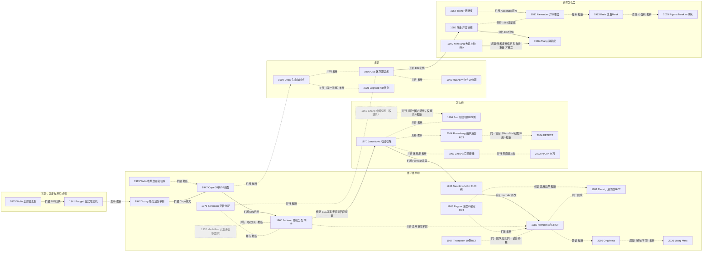

# D02 焦痂早期切除与自体皮移植

> **一句话判断**：这个方向研究三件事——烧伤坏死组织（焦痂）什么时候切、怎么切、切完怎样用患者自己的皮盖上；它从 1929–1947 年的个案和病例系列起步，1955–1989 年大面积烧伤中至少四项随机或交替分配试验里，死亡差异只在个别亚组出现，今天"手术清创加自体植皮"已被当作新疗法的对照背景（DETECT 2024 摘要），但"早"的执行率因国家而异（德国 72 小时内首次手术只占 44%）[D02-R08][D02-R02]。
> **对临床医生最重要的一点**：早切缩短住院的证据较一致；死亡获益在随机试验中只见于无吸入性损伤者——Herndon 1989 的 17–30 岁亚组（45% 对 9%）[D02-N14]，以及 Ong 2006 Meta（6 项 RCT，无吸入性损伤者 RR 0.36，95%CI 0.20–0.65）[D02-N18]。Ong 的纳入名单本轮未核，可能同时计入同团队的 Thompson 1987 与 Herndon 1989（重复计数）；Thompson 1987 认为类似差异可由两组年龄不同解释 [D02-N24]；近五年登记库与队列研究之间死亡结论相反（4.1）。

## 0 三分钟速读

1. **从哪里来**：1940 年代以前的常规是等焦痂自行分离，全层创面约 25 天后才能在肉芽上植皮（Cope 1947 p.1–2）。本轮找到的最早"立即切除+植皮"记录是 Wells 1929 的电接触烧伤 [D02-N02]，热力烧伤是 Young 1942 的单例 [D02-N04]；Cope 1947 的 38 例、52 个创面显示伤后拖得越久，植皮成活越差 [D02-N05]。
2. **为什么改变**：血浆复苏让大面积烧伤患者活过休克期，却在 1–3 个月内死于开放创面的败血症（Young 1942 [D02-N04]）。但转向并不顺利：伯明翰 1955–1957 年的随机分配试验没能证明早切降低死亡 [D02-N06]；此后切线切除（Janzekovic 1970，仅题录）[D02-N08] 与 MGH 1974–1984 年 1,103 例的历史对照（死亡率 24%→7%，但同期所有改进都混在"年份"里，且摘要与正文对面积构成变化的作用说法自相矛盾）[D02-N13] 被 Herndon 1989 引言串成一条线；本轮没有找到当年采纳率的数据。**这里有一段断档**：1990–2020 年早切怎样从争议做法变成常规（采纳率、指南推荐及其依据）没有追到，ISBI 2016 指南的切除时机推荐未读；只找到两次自报调查的摘要：2011 年欧洲 38 个烧伤中心称深度烧伤早期切除已是常规，2015 年美国烧伤协会问卷中 56% 的外科医生最早在伤后第 1 天切除（2.2 末、8.2）。
3. **如何分化**：分成三个问题各自分化。多早：伤后 24 小时、休克期、48 小时、72 小时或分期切除 [D02-N17][D02-N25]；怎么切：切到筋膜、切线切除、中国磨痂术、酶学清创、水刀 [D02-N08][D02-N27][D02-N19]；怎么盖：网状皮、异体皮覆盖、Meek、中国大张异体皮开窗嵌植与微粒皮 [D02-N07][D02-N10][D02-N16][D02-N09][D02-N12]。
4. **现在研究什么**：本轮检索到的近五年主题有七个——登记库比较手术时机（死亡结论相反：法国前瞻队列延迟切除 90 天死亡 aOR 2.3，日本 DPC 无差异）[D02-R06][D02-R03]；菠萝蛋白酶清创（DETECT：需手术切除 4% 对 72%）[D02-R08]；氨甲环酸止血；Meek 与网状皮随机比较；水刀；中国磨痂术；供区愈合（第 4 节）。
5. **用了什么数据**：早期是单例、病例系列和兔/大鼠实验；1955–1991 年是 24–149 例的随机或交替分配试验；1986 年起有机构级历史对照加 logistic 回归（1,103 例）；今天加上登记库和行政库（836–6,158 例）、多中心前瞻队列（448 例，AIPTW/TMLE）和同一患者内随机（第 7 节）。
6. **还有什么不知道**：大面积成人早切的随机证据自 1989 年后几乎空白，且同团队 1987 与 1989 两份报告是否来自同一试验待核；"早"的定义从 24 小时到 7 天不等；早切使脓毒症更多、无差异还是更少，各来源方向相反（5.1）；特大面积烧伤各种覆盖方式缺前瞻比较；中文原始文献未经中文数据库检索（第 8 节）。

**覆盖边界**：
- 纳入：焦痂从等待自然分离到早期手术切除（切痂、切线切除/削痂、磨痂）的转变及证据；手术时机与分期切除；切除术中失血控制；自体皮移植技术（全厚皮、中厚/刃厚皮、取皮机、网状皮、Meek）；供区不足对策（中国大张异体皮开窗嵌植、微粒皮、异体皮覆盖）；非手术/酶学清创（含失败路线）；水刀；供区愈合。
- 只点到为止：复苏与"休克期能否手术"（D01）；局部抗菌与创面感染（D04）；输血策略、器官功能、死亡风险（D07）；休克期切痂的代谢效应（D06）；手部与瘢痕远期结局（D09、D10）；昆山爆炸等批量伤（D12）；学科史（X01）。
- 不含：人工真皮、培养表皮、细胞喷雾、异种皮、免疫抑制下异体皮长期存活（D03）；晚期挛缩重建（D11）。

**本章口径**：
- 截止 2026-09-29；近期窗口 2021-09-29 至 2026-09-29，只用于第 4 节。Moussa 2021、Glaser 2021、Wong 2021、K S A 2022 的在线日期早于窗口起点、印刷日期在窗口起点附近，按窗口起点附近的研究处理。
- 阅读层级：L0=仅二手转述；L1=题录已在数据库核实；L2=摘要已读；L3=原文部分章节已读；L4=全文已读。只到 L0/L1 的写"据某来源转述"或"仅题录"。
- 核查状态：通过=题录与所引数字对照 PubMed 记录或原文扫描页核对一致；修正=核对后改正，正文用修正值；存疑=保留但证据自相矛盾或不足。N20–N27 与 R23、R24、E09 是后期补入的文献，成稿时对照 PubMed 题录和摘要核对一次，未经独立复核。
- 覆盖状态：**基本完整但有标注缺口**。理由：六个问题都能据本章回答；"要不要早切、多早、怎么切、怎么盖"四个分支和中国线都有摘要层级以上的节点；缺口限于第 8 节已标注的项目——Janzekovic 1970/1972、Tanner 1964、Meek 1958、Burke 1974 只到题录；CNKI/万方未检索；1990–2020 年早切成为常规的过程只有两次自报调查的摘要，ISBI 2016 切除时机推荐未读；近五年四个主题的补查起点未能按综述检索截止锚定，酶学清创在 2024-05-30 之后未系统补查原始 RCT（第 4 节开头）。1989 年后大面积成人随机证据空白是领域证据缺口（8.1），不是本报告的检索缺口。
- 节点 27 个：L4 1 个（N01）、L3 7 个（N02–N06、N13、N14）、L2 15 个、L1 4 个（N07、N08、N20、N21）。其中 N20、N21 只有题录，设计、样本、结果都未读，六要素缺，作为"待读线索节点"只标时间位置，不参与"谁最早""随机试验先后"等判断。近期代表研究 24 条（L2 23、L1 1）；入口综述/指南 11 条（L4 2、L3 1、L2 8；E03 与 N18 是同一篇）。全部 62 行见 `data/evidence_D02.json`。
- 引用写法：[D02-Nxx]=关键节点；[D02-Rxx]=近期代表研究；[D02-Exx]=入口综述/指南；只出现一两次的辅助文献直接给 PMID 或 DOI。

---

## 1 源头：最初在研究什么

**判断**：没有单一起点。"最早找到"只说明在本轮所查范围内（PubMed、Europe PMC 标题检索 1850–1945 年，PMC 扫描页）没有更早的；"公认奠基"是后来的综述或学科史把它当起点，两者不等价。1905 年 JAMA 已有一篇烧伤治疗与植皮的专文，内容未读，是否主张早期切除未知（第 8 节待核）。

| 主题 | 起点说法 | 分类 | 依据与限定 | 层级 |
|---|---|---|---|---|
| 急性烧伤焦痂立即切除+一期闭合（任何原因） | Wells 1929 [D02-N02] | 目前最早找到的文献；同时是作者自称首次 | p.1073 作者称此做法"文献未见报告"，并说明来自一战枪伤清创后一期闭合的原则；仅限边界清楚的电接触烧伤。更早的烧伤"切除"文献针对陈旧瘢痕（Wood 1863，PMID 20896211）或放射性损伤（Lockhart-Mummery 1928，PMID 19986379），不是急性焦痂；Paré、Hildanus 只见于 E01/E05 转述 | L3 |
| 热力烧伤早期切除+即刻植皮 | Young 1942 [D02-N04] | 目前最早找到的文献 | 本轮检索范围内无更早的热力烧伤临床报告；Cope 1947 p.2 把它列为前人尝试；Young 只切除"明确三度"区 | L3 |
| 切线切除 | Janzekovic 1970 [D02-N08] | 被公认的奠基工作 | "公认"见 Herndon 1989 p.547 引言与 E01 §6.1。更早已有"削除坏死层"个案：据 Cope 1947 p.3，蒙特利尔 Gerrie 在伤后第 12 天用锐刀削除后立即植皮。Janzekovic 的贡献是伤后数天内系统化削至出血层并立即植皮；原文付费墙 | L1 |
| 早期切除的随机分配 | Jackson 1960 [D02-N06] | 目前最早找到的随机分配记录 | p.170：1955–1957 年病例"以随机方式"分配。Herndon 1989 所说"此前无随机研究"限定在 >30%TBSA 成人与同等大面积人群（p.547、p.550），与之不直接矛盾。同期美国 MacMillan & Artz 1957–1958 有">25% 体表面积早切的计划评估"，设计未读 [D02-N20]（待读线索节点，仅题录，不参与"最早随机分配"的判断） | L3 |
| 网状皮 | Tanner 1964 [D02-N07] | 被公认的奠基工作 | 据 E01 §6.3，Lanz 1907 已有网状切皮原型；"首次"应理解为临床器械化与命名 | L1 |
| Meek 邮票皮 | Meek 1958 Am J Surg 96:557-8（PMID 13571547） | 目前最早找到的文献 | Kreis 1993 摘要写"1963 年首次描述"；PubMed 另有 Meek 1963 两篇（PMID 14056727、13934413）。1958 有原始题录，证据更强；Kreis 为何写 1963 原文未说明 | L1 |
| 大张异体皮开窗嵌植自体小皮片（中国） | 瑞金医院方案 [D02-N09] | 作者自称改良（有西方前身） | 1980 年 J Chir 摘要（PMID 7000806）自称此法较"Mowlem-Jackson 法"有很大改进，即作者自己把它定位为改良而非首创。西方前身：据 E01，Jackson 1954 的条状间植（16 例）由 Jackson 归功于 Mowlem；法国 Colson 1958 已报告自异体皮交替移植（Mowlem-Jackson）治疗大面积烧伤（PMID 13617695，仅题录）。E02 原文对瑞金方案的用词是"advocated"（提倡），"里程碑"的评价限定为"在中国"，且只来自这篇亲历者撰写的学科史（E02 引瑞金 1975 年专著）。最早可检索的外文报告为 1979 年 Chirurgie（PMID 119616） | L2 |
| 微粒皮移植 | Zhang ML 等 1986 年 4 月《中华外科杂志》24:219-21（PMID 3530665）[D02-N12] | 作者自称首次 | 同组英文版 Burns 1986 年 12 月；E02 讲"漂浮法"时引 Zhang 1987（PMID 3151574） | L1（中文版）/L2（英文版） |
| 休克期大面积切痂（中国） | Guo 1993/1995 [D02-N17] | 目前最早找到的以"休克期切痂"为题的报告 | 不是"首次在休克期切痂"：Jackson 1960 在伤后 4–18 小时切除 [D02-N06]，Sørensen 1976–1979 年在伤后 24 小时内切除 [D02-N22]。"休克期"时点在 Guo 原文约 24 小时，E02 写作伤后 2–3 天内。1983 年已有"早期切痂禁忌证"讨论（Liu & Sheng，PMID 6426876，仅题录） | L2 |
| 鼓式取皮机 | Padgett 1941 [D02-N03] | 作者自称首次 | p.1035 脚注称由作者构想、与 Hood 教授合作设计；年份有两说：E01 写 1937 年，Padgett 写自 1938 年 1 月采用；1939 年首篇描述未找到 | L3 |
| 菠萝蛋白酶烧伤清创 | Levine 等 1973 猪实验（PMID 4355066）；Levenson 1974 Ann Surg（PMID 4606330） | 目前最早找到的文献 | 同一课题组；Levenson 1974 摘要提到 Paraenzyme、Travase 此前有增加感染的报告。与今天 NexoBrid 的直接传承关系未核 | L2 |

**背景注释（植皮前史）**：游离皮片为什么能成活，在焦痂切除之前就已开始研究。Wolfe 1875 在同一患者身上做了三块前臂游离皮的对照：两块用白内障刀削去皮下疏松组织后愈合，未处理的一块第 4 天开始化脓、大部分丢失；作者据此主张"蒂不是必需的"[D02-N01]。Padgett 1941 的可校准取皮机让一次手术覆盖大面积成为可能：肉芽创面的平均单次覆盖面积由 89.6 cm² 增至 357 cm² [D02-N03]。这两个节点回答的是"怎么取皮、怎么让皮活"，而不是"焦痂何时切"。

**最初在研究什么**：能落到来源上的问题是两个。第一，焦痂能不能不等自然分离——Wells 1929 在电烧伤、Young 1942 在热力烧伤上给出示范 [D02-N02][D02-N04]。第二，切得越早是不是越好——Cope 1947 把伤后间隔与植皮成活、失血联系起来 [D02-N05]。

---

## 2 关键转折：问题—新证据/新方法—认识变化—新问题

按三个临床问题组织：要不要早切（2.1–2.2）、多早（2.3）、怎么切（2.4）、切完怎么盖（2.5）。

**使能条件（交叉，点到为止）**：早切要做得下去，患者要先活过休克期、术中失血要能补、术后感染要能控。本章材料能直接看到的只有三处：Young 1942 所说血浆复苏让患者活过休克期后死于创面败血症 [D02-N04]；Cope 1947 在人为推迟切除的病例中使用青霉素 [D02-N05]；Tompkins 1986 的"年份"项包含营养、ICU、抗菌等所有同期改进 [D02-N13]。复苏、感染和输血分别见 D01、D04、D07。

### 2.1 旧常规失效，早切从个案变成系列（1929–1947）

- **问题**：全层焦痂要等感染促成分离，约 25 天后才能在肉芽上植皮，广泛者拖延数月（Cope 1947 p.1–2）。Young 1942 的病例 1（55%）用鞣酸结痂加延迟植皮，第 30 天死于败血症 [D02-N04]。鞣酸被 Young 与 Cope 批评为损伤创面（Cope 1947 p.1）。
- **新方法**：Wells 1929 在电接触烧伤中整块切除焦痂后一期缝合或立即植皮，第二例伤后恰 8 周返工；但第二例在首次手术后第 20 天还往肉芽创面补植了约 140 块小深皮片，并非全程即刻闭合 [D02-N02]。Young 1942 在 1 例 11 岁、8–10% 背部烧伤男孩伤后数小时内（Cope 转述为 3.5 小时）切除明确三度区、取 0.010 英寸皮片覆盖，第 14 天首次换药已全部上皮化 [D02-N04]。
- **新证据**：Cope 1947 在 MGH 系统化为 38 例、52 个全层创面（热力、化学、电烧伤都有）：成活率随伤后至手术间隔延长而下降，失败区都有活动性感染；48 小时内切除只需结扎少数动脉，之后切入炎症层出血汹涌，广泛切除失血最多 1,750 ml [D02-N05]。"一半创面成活 ≥95%"（p.12）未经独立复核。
- **认识变化**：焦痂可以不等分离；时间窗和失血这两个后来的核心问题第一次写清。Cope 认为外科医生不愿早切，是因为怕失血、以为游离皮只能长在肉芽上 [D02-N05]。关系：Cope 明确把 Young 列为前人（原文 p.2）；Wells→Cope 只见参考文献表，属本报告推断。
- **新问题**：大面积烧伤能不能在伤后当天切？切了能不能降低死亡？

### 2.2 要不要早切：随机试验给出不一致的答案（1955–2006）

**第一轮：可行但未证实获益（1950–1970 年代）**。
- Jackson 1960 在伯明翰把 1955 年 1 月至 1957 年 2 月的病例按年龄和全层缺损面积分组，"以随机方式"分配到当日切除植皮或 2–3 周植皮；<55 岁者当日切除 13 例、延迟 11 例；手术在伤后 4–18 小时（平均略超过 9 小时）。结论：20–30% 体表面积可在伤后当天切除而不增加死亡风险，但平均植皮成活仅约 70%，降低死亡、减少感染、缩短愈合三项目标都没有证实；试验中途中断，作者建议只在有研究条件的单位开展 [D02-N06]。E01 对这项试验的描述（更早获得成活与闭合）比原文乐观，两说并存。
- 同期美国 MacMillan & Artz 1957、MacMillan 1958 做了">25% 体表面积早期切除的计划评估"，设计和结果未读 [D02-N20]。这是待读线索节点（仅题录），是否为对照试验未知，不据此比较随机试验先后。
- 竞争范式是暴露疗法。哥本哈根 Sørensen 1979 报告：1962–1971 年用暴露疗法治疗 2,460 例，结果满意但有明确上限，于是 1972–1975 年对极重患者做急性切除；1976 年 5 月起按入院单双号交替分配伤后 24 小时内切除与暴露疗法（准随机），中期报告两组死亡率相同。1984 年终报：1976–1979 年入院 570 例中 421 例不适合纳入，急性切除 73 例（休克期）、暴露至第 14 天 76 例；摘要被截断，死亡率数字未读 [D02-N22]。
- E01 §6.1 称 Jackson 之后早切"动力不足"，直到 Janzekovic 1970 改变局面。这是综述叙事，本轮没有找到 Janzekovic 直接回应 Jackson 的证据 [D02-N06][D02-N08]。

**第二轮：机构级历史对照（1974–1988）**。Burke 1974 在 MGH 建立"及时焦痂切除+立即闭合"体系（方法报告，PMID 4596096，仅题录）。Tompkins 1986 分析 1974 年 7 月至 1984 年 1 月连续入院 1,103 例：总死亡率由 1974 年的 24% 降至 1979–1984 年平均 7%，住院日由 32 天降至 22 天；logistic 回归中年份项 p<0.001；50 岁、50% 体表面积患者的生存概率由 56% 升至 76% [D02-N13]。两点限制：年份项包含同期所有改进，不能单独归因于切除；摘要称改善与烧伤面积等构成变化无关，正文 p.274 却写平均 %BSA 由 32% 显著降至 16% 且"可部分解释"死亡下降，文内自相矛盾。同一团队在 Shriners Boston 儿童中报告死亡率由 9% 降至 1%（Tompkins 1988，PMID 3190284），那是不同人群，不是同一队列。本轮没有 1970–1980 年代的采纳率或实践调查数据，因此不写"推动美国烧伤中心采纳"（此后的情况见本节末"从争议到常规"）。

**第三轮：小面积与大面积的随机试验（1983–1991）**。
- 小面积、深度不确定：Engrav 1983（西雅图，47 例，<20%TBSA）早切组住院更短、费用更低，但用血和手术室资源更多，未增加并发症；远期重建需求无差异，非手术组晚期植皮与增生性瘢痕更多 [D02-N11]。Desai 1991（Galveston，24 例儿童烫伤）结论相反：延迟 2 周组切除面积更小、一半最终不需手术 [D02-N15]。
- 大面积成人：Galveston 团队有两份随机报告。**Thompson 1987**：1983 年 12 月至 1986 年 1 月 50 例 ≥30%TBSA 成人随机分配，两组烧伤面积相近但年龄不同；>50%TBSA、无吸入性损伤组早切死亡较低，作者认为"可完全由年龄差异解释"；住院日、用血和其他组死亡率均无差异 [D02-N24]。**Herndon 1989**：1982–1988 年，按有无吸入性损伤预分层后用随机数表分配，72 小时内切至筋膜+4:1 网状自体皮+2:1 异体皮覆盖，对照为每日浸浴、外用抗菌药、21–24 天后分次植皮。17–30 岁、无吸入性损伤亚组死亡率保守组 45%（n=11）对早切组 9%（n=22），p<0.025；31–55 岁无吸入 75% 对 57%、有吸入各组均无显著差异；早切组血容量周转 2.1±2.2，保守组 0.7±0.6 [D02-N14]。
- 两份报告的关系：入组期重叠、作者重合，Herndon 1989 的参考文献表没有列 Thompson 1987；是否为同一试验的中期与终期报告，本轮未核实。Herndon 1989 的成人人数在摘要（85）、Methods（早切 44、保守 38）和 Table 2（44、40）三处不一致。作者在 p.551 自己写明：没有比较长期功能的同期随机研究，不能据此教条地支持更激进的做法，需要更大样本；并报告 1977–1981 年 32 例连续清创（平均 70%）对 1981–1984 年 32 例全部早切，死亡无差异（历史对照）。p.552 讨论中 Monafo 指出脓毒症发生率无差异、只有年轻无吸入的小亚组有差 [D02-N14]。p.547 还提到此前与匹配历史对照比较的儿童报告未显示明确死亡差异。
- **汇总**：Ong 2006 Meta 从 15 项 RCT 中纳入 6 项，死亡率降低只见于无吸入性损伤者（RR 0.36，95%CI 0.20–0.65），住院日缩短 8.89 天，早切组输血更多 [D02-N18]。纳入的 6 项名单本轮未读，是否同时纳入 Thompson 1987 与 Herndon 1989（可能重复计数）未知。第二轮用 OpenAlex 提取的 Ong 2006 参考文献表（题录层面，L1）同时列有 Thompson 1987 与 Herndon 1989，另有同团队的 Herndon 1986（PMID 3511266，仅题录）；参考文献表不等于纳入名单，6 项纳入名单仍未核，重复计数的可能不能排除。
- **认识变化**：早切缩短住院较一致；死亡获益只在亚组出现，且同团队两份报告的解释方向不同。关系：Tompkins→Herndon 为验证（Herndon p.550 称结果"平行"）；Jackson 与 Herndon 是适用范围不同的并行试验。

**此后：从争议到常规（1990–2020，过程未追到）**。1989 年以后早切怎样从有争议的做法变成常规、再变成新疗法的对照背景（DETECT，4.2），本轮没有追到过程数据：各时期采纳率、指南推荐及其依据都缺；ISBI 2016 指南的切除时机推荐未读（第二轮经 OpenAlex 查询为非开放获取）。第二轮补查只找到两次横断面自报调查，都只读了摘要（L2）：
- 2011 年欧洲 17 国 38 个烧伤中心问卷：深度烧伤早期切除"已是各中心常规"，摘要未给百分比（Rousseau 2014，PMID 24419142）。
- 2015 年 7–8 月发给美国烧伤协会 607 名烧伤外科医生的 71 项问卷（应答率 24%）：56% 最早在伤后第 1 天切除，73% 一次切除超过 20%TBSA；地区、专科认证和病床数都与做法差异有关（Israel 2017，PMID 27893575）。

这两项是医生或中心的自报做法，不是实际执行率；德国登记库实测 72 小时内首次手术只占 44% [D02-R02]。从争议到常规的过程及其依据仍列为检索缺口（8.2）。

### 2.3 多早：时间窗、失血与分期切除（1947–1999）

- **失血与时间**：Cope 1947 已观察到 48 小时内切除出血少 [D02-N05]。Desai 1990 用 Galveston 1982–1989 年 594 例儿童近全切除的数据定量：>30%TBSA 者伤后 24 小时内切除失血 0.40 ml/cm²、第 16 天以后 0.49 ml/cm²，都低于第 2–16 天的 0.75 ml/cm² [D02-N25]。这是儿童数据，且"很晚切"同样出血少；它与 Herndon 1989 的儿童组（259 例，1982–1988）部分重叠。
- **中国的休克期切痂**：解放军 304 医院（后称解放军总医院第一附属医院，PMID 27338528 单位字段写"Formerly 304th Hospital of PLA"）Guo 1995 报告 A 组 21 例（总面积 63.2±18.1%、全层 35.9±19.6%）在伤后 24.1±13.9 小时首次切痂，切痂面积 32.3±6.7%，15 例用 Swan-Ganz 监测血流动力学稳定；与伤后 4–5 天切痂的 B 组 29 例比较，愈合时间 33.1 对 40.1 天，前 2 周输血少约 700 ml [D02-N17]。几处要注意：分组方式摘要未说明；切痂面积范围 Burns 版写 24–96%，Chin Med J 版与 1993 年中文版写 24%–46%；1993 年中文版对照组同为 29 例，可能重复使用同一对照组，且输血差写作约 1,000 ml。中国的贡献是在特大面积烧伤中于休克期一次切除大面积焦痂并做血流动力学监测，而不是首次在休克期切痂（见第 1 节）。
- **一次切还是分期切**：重庆第三军医大学 Huang Y 1999 比较一次性早期大面积切痂（35 例）与分期多次切痂（25 例）[D02-N26]。Herndon 1989 讨论中 Baker 描述第 1、3、5 天各切约 20% 的分期方案；p.551 的 32 对 32 例历史对照死亡无差异 [D02-N14]。今天 Moussa 2021 认为延至 72 小时对部分患者合理 [D02-R01]，与这条路线相呼应。
- **新问题**：24 小时、48 小时、72 小时哪条线真正有意义；"早"的获益是否被早切组更多的脓毒症抵消（见 4.1；各来源方向相反，见 5.1"早切与感染/脓毒症"）。

### 2.4 怎么切：保留多少真皮（1970–今）

四条路线都以保留有活力真皮为目标，本轮没有找到它们之间的直接比较。

- **切线切除**：Janzekovic 1970 把"切到筋膜"改为伤后数天内逐层削至出血层并立即植皮。据 E01 §6.1 转述，1970 与 1972 两文合计 2,615 例，≤20%TBSA 者可在 10 天内愈合；原文付费墙，未核 [D02-N08]。Groves & Lawrence 1971 做了动物实验（PMID 4940075，仅题录）。中国 Chang 1962《大面积烧伤的焦痂切除》发表早于 Janzekovic [D02-N21]，但这是待读线索节点（仅题录），切除方式是否为切线切除未知；Sun YH 等 1984 报告 13 年 627 例切线切除经验，作者与积水潭微粒皮报告部分重叠 [D02-N23]。中西两条线在时间上并行，本轮没有两者互相引用的证据。
- **磨痂术（中国）**：中华医学会烧伤外科学分会 2021 年共识把磨痂术列为"烧伤外科三大清创术式之一"，适用于以深Ⅱ度为主的新鲜创面，并指出各单位在时机、器具、步骤上差异大 [D02-E09]。Zhou 2003 在休克期磨痂（首次手术伤后 12.3±10.7 小时）对比常规削痂（47.2±11.5 小时），单次处理面积约 65%，磨痂组愈合约快 10 天；摘要称 50 例随机分组，两组人数却是 30+25，**存疑** [D02-N27]。
- **酶学清创**：化学/酶学清创自二战起多次尝试，结果高度不稳定（Klasen 2000 [D02-E07]）；丙酮酸法（Connor & Harvey 1946，PMID 17858879，仅题录）被 Cope 1947 p.21 批评为以时间换失血；Levenson 1974 摘要提到 Travase 等有增加感染的报告。Rosenberg 2014 多中心开放标签 RCT（4–55 岁、5–30%TBSA）中，NexoBrid 组伤后至完全清创 2.2 对 8.7 天，需手术 24.5% 对 70.0%，需自体植皮 17.9% 对 34.1%（P=0.01），瘢痕与生活质量相近；总样本量摘要未给出 [D02-N19]。
- **水刀**：Cochrane 2020 只找到 1 项儿童 RCT（61 例），证据确定性极低 [D02-E10]；2022 年 HyCon 试验见 4.5。

### 2.5 切完怎么盖：供区不足的几条路（1954–1993）

- **网状皮**：Tanner、Vandeput 1964 在 Grady Memorial Hospital 制成网状切皮器；据 E01 §6.3 转述可扩展 1:3，并首次用"meshed graft"一词 [D02-N07]。Alexander 1981 指出 3:1 已普及、6:1 以上易丢失，于是在宽网自体皮上覆盖网状冷冻异体皮：14 例（烧伤面积 25–98%）、22 次植皮，自体皮平均成活 99%、异体皮 95%，异体皮约 14 天丢失一半且不伴急性炎症，3 例因创面脓毒症丢失皮片 [D02-N10]。Herndon 1989 早切组采用同类"4:1 自体+2:1 异体"覆盖 [D02-N14]。
- **Meek**：据 E01 §6.3，Meek-Wall 取皮机（1958）因昂贵、操作繁琐未普及。Kreis 1993 用预折叠纱布做 1:9 扩展，1 周后加盖甘油保存异体皮：10 例、16 次手术，5 周内平均上皮化 90%（70–100%）[D02-N16]。
- **中国大张异体皮开窗嵌植**：瑞金医院在大面积全层切痂后覆盖打洞异体皮、洞内嵌植自体小皮片。1980 年法文摘要称此法较 Mowlem-Jackson 法"有很大改进"，在三度面积达 90% 者获成功 [D02-N09]，即作者自称改良，西方前身见第 1 节；据 E02 转述，1971 年救治 10 例 >90%TBSA（全层 >70%）患者，E02 称这是"中国"大面积深度烧伤治疗的里程碑（亲历者评价，只来自 E02），但方法费时费力。
- **微粒皮**：E02 称瑞金方法几年后积水潭发展"漂浮法"以省工，并很快全国推广。Zhang ML 等最早的中文报告为 1986 年 4 月；英文版中兔 12 只 8 只完全覆盖（扩展 7:1–15:1），临床 8 例 7 例成活；1988 年续报 17 例全部存活，41 个部位中 12.2% 未成活 [D02-N12]。
- **中西之间**：1981 年两种"异体皮保护下高倍扩展自体皮"是否互相影响，没有证据。1990 年有两项大鼠研究，都出自 Cincinnati Shriners 的中美合作组，与微粒皮原团队有作者重叠（Fang CH 是张明良 1988 年 J Trauma 微粒皮报告的合作者；Yu GS 与 Fang CH、Alexander JW 同为 1988 年北京微粒皮临床报告的作者，见 X01-N23），不是独立验证：Yeh 1990（PMID 2373729）比较的是微粒皮与中国式自异体皮间植（10:1 扩展），中国式间植的瘢痕挛缩较少；Fang 1990（PMID 2383359）比较的是微粒皮加异体皮覆盖与整张同系皮，微粒皮组挛缩更重（数字见 X01-N26）。两项研究的挛缩信号都指向微粒皮，但都是动物实验、同一合作组。德国 Bäumer 1985 也做过冷冻异体/自体混合全厚皮移植（PMID 3910982，仅题录）。
- **新问题**：特大面积时哪种扩展方式成活和瘢痕更好——至今只有小面积随机比较（4.4）。

---

## 3 分支图

图例：实线=原文明确讨论或综述归纳的关系；虚线=本报告推断；边上写关系类型。节点为"年份 简称"；Y90 为辅助文献（Yeh 1990 与 Fang 1990 两项大鼠研究，与微粒皮原团队有作者重叠），未单列节点。灰色虚框、标"（仅题录）"的 N20、N21 是待读线索节点：只有题录，六要素缺，连线只表示时间上并行，不参与"谁最早""随机试验先后"等判断。

---

## 4 近五年重点（2021-09-29 至 2026-09-29）

以下是本轮检索到的七个主题，不代表"主线"排序。窗口内题录数见 E 表 D02 行（PubMed 近期窗口 1,337 条，查询日 2026-09-29，检索式见 E0 所指 `scripts/queries.py`）；七个主题各自没有单独计数。

各主题的补查起点（能按入口综述或 Meta 的检索截止锚定的写日期，不能锚定的写明）：

| 主题 | 锚定用的综述/Meta 及其检索截止 | 补查起点 |
|---|---|---|
| 4.1 手术时机 | E04 Wang 2026：摘要只给纳入文献的发表窗口（2010-01-01 至 2024-03-11），未给检索日期（第二轮经 Europe PMC 确认无开放全文）；E11 Wong 2021：纳入 1990–2017 年文献 | 补查起点未能按综述检索截止锚定；登记库/队列研究按近期窗口起点 2021-09-29 检索 |
| 4.2 酶学清创 | R10 De Freitas 2025：检索至 2024-05-30；R11 Sacasa 2026 的检索截止本章证据表未记录 | 可锚定在 2024-05-30；本轮在此日期之后只做了 2021–2026 年系统综述/Meta 题名检索和按试验名、作者的检索，没有按该日期系统补查原始 RCT（未补查） |
| 4.3 氨甲环酸 | R14 Slob 2024：本章证据表未记录检索截止 | 补查起点未能按综述检索截止锚定；RCT 与 Meta 检索未加日期限制 |
| 4.4 自体皮扩展方式 | E06 Rijpma 2022：检索至 2021 年（月份未说明） | 锚定在 2021 年；Meek 对网状皮的检索未加日期限制，覆盖 2021 年以后 |
| 4.5 水刀 | E10 Cochrane 2020：检索至 2019-12 | 锚定在 2019-12；水刀检索未加日期限制，覆盖此后 |
| 4.6 磨痂 | E09 2021 共识：未说明检索截止 | 补查起点未能按综述检索截止锚定；R23、R24 为复审后补入 |
| 4.7 供区愈合 | 无入口综述 | 补查起点未能按综述检索截止锚定；按近期窗口起点 2021-09-29 检索 |

### 4.1 手术时机与死亡率

- **研究什么**：首次切除在伤后 24/48/72 小时内与更晚相比，对死亡、ICU 住院、感染的影响；早切的实际执行率。
- **数据与设计**：登记库、行政库、联邦化电子病历网络的倾向评分匹配；多中心前瞻观察加 AIPTW/TMLE；群体伤队列；Meta。
- **代表研究**：
  - BRANZ 836 例（≥20%TBSA，24 小时为界）：只在 20–29% 亚组 ICU 住院 6.6 对 9.2 天、通气时间更短，其余无差异 [D02-R01]。
  - 德国烧伤登记 1,494 例：72 小时内首次手术仅 44%，周日至周三入院者更易早切（51.5% 对 37.3%）；早切住院中位 18 对 21 天，校正后死亡相当 [D02-R02]。
  - 日本 DPC 2,362 例、匹配 389 对（入院 2 天内对 3–7 天）：院内死亡 15.9% 对 17.2%（p=0.70）[D02-R03]。
  - 美国 ACS TQIP 2,270 例（48 小时内对 48–120 小时）：早切住院与 ICU 更短、DVT/PE/VAP/CAUTI 更少，死亡无差异 [D02-R04]。
  - TriNetX 6,158 例：伤后 0–3 天切除死亡 3.84%，8–14 天 6.09% [D02-R05]。
  - 法国 6 中心前瞻队列 448 例（>20%TBSA，48 小时为界，早切 90、延迟 358）：延迟切除 90 天死亡 aOR 2.3（1.2–4.1）、ICU 死亡 aOR 3.1；但早切组脓毒症/感染性休克更多（53% 对 32%）[D02-R06]。
  - 昆山 2014 年铝粉尘爆炸 185 例 ≥70%TBSA（外部验证 144 例）：首次切痂 >3 天 HR 2.37、切痂面积 >48% HR 2.41 [D02-R07]。这篇与 D07-R19/R20 为同一团队、同一队列；144 例长海验证队列可能与昆山伤员重叠（未核），不作为独立验证。
- **分歧**：原始研究中 R05–R07 显示早切与更低死亡相关（R07 与 D07-R19/R20 同源，合计只算一个证据来源），R01–R04 无死亡差异。汇总层面 Wang 2026 Meta（10 项、5,070 例，纳入 2010 年至 2024-03-11 发表的研究）死亡风险差 −0.01、I²=79% [D02-E04]，Wong 2021（16 项，1990–2017 年英文文献，NOS 评质量）在高、低收入国家都是晚切组死亡更低、作者自称无法下结论 [D02-E11]。Wang 2026 可能纳入了 R01–R04，本轮未核对纳入名单，因此汇总与原始研究不应当作独立证据相加。"早"的定义从 24 小时到 7 天不等（E05 把早切定义为伤后 24 小时至约 7 天 [D02-E05]），是分歧的主要来源之一。
- **成熟度**：发展中。住院日缩短较一致；死亡获益与最佳时点未定。

### 4.2 菠萝蛋白酶类选择性酶学清创

- **研究什么**：能否减少切线切除、自体植皮与失血，远期瘢痕是否非劣。
- **数据与设计**：企业相关多中心 RCT（成人含安慰剂基质臂，儿童开放标签）、Meta。
- **代表研究**：DETECT（3–30%TBSA，175 例，3:3:1）完全清创 93% 对安慰剂 4%，需手术切除 4% 对标准治疗 72%，清创失血 14±512 对 814±1,020 ml，12 与 24 个月 MVSS 非劣 [D02-R08]。儿童 RCT（36 中心、145 例）完全清创中位 1 对 6 天，手术切除面积 1.5% 对 48.1%，12 个月 MVSS 非劣 [D02-R09]。De Freitas 2025 Meta（7 项、484 例）手术切除 RR 0.17、自体植皮 RR 0.40，创面闭合时间 MD −7.64 天但 CI 跨 0，I² 70–86% [D02-R10]；Sacasa 2026 RCT Meta（4 项进入主分析、336 例）手术切除 RR 0.11（0.06–0.23），开放标签是主要偏倚来源 [D02-R11]。两篇 Meta 的纳入研究大概率与 R08、R09、N19 重叠。
- **分歧**：随机证据集中在 ≤30%TBSA、早期治疗的患者；对照组"标准治疗"混合手术与非手术；闭合时间是否受影响不确定；大面积危重患者、成本效益缺数据。历史上酶学清创多次失败（2.4），当前证据是否足以扭转这一经验仍需大面积数据。
- **成熟度**：发展中；小面积早期患者"减少手术"已较一致。

### 4.3 切除术中失血：氨甲环酸与输血策略

- **代表研究**：K S A 2022 单中心双盲 RCT（30 例，<30% 深二度切线切除，TXA 15 mg/kg）每 cm² 失血差 0.28 ml，总失血 258.7 对 388.1 ml（p=0.07），无患者需要输血 [D02-R12]。Naderi 2025 双盲 RCT（94 例，>20%TBSA）失血、输液、手术时间、住院日、输血均减少，但 TXA 组植皮成活较低 [D02-R13]。Slob 2024 Meta（5 项、303 例）：中等证据显示单位面积失血与红细胞输注减少，两项 RCT 合并总失血未达显著 [D02-R14]。多中心双盲 TRANEX 试验仍在方案阶段 [D02-R15]。
- **交叉（D07）**：窗口前的输血策略随机证据——TRIBE 多中心 RCT 345 例 ≥20%TBSA，限制性（Hb<7）对开放性（Hb<10）输血，用血更少、死亡与感染无差异（Palmieri 2019，PMID 30371811）；儿童 >20%TBSA 切痂术中红细胞:血浆 4:1 对 1:1 随机比较 45 例（Galganski 2017，PMID 27893574）。
- **分歧与成熟度**：单个 RCT 小、终点（每 cm² 失血、总失血、输血）不统一；Naderi 2025 的植皮成活信号需更大试验确认。发展中。

### 4.4 自体皮扩展方式的比较

- **代表研究**：Rijpma 2025 两中心患者内 RCT（70 例，平均 TBSA 10±10%，扩展 1:2 与 1:3）成活率 Meek 79±25% 对网状皮 87±19%（p=0.003），3 个月多数 POSAS 项目网状皮更好，1:3 组的患者偏好与供区面积有利于 Meek（该文有勘误）[D02-R16]。Rijpma 2022 综述（1958–2021 年 15 篇、310 例，平均 56%TBSA）加权成活率 82±7%，多为低质量研究 [D02-E06]。中国 Ji 2025 单中心回顾性比较残余创面 74 例：混合移植、微粒皮、Meek 愈合率 89%、66.5%、75.4%（P<0.001）；1–2 年 VSS 混合组低于微粒皮组；但三组扩展比不同（混合 1:9–16，Meek 1:4–6）[D02-R17]。2019 年中华医学会烧伤外科学分会 MEEK 协作组发布操作规范，称该技术引入中国已 10 余年（PMID 31474033）。
- **分歧与成熟度**：RCT 只覆盖小面积、低扩展比，不能外推到特大面积；中国比较多为回顾性。发展中。

### 4.5 水刀

- **代表研究**：HyCon 多中心双盲患者内 RCT（137 例，水刀对 Weck 刀）12 个月 POSAS 观察者总分 2.42 对 2.54（P=0.023），组织学保留更多真皮（P<0.001），并发症无差异 [D02-R18]。de Cesaro Schpchacki 2026 Meta（8 项比较研究、2,130 例）愈合快 3.77 天，Hb 变化、手术时间、费用无差异，TBSA 越大获益越大（meta 回归 p=0.003）[D02-R19]。
- **分歧与成熟度**：Cochrane 2020 证据确定性极低 [D02-E10]；HyCon 的瘢痕差约 0.1 分，临床意义待判断。发展中。

### 4.6 中国磨痂术与术后处理

- **代表研究**：Shang 2021 前瞻性 RCT（168 例，84 对 84，入组 2015–2019 年）两组都先做磨痂/削痂，再比较术后是否加用水凝胶敷料 [D02-R23]。Shen 2024 儿童深Ⅱ度 RCT（贵阳单中心，入组 2021 年 6 月至 2022 年 12 月，随机 78 例、1 例随访脱落，纳入分析 77 例：38 对 39）在伤后 48 小时内磨痂联合银离子泡沫敷料，对照为伤后 48 小时内消毒后单用泡沫敷料。换药时 FLACC 疼痛评分中位 3.5 对 6.0 分，换药次数中位 3 对 8 次，愈合时间 19±5 对 25±6 天，愈合后 6 个月 VSS 中位 5 对 7 分（均 P<0.05），两组均未发生创面水肿、积液或周边皮疹过敏 [D02-R24]。两组换药间隔按方案本就不同（联合组 7 天 1 次、对照组 2–3 天 1 次），换药次数的差异部分来自方案本身；摘要未说明评估者是否设盲（第二轮读中英文摘要，L2）。
- **分歧与成熟度**：研究多为单中心，对照是"磨痂+某敷料"对"某敷料"（Shen 2024 的对照组只做创面消毒、不磨痂），没有磨痂与切线切除、水刀、酶学清创的直接比较；2021 共识本身承认各单位做法差异大 [D02-E09]。早期线索。

### 4.7 供区愈合

- **代表研究**：García-Sánchez 2022 患者内 RCT（20 例、60 个供区）第 8 天完全上皮化 PRP 55%、PRGF 45%、水胶体 20%（PRGF 对水胶体 p=0.036）[D02-R20]。Cussons 2024 RCT（40 例 >65 岁，皮肤癌切除后植皮，非烧伤）Suprathel 对 Hypafix 愈合 31.7 对 27.3 天（p=0.182）[D02-R21]。Colclough 2024 烧伤患者供区局部 TXA（25 mg/mL）对安慰剂：出血与再上皮化时间主分析均无显著差异，事后亚组支持 TXA，使用肿胀液可能影响终点 [D02-R22]。
- **分歧与成熟度**：研究对象常混入非烧伤患者，终点与敷料分散。早期线索。

---

## 5 争议、负性结果与停滞路线

### 5.1 仍在争的问题（原始研究与汇总分层列出）

| 争议 | 原始研究 | 汇总（与原始研究可能重叠） | 现状 |
|---|---|---|---|
| 早切是否降低死亡 | 支持：Herndon 1989 仅 17–30 岁无吸入亚组 [D02-N14]；Tompkins 1986 历史对照（年份项混入同期所有改进；摘要与正文对 %BSA 作用的说法自相矛盾）[D02-N13]；R05、R06、R07（R07 与 D07-R19/R20 同一队列，计一个来源，外部验证不独立）。不支持或不确定：Jackson 1960 [D02-N06]；Sørensen 1979 中期死亡率相同 [D02-N22]；Thompson 1987 差异由年龄解释 [D02-N24]；Herndon 1989 其他亚组；R01–R04 | Ong 2006 无吸入者 RR 0.36 [D02-N18]（是否同时纳入 N14 与 N24 未知）；Wang 2026 RD −0.01 [D02-E04]；Wong 2021 晚切组死亡更低 [D02-E11] | 未解决；随人群、年代、"早"的定义和混杂控制方式而变 |
| "早"到底多早 | 越早越好：Desai 1990（儿童 24 小时内失血最少，但 16 天后也少）[D02-N25]；Guo 1995 [D02-N17]；R06（48 小时）；R07（>3 天 HR 2.37）。可放宽：R01（72 小时可接受）；R03（2 天内无死亡差异）；分期切除 32 对 32 例死亡无差异（Herndon 1989 p.551，历史对照）[D02-N14] | — | 未解决；均为观察性或非随机；R06 早切组脓毒症更多 |
| 早切与感染/脓毒症 | 更多：Legrand 2026 法国 6 中心前瞻观察队列，48 小时内早切组脓毒症/感染性休克 53% 对 32%，原因未解释，非随机设计不能排除指征混杂 [D02-R06]。无差异：Herndon 1989 随机试验，p.552 讨论中 Monafo 指出两组脓毒症发生率无差异 [D02-N14]；Jackson 1960 随机分配未证实减少感染 [D02-N06]。更少：Hart 2003（见 D06-S30）儿童按转入时间分组的队列，早切加积极肠内喂养减少创面定植与脓毒症，属组合干预，不能单独归因于早切 | Pruitt & McManus 1992 综述判断：局部化疗、及时切痂和闭合共同使侵袭性创面感染及相关死亡下降，各项贡献分不开（见 D04-E03、D07-N23） | 未决；方向相反（更多/无差异/更少），设计不同（前瞻观察队列、随机试验的讨论记录、组合干预队列、叙述性综述），不能直接合并 |
| 深度不确定烧伤（儿童烫伤）是否早切 | Engrav 1983 支持早切 [D02-N11]；Desai 1991 支持延迟 [D02-N15] | — | 按人群分化；深度判断是前提 |
| 手部深度烧伤是否早切 | Goodwin 1983（164 只手）早晚切除对功能均无优势，三度手早切有更差趋势（PMID 6345800）；Mohammadi 2011 RCT 50 例功能、瘢痕、满意度无差异（PMID 20537468）；Omar 2011 RCT 40 例 TAM、握力、Jebsen-Taylor 有利于早切（PMID 21276660）；Ayaz 2019 双盲 RCT 50 例术后早期功能更好、1 与 3 个月无差异，早切住院更短、费用更低（PMID 30875425） | — | 三项手部 RCT 结论不一致 |
| 资源受限地区是否早切 | Saaiq 2012 巴基斯坦 120 例（伤后 4–7 天对 1–4 周），摘要称早切组培养阳性率、成活、住院与死亡更优，分配方式未说明（PMID 23467391）；Puri 2016 印度 20 例（每组 10 例）比较失血、输血、成活、住院日（PMID 23816999） | Wong 2021 认为资源差异使结论无法确定 [D02-E11] | 证据少且质量低 |
| 酶学清创能否取代手术 | N19、R08、R09 | R10、R11 | 小面积早期患者"减少手术"较一致；大面积与成本效益不足 |
| 特大面积用哪种扩展方式 | Alexander 1981、Kreis 1993、瑞金、积水潭；Yeh 1990 大鼠间植挛缩少于微粒皮、Fang 1990 大鼠微粒皮加异体覆盖挛缩多于整张同系皮（同一中美合作组，与微粒皮原团队有作者重叠，非独立验证）；R16（小面积网状皮优于 Meek）；R17（回顾性，混合移植优于微粒皮与 Meek） | E06（低质量） | 未解决 |
| 谁做了第一个早切随机试验 | Jackson 1960 是本轮找到的最早随机分配记录 [D02-N06]；Herndon 1989 的"此前无随机研究"限定在 >30%TBSA 成人与同等大面积人群；Sørensen 1976 起为交替分配 [D02-N22]；Thompson 1987 早于 Herndon 1989 发表 [D02-N24] | — | 按定义不同各自成立，不构成直接冲突 |

**来源间数字矛盾（保留两说，未裁定）**：Jackson 1960 卷号 E01 写 250，PubMed 与扫描页为 152；Guo 1995 切痂面积范围 24–96%（Burns）与 24%–46%（Chin Med J、1993 中文版）；Herndon 1989 成人数 85 / 44+38 / 44+40；Meek 首报 1958（题录）与 1963（Kreis）；E01 中 George Pollock 生卒年两处不同，Krause 同段先写 1896 后写 1893；Padgett 取皮机 1937（E01）与 1938 年 1 月（Padgett）；Wolfe 的报告 E01 标为 1874 年，BMJ 刊出为 1875-09-18；"休克期切痂"时点 Guo 约 24 小时、E02 写 2–3 天内；Tompkins 1986 摘要与正文对 %BSA 变化作用的说法不一。

### 5.2 负性结果、失败路线与停滞

| 路线 | 发生了什么 | 依据 |
|---|---|---|
| 等焦痂自然分离后在肉芽上植皮 | 大面积患者活过休克期后在 1–3 个月内死于消瘦、败血症 | Young 1942 病例 1 [D02-N04]；Cope 1947 p.1–2 [D02-N05] |
| 鞣酸结痂 | 被批评为损伤创面；E02 记载 1930 年代中国同样用鞣酸、硝酸银 | Cope 1947 p.1；Young 1942 p.446；E02 |
| 暴露疗法 | 2,460 例经验显示有明确上限，1972–1975 年对极重患者改做急性切除；1976–1979 年与急性切除交替比较，中期死亡率相同 | Sørensen 1979/1984 [D02-N22] |
| 伤后当日大面积切除（伯明翰） | 可行但未证明降低死亡、感染或缩短愈合；植皮成活约 70%；两期法（先切后植）未增加植皮面积且可能增加败血症风险；试验中断 | Jackson 1960 pp.186–188 [D02-N06] |
| 早期化学/酶学清创（丙酮酸、Travase 等） | 结果高度不稳定，未成为常规；Travase 有增加感染的报告 | Connor & Harvey 1946（PMID 17858879）；Levenson 1974 摘要；Klasen 2000 [D02-E07] |
| 一律早切儿童烫伤 | 延迟组一半不需手术、切除面积更小 | Desai 1991 [D02-N15] |
| 大面积成人早切的死亡获益 | 同团队 1987 年报告认为差异由年龄解释；1989 年作者自己提醒不能教条推广 | Thompson 1987 [D02-N24]；Herndon 1989 p.551 [D02-N14] |
| 微粒皮与宽网自体皮的失败病例 | 兔 4/12 因异体皮移动失败；临床 1/8 失败；1988 年 12.2% 部位未成活；宽网+异体覆盖 14 例中 3 例因脓毒症丢失皮片 | [D02-N12]；[D02-N10] |
| 原版 Meek-Wall 技术（1958） | 据 E01 因昂贵、繁琐未普及，1993 年改良后才重新使用；2025 年小面积 RCT 成活率低于网状皮 | E01 §6.3（L0）；[D02-N16]；[D02-R16] |

---

## 6 中国线

**判断**：中国线有自己的起点和几条分支，不宜挂在 Janzekovic 之下；其中"中国里程碑""最终被许多烧伤外科医生接受"等评价只来自一篇亲历者撰写的学科史（E02）。E02 作者所在的解放军总医院第一附属医院就是原解放军 304 医院（PMID 27338528），与休克期切痂原始报告出自同一单位；原始报告作者串中的"Sheng Z"是否就是 E02 作者，仍待核。

- **早期切痂**：Chang TS 等 1962 年 Chin Med J 81:447-53《Excision of eschar in extensive burns》早于 Janzekovic 1970 [D02-N21]（待读线索节点，仅题录，内容未读）。1958 年上海广慈医院（现瑞金医院）救治邱姓钢铁工人（89% TBSA、III 度 23%）只见于转述来源：E02（Sheng 2013，全文已读，L4）与孙永华 2018 年纪念文（Sun 2018，PMID 30481908，摘要已读，L2）；原始病例报告未找到（L0），详见 X01。1983 年已有《大面积烧伤早期切痂禁忌证》（Liu SH、Sheng ZY，PMID 6426876，仅题录）。
- **切线切除**：Sun YH 等 1984 报告 13 年 627 例经验 [D02-N23]。
- **大张异体皮开窗嵌植**：瑞金方案 [D02-N09]，作者自称是对 Mowlem-Jackson 法的改良（西方前身见第 1 节），"中国里程碑"的评价只来自亲历者 E02；1971 年 10 例 >90%TBSA 获救与"费时费力"均据 E02 转述；可检索的外文报告为 1979 年 Chirurgie 4 例 >90% 三度（PMID 119616）、1980 年 J Chir（L2）、1982 年 PRS（PMID 7048371，L1）；1975 年 Chin Med J 无作者文章（PMID 811437，L1）。
- **微粒皮**：积水潭 Zhang ML 等，最早中文报告 1986 年 4 月 [D02-N12]；E02 称其迅速全国推广并带动各地皮库建立。
- **休克期切痂与一次性大面积切痂**：解放军 304 医院（后称解放军总医院第一附属医院）Guo 1993/1995 [D02-N17]；重庆 Huang Y 1999 [D02-N26]；Chen 2011 报告 35 例休克期切痂加异体皮降低胰岛素抵抗（PMID 21252690，交叉 D06）。E02 称休克期切痂"最终被许多烧伤外科医生接受"——Guo 1995 Chin Med J 版作者串含"Sheng Z"、单位为 304 医院创伤中心，E02 作者为 Sheng Z、单位为解放军总医院第一附属医院烧伤研究所。后者就是原 304 医院（PMID 27338528 单位字段写"Formerly 304th Hospital of PLA"），所以两者属同一单位；作者串中的"Sheng Z"是否与 E02 作者为同一人，本轮仍未核实。在找到本团队以外的独立评价前，这一评价按"据 E02 转述、可能为参与者自述"处理。
- **磨痂术**：休克期磨痂（Zhou 2003）[D02-N27]；2021 年全国共识 [D02-E09]；近期 RCT [D02-R23][D02-R24]。
- **近五年**：2019 年 MEEK 操作规范（PMID 31474033）；昆山爆炸队列 [D02-R07]（与 D07-R19/R20 同一团队同一队列，计一个证据来源）；海军军医大学混合移植回顾研究 [D02-R17]。
- **中外交流**：1990 年 Cincinnati Shriners 的中美合作组做了两项大鼠研究：Yeh 1990 比较微粒皮与中国式间植（PMID 2373729），Fang 1990 比较微粒皮加异体皮覆盖与整张同系皮（PMID 2383359）。两篇作者与微粒皮原团队有重叠（Fang CH、Yu GS），属合作研究，不是独立验证；1981 年前后两路线是否互相影响无证据。
- **缺口**：1960–1980 年代中文原始文献（《中华外科杂志》、瑞金 1975 年专著、积水潭"漂浮法"原始报告）未经 CNKI/万方检索，中国线多处只到 L0/L1。

---

## 7 数据路径小结（历史上 vs 现在）

| 时期 | 主要数据 | 代表 | 能回答/不能回答 |
|---|---|---|---|
| 1875–1942 | 单例或少数病例报告；同一患者内皮片对照 | N01、N02、N04 | 能示范可行性；不能比较 |
| 1941–1995 | 单中心病例系列、前后两期对照 | N03（171 对 206 例）、N05（38 例/52 创面）、N10（14 例）、N16（10 例/16 次手术）、N17（21 对 29 例） | 能提出时间效应、失血等问题；选择偏倚大 |
| 1955–1991 | 小样本随机、交替分配试验 | N06（中断）、N22（73 对 76）、N11（47）、N24（50）、N14（成人约 85）、N15（24） | 首次同期比较；样本小、亚组多、同团队报告可能重叠 |
| 1986–1990 | 机构级历史队列+多变量模型 | N13（1,103 例 logistic）、N25（594 例儿童失血） | 能控制部分构成变化；年份项混入同期所有改进 |
| 1986–1990 | 动物实验 | N12（兔 12 只）、Yeh 1990 与 Fang 1990 大鼠（同一合作组，与原团队作者重叠） | 比较覆盖方式的机制与挛缩；不是独立验证 |
| 2014–2025 | 企业相关多中心 RCT | N19、R08、R09 | 小面积早期患者的手术需求；开放标签 |
| 2022–2025 | 同一患者内随机 | R16（70）、R18（137）、R20（20 例/60 供区） | 控制个体差异；只适合可分区比较的小面积 |
| 2021–2026 | 登记库、行政库、联邦化 EHR | R01（836）、R02（1,494）、R03（2,362）、R04（2,270）、R05（6,158） | 大样本、真实执行率；残余混杂、"早"定义各异 |
| 2026 | 多中心前瞻观察+因果推断方法 | R06（448，AIPTW/TMLE） | 更好控制混杂；仍非随机 |
| 2025–2026 | 群体伤队列 | R07（185+144 验证；与 D07-R19/R20 同一队列，合计一个证据来源） | 同一事件内比较；病因单一；长海验证队列可能含昆山伤员（未核），外部验证不独立 |
| 2006–2026 | 系统综述/Meta | N18、E04、E11、R10、R11、R14、E06、E10 | 汇总；与原始研究重叠，纳入试验老、少 |

本轮没有见到多组学或大型注册 RCT 平台用于本方向。

---

## 8 还不知道什么（领域证据缺口）与本报告的检索缺口

### 8.1 领域证据缺口

1. 大面积（>30–40%TBSA）成人早切的随机证据自 Herndon 1989 后几乎空白；已有的阳性亚组结果在考虑年龄不平衡后是否仍成立，没有答案 [D02-N24][D02-N14]。
2. "早期"没有统一定义（24 小时到 7 天），现有时机研究全为观察性，早切组脓毒症更多的信号未解释 [D02-R06]，且与其他来源方向相反（5.1"早切与感染/脓毒症"）。
3. 酶学清创 RCT 限于 ≤30%TBSA、开放标签；大面积危重患者、成本效益与闭合时间证据不足。
4. 特大面积烧伤中 Meek、微粒皮、中国间植、网状皮+异体覆盖缺前瞻性比较。
5. 切线切除、磨痂、水刀、酶学清创四条"保真皮"路线之间没有直接比较。
6. 深二度烧伤手术时机与远期瘢痕/生活质量的比较证据低质量；手部 RCT 结论不一致。
7. 资源受限地区早切的可行性与获益证据少且质量低 [D02-E11]。
8. 中国方法（间植、微粒皮、休克期切痂、磨痂）缺少非原团队的独立评价。
9. 供区愈合 RCT 小而分散，常混入非烧伤患者。

### 8.2 本报告的检索缺口（含待核线索）

**未读原文**：Janzekovic 1970/1972、Burke 1974、Tanner 1964、Meek 1958、Engrav 1983、Rosenberg 2014 为付费墙或无开放扫描，只到 L1/L2（Janzekovic 2,615 例未核原文；Rosenberg 2014 总样本量未知）。Ong 2006 纳入的 6 项 RCT 名单、ISBI 2016 指南关于切除时机的具体推荐（E08 只读摘要）、Sørensen 1984 死亡率数字（摘要被截断）、MacMillan 1957/1958 的设计与结果（N20）、Chang 1962 的内容（N21）、Herndon 1989 p.553 讨论记录未读。Thompson 1987 与 Herndon 1989 是否为同一试验、Ong 2006 是否同时纳入二者，未核；第二轮只查到 OpenAlex 提取的 Ong 2006 参考文献表同时列有二者（参考文献表不等于纳入名单）。

**早切常规化过程（第二轮新增）**：1990–2020 年早切从争议做法成为常规的过程（各时期采纳率、指南推荐及其依据）未能追到；ISBI 2016 切除时机推荐未读（第二轮经 OpenAlex 查询为非开放获取）。第二轮只做了 1 次 PubMed 检索（题名含 `burn*`、题名/摘要含 excision、题名含 survey/questionnaire/practice patterns/current practice，1990–2020 年，6 条），读了其中 2 篇摘要（Rousseau 2014、Israel 2017，见 2.2 末），它们是 2011 年与 2015 年的横断面自报快照，不能说明常规化的过程和原因。其余 4 条未读，按题名看与本问题沾边的是 Bain 2014 英国烧伤外科医生对切除后直接缝合的态度调查（PMID 24685067）与 Hermans 2007 网络问卷（PMID 17925651），均仅题录。

**近五年补查起点**：第 4 节开头的表列出了各主题能否按综述检索截止锚定；4.1（E04 无检索日期）、4.3、4.6、4.7 未能锚定，4.2 在 2024-05-30 之后没有系统补查原始 RCT（未补查）。

**中文数据库**：未检索 CNKI/万方；E02 作者与 Guo 1995 作者"Sheng Z"是否同一人未核（两者单位同属原 304 医院，已由 PMID 27338528 单位字段确认）。

**待核线索（材料中出现但无可定位标识或只见转述，未写入正文叙事）**：
- 19 世纪植皮原始文献：Reverdin 1869、Pollock 1870（16 例植皮）、Ollier 1872、Thiersch 1874 或 1886、Krause 1893——仅 E01 转述，原文未找到；Padgett 1939 年取皮机首篇、Brown 1948 电动取皮刀、Humby 1934 取皮刀、Blair & Brown 1929 中厚皮原文未找到。
- Sneve H. The treatment of burns and skin grafting. JAMA 1905;45:1（DOI 10.1001/jama.1905.52510010001001，仅题录，另有 1906 年同题文）——早于 Wells 1929，内容未读。
- Gray 1982 Am J Surg（西雅图 72 例历史对照）；Hart 2001（92 例儿童失血在伤后 5–12 天最高）；Djurickovic 2001（止血带对肾上腺素浸润）；Makepeace 1983（Travase 临床经验冲突）；Subrahmanyam 1999（印度 50 例切线切除对蜂蜜敷料）；Bowers 2022（ICU 与复苏期酶学清创）；Salemans 2024（荷兰深二度手术时机试验方案）；2020 年中文 Meta（微粒皮对 Meek，15 项、821 例）；Chai 1999（按临床指征休克期切痂 33 对 32 例）；Guo 1998 中文休克期切痂临床指征；Monafo 1972 Arch Surg 切线切除；Tanner 1966/1969、Vandeput 1966、Kreis 1994；Wang XW 1980 Chin Med J；Yang ZJ 1982、Ding YL 1983 猪皮/自体皮间植；Rosenberg 2012、Singer 2010 猪 bromelain 实验；Wang 2000 犬休克期切痂；Hackl 2012 Xpansion 微移植（偏 D03）——材料中无 PMID/DOI 或卷页，需补定位后才能使用。
- Burke 1976 儿童最高 80%TBSA 救治成功（题录 PMID 772845 已核，内容据 E01 转述）；Meek 1963 所用的酶（PMID 14056727、13934413 题录已核，内容未读）；Mowlem 1944 间植（PubMed 未找到）。
- 第二轮从 OpenAlex 提取的 Ong 2006 参考文献表中另见：同团队 Herndon 1986 连续清创自体植皮对早期大面积切除加尸体皮（PMID 3511266）、Pietsch 1985 儿童大面积烧伤早切（PMID 3910786），均仅题录；上文待核线索中无定位信息的 Subrahmanyam 1999（切线切除对蜂蜜敷料）也在该表中，PMID 10630854 由此定位，仍仅题录。这几篇是否属于 Ong 纳入的 6 项 RCT 未核。

### 8.3 复审意见的处理记录

| 复审指出的严重问题 | 处理 |
|---|---|
| 遗漏同团队 Thompson 1987 随机报告（差异可由年龄解释），可能与 Herndon 1989 为同一试验 | 新增 N24；N14 的结果与局限写明两报告关系待核、Herndon 未引用；一句话判断与 5.1 加入；Ong 2006 可能重复计数写入 8.2 |
| 遗漏 Sørensen 交替分配试验与暴露疗法路线；"中国把切痂推进到休克期"与 Jackson、Sørensen 的时点矛盾 | 新增 N22；第 1 节、2.3、6 改写为"中国在特大面积中于休克期一次大面积切除并监测血流动力学"；暴露疗法写入 5.2 |
| 中国线"被公认/被接受"只来自 E02，E02 作者可能是原始报告作者；N08→N17"扩展"无证据 | 删除该关系；新增 Chang 1962（N21）、Sun 1984（N23）作为中国切痂与切线切除线，与 Janzekovic 标为并行；E02 评价一律写"据 E02 转述"，同团队可能性写入第 6 节与 8.2 |
| 缺中国磨痂术分支 | 新增 N27、E09、R23、R24，与切线切除、水刀、酶学清创并列（2.4、4.6） |
| 把综述叙事写成采纳与因果；Herndon 1989 漏读 p.551–552 作者限定 | 一句话判断改用 DETECT 摘要与德国执行率；N13 删去"推动采纳"；N06→N08 标"E01 叙事，无直接回应证据"；N14 阅读层级按 L3 记（pp.547–552 已读，p.553 未读），补入 p.551 限定、分期对照与 p.552 质疑 |

一般问题也已处理：争议表按原始研究与汇总分层并标重叠；De La Tejera 2023、Huang 2026 补 PMID 与层级；起点检索范围写明并把 Sneve 1905 列为待核；新增分期切除路线（2.3、5.1）；补三项手部 RCT 与两项资源受限地区研究；补输血策略两条（D07 交叉）；"主线"改为"本轮检索到的主题"；Wolfe 1875 降为背景注释。核对中判为"修正"的内容已用修正值：E02 卷期改为 2013;1(2):51-55；N12 首报改为 1986 年 4 月中文版；N13 同队列标注与 %BSA 出处；N14 层级与儿童组重叠；Colclough 2024 升为 L2；Huang 2026 注明 2025 年在线；各边关系类型与依据按核对结果改写。

---

## 9 本章节点速查表

| 编号 | 年份 | 第一作者+题名简写 | 期刊 | 节点作用 | 设计/数据/分析单位 | 样本 | 关键结果 | 阅读层级 | 核查状态 | PMID/DOI |
|---|---|---|---|---|---|---|---|---|---|---|
| N01 | 1875 | Wolfe：一种整形手术新方法 | Br Med J 2:360-1 | 背景：游离全厚皮须去除皮下组织 | 单例，同一患者 3 块皮片对照 | 1 例/3 块皮片 | 两块去脂皮片愈合；未处理的一块第 4 天化脓、大部分丢失 | L4 | 通过 | PMID 20747957；DOI 10.1136/bmj.2.768.360-a |
| N02 | 1929 | Wells：电烧伤立即切除植皮 | Ann Surg 90:1069-78 | 提出问题；最早找到+作者自称首次 | 病例报告；患者 | ≥2 例 | 第二例伤后 8 周返工；第 20 天补植约 140 块小皮片 | L3（pp.1069、1073、1076、1078） | 通过 | PMID 17866224；DOI 10.1097/00000658-192912000-00013 |
| N03 | 1941 | Padgett：三分之三厚皮片 | Ann Surg 113:1034-49 | 建方法：校准取皮机 | 单中心前后两期系列；患者/单次取皮面积 | 171 对 206 例 | 单次覆盖 89.6→357 cm²；肉芽创面皮片 ≤0.012 英寸 | L3（pp.1034-1035） | 通过 | PMID 17857789；DOI 10.1097/00000658-194106000-00014 |
| N04 | 1942 | Young：烧伤的即刻植皮 | Ann Surg 116:445-51 | 热力烧伤示范 | 病例报告 3 例（1 例立即切除）；患者 | 3 例 | 11 岁、8–10%，第 14 天全部上皮化，第 17 天出院 | L3 | 通过 | PMID 17858111；DOI 10.1097/00000658-194209000-00017 |
| N05 | 1947 | Cope：全层烧伤切除植皮 | Ann Surg 125:1-22 | 验证；提出时间效应与失血 | MGH 病例系列；患者/创面 | 38 例/52 创面 | 延迟越久成活越差；48 小时内出血少；最多失血 1,750 ml | L3 | 通过（p.12 成活数未独立复核） | PMID 17858906（重复题录 20279396） |
| N06 | 1960 | Jackson：大面积烧伤一期切除植皮 | Ann Surg 152:167-89 | 反证：随机分配未证实获益 | 四阶段研究，含随机分配；患者 | 59 例；<55 岁 13 对 11 | 当日切除 20–30% 可行；成活约 70%；三项目标均未证实 | L3 | 通过 | PMID 14406278；DOI 10.1097/00000658-196008000-00001 |
| N07 | 1964 | Tanner：网状皮 | Plast Reconstr Surg 34:287-92 | 建方法：网状扩展 | 技术报告；未读 | 未读 | 据 E01 转述：扩展 1:3 | L1 | 通过 | PMID 14209177 |
| N08 | 1970 | Janzekovic：早期切除即刻植皮新概念 | J Trauma 10:1103-8 | 建方法：切线切除 | 临床经验；未读 | 据 E01：1970+1972 合计 2,615 例 | 据 E01 转述：削至出血层；≤20% 10 天愈合 | L1 | 通过 | PMID 4921723；DOI 10.1097/00005373-197012000-00001 |
| N09 | 1980 | Chih-Chun：大面积烧伤异体/自体皮联合应用 | J Chir (Paris) 117:443-6 | 分支：中国开窗嵌植（作者自称改良，有西方前身；"中国里程碑"评价只来自 E02） | 临床与组织学观察；患者 | 摘要未给；E02：1971 年 10 例 | 较 Mowlem-Jackson 法改进；三度 90% 获成功 | L2（1979、1982、1975 为 L1） | 修正（起点定性由"被公认的奠基工作"改为"作者自称改良"） | PMID 7000806 |
| N10 | 1981 | Alexander：宽网自体皮+网状异体皮覆盖 | J Trauma 21:433-8 | 扩展：高倍扩展上限 | 单中心系列；患者/植皮次数 | 14 例/22 次 | 自体 99%、异体 95% 成活；3 例因脓毒症丢皮 | L2 | 通过 | PMID 7230295 |
| N11 | 1983 | Engrav：深度不确定烧伤早切对非手术 | J Trauma 23:1001-4 | 验证：小面积 RCT | 单中心 RCT；患者 | 47（22/25） | 住院短、费用低；用血与手术室资源多 | L2 | 通过 | PMID 6355500；DOI 10.1097/00005373-198311000-00007 |
| N12 | 1986 | Zhang ML：微粒皮 I/II | Burns Incl Therm Inj 12:540-8；中文版 中华外科杂志 24:219-21 | 分支：微粒皮 | 兔实验+临床系列 | 兔 12；临床 8；1988 年 17 例/41 部位 | 扩展 7:1–15:1；7/8 成活；1988 年 12.2% 部位未成活 | L2（中文版 L1） | 修正（首报改为 1986 年 4 月中文版） | PMID 3530665；3331553；3331554；DOI 10.1016/0305-4179(86)90002-1 |
| N13 | 1986 | Tompkins：及时焦痂切除与死亡率下降 | Ann Surg 204:272-81 | 验证：机构级历史对照 | 单中心连续入院+logistic；患者 | 1,103（270/619） | 死亡 24%→7%；住院 32→22 天；%BSA 32→16（p.274，与摘要"与构成变化无关"自相矛盾）；年份项混入同期所有改进 | L3（pp.272-277） | 修正（同队列标注、%BSA 出处） | PMID 3753058；DOI 10.1097/00000658-198609000-00006 |
| N14 | 1989 | Herndon：保守对早期切除 | Ann Surg 209:547-53 | 验证并划边界：大面积成人 RCT | 分层随机；患者 | 成人 85/44+38/44+40（三处不一）；儿童 259 非随机 | 17–30 岁无吸入 45% 对 9%；其余亚组无差异；p.551 作者限定 | L3（pp.547-552） | 修正（层级、儿童组与 N25 重叠） | PMID 2650643；DOI 10.1097/00000658-198905000-00006 |
| N15 | 1991 | Desai：烫伤保守治疗优于早切 | J Burn Care Rehabil 12:482-4 | 划边界：儿童烫伤 | RCT；患者 | 24（12/12） | 延迟组切除面积小，一半不需手术 | L2 | 通过 | PMID 1752885；DOI 10.1097/00004630-199109000-00016 |
| N16 | 1993 | Kreis：改良 Meek+异体覆盖 | Burns 19:142-5 | 修正：使 Meek 重新可用 | 连续病例系列；手术/患者 | 10 例/16 次 | 1:9 扩展；5 周上皮化 90% | L2 | 通过 | PMID 8471149；DOI 10.1016/0305-4179(93)90038-a |
| N17 | 1995 | Guo：休克期大面积切痂 | Burns 21:139-42 | 分支：特大面积休克期一次大面积切痂 | 对照病例系列；患者 | 50（21/29） | 伤后 24.1 h 切痂 32.3%；愈合 33.1 对 40.1 天；输血少约 700 ml | L2 | 修正（作用表述；首次说法删除） | PMID 7766324；DOI 10.1016/0305-4179(95)92140-8 |
| N18 | 2006 | Ong：早期切除 Meta | Burns 32:145-50 | 汇总 | Meta；研究 | 6 项 RCT | 无吸入者死亡 RR 0.36；住院 −8.89 天 | L2 | 通过 | PMID 16414197；DOI 10.1016/j.burns.2005.09.005 |
| N19 | 2014 | Rosenberg：快速选择性酶学清创多中心 RCT | Burns 40:466-74 | 分支：酶学清创首个多中心 RCT | 开放标签 RCT；患者/创面面积 | 摘要未给 | 需手术 24.5% 对 70.0%；植皮 17.9% 对 34.1% | L2 | 通过 | PMID 24074719；DOI 10.1016/j.burns.2013.08.013 |
| N20 | 1957 | MacMillan & Artz：>25% 早切计划评估 | Surg Forum 7:88-93；AMA Arch Surg 1958;77:369-75 | 待读线索节点（仅题录，六要素缺）：美国 1950 年代早切评估，不参与随机试验先后判断 | 设计未读 | 未读 | 未读 | L1 | 通过（题录） | PMID 13433318；13570826；DOI 10.1001/archsurg.1958.01290030069008 |
| N21 | 1962 | Chang TS：大面积烧伤焦痂切除 | Chin Med J 81:447-53 | 待读线索节点（仅题录，六要素缺）：中国切痂线按题录年份的起点 | 未读 | 未读 | 未读 | L1 | 通过（题录） | PMID 13878114 |
| N22 | 1979 | Sørensen：急性切除还是暴露疗法 | Scand J Plast Reconstr Surg 13:115-8；1984;18:87-93 | 反证/并行：休克期切除交替分配试验 | 单双号交替分配；患者 | 暴露疗法史 2,460；试验 73 对 76（570 入院、421 排除） | 中期死亡率相同；终报死亡率未读 | L2（1984 摘要截断） | 通过（未经独立复核） | PMID 377458；6377487 |
| N23 | 1984 | Sun YH：大面积或深度烧伤切线切除 | Burns Incl Therm Inj 11:31-4 | 中国切线切除线 | 经验总结；患者 | 627 | 13 年经验，讨论适应证、时机、界面判定 | L2 | 通过（未经独立复核） | PMID 6509350；DOI 10.1016/0305-4179(84)90158-x |
| N24 | 1987 | Thompson：早期切除对大面积烧伤的作用 | J Trauma 27:205-7 | 反证：同团队随机报告 | RCT；患者 | 50 | >50% 无吸入组死亡差异可由年龄解释；其余无差异 | L2 | 通过（未经独立复核；与 N14 关系待核） | PMID 3820353 |
| N25 | 1990 | Desai：早期切除显著减少失血 | Ann Surg 211:753-9 | 定量时间窗与失血 | 单中心回顾；儿童 | 594 | >30%：24 h 内 0.40、16 天后 0.49、2–16 天 0.75 ml/cm² | L2 | 通过（与 N14 儿童组部分重叠） | PMID 2357138；DOI 10.1097/00000658-199006000-00015 |
| N26 | 1999 | Huang Y：一次性早期大面积切痂 | World J Surg 23:1272-8 | 中国第二中心；一次性对分期 | 对照研究；患者 | 60（35/25） | 本章只用设计与分组 | L2 | 通过（未经独立复核） | PMID 10552120；DOI 10.1007/s002689900661 |
| N27 | 2003 | Zhou：休克期磨痂 | 中华烧伤杂志 19:219-22 | 分支：中国磨痂 | 称随机分组；患者 | 称 50 例，组内 30+25 | 首次手术 12.3 对 47.2 h；愈合约快 10 天 | L2 | 存疑（例数不自洽） | PMID 14514402 |

近期代表研究（R01–R24）与入口综述（E01–E11）的全部字段见 `data/evidence_D02.json`。

---

## 10 本章入口文献与检索截止

| 编号 | 文献 | 类型 | 文中检索截止 | 阅读层级 | 用在哪里 |
|---|---|---|---|---|---|
| E01 | Ozhathil DK 等. A Narrative Review of the History of Skin Grafting in Burn Care. Medicina 2021;57(4):380（PMID 33920783） | 叙述性历史综述 | 未说明 | L4 | 植皮史、取皮机/网状皮/Meek 器械史、Young→Jackson→Janzekovic 叙事；内部有卷号与年份矛盾（5.1） |
| E02 | Sheng Z. A brief history of treatment of burn injury in China. Burns Trauma 2013;1(2):51-55（PMID 27574625；DOI 10.4103/2321-3868.118924） | 学科史回顾（亲历者撰写） | 未说明 | L4 | 中国线；其"中国里程碑""被接受"评价可能为参与者自述；1958 年病例的转述来源之一 |
| E03 | Ong YS 等. Meta-analysis of early excision of burns. Burns 2006;32:145-150（PMID 16414197）＝N18 | 系统综述/Meta | MEDLINE 1966–2004-07；EMBASE 1980–2004-08；CENTRAL | L2 | RCT 汇总 |
| E04 | Wang H 等. Timing of surgical excision for burn wounds. J Int Med Res 2026;54(6):3000605261458971（PMID 42343617；PROSPERO CRD42024621585） | 系统综述/Meta | 摘要只给纳入研究发表窗口 2010-01-01 至 2024-03-11，未给检索日期 | L2 | 时机的最新汇总；10 项、5,070 例，死亡 RD −0.01 |
| E05 | Kim H 等. Review of History of Basic Principles of Burn Wound Management. Medicina 2022;58(3):400（PMID 35334576） | 叙述性历史综述 | 未说明 | L3（手术治疗段） | 早切定义为伤后 24 小时至约 7 天 |
| E06 | Rijpma D 等. The Meek micrograft technique for burns. Burns 2022;48(6):1287-1300（PMID 35718572） | 系统性检索综述 | 1958 年首篇 Meek 报告至 2021 年（月份未说明） | L2 | Meek 证据质量 |
| E07 | Klasen HJ. A review on the nonoperative removal of necrotic tissue from burn wounds. Burns 2000;26(3):207-222（PMID 10741585） | 叙述性综述 | 未说明 | L2 | 非手术清创结果高度不稳定 |
| E08 | ISBI Practice Guidelines Committee. ISBI Practice Guidelines for Burn Care. Burns 2016;42(5):953-1021（PMID 27542292） | 国际学会指南 | 未说明 | L2（仅摘要） | 只确认存在面向资源受限与充足地区的指南；切除时机推荐未读，不引用（第二轮经 OpenAlex 查询为非开放获取） |
| E09 | 中华医学会烧伤外科学分会. 烧伤创面磨痂术临床应用全国专家共识（2021 版）. 中华烧伤杂志 2021;37(6):501-507（PMID 34044497；DOI 10.3760/cma.j.cn501120-20210110-00013） | 国内专家共识 | 未说明 | L2 | 磨痂术定位与做法差异 |
| E10 | Wormald JCR 等. Hydrosurgical debridement versus conventional surgical debridement for acute partial-thickness burns. Cochrane 2020;CD012826（PMID 32882071；DOI 10.1002/14651858.CD012826.pub2） | Cochrane 系统综述 | 2019-12 | L2 | 水刀证据确定性极低 |
| E11 | Wong L 等. Systematic review of excision and grafting in burns: low and high-income countries. Burns 2021;47(8):1705-1713（PMID 34303572） | 系统综述/Meta | 纳入 1990–2017 年英文文献（Web of Science、Cochrane、PubMed） | L2 | 高低收入国家时机比较；晚切组死亡更低但作者不下结论 |

没有一篇入口综述被当作整个方向的历史：起点用一手文献（N02–N06 原文扫描页）与 E01 交叉；中国线以 E02 为索引，但评价性说法单独标注；时机证据用 E03、E04、E11 并列并标注与原始研究的重叠；近期部分按各综述检索截止日之后补查。

**检索与中间材料**：检索日 2026-09-29；来源为 PubMed E-utilities（主力）、Europe PMC（间歇 502/503）、OpenAlex（被引数；匿名检索当日暂停）、Crossref、PMC 扫描页（Wolfe 1875、Wells 1929、Padgett 1941、Young 1942、Cope 1947、Jackson 1960、Tompkins 1986、Herndon 1989）。可复核的中间材料在 scratchpad `burns/D02/`（E01、E02、E05 全文 XML，8 篇扫描页 HTML，检索脚本）、`burns/D02v/`（核对用扫描页与摘要）、`burns/D02/critic/`（Herndon 1989 pp.551–552 扫描页、补充检索记录 critic_queries.txt）和 `burns/D02_write/`（成稿时的 PubMed 题录与摘要核对）。完整性检查后的第二轮另做 8 次查询（PubMed E-utilities 4 次、OpenAlex 3 次、Europe PMC 1 次，均在 2026-09-29），逐条记在第 12 节"第二轮"。（中间材料位于会话临时目录，不随报告交付，且曾在系统重启时被清空；回查以证据表中的 PMID/DOI/PMCID 与页码为准，各阶段原始结构化输出见 `data/pipeline/`）

---

## 12 复核修订记录（2026-09-29）

全报告复核（证据行抽查、跨章事实一致性、跨章关系）后，本章按下列各条修订。每条格式为：来源｜改了哪里｜改前→改后要点。

1. 跨章一致性｜第 6 节"早期切痂"条、第 10 节 E02 行、证据表 D02-053（E02）｜改前：1958 年邱姓工人病例写"总面积 89%、Ⅲ度 23%""只见于 E02 与 Sun 2018 的转述（L0）"。→改后：数字统一为"89% TBSA、III 度 23%"（Sheng 2013 全文原句为 whole-thickness 23%，全报告复核时核对）；层级统一写"转述来源 L4（Sheng 2013，即 E02）/L2（Sun 2018，PMID 30481908）；原始病例 L0"，与 X01、D01、D07 一致。
2. 跨章一致性｜第 1 节源头表"大张异体皮开窗嵌植"一行、2.5 节、第 6 节"判断"与"大张异体皮开窗嵌植"条、第 9 节 N09 行、第 10 节 E02 行、证据表 D02-009（N09）与 D02-053｜改前：分类为"被公认的奠基工作"（同格又注明"公认"只来自 E02）。→改后：分类为"作者自称改良（有西方前身）"——1980 年 J Chir 摘要（PMID 7000806）自称是对 Mowlem-Jackson 法的改进；西方前身有 Jackson 1954 条状间植（归功于 Mowlem）和法国 Colson 1958 自异体皮交替移植报告（PMID 13617695，仅题录）；E02 原文对瑞金方案用词为"advocated"，"里程碑"限定为"在中国"，只来自亲历者 E02（全报告复核时核对 E02 全文）。与 X01 统一。N09 核查状态由"通过"改为"修正"。
3. 跨章一致性、跨章关系｜2.5 节"中西之间"、第 3 节图例与 Y90 节点/边、5.1 争议表"特大面积用哪种扩展方式"、第 6 节"中外交流"、第 7 节动物实验一行、证据表 D02-012（N12）｜改前：Yeh 1990 大鼠比较（PMID 2373729）"证据来自第三方研究"，是"中西高倍扩展路线存在交流的直接证据"。→改后：删去"第三方""直接证据"；写明 Yeh 1990 与 Fang 1990（PMID 2383359）都出自 Cincinnati Shriners 中美合作组，与微粒皮原团队有作者重叠（Fang CH 为张明良 1988 年 J Trauma 报告合作者；Yu GS 为 1988 年北京微粒皮临床报告作者，见 X01-N23），不是独立验证；补写两项研究各自的比较对象：Yeh 1990 为微粒皮对中国式间植（10:1），中国式间植挛缩较少；Fang 1990 为微粒皮加异体皮覆盖对整张同系皮，微粒皮组挛缩更重。作者字段与比较对象在全报告复核时对照 PubMed 题录与摘要核对。
4. 跨章一致性｜2.3 节"中国的休克期切痂"（本章首次出现 304 医院）、第 6 节"判断"与"休克期切痂"条、8.2"中文数据库"、证据表 D02-017（N17）与 D02-053（E02）｜改前："304 医院"与"解放军总医院第一附属医院"是否同一单位体系写"本轮未核实"。→改后：首次出现处写"解放军 304 医院（后称解放军总医院第一附属医院）"，依据 PMID 27338528 单位字段"Formerly 304th Hospital of PLA"（全报告复核时核对），删去"单位可能不同"这一不确定点；作者串中的"Sheng Z"是否与 E02 作者为同一人，仍按待核处理，E02 对休克期切痂的评价仍按"可能为参与者自述"处理。
5. 跨章一致性、跨章关系｜4.1 节昆山条与"分歧"、5.1 争议表"早切是否降低死亡"、第 6 节"近五年"、第 7 节群体伤队列一行、证据表 D02-034（R07）｜改前：Huang R 2025（R07）185 例及 144 例外部验证作为早切降低死亡的支持证据，未加限定，same_cohort_as 为空。→改后：补注"与 D07-R19/R20 为同一团队、同一队列；144 例长海验证队列可能与昆山伤员重叠（未核），不作为独立验证"；在近五年分歧与数据路径中把 R07 与同源论文合并为一个证据来源；证据表 same_cohort_as 与 limitations 同步。
6. 跨章关系｜5.1 争议表新增"早切与感染/脓毒症"一行，速读第 6 条、2.3 节"新问题"、8.1 第 2 条加指向，证据表 D02-033（R06）｜改前：早切组脓毒症更多（R06）只作为"早切获益可能被抵消"的新问题，未收录方向相反的证据。→改后：并列 Legrand 2026 前瞻观察队列（早切组脓毒症/感染性休克 53% 对 32%）[D02-R06]、Herndon 1989（p.552 讨论中 Monafo 指出脓毒症发生率无差异）与 Jackson 1960（未证实减少感染）、Hart 2003（见 D06-S30，早切加积极肠内喂养减少定植与脓毒症，属组合干预队列）、Pruitt & McManus 1992 综述判断（见 D04-E03、D07-N23，各项贡献分不开）；写明方向相反、设计不同、未决。
7. 跨章关系｜速读第 2 条、5.1 争议表"早切是否降低死亡"中 Tompkins 1986、第 9 节 N13 行、证据表 D02-013（N13）｜确认 2.2 节"第二轮"已写明两条限定：摘要称死亡改善与烧伤面积等构成变化无关，正文 p.274 又写平均 %BSA 由 32% 显著降至 16% 且"可部分解释"死亡下降，文内自相矛盾；"年份"项混合了同期所有改进，不能单独归因于切除。改后：速读、5.1 争议表与第 9 节 N13 行同步带上这两条限定；证据表 limitations 措辞改为"文内自相矛盾"，并注明全报告复核时对照 PubMed 摘要确认。

### 第二轮（完整性检查）

依据 `data/qa_completeness.json` 中 D02 的 top_issues（1 条必须改、5 条建议改）修订。格式同上：来源｜改了哪里｜改前→改后要点。

1. 必须改｜一句话判断下的"对临床医生最重要的一点"｜改前：早切降低死亡"只在 Herndon 1989 的 17–30 岁、无吸入性损伤亚组和部分观察性研究中出现"，漏掉本章 2.2、5.1 已引用的 Ong 2006 RCT 汇总。→改后：死亡获益在随机试验中只见于无吸入性损伤者——Herndon 1989 的 17–30 岁亚组（45% 对 9%）与 Ong 2006 Meta（6 项 RCT，RR 0.36，95%CI 0.20–0.65）；写明 Ong 纳入名单本轮未核、可能同时计入同团队的 Thompson 1987 与 Herndon 1989；保留 Thompson 1987 的年龄解释；补"近五年登记库与队列研究之间死亡结论相反（4.1）"。
2. 建议改｜"本章口径"新增覆盖状态行｜改前：章内没有覆盖状态。→改后：按统一口径评为**基本完整但有标注缺口**。理由：六问都能据本章回答（完整性检查六项均为"满足"）；要不要早切、多早、怎么切、怎么盖四个分支和中国线都有摘要层级以上的节点，N20、N21 两个仅题录节点不承担判断；缺口（奠基原文只到题录、中文库未查、1990–2020 年常规化过程只有自报调查快照、ISBI 2016 切除时机推荐未读、部分近期补查未做）都已在第 8 节标注。1989 年后大面积成人随机证据空白单独注明为领域证据缺口。与 F 中 D02 的评级一致。
3. 建议改｜速读第 2 条末、2.2"第二轮"末句、2.2 末新增"此后：从争议到常规（1990–2020，过程未追到）"段、8.2 新增"早切常规化过程"条、第 10 节 E08 行｜改前："本轮没有采纳率或实践调查数据"，1989–2021 年之间的转变只有 Ong 2006 与 Rosenberg 2014 两个点，未列为缺口。→改后：速读第 2 条点出断档；2.2 末写明过程与依据未追到；有限检索（下列第 6–8 次查询）找到两篇横断面自报调查并只读摘要（L2）：Rousseau 2014（PMID 24419142，2011 年欧洲 17 国 38 个中心，深度烧伤早切"已是常规"）、Israel 2017（PMID 27893575，2015 年美国烧伤协会 607 名医生、应答率 24%，56% 最早伤后第 1 天切除、73% 一次切除 >20%TBSA）；写明是自报做法、不是实际执行率，并与德国登记库 44% 并列。ISBI 2016 经 OpenAlex 查询为非开放获取（第 2 次查询），仍未读，在 2.2、8.2、第 10 节 E08 行与证据表 D02-059（E08）limitations 注明。
4. 建议改｜N20（MacMillan & Artz 1957/1958）、N21（Chang 1962）：本章口径节点计数行、第 1 节源头表"早期切除的随机分配"、2.2"第一轮"、2.4、第 6 节"早期切痂"、分支图、第 9 节两行、证据表 D02-020 与 D02-021 的 role 字段｜改前：以关键节点身份出现，节点作用写"并行""中国切痂线起点"。→改后：统一称"待读线索节点（仅题录，六要素缺）"，写明不参与"谁最早""随机试验先后"判断；分支图节点标签加"（仅题录）"，用 classDef 设为灰色虚框，图例说明；2.4 注明 Chang 1962 是否为切线切除未知。证据表 kind 字段仍为"关键节点"，没有改，因为报告级 D 表和 evidence_stats 按该字段计数，改动会使全报告统计与本章不一致；改动只在 role 字段。
5. 建议改｜第 3 节分支图边标签｜改前："结论不同 推断""同一问题 推断""同一国内路线 推断""同一研究体系 推断"不在八类（验证/扩展/质疑/修正/分化/互补/并行/同一项目）里。→改后：N18→E04 "质疑（结论不同）·推断"；N25→R06 "扩展（同一问题）·推断"；N21→N23 "并行（同一国内路线，仅题录）·推断"；N19→R08 "同一项目（NexoBrid 研发体系）·推断"；连带把 N20—N06 改为"并行（仅题录）·推断"。只改标签文字，边的写法不变；用 `scripts/check_mermaid.mjs` 校验通过。
6. 建议改｜4.6 Shen 2024、第 4 节开头、8.2"近五年补查起点"、证据表 D02-051（R24）与 D02-055（E04）｜改前：Shen 2024"结果本章未展开"；第 4 节"没有做检索计数"；E04 无检索日期，补查起点没有锚定。→改后：读 Shen 2024 中英文摘要（第 1 次查询，L2），补主要结果（随机 78、分析 77 例；FLACC 3.5 对 6.0，换药 3 对 8 次，愈合 19±5 对 25±6 天，6 个月 VSS 5 对 7，均 P<0.05），并注明两组换药间隔按方案不同、摘要未说明评估者是否设盲；第 4 节开头指向 E 表 D02 行（1,337 条，检索式见 `scripts/queries.py`），加七个主题的补查起点表：能锚定的写日期（4.2 为 2024-05-30、4.4 为 2021 年、4.5 为 2019-12），4.1、4.3、4.6、4.7 写"补查起点未能按综述检索截止锚定"；E04 经 Europe PMC 查询（第 5 次查询）无开放全文、摘要无检索日期；4.2 在 2024-05-30 之后没有按日期系统补查原始 RCT，写为"未补查"。
7. 连带（第 1 条的 Ong 纳入名单）｜2.2"汇总"、8.2"未读原文"与待核线索、证据表 D02-018（N18）limitations｜OpenAlex 提取的 Ong 2006 参考文献表（第 3–4 次查询，题录层面 L1）同时列有 Thompson 1987 与 Herndon 1989，另有 Herndon 1986（同团队，PMID 3511266）和 Pietsch 1985（PMID 3910786），均仅题录；已写明参考文献表不等于纳入名单，纳入名单仍未核。原待核线索中无定位信息的 Subrahmanyam 1999 由此定位到 PMID 10630854（仍仅题录）。

**第二轮查询记录**（共 8 次，均在 2026-09-29；PubMed 请求间隔 ≥1.5 秒；未用浏览器）：

| 次序 | 来源 | 查询 | 结果 |
|---|---|---|---|
| 1 | PubMed efetch | PMID 38664028 摘要 | Shen 2024 英文与中文摘要，已读 |
| 2 | OpenAlex | /works/pmid:27542292 | ISBI 2016：oa_status=closed，仓储无全文 |
| 3 | OpenAlex | /works/pmid:16414197 | Ong 2006：非开放获取；referenced_works 14 条 |
| 4 | OpenAlex | 按 14 个 work id 取题录 | 解析出 13 条，含 Thompson 1987、Herndon 1989、Herndon 1986、Pietsch 1985、Subrahmanyam 1999 等 |
| 5 | Europe PMC | EXT_ID:42343617 AND SRC:MED | Wang 2026：需订阅，摘要只给纳入文献发表窗口，无检索日期 |
| 6 | PubMed esearch | `burn*[ti] AND (excision[tiab] OR excise*[tiab]) AND (survey[ti] OR questionnaire[ti] OR "practice patterns"[ti] OR "current practice"[ti]) AND 1990:2020[dp]` | 6 条 |
| 7 | PubMed esummary | 第 6 次的 6 个 PMID | 题录；2 条相关进入第 8 次，2 条列为待核线索，2 条按题名无关 |
| 8 | PubMed efetch | PMID 27893575、24419142 摘要 | Israel 2017、Rousseau 2014 摘要，已读 |
