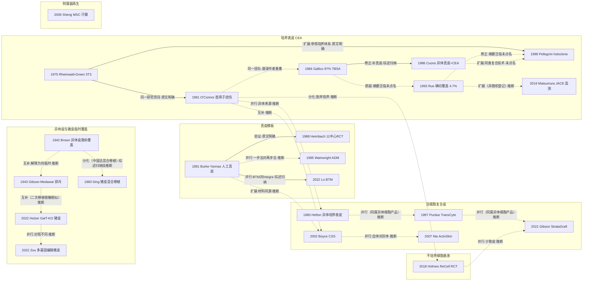

# D03 皮肤替代物、组织工程皮肤与细胞治疗

> **一句话判断**：这个方向研究“自体皮不够时，拿什么暂时或永久代替皮肤”，本轮能追到的较早记录是 1938–1942 年把异体皮当作救命性临时覆盖，1975 年后陆续分出培养表皮、真皮模板、活细胞复合皮、细胞悬液、异体细胞产品和基因编辑猪皮等路线，现在处在“多种产品已上市、相互比较的证据薄”的阶段。深Ⅱ度烧伤已有患者内随机试验支持细胞悬液和异体工程皮能少取自体皮 [D03-N15][D03-N16]，而全层大面积烧伤能否因替代物降低死亡，只有非随机和登记库证据 [D03-N22][D03-R12]。**对临床医生最重要的一点**：本章多数关键试验由企业资助、在同一病人的两处创面上对比，能回答“局部愈合、少取皮”，回答不了死亡和住院天数。

## 0 三分钟速读

1. **从哪里来**：最早的问题是“大面积深度烧伤等不到足够自体皮，先拿什么盖住创面”。本轮找到的较早记录是 Bettman 1938（题名称异体皮移植为“救命措施”，仅题录）和 Brown & McDowell 1942（异体皮可存活 3–10 周）[D03-N01]；Gibson & Medawar 1943 在 1 名病人身上看到第二批异体皮第 8 天已大部溶解，说明异体皮只能临时存活 [D03-N02]。
2. **为什么改变**：异体皮会被排斥，大面积烧伤又缺供皮区。1975 年 Rheinwald & Green 的角质形成细胞培养法本是细胞生物学工作，1979 年起才被引向烧伤 [D03-N03][D03-N04]；同期 Burke 与 Yannas 做出无细胞的胶原-GAG 真皮模板（首批 10 例）[D03-N05]，Bell 做出活细胞皮肤等效物（PMID 7008197）。
3. **如何分化**：培养表皮（CEA）有缺真皮、起疱、确切覆盖面积小（Rue 1993：用于 15.9% BSA，最终覆盖 4.7%）[D03-N10] 等弱点，1980 年代中期起出现几条并行回应：异体真皮垫底 [D03-N08]、双层复合皮 [D03-N13]、保住干细胞的载体 [D03-N12]、不培养的细胞悬液 [D03-N15]。这些回应多数早于 1990 年代的争论，不是被争论“推出来”的。另有异体细胞产品线 [D03-N20][D03-N21][D03-N16]、脱细胞真皮 [D03-N11]、合成模板 BTM [D03-N17] 和猪皮线 [D03-N06][D03-N18][D03-N19]。
4. **现在研究什么**：BTM 与 Integra 的取舍：BTM 整合更慢（32.11 对 18.4 天）、校正后感染率更高（22.8% 对 2.96%），但校正后植皮成活更高（90.6% 对 77.2%），因感染再手术和总体闭合无差异；均为极低质量证据，该综述的检索截止未核 [D03-E10]；StrataGraft 从Ⅲ期到Ⅲb 期的落差（3 个月 92% 病人无需自体皮 vs 12 周确认闭合 63.5%，终点不同）[D03-N16][D03-R08]；自体工程皮Ⅱb 期 [D03-R09]；基因编辑猪皮的首批人体数据（6–31 例，均为会议摘要或预印本）[D03-N18][D03-N19]；登记库匹配研究开始报告生存差异 [D03-R12][D03-R13][D03-R04]。
5. **用了什么数据**：从细胞株、豚鼠和单例观察，到 2–10 例病例系列，再到患者内配对随机（Heimbach 1988 11 中心 106 例 [D03-N09]、Holmes 2018 101 例 [D03-N15]）、日本 118 家医院上市后监测（216 例、718 个部位）[D03-N22]、美国烧伤登记（388,775 人，只分析存活者）[D03-R13] 和系统综述（Lo 2019 纳入 77 项研究，CEA 成活率 0–100%）[D03-E3]。
6. **还不知道什么**：CEA 和其他替代物能否降低大面积烧伤死亡（没有随机证据，现有登记研究排除了早期死亡者）；BTM 与 Integra 没有头对头 RCT；基因编辑猪皮没有同行评审全文和远期病原学监测；中国组织工程皮肤 2021 年后的临床数据在英文库未检到，中文库本轮未检索。

**覆盖边界**：
- 纳入：同种异体皮与异种（猪）皮的临时覆盖；培养表皮（自体 CEA 与异体培养表皮）；真皮替代物（胶原-GAG 模板 Integra、脱细胞真皮 ADM、合成聚氨酯 BTM）；活细胞复合皮（CSS/ESS、ActivSkin、TransCyte、StrataGraft、denovoSkin、SASS）；不培养的自体皮肤细胞悬液（ASCS/RECELL）；表皮干细胞与附属器再生；基因修饰猪皮；3D 生物打印；中国与日本的相关临床数据。
- 只点到为止：自体植皮、微粒皮、MEEK、早期切痂（D02）；慢性创面用的 Apligraf/Dermagraft、生长因子、负压（D08；Sheng 2009 汗腺再生在 D08 为 D08-N16）；BTM/Integra 感染（D04）；死亡率与救治体系（D07）；远期瘢痕（D09）与功能（D10）；Integra/BTM 在瘢痕松解与皮瓣供区的应用（D11）；“中国法”混合移植的学科史背景（X01）。
- 不含：浅Ⅱ度烧伤用的 Biobrane、Suprathel、猪皮敷料等敷料问题（Haller 2021 综述，PMID 33946298，与 D08 交叉）；鱼皮、羊膜等其他生物材料（未系统检索，见第 8 节）。

**本章口径**：
- 截止 2026-09-29；近期窗口 2021-09-29 至 2026-09-29，只用于第 4 节，不限制历史追溯。
- 阅读层级：L0=仅二手转述；L1=题录已核；L2=摘要已读；L3=原文部分章节已读；L4=全文已读。L0/L1 的内容写“据某来源转述”或“仅题录”，不写成已核对原文贡献。
- 核查状态：通过=题录与所引数字经本轮对照数据库记录或原文核对一致；修正=核对后已改用修正值；存疑=保留但证据不足。Brown 1942、Gibson & Medawar 1943、Burke 1981、Heimbach 1988、Green 1979 的关键数字经两次分别下载 PMC 扫描页 OCR 核对。N20–N22 与 R04、R12、R13、R22、R23 为后补文献，题录和数字只对照 PubMed 摘要核对一次，未经独立复核。
- 节点 23 个：L3 5 个（N01、N02、N05、N09、N15）；L2 17 个；L1 1 个（N07，结果为 L0 转述）。以上层级只按每个节点的主行计。近期代表研究 23 条（R01–R23；R10、R17、R18 早于窗口，只作背景）；入口综述 10 篇（E1–E10）。
- 节点主行与辅助行：证据表 `data/evidence_D03.json` 共 105 行。每个节点只有一行主行（kind=关键节点，23 行），就是第 9 节速查表里的那篇文献；挂在同一节点下的其余文献（前期工作、同一项目后续、同类报告、背景文献）标为“辅助文献”（48 行），其中 29 行只核到题录（L1）。辅助行只用来标注出处和线索，不代表节点的证据强度。另有近期代表研究 24 行（R09 下含 Meuli 2025 与 Schiestl 2025 两行）、入口综述 10 行。全报告汇总表中 D03 的“节点下文献行 71”= 主行 23 + 辅助行 48。
- 覆盖状态：**基本完整但有标注缺口**（2026-09-29 按统一口径复评）。理由：①六个问题都能据本章回答：从哪里来（第 1 节，1938–1943 年异体皮临时覆盖）、为什么改变（2.1–2.4，异体皮被排斥与供皮不足）、如何分化（2.3–2.8 与第 3 节分支图）、现在研究什么（4.1–4.6）、用了什么数据（第 7 节）、还不知道什么（8.1）。②覆盖边界内的主要分支都有节点：异体皮与猪皮临时覆盖（N01、N02、N06、N18、N19）、培养表皮（N03、N04、N07、N08、N10、N12、N22）、真皮模板（N05、N09、N11、N17）、活细胞复合皮（N13、N14、N20、N21、N16）、不培养细胞悬液（N15）、附属器再生（N23）；3D 生物打印只有近期研究（R17、R20、R21），本身还没有形成临床分支。③主链关键转折都有可核实来源（除 N07 只核到题录、结果据 Pitt 2023 转述外，都在摘要层级以上，其中 5 个节点读到原文部分章节）。④缺口限于已在第 8 节标注的项目：CNKI/万方未检索；Gallico 1984、Rheinwald 1975 原文未读，Munster 1996 停在摘要；Lo 2019、He 2025、Daneshi 2026、Lou 2025 的检索截止未核，细胞悬液与 Integra 的窗口期补查未按截止日专门做；日本以外的地区产品和试验注册库未系统检索。没有出现“某个主要分支没有节点”或“主链关键转折缺少可核实来源”的情况，所以不评为“部分”。
- 引用写法：[D03-Nxx]=关键节点；[D03-Rxx]=近期代表研究；[D03-Ex]=入口综述；只出现一次的辅助文献直接给 PMID 或 DOI。

---

## 1 源头：最初在研究什么

**判断**：这个方向不是从“组织工程”开始的，而是从“病人等不到自体皮，先拿别人的皮盖住”开始的。本轮找到的较早记录在 1938–1943 年；常被提到的 19 世纪尸体皮移植没有查到，所以“起步于 1930–40 年代”只是本轮检索范围内的说法。1975 年前后的三条技术路线起点清楚，但最初动机并不相同：培养表皮先是细胞生物学问题，真皮模板从一开始就针对烧伤。

| 起点说法 | 分类 | 依据与限定 | 层级 |
|---|---|---|---|
| 异体皮作为大面积烧伤的救命性临时覆盖 | 目前最早找到的文献：Bettman 1938 | Bettman AG. Am J Surg 1938;39(1):156-162，题名 “Homogenous Thiersch grafting as a life saving measure”（DOI 10.1016/s0002-9610(38)90744-5），内容未读。Brown & McDowell 1942 是较早系统总结这一做法的报告之一，p.671 称异体皮铺盖“may be a life-saving process”，并引用 1937 年 Surgery 1:559 的同卵双胞胎报告 [D03-N01]。Girdner 1881 在 PubMed、OpenAlex、Crossref 均未检到 | Bettman L1；Brown L3 |
| 异体皮只能临时存活，破坏属免疫反应 | 目前最早找到的文献（本方向内的人体对照组织学观察） | Gibson & Medawar 1943 Summary 第 4–8 条 [D03-N02]。作者在 p.308 讨论中引用了更早的异体皮失败临床观察（如 Holman 1924, Surg Gynec Obstet 38:100），Holman 是否已描述“再次移植加速排斥”本轮未核 | L3 |
| 猪皮用于烧伤 | 目前最早找到的文献：Falkowski 1955 | 波兰语报告，用胰酶处理的猪皮治疗烧伤（PMID 14394866）；1960 年已有“异种皮作生物敷料”的报告（Sokolic，PMID 13832521；Stallings，PMID 13833680；题名未写种属）；Song 1963（PMID 14065698）与 Bromberg 1965（PMID 14310550）是英文文献常引用的猪皮敷料报告；动物皮移植另有更早历史（Gibson 1955 “Zoografting”，PMID 13269743） | 均 L1 |
| 人角质形成细胞连续培养（3T3 饲养层法） | 被公认的奠基工作 | Chogan 2023 称 1975 年是里程碑 [D03-E1]；Atiyeh 2007 称此后的进展都从 Rheinwald 和 Green 首次描述培养技术开始 [D03-E2]。该文摘要未涉及烧伤 [D03-N03] | L2 |
| 培养表皮自体移植首次用于烧伤 | 被公认的奠基工作 | O'Connor 1981，2 例 [D03-N04]；Wood 2006 摘要写 CEA 于 1981 年首次报告用于大面积烧伤（PMID 16621307）；Chogan 2023 写“CEA 自 1981 年用于烧伤” [D03-E1]。同期平行支线：Hefton 1983 用异体培养表皮治疗 3 例 [D03-N20] | L2 |
| 胶原-糖胺聚糖双层人工皮 | 被公认的奠基工作 | Yannas & Burke 1980 设计原则与豚鼠实验（PMID 6987234；摘要自述设计“始于 10 年前”）；Burke 1981 首批 10 例 [D03-N05]；Chogan 2023 把它与 Rheinwald & Green 并列为同期工作的两组美国研究者 [D03-E1] | L2/L3 |
| 活细胞皮肤等效物（成纤维细胞-胶原格子加表皮细胞） | 目前最早找到的文献 | Bell 1981 Science（PMID 7008197）：移植回细胞供体后血管化并抑制创面收缩，摘要未写动物种属；前期为 Bell 1979 胶原格子收缩研究（PMID 286310）。主要下游产品用于慢性创面（D08） | L2 |
| CEA 与异体真皮复合 | 被公认的奠基工作 | Cuono 1986 [D03-N08]；Chogan 2023 写 Cuono 于 1980 年代中期报告满意成活 [D03-E1]；Pitt 2023 把它列为解决缺真皮的路径 [D03-E6] | L2 |
| 表皮细胞悬液移植 | 目前最早找到的文献：Billingham & Reynolds 1952 | 表皮片与表皮细胞悬液移植的动物研究（Br J Plast Surg 1952;5:25-36，PMID 14944770）；1988 年匈牙利 Sebök 等已用于供皮区和Ⅱ度烧伤（PMID 3283650）；Navarro 2000 猪微创面模型（PMID 11194804），该摘要未说明细胞是否经过培养。RECELL 装置的发明史本轮没有找到原始文献 | 均 L1 |
| 骨髓 MSC 诱导再生汗腺（人体） | 作者自称首次 | Sheng 2009 摘要末句 [D03-N23] | L2 |
| 中国首个获批的组织工程皮肤（ActivSkin，安体肤） | 作者自称首次 | 中国学者综述称 2007 年 SFDA 批准、中国成为继美国之后第二个拥有该技术的国家 [D03-E7]；企业 2018 年公告同样自称“国内首个”（见第 6 节）。没有药监部门原始注册记录 | 事件本身 L0 |
| 基因修饰猪皮首次用于人体烧伤 | 存在争议的首次 | 美方 2022 年会议摘要（GalT-KO，6 例）[D03-N18]；中方 2022 年预印本（多基因编辑，16 例）[D03-N19] 与 2025 年预印本（题名同样用 “First-in-Human”，31 例）[D03-R15]。两方都自称首次，都没有同行评审全文；按单基因还是多基因、按试验启动还是报告时间来算，结论不同 | L2 |

---

## 2 关键转折：问题—新证据/新方法—认识变化—新问题

关系类型：验证、扩展、质疑、修正、分化、互补、并行、同一研究项目。每处注明依据是“原文明确”“综述归纳”还是“本报告推断”。

### 2.1 异体皮能不能留下来：从救命覆盖到“只能临时”（1938–1955）

- **问题**：大面积深度烧伤病人撑不住长时间取皮，靠换药等肉芽创面时逐日衰弱 [D03-N01]。
- **新做法**：Brown & McDowell 1942 总结：异体皮“take”几乎和自体皮一样，能存活 3–10 周；这段时间病人免于疼痛和换药，全身状况好转，自身上皮化加快；成活与血型（含 M、N 血型）无关；同卵双胞胎之间可永久存活（p.671）[D03-N01]。更早的 Bettman 1938 已以“救命措施”为题（仅题录），所以 Brown 1942 是“较早的系统总结”，不是首创。
- **认识变化**：Gibson & Medawar 1943 在 1 名烧伤病人身上并排种植 52 块自体、50 块兄长的异体点状皮片，15 天后再种 28 块同一供者皮片。第一批异体皮 15 天开始退变、28 天基本完成；第二批第 8 天已大部溶解，并与第一批同时退变；局部没有明显淋巴细胞反应；异体胶原比异体上皮耐久 [D03-N02]。异体皮消失因此被理解为会被“致敏”加速的全身免疫过程。两文关系为互补（本报告推断；Gibson & Medawar 的讨论引用了 Brown 1941 的 M、N 血型观察）。
- **新问题**：既然只能临时存活，就需要稳定供应。同一作者 1953、1955 年报告尸体异体皮作生物敷料和建立皮库（PMID 13092792、13273143，仅题录）。异体皮传播 HIV 的顾虑在 1987 年已有讨论（Clarke, Lancet 通信，PMID 2882378，仅题录），但本轮没有证据说明它推动了哪条替代物路线。

### 2.2 从一小块皮扩增出覆盖物：CEA 的起点（1975–1989）

- **方法**：Rheinwald & Green 1975 用致死照射的 3T3 细胞作饲养层，连续培养人角质形成细胞：7 个细胞株寿命 20–50 代，直接取自皮肤的细胞克隆率 0.1–1.0%，新生儿来源传代后可达 10% 以上 [D03-N03]。
- **转向临床**：Green 1979 PNAS 估算一次接种可在 14–21 天内扩增到 0.6 m²，约 6000 倍，并写明要引起外科医生注意（p.5665、p.5667）；O'Connor 1981 把自体培养上皮移植到 2 例全层烧伤创面，最长观察 8 个月仍存活 [D03-N04]。这两步属同一研究项目（Green 为共同作者，原文明确）。
- **极端病例**：Gallico 1984 NEJM 用于 2 名烧伤面积超过 97% 的儿童；据 Pitt 2023 转述，21–23 周时两人创面愈合 85% 以上，约一半由 CEA 覆盖 [D03-N07]（原文未读，PubMed 无摘要）。它与 O'Connor 1981 是同一团队（依据：题录作者重叠）。Compton 1989 对 21 名儿童做 6 天至 5 年的组织学随访，培养表皮下的结缔组织 4–5 年后接近真皮（PMID 2469857；是否包含 Gallico 的 2 例原文未说明）。
- **平行支线**：Hefton 1983 把尸体皮来源的异体培养表皮片移植到 3 例切削后的深Ⅱ度创面，3 天内愈合，观察 9 个月 [D03-N20]。
- **新问题**：培养要等几周；片状 CEA 直接贴在切痂创面上成活不稳、易起疱，因为缺真皮。

### 2.3 CEA 的弱点与几条并行回应（1986–2000）

**判断**：常见叙述是“1990 年代 CEA 效果争论把研究推向真皮床、干细胞和细胞悬液”。按时间核对这不成立：异体真皮加 CEA（1986）、holoclone 概念（1987）、双层复合皮（1989）、表皮细胞悬液（1952、1988）都早于 Rue 1993 等争论性报告。更准确的说法是，1980 年代中期起针对已知弱点出现了几条并行回应；摘要里明确以“各中心结果差”为出发点的只有 Pellegrini 1999。

| 已知弱点 | 回应（起始年份） | 关系与依据 |
|---|---|---|
| 缺真皮、成活不稳 | 先铺尸体异体皮，磨去异体表皮、保留异体真皮，再覆盖 CEA：Cuono 1986，1 名 55% BSA（80% Ⅲ度）成人实现完整皮肤重建 [D03-N08] | 修正（综述归纳：Chogan 2023、Pitt 2023）。异体真皮较耐久与 Gibson & Medawar 的观察相容，但 Cuono 摘要未引用它 |
| 同上，并想一次给双层自体皮 | 胶原-GAG 膜加自体成纤维细胞和角质形成细胞：Hansbrough 1989 JAMA 4 例（PMID 2677425）→ Boyce 2002 [D03-N13] | 扩展；与 Burke–Yannas 模板材料同源（本报告推断，Boyce 摘要未点名） |
| 干细胞在培养与转移中丢失 | Barrandon & Green 1987 区分 holoclone、meroclone、paraclone（PMID 2436229）→ Pellegrini 1999 纤维蛋白载体 [D03-N12] | Pellegrini 以 Rheinwald–Green 体系为参照（原文明确）；临床部分用“异体真皮/培养自体表皮复合技术”（摘要未点名 Cuono） |
| 等待培养数周 | 表皮细胞悬液：Billingham 1952、Sebök 1988（均仅题录）→ 现场制备装置 [D03-N15] | 分化（本报告推断） |

**争议本身（1991–2006）**：
- Desai 1991 个案题名即“培养角质形成细胞覆盖缺乏远期耐久性”（PMID 1779008，仅题录）。
- Rue 1993（美军外科研究所，16 例、22 次应用，CEA 由私营实验室供应）：CEA 平均用于 15.9% BSA，最终确切覆盖平均只有 4.7% BSA（0–18.6%）；每例费用平均 43,705 美元；平均住院 132 天；死亡 2 例（12.5%）[D03-N10]。摘要泛指 CEA“宣称的获益”未能证实，没有点名具体文献。
- Munster 1996（Johns Hopkins，前瞻、非随机）：22 例 CEA 对 42 例对照，死亡率 14% 对 48%（p<0.007），CEA 组吸入伤更多（PMID 8813265，L2）。
- Carsin 2000（法国，30 例）：CEA 永久覆盖 26±15% TBSA，终末成活 69±23%，存活率 90%（PMID 10751706，L2）。
- Pellegrini 1999：纤维蛋白上培养时三类克隆比例不变，移植成活高、可重复且永久，成本下降 [D03-N12]。据 Pitt 2023 转述，按 dispase 分离后贴纱布的片状 CEA 在 36 小时内丢失 60% 以上的克隆能力，临床用于 7 例（婴儿至 30 岁，20–45% TBSA 全层）。它把问题从“CEA 本身不可靠”改为“培养和载体有没有保住干细胞”。与 Rue 1993 的关系为修正，但依据只是摘要泛指各中心结果差，未点名 Rue。
- 汇总：Wood 2006 认为没有 Level 1 证据（PMID 16621307）；Lo 2019 纳入 77 项研究，96% 样本量不足 100，报告成活率 0–100%，与自体皮联合时为 73–96% [D03-E3]。注意“0–100%”是 1946 年以来累积文献的范围，不是某一年代的数据。
- **新问题**：CEA 能不能救命，至今没有随机证据；2016 年后日本登记库研究给出了新一轮非随机数据（见 4.4）。

### 2.4 先给真皮：人工真皮、脱细胞真皮到合成模板（1980–2025）

- **问题**：切痂后没有足够自体皮；异体皮有抗原性、来源有限；中厚皮愈合后挛缩 [D03-N05]。
- **新方法**：Burke 1981 在 MGH 用双层人工皮（上层硅胶，下层多孔胶原-6-硫酸软骨素）覆盖 10 例切痂创面。病人 TBSA 平均 77%、Ⅲ度平均 64%；人工皮覆盖平均约 27% BSA，维持闭合 14–46 天后揭去硅胶层、改植 0.004 英寸超薄自体表皮；人工真皮成活约 95–100%，其上表皮成活 85–95%；无感染丢失，1 例血肿丢失约 3% BSA；随访 2–16 个月（p.419 Table 4–5）[D03-N05]。作者提出“新真皮”：用可室温储存的材料暂时闭合创面并引导真皮再生，供皮区可取极薄、反复取。
- **验证并显出局限**：Heimbach 1988 11 中心患者内随机（入组 149 例，完整疗效数据 106 例；部位数摘要写 139、结果 p.314 写 136，两说并存）[D03-N09]：人工真皮成活中位数 80%，对照合计 95%（p<0.0001），但与异体皮等非自体皮对照无差异（p.315）；研究者经验越多成活越好（r=0.23）；供皮区厚度 0.006 对 0.013 英寸，愈合约早 4 天；1 年时 42% 的部位人工真皮侧增生性瘢痕较少；总死亡 20/149（13%）。关系：验证（摘要首句称“Burke 和 Yannas 发明的人工真皮”，原文明确）。
- **上市后与儿童**：Heimbach 2003 上市后研究 216 例、13 中心，侵袭性感染 3.1%，Integra 成活均值 76.2%、中位 95%（PMID 12543990）；Branski 2007 儿童 RCT 20 例，死亡率 40% 对 30%、住院天数均无差异，瘢痕与骨密度改善（PMID 17828040）。
- **一步法生物真皮**：Wainwright 1995 把脱细胞异体真皮（AlloDerm）与薄网状自体皮同时移植，成活率高，活检见宿主细胞长入与新生血管，组织学和淋巴细胞增殖试验均未检出特异性免疫反应（病例数摘要未写）[D03-N11]。与 Integra 的两步法是并行思路（本报告推断）。中国 Chai 2000 用异体或猪脱细胞真皮加自体中厚皮治疗 119 例，成活约 92–94%；配合微粒皮只有约 40%（PMID 11832167）。
- **合成模板**：Lo 2022 在澳大利亚和法国多中心单臂研究 30 例，用全合成可降解聚氨酯模板（BTM）先临时覆盖、再延期植皮：植皮成活均值 81.9%，BTM 成活 88.6%；处理得当时，有疑似感染表现的 BTM 仍可整合；作者含企业（PolyNovo）员工 [D03-N17]。前期有猪模型比较 BTM 与 Integra（PMID 22002205，仅题录）和研发回顾（Greenwood 2017，题名“retiring the split skin graft”，PMID 28560888，仅题录）。BTM 研发的具体动因本轮未读到原文，不作因果判断。
- **现在的认识**：van den Bosch 2024（31 项比较性研究，检索至 2023-10-19）：胶原-弹性蛋白基质比 STSG 在 4–7 天时再上皮化少 7.30%（p=0.02）；急性烧伤 ADM 对 STSG，术后 6 个月瘢痕评分改善 −1.95（p<0.01）；研究质量中等、结局指标不统一 [D03-E4]。即“早期愈合稍慢，换取瘢痕改善”，硬终点无差异。

### 2.5 活细胞复合皮：自体个体化与异体现成两条线（1983–2025）

**判断**：自体产品少取皮，但要等几周、逐人制备；异体产品可冷冻、随取随用，但本轮核实的 StrataGraft 获批适应证限于含完整真皮成分的创面。异体线在 1983–2021 年间反复出现，其中至少一个有阳性随机试验的产品已不在市场上。

- **自体线**：Boyce 2002（辛辛那提 Shriners）45 例做定性比较、12 例描图：1 年时 CSS 与自体皮各项定性评分无差异；第 14 天 12 例 CSS 成活均超过 75%；第 28 天“闭合面积:供皮面积”显著高于 4:1 网状自体皮，但闭合的 %TBSA 少于自体皮 [D03-N13]。同一项目的 Boyce 2017 为患者内配对随机：16 名儿童入组、15 名接受 2056 片 ESS，平均 76.9% TBSA；闭合与供皮面积之比 108.7±9.7（自体皮最高 4.0），但 ESS 成活 83.5% 对自体皮 96.5%，闭合 %TBSA 29.9% 对 47.0%；与 National Burn Repository 历史外部对照比，死亡率 6.25% 对 30.3%（PMID 27404165）。近年的自体产品见 4.3。
- **中国异体线**：第四军医大学 ActivSkin 用新生儿成纤维细胞和角质形成细胞，可量产 [D03-N14]，见第 6 节。与 CSS 是自体/异体两种思路的并行（本报告推断）。
- **美国异体线**（关系归为并行：同属异体细胞产品，本报告推断的概念连线，不是同一团队）：
  - Hefton 1983：异体培养表皮 3 例 [D03-N20]。
  - Purdue 1997：Dermagraft-TC（即 TransCyte，题名称“生物合成皮肤替代物”）与冷冻尸体异体皮比较切痂后临时覆盖，66 例，每例两处约 1% TBSA 部位随机：植自体皮后第 14 天的成活相当或更优，更易揭除、出血更少 [D03-N21]。据 Chogan 2023 转述，TransCyte 与 Dermagraft 已退市 [D03-E1]，退市原因和时间本轮未核。
  - Gibson 2021 StrataGraft Ⅲ期（NIKS 永生化角质形成细胞加真皮成纤维细胞，冷冻保存）：71 例、切痂后深Ⅱ度区域患者内随机，第 3 个月需补植自体皮的面积占比 4.3% 对 102.1%（减少 96%，p<0.0001），92%（59/64）病人的 StrataGraft 部位无需自体皮即持久闭合；最常见相关不良事件为瘙痒（15%）[D03-N16]。FDA 产品页显示 2021-06-15 发出批准信（另有 2024-01-30 批准信），适应证为含完整真皮成分、需手术干预的成人清创后热烧伤。企业资助、开放标签；“需自体植皮面积”这一终点在设计上偏向试验组。
  - Holmes 2024 Ⅲb 期单臂扩展使用：52 例、96 个部位，第 12 周确认闭合为 63.5% 的病人、71.9% 的部位，第 24 周持久闭合 55.8% 的病人，瘙痒 42.3% [D03-R08]。与Ⅲ期时间点相近的比较是“3 个月 92% 对 12 周 63.5%”，但终点定义和入组人群不同，只能说扩展使用中的数字较低。

### 2.6 不等培养：现场制备的细胞悬液（1952–2026）

- **前史**：Billingham & Reynolds 1952、Sebök 1988、Navarro 2000（均仅题录，见第 1 节）。
- **较早的单中心比较**：Gravante 2007 罗马单中心 82 例深Ⅱ度烧伤（题名称随机，方法写按“sampling chart”分组使两组均衡）：植皮愈合比 ReCell 快（PMID 17904748，L2；资助来源本轮未核）。
- **关键试验**：Holmes 2018 美国 12 中心、FDA IDE 注册试验（NCT01138917），101 例深Ⅱ度烧伤、患者内随机：第 4 周治疗部位愈合 97.6% 对 100%，差值 −2.4%（95%CI −8.4% 至 2.3%），达到非劣效；供皮面积约为对照的 1/40；供皮区第 1 周愈合 21.8% 对 10.0%（p=0.04），第 2 周 90.0% 对 67.3%（p<0.001）；第 8 周前供皮区疼痛较轻；ASCS 部位不良事件较多，作者归因于使用 SSD 和缺乏保护 [D03-N15]。同一研发项目的 Holmes 2019 用于混合深度烧伤 30 例（患者内随机）：第 8 周愈合 92% 对 85%，供皮减少 32%；1 cm² 皮肤可处理最多 80 cm²（PMID 30578048）。
- **关系**：放弃培养扩增，用“不等待”替代“大扩增”，主要用于尚有真皮的深Ⅱ度创面或与宽网状自体皮联用（分化，本报告推断）。RECELL 的 FDA 批准时间本轮未核。

### 2.7 猪皮：从敷料、混合移植到基因编辑活体皮（1955–2025）

- **混合移植**：中国 1970–80 年代把新鲜猪皮与自体皮间隔混合移植。Ding 1983 报告自 1973 年 3 月起 17 例、21 次手术：6 例出现自体皮与猪皮“融合现象”；早期猪皮与创面之间没有血管沟通，所谓“转红”是皮下红色渗出；猪皮最终被排斥，过程与异体皮相似；0.4–0.5 mm 厚、间距 0.5–0.75 cm 效果较好；建议猪皮覆盖面积少于 20%，以免大片脱落 [D03-N06]。同题中文版 1982 年发表于《中华外科杂志》（PMID 6751717），很可能是同一批病人。与异体皮临时覆盖 [D03-N01] 的关系归为分化：瑞金医院学科史把“大张异体或异种皮打洞嵌植自体小皮片混合移植”列为“中国法”的组成部分（综述归纳 [D03-E9]）；把它看作从异体皮临时覆盖分出的一支，是本报告推断。
- **免疫障碍**：Yamamoto 2018 综述：基因工程猪皮在非人灵长类中存活时间接近异体皮，但抑制细胞免疫可能仍需全身免疫抑制 [D03-E8]。Leto Barone 2015 用 8 只非人灵长类：GalT-KO 猪皮与异体皮都能覆盖 11 天，第二次 GalT-KO 移植因致敏不能血管化（PMID 25406888），与 Gibson & Medawar 的第二批异体皮加速排斥现象相似，两者关系归为互补（本报告推断）。
- **首批人体数据（两说并存）**：
  - 美方（XenoTherapeutics/MGH）：Holzer 2022 年会摘要，6 例，来自指定无病原 GalT-KO 猪的中厚皮冷冻保存（细胞存活率 >70%），与尸体异体皮在清创后的全层创面上并排移植：贴附、血管化、外观均无法区分，未给数值 [D03-N18]；同一项目 2024 年摘要Ⅰ/Ⅱ/Ⅱb 期共 22 例，未见不良事件，3 例混合深度烧伤无需植皮，计划Ⅲ期 [D03-R14]。
  - 中方：Zou 2022 medRxiv 预印本，16 例，冷冻的多基因编辑（SGGEP）猪皮 Xeno X 与野生型猪细胞外基质并排：均血管化、完全贴附，不用免疫抑制至少存活 25 天 [D03-N19]；Xie 等 2025 Research Square 预印本：共 11 处基因组修饰，31 例热烧伤病人达到完全、持久闭合，3 例无需自体植皮 [D03-R15]。31 例很可能包含 2022 年的 16 例（原文未说明）。
  - 两方对照不同（尸体异体皮 vs 无细胞猪 ECM），结果不可直接比较。中方工作与 1970–80 年代猪皮混合移植只是时间上晚于、概念相近，没有证据显示同一团队或直接延续；时间先后本身不构成关系，所以分支图不在 N06 与 N19 之间画边。

### 2.8 从“覆盖”到“再生”：干细胞与附属器（1987–2024）

- Barrandon & Green 1987 的三类克隆 → Pellegrini 1999 [D03-N12] → Hirsch 2017 Nature 用转基因 holoclone 培养物为一名 7 岁交界型大疱性表皮松解症患儿再生表皮（据 Pitt 2023 转述约 80% 体表，PMID 29144448）。疾病不是烧伤，只作表皮干细胞背景。
- Sheng 2009：5 名深度烧伤后无汗瘢痕的病人移植诱导的骨髓 MSC，2–12 个月后发汗功能恢复，作者称首次 [D03-N23]；本轮未见独立重复。
- 类器官、化学重编程和生物打印见 4.6。

---

## 3 分支图

图例：实线=原文明确讨论或综述归纳的关系；虚线=本报告推断或只有摘要泛指、作者重叠等间接依据；边上写关系类型与依据。

读图要点：图中只有五条实线边有原文或综述支持；其余虚线边是概念相近或作者重叠等间接依据上的推断，不能读成“一条线传下来”。N01→N06 的“中国法”归类有综述依据（[D03-E9]），但把它画成从异体皮覆盖分出来是推断，所以仍用虚线。2026-09-29 第二轮删去两条边：N01→N17（原标“经第三方研究间接关联”，没有找到可回查的第三方研究；BTM 与异体皮时期的比较见 4.2 的 Betar 2023，是历史对照，不据此画边）；N06→N19（只有时间先后与概念相近，见 2.7）。N23 与其他节点没有经核实的直接关系，单独列出。

---

## 4 近五年重点（2021-09-29 至 2026-09-29）

### 4.1 细胞悬液（ASCS/RECELL）的适应证扩大与证据汇总

- **研究什么**：细胞悬液单用或与宽网状自体皮联用，用于深Ⅱ度、混合深度和儿童中等面积Ⅱ度烧伤；比较愈合、供皮面积、并发症、死亡。
- **数据与设计**：企业相关的注册试验（2018–2019）、儿童小样本 RCT、回顾性匹配研究、SR/MA（多数纳入非随机研究）。
- **补查起点**：未能锚定。Daneshi 2026 的检索截止未核（全文不开放；其 PROSPERO 记录 CRD42024606554 本轮因证书校验失败未能读取）；Saraswat 2026 摘要写纳入 2000 年 1 月至 2024 年 12 月的研究，这是研究的时间范围，不是检索执行日。据本报告检索记录，细胞悬液的近期研究只做了一条不设日期下限、限随机试验相关词的 PubMed 检索，没有从某个截止日起专门补查（未补查）。
- **代表研究**：
  - Daneshi 2026 SR/MA（PROSPERO CRD42024606554）：14 项研究，n=3362（单位摘要未写明）；ASCS+STSG 对单用 STSG，并发症 RR 0.64（95%CI 0.41–1.00，P=.048），伤口感染与移植失败无差异；纳入人群平均 TBSA 14.6%，I²=95.1% 指的是 TBSA 均值的异质性，不是结局合并的异质性 [D03-R01]。
  - Saraswat 2026 SR：99 项研究（13 国，2000–2024 年），27 项比较性研究中 61% 的愈合结局偏向细胞悬液、39% 相当；未做定量合并；多数作者与 AVITA Medical 有利益关系，Wood FM 为 RECELL 共同发明人 [D03-R02]。
  - Bairagi 2023 儿童三臂先导 RCT（7/7/8 例）：再上皮化中位 12、14、12 天，无差异；受 COVID-19 影响效能不足 [D03-R03]。
  - Ahmad 2026 单中心回顾性匹配病例对照（2015–2023）：细胞悬液加 STSG 63 例对单用 STSG 126 例，按Ⅲ度 TBSA 和年龄 1:2 匹配，死亡 OR 0.211（P=.0445）；作者承认有选择偏倚和时间先后偏倚 [D03-R04]。
- **分歧**：全层或大面积烧伤的额外获益、能否脱离网状植皮单用，证据不足；综述作者利益冲突多；唯一的死亡率数据来自非随机匹配。
- **成熟度**：发展中。深Ⅱ度有注册 RCT 支持，其余适应证证据弱。

### 4.2 真皮模板“先临时覆盖、再植皮”：BTM 与 Integra

- **研究什么**：切痂后先用 BTM、Integra 等模板覆盖，比较整合时间、植皮成活、感染、资源消耗和瘢痕。
- **数据与设计**：单臂前瞻研究 [D03-N17]、单中心大样本回顾、历史对照队列、含个体数据的 Meta 回归、临床医生调查。
- **补查起点**：2023-10-19（依据 van den Bosch 2024 全文 Methods 写明的更新检索日 [D03-E4]）。He 2025 的检索截止未核（出版社全文页返回 403；摘要未写检索日期和登记号）[D03-E10]。本轮按出版年 2021–2026 检索 PubMed 中的 BTM/NovoSorb 研究，起点早于 2023-10-19；该检索式不含 Integra，Integra 单独的窗口期研究未专门补查。
- **代表研究**：
  - Tapking 2024 单中心 175 例（2020-03 至 2023-11，TBSA>10%）：BTM 成活 82.0±24.7%，STSG 成活 87.3±19.0%；应用 BTM 前手术次数越多，BTM 成活越差；先用过异体皮或 STSG 失败者，后续 STSG 成活较差 [D03-R05]。
  - Betar 2023（≥40% TBSA，55 例，BTM 22 例，对照为引入 BTM 前用尸体异体皮的病人）：手术时间中位 1361.5 对 1768 分钟（p=0.044），手术次数、异体皮用量、住院与 ICU 时间、输血相似 [D03-R06]。
  - He 2025 SR + Meta 回归 + 两阶段 IPD Meta（35 项研究，19 项提供个体数据；Integra 674 例患者、BTM 288 例患者）：整合时间 BTM 32.11 天对 Integra 18.4 天；校正后植皮成活 BTM 90.6% 对 77.2%；感染率 BTM 22.8% 对 2.96%，但模板成活、因感染再手术、总体创面闭合（96.0% 对 96.5%）无差异；总体为极低质量证据，多为无对照病例系列 [D03-E10]。
  - CASSIUS 调查（2022 年 4–8 月，英国和爱尔兰 21 个单位、306 名医务人员）：18/21 个单位（86%）把替代物用于深Ⅱ度或全层烧伤，受访者报告这类创面最常用 Novosorb-BTM；不到一半的受访者能正确说出多数产品的成分 [D03-R07]。这是自报，不是实际用量，也不能外推到其他国家。
- **分歧**：BTM 与 Integra 在感染和整合时间上各有优劣，没有头对头 RCT；模板相对异体皮能否改善死亡、住院等硬终点，没有随机证据；“早期愈合慢、瘢痕好”是否值得，各中心看法不一。
- **成熟度**：临床已广泛使用，高质量比较证据缺乏。

### 4.3 实验室工程皮进入后期临床与监管

- **研究什么**：异体 StrataGraft 的上市后表现；自体 denovoSkin、自组装皮 SASS 用于深Ⅱ度或全层烧伤；欧洲医院自制产品的法规路径。
- **数据与设计**：企业相关的Ⅱb 期多中心患者内随机（denovoSkin）和Ⅲb 期单臂扩展使用（StrataGraft）、特殊准入病例系列（SASS，窗口前）、系统综述、法规讨论文章。
- **代表研究**：
  - StrataGraft Ⅲb 期 [D03-R08]，见 2.5。
  - Meuli 2025 denovoSkin Ⅱb 期多中心患者内随机（NCT03227146）：入组 21 例，符合方案集 13 例；扩展比 denovoSkin 10.76±6.03 对 STSG 1.70±0.68，两者之比均值 7.41；第 3 个月两侧均完全上皮化；12 个月时 denovoSkin 侧无临床相关瘢痕，STSG 侧多为增生性瘢痕；多名作者持有 CUTISS 股份 [D03-R09]。同产品儿童 5 年随访只核实到题录（Schiestl 2025，PMID 39115183）。
  - Germain 2018（窗口前背景）：加拿大特殊准入 14 例 SASS，术后 5–7 天成活 98%（SD 5），平均随访 3.2 年表皮持续存在，多例色素不均 [D03-R10]。
  - Simaey 2024 SR：培养细胞类产品 14 项研究，其中 8 项 RCT；最终检索日 2024-01-22（据根特大学机构库收录的录用稿 Methods，PROSPERO CRD42023407454）[D03-E5]；Auxenfans 2025 讨论欧洲实验室自体皮的法规，只核实到题录 [D03-R11]。
- **分歧**：StrataGraft Ⅲ期与扩展使用之间的数字落差；自体产品样本很小、作者与企业利益交织；制备周期和费用没有系统评价。
- **成熟度**：异体产品已进入上市后阶段；自体产品处于Ⅱ–Ⅲ期。

### 4.4 登记库与匹配观察：硬终点证据换了形态

- **研究什么**：替代物与死亡、住院天数的关系。随机试验多以“部位”为单位，只能在登记库中看全身结局。
- **数据与设计**：上市后监测加登记库同严重度对照、登记库倾向评分匹配、全国登记库按编码分析（会议摘要）、单中心回顾性匹配病例对照。
- **代表研究**：
  - Matsumura 2016 日本 JACE（自体 CEA）6 年上市后监测，118 家医院、TBSA>30%，216 例、718 个部位：第 4 周 CEA 成活按部位 66%、按病人 68%；铺在人工真皮上 65%（226 个部位）；与东京烧伤登记同严重度数据比较，CEA 与伤后 7 周内的生存有关 [D03-N22]。
  - Matsumura 2024：据摘要，JACE 于 2009 年纳入日本国民医保，已用于 1000 例以上。东京烧伤登记 2009–2023 年 3990 例，排除 4 周内死亡者等之后筛出 119 例，倾向评分匹配 25 对 25：JACE 组伤后 6–9 周生存率更高 [D03-R12]。排除 4 周内死亡者意味着只有活过 4 周的人才进入比较（存活者偏倚）；两篇都用东京登记数据，是否重叠原文未说明。
  - Crombie 2024 美国烧伤学会全国登记（NBR）会议摘要：2008–2021 年 388,775 名病人中 41,785 名按 ICD-9/10 编码使用了真皮再生移植物，只分析存活者（32,428 名）；Ⅲ度为主、TBSA 10–40% 的病人，7 天内使用比 8 天及以后使用的 LOS/TBSA 更低 [D03-R13]。暴露靠编码，可能误分类。
  - Ahmad 2026 细胞悬液与死亡（见 4.1）[D03-R04]。
- **判断**：这些研究把“替代物能否救命”的争议从 1990 年代的单中心对照（Rue 对 Munster）带进了登记库时代（N22 与 N10 的关系归为扩展：同一问题换成非随机登记数据，本报告推断），但都是非随机，并各自带有存活者、编码误分类或时间先后偏倚。随机的硬终点证据仍是空白。
- **成熟度**：早期线索。

### 4.5 基因修饰猪皮进入人体

- **研究什么**：GalT-KO 或多基因编辑的活体猪皮能否代替尸体异体皮做临时覆盖；免疫与病原（PERV）安全性。
- **数据与设计**：灵长类实验（食蟹猴、松鼠猴；Hara 2023，仅题录 [D03-R16]）；患者内并排对照的首批人体数据（会议摘要与预印本）[D03-N18][D03-R14][D03-N19][D03-R15]；综述（Wu 2025 列出 NCT03695939 与 NCT06223269，PMID 40407357）。
- **分歧**：人体数据尚无同行评审全文；两团队对照不同，结果不可直接比较；是否需要免疫抑制两说并存（Yamamoto 2018 综述认为可能仍需 [D03-E8]；中方预印本报告不用免疫抑制存活 25 天以上）。
- **成熟度**：早期线索。

### 4.6 生物制造与附属器再生

- **研究什么**：用生物打印、多能干细胞类器官和化学重编程造皮肤或皮肤细胞，其中部分工作针对汗腺、毛囊等附属器。
- **数据与设计**：动物实验（Albanna 2019 摘要未写种属；Xiang 2024 为小鼠）、类器官移植裸鼠、体外生物打印模型；人体数据基本空白（Zhang M 2025 是否用于人体未能确认）。
- **代表研究**：Albanna 2019（窗口前背景）分层原位打印自体成纤维细胞和角质形成细胞，动物全层创面闭合更快、收缩减少，摘要未写种属 [D03-R17]；Lee 2020 Nature（背景）多能干细胞培养 4–5 个月形成含表皮、真皮、色素毛囊和皮脂腺的类器官，移植到裸鼠后形成带毛的平面皮肤 [D03-R18]；Xiang 2024（付小兵团队）用 6 种小分子把人角质形成细胞重编程为汗腺样细胞，移植到烫伤小鼠爪部后汗腺结构与功能恢复 [D03-R19]；Zhang Y 2021 含汗腺与毛囊的生物打印皮肤模型（仅题录）[D03-R20]；Zhang M 2025 3D 打印皮肤用于博来霉素注射相关慢性创面（研究快报，无摘要，是否人体应用未能确认）[D03-R21]。
- **分歧与成熟度**：血管化、制备时间、规模化和监管离烧伤临床仍远；人体数据基本空白。早期线索。

---

## 5 争议、负性结果与停滞路线

### 5.1 仍在争的问题

| 问题 | 一方 | 另一方 | 现状 |
|---|---|---|---|
| CEA 在大面积烧伤中有没有用 | Rue 1993：确切覆盖 4.7% BSA、每例 43,705 美元，未见正面作用 [D03-N10] | Munster 1996 死亡率 14% 对 48%（非随机，CEA 组吸入伤更多）；Carsin 2000 存活率 90%；Matsumura 2016/2024 登记研究报告生存获益 [D03-N22][D03-R12] | 没有随机证据；日本登记库的匹配研究报告生存获益，但设计上排除了 4 周内死亡者。Lo 2019 认为 CEA 只是辅助或生物敷料，不能替代中厚皮 [D03-E3] |
| 真皮替代物以早期愈合延迟换瘢痕改善是否值得 | 瘢痕与功能改善：Heimbach 1988、Branski 2007、van den Bosch 2024（6 个月瘢痕评分 −1.95）[D03-N09][D03-E4] | 成活低于自体皮、需两步手术、早期再上皮化少 7.30% [D03-N09][D03-E4] | 急性创面的瘢痕获益有中等质量证据；死亡、住院无差异；结局指标待统一；不外推到晚期挛缩松解（见表下说明） |
| BTM 还是 Integra | BTM 植皮成活更高、易挽救 | BTM 整合更久、感染率更高 [D03-E10] | 极低质量证据，没有头对头 RCT |
| 细胞悬液的证据独立性 | 注册 RCT 与 SR 支持少取皮、并发症较少 [D03-N15][D03-R01] | 关键试验和综述作者多与企业相关 [D03-R02]；较早的单中心比较 Gravante 2007 结果是植皮愈合更快 | 深Ⅱ度适应证证据较强，其余待独立 RCT |
| 基因修饰猪皮是否需要免疫抑制、能否替代异体皮 | 美方摘要：与异体皮无法区分；中方预印本：不用免疫抑制存活 ≥25 天 [D03-N18][D03-N19] | Yamamoto 2018：可能仍需全身免疫抑制；灵长类二次移植因致敏失败 [D03-E8] | 早期、未决；缺同行评审全文与远期病原学数据 |
| 异体细胞产品能否持续使用 | StrataGraft Ⅲ期阳性并获 FDA 批准 [D03-N16] | TransCyte 有阳性随机试验却已退市 [D03-N21]；StrataGraft 扩展使用数字较低 [D03-R08] | 退市原因与真实世界表现缺独立分析 |

**适用范围**：本章真皮替代物的瘢痕获益证据（van den Bosch 2024、Heimbach 1988、Branski 2007）都来自急性烧伤创面，不能外推到伤后晚期的挛缩松解；晚期挛缩场景的 RCT 见 D11（Almeida 2023 四臂 RCT，替代物加植皮与单纯植皮组间无差异）[D11-R05]。

### 5.2 负性结果、失败与停滞路线

- **让异体皮永久存活**：失败。2–4 周内退变，同一供者再次移植加速排斥；只有同卵双胞胎例外 [D03-N01][D03-N02]。
- **商业化 CEA 单独覆盖大面积切痂创面**：确切覆盖小、费用高 [D03-N10]；远期耐久性差（Desai 1991，仅题录）；CEA 后发生 Marjolin 溃疡的病例系列（Baus 2021，PMID 34911675，仅题录）。
- **人工真皮初期推广**：成活低于自体皮，且依赖操作经验 [D03-N09]。
- **大面积猪皮混合移植**：猪皮终被排斥，覆盖面积过大会出现大片脱落 [D03-N06]。
- **ADM 加微粒皮**：成活约 40%，明显低于 ADM 加中厚皮（Chai 2000）。
- **有阳性随机试验却退出市场**：TransCyte [D03-N21]；Dermagraft 据 Chogan 2023 转述也已退市（主要用途在慢性创面，D08）[D03-E1]。原因未核。
- **基因修饰猪皮再次移植**：致敏后不能血管化（Leto Barone 2015）。
- **StrataGraft 从Ⅲ期到扩展使用**：3 个月 92% 到 12 周 63.5%（终点与人群不同）[D03-N16][D03-R08]。
- **早期细胞悬液比较**：Gravante 2007 植皮愈合更快；BRACS 儿童先导 RCT 三臂无差异、效能不足 [D03-R03]。

---

## 6 中国线

**判断**：在英文数据库可见的范围内，中国在这个方向有四块可核实的工作：1970–80 年代的猪皮/异体皮混合移植；脱细胞真皮与异种、异体生物敷料的临床比较（本轮补查到的窗口期中国临床研究以这一类为主）；第四军医大学的组织工程皮肤；汗腺再生与基因编辑猪皮的早期人体数据。以上判断的前提是 CNKI/万方未检索，中文原始首报和中文 RCT 本身都没有逐篇核对。

1. **混合移植（1970–80 年代）**：Ding 1983 Burns 的猪皮混合移植 17 例 [D03-N06]；同题中文版见《中华外科杂志》1982;20:269-271（PMID 6751717），很可能是同一批病人，不重复计数。Yang ZJ 1982 Chin Med J（PMID 6813034）与同期《中华外科杂志》版（PMID 6751716）也可能是同一批病人；Min J 1981《中华外科杂志》（PMID 7030673）。以上除 Ding 1983 外均只核实题录。瑞金医院学科史把“大张异体或异种皮打洞嵌植自体小皮片混合移植”列为“中国法”的组成部分，摘要未给首创年份 [D03-E9]。
2. **脱细胞真皮与生物敷料**：Chai 2000 用异体或猪 ADM 加自体中厚皮 119 例，成活约 92–94%，配合微粒皮约 40%（PMID 11832167）。窗口期：Lou 2025 儿童烧伤 ADM Meta 检索了 CNKI、VIP、万方，纳入 12 项 RCT、884 名儿童：愈合时间 MD −3.13 天（I²=94%），并发症 RR 0.40，植皮成活与瘢痕评分无差异；检索截止未核（摘要未写，出版社全文页返回 403，未补查）[D03-R22]。Chen 2026 南通单中心回顾（2015–2020 年）：猪源 ADM 62 例对异体 ADM 33 例，初次植皮成活 93.3% 对 94.3%、无差异，猪源组愈合时间更长（11.4 对 8.9 天）[D03-R23]。
3. **组织工程皮肤（ActivSkin，安体肤）**：同一团队两项临床数据。Liu 2006 在 9 名病人的 18 处供皮区做患者内随机（摘要未说明病因），愈合 9.67±2.92 天对 16.56±2.96 天（PMID 16535795）；Nie 2007 多中心 158 例入组、129 例分析，对照为凡士林敷料，按深度分层愈合缩短 6.5–20 天，未见排斥 [D03-N14]。两项研究的病人是否重叠原文未说明。获批信息：中国学者综述称 2007 年 SFDA 批准 [D03-E7]；中国再生医学（股票代码 08158）2018-04-06 公告（新浪财经转载：http://finance.sina.com.cn/stock/hkstock/ggscyd/2018-04-06/doc-ifyteqtq5026515.shtml ，企业自述，非药监原始记录）写明该产品按医疗器械完成第二次再注册，注册证号国械注准20183461660，并自称“国内首个也是唯一含有活性细胞”的组织工程皮肤。“2007 年 11 月获批、适应证限于不超过 20 cm² 的深Ⅱ度和Ⅲ度烧伤创面”只见于新闻检索摘要（原网页 404），存疑。2021 年后在英文库未检到该产品的新临床研究。
4. **干细胞与附属器再生**：Sheng 2009 MSC 汗腺 5 例 [D03-N23]；Xiang 2024 化学重编程汗腺细胞（小鼠）[D03-R19]；Zhang Y 2021 生物打印含汗腺毛囊模型（仅题录）[D03-R20]。
5. **基因编辑猪皮**：Zou 2022（16 例）[D03-N19] 与 Xie 2025（31 例）[D03-R15] 均为预印本；中文综述 Duan 2022（PMID 36177583，仅题录）。

---

## 7 数据路径小结（历史上 vs 现在）

| 数据类型 | 历史上（代表） | 现在（代表） | 能回答 / 不能回答 |
|---|---|---|---|
| 体外细胞与克隆分析 | Rheinwald 1975（7 个细胞株）；Barrandon 1987；Pellegrini 1999 | 化学重编程（Xiang 2024）；多能干细胞类器官（Lee 2020） | 细胞能力；不能回答临床效果 |
| 动物模型 | 豚鼠（Yannas 1980）；无胸腺小鼠（Green 1979）；猪（Greenwood 2012 BTM 对 Integra） | 非人灵长类异种皮（Leto Barone 2015，8 只；Hara 2023）；小鼠烫伤爪（Xiang 2024）；原位打印（Albanna 2019） | 机制与安全信号；种属差异大 |
| 单例与病例系列 | Brown 1942；Gibson & Medawar 1943（1 例患者内）；O'Connor 1981（2 例）；Gallico 1984（2 例）；Cuono 1986（1 例）；Burke 1981（10 例）；Ding 1983（17 例）；Chai 2000（119 例）；Carsin 2000（30 例） | Germain 2018（14 例）；Lo 2022（30 例）；Tapking 2024（175 例） | 可行性、操作参数；无对照 |
| 患者内配对随机（本方向最典型） | Heimbach 1988（106 例）；Purdue 1997（66 例）；Liu 2006（9 例 18 处） | Holmes 2018（101 例）；Holmes 2019（30 例）；Boyce 2017（15 名儿童）；Gibson 2021（71 例）；Meuli 2025（21 例） | 以“部位”为单位比较局部愈合与供皮；不能回答死亡、住院等全身结局 |
| 平行组 RCT | Branski 2007（20 名儿童） | Bairagi 2023（22 名儿童）；中文 ADM RCT（Lou 2025 汇总 12 项，各试验设计本轮未读） | 可看全身结局，但样本都很小 |
| 非随机或历史对照 | Munster 1996（22 对 42）；Rue 1993（无对照） | Boyce 2017 对 NBR；Betar 2023 对异体皮时期 | 时间先后偏倚、选择偏倚 |
| 上市后监测与扩展使用 | Heimbach 2003（216 例） | Matsumura 2016（216 例、718 个部位）；Holmes 2024（52 例） | 真实世界成活与安全；无同期对照 |
| 登记库与匹配观察（硬终点） | 本轮未检到 | Matsumura 2024（25 对 25，排除 4 周内死亡）；Crombie 2024（NBR，ICD 编码，只含存活者）；Ahmad 2026（63 对 126） | 能看死亡与住院；存活者偏倚、编码误分类、时间先后偏倚 |
| 远期组织学随访 | Compton 1989（21 名儿童，6 天至 5 年） | Germain 2018（平均 3.2 年）；Schiestl 2025 denovoSkin 5 年（仅题录） | 耐久性；病例少 |
| 系统综述与 Meta | Wood 2006；Lo 2019（77 项） | van den Bosch 2024（31 项）；Simaey 2024（14 项）；He 2025（35 项，含 IPD）；Daneshi 2026（14 项）；Saraswat 2026（99 项）；Lou 2025（12 项 RCT） | 汇总方向；多数纳入非随机研究、异质性高 |
| 调查、经济模型、基因治疗追踪 | Hirsch 2017（1 例 JEB，前病毒整合位点克隆追踪） | CASSIUS 2025（306 人、21 单位）；Kowal 2019 细胞悬液成本效果模型（PMID 31065995，仅题录） | 使用现状与成本；自报或模型假设 |

**判断**：本方向的主力设计是“同一病人两处创面”的配对随机，适合比较局部愈合和供皮面积，却让死亡率等全身结局长期无法检验；硬终点直到 2016 年后才以登记库和匹配研究的形式出现，而且都带有明显偏倚。

---

## 8 还不知道什么（领域证据缺口）与本报告的检索缺口

### 8.1 领域证据缺口

- **缺随机的硬终点证据**：没有以死亡、住院天数为主要终点、效能充足的平行组 RCT；已有的观察性研究带存活者偏倚与编码暴露偏倚（4.4）。
- **没有专门评价深Ⅱ度/全层烧伤皮肤替代物的 Cochrane 综述**：PubMed 以 Cochrane Database Syst Rev + burn 题名检索共 12 条，逐条核对题名，均不是这一主题。
- **结局指标不统一**：成活率定义、瘢痕量表、随访时长各异，无法合并 [D03-E3][D03-E4]。
- **远期结局稀少**：CEA 与工程皮 5 年以上的耐久性、恶变与功能数据少（Compton 1989；Schiestl 2025 与 Baus 2021 仅题录）。
- **BTM 与 Integra 没有头对头 RCT** [D03-E10]。
- **基因编辑猪皮**：人体结果无同行评审全文，缺远期病原学（PERV）监测。
- **异体细胞产品为何退市、上市后真实表现如何**：没有独立分析。
- **自体工程皮的制备周期与费用**：没有系统评价。

### 8.2 本报告的检索缺口与待核线索

- 未检索 CNKI、万方；“中国法”混合移植的中文首报与年份、ActivSkin 的获批日期与适应证未核实。
- 原文未读：Gallico 1984（NEJM，无摘要）、Rheinwald 1975（不在 PMC）、Bromberg 1965；Munster 1996 的 PMC 扫描页因页面返回 reCAPTCHA 验证页未抓取，停在摘要。
- 入口综述与近期综述的检索截止：2026-09-29 第二轮做了有限补查（Europe PMC、OpenAlex 开放获取定位，出版社与机构库页面，共 13 次请求）。只补到 Simaey 2024：最终检索日 2024-01-22（根特大学机构库收录的录用稿 Methods，PROSPERO CRD42023407454）。仍未核：Lo 2019（摘要只写 “until present”；出版社免费 PDF 返回验证页）；He 2025（摘要未写检索日期，也未写登记号；出版社全文页返回 403）；Daneshi 2026（全文不开放；PROSPERO CRD42024606554 记录页因本机证书校验失败未能读取，未关闭校验重试）；Lou 2025（摘要未写；出版社全文页返回 403）。因此 4.1 的补查起点未能锚定，4.2 以 van den Bosch 2024 的 2023-10-19 为起点；细胞悬液与 Integra 的窗口期研究没有按截止日专门补查。
- 日本只补到 Matsumura 两篇；韩国产品、欧洲医院自制 CEA 未专门检索。
- ClinicalTrials.gov 等注册库未系统检索生物打印与异种移植试验。
- 鱼皮、羊膜等其他生物材料未检索。
- 19 世纪起源：Girdner 1881 在 PubMed、OpenAlex、Crossref 均未检到（OpenAlex 按 1875–1890 年检索 0 命中，复检时服务返回 503）。
- FDA 批准时间：StrataGraft 已从 FDA 页面核实；Integra、RECELL 未核。
- **待核线索**（本轮未取得可定位来源或只见于二手转述，未进入正文叙事）：
  - Bettman 1938 的病例内容：有二手综述称其用父母的异体皮治疗 2 名烧伤面积分别为 60% 和 80% 的儿童，出处未能定位。
  - Greenwood 2020 称 BTM 为“范式转变”；Lemaître 2026 “无异种成分”培养综述；Holzer 2020 食蟹猴猪皮实验；Wasiak 2013 Cochrane 敷料综述；Dagher 2023 历史综述——均未给出本轮核实的标识符。
  - Fu 等 2001 Lancet 表皮细胞“去分化”（8 名腿部溃疡病人）：Lancet 2002 年刊出三封通信（附作者回复），内容未读，性质未定（原文 PMID 11589942；通信 PMID 11853830、11853831、11853832；题录在全报告复核时核对）。原文与通信均未读，未进入正文叙事（D08 相关）。
  - Pellegrini 1999 “5/7 名病人不再需要补植”：在 Pitt 2023 全文中未能定位，存疑。
  - Brown & Fryer 1954 JAMA 尸体异体皮降低死亡率；美国海军组织库 1949 年为现代皮库起点。
  - 日本 JACE 2007 年获批；Integra 1996 年、RECELL 2018 年获 FDA 批准。
  - RECELL 由 Wood 团队发明、源于 1990 年代喷洒培养角质形成细胞（只从 Saraswat 2026 利益声明确认 Wood 为共同发明人）。
  - “Boyce 2017 Sci Transl Med 自体工程皮”：PubMed 检索 0 命中；本轮查到的是 J Burn Care Res 2017 那篇。
  - TransCyte 与 Dermagraft 的退市原因和时间。

### 8.3 审阅意见的处理记录

| 问题（等级） | 处理 |
|---|---|
| 用出版先后推因果：把 1990 年代 CEA 争论写成复合移植、干细胞、细胞悬液的起因（严重） | 已改：2.3 节按时间重写为“针对已知弱点的并行回应”，列出 Cuono 1986、Barrandon 1987、Hansbrough 1989、Billingham 1952、Sebök 1988；删去“争论把路线推向”和 Rue 1993“推动了”；Pellegrini→Rue、Pellegrini→Cuono 两条边降为“摘要泛指/未点名” |
| 漏掉登记库与匹配观察的硬终点研究，日本线缺失（严重） | 已改：新增 N22、R12、R13、R04 与 4.4 节；数据路径加“登记库与匹配观察”一类并逐条标偏倚；CEA 争议现状与缺口改为“缺随机的硬终点证据”。日本只补 Matsumura 两篇，其余地区产品列入 8.2 |
| 缺异体培养细胞分支和“阳性 RCT 却退市”的失败路线（严重） | 已改：新增 N20（Hefton 1983）、N21（Purdue 1997），2.5 节写出 1983→1997→2021 的反复；5.2 列入；StrataGraft 的 FDA 批准日期据 FDA 页面写入 N16；退市原因未核，列入 8.2 |
| 起点说成“1940 年代”；“0–100%”被放进 1990 年代；1975 年动机被事后赋义、漏 Bell 路线；“两条路线互相独立”未核（一般） | 已改：起点写 Bettman 1938（仅题录）与 Brown 1942；“0–100%”注明为累积文献范围；1975 年写明为细胞生物学工作；补 Bell 1979/1981；删去“互相独立” |
| 推断写成传承（“升级”“沿用”“推动”“提供依据”）（一般） | 已改：N01、N02、N06、N07、N19 的相应措辞改为“时间上晚于、概念相近”或“相容但未引用” |
| 监管事实前后不一；CASSIUS 外推；跨时间点比较（一般） | 已改：N15 只写“FDA IDE 注册试验”；CASSIUS 写明 2022 年、英国和爱尔兰、单位层面 18/21；StrataGraft 改用 3 个月对 12 周并注明终点不同 |
| 同一队列与计数单位（一般） | 已标：Ding 1982/1983、Yang 1982 两版、Liu 2006/Nie 2007、Matsumura 2016/2024、Holzer 2022/Homsombath 2024、Zou 2022/Xie 2025、Boyce 1995/2002/2017、Holmes 2018/2019；Daneshi、He 的 n 注明“单位摘要未写明”（He 2025 摘要实写为患者，已于 2026-09-29 更正，见第 12 节） |
| 中国线只看英文库却下总判断（一般） | 已改：判断限定为“英文数据库可见范围”；补 Lou 2025、Chen 2026；CNKI/万方未检索列为前提 |
| 无标识符文献进正文；转向动因缺证据（一般） | 已改：Greenwood 2020 等移入 8.2；HIV 顾虑只以 Clarke 1987（仅题录）作线索，不作因果；BTM 研发动因写“原文未读，不作判断” |
| 核对中发现的事实问题 | Brown 1942 改为“较早系统总结”；猪皮与细胞悬液起点前移；N12 的“5/7”标存疑；Boyce 2017 改为配对随机并补成活与闭合数字；Liu 2006 改为“9 名病人（病因未说明）”；N19 补 2025 预印本；Heimbach 1988 内部不一致数字两说并存；Rue 1993 的 Europe PMC DOI 指向 1992 年期号；Daneshi 的 I² 改为指 TBSA 均值；N04→N07、N13→N05、N17→N01、N06→N01 的依据降级（N01→N17 边在第二轮删除，见第 12 节） |

---

## 9 本章节点速查表

| 编号 | 年份 | 第一作者+题名简写 | 期刊 | 节点作用 | 设计/数据/分析单位 | 样本 | 关键结果 | 阅读层级 | 核查状态 | PMID/DOI |
|---|---|---|---|---|---|---|---|---|---|---|
| N01 | 1942 | Brown & McDowell：厚中厚皮大面积修复；异体皮作急救“敷料” | Ann Surg 115:658-674 | 较早系统总结异体皮临时覆盖（更早有 Bettman 1938） | 单中心临床经验，示例病例；患者 | 未给总数 | 异体皮存活 3–10 周，与血型无关；同卵双胞胎可永久存活 | L3（p.658、671、673） | 修正 | PMID 17858007；DOI 10.1097/00000658-194204000-00017 |
| N02 | 1943 | Gibson & Medawar：人体异体皮的命运 | J Anat 77:299-310 | 异体皮临时存活的免疫学边界 | 单例患者内对照；皮片 | 1 例；自体 52、异体 50+28 块 | 第二批异体皮第 8 天大部溶解；无局部淋巴细胞反应；胶原较耐久 | L3（Summary） | 通过 | PMID 17104936 |
| N03 | 1975 | Rheinwald & Green：人角质形成细胞连续培养 | Cell 6:331-343 | 建立体外扩增方法 | 体外培养；细胞株/克隆 | 7 个细胞株 | 寿命 20–50 代；克隆率 0.1–1.0% | L2 | 通过 | PMID 1052771；DOI 10.1016/s0092-8674(75)80001-8 |
| N04 | 1981 | O'Connor：自体培养上皮移植烧伤 | Lancet 1:75-78 | CEA 首个临床证据 | 病例报告；患者 | 2 例 | 最长 8 个月仍存活；Green 1979 估算 14–21 天扩增约 6000 倍 | L2（Green 1979 为 L3） | 通过 | PMID 6109123；DOI 10.1016/s0140-6736(81)90006-4 |
| N05 | 1981 | Burke：生理可接受的人工皮 | Ann Surg 194:413-428 | 真皮模板与两步法 | 单中心病例系列；患者 | 10 例 | 人工真皮成活 95–100%，表皮 85–95%；无感染丢失 | L3（p.419 表 4–5） | 通过 | PMID 6792993；DOI 10.1097/00000658-198110000-00005 |
| N20 | 1983 | Hefton：异体培养表皮移植烧伤 | Lancet 2:428-430 | 异体细胞产品支线起点 | 病例报告；患者 | 3 例深Ⅱ度 | 3 天内愈合，观察 9 个月 | L2 | 通过（后补） | PMID 6135914；DOI 10.1016/s0140-6736(83)90392-6 |
| N06 | 1983 | Ding：自体-猪皮混合移植Ⅲ度烧伤 | Burns Incl Therm Inj 9:381-386 | 中国混合移植的异种皮分支 | 病例系列；患者/手术 | 17 例，21 次手术 | 猪皮最终被排斥；建议覆盖 <20% | L2 | 通过 | PMID 6351972；DOI 10.1016/0305-4179(83)90100-6 |
| N07 | 1984 | Gallico：自体培养上皮永久覆盖大面积烧伤 | N Engl J Med 311:448-451 | 极端病例中的永久覆盖 | 病例报告；患者 | 2 名儿童（>97% TBSA） | 据 Pitt 2023：21–23 周愈合 >85%，约一半由 CEA 覆盖 | L1（结果 L0） | 通过 | PMID 6379456；DOI 10.1056/NEJM198408163110706 |
| N08 | 1986 | Cuono：CEA 加异体真皮 | Lancet 1:1123-1124 | 给 CEA 补真皮床 | 单例报告；患者 | 1 例（55% BSA） | 自体表皮+异体真皮完整重建 | L2 | 通过 | PMID 2422513；DOI 10.1016/s0140-6736(86)91838-6 |
| N09 | 1988 | Heimbach：人工真皮 11 中心随机 | Ann Surg 208:313-320 | 首个多中心随机验证，显出局限 | 患者内随机；部位 | 入组 149，完整 106；部位 136（摘要 139） | 成活中位 80% 对 95%；与非自体皮对照相当；42% 部位瘢痕较少 | L3（p.313–320） | 通过 | PMID 3048216；DOI 10.1097/00000658-198809000-00008 |
| N10 | 1993 | Rue：培养角质形成细胞治疗的创面闭合与结局 | J Trauma 34:662-668 | CEA 常规应用的反证 | 单中心回顾性病例系列；患者/应用 | 16 例，22 次应用 | 用于 15.9% BSA，确切覆盖 4.7%；每例 43,705 美元 | L2 | 通过 | PMID 8497000（Europe PMC DOI 指向 1992 年期号） |
| N11 | 1995 | Wainwright：脱细胞异体真皮（AlloDerm） | Burns 21:243-248 | ADM 一步法分支 | 病例报告；患者 | 未说明 | 成活率高；未检出特异性免疫反应 | L2 | 通过 | PMID 7662122；DOI 10.1016/0305-4179(95)93866-i |
| N21 | 1997 | Purdue：Dermagraft-TC 对尸体异体皮多中心试验 | J Burn Care Rehabil 18:52-57 | 异体细胞产品阳性 RCT，后退市 | 患者内随机；部位 | 66 例，每例 2 处约 1% TBSA | 植皮后第 14 天成活相当或更优；更易揭除 | L2 | 通过（后补） | PMID 9063788；DOI 10.1097/00004630-199701000-00009 |
| N12 | 1999 | Pellegrini：纤维蛋白上培养与表皮干细胞 | Transplantation 68:868-879 | 把 CEA 失败归因于干细胞丢失 | 克隆分析+临床；克隆/患者 | 摘要未写；据 Pitt 2023 为 7 例 | 三类克隆比例不变；成活高而永久 | L2（部分 L0） | 通过（“5/7”存疑） | PMID 10515389；DOI 10.1097/00007890-199909270-00021 |
| N13 | 2002 | Boyce：CSS 减少供皮 | Ann Surg 235:269-279 | 自体双层工程皮 | 单中心患者内比较；部位/患者 | 45（定性），12（描图） | 闭合:供皮比高于 4:1 网状皮；第 28 天闭合 %TBSA 少于自体皮 | L2 | 修正 | PMID 11807368；DOI 10.1097/00000658-200202000-00016 |
| N14 | 2007 | Nie：组织工程皮肤治疗急性皮肤缺损 | Artif Organs 31:703-710 | 中国首个组织工程皮肤产品的临床数据 | 多中心比较（随机未说明）；患者 | 入组 158，分析 129 | 愈合缩短 6.5–20 天；未见排斥 | L2 | 修正 | PMID 17725698；DOI 10.1111/j.1525-1594.2007.00443.x |
| N23 | 2009 | Sheng：MSC 再生汗腺样结构 | Wound Repair Regen 17:427-435 | 附属器再生，作者称首次 | 病例系列；患者 | 5 例 | 2–12 个月后发汗功能恢复 | L2 | 通过 | PMID 19660052；DOI 10.1111/j.1524-475x.2009.00474.x |
| N22 | 2016 | Matsumura：JACE 6 年多中心监测 | Burns 42:769-776 | 日本上市后大样本与生存比较 | 上市后监测+登记对照；部位/患者 | 118 家医院，216 例，718 个部位 | 4 周成活 66%（部位）/68%（病人）；与伤后 7 周内生存有关 | L2 | 通过（后补） | PMID 26948957；DOI 10.1016/j.burns.2016.01.019 |
| N15 | 2018 | Holmes：ReCell 对网状中厚皮 | J Burn Care Res 39:694-702 | 细胞悬液关键 RCT | 12 中心患者内随机；部位 | ITT 101，PP 87，MPP 83 | 第 4 周愈合 97.6% 对 100%（非劣效）；供皮约 1/40 | L3（Methods、Results） | 通过 | PMID 29800234；DOI 10.1093/jbcr/iry029 |
| N16 | 2021 | Gibson：StrataGraft Ⅲ期 | Burns 47:1024-1037 | 异体工程皮首个Ⅲ期 RCT | 多中心患者内随机；部位/患者 | 71 例 | 需补植面积 4.3% 对 102.1%；92% 无需自体皮即闭合；FDA 2021-06-15 批准信 | L2 | 通过 | PMID 34099322；DOI 10.1016/j.burns.2021.04.021 |
| N17 | 2022 | Lo：NovoSorb BTM 前瞻研究 | Burns 48:529-538 | 合成模板用于临时覆盖 | 多中心单臂；患者 | 30 例 | 植皮成活 81.9%，BTM 成活 88.6% | L2 | 通过 | PMID 34407914；DOI 10.1016/j.burns.2021.07.014 |
| N18 | 2022 | Holzer：GalT-KO 猪皮首次人体 | J Burn Care Res 43(S1):S60-S61 | 基因修饰猪皮进入人体（美方） | 会议摘要，患者内并排；部位 | 6 例 | 与异体皮无法区分（无数值） | L2 | 通过 | DOI 10.1093/jbcr/irac012.093 |
| N19 | 2022 | Zou：多基因编辑猪皮用于烧伤 | medRxiv 预印本 | 基因编辑猪皮进入人体（中方） | 研究者发起试验，并排；部位/患者 | 16 例 | 无不良事件；不用免疫抑制存活 ≥25 天 | L2 | 修正 | DOI 10.1101/2021.12.30.21267448 |

本表每个节点只列一行主行。证据表中同一节点下的其余文献标为“辅助文献”（48 行，其中 29 行只核到题录），用于标注前期工作、同一项目后续、同类报告和背景线索，不代表节点的证据强度；本表的阅读层级和“本章口径”里的层级统计只按主行计。近期代表研究 R01–R23 与入口综述 E1–E10 的完整字段见 `data/evidence_D03.json`。

---

## 10 本章入口文献与检索截止

| 编号 | 文献 | 类型 | 文中检索截止 | 阅读层级 | 用在哪里 |
|---|---|---|---|---|---|
| E1 | Chogan F 等. Skin Tissue Engineering Advances in Burns. J Burn Care Res 2023;44(S1):S1-S4（PMID 36567473，PMC10233492） | 叙述性学术史简介 | 未说明 | L3 | 1975 年为里程碑；CEA 自 1981 年用于烧伤；Cuono 1980 年代中期；TransCyte 与 Dermagraft 已退市 |
| E2 | Atiyeh BS, Costagliola M. CEA in burn treatment: three decades later. Burns 2007;33:405-413（PMID 17400392） | 叙述性综述 | 未说明 | L2 | CEA 未解决问题清单；Rheinwald & Green 为起点 |
| E3 | Lo CH 等. CEA 成活率系统综述. Wound Repair Regen 2019;27:693-701（PMID 31293060） | 系统综述 | 摘要写 MEDLINE 自 1946、EMBASE 自 1974 至 “present”，无具体日期；出版社免费 PDF 返回验证页，未核 | L2 | 77 项研究，成活 0–100%，联合自体皮 73–96% |
| E4 | van den Bosch AS 等. 真皮替代物系统综述与 Meta. Wound Repair Regen 2024;32:960-978（PMID 39435560，PMC11584356） | SR+Meta | 首检 2022-07-25，更新 2023-10-19 | L3 | 31 项比较性研究；早期愈合与瘢痕的取舍 |
| E5 | Simaey M 等. 培养细胞在烧伤治疗中的附加价值. Burns 2024;50:107247（PMID 39447287） | 系统综述 | 最终检索 2024-01-22（据根特大学机构库收录的录用稿 Methods；PROSPERO CRD42023407454） | L2（检索与登记部分 L3，据录用稿） | 14 项研究，其中 8 项 RCT |
| E6 | Pitt K 等. Greener Grass: 表皮干细胞创新的现代史. Life 2023;13:688（PMID 36983843，PMC10058258） | 学术史综述 | 未说明 | L3 | Gallico 1984、Pellegrini 1999、Hirsch 2017 的转述 |
| E7 | Cheng B, Lu SL, Fu XB. Regenerative medicine in China. Mil Med Res 2016;3:24（PMID 27547444，PMC4990848） | 中国学者综述 | 未说明 | L3（获批事件本身 L0） | ActivSkin 2007 年获批的说法 |
| E8 | Yamamoto T 等. Skin xenotransplantation: historical review. Burns 2018;44:1738-1749（PMID 29602717） | 历史综述 | 未说明 | L2（有 PMC 全文 PMC6160369，本轮未读全文） | 异种皮排斥机制；可能仍需免疫抑制 |
| E9 | 方培耀, 张勤, 刘琰. 上海瑞金医院烧伤学科六十年回顾. 中华烧伤杂志 2018;34:584-587（PMID 30293358） | 中文学科史 | 不适用 | L2 | “中国法”混合移植 |
| E10 | He M 等. Integra 对 NovoSorb BTM 的比较性 SR 与 Meta. Burns 2025;51:107754（PMID 41192209） | SR+Meta 回归+IPD | 未核（摘要未写检索日期和登记号；出版社全文页返回 403） | L2 | BTM 与 Integra 的整合时间、植皮成活、感染 |

没有一篇入口综述被当作整个方向的历史：起点用 PubMed、OpenAlex、Crossref 追到原始记录并读 PMC 扫描页；CEA 用 E1、E2、E6 交叉；真皮替代物与 BTM 以 E4 的检索截止（2023-10-19）为补查起点，E10 的检索截止未核（见 4.2）；中国线用 E7、E9 加英文原始文献。

**检索与中间材料**：检索于 2026-09-29 完成，使用 Europe PMC、PubMed E-utilities、OpenAlex、Crossref、PMC 扫描页（Brown 1942、Gibson & Medawar 1943、Burke 1981、Heimbach 1988、Green 1979，tesseract OCR）、Europe PMC 全文（E1、E4、E6、E7、Holmes 2018、Holzer 2022、Homsombath 2024）、FDA 产品页与 WebSearch（ActivSkin 注册信息）。中途 PMC 页面开始返回 reCAPTCHA 验证页，按规则停止抓取，未绕过。检索记录与下载材料保存在报告仓库之外的会话临时目录 `scratchpad/burns/D03/` 与 `D03_verify/`，不入库。被引次数（OpenAlex，2026-09-29）：Rheinwald 1975 为 4559，Burke 1981 为 1255，Gallico 1984 为 1161，Heimbach 1988 为 684；被引多少不等于实际影响，节点入选依据是它在问题演变中的作用。主要合并与排除：Heimbach 2003、Branski 2007 并入 N09；Munster 1996、Carsin 2000、Wood 2006 并入 N10；Boyce 1995、2017 与 Hansbrough 1989 并入 N13；Holmes 2019、Gravante 2007 并入 N15；Bell 1981 只在第 1 节列为起点（下游主要为慢性创面产品，D08）；Hirsch 2017 疾病为大疱性表皮松解症，只作 N12 背景；微粒皮（Zhang ML 1988，PMID 3290505）与 MEEK 归 D02。（中间材料位于会话临时目录，不随报告交付，且曾在系统重启时被清空；回查以证据表中的 PMID/DOI/PMCID 与页码为准，各阶段原始结构化输出见 `data/pipeline/`）

---

## 12 复核修订记录（2026-09-29）

1. 跨章一致性｜8.2 待核线索中 Fu 等 2001 Lancet 表皮细胞“去分化”一条｜改前写“原文有 3 封质疑来信”“未给出本轮核实的标识符”→ 改后写“Lancet 2002 年刊出三封通信（附作者回复），内容未读，性质未定”，补原文 PMID 11589942 与通信 PMID 11853830、11853831、11853832，删去“质疑”二字。依据：全报告复核时核对 PubMed，三封通信题名中性、无摘要，性质无法判断；与 X01 的写法一致。
2. 证据抽查｜证据表 D03-105（He 2025，[D03-E10]）的 n_patients 与 limitations；正文 4.2 节 He 2025 条；8.3 节“同一队列与计数单位”一行｜改前“Integra 674，BTM 288（单位摘要未写明）”，limitations 含“n 的单位摘要未写明”→ 改后“Integra 674 例患者，BTM 288 例患者”，删去 limitations 中关于单位的一句；4.2 节同步改为“Integra 674 例患者、BTM 288 例患者”；8.3 节注明 He 2025 已更正。依据：摘要原文写明 674 名患者用 Integra、288 名用 BTM。其余数字复核一致，未改。
3. 跨章关系｜5.1 节“真皮替代物以早期愈合延迟换瘢痕改善是否值得”一行的“现状”栏，并在 5.1 表下新增“适用范围”一句｜改前“瘢痕获益有中等质量证据”，未限定场景 → 改后写明是“急性创面的瘢痕获益”，并说明 van den Bosch 2024、Heimbach 1988、Branski 2007 的瘢痕获益证据不能外推到晚期挛缩松解，晚期挛缩场景的 RCT 见 D11（Almeida 2023 四臂 RCT）[D11-R05]。依据：D03 与 D11 的场景不同（急性切痂创面 vs 伤后至少 1 年的挛缩松解），未限定场景时读者会把两章结论读成相反。

### 第二轮（完整性检查）

依据：全报告完整性检查对本章提出的 6 条“建议改”（无“必须改”）。逐条处理如下。

1. 证据表主行与辅助行｜`data/evidence_D03.json` 中 48 行（D03-002、003、004、005、008、010、012、014–023、025、028、029、031–035、037、038、040、041、043–047、049、050、052–057、059、061、062、064、066、067）｜kind 由“关键节点”改为“辅助文献”，每个节点只保留一行主行（23 行，即第 9 节速查表所列文献）；字段与数组结构不变，未新增 parent_node 字段（node_id 已标明归属）。“本章口径”新增“节点主行与辅助行”一条，写明辅助行 48 行中 29 行只核到题录、层级统计只按主行计、全报告汇总表中“节点下文献行 71”= 主行 23 + 辅助行 48；第 9 节表下加同样说明。依据：检查指出辅助行也标成“关键节点”，与正文“L1 仅 1 个节点”对不上。
2. 分支图 N01→N17 边｜第 3 节｜删去原标“经第三方研究间接关联”的边。依据：正文和检索记录都找不到这项第三方研究的题录，读者无法回查。“读图要点”写明删除原因，并指出 BTM 与异体皮时期的比较见 4.2 的 Betar 2023（历史对照），不据此画边；8.3 表末行加注“N01→N17 边在第二轮删除”。
3. 分支图关系词｜第 3 节五处边标签｜改为八类之一：N20→N21 与 N21→N16 改为“并行（同属异体细胞产品）·推断”（检查只点了 N20→N21，N21→N16 用的是同一个标签，一并改）；N02→N18 改为“互补（二次移植致敏相似）·推断”；N10→N22 改为“扩展（非随机登记）·推断”；N01→N06 改为“分化（中国法混合移植）·综述归纳加推断”。N06→N19（原“时间晚于·概念相近”）没有改成“并行（无延续证据）”，而是按检查意见的后半句删去：两者相隔约 40 年，只有时间先后和概念相近，不构成关系。连带位置：2.5 “美国异体线”、2.7 猪皮混合移植段、2.7 “免疫障碍”段、2.7 末句、4.4 “判断”各补一句关系类型或不画边的说明；“读图要点”改写。只改了标签文字，边的写法和图的语法未动。
4. 综述检索截止与补查起点｜4.1、4.2、4.3、第 6 节（2）、8.2、第 10 节 E3/E5/E10 行及表后说明；证据表 D03-072、094、098、100、105｜做了有限补查（Europe PMC 批量题录 1 次、OpenAlex 开放获取定位 1 次、出版社/机构库/PROSPERO 页面 11 次，共 13 次请求）。补到 Simaey 2024：最终检索日 2024-01-22（根特大学机构库录用稿 Methods，PROSPERO CRD42023407454；该稿题名、作者、167→14 篇、8 项 RCT 与出版版摘要一致），第 10 节 E5 行与 D03-100 行的检索截止、阅读层级、出处据此更新。未补到：Lo 2019（Wiley 免费 PDF 返回验证页）、He 2025（ScienceDirect 返回 403；摘要未写检索日期，也未写登记号，检查意见说 He 2025 有登记号，本轮未能证实）、Daneshi 2026（全文不开放；PROSPERO 记录页证书校验失败，未关闭校验重试）、Lou 2025（出版社返回 403）；以上均未绕过访问限制，在 8.2、第 10 节和证据表 limitations 写明“未核”。4.1 新增“补查起点：未能锚定”，并据检索记录写明细胞悬液的近期研究没有按截止日专门补查；4.2 新增“补查起点：2023-10-19（依据 van den Bosch 2024）”，并写明 He 2025 截止未核、检索式不含 Integra。第 10 节表后原句“真皮替代物与 BTM 用 E4、E10 的检索截止往后补查”改为只以 E4 为起点，因为 E10 的截止日并未核实。
5. 三分钟速读第 4 条｜第 0 节｜补全 He 2025 的双向结果：BTM 整合更慢（32.11 对 18.4 天）、校正后感染率更高（22.8% 对 2.96%），但校正后植皮成活更高（90.6% 对 77.2%），因感染再手术和总体闭合无差异，均为极低质量证据，并注明该综述检索截止未核。检查意见建议写“感染记录更多”，摘要原文是经调节变量校正后的感染率，所以写成“校正后感染率更高”。数字均来自该文摘要，已在 4.2 与证据表 D03-105 中，未新增。
6. 第 4 节小节结构｜4.3、4.6，连带 4.4｜4.3 补“数据与设计”：企业相关的Ⅱb 期多中心患者内随机（denovoSkin）和Ⅲb 期单臂扩展使用（StrataGraft）、特殊准入病例系列（SASS，窗口前）、系统综述、法规讨论文章。检查意见原写“企业相关的患者内随机（Ⅱb/Ⅲb）”，但 StrataGraft Ⅲb 期是单臂扩展使用（见 2.5），故分开写。4.6 补“研究什么”和“数据与设计”（动物实验、类器官移植裸鼠、体外生物打印模型，人体数据基本空白）。4.4 同样缺“数据与设计”一行（检查未点出），按同一要求补上（上市后监测加登记对照、倾向评分匹配、全国登记按编码分析、单中心回顾性匹配病例对照）。所补内容均取自本节已有代表研究，未新增文献或数字。
7. 覆盖状态复评｜“本章口径”覆盖状态一条｜按统一口径复评，维持“基本完整但有标注缺口”，并逐项写明理由：六问都能据本章回答；覆盖边界内的主要分支都有节点（3D 生物打印只有近期研究、尚无人体数据，不算已形成的临床分支）；主链关键转折都有可核实来源（N07 只核到题录，结果据综述转述，已标注）；缺口限于第 8 节已标注的中文库未查、部分原文未读、4 篇综述检索截止未核和部分窗口期补查未按截止日做。
