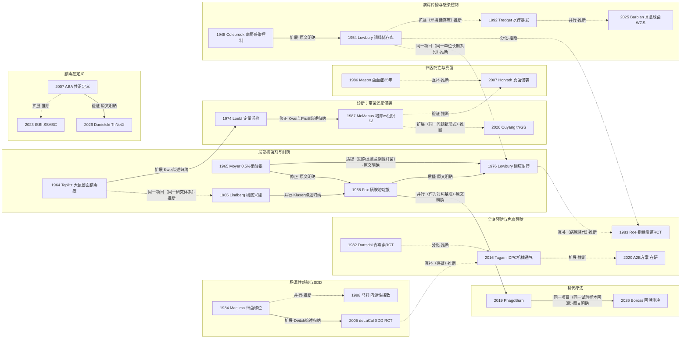

# D04 烧伤感染、脓毒症与局部抗菌

> **一句话判断**：这个方向研究三件事——烧伤病人身上的细菌从哪里来、怎样区分“带菌”和“侵袭性感染”、用什么局部药物和病房管理去挡住它；本轮找到的最早专题文献在 1930 年代（美国 Aldrich 1933、英国 Cruickshank 1935），1964–1968 年三种局部抗菌剂相继用于大面积烧伤，此后分成诊断、局部用药、全身预防、肠源性感染、真菌、免疫预防、病房感染控制等多条并行分支。今天它处在“重新校准定义和诊断”的阶段，至少六个核心问题没有定论（第 5 节）。
> **对临床医生最重要的一点**：培养阳性不等于侵袭性感染——同一块活检一分为二，定量培养 ≥10⁵/g 的标本只有 36% 在组织学上确认侵袭 [D04-N13]；2026 年靶向测序研究的作者同样提醒，阳性可能只是定植 [D04-R20]。

## 0 三分钟速读

1. **从哪里来**：本轮找到的最早专题文献是 Aldrich 1933 NEJM《The Role of Infection in Burns》（仅题录）和 Cruickshank 1935（用血清分型发现同一病房多名患者创面与灰尘中是同一型化脓性链球菌，据 Lowbury & Fox 1954 转述）。英国 Colebrook 组 1948 年把烧伤感染当成病房交叉感染来控制 [D04-N01]；伯明翰 1954 年追踪铜绿假单胞菌的储存库，331 例中 156 例（47%）住院期间新获得铜绿 [D04-N02]。
2. **为什么改变**：链球菌被控制后，铜绿和耐药革兰阴性菌成为问题，致死性铜绿感染在 1954–1961 年被当作主要死因研究。1964 年大鼠模型给出“细菌侵袭存活组织”的实验定义 [D04-N03]，1964–1968 年 0.5% 硝酸银、醋酸磺胺米隆、磺胺嘧啶银相继用于临床（代表论文发表于 1965–1968 年）[D04-N04][D04-N05][D04-N06]。同机构历史对照显示 20–50 岁、40–79% 体表面积患者死亡下降超过 10%，但历史对照不能排除其他治疗变化的影响，不宜单独归因于局部药 [D04-N05]。
3. **如何分化**：至少八条线并行——诊断口径（定量培养 vs 组织学）[D04-N07][D04-N13]；局部药筛出耐药（磺胺耐药菌株 70% 对 44%）[D04-N08]；按菌种、按侵袭区分的归因死亡 [D04-N12][D04-N15]；肠源性感染与选择性消化道去污（SDD），中美 1984–1986 年并行 [D04-N10][D04-N11][D04-N14]；全身预防 [D04-N09][D04-N17]；铜绿免疫预防（746 例随机试验，结果阳性却没有成为常规）[D04-N19]；病房水疗与暴发 [D04-N20]；烧伤专用脓毒症定义 [D04-N16]。
4. **现在研究什么**：七个主题——三套脓毒症标准的再验证（TriNetX 527,197 例；以伤后 7 天内 ICD-10 脓毒症编码为参照、编码阳性只占 1.4% 时，三者阳性预测值为 2.5–6.0%，作者认为只能作筛查，见 4.1）[D04-R02]；生物标志物与机器学习；多重耐药菌和耳念珠菌的基因组流行病学；全身/围术期预防（法国 A2B 试验计划 506 例，结果未出）[D04-R12]；噬菌体；含银敷料再评价；靶向测序与宏基因组诊断（第 4 节）。
5. **用了什么数据**：早期是动物模型、单个烧伤单位的全员拭子和交替分配试验；中期是机构 25 年长时序（5,882 例）[D04-N12] 和同一标本配对；RCT 多为单中心、27–117 例；现在加上行政库（日本 DPC 2,893 例）[D04-N17]、真实世界库和全基因组测序（第 7 节）。
6. **还有什么不知道**：重度烧伤全身预防缺专门的高质量 RCT；脓毒症定义没有共同的参照标准；局部抗菌剂试验多不报感染终点；1960 年代美国奠基论文本轮未读到原文，6 个节点停在题录层（L1）；ABA 2007 脓毒症条目的原文未核（2.9）（第 8 节）。

**覆盖边界**：
- 纳入：创面感染与创面脓毒症的概念和诊断（定量活检、组织学、分子诊断）；局部抗菌剂（硝酸银、醋酸磺胺米隆、磺胺嘧啶银、含银敷料、消毒剂）；病原谱与耐药；病房感染控制（隔离、储存库、水疗）；全身/围术期预防性抗生素与 SDD；肠源性感染与细菌移位；真菌感染；铜绿免疫预防；ABA 2007、Sepsis-3 与 ISBI 2023 在烧伤中的适用性；诊断生物标志物；噬菌体。
- 只点到为止：早期切痂本身（D02）；全身炎症、器官功能与死因归类（D07）；吸入性肺炎（D05）；复苏与感染的时间关系（D01）；湿润烧伤膏（MEBO）的愈合终点（D08）。
- 不含：瘢痕、康复与重建（D09–D11）；学科形成的完整叙述（X01）。

**本章口径**：
- 截止 2026-09-29；近期窗口 2021-09-29 至 2026-09-29，只用于第 4 节，不限制历史追溯。
- 阅读层级：L0=仅二手转述；L1=题录已在数据库核实；L2=摘要已读；L3=原文部分章节已读；L4=全文已读。只到 L0/L1 的写“据某来源转述”或“仅题录”，不写成已核对原文贡献。
- 核查状态：通过=题录与所引数字本轮对照 PubMed 记录或原文核对一致；修正=核对后改正（正文已用修正值）；存疑=保留但证据不足。N19、N20、R20、R21 是后期补充的文献，R23 此前未单独核对；这 5 条成稿时对照 PubMed 摘要核对一次，未经独立复核。
- 节点 20 个：L4 1 个（N08）、L3 1 个（N02）、L2 12 个（N09–N20）、L1 6 个（N01、N03–N07；其中 N04、N06 读到开篇段，结果都据他文转述）。近期代表研究 23 条（L2 16、L1 7）；入口综述/指南 13 条（L3 5、L2 8）。全部 56 行见 `data/evidence_D04.json`。
- 覆盖状态：**基本完整但有标注缺口**（2026-09-29 按全报告统一口径重评，结论不变）。理由：①六个问题都能据本章回答——从哪里来（第 1 节）、为什么改变（2.1–2.3）、如何分化（2.4–2.10 与第 3 节）、现在研究什么（第 4 节）、用了什么数据（第 7 节）、还有什么不知道（第 8 节）；②章节范围内的八条分支（病房传播、局部抗菌剂与耐药、诊断、归因死亡与真菌、肠源性感染与 SDD、全身与免疫预防、脓毒症定义、替代疗法）在第 3 节都有节点，中国线另见第 6 节；③主链关键转折都有可核实来源：1964–1968 年局部药引入虽然原文未读，但结果据可定位的他文转述（Klasen 2000、Kwei 2015、Brown 2004，均标出处），1976、1986、1987、2005、2016、2019 年的转折节点都到摘要层或全文层。缺口限于：6 个奠基节点（N01、N03–N07）原文未读；ABA 2007 条目原文未核（付费墙，限定条件据共识第一作者 2017 年复述，见 2.9）；中文数据库（CNKI、万方）没有检索，中国线只取 PubMed 收录的中文和英文文献；部分近期研究只到题录。以上都已在第 8 节标注，所以不降为“部分”。
- 引用写法：[D04-Nxx]=关键节点；[D04-Rxx]=近期代表研究；[D04-Exx]=入口综述/指南；只出现一两次的辅助文献直接给 PMID 或 DOI。

---

## 1 源头：最初在研究什么

**判断**：没有单一起点。1930–1950 年代英国、美国两条线分别在病房细菌学和“败血症致死”上起步，本轮没有查到两者之间的引用关系。“最早找到”只说明本轮检索范围内没有更早的；“公认奠基”是后来的综述或史料把它当起点，两者不等价。

| 主题 | 起点说法 | 分类 | 依据与限定 | 层级 |
|---|---|---|---|---|
| 烧伤感染的专题讨论 | Aldrich RH. The Role of Infection in Burns. N Engl J Med 1933;208:299-309（DOI 10.1056/NEJM193302092080603） | 目前最早找到的文献 | Crossref 题录；内容未读，只证明 1933 年已有以感染为题的专论。1959 年中文文献（Ch'en C，中华外科杂志 7:1023，PMID 13808943；PubMed 英文题名 Infection and theory of toxemia in burns）显示“毒血症”与“感染”两种解释曾并存；当时争论的具体论点本轮未读，不展开 | L1 |
| 用血清分型追踪病房链球菌传播 | Cruickshank R. J Pathol Bacteriol 1935;41:367-369（DOI 10.1002/path.1700410217） | 目前最早找到的文献（限“血清分型追踪病房传播”） | 同一病房多处烧伤创面和病房灰尘出现同一 Griffith 型化脓性链球菌；内容据 Lowbury & Fox 1954 第 403 页转述 | L1（内容 L0） |
| 病房感染控制（隔离、换药技术、空气卫生） | Colebrook 1947–1948 [D04-N01] | 被公认的奠基工作 | Kim 2022 第 2.3 节称 Colebrook“first introduced”保护创面免于感染的概念 [D04-E13]；这是 Kim 的评价，更早的 Aldrich 1933、Cruickshank 1935 已涉及烧伤感染 | L1 |
| 铜绿作为烧伤病原、局部多粘菌素预防 | Jackson DM, Lowbury EJL, Topley E. Lancet 1951;2:137-147（PMID 14851702） | 目前最早找到的文献（本轮范围） | Lowbury & Fox 1954 引言直接引用；[D04-N02] 是同组更系统的储存库与传播研究，不是首次关注铜绿 | L1 |
| 人体致死性铜绿感染/败血症的临床病理 | Liedberg 1954 SGO 99:151（PMID 13187194）；Bazan 1957 Ann Surg 145:175（PMID 13395302）；Rabin 1961 NEJM 265:1225（PMID 14489592） | 目前最早找到的文献 | 仅题录；三篇都早于 Teplitz 1964 的实验模型 | L1 |
| 烧伤创面脓毒症实验模型与活检评估 | Teplitz 1964 [D04-N03] | 被公认的奠基工作（限实验模型与活检评估方法） | Kwei 2015 Background 称定量活检和组织学评估“源于”Teplitz 的发现 [D04-E11]；不是“创面脓毒症”概念本身的首创 | L1 |
| 0.5% 硝酸银重新用于大面积烧伤 | Moyer 1965 [D04-N04] | 被公认的奠基工作 | Klasen 2000 称 Moyer“revived interest” [D04-E05]；1940 年 Ross & Hulbert 已把硝酸银、鞣酸、龙胆紫并列用于烧伤（BMJ 2:702，DOI 10.1136/bmj.2.4168.702，L1），所以是“重新引入” | L1 |
| 局部磺胺类的前史 | Fox 1968 开篇段 [D04-N06] | 不属于四类：作者对前史的叙述 | 据 Fox 1968 开篇，二战期间已研究可溶性磺胺钠盐局部用于创面和烧伤，此后转向全身用药，局部治疗一度不被相信；所引二战文献本轮未核 | L1 |
| 定量活检培养用于临床 | Loebl 1974 [D04-N07] | 被公认的奠基工作 | Kwei 2015 原话“The clinical method for quantitative biopsy was described by Loebl et al.”；更早有 Lawrence & Lilly 1972（PMID 4628448，定量皮肤细菌学方法用于烧伤）和 Baxter 1973（PMID 4586477），均仅题录 | L1 |
| 烧伤后肠道细菌移位 | Maejima, Deitch, Berg 1984 [D04-N10] | 目前最早找到的文献（限烧伤模型） | 非烧伤的肠源性感染观念更早：Deitch 2012 追溯到 1940 年代犬失血性休克研究 [D04-E10]；中文 Ma 1985（PMID 3939846）与 Ma 1986 [D04-N11] 可能是同一实验 | L2 |
| 烧伤脓毒症诊断标准 | Yao YM, Chai JK, Sheng ZY. 中华烧伤杂志 2003;19:65-66（PMID 12830800） | 目前最早找到的文献（限“诊断标准”） | 仅题录。1974 年已有苏联烧伤脓毒症鉴别诊断文章（Grishina，PMID 4420452）。ABA 2007 [D04-N16] 摘要没有自称首次，是此后验证研究共同的比较对象 | L1 |
| 烧伤脓毒症国际管理指南 | ISBI 2023 SSABC [D04-E07] | 不属于四类：二手来源称“首部” | “首部”出自 Zhu 2025 中文解读 [D04-R22]；原指南摘要只写烧伤一直被排除在 Surviving Sepsis Campaign 之外 | L2 |
| 烧伤创面噬菌体 RCT | PhagoBurn 2019 [D04-N18] | 目前最早找到的文献（限 RCT） | 更早有 Rose 2014 比利时非随机试验，9 例、10 次应用，未能评估疗效（PMID 25356373） | L2 |
| 中国线 | Ch'en 1959（PMID 13808943）；Liu CH 等 1964 Chin Med J 83:779《Studies on septicemia in extensive burns》（PMID 14239695） | 目前最早找到的文献（中国线） | 仅题录，限 PubMed 收录范围 | L1 |

**最初在研究什么**：能落到来源上的问题有三个。第一，感染在烧伤死亡里占什么位置——题名显示 1933 年已有专论，1954–1961 年的临床病理报告把败血症、致死性铜绿感染作为死因来研究（上表）；与“毒血症”解释的关系本轮未读到原文。第二，病房里的链球菌交叉感染——Cruickshank 1935 的血清分型和 Colebrook 的病房措施 [D04-N01]。第三，链球菌控制下来以后，铜绿在病房里怎样传播 [D04-N02]。

---

## 2 关键转折：问题—新证据/新方法—认识变化—新问题

下面按问题组织，不按年份排队。每个关系都写明类型和依据（原文明确讨论/综述归纳/本报告推断）。

### 2.1 病房里怎样传播：从链球菌到铜绿，再到水疗设施（1948–2010）

- **问题**：二战前后英国烧伤病房的“附加感染”很常见，主要威胁是化脓性链球菌（Colebrook 1947《Added infections in burns; a study of 233 cases》，Lancet 1:321，PMID 20288311，L1）。
- **新方法**：Colebrook、Duncan & Ross 1948 在 MRC 烧伤单位实施一组联合措施 [D04-N01]（Lancet 1948;1(6511):893-899，原文未读）。据 Lowbury & Fox 1954 第 413 页转述：病房化脓性链球菌大幅下降，金黄色葡萄球菌和铜绿没有类似下降；Lowbury & Fox 推测葡萄球菌不降有两个原因——青霉素耐药株流行、大量健康人鼻腔和皮肤带菌。
- **认识变化**（扩展，原文明确讨论）：伯明翰 Lowbury & Fox 1954 [D04-N02] 转向铜绿的储存库。1951-07 至 1952-06 入院的 331 例中 156 例（47%）新获得铜绿，>10% 体表面积的多数会获得、<5% 的多数不会；护士手部常被污染（11/29，38%），受感染的创面是主要储存库；新引入的血清型只在一个病房内传播。同文一项按住院号奇偶交替分配的试验（≥15% 体表面积，儿童 ≥10%）：多粘菌素 E+青霉素粉组首次换药定植 16/133（12.0%），单用青霉素粉组 35/126（27.7%）（χ²=9.17，P<0.01）；到后期两组分别为 88/133（66.1%）与 103/126（81.8%），差异仍显著（χ²=7.35，P<0.01），但两组多数最终都被定植。作者结论是没有哪一项措施单独有效，主张多措施并用和隔间病房。局限：交替分配不是随机，终点是定植不是侵袭或死亡。
- **新问题**：药物和措施会不会被耐药菌绕过。同一单位 1977–78 年庆大霉素耐药铜绿高峰时 >90% 耐药，停用庆大霉素止不住暴发，只有把铜绿患者集中到一个病房才有效（Bridges 1979 BMJ，PMID 106914，L2）。
- **后来的设备来源**（扩展，本报告推断“环境储存库”思路的延续）：Tredget 1992 [D04-N20] 用限制性片段长度多态性（RFLP）和菌毛基因探针，把一株致死性院内铜绿暴发追到共用水疗设施；停用水疗期间总死亡率下降，与铜绿脓毒症相关的死亡消失，氨基糖苷耐药下降。设计是单中心前后对照。北美调查显示这一做法在收缩但没有被放弃：59/142 家中心回复（44%），常规用水疗的比例从 1990 年的 95% 降到 83%，浸浴式从 81% 降到 55%，57% 的中心不常规培养水疗设备（Davison 2010，PMID 20305571，L2）。中国 1986 年也有洗浴疗法使用不当致严重烧伤脓毒症的报告（Wang DC，中华整形烧伤外科杂志 2:185，PMID 3151839，仅题录）。

### 2.2 焦痂下的细菌：实验模型与三种局部药（1954–1977）

- **问题**：1954–1961 年的临床报告把败血症、致死性铜绿感染作为主要死因来研究（第 1 节表中 Liedberg、Bazan、Rabin，仅题录；Liedberg 与 Rabin 属美军烧伤研究体系）。Moyer 1965 开篇段写道：过去 30 年烧伤死亡下降主要在 ≤60% 体表面积的患者，>65% 的仍常致死；用平衡钠盐液处理后，休克已不再是主要死因 [D04-N04]。
- **新方法：实验模型**。Teplitz、Davis、Mason、Moncrief 1964 [D04-N03]（同系列 Part II，PMID 14160480；同年 Moncrief & Teplitz《Changing concepts in burn sepsis》，PMID 14151157，均仅题录）。据 Kwei 2015 转述：大鼠创面铜绿数量增加后侵袭下方存活组织并引起临床病症；Kwei 认为后来的定量活检和组织学评估都源于这项发现。原文未读，动物数和阈值未核。
- **新方法：三种局部药**（Klasen 2000 归纳为“短时间内相继出现” [D04-E05]）。
  - 0.5% 硝酸银 [D04-N04]：据 Klasen 2000 转述，Moyer 经体外和体内研究认定 0.5% 是有抗菌作用的最低浓度。据 Fox 1968 开篇段，它是低渗溶液（29.4 mmol/L），会引起特征性的液体和电解质改变。
  - 醋酸磺胺米隆 [D04-N05]：美军烧伤中心 Lindberg 等 1965（同一项目还有 Moncrief 1966，PMID 5934283；Pruitt 1968 JAMA，PMID 5694367；Lindberg 1968，PMID 4973466，均 L1）。据 Kim 2022 转述，1964 年用的是 10% 水溶性乳膏，高渗导致新焦痂和疼痛，后改用 5% 溶液 [D04-E13]。题名显示同一机构 1970–1971 年记录了它相关的酸碱改变（Asch、White、Pruitt 1970 Ann Surg，100 例回顾，PMID 5496480；White & Asch 1971 NEJM，PMID 4995945），1982 年有肾衰患者碳酸酐酶抑制致高碳酸血症和酸中毒的报告（Liebman，PMID 6809230），三篇都只到题录；这是否是它后来使用收窄的原因，本轮没有来源说明。
  - 磺胺嘧啶银 [D04-N06]：Fox 1968 开篇以“前两种都扰乱液体电解质”作为开发理由（修正，原文明确讨论）。机制研究 Fox & Modak 1974（PMID 15825409，L2）：细菌能结合银、不能结合磺胺嘧啶，疗效被认为来自持续缓慢释放的银离子。据 Klasen 2000，它对 >50% 体表面积的烧伤防护不足，Monafo 因此加入硝酸铈（Fox 1977，PMID 850849，L1）。
- **认识变化——效果有多大、能不能归因**：Brown 2004（PMID 15187754，L2）用同一美军烧伤中心数据，比较引入磺胺米隆之前（1950–1963）与之后（1964–1968），20–50 岁、40–79% 体表面积的患者死亡率下降超过 10%，<40% 或 >79% 的只有轻微影响。Brown 称两个时期“其余治疗相近”，但这是同机构历史对照，未记录的做法变化无法排除；Brown 与 Lindberg 系列来自同一机构，不是独立验证。所以这组历史对照不能把死亡下降单独归于局部药。其他章节引用的单因归因（如 Andreasen 1971、Rashid 2001 转述的伯明翰 1971 年报告）均为作者判断，见 D10、D07。Williams 2009 摘要把烧伤死亡的整体下降归于早期切痂植皮、积极复苏和抗菌治疗等多项进步共同作用（PMID 19919684；这是整体概括，不针对 1964 年前后），复苏与切痂见 D01、D02。Pruitt & McManus 1992 综述归纳：局部化疗、及时切痂和闭合使侵袭性创面感染及相关死亡下降 [D04-E03]。Cancio 2021 称局部抗菌剂的出现“可以说”是烧伤救治中最重要的单项进步——这是作者观点，不是本报告的结论 [D04-E04]。
- **新问题**：局部药会不会像全身药一样筛选耐药（2.3）；它们能不能代替“侵袭”的诊断（2.4）。

### 2.3 局部药同样筛选耐药菌（1976–1979）

- **问题**：美国新出的磺胺嘧啶银和硝酸银，需要在英国病房做对照比较并评估耐药后果。
- **新证据**：Lowbury 等 1976 BMJ [D04-N08]，本轮读完 PMC 扫描版第 493–496 页（L4）。伯明翰 MRC 工伤与烧伤单位，**按入院顺序交替分配**，不是随机，含三项比较：
  - 广泛烧伤（预期死亡 ≥0.1）：磺胺嘧啶银（SSD）22 例对 0.5% 硝酸银湿敷（SN）25 例（表 I）。<3 岁儿童因低渗硝酸银有电解质风险被排除（第 493 页）。SN 湿敷对杂类革兰阴性杆菌活性差得多，该组早晚体温和呼吸频率更高。死亡 SN 10/25、SSD 5/22；原文比较的是各组与预期死亡率之差，SSD 组低于预期但不显著。
  - 较小烧伤：硝酸银加洗必泰乳膏（SNC）52 例对 SSD 62 例（表 II），两组相近。
  - 广泛烧伤：SNC 8 例对 SSD 17 例（表 III，1975-06 初步结果），因磺胺耐药出现而提前停止。
  - 耐药：SSD 组分离菌株中磺胺嘧啶耐药 41/59（70%），SN 组 23/52（44%）（χ²=6.26，P<0.02）。单位随后暂停 SSD 和全部磺胺类；附言称停药 6 个月后多数革兰阴性杆菌对磺胺的敏感性恢复。作者讨论称，临床结果并不提示 SN 湿敷在预防侵袭性感染和死亡上优于 SNC 或 SSD。
- **关系**：对硝酸银是“质疑”，但只限于对杂类革兰阴性杆菌的活性，三种制剂总体防护作用相当（原文明确讨论）；对磺胺嘧啶银是“质疑”（原文明确讨论）；与 [D04-N02] 是“同一项目”关系——同一单位的长期系列（本报告推断，署名单位相同）。同一项目的 Bridges & Lowbury 1977（PMID 321478，L2）：病房停用全部磺胺后耐药率回到引入前水平；克雷伯菌多携带可转移的多重耐药（T Ce Cl A Ca S 谱型见于 22 株中的 4 株）。
- **认识变化**：局部抗菌也有选择压力，病房可以用“停药—耐药回落”做自然实验。这与 2.8 节免疫预防后克雷伯菌取代铜绿是同一类现象（本报告推断）。

### 2.4 “带菌”还是“侵袭”：诊断口径之争（1972–2018，至今两法并存）

- **问题**：表面拭子分不清定植和侵袭，临床需要一个能操作的细菌负荷指标。
- **新方法**：定量细菌学先出现在 Lawrence & Lilly 1972 和 Baxter 1973（均仅题录，第 1 节）。Loebl 等 1974 [D04-N07]（同项目方法学论文 Loebl 1974 Am J Clin Pathol，PMID 4588085，L1）把定量活检培养用于常规监测。据 Kwei 2015 转述：活检阳性（>10⁴/g）的患者中，儿童 88%、成人 45% 出现脓毒症临床征象。后来通用阈值是 10⁵ CFU/g（Kwei 2015）——**阈值两说并存**，本轮未能读 Loebl 原文核对。Pruitt & Foley 1973《The use of biopsies in burn patient care》（PMID 4703490）是组织学活检的早期文献，无摘要、未读。
- **修正**（综述归纳：Kwei 2015、Pruitt 1998）：McManus 等 1987 [D04-N13] 把 200 例患者的活检一分为二，一半做定量培养，一半做组织病理评分（1–6 分，≥4 分为微生物侵袭存活组织）。培养阴性（<10⁵/g）与组织学无侵袭的一致率 96.1%，但培养阳性的标本只有 36% 确认侵袭。低计数基本可排除侵袭，高计数常常只是定植。Pruitt 1998 据此写明组织学是区分定植与侵袭唯一可靠的手段 [D04-E02]。
- **为什么说“至今并存”而不是“已经转向”**：定量方法此后仍有支持者（Buchanan 1986，PMID 3084547），也有人专门讨论它的缺陷（Freshwater 1980，题名《Potential pitfalls》，PMID 7447271，L1）。Halstead 2018 系统综述（26 项研究，检索至 2015-08）认为证据有限、报告质量差，需要多次采样并结合临床解读 [D04-E11]。真菌的组织病理与培养一致性也差（Schofield 2007，PMID 17321689，L2）。靶向测序出现后，同一个问题换了形式重新出现（4.7，本报告推断）。

### 2.5 哪些感染真正致死：按菌种、按侵袭分层（1986–2007）

- **问题**：菌血症常见，但哪类菌血症真正增加死亡，需要排除面积和年龄的影响。
- **新方法**：Mason、McManus、Pruitt 1986 [D04-N12] 用美军烧伤中心 1959–1983 年连续 5,882 例（有效 5,877；1,481 例至少一次血培养阳性；1,529 例死亡），用 4,396 例无菌血症患者建立死亡预测模型，再比较各类菌血症的观察与预测死亡。革兰阴性菌血症显著增加死亡；酵母样菌血症的增加不确定；革兰阳性菌血症没有可归因的增加。同一队列的 McManus 1985（PMID 3924612，same cohort）：540 例铜绿菌血症，平均烧伤面积 54.2%，死亡率 77%，比预测高 28%，25 年间没有明显变化。
- **扩展到真菌**（互补，本报告推断；两文作者只有 Mason 重叠，同属美军外科研究所烧伤中心体系）：同中心 Becker 1991 回顾 10 年资料，细菌性创面感染明显下降，真菌性创面感染没有下降（PMID 1985634，L2）。Horvath 等 2007 [D04-N15] 用 1991–2002 年 2,651 例，按组织病理分为无真菌 2,476、定植 121、侵袭 54；三组中位面积 9%、47%、64%，死亡率 5%、27%、76%。校正面积、Ⅲ度面积、年龄、吸入伤、性别后，真菌侵袭独立相关（OR 8.16，相当于面积增加 33% 的影响），定植不独立相关；关联主要出现在 30–60% 体表面积的患者。同中心 Schofield 2007（2000-04 至 2005-03，与 Horvath 在 2000–2002 年重叠）：68 例组织学见真菌，19 例侵袭，侵袭 OR 25.3（3.12–204.8），菌种对三大类抗真菌药均有耐药。这一步与 [D04-N13] 用的是同一条界线——组织学侵袭，而不是培养阳性（验证，本报告推断）。
- **耐药菌是否独立致死，结论不一**：同一中心 Albrecht 2006（PMID 17000400，L2）802 例中 59 例鲍曼不动杆菌感染，未校正相对危险度 2.86，多因素分析后与死亡无独立关联。
- **关于“病原谱逐代更替”的说法**：Pruitt 1998 摘要写的是创面优势菌群“随时间”从革兰阳性变为革兰阴性，“重演了烧伤创面感染史”——指单个患者住院期间菌群的变化，作者用它类比历史，不是按年代的病原更替证据 [D04-E02]。Pruitt & McManus 1992 摘要也写到，当时肺炎以支气管肺炎为主，最常见致病菌是革兰阳性菌 [D04-E03]。2026 年华南两中心 814 例感染患者按面积分层，革兰阴性菌占比从 27.1% 到 56.6%、真菌从 9.0% 到 20.6% 不等 [D04-R20]。这些来源不支持“革兰阳性→铜绿→多重耐药革兰阴性菌和真菌”的单线更替叙事。
- **今天感染还占多大分量（与 D07 交叉，只点到）**：美国一家儿童烧伤中心 1989–2009 年收治 5,260 例、死亡 145 例，144 例尸检中脓毒症占 47%，两个十年从 35% 升到 54%，耐药菌所占比例显著上升（Williams 2009，PMID 19919684，L2）；赫尔辛基 1999–2005 年 71 例死亡中 40% 死于多器官衰竭，脓毒症总与多器官衰竭同时出现（Kallinen 2012，PMID 21979843，L2）。同样的死亡归为“脓毒症”还是“器官衰竭”，取决于归类口径。

### 2.6 感染是不是从肠道来：细菌移位与 SDD（1984–2018）

- **问题**：部分脓毒症找不到创面来源，内源性菌从何而来。
- **新证据（中美并行）**：Maejima、Deitch、Berg 1984 [D04-N10]：对照组和 20% 体表面积烧伤组都没有培养出固有菌；40% 组 44% 的大鼠伤后第 2 天肠系膜淋巴结里有活的大肠杆菌、奇异变形杆菌、葡萄球菌和梭菌；到第 14 天局限在淋巴结。中国马莉、肖光夏等 1986 [D04-N11]：肠黏膜屏障受损是内源性微生物播散的主要因素，Kupffer 细胞吞噬和调理功能下降也起作用（摘要仅两句）。两组几乎同期，本轮没有查到互引（并行，本报告推断）。
- **中国线的扩展**：Fu 1994 用 110 只大鼠做 pUC19 质粒示踪，焦痂下组织质粒检出从伤后早期 10.81% 升到第 12 天 62.5%，提示肠道→会阴→创面途径（PMID 7750422，L2）；Peng 1996 在 46 只大鼠中证明细菌和内毒素可经肠淋巴移位（PMID 9206143，L2）；Wang 2004 的 128 只大鼠中 69 只移位（53.9%），回肠损伤评分（OR 45.52）和黏膜双歧杆菌数（OR 0.039）是独立预测因素（PMID 15162536，L2）。
- **概念修正**（据 Deitch 2012 [D04-E10]，本轮对照其 PMC 全文核实）：临床证据主要是间接的通透性探针；Moore 等在**创伤**（非烧伤）患者中，门静脉血培养只有 2% 阳性，所有门静脉样本都没有检出内毒素。Deitch 由此转向“肠淋巴假说”——指无菌的非微生物性致伤因子经肠淋巴进入循环引起全身炎症和器官衰竭，**不是**细菌经淋巴移位。所以 Peng 1996 与 Deitch 的假说机制对象不同，只能算并行，不是同一结论。题名显示，实验中预防性抗生素减少了移位，但没有降低实验性创面脓毒症的死亡率（Jones 1990，PMID 2191143，L1）。
- **临床干预：SDD**（扩展，综述归纳：Deitch 2012 SDD 段，针对一般 ICU）。de la Cal 等 2005 [D04-N14] 是本轮找到的唯一一项烧伤 SDD 随机双盲安慰剂对照试验：单中心，≥20% 体表面积和/或疑似吸入伤，随机 117 例、分析 107 例（53/54）。烧伤 ICU 死亡率安慰剂 27.8%、SDD 9.4%；按预测死亡率校正后 ICU 死亡 RR 0.25（0.08–0.76），住院死亡 RR 0.28（0.10–0.80）；肺炎每千机械通气日 30.8 对 17.0（P=0.03）。SDD 同时含短程全身抗生素。López-Rodríguez 2016 Shock（PMID 27755474）分析的是同一试验同一批 107 例的器官功能，是二次分析，不是另一项 RCT。
- **分歧**：Barajas-Nava 2013 Cochrane 中非吸收性抗生素 2 项试验 140 人，对各类感染率无显著影响，非吸收性抗生素加头孢噻肟使 MRSA 增加（RR 2.22，1.21–4.07）[D04-E09]；同组作者的 Rubio-Regidor 2018 系统综述（5 项 RCT、5 项观察性研究，1,680 例）中只有这一项 SDD RCT（OR 0.20），作者认为 SDD 安全（PMID 28797573，L2）。至今没有多中心重复。

### 2.7 全身预防性抗生素：从“常规用”到“给谁用”（1982–2026）

- **问题**：链球菌时代留下的常规低剂量青霉素预防是否有效。
- **反证**：Durtschi 等 1982 [D04-N09]，随机、安慰剂对照，成人 1–91% 体表面积，青霉素 5 天，25 例对 26 例（安慰剂组人数经 Avni 2010 表格证实）。蜂窝织炎 11 对 7，创面脓毒症 2 对 3（p=0.340）；两组都没有出现庆大霉素耐药革兰阴性菌，青霉素组 2 例肠道新出现酵母菌定植；作者结论是常规预防既不保护、也不促进耐药选择。样本小，检验效能不足。Sheridan 2001 用两个时期的儿童历史对照（1992–94 年常规预防 511 例对 1995–97 年只治筛查阳性者 406 例），A 组链球菌感染 0.6% 对 0.98%（p=0.71）（PMID 11493799，L2）。
- **Meta 的反方向信号**：Avni 2010 [D04-E08] 纳入 17 项试验、1,113 例（1968–2008），入院后 4–14 天全身预防降低全因死亡（RR 0.54，0.34–0.87；5 项试验 272 例；NNT 8），但作者自评方法学质量差，预防药物相关的耐药增加（率比 2.84，1.38–5.83）。Barajas-Nava 2013（36 项 RCT、2,117 人）认为围术期全身预防对各项结局都没有效果 [D04-E09]。Ramos 2017 系统综述：多数患者不支持（1C/2B），需机械通气的重度烧伤“可能有用”（2B）（PMID 28629932，L2）。
- **分化**（本报告推断：人群和药物都不同）：Tagami 等 2016 [D04-N17] 用日本 DPC 住院库 2010-07 至 2013-03、583 家医院、烧伤指数 ≥10 的 2,893 例，按入院 2 天内是否机械通气分层做倾向评分匹配。机械通气组（232 对）28 天死亡率对照 47.0%、预防组 36.6%，差 10.3%（95% CI 1.4–19.3）；非机械通气组（526 对）5.1% 对 4.2%，无显著差异。局限：观察性，适应证偏倚无法排除，行政库缺微生物和耐药信息；同年有质疑安全性的来信（Hurley 2016，PMID 26970387；Legrand 2016，PMID 26951574，L1）。问题从“要不要常规预防”变成“哪一类高危患者可能获益”。
- **正在等的试验**：A2B（NCT04292054）[D04-R12]，法国 10 中心、随机双盲安慰剂对照，计划 506 例，5–40% 体表面积，前两次切痂植皮术前 30 分钟给药。2026-09-29 查询登记：状态 RECRUITING，最后核实日期 2025-10，记录最后更新 2025-11-24；预计主要完成日 2026-04-18 与研究完成日 2026-07-09 都已过去但登记未更新，hasResults=false，PubMed 未检出结果论文——**状态待确认**。
- 关于 [D04-N14] 与 [D04-N17] 的关系：Avni 2010 确实把 de la Cal 2005（全身头孢噻肟加非吸收性抗生素）与其他全身预防放进同一框架，但两篇综述早于 Tagami 2016，不可能讨论它；两者的“互补”关系是本报告推断，标**存疑**。

### 2.8 一条结果阳性却没有成为常规的路线：铜绿免疫预防（1983）

- **问题**：铜绿创面感染和菌血症致死，局部药又会筛出耐药。
- **新证据**：Roe & Jones 1983 [D04-N19]，新德里 Safdarjang 医院，746 例 5–70% 体表面积全层烧伤患者随机分为四组：16 价铜绿疫苗 PEV-01、抗铜绿人免疫球蛋白、两者联合、不做免疫预防。Rev Infect Dis 版摘要：疫苗组与不免疫组相比，死亡率在成人降为约四分之一，在儿童降一半以上；疫苗加免疫球蛋白联合反而不如单用；免疫后肺炎克雷伯菌成为革兰阴性菌血症的主要病原。同一试验的 Burns 版摘要（PMID 6412970，same cohort）写的是免疫治疗使成人死亡降为四分之一、儿童降为三分之一——两版儿童数字不一致，两说并存。
- **认识变化与未解问题**：结果阳性，但本轮找到的来源都没有说明它为什么没有进入标准治疗——原文未说明，本轮未核实。病原替代（克雷伯菌取代铜绿）与 [D04-N08] 中磺胺耐药菌占优是同一类现象（互补，本报告推断）。更早的 Jones、Lowbury 等 1966–1977 年疫苗研究只见题名线索，没有可定位来源（第 8 节）。

### 2.9 什么算“烧伤脓毒症”：定义之争（2003–2026）

- **问题**：烧伤患者因为大面积创面持续暴露于炎症介质，按定义本来就处在全身炎症反应（SIRS）状态；发热、心动过速、呼吸急促、白细胞增多在烧伤中普遍存在，通用标准适用性差（ABA 2007 摘要）。
- **中国更早的标准类文献**：姚咏明、柴家科、盛志勇 2003（中华烧伤杂志 19:65，PMID 12830800，英文题名 Diagnostic criterion and management of burn sepsis）；Wang ZQ 2003（同刊 19:282，PMID 14687531，英文题名 The clinical staging and tissue bacterial quantification in the diagnosis of burn wound sepsis），均仅题录。
- **新方法**：ABA 共识会议 2007-01-20 在 Tucson 召开 [D04-N16]，目的是为烧伤人群制定标准化的脓毒症和感染定义，作为多中心研究的共同口径。结构是：有明确感染，并满足 6 条中至少 3 条；**具体条目和阈值见原文，本轮未核原文**（付费墙；2026-09-29 查 OpenAlex 与 Europe PMC，均无开放全文）。Zhu 2025 等中文解读列出的阈值是二手转述（L0），可能遗漏限定条件，本章不再列出。共识第一作者 Greenhalgh 2017 年综述（Burns Trauma 5:23，PMID 28795054，PMC5547526；相关段落全文已读，L3；对 2007 原文仍属复述，未逐条核对）复述的条目，确实带有中文转述里没有的限定：心动过速和呼吸急促写作“进行性”；机械通气者可用分钟通气量 >12 L/min 代替呼吸频率；血小板条目伤后 3 天内不适用；高血糖限于既往无糖尿病者，并以血糖值、静脉胰岛素用量或胰岛素需要量增加来界定；肠内营养不耐受要求持续 >24 小时并列出具体表现；儿童按年龄别标准另设阈值。“明确感染”指培养阳性、找到病理组织来源或对抗菌药有临床反应三者之一。床旁使用前应以 2007 原文为准。它是专家共识，没有预先验证。
- **质疑与分化**：Mann-Salinas 2013（59 名受试者、177 个血培养时段，98% 符合 SIRS 标准）用六变量模型，AUC 0.775/0.714，ABA 标准 0.619/0.597（PMID 23135212，L2）。Yan 2018（418 例中 88 例经前瞻性临床诊断为脓毒症）：ABA、Mann-Salinas、Sepsis-3 阳性率 59%、28%、85%；Sepsis-3 预测性最好，但没有一套能单独作诊断标准（PMID 30049483，L2）。Yoon 2018（首尔 Hangang 圣心医院，2009–2015 年 1,185 例）：Sepsis-3 的预后准确度并不更好，SOFA ≥6 准确度 0.86（PMID 29620554，L2）——它与同中心 2010–2020 年的 Yoon 2023 [D04-R01] 病例重叠，两篇不是独立证据。
- **现在**：ISBI 2023 SSABC [D04-E07] 对应 2021 年 Surviving Sepsis Campaign 的 PICO，14 个主题下 60 条陈述，要求 80% 同意、四轮评议；作者强调这些陈述是供后续检验的指南，不是定论。Danielski 2026 用 TriNetX 验证三套标准（验证，原文明确讨论）[D04-R02]，见 4.1。

### 2.10 耐药时代的替代疗法：噬菌体（2014–2026）

- **前驱**：Rose 2014 比利时非随机试验，9 例、10 次应用，未能评估疗效（PMID 25356373，L2）。
- **反证并明确边界**：PhagoBurn [D04-N18]，Jault 2019 摘要写“法国和比利时 9 个烧伤中心”，Boross 2026 写“瑞士、法国和比利时”，两说并存。12 种裂解性抗铜绿噬菌体鸡尾酒 PP1131（设计浓度 1×10⁶ PFU/mL）对照 1% 磺胺嘧啶银乳剂（对照基准，原文明确），每日局部用 7 天、随访 14 天，微生物学者和患者设盲、临床医生未设盲。随机 27 例（13/14），疗效人群 25 例（12/13）。细菌负荷持续下降两个象限的中位时间：噬菌体组 144 小时，对照组 47 小时（HR 0.29，0.10–0.79；p=0.018），噬菌体组更差。制剂滴度生产后下降，实际给药约 1×10² PFU/mL/天。不良事件 23% 对 54%。2017-01-02 因疗效不足停止。
- **新问题**：失败是制剂滴度问题，还是菌株适应和非经典相互作用导致的本质局限？同一试验样本的回溯测序见 4.5 [D04-R16]。

---

## 3 分支图

图例：实线=原文明确讨论或综述归纳的关系；虚线=本报告推断。边上写“关系类型（说明）·依据”，关系类型限验证、扩展、质疑、修正、分化、互补、并行、同一项目八类，括号里是原来的具体说法。节点为“年份 简称”。起点线索（Aldrich 1933、Cruickshank 1935 等）只到题录，未画入。

说明：原提交中“ABA 2007→Tagami 2016（并行）”一条只因“都在 2007 年后”，本章已删除，避免被读成承接关系。

---

## 4 近五年重点（2021-09-29 至 2026-09-29）

### 4.1 烧伤脓毒症定义的再验证

- **研究什么**：ABA 2007、Mann-Salinas、Sepsis-3（SOFA）三套标准在烧伤中的敏感度、特异度和预后价值；以器官功能为导向的定义能否取代以 SIRS 为基础的烧伤标准。
- **数据与设计**：单中心回顾性队列、多中心真实世界库、国际专家共识。
- **代表研究**：
  - Yoon 2023 [D04-R01]：首尔单中心 2010–2020 年 1,391 例疑似感染；校正后 SOFA≥2 的 HR 2.426、qSOFA≥2 为 7.198；SIRS 敏感度 0.989 但特异度 0.461，qSOFA 和烧伤专用 SIRS 特异度 0.929、0.922。与 Yoon 2018 同中心、时段重叠。
  - Danielski 2026 [D04-R02]：TriNetX 527,197 例成人烧伤，以伤后 7 天内 ICD-10 编码（A40/A41/R65.2）的脓毒症为参照（8,810 例，1.4%）。敏感度 ABA 86.7%、Mann-Salinas 86.6%、Sepsis-3 81.4%；特异度 61.6%、77.0%、45.8%；阳性预测值 2.5–6.0%；三种定义下 28 天死亡率无差异。作者认为 Mann-Salinas 最均衡，所有标准都只能作筛查。读这组阳性预测值时要注意参照标准：编码阳性只占 1.4%，阳性预测值本来就会很低；ICD 编码是否漏记脓毒症也未知。所以它说明三套标准不宜单独作诊断，不等于它们在临床上没有用（本报告推断）。
  - ISBI 2023 SSABC [D04-E07]：60 条陈述，供检验的指南。Knuth 2022 [D04-R03] 只核题录。
- **分歧**：Yan 2018 认为 Sepsis-3 预测性最好；Yoon 2018 认为它的预后准确度不更好；Danielski 2026 认为 Mann-Salinas 最均衡。三者的参照标准不同（前瞻性临床诊断、血培养时段、ICD 编码），本报告认为这是结论分歧的重要来源；首尔两篇不是独立证据。
- **成熟度**：发展中。

### 4.2 诊断生物标志物、动态轨迹与机器学习

- **研究什么**：降钙素原、presepsin、多标志物纵向轨迹和机器学习模型，能否提前识别脓毒症或血流感染。
- **数据与设计**：诊断准确性 Meta、单中心前瞻性诊断研究、单中心回顾性轨迹分析（线性混合模型、k-means）、系统综述（PROBAST+AI）。
- **代表研究**：
  - Li AT 2022 [D04-R04]：28 项研究、57 种标志物、1,517 名受试者；降钙素原敏感度 73%、特异度 75%，CRP 86%/54%，白细胞 47%/65%。**检索截至 2020-02，证据本身早于近期窗口。**
  - Tan 2021 [D04-R05]：重庆西南医院 2014–2019 年 ≥40% 体表面积 321 例；降钙素原浓度 AUC 0.788，动态变化 AUC 0.826；阈值 1.41 ng/mL 或较基线升高 1.34 倍。
  - Park 2025 [D04-R06]：前瞻性 221 例；presepsin AUC 0.810，培养阴性病例中 0.846（对照标志物 0.604）。
  - Lou 2026 [D04-R07]：943 例（Sepsis-3），15 种标志物的纵向轨迹；21 天死亡 17.92%；聚出三种表型，死亡率 5.2%、18.7%、38.0%；多因素分析中只有烧伤指数独立相关。
  - Azizi 2026 [D04-R08]：机器学习 7 项研究，样本 82–302，1 项多中心，1 项做了内部重抽样之外的时间验证。
- **分歧**：单中心研究降钙素原 AUC 约 0.8，Meta 只有约 73%/75%；差距可能与脓毒症定义、采样时间和阈值不同有关（本报告归纳）。
- **成熟度**：单一标志物为早期线索，降钙素原为发展中；机器学习处于起步阶段。

### 4.3 多重耐药革兰阴性菌与耳念珠菌：基因组流行病学与病房暴发

- **研究什么**：耐碳青霉烯鲍曼不动杆菌、耐药革兰阴性菌和耳念珠菌的流行克隆、传播链与挽救治疗。
- **数据与设计**：多省分离株 MLST 与耐药基因检测；暴发调查合并全基因组测序；单中心回顾性治疗队列；研究议程。
- **代表研究**：
  - Pan 2025 [D04-R09]：中国六省 2016–2020 年烧伤创面鲍曼不动杆菌 415 株，MDR 92.5%、XDR 9.2%；优势克隆由 CC92 转为 CC1417 和 CC1660；对替加环素和头孢哌酮/舒巴坦耐药较低。
  - Barbian 2025 [D04-R10]：美国伊利诺伊烧伤 ICU 2021–2023 年耳念珠菌 28 例（15 例定植、13 例临床感染），4 个簇（0–6 SNP），提示多次输入加单元内传播，不是长期固定的环境来源。
  - Jiang 2025 [D04-R11]：2018–2023 年 72 例耐碳青霉烯革兰阴性菌所致烧伤脓毒症，30 天全因死亡 31.9%；早期适当使用多粘菌素 B 是独立保护因素（HR 0.183）；肾毒性 19.4%。
  - Sopirala 2025 [D04-E12]：SHEA 烧伤感染防控兴趣组与 ABA 合作的研究议程，列出监测、微生物学（生物膜和微生物组）、愈合策略、烧伤单元特有防控措施、风险预测模型五个优先领域；指出 CDC/NHSN 与 ABA 定义不统一，BCQP 并非以感染监测为主。
- **分歧**：耐药菌感染是否独立增加死亡（Albrecht 2006 多因素后不独立，2.5）；暴发来源是环境还是人际传播，各中心结论不同，基因组数据开始改变判断。
- **成熟度**：发展中。

### 4.4 全身/围术期预防性抗生素

- **研究什么**：哪一类烧伤患者（机械通气、切痂植皮围术期、小面积）需要预防，以及预防与耐药、肾毒性的权衡。
- **代表研究**：A2B 方案（Dépret 2020）与登记记录 [D04-R12]（状态见 2.7）；Mackow 2023 评论《Which trial do we need?》[D04-R13]、Puthumana 2022 ≤20% 体表面积切痂是否需要预防的回顾性研究 [D04-R14]、Christensen 2026 围术期预防系统综述方案 [D04-R15]，三篇只核题录。
- **分歧**：Avni 2010（RR 0.54，试验质量差）、Barajas-Nava 2013（围术期无效）、Tagami 2016（只在机械通气组）针对的人群和药物不同。
- **成熟度**：**窗口内没有摘要层级以上的原始数据**；关键 RCT 结果未出。

### 4.5 噬菌体等替代疗法

- **代表研究**：Boross 2026 [D04-R16] 用 PhagoBurn 样本回溯：7 名患者 184 株分离株，98 株测序，41 株（42%）检出 PP1131 来源的噬菌体 DNA，提示慢性感染或假溶原等非经典相互作用；个体内的敏感性随时间快速变化。de Villiers de la Noue 2025 [D04-R17] 为洛桑烧伤患者的鲍曼不动杆菌理性设计双噬菌体组合（仅题录）。
- **分歧**：PhagoBurn 失败是制剂滴度失效，还是菌株适应导致的本质局限，没有定论。
- **成熟度**：早期线索；临床 RCT 仍缺。

### 4.6 局部抗菌敷料与消毒剂的再评价

- **背景（窗口外）**：Norman 2017 Cochrane（检索至 2016-09，56 项 RCT、5,807 人）：与磺胺嘧啶银相比，银基消毒剂可能缩短愈合时间（−3.33 天，I²=87%），感染方面无法确定，多数试验不报或不完整报告感染终点（PMID 28700086，L2）。Heyneman 2016 系统综述：多数新型敷料愈合更快，但感染方面没有一种明显优于磺胺嘧啶银；结论“不再支持标准使用磺胺嘧啶银”限于部分厚度烧伤的保守治疗（PMID 27126813，L2）。
- **代表研究**：Ye 2025 [D04-R18]：中国 6 中心双盲非劣效 RCT（2019-10 至 2021-01），132 例深Ⅱ度烧伤，HBPs-Ag 敷料不劣于 Atrauman Ag，总有效率 98.3% 对 94.7%，血或尿检出银的患者占 3.79%（5 例）。Chen Z 2026 [D04-R19] 磺胺嘧啶银与纳米晶银的 Meta，只核题录。
- **分歧与成熟度**：**窗口内缺少以感染为终点的研究**；Ye 2025 的主要终点是愈合。发展中，确定性低到极低。

### 4.7 靶向测序与宏基因组诊断（新主题）

- **研究什么**：靶向二代测序（t-NGS）和宏基因组能否比培养更早、更多地检出病原，以及阳性结果的临床含义。
- **代表研究**：
  - Ouyang 2026 [D04-R20]：华南两家烧伤中心 2020–2024 年 814 例感染患者，按体表面积分层，从最小面积组到最大面积组：多菌感染 25.7%→64.4%，革兰阴性菌 27.1%→56.6%，真菌 9.0%→20.6%。40 份标本中 t-NGS 阳性率 77.5%、培养 55.0%；血标本 55.6% 对 16.7%。作者提醒阳性结果可能只是定植。
  - Mellon 2025 [D04-R21]：在烧伤 ICU 用鸟枪法宏基因组评估换药时的空气污染（仅题录），对应 Sopirala 2025 列出的环境（空气）控制缺口。
- **与老问题的关系**（扩展，本报告推断）：检出率更高，但“阳性是定植还是侵袭”的问题与 1987 年定量培养对组织学 [D04-N13] 是同一个问题的新形式。
- **成熟度**：早期线索；只有 40 份标本的试点对比。

---

## 5 争议、负性结果与停滞路线

### 5.1 仍在争或说不清的问题

| 争议 | 各方证据 | 现状 |
|---|---|---|
| 重度烧伤是否用全身预防性抗生素 | 反对常规用：Durtschi 1982 RCT [D04-N09]；Sheridan 2001；Barajas-Nava 2013 [D04-E09]；Ramos 2017（1C/2B）。可能获益：Avni 2010 RR 0.54（5 项试验 272 例，质量差，耐药率比 2.84）[D04-E08]；Tagami 2016 机械通气组 28 天死亡差 10.3% [D04-N17] | 未解决；A2B 登记过期、结果未出 [D04-R12] |
| 磺胺嘧啶银还算不算标准局部用药 | 支持：约 40 年经验，PhagoBurn 等试验的标准对照 [D04-N18]。反对：Barajas-Nava 2013 中 11 项试验 645 人，与敷料/皮肤替代物相比创面感染增加（OR 1.87，1.09–3.19）、住院多 2.11 天，偏倚高或不清；Heyneman 2016（限部分厚度保守治疗）；1976 年起已见磺胺耐药菌被筛选 [D04-N08] | 部分转向；缺高质量感染终点证据 |
| 定量活检培养还是组织学判断侵袭 | 定量：Loebl 1974 [D04-N07]、Buchanan 1986。组织学：McManus 1987（36%）[D04-N13]、Pruitt 1998 [D04-E02]。阈值 10⁴/g 与 10⁵/g 两说 | 两法并存；Halstead 2018 认为证据有限 [D04-E11] |
| 烧伤脓毒症用哪套定义 | ABA 2007 [D04-N16]；Mann-Salinas 2013；Sepsis-3；SSABC 2023 强调动态评估器官功能 [D04-E07] | 未解决；各研究参照标准不同；以 ICD 编码为参照（编码阳性 1.4%）时阳性预测值 2.5–6.0%，作者认为只能作筛查 [D04-R02] |
| SDD 在烧伤中的地位 | 支持：de la Cal 2005 单中心 RCT（ICU RR 0.25）[D04-N14]，同组 Rubio-Regidor 2018 认为安全。质疑：Barajas-Nava 2013 中对感染率无显著影响、MRSA RR 2.22 | 未解决；只有 1 项烧伤 SDD RCT（分析 107 例），无多中心重复 |
| 肠源性感染对临床结局的贡献 | 动物证据多（[D04-N10][D04-N11]；Fu 1994；Wang 2004）；临床证据间接（Peng 2001 乳果糖/甘露醇比、内毒素）；Deitch 2012 转向无菌因子的肠淋巴假说 [D04-E10] | 作为机制被广泛接受，对临床结局的因果贡献未证实 |
| 耐药菌是否独立增加死亡 | 革兰阴性菌血症增加死亡 [D04-N12]；鲍曼不动杆菌多因素后不独立（Albrecht 2006）；儿童尸检中耐药菌所占比例上升（Williams 2009） | 未解决；与死因归类口径（脓毒症 vs 多器官衰竭，Kallinen 2012）纠缠，交 D07 |

### 5.2 负性结果、失败路线与停滞

| 路线 | 结果 | 证据 |
|---|---|---|
| 常规青霉素预防链球菌感染 | 没有降低蜂窝织炎、创面脓毒症或 A 组链球菌感染 | [D04-N09]（51 例，p=0.340）；Sheridan 2001（917 名儿童，0.6% 对 0.98%） |
| 噬菌体鸡尾酒 PP1131 | 细菌负荷下降比磺胺嘧啶银慢（144 对 47 小时），提前终止；滴度从 10⁶ 降到约 10² PFU/mL | [D04-N18]；[D04-R16] |
| 用定量培养诊断侵袭 | 高计数中只有 36% 组织学确认侵袭 | [D04-N13]；Halstead 2018 |
| 长期单一局部化学预防 | 磺胺耐药菌株 70% 对 44%，后期预防效果下降；庆大霉素耐药铜绿暴发时停药无效，分区隔离才奏效 | [D04-N08]；Bridges & Lowbury 1977；Bridges 1979 |
| 早期撒布多粘菌素粉 | 首次换药定植减半，但后期两组多数仍被定植（66.1% 对 81.8%，差异仍显著） | [D04-N02] 表 9 |
| 用已有措施应对真菌 | 10 年间细菌性创面感染下降，真菌性没有下降 | Becker 1991 |
| 常用标志物诊断脓毒症 | CRP、白细胞、降钙素原预测性差 | [D04-R04] |
| 用抗生素阻断肠道移位（实验） | 题名显示：移位减少，实验性创面脓毒症死亡不降 | Jones 1990（L1） |
| 铜绿免疫预防 | 746 例随机试验死亡率下降，但没有成为常规；免疫后克雷伯菌成为主要革兰阴性菌血症病原；未被采用的原因本轮未核 | [D04-N19] |
| 浸浴式水疗 | 致死性铜绿暴发追到共用水疗设施；北美使用率下降但多数中心仍在用 | [D04-N20]；Davison 2010 |
| 10% 磺胺米隆乳膏 | 高渗致新焦痂和疼痛，改为 5% 溶液；酸碱改变见 1970–1982 年题名 | [D04-E13]；Asch 1970、White 1971、Liebman 1982（L1） |

---

## 6 中国线

**判断**：本轮能核实的中国线有五段，最早到 1959 年（题录）。篇数最多、摘要层级证据最完整的是 1985–2004 年第三军医大学和解放军 304 医院（后称解放军总医院第一附属医院，PMID 27338528 单位字段）的肠源性感染研究，与美国 Deitch 组几乎同期；近五年以多中心病原与诊断研究为主。中文数据库没有检索，所以 1950–1990 年代的中文原始研究只见 PubMed 题录。

1. **早期中文文献（仅题录，结果未读）**：Ch'en 1959 讨论烧伤感染与毒血症学说（PMID 13808943）；Liu CH、Hsue CY 等 1964 Chin Med J《Studies on septicemia in extensive burns》（PMID 14239695）；Ge SD 1982 研究国产 N1-金属磺胺类预防创面脓毒症（中华外科杂志 20:264，PMID 7128331）；Wang DC 1986 洗浴疗法使用不当致脓毒症（PMID 3151839）；Yang XD 1989 分析 240 例铜绿败血症（中华外科杂志 27:292，PMID 2806007）。
2. **肠源性感染/细菌移位（第三军医大学系）**：马莉 1985 严重烧伤后肠源性感染的实验研究（中华整形烧伤外科杂志 1:179，PMID 3939846，L1）与马莉、肖光夏等 1986 Burns [D04-N11] 可能是同一实验的中英文两版，待核。1991 年马莉、肖光夏、黎鳌讨论胃肠屏障与移位的综述（PMID 1782594，L1）。Fu 1994、Peng 1996（2.6）。Peng、Yuan、Xiao 2001 做了 22 例早期肠内营养随机研究，早期肠内营养组乳果糖/甘露醇比、内毒素和 TNF-α 都更低，署名单位为第三军医大学西南医院烧伤研究所（PMID 11226652，L2）。
3. **休克期延迟复苏与移位（解放军 304 医院盛志勇、姚咏明等）**：Yang H 等 1997 Chin Med J 合并 47 例患者（18 例延迟复苏）和 66 只大鼠，延迟复苏组氧自由基和血浆内毒素升高更明显，大鼠移位增加（PMID 9594282，L2）；Wang ZT 等 2004 的 128 只大鼠移位危险因素分析（2.6）。与 D01 交叉。
4. **诊断标准与指南**：姚咏明等 2003 诊断标准、Wang ZQ 2003 创面脓毒症临床分期与组织细菌定量（2.9，均 L1），均早于 ABA 2007。据 Zhu 2025 解读转述（L0，原文未取得）：2007 年中华医学会烧伤外科学分会有烧伤脓毒症诊断标准草案，2012 年中国医师协会烧伤科医师分会发布《烧伤感染的诊断标准与治疗指南》。Luo G 等 2014 Burns Trauma《中国烧伤后侵袭性真菌感染诊断、预防和治疗指南（2013）》（2:45-52，PMID 27602362，L2）。中华医学会烧伤外科学分会等《Ⅱ度烧伤创面治疗专家共识（2024 版）Ⅱ：手术治疗和感染防治》提出 29 条推荐 [D04-R23]。Zhu 2025 对 SSABC 的解读 [D04-R22]。
5. **近五年病原与诊断**：六省鲍曼不动杆菌克隆转换 [D04-R09]；华南两中心按面积分层的病原谱与 t-NGS [D04-R20]；降钙素原动态 [D04-R05]；标志物轨迹 [D04-R07]；6 中心含银敷料非劣效 RCT [D04-R18]。

**与中国相关的局部治疗争议（与 D08 交叉，只点到）**：源自中国的湿润烧伤膏（MEBO）在新加坡一项 115 例 <40% 体表面积Ⅱ度烧伤随机试验中，细菌感染率与常规换药相近（HR 1.10，95% CI 0.59–2.03，P=0.76），75% 愈合时间无显著差异（Ang 2001，PMID 11549952，L2）。

---

## 7 数据路径小结（历史上 vs 现在）

| 数据类型 | 历史上怎么用 | 现在怎么用 | 主要限制 |
|---|---|---|---|
| 动物模型 | 定义创面脓毒症、筛选局部药（大鼠铜绿模型 [D04-N03]）；细菌移位（[D04-N10][D04-N11]；质粒示踪 Fu 1994；128 只大鼠 Wang 2004） | 噬菌体、敷料的前期研究 | 是否转化为临床结局未证明 |
| 单个烧伤单位的全员细菌学监测 | 伯明翰全员拭子、环境采样、血清分型、交替分配试验 [D04-N02]；“停药—耐药回落”病房自然实验（Bridges & Lowbury 1977） | 暴发调查加全基因组测序 [D04-R10] | 单中心；非随机 |
| 机构级长时序数据 | 美军烧伤中心 1959–1983 年 5,882 例 [D04-N12]；1950–1968 年药物前后比较（Brown 2004）；1991–2002 年 2,651 例 [D04-N15] | 单中心回顾性队列（首尔 [D04-R01]、重庆 [D04-R05]、943 例轨迹 [D04-R07]） | 历史对照混杂；同一中心多篇报告要标 same cohort |
| 配对标本方法学研究 | 同一活检一分为二（200 例）[D04-N13] | 同一标本 t-NGS 对培养（40 份）[D04-R20] | 缺与临床结局直接挂钩 |
| RCT | 小型单中心为主：51 例 [D04-N09]、107 例 [D04-N14]、27 例 [D04-N18]；例外是新德里 746 例 [D04-N19] | 多中心非劣效 132 例 [D04-R18]；A2B 计划 506 例 [D04-R12] | 样本小、终点多为替代指标 |
| 系统综述/Meta | Avni 2010、Barajas-Nava 2013、Norman 2017、Ramos 2017、Halstead 2018、Rubio-Regidor 2018 | Li AT 2022 [D04-R04]、Azizi 2026 [D04-R08] | 纳入研究小、偏倚高、定义不统一 |
| 行政/真实世界数据库 | 美国国家烧伤数据库血流感染（Shupp 2010，PMID 20616647，L1） | 日本 DPC 2,893 例 [D04-N17]；TriNetX 527,197 例 [D04-R02] | 缺微生物和耐药信息；脓毒症以 ICD 编码为参照；Sopirala 2025 指出 BCQP 并非以感染监测为主，需要专门的监测库 |
| 分子与基因组 | — | 多省 MLST [D04-R09]；暴发 WGS [D04-R10]；噬菌体试验样本回溯测序 [D04-R16]；空气宏基因组 [D04-R21] | 多为单中心或小样本 |
| 死因构成 | — | 儿童烧伤中心尸检 144 例（Williams 2009）；赫尔辛基 71 例死亡的死因分析（Kallinen 2012） | 死因归类口径不一（交 D07） |

**变化的方向**：分析单位从“病房/菌株”（1950–1970 年代）移到“患者/标本”（1980 年代配对标本和机构队列），再到“国家行政库和基因组簇”（2016 年后）。但关键干预问题——全身预防、SDD、噬菌体——的 RCT 仍然停在单中心、几十到一百多例的规模。

---

## 8 还不知道什么（领域证据缺口）与本报告的检索缺口

### 8.1 领域证据缺口

1. 机械通气或围术期重度烧伤患者的全身预防：没有足够规模的专门 RCT；A2B 登记已过预计完成日，结果状态未知 [D04-R12]。
2. 烧伤专用感染与脓毒症定义没有与 CDC/NHSN 统一，也缺专门的感染监测数据库（Sopirala 2025 列为第一优先）[D04-E12]；各验证研究的参照标准不同 [D04-R02]。
3. 定量创面微生物学的可靠性和预测价值证据有限、报告质量差 [D04-E11]；t-NGS 阳性的临床含义未定 [D04-R20]。
4. 局部消毒剂和含银敷料的试验多不报感染终点，确定性低（Norman 2017）；近期窗口内也没有以感染为终点的研究（4.6）。
5. 生物膜、创面与气道微生物组和侵袭性感染的关系几乎空白 [D04-E12]。
6. 机器学习模型样本小、外部验证少 [D04-R08]。
7. 真菌感染、高龄与合并症患者、偏远或资源有限环境仍是空白 [D04-E04]。
8. 死因归类（脓毒症还是多器官衰竭）口径不统一，影响“感染负担”的判断（2.5，交 D07）。
9. SDD 只有一项烧伤 RCT；铜绿免疫预防的阳性结果没有重复，也没有说明为什么没被采用。

### 8.2 本报告的检索缺口（含待核线索）

- **原文未读**：Teplitz 1964、Moyer 1965、Lindberg 1965、Fox 1968、Loebl 1974 的方法和结果（无摘要或付费墙；PMC/Europe PMC 当次会话出现验证页，未绕过）；Colebrook 1948（不在 PMC）；ABA 2007 与 SSABC 2023 全文（条目和推荐强度未逐条核对）；Cancio 2021 全文。
- **6 个奠基节点（N01、N03–N07）的原文获取途径与优先顺序**：2026-09-29 用 OpenAlex 按 DOI 查询，这 6 篇和 ABA 2007 都标为 closed，没有仓储全文；机构馆藏和馆际互借本轮未办理。按 DOI 前缀对应的出版方：J Surg Res 与 Lancet 为 Elsevier（ScienceDirect 过刊），Arch Surg 为 JAMA Network 过刊，J Trauma 为 Wolters Kluwer（LWW）过刊。先查所在机构图书馆是否订阅这些过刊，没有订阅就走馆际互借或文献传递。按对本章结论的影响排序：
  1. Loebl 1974 J Surg Res 16:1-5（PMID 4594354）：核对阈值是 10⁴/g 还是 10⁵/g（2.4、5.1 的“两说并存”）；同时取同项目方法学论文 Loebl 1974 Am J Clin Pathol 61:20-24（PMID 4588085）。
  2. Lindberg 1965 J Trauma 5:601-616（PMID 5318146）：病例数和引入磺胺米隆前后的死亡率（2.2 的归因问题）。
  3. Moyer 1965 Arch Surg 90:812-867（PMID 14333527）：病例数、死亡率和 0.5% 浓度的依据。
  4. Teplitz 1964 J Surg Res 4:200-216（PMID 14160479）：动物数和细菌计数阈值。
  5. Fox 1968 Arch Surg 96:184-188（PMID 5638080）：动物与早期临床结果。
  6. Colebrook 1948 Lancet 1:893-899（PMID 18868186）：样本量和各菌种的下降幅度（目前据 Lowbury & Fox 1954 第 413 页转述）。
- **ABA 2007 脓毒症条目**：原文未核（Europe PMC 标注需订阅，OpenAlex 标为 closed）。本轮只找到共识第一作者 Greenhalgh 2017 年综述的复述（PMID 28795054，PMC5547526，相关段落全文已读，L3），2.9 据此写出中文转述遗漏的限定条件，但没有列阈值全表；与 2007 原文逐条核对仍待完成。
- **中文数据库**：CNKI、万方没有检索；中国 2007 年诊断标准草案和 2012 年《烧伤感染的诊断标准与治疗指南》原文未取得。
- **待核线索（没有可定位来源，未写进正文）**：
  - 中国单中心病原谱研究：Fu Y 等 2012 长海医院 1998–2009 年 3,615 株（金黄色葡萄球菌 38.2%、鲍曼不动杆菌 16.2%）；Sun FJ 等 2012 西南医院 2003–2010 年 989 株（铜绿 23.1%）；Li L 等 2018 闽东南 4 家医院 1,449 例、1,891 株（MRSA 占金黄色葡萄球菌 74.1%）。材料中只有作者、年份和数字，没有 PMID/DOI/卷页。这些数据如能核实，是反驳“病原谱单线更替”的另一组证据。
  - 1980 年代中文原始研究：Zhang ML 1984 分析 134 例侵袭性全身感染；Ma KX 1987 焦痂下定量培养的临床意义；Tian 1982 金黄色葡萄球菌联合疫苗；Zhao 1988 马免疫球蛋白局部用药。
  - 铜绿免疫预防：1966–1993 年跨多国的疫苗和免疫球蛋白研究（本轮 PubMed 命中约 47 条，未处理）；Jones 1976 J Hyg、Miler 1977 J Med Microbiol 等只见题名。
  - Embil 2001 MRSA 暴发与水疗设备；Norbury 2016、Dvorak 2021 综述；Keen 2010 美军烧伤中心两篇多重耐药菌发生率；Dalley 2007 围术期 β-内酰胺浓度；Han CM 2021 对 ISBI 实践指南的中文解读；《含银敷料在创面治疗中应用的全国专家共识（2018 版）》；2024 版中国烧伤侵袭性真菌感染指南（只见网页题名）。
  - “黎鳌提出烧伤内源性/肠源性感染学说”：PubMed 只见黎鳌作为 1991 年综述合著者，原始出处未找到。
  - Colebrook 1942 年在格拉斯哥建立 MRC 烧伤单位、1944 年迁往伯明翰及 MRC 专题报告：未定位。
  - Lindberg 1965、Pruitt 1968 磺胺米隆引入前后的具体死亡率；Moyer 1965 的病例数与死亡率；Pruitt & Foley 1973 组织学分期的具体分级；Monafo 硝酸铈的临床效果。
  - 1930–1950 年代“烧伤死亡来自毒血症还是感染”的概念之争：只有题名线索（Aldrich 1933、Ch'en 1959），论点未读。
- **未展开**：病毒性创面感染（Pruitt 1998 摘要提到组织学可识别细菌、真菌和病毒感染，本章未覆盖）；MRSA、VRE、CRE 在烧伤中的归因死亡；β-内酰胺治疗药物监测；ISBI 2016/2018 实践指南感染章节。
- **来源矛盾，保留两说**：PhagoBurn 开展国家（Jault 2019“法国和比利时” vs Boross 2026“瑞士、法国和比利时”）；Roe & Jones 1983 儿童死亡下降幅度（Rev Infect Dis“降一半以上” vs Burns“降为三分之一”）；Loebl 阈值（>10⁴/g vs 通用 10⁵/g）。

### 8.3 复审意见的处理记录

| 复审指出的严重问题 | 处理 |
|---|---|
| 一句话概括把“最早找到”写成“起点在英国 1930–40 年代”；漏掉 Aldrich 1933 NEJM 和“毒血症还是感染”之争 | 改为“本轮找到的最早专题文献”；第 1 节新增 Aldrich 1933、Ross & Hulbert 1940、Ch'en 1959（均 L1）；毒血症之争只写题名能支持的内容，论点列入 8.2 待核 |
| 一句话概括写成线性进步史：“诊断已转向组织学”“病原谱逐代更替” | 诊断改写为“两法并存”（2.4、5.1）；按 Pruitt 1998 原文说明“革兰阳性→阴性”指单个患者住院期间的变化，并引 Pruitt 1992 与 Ouyang 2026 说明不是单线更替（2.5）。复审所引长海、闽东南数据没有可定位来源，放入 8.2；争议数量与 5.1 对齐 |
| 1960 年代核心节点全在 L1，却写出因果结论（N05 死亡下降、N03“一切源于”、N17“据此 2B”、Cancio 判断当结论） | N03–N07 结果一律写“据某来源转述”；N05 写明是同机构历史对照、不能排除其他治疗变化（引 Williams 2009 摘要的整体概括），交叉 D01/D02；Cancio 标为作者观点；Ramos 2017 删去“据此” |

一般问题也已处理：新增铜绿免疫预防 [D04-N19] 与水疗暴发 [D04-N20] 两个节点；醋酸磺胺米隆酸碱改变写入 2.2（L1，未作因果归因）；中国线补 1959–1989 年题录并把最早年份改为 1959；Yoon 2018/2023、Horvath/Schofield、Ma 1985/1986 标同中心或疑似同一研究；Li AT 2022 标检索截止 2020-02，敷料和预防主题注明窗口内缺感染终点或原始数据；新增 4.7 分子诊断；A2B 登记状态改写；首次声明重新分类；阅读层级重新计数（N08 经原文全读升为 L4）。本轮核对判为“删除”的一条关系（ABA 2007→Tagami 2016）已从分支图删除；判为“存疑”的一条（SDD→Tagami）保留并标注。

---

## 9 本章节点速查表

“关键结果”列中带【转述，来源×】前缀的，是其他文献对该节点的转述，不是该节点原文的结果；N06 那一格取自该文开篇段（背景部分），另行标注。这 6 个节点（N01、N03–N07）原文都未读，获取途径和优先顺序见 8.2。

| 编号 | 年份 | 第一作者+题名简写 | 期刊 | 节点作用 | 设计/数据/分析单位 | 样本 | 关键结果 | 阅读层级 | 核查状态 | PMID/DOI |
|---|---|---|---|---|---|---|---|---|---|---|
| N01 | 1948 | Colebrook：烧伤感染的控制 | Lancet 1948;1(6511):893-9 | 奠基：病房级感染控制 | 病房联合措施；原文未读 | 未知 | 【转述，来源 Lowbury & Fox 1954 p413】链球菌大幅下降，葡萄球菌和铜绿未降 | L1（结果 L0） | 修正（期号 6511） | PMID 18868186；DOI 10.1016/s0140-6736(48)90898-8 |
| N02 | 1954 | Lowbury & Fox：烧伤单位铜绿流行病学 | J Hyg 52:403-16 | 建方法：储存库与传播；交替分配试验 | 全员拭子+环境采样+血清分型；患者/烧伤 | 331 例；试验 259 处烧伤（133/126） | 47% 新获得；首次换药定植 12.0% 对 27.7%，后期 66.1% 对 81.8%（均 P<0.01） | L3（p403–406、413、415） | 修正 | PMID 13212044；DOI 10.1017/s0022172400027601 |
| N03 | 1964 | Teplitz：铜绿创面脓毒症 I 实验发病机制 | J Surg Res 4:200-16 | 建方法：大鼠实验模型 | 动物；原文未读 | 未知 | 【转述，来源 Kwei 2015 Background】铜绿增多后侵袭存活组织并致病 | L1（结果 L0） | 通过 | PMID 14160479；DOI 10.1016/s0022-4804(64)80026-3 |
| N04 | 1965 | Moyer：0.5% 硝酸银治疗大面积烧伤 | Arch Surg 90:812-67 | 改变认识：重新引入银剂 | 临床+体外/体内；原文仅开篇段 | 未知 | 【转述，来源 Klasen 2000】0.5% 为最低有效浓度 | L1（开篇段） | 通过 | PMID 14333527；DOI 10.1001/archsurg.1965.01320120014002 |
| N05 | 1965 | Lindberg：成功控制烧伤创面脓毒症 | J Trauma 5:601-16 | 建方法：局部磺胺米隆 | 美军临床报告；原文未读 | 未知 | 【转述，来源 Brown 2004 同机构历史对照】20–50 岁、40–79% TBSA 死亡降 >10% | L1（定量据 Brown 2004，L2） | 通过 | PMID 5318146；DOI 10.1097/00005373-196509000-00004 |
| N06 | 1968 | Fox：磺胺嘧啶银 | Arch Surg 96:184-8 | 建方法：此后约 40 年的标准局部用药 | 动物+早期临床；原文仅开篇段 | 未知 | 【本文开篇段，属背景非结果；本文结果未读】前两药均扰乱电解质；机制另见 Fox & Modak 1974 | L1（开篇段） | 通过 | PMID 5638080；DOI 10.1001/archsurg.1968.01330200022004 |
| N07 | 1974 | Loebl：定量活检培养监测 | J Surg Res 16:1-5 | 建方法：临床定量活检 | 临床系列；原文未读 | 未知 | 【转述，来源 Kwei 2015 Background】>10⁴/g 时儿童 88%、成人 45% 有脓毒症征象 | L1（结果 L0） | 通过 | PMID 4594354；DOI 10.1016/0022-4804(74)90002-x |
| N08 | 1976 | Lowbury：磺胺嘧啶银与硝酸银洗必泰乳膏 | BMJ 1:493-6 | 反证：局部药筛选耐药 | 交替分配对照试验 ×3；患者/菌株 | 22/25；52/62；8/17（中止） | 磺胺耐药菌株 70% 对 44%（P<0.02）；停药 6 个月敏感性恢复 | L4（PMC 扫描 p493–496） | 修正 | PMID 814955；DOI 10.1136/bmj.1.6008.493 |
| N09 | 1982 | Durtschi：预防性青霉素前瞻研究 | J Trauma 22:11-4 | 反证：常规青霉素预防无效 | 随机、安慰剂对照；患者 | 51（25/26） | 蜂窝织炎 11 对 7；脓毒症 2 对 3（p=0.340） | L2 | 通过 | PMID 7035687；DOI 10.1097/00005373-198201000-00003 |
| N10 | 1984 | Maejima：烧伤大鼠胃肠道细菌移位 | Infect Immun 43:6-10 | 新分支：细菌移位 | 大鼠 20%/40% TBSA；动物 | 摘要未给总数 | 40% 组 44% 大鼠第 2 天肠系膜淋巴结检出活菌 | L2 | 通过 | PMID 6360909；DOI 10.1128/iai.43.1.6-10.1984 |
| N11 | 1986 | 马莉：严重烧伤大鼠内源性微生物播散 | Burns 12:325-9 | 并行：中国肠源性感染线 | 大鼠；动物 | 摘要未给 | 肠黏膜屏障受损是主因 | L2（摘要两句） | 通过 | PMID 3730911；DOI 10.1016/0305-4179(86)90102-6 |
| N12 | 1986 | Mason：烧伤死亡与菌血症 25 年 | Arch Surg 121:1027-31 | 验证：按菌种区分归因死亡 | 单中心回顾队列+预测模型；患者 | 5,882（建模 4,396） | 革兰阴性增加死亡；酵母不确定；革兰阳性无 | L2 | 通过 | PMID 3741098；DOI 10.1001/archsurg.1986.01400090057009 |
| N13 | 1987 | McManus：分割活检定量微生物学与组织病理 | Arch Surg 122:74-6 | 修正：培养阳性≠侵袭 | 配对标本；活检 | 200 | 阴性一致 96.1%；阳性仅 36% 侵袭 | L2 | 通过 | PMID 3099730；DOI 10.1001/archsurg.1987.01400130080012 |
| N14 | 2005 | de la Cal：重症烧伤 SDD 生存获益 | Ann Surg 241:424-30 | 阳性证据：烧伤 SDD RCT | 单中心随机双盲安慰剂；患者 | 随机 117，分析 107（53/54） | ICU 死亡 27.8% 对 9.4%；RR 0.25 | L2 | 修正（补 same cohort） | PMID 15729064；DOI 10.1097/01.sla.0000154148.58154.d5 |
| N15 | 2007 | Horvath：真菌创面感染（非定植）独立关联死亡 | Ann Surg 245:978-85 | 明确边界：真菌侵袭 vs 定植 | 单中心回顾队列；患者 | 2,651（侵袭 54） | 死亡 5%/27%/76%；侵袭 OR 8.16 | L2 | 修正（同中心重叠年份） | PMID 17522525；DOI 10.1097/01.sla.0000256914.16754.80 |
| N16 | 2007 | Greenhalgh：ABA 烧伤脓毒症与感染定义共识 | J Burn Care Res 28:776-90 | 建方法：共识定义（非首次） | 专家共识 | 不适用 | 烧伤患者按定义即处 SIRS；明确感染+6 条满足 ≥3 条，条目原文未核（限定条件见 2.9） | L2（条目原文未读；限定条件据 Greenhalgh 2017 复述，L3） | 修正（首次说法） | PMID 17925660；DOI 10.1097/BCR.0b013e3181599bc9 |
| N17 | 2016 | Tagami：机械通气重度烧伤预防性抗生素 | Clin Infect Dis 62:60-6 | 分化：限定到机械通气亚组 | DPC 行政库+倾向评分；患者 | 2,893（232 对/526 对） | 机械通气组 28 天死亡 47.0% 对 36.6% | L2 | 修正（A2B 状态） | PMID 26405146；DOI 10.1093/cid/civ763 |
| N18 | 2019 | Jault：PhagoBurn | Lancet Infect Dis 19:35-45 | 反证并明确边界：噬菌体 RCT | 多中心 1/2 期随机；患者 | 27（13/14） | 144 对 47 小时（HR 0.29）；滴度降至约 10² | L2 | 通过 | PMID 30292481；DOI 10.1016/S1473-3099(18)30482-1 |
| N19 | 1983 | Roe & Jones：新德里烧伤患者铜绿免疫 | Rev Infect Dis 5(Suppl 5):S922-30 | 分化：免疫预防路线 | 四组随机对照；患者 | 746 | 成人死亡降为约 1/4，儿童降一半以上；克雷伯菌取代铜绿 | L2 | 通过（后补） | PMID 6419315；DOI 10.1093/clinids/5.supplement_5.s922 |
| N20 | 1992 | Tredget：烧伤铜绿感染流行病学与水疗 | Clin Infect Dis 15:941-9 | 修正做法：水疗设施是暴发来源 | 分子分型+单中心前后对照；患者/菌株 | 摘要未给 | 停用水疗期间总死亡显著下降，铜绿脓毒症相关死亡消失 | L2 | 通过（后补） | PMID 1457665；DOI 10.1093/clind/15.6.941 |

---

## 10 本章入口文献与检索截止

| 编号 | 文献 | 类型 | 文中检索截止 | 阅读层级 | 用在哪里 |
|---|---|---|---|---|---|
| E01 | Church D 等. Burn wound infections. Clin Microbiol Rev 2006;19:403-434（PMID 16614255） | 叙述性综述 | 未说明 | L2 | 总体框架：早期切痂降低侵袭性创面感染，重度烧伤死亡仍多与创面脓毒症、吸入伤并发症有关 |
| E02 | Pruitt BA Jr 等. Burn wound infections: current status. World J Surg 1998;22:135-145（PMID 9451928） | 叙述性综述 | 未说明 | L2 | 组织学是区分定植与侵袭唯一可靠手段；“阳性→阴性”指住院期间随时间变化 |
| E03 | Pruitt BA Jr, McManus AT. The changing epidemiology of infection in burn patients. World J Surg 1992;16:57-67（PMID 1290268） | 叙述性综述 | 未说明 | L2 | 局部化疗、切痂、闭合使侵袭性感染下降；肺炎最常见，致病菌以革兰阳性菌最常见 |
| E04 | Cancio LC. Topical antimicrobial agents for burn wound care: history and current status. Surg Infect 2021;22:3-11（PMID 33124942） | 学术史综述 | 未说明 | L2（付费墙） | “可以说最重要的单项进步”（作者观点）；真菌、高龄、资源有限环境为空白 |
| E05 | Klasen HJ. A historical review of the use of silver in the treatment of burns. II. Burns 2000;26:131-138（PMID 10716355；Part I PMID 10716354） | 学术史 | 未说明 | L2 | Moyer“重新引入”；三药相继出现；磺胺嘧啶银 >50% 防护不足 |
| E06 | Greenhalgh DG 等. ABA consensus conference to define sepsis and infection in burns. J Burn Care Res 2007;28:776-790（PMID 17925660） | 共识 | 未说明（2007-01-20 会议） | L2 | 为什么需要烧伤专用定义（同 N16） |
| E07 | Greenhalgh DG 等. Surviving Sepsis After Burn Campaign. Burns 2023;49:1487-1524（PMID 37839919） | 国际共识/指南（ISBI） | 摘要未说明（2022-08-28 会议，四轮评议） | L2 | 14 个主题 60 条陈述；中文解读见 R22 |
| E08 | Avni T 等. Prophylactic antibiotics for burns patients: systematic review and meta-analysis. BMJ 2010;340:c241（PMID 20156911） | 系统综述/Meta | PubMed 1966–2009-02；Cochrane Library 2008 第 4 期；LILACS 1982–2009-02；Embase 1974–2009-10 | L3 | 全身预防 RR 0.54；耐药率比 2.84 |
| E09 | Barajas-Nava LA 等. Antibiotic prophylaxis for preventing burn wound infection. Cochrane 2013;CD008738（PMID 23740764） | Cochrane 系统综述 | 2013-01 | L2 | 36 项 RCT、2,117 人（局部 26、全身 7、非吸收性 2、气道 1）；排除准随机研究 |
| E10 | Deitch EA. Gut-origin sepsis: evolution of a concept. Surgeon 2012;10:350-356（PMID 22534256） | 学术史综述 | 未说明 | L3 | 肠源性感染概念演变；Moore 等创伤患者门静脉血培养 2% 阳性；肠淋巴假说指无菌因子 |
| E11 | Kwei J 等. Syst Rev 2015;4:150（PMID 26542240）；Halstead FD 等. Burns 2018;44:39-56（PMID 28784345） | 系统综述方案与系统综述 | Halstead：检索至 2015-08 | L3（Kwei 背景）/L2（Halstead） | 定量活检源流；26 项研究证据有限 |
| E12 | Sopirala MM 等. A research agenda for burn infection prevention. Antimicrob Steward Healthc Epidemiol 2025;5:e293（PMID 41245847） | 研究议程（SHEA 与 ABA） | 未说明（非系统检索） | L3 | 近期缺口：定义不统一、缺监测库、生物膜/微生物组、环境控制 |
| E13 | Kim H, Shin S, Han D. Review of history of basic principles of burn wound management. Medicina 2022;58(3):400（PMID 35334576；DOI 10.3390/medicina58030400） | 学术史综述 | 未说明 | L3（第 2.3 节与磺胺米隆段） | Colebrook 的公认地位；磺胺米隆 10% 乳膏改 5% 溶液 |

没有一篇入口综述被当作整个方向的历史：起点用一手文献（N01、N02）和 Kim 2022 交叉；局部药用 Klasen 2000、Cancio 2021 与 Brown 2004 对照；诊断用 Kwei 2015、Pruitt 1998 与 Halstead 2018 对照；预防用 Avni 2010、Barajas-Nava 2013 与 Ramos 2017 并列；近期部分按各综述检索截止日之后补查。

**检索与中间材料**：检索日 2026-09-29；来源为 PubMed E-utilities（主力）、Europe PMC（间歇 503/500）、OpenAlex（被引数与 Moyer、Fox 开篇段）、Crossref、Cambridge Core 公开 PDF（Lowbury & Fox 1954）、PMC 扫描页（Lowbury 1976）、ClinicalTrials.gov API（NCT04292054、NCT02116010）、WebSearch/WebFetch（中文解读页）。可复核的中间材料在 scratchpad `burns/D04/`（lowbury_fox_1954.pdf、lf54.txt、kwei.txt、avni.txt、deitch2012.txt、kim2022.txt、sopirala2025.txt、检索脚本）、`burns/D04v/`（Lowbury 1976 扫描页 l76_*.png、摘要 ab1–ab4.txt）和 `burns/D04/critic/`（免疫预防、水疗、死因、t-NGS、MEBO 摘要与 A2B 登记 JSON）。（中间材料位于会话临时目录，不随报告交付，且曾在系统重启时被清空；回查以证据表中的 PMID/DOI/PMCID 与页码为准，各阶段原始结构化输出见 `data/pipeline/`）

---

## 12 复核修订记录（2026-09-29）

1. 来源：跨章一致性｜改了哪里：第 6 节“判断”段（本章首次出现 304 医院处）｜改前→改后要点：改前只写“解放军 304 医院”，与 X01 写的“解放军总医院第一附属医院”对不上 → 改后写“解放军 304 医院（后称解放军总医院第一附属医院，PMID 27338528 单位字段）”。全报告复核时核对：PMID 27338528 的单位字段含“Burns Institute, The First Affiliated Hospital of PLA General Hospital (Formerly 304th Hospital of PLA)”（本次修订时经 PubMed E-utilities 再核一致）。第 6 节第 3 条“解放军 304 医院盛志勇、姚咏明等”保持原样。
2. 来源：跨章关系｜改了哪里：2.2 节“认识变化——效果有多大、能不能归因”；证据表 D04-005（N05）limitations 字段同步｜改前→改后要点：改前只写同机构历史对照“未记录的做法变化无法排除”，没有明说能否单因归因，也没有提示其他章节的不同写法 → 改后补明“这组历史对照不能把死亡下降单独归于局部药”，并加一句“其他章节引用的单因归因（如 Andreasen 1971、Rashid 2001 转述的伯明翰 1971 年报告）均为作者判断，见 D10、D07”。速读第 2 条原已写“不宜单独归因于局部药”，未改。

### 第二轮（完整性检查）

依据：`data/qa_completeness.json` 中 D04 的 top_issues（4 条，均为“建议改”，无“必须改”）。本轮有限检索共 4 次查询：OpenAlex 按 DOI 查 7 篇的开放状态 1 次；Europe PMC 查 PMID 17925660 的全文可得性 1 次、检索引用 ABA 条目的开放全文 1 次、取 PMC5547526 全文 1 次。没有使用浏览器，没有绕过访问限制。

1. 来源：完整性检查第 1 条（ABA 2007 条目为 L0）｜改了哪里：2.9“新方法”段；0 速读第 6 条；8.2 新增“ABA 2007 脓毒症条目”一项；第 9 节 N16 行“关键结果”“阅读层级”两列；证据表 D04-016 的 key_result、result_location、limitations、reading_level｜改前→改后要点：改前据 Zhu 2025 中文解读列出 6 条阈值（L0）→ ABA 2007 原文仍未取得（Europe PMC 标注需订阅，OpenAlex 为 closed），按改法删去中文转述的阈值，只写“有明确感染，并满足 6 条中至少 3 条，条目见原文”，并注明二手转述可能遗漏限定条件。检索中找到共识第一作者 Greenhalgh 2017 年综述（Burns Trauma 5:23，PMID 28795054，PMC5547526；相关段落全文已读，L3），它复述的条目确实带有中文转述缺的限定（机械通气者以分钟通气量代替呼吸频率、血小板条目伤后 3 天内不适用、高血糖限于既往无糖尿病者等），2.9 据此列出这些限定，并写明“对 2007 原文仍属复述，未逐条核对，床旁使用前以原文为准”。阅读层级没有升为 L3/L4：2007 原文本身仍未读。速读第 6 条补“ABA 2007 脓毒症条目的原文未核”。
2. 来源：完整性检查第 2 条（速读阳性预测值缺参照标准）｜改了哪里：0 速读第 4 条；4.1 Danielski 2026 条；5.1“烧伤脓毒症用哪套定义”行“现状”列；证据表 D04-022 的 limitations｜改前→改后要点：改前只写“三者阳性预测值只有 2.5–6.0%”→ 改为“以伤后 7 天内 ICD-10 脓毒症编码为参照、编码阳性只占 1.4% 时，三者阳性预测值为 2.5–6.0%，作者认为只能作筛查，见 4.1”；4.1 补一句“编码阳性率低，阳性预测值本来就会很低；ICD 编码是否漏记也未知；不等于三套标准在临床上没有用（本报告推断）”。没有新增数字。
3. 来源：完整性检查第 3 条（6 个奠基节点转述来源不易区分）｜改了哪里：第 9 节表前加说明句；N01、N03、N04、N05、N07 行“关键结果”列加前缀【转述，来源×】（来源分别为 Lowbury & Fox 1954 p413、Kwei 2015 Background、Klasen 2000、Brown 2004 同机构历史对照、Kwei 2015 Background）；N06 行那一格取自该文自己的开篇段而非他文转述，改标为【本文开篇段，属背景非结果；本文结果未读】；8.2 新增“6 个奠基节点的原文获取途径与优先顺序”｜改前→改后要点：OpenAlex 显示 6 篇都是 closed、无仓储全文；8.2 按 DOI 前缀写明出版方过刊来源（Elsevier、JAMA Network、Wolters Kluwer），先查机构馆藏、无订阅则馆际互借或文献传递；优先顺序为 Loebl 1974（阈值 10⁴ 还是 10⁵/g）→ Lindberg 1965 → Moyer 1965 → Teplitz 1964 → Fox 1968 → Colebrook 1948。原文本轮均未取得，节点层级不变。
4. 来源：完整性检查第 4 条（分支图关系词不在八类里）｜改了哪里：第 3 节图例与全部 25 条边的标签；2.3“关系”段与 4.7“与老问题的关系”的措辞同步｜改前→改后要点：边标签统一写成“关系类型（说明）·依据”，类型限验证、扩展、质疑、修正、分化、互补、并行、同一项目八类。被点名的四条：“同一问题新形式”→“扩展（同一问题新形式）·推断”；“作为对照基准”→“并行（作为对照基准）·原文明确”；“同一单位长期系列”→“同一项目（同一单位长期系列）·推断”；“同一研究体系”→“同一项目（同一研究体系）·推断”。另一条同类问题“同一试验回溯”→“同一项目（同一试验样本回溯）·原文明确”。其余边只调整格式，依据按正文已写的“原文明确/综述归纳/推断”补全，实线虚线不变，节点和连线不变。
5. 来源：统一覆盖口径重评｜改了哪里：“本章口径”的覆盖状态一条｜改前→改后要点：结论保持“基本完整但有标注缺口”，补写理由：六个问题各对应到章节；八条分支都有节点；1964–1968 年转折虽然原文未读，但结果来自可定位的他文转述，其余关键转折到摘要或全文层；缺口（6 个奠基节点原文、ABA 2007 条目原文、中文数据库、部分近期题录）都已在第 8 节标注，所以不降为“部分”。
