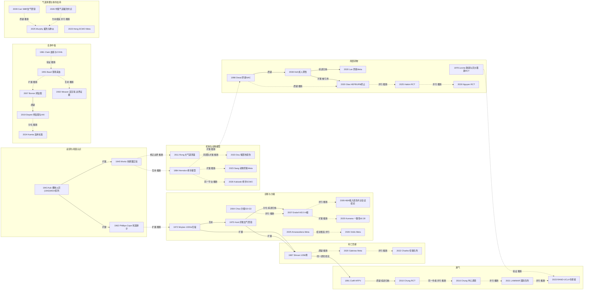

# D05 吸入性损伤

> **一句话判断**：这个方向研究烟雾和热气对气道与肺的损伤，以及一氧化碳（CO）和氰化物造成的全身中毒；现在处在“专家共识已出、直接证据仍薄”的阶段：2023 年国际专家组给出了适当/不适当清单 [D05-E5]，但多数治疗只有单中心小样本 RCT 或观察性研究，连支气管镜分级本身的评估者间一致性也只有 k=0.30 [D05-R02]。
>
> **起点**：本轮找到的最早以肺部/呼吸道并发症为主题的火灾伤员系列，是 1942 年 Cocoanut Grove 火灾后 1943 年的 Ann Surg 系列报告；更早的火灾伤员报告（D01、D12）、烟雾实验和 1970–80 年代美国陆军外科研究所（USAISR）建立支气管镜诊断的过程见第 1、2 节。
>
> **对临床医生最重要的一点**：激素和预防性雾化庆大霉素在小样本 RCT（Levine 1978）中未见获益；专家组把糖皮质激素、预防性全身抗生素、高频冲击通气（HFPV）和高频振荡通气（HFOV）评为不适当 [D05-E5]；雾化肝素、治疗性灌洗、羟钴胺、高压氧在吸入损伤人群中都还没有统计效能足够的随机证据。

## 0 三分钟速读

1. **从哪里来**：本轮找到的最早以肺部/呼吸道并发症为主题的火灾伤员系列，是 1942 年 Cocoanut Grove 夜总会火灾后麻省总医院（MGH）1943 年在 Ann Surg 发表的系列报告：39 例住院者中 7 例死亡，全部死于肺部并发症 [D05-N01]。更早的火灾伤员报告见 D01（Underhill 1923/1927：New Haven 剧院火灾 20 余名伤员）和 D12（Fell 1887《Treatment of Burns—Lessons from the “Richmond” Fire》，仅题录）。它也不是最早关注烟雾伤害的文献：1929 年 Cleveland Clinic 火灾已有把死亡归因于化学刺激物的官方调查（原件未见），1937 年已有动物烟雾吸入实验（第 1 节）。
2. **为什么改变**：1962 年 MGH 审计 1939–1958 年 932 例烧伤、106 例死亡，结论是呼吸道损伤一直是首要死因，并转述美国国家研究委员会（NRC）专门小组的意见：尸检没有系统检查全呼吸道，造成漏诊 [D05-N19]。1970 年代 USAISR 先后用 133Xe 肺扫描（1972）和纤维支气管镜（1975）做客观诊断 [D05-N03][D05-N04]；1987 年用 1058 例建模，单纯吸入损伤最多使预期死亡率增加约 20%，合并肺炎最多约 60% [D05-N07]。
3. **如何分化**：不是“先量化、后分叉”，而是五条线各有起点、长期并行：全身中毒线（CO 见于 1943 年报告，火灾死者血氰研究见于 1966 年）、局部药物线（激素与雾化庆大霉素 RCT 1978，雾化肝素临床 1998）、通气线（中国高频通气据摘要自 1982 年起，冲击式 HFPV 1989）、大动物模型线（绵羊 1983–1984）、诊断分级线（台湾 2004，AIS 0–4 级 2007）。
4. **现在研究什么**：近五年集中在八个主题：支气管镜分级的可靠性与预后（两篇 Meta 结论相反 [D05-E8][D05-E9]）、雾化肝素小型 RCT（88 例 [D05-R04]、76 例 [D05-R05]）、治疗性支气管镜灌洗（中国 2026 年共识推荐 [D05-R21]，一项 98 例研究却发现灌洗者肺炎风险更高 [D05-R20]）、通气实践（28 个 ICU 中 74% 用小潮气量，但潮气量与无呼吸机天数无关 [D05-R19]）、羟钴胺适用标准、ECMO、插管与气管切开、领域停滞信号（第 4 节）。
5. **用了什么数据**：灾难病例系列、犬/山羊/绵羊实验、单中心历史对照、小型 RCT（本章最大 88 例）、美国国家烧伤登记库（NBR）与台湾全民健康保险数据库、系统综述和专家共识（第 7 节）。
6. **还有什么不知道**：没有一项针对吸入损伤人群、统计效能足够的多中心 RCT（国际多中心雾化肝素 RCT 入组 13 例后终止 [D05-N18]）；诊断分级缺客观金标准；文献计量显示发文增速放缓、临床试验缺乏 [D05-R25]；中文数据库本轮未检索，早期检索用旧刊名，曾漏检更名后期刊的共识（已补）；中国线其余部分仍可能有同类漏检。

**覆盖边界**：
- 纳入：火灾与烟雾吸入损伤（上气道热损伤、下气道与肺实质损伤、CO 与氰化物中毒）的认识史；诊断与分级；死亡贡献；治疗（激素、雾化抗生素、雾化肝素/NAC、通气方式、治疗性支气管镜与灌洗、气管切开、ECMO、羟钴胺、高压氧）；动物模型；儿童证据。
- 不含：吸入损伤对复苏液量的影响只点到为止（交 D01）；Baux/修订 Baux 等死亡评分（交 D07）；呼吸机相关肺炎的病原与抗菌（交 D04）；远期喉气管并发症与康复训练只点到为止（交 D10）；Cocoanut Grove 的医院组织与批量伤员问题（交 D12）；中国学科史（交 X01）。氢氟酸、氨等化学品吸入本轮未纳入。

**本章口径**：
- 报告截止 2026-09-29；近期窗口 2021-09-29 至 2026-09-29，只用于第 4 节，不限制历史追溯。
- 阅读层级：L0=仅二手转述；L1=题录已在数据库核实；L2=摘要已读；L3=原文部分章节已读；L4=全文已读。L0/L1 的内容写成“据某来源转述”或只写题名信息。
- 核查状态：“通过/修正”指已对照 PubMed 记录、PMC 全文或扫描页逐条核对，修正项一律用修正值；“存疑”就地标出。N20、N21 是起点核查中补入的（摘要已核）；N19、N22–N24 与 R19–R26 是后补入的文献，题录在定稿前对照 PubMed 核对，内容按其补充时标注的阅读层级记录，未经第二人独立复核（证据表 limitations 字段注明）。
- 本章关键节点 24 个：L4 1 个（N18），L3 8 个（N01、N02、N03、N07、N08、N17、N19、N23），L2 14 个，L1 1 个（N22）。近期代表研究 26 条（L3 1 条 R19，其余 L2）。入口综述/指南 10 条（L4 1 条 E10，L3 5 条 E1、E2、E5、E7、E8，L2 4 条）。N18、E10 升到 L4 和 E5 升到 L3 是第二轮（完整性检查）读开放全文后做的（第 12 节）。全部 60 条见 `data/evidence_D05.json`。只在正文出现一次的辅助文献直接给 PMID，不入证据表；未逐条标注层级的，按 L1（题录已核）理解。
- 引用写法：[D05-Nxx] 关键节点；[D05-Rxx] 近期代表研究；[D05-Ex] 入口综述/指南。
- 覆盖状态：**基本完整但有标注缺口**。理由：六个问题（从哪里来、为什么改变、如何分化、现在研究什么、用了什么数据、还有什么不知道）都能据本章回答；本章范围内的八个主要分支（起源与死因认识、诊断与分级、死亡贡献、机制与动物模型、局部药物、通气、全身中毒、气道清理与体外支持）都有节点，主链转折都有 PubMed 可核实的原始记录（摘要层级以上）。缺口限于第 8.2、8.3 节已标注的项目：知网和万方未检索；6 个主链节点（Hunt 1975、Herndon 1984、Baud 1991、Desai 1998、Endorf 2007、Chung 2010）原文只读到摘要，其中 Hunt 1975、Herndon 1984 样本数未知；部分题录线索未核。

---

## 1 源头：最初在研究什么

**判断**：没有单一起点。本轮找到的最早以肺部/呼吸道并发症为主题的火灾伤员系列，是 1942 年 Cocoanut Grove 火灾后 1943 年的 Ann Surg 系列报告，后来的史料把它当作吸入损伤首次较全面描述的起点；但更早已有火灾伤员报告（D01 的 Underhill 1923/1927：New Haven 剧院火灾 20 余名伤员；D12 的 Fell 1887《Treatment of Burns—Lessons from the “Richmond” Fire》，仅题录），烟雾致死的调查（1929）、烟雾动物实验（1937）也更早；诊断、死亡量化、动物模型、解毒、局部药物各有自己的起点。下表中“目前最早找到”只说明本轮检索范围内没有更早的，不等于史上首次；“公认奠基”指后来的综述或史料把它当起点。

| 主题 | 起点说法 | 分类 | 依据与限定 | 层级 |
|---|---|---|---|---|
| 火灾伤员肺部并发症的系统临床描述 | 1942 年 Cocoanut Grove 火灾，1943 年 Ann Surg 117 卷 MGH 系列报告：Aub 临床描述 [D05-N01]；同期 Mallory & Brickley 病理（PMID 17858232）、Schatzki X 线（PMID 17858231），同一批患者 | 被公认的奠基工作（限定为以肺部/呼吸道并发症为主题的火灾伤员系列；本轮找到的最早此类系列） | **更早的火灾伤员报告**：D01 的 Underhill 1923/1927（New Haven 剧院火灾 20 余名伤员）；D12 的 Fell 1887（题录）。Saffle 1993 摘要称此次火灾带来“the first comprehensive descriptions of inhalation injury” [D05-E3]；Zawacki 1977 p100（PMID 831629，扫描页）称烟雾直到这次火灾才被认识为主要威胁；Phillips & Cope 1962 p2 称这次火灾首次让本院重视呼吸道损伤 [D05-N19]。**更早线索**：Aub 1943 p835 已把本组肺部反应与“the Cleveland Clinic fire”比较；Moritz 1945 p311 及 ref 1 写明 1929 年 Cleveland Clinic 火灾有美国化学战勤务局调查报告，死亡归因于硝酸纤维素 X 线胶片燃烧产生的化学刺激物（报告原件未见）；Emrys-Roberts 1915 BMJ 讨论煤矿灾难中烟雾使 CO 中毒复杂化（PMID 20767542） | N01 L3；E3 L2；其余 L1 |
| 区分热与化学损伤的受控实验 | Moritz 1945 [D05-N02] | 目前最早找到的文献（限定为隔离热因素、测气道温度的实验） | 化学烟雾的动物吸入实验更早：Schnurer 1937 AJPH（PMID 18014707）、Schnurer & Haythorn 1937 Am J Pathol（PMID 19970348），均只核到题录。Moritz 的新意是绕过口咽、在喉部和隆突测吸气温度 | L3 |
| 呼吸道损伤是首要死因 | Phillips & Cope 1962 [D05-N19] | 目前最早找到的文献（限定为本轮读到的死因审计） | p2 列出更早的 1950 年代工作（Mallory、Liebow 病理；Schmidt 与 Aviado 病理生理；Bull & Fisher 1954；Artz 等；Yates 1958 温哥华死因研究），均据 N19 p2 转述，原文本轮未查 | L3 |
| 133Xe 肺扫描早期诊断 | Moylan 1972 [D05-N03] | 目前最早找到的文献 | 133Xe 技术更早用于其他肺病（原文 p477 refs 2–5），作者未自称首次；同所后续 Agee 1976（PMID 1255837） | L3 |
| 纤维支气管镜诊断 | Hunt 1975 J Trauma（8 月）[D05-N04]；Moylan 1975 Surg Gynecol Obstet（4 月，PMID 1129663：25 例烧伤中 15 例经纤维支气管镜诊断） | 存在争议的首次（同年并行报告） | 更早的 Beal 1970（PMID 4904257）、Alpert 1970（PMID 5267665）讨论呼吸道损伤处理，是否用纤维支气管镜未核；Hunt 的贡献在于区分声门上/下层面并与 133Xe 联用 | N04 L2；Moylan 1975 L2 |
| 吸入损伤对死亡的独立贡献 | Shirani 1987 [D05-N07] | 被公认的奠基工作 | E1 直接引用其 20%/60% 数字；更早有 DiVincenti 1971（PMID 5099825，L1）、Thompson 1986（PMID 3944839，1018 例，L2）；Shirani 的贡献是把吸入损伤与肺炎拆开，并随年龄与面积量化 | L3 |
| 绵羊烟雾吸入模型 | Herndon 1984（Circ Shock 12:107，PMID 6423312；J Trauma 24:1044）[D05-N06] | 存在争议的首次 | Meredith 1983（PMID 6546182）已用 12 只绵羊冷松木烟雾模型，且结论相反；USAISR 的 Walker 1981（PMID 7299865）已用改装养蜂熏烟器在山羊中产生低温烟雾 | L2 |
| 火灾伤员氰化物中毒 | Baud 1991 [D05-N09] | 存在争议的首次（仅“现场治疗前采血＋多组对照”设计领先） | 更早：Wetherell 1966 法医学（PMID 5956236，L1）；Symington 1978 Lancet（PMID 78311，L2）；Clark 1981 Lancet [D05-N20]；Anderson & Harland 1982（PMID 6278240，L1） | L2 |
| 雾化肝素＋NAC 的临床使用 | Desai 1998 [D05-N10] | 目前最早找到的文献（限定为临床） | 动物证据更早：Jastrzebski 1981（PMID 7033938，L1）、Brown 1988 绵羊 DMSO＋肝素（PMID 3356738，Desai 为共同作者）、Cox 1993 绵羊肝素（PMID 8460409）；Desai 摘要自述团队此前已报告该组合可改善铸型，出处本轮未找到 | L2 |
| 高频通气用于吸入损伤 | 冲击式 HFPV：Cioffi 1989（PMID 2926848，L1）、1991 [D05-N08] | 目前最早找到的文献（限定为冲击式） | 非冲击式高频通气在中国更早：Li GH 1989 摘要称自 1982 年起治疗 39 例，15 例血气观察者中 10 例合并吸入损伤（PMID 2509044，L2）；Xu JL 1986 护理报告（PMID 3466724，L1） | N08 L3 |
| 支气管镜严重度分级 | Endorf 2007 AIS 0–4 级 [D05-N12] | 目前最早找到的文献（限定为基于 AIS 标准的 0–4 级） | Chou 2004 台湾已按黏膜损伤深度分 G0–G3 并关联急性肺损伤 [D05-N21]；Masanes 1994（PMID 8295250）用支气管镜早期诊断声门下损伤 | L2 |
| 中国学者的吸入损伤实验 | Li N 1983 Burns（PMID 6616307） | 目前最早找到的文献（限定为 PubMed 收录的英文论文）——**存疑** | 摘要首句自述前一年已有犬实验（可能以中文发表，未找到）；Wang CZ & Li A 1985 中文山羊蒸汽研究（PMID 3939800）；1983 年文 PubMed 无单位信息，“第三军医大学”归属是据作者（Yang ZC 等）与后续同团队论文推断 | L2 |

---

## 2 关键转折：问题—新证据/新方法—认识变化—新问题

### 2.1 体表烧伤不重的人为什么也会死：从灾难观察到死因审计（1943–1967）

**问题**：火灾大批伤员中，体表烧伤轻的人为什么也死于呼吸衰竭；肺部病变来自热还是化学物。
**新证据**：Aub 1943 描述 1942 年 Cocoanut Grove 火灾后 MGH 收治的 39 例 [D05-N01]：7 例死亡全部死于肺部并发症；只有 3 例完全没有呼吸道症状，这 3 人都用湿布捂住了口鼻；体表烧伤严重度与肺损伤相关性很小；伤后约 3 小时出现第一波呼吸困难，约 24 小时起进入持续约 36 小时的危重期；5 例气管切开，2 例存活；全组未发生肺炎或肺脓肿；作者认为静脉输盐水会加重支气管水肿（p834–835、p840）。p835 转述 Moritz 在到院已死亡者中高比例检出 CO；烟雾中可能含光气或氮氧化物只是推测，原文写“must remain a matter for speculation”。
**热的问题被单独拿出来测** [D05-N02]：Moritz 1945 用隔热经口插管把热气直接送到声带以下，在 18 只犬中比较三类暴露（不同温度热空气、喷灯火焰与燃烧产物、蒸汽空气混合物），在喉部和隆突测温；另用 2 头猪比较皮肤与呼吸道内衬的相对易损性。p325 的 7 条结论全部讲热：只有温度高到足以瞬间烧伤皮肤和上呼吸道黏膜时，到达肺的残余热量才足以伤肺；足以伤肺的热暴露早已先引起致命的声门水肿；湿热携热远多于干热（142°C 干空气 500 mL 一次吸气约释放 13 卡，可被蒸发抵消；125°C 蒸汽空气混合物可传递 200 卡以上，p323–324）。原文引言 p311 说明“热还是化学”之争在许多火灾中早已存在。**限定**：“下气道损伤以化学性为主”是后来综述（E1）据其热学结论的引申，原文没有这样写；喷灯燃烧产物也不等于真实火灾烟雾。关系：**扩展**（原文明确讨论：p311 引用 Cocoanut Grove 病理报告）。
**断档后的重新确立** [D05-N19]：Phillips & Cope 1962 审计 MGH 1939-06-30 至 1958-01-01 的 1,140 份烧伤病历，纳入 932 例，其中 106 例死亡。结论：呼吸道损伤（伴或不伴感染）“一直是、至今仍是”本院烧伤的首要死因，创面脓毒症第二；1930 年代约每 5 例死亡有 1 例死于休克，后来休克已退居次要（p1）。p2 写明 Cocoanut Grove 火灾首次让本院重视呼吸道损伤（关系：**扩展**，原文明确讨论），并记录两件事：呼吸道损伤的重要性在一些地区受重视、在另一些地区被轻视，作者推测与气候及室内受伤比例有关；NRC 病理委员会专门小组复查 Brooke Army Medical Center（USAISR 所在地）41 例烧伤死亡，指出尸检因没有系统检查全呼吸道而漏诊。1960 年代还有以“respiratory burns”为题的死因与临床–实验室研究（Taylor & Gumbert 1965，PMID 14274851；Stone 1967，PMID 6017062，均 L1）。术语何时从“respiratory burns”换成“inhalation injury”，本轮未核（8.2）。
**与 D07 死因谱叙事的差异**：MGH 1962 年死因审计（Phillips & Cope [D05-N19]）把呼吸道损伤列为首要死因，这与 D07 2.5 节以创面感染为起点的死因谱叙事（主要依据 USAISR 与 Pruitt 综述）不同。死因构成随中心和尸检方法而不同，N19 本身也记录了地区分歧和尸检漏诊，所以两章的起点应各自理解为特定中心、特定尸检做法下的结论。
**新问题**：能不能在症状出现前、在活人身上确诊。

### 2.2 活人身上怎么诊断：133Xe、支气管镜到分级（1972–2025）

**133Xe 扫描** [D05-N03]：Moylan 1972 在 USAISR 对 50 例伤后 48 小时内入院的火焰烧伤者静注 133Xe，以 90 秒内完全均匀清除为正常；15/50 例异常；全组平均烧伤面积 42%，异常者 50%；结论为伤后第 4 天前扫描可早期诊断（p483）。原有肺病和吸烟可致假阳性；7 例异常者用了激素，无法判断价值。
**纤维支气管镜** [D05-N04]：Hunt 1975 摘要称支气管镜简单、安全、准确，能区分声门上与声门下损伤，并与 133Xe 联用同时发现大、小气道损伤（关系：**互补**，原文明确讨论）；唯一失败情形是伤后早期低血容量休克时黏膜改变可暂缺。同年 4 月 Moylan 等已在 25 例中用纤维支气管镜诊断出 15 例（PMID 1129663），属同年并行报告。E1 转述 Hunt 的准确率 86%、无假阳性，并转述 133Xe 与支气管镜联用只小幅提高诊断率、成本难以支持（均本轮未核原文）。**阅读限制**：Hunt 1975 本轮只读到摘要（L2），摘要没有给样本数；原文不在 PMC，OpenAlex 显示无开放版本，所以样本数和准确性数字都未核。USAISR 的阶段性经验总结见 Pruitt 1990（PMID 2254994，L1）。此后 Shirani 1987 以“支气管镜和/或 133Xe 阳性”为暴露定义（p83，refs 6–8）[D05-N07]。
**从“有/无”到“多重”** [D05-N21][D05-N12]：Chou 2004（高雄医学大学，1993–2002 年 167 例）按黏膜损伤深度分 G0–G3，急性肺损伤率依次为 3.8%、4%、33%、77%。Endorf 2007（80 例）按 AIS 标准把首次支气管镜所见分为 0–4 级，2–4 级生存率低于 0–1 级（P=0.03），但分级与液体需求不相关；入院 P:F<350 者液体量更多（P=0.03）。关系：**分化**（综述归纳：E2 分级段；E2 的 AIS 分级表引自 Albright 2012，PMID 22067627）。美国烧伤协会（ABA）吸入损伤共识会议（结论 2009 年发表，PMID 19060761；会议召开年份本轮未核）的专刊含 Woodson 的诊断与分级专文和 Palmieri 撰写的结论 [D05-N22]，本轮只核到题录；它与 D04、D07 所引的 ABA 2007 脓毒症与感染定义共识不是同一次会议。
**验证者多来自同一中心**：Mosier 2012（PMID 21941194，32 例）ARDS 发生率按 0–3 级依次为 0、22%、57%、80%，但与 Endorf 同为 Loyola 中心，不是独立验证。CT 作为补充：Oh 2012（USAISR，PMID 22210063，25 例吸入损伤＋19 例对照，CT 与支气管镜联合时复合终点风险升高 12.7 倍）；Yamamura 2013（PMID 23706091，37 例，支气管镜评分与临床因素无显著相关，CT 支气管壁厚度相关）。
**新问题**：分级是否可重复、是否真能预测死亡（4.1）。

### 2.3 吸入损伤到底多致命：从定量到“混杂之争”（1971–2022）

**新证据** [D05-N07]：Shirani 1987 分析 USAISR 1980–1984 年 1058 例连续患者：吸入损伤 373 例（35.3%），其中 141 例（38%）继发肺炎；肺炎率在无吸入损伤者 8.8%（60/685）、仅 133Xe 异常者 19.5%、支气管镜异常者 45.8%；观察死亡率分别为 9.6%、21.2%、57.7%（Table 1）。用含年龄、面积、吸入损伤、肺炎的 logistic 方程相减，单纯吸入损伤最多使预期死亡率增加约 20%，单纯肺炎最多约 40%，两者并存最多约 60%；效应在年龄和面积的中间区段最大。关系：诊断方法被用作暴露定义，**扩展**（原文明确讨论）。
**暴露定义的限制**：p83 写明 1058 例中只有 487 例“被认为有吸入损伤风险并接受检查”；Table 1 三组 685＋113＋260 合计 1058，说明约 571 例未接受检查者被计入“无吸入损伤”组（按表推算，原文未单独讨论）。对照组可能混入未确诊者，“+20%”应理解为单中心、1980 年代诊断标准下的估计。
**后来的数字与反向证据**：Osler 2010（PMID 20038856）用 NBR 39,888 例修订 Baux 评分，吸入损伤相当于增加 17 岁或 17% TBSA（交 D07）。E1 转述 NBR 2005–2014 年 99 家中心 203,422 例：在 <60 岁且 TBSA 0.1–19.9% 者中，吸入损伤使死亡率升高近 24 倍（E1 本轮 L3，NBR 原报告 L0）。Galeiras 2020 Meta（54 项研究、408,157 例）：患病率 15.7%（13.4–18.3%），死亡 OR 3.2（2.5–4.3），但按严重度校正后关联不显著 [D05-E4]。Charles 2022：严重（2/3 级）损伤校正 HR 2.14，肺炎却未独立预测死亡 [D05-R01]，与 Shirani 的“叠加”结论不一致。关系：**质疑**（本报告推断，原文是否互引未核）。
**新问题**：吸入损伤与面积、年龄、密闭空间暴露高度相关，诊断标准又不统一，校正后的独立效应多大仍未定。

### 2.4 下气道为什么会伤：动物模型与“通透性”之争（1981–2026）

**热损伤的温度边界** [D05-N16]：Rong 2011（北京积水潭医院）让 18 只犬吸入 80、160、320°C 干热空气 20 分钟，喉前庭温度降到 47.1、118.4、193.8°C，声带下缘仍有 39.3、56.6、137.9°C；作者认为喉部阻挡高温的能力有限。关系：对 Moritz 结论的**修正/划边界**（本报告推断；Rong 摘要未点名 Moritz，且 Moritz 插管已越过喉部，两者设置不同）。E1 把两文并列引用来支持“上气道高效散热”，这本身存在张力。同团队 Dou 2023（12 只比格犬，320°C 时喉部各层均严重受损）[D05-R24] 是延续工作。
**大动物模型与相反结论**：USAISR 的 Walker 1981 用改装养蜂熏烟器在山羊中产生低温烟雾（PMID 7299865）。Meredith 1983 让 12 只绵羊吸入冷松木烟雾，结论是烟雾吸入“不导致”肺泡毛细血管膜对蛋白通透性显著增加（PMID 6546182）。Galveston 团队 1984 年先在 Circ Shock 报告 6 只慢性置管绵羊棉布烟雾＋正压通气（PMID 6423312），再在 J Trauma 报告：肺淋巴流量、淋巴/血浆蛋白比升高而肺血管压力不变，提示肺水肿来自微血管通透性增加 [D05-N06]。**阅读限制**：J Trauma 这篇本轮只读到摘要（L2），摘要没有给动物数，OpenAlex 显示无开放版本，所以样本数未知；本段同项目的动物数来自 Circ Shock 1984、Traber 1986、Kimura 1988 的摘要，不是这篇的样本数。同项目 Traber 1986（PMID 2421939，烟雾组与假吸入组各 9 只）富含蛋白的肺淋巴液增加 3 倍、持续 48 小时以上；Kimura 1988（PMID 3366733，18 只）用降温至 <40°C 的烟雾按 32/48/64 口分级，烟雾越多肺水越多。关系：Meredith 与 Herndon 两说并存，属**质疑/并行**（本报告推断，互引未核）；低温烟雾即可复制下气道损伤，与 Moritz 的热学结论**互补**（推断）。
**此后的平台作用**：绵羊模型成为雾化抗凝等局部治疗的主要临床前平台：Brown 1987 绵羊 VV-ECMO（PMID 3828855）、Brown 1988 DMSO＋肝素（PMID 3356738）、Cox 1993 肝素（PMID 8460409），直到 2026 年的 ECMO 期间雾化肾上腺素 [D05-R14]；动物 Meta 显示雾化肝素使死亡 RR 降至 0.42（0.22–0.80）[D05-R07]。羟钴胺和 HFPV 并未经过这一模型。E1 转述绵羊早期体外 CO2 清除对肺损伤严重度和死亡无影响（Kreyer 2016，PMID 26674455，本轮只经 E1 获知）。**限定**：棉布烟雾不同于真实火灾烟雾；主导团队长期是 Galveston（Traber/Herndon/Enkhbaatar），文献计量也显示少数团队贡献多数文献 [D05-R25]。

### 2.5 局部药物：激素与雾化抗生素的阴性、雾化肝素的起伏（1976–2026）

**动物阳性、临床阴性** [D05-N05]：Dressler 1976 在白松烟雾大鼠中，单次甲泼尼龙 20 mg 使预期死亡降低 76.7%（PMID 942843）。Levine 1978 在支气管镜与 133Xe 确诊的 60 例中做两项随机安慰剂对照试验（各 30 例）：地塞米松 3 天、雾化庆大霉素 10 天，死亡率、肺部与感染并发症均无主要差异。后续：Welch 1977 四氧化二氮吸入模型（PMID 897976）、Robinson 1982 拉斯维加斯酒店火灾单纯烟雾吸入者（PMID 7131608）未见激素获益；Nieman 1991（PMID 1760107）是犬实验，甲泼尼龙预处理不能保护肺。E5 把糖皮质激素和预防性全身抗生素评为不适当，不论损伤轻重（全文 Results 药物治疗段已核）；该段没有雾化抗生素的陈述，完整陈述表（Additional file 4）未读，所以不能说专家组评过雾化庆大霉素。**措辞限定**：Levine 每组约 15 例，统计效能不足以排除中等效应，准确说法是“小样本 RCT 未见获益”，不是“已被证伪”。关系：动物结果被临床**质疑**（推断）。
**抗凝＋祛痰的起点** [D05-N10]：针对脱落上皮、黏液和纤维蛋白形成的气道铸型，Desai 1998 回顾 Galveston 儿童医院 90 例需要通气的患儿：1985–89 年 43 例为对照，1990–94 年 47 例每 4 小时雾化肝素 5000 U＋20% NAC 3 mL，共 7 天；治疗组再插管、肺不张和死亡均下降（摘要无具体数字）。关系：从绵羊实验到临床的**扩展**（推断：Brown 1988 共同作者含 Desai）。**限定**：前后时期对照，同期 ICU 进步可能混杂。
**成人结果不一**：Holt 2008（Utah，150 例，62 例 72 小时内用药）所有临床结局无差异，1999–2002 年仅 18 例用药，存在时代混杂 [D05-N14]（关系：**质疑**，原文明确引用儿童结果）。Miller 2009（PMID 19165116，30 例成人，历史对照）生存率对照 0.57、治疗 0.94。McIntire 2017 HIHI（PMID 27532613，72 例匹配病例对照，通气 7.0 天 vs 14.5 天）与 Cox 2020 HIHI2（PMID 32594168，35 组三联配对，少 8–11 个通气日）作者重叠，HIHI2 可能包含 HIHI 所在中心，本章不把两者算作两项独立证据。Lan 2020 Meta 纳入 9 项研究（1 项随机、8 项非随机，1998–2019 年，609 例），死亡 RR 0.75 [D05-E7]。
**随机试验难以完成** [D05-N18]：国际多中心双盲 RCT（HEPBURN，荷兰与比利时的烧伤中心，NCT01773083，方案 Glas 2014，PMID 24661817）每 4 小时雾化肝素 25,000 IU（每日 150,000 IU，作者称是烧伤文献中的最高剂量），原计划每组 58 例。共筛查 49 例、支气管镜确诊 33 例，11 个月内入组 13 例（7/6）后，数据安全监察委员会因入组慢、购药和设盲成本高建议终止，未做有效性分析；作者在 Discussion 写明安全与可行性问题不是终止原因，并认为“必须支气管镜确诊”可能拖慢了入组。安全性：未见归因于研究药物的严重出血或肝素诱导血小板减少；2 次严重通气问题都发生在肝素组患者、都与雾化操作有关（1 次发生在雾化头孢唑林之后），作者归因于主动湿化与呼气端滤器合用导致滤器阻塞，统一滤器后未再发生。可行性：肝素组 427 次计划雾化中 129 次被暂停（30%，其中 72 次来自 1 例合并颅脑外伤、出血风险高的患者），安慰剂组 299 次中 45 次（15%）；暂停主要因血痰或灌洗液带血、预期出血风险，因血痰暂停的比例两组相近（8% vs 10%）。关系：Glas 全文把 Holt 2008 列为 ref 4，在“目前没有有效治疗”和“回顾性研究未清楚报告依从性”两处引用（**扩展**，原文明确引用）；“临床研究结果互相矛盾”一句引的是 ref 7（同一作者组 2016 年雾化肝素个体患者数据 Meta，DOI 10.1186/s13613-016-0138-4，只见于参考文献表，未读），不是 Holt 2008。全文未检出引用 Desai 1998（本段据全文，L4）。**新问题**：剂量、是否合并支气管镜、轻重度是否有别（4.2）。

### 2.6 通气：从高频通气到小潮气量，实践并未收敛（1982–2021）

**早期高频通气**：中国自 1982 年起把高频通气（非冲击式）用于合并吸入损伤的重度烧伤（Li GH 1989，PMID 2509044）。USAISR 的 Cioffi 1991 [D05-N08]：1987-03 至 1990-09 的 54 例成人吸入损伤患者插管 24 小时内改用 HFPV，平均 32.2 岁、面积 47.8%，52/54 例支气管镜阳性；肺炎 14 例（25.9%），历史对照为 45.8%；死亡 10 例（18.5%），按 Shirani 方程预期 23 例（95% 置信限 17–28）。关系：与 N07 **同一研究项目**（原文明确：直接使用其方程和历史肺炎率）。**限定**：历史对照，抗生素、切痂、复苏的时代差异无法排除；原文 p576 的“12–15 mL/kg”是设定 HFPV 峰压时的参照，不是历史队列的实际通气参数，“对照组用大潮气量”是推断——不过 Al Ashry 2016 系统综述（PMID 27025800，4 项研究、540 例）摘要确实指出多数比较研究的对照组用大潮气量，并判断 VAP 证据不确定。
**随机试验** [D05-N15]：Reper 2002 小 RCT（PMID 12163294，35 例）HFPV 只在第 0–3 天改善 P/F，死亡与感染无差异。Chung 2010 在 USAISR 随机 62 例需通气 >24 小时的烧伤患者（吸入损伤仅 35–39%）：28 天无呼吸机天数 HFPV 12±9、小潮气量 11±9，次要结局均无差异；小潮气量组 29% 因达不到氧合或通气目标改用补救模式，HFPV 组 6%（P=0.02）。作者结论是两种策略临床结局相似，并没有写“否定 HFPV”；ClinicalTrials.gov 登记（NCT00351741）状态为 TERMINATED，未写原因。关系：对 N08 的**质疑**（综述归纳）。
**实践没有跟着收敛**：同一第一作者的 Chung 2016 调查 [D05-N23]：129 家北美烧伤中心 46 家回复（36%），有吸入损伤时初始用开放肺模式（HFPV/HFOV/APRV）的占 53%（24/46），无吸入损伤时 24%。2021 年国际队列显示 74% 用小潮气量，但潮气量与 28 天无呼吸机天数无关，作者指出烧伤患者通常被排除在基准通气试验之外 [D05-R19]。儿童方向相反：Sousse 2015（PMID 25724604，Galveston 1986–2014 年 932 例）大潮气量组（15±3 mL/kg）ARDS、肺不张更少、通气天数更短，但气胸更多。HFOV 另有专文（Cartotto 2009，PMID 19060746，L1），E5 评为不适当。
**认识变化**：成人默认小潮气量，主要依据是一般 ARDS 人群证据的外推加 2023 年专家共识 [D05-E5]；烧伤人群内部的直接随机证据只有一项 62 例、提前终止的试验。

### 2.7 全身中毒：CO 与氰化物哪个更致命、怎么解（1943–2026）

**氰化物线比通常以为的更早**：Wetherell 1966 以火灾死者血氰为题（PMID 5956236，L1）。Symington 1978（Glasgow，PMID 78311）：火灾伤员血氰显著升高，少数死者达中毒水平，消防员与对照无差异。Clark 1981 [D05-N20]：53 名火灾幸存者中 36 人有烟雾吸入，只有这些人 COHb 和血氰升高；作者提出按采样时间校正的 COHb 列线图，把 COHb 当作是否使用氰化物解毒剂的替代指标。
**关键验证** [D05-N09]：Baud 1991 在巴黎住宅火灾现场、任何治疗前为 109 名受害者采血（66 存活、43 死亡），另设 114 名对照（药物中毒 40、CO 中毒 29、创伤 45）：血氰均值存活者 21.6±36.4、死亡者 116.4±89.6、对照 5.0±5.5 µmol/L；43 名死亡者中 32 名（74%）>40 µmol/L；血氰与 CO 显著相关；在 39 例无严重烧伤者中，乳酸 >10 mmol/L 是血氰 >40 µmol/L 的敏感指标。关系：对 Clark 等早期发现的**验证**（推断），新意在采样时点与对照设计。
**相反意见**：Lundquist 1989 前瞻研究 18 名建筑火灾死者（PMID 2556335）：50% 达 HCN 中毒水平，90% 达 CO 中毒水平，83% 达 CO 致死水平，作者认为 CO 比 HCN 更重要。两说并存（第 5 节）。
**解毒剂为什么换代**：Hall 1989 单病例报告（PMID 2746547）：亚硝酸钠在烟雾吸入者中引起低血压，高铁血红蛋白与 COHb 叠加，使不能携氧的血红蛋白总量居高不下，作者建议优先用羟钴胺。Borron 2007 [D05-N13]：1987–1994 年 69 例入 ICU 的烟雾吸入者在现场或 ICU 静注羟钴胺 5 g（最多 15 g），50 例（72%）存活，事后确诊中毒（≥39 µmol/L）的 42 例中 28 例（67%）存活，未见归因于药物的严重不良事件；但没有对照组，并排除了院前死亡者。与 Baud 1991 共享作者和巴黎院前体系，是否含相同患者原文未说明。
**安全性被重新审视** [D05-N17]：Dépret 2019 法国 21 个 ICU 739 例（2011–2017），全文 Table 1 显示 386 例（52.2%）用羟钴胺（摘要中的“306”和 55.2% 为笔误）；AKI 39%，严重 AKI 25.2%；用药者病情更重、死亡率更高（38.1% vs 27.2%）；羟钴胺与 AKI 的校正 OR 1.597（1.055–2.419），与严重 AKI 1.772（1.137–2.762），与生存无关（OR 1.114，0.691–1.797）。全文 Discussion 明确讨论了 Borron 等的研究（关系：**质疑**，原文明确）。**限定**：适应证混杂，未测血氰。
**高压氧只是边界证据** [D05-N11]：Weaver 2002 双盲 RCT 的对象是一般症状性 CO 中毒（152 例），不是烧伤合并吸入损伤：6 周认知后遗症 25.0% vs 46.1%（校正 OR 0.45，0.22–0.92），因获益提前终止，基线小脑功能障碍不平衡，摘要未报告火灾来源比例。Buckley 2011 Cochrane（PMID 21491385，检索至 2010 年 6 月）合并 6 项 RCT 1361 例，OR 0.78（0.54–1.12）不显著；摘要称一项阳性试验可能受多重检验影响、两项阳性试验均因获益提前终止，但未点名，是否指 Weaver 需读全文。本轮未找到烧伤合并吸入损伤人群的高压氧 RCT。关系：CO 与氰化物两条中毒途径**互补**（推断）。

### 2.8 气道清理与体外支持的早期证据（1987–2013）

治疗性支气管镜的主要观察性证据来自 Carr 2009 [D05-N24]：NBR 1998–2007 年吸入损伤合并肺炎者 624 例（未做 355、做 1 次 173、多次 96），面积 30–59% 者做支气管镜后通气天数更短（21 天 vs 28 天），死亡 OR 0.82（0.53–1.27）不显著。同一作者 Carr 2013 小 RCT（PMID 26815077）入组 33 例（分析 13 vs 15）：肺炎发生率无差异，只有复合“并发症”指标有差异（23% vs 60%，P=0.04）。早期气管切开：Saffle 2002 RCT（PMID 12432320，44 例）在通气、住院、肺炎和生存上均无改善。体外支持最早见于绵羊 VV-ECMO（Brown 1987）。这几条线的近期证据见 4.3、4.6、4.7。

---

## 3 分支图

图例：实线 = 原文明确讨论或综述归纳的关系；虚线 = 本报告推断；边上写关系类型。节点为“年份 简称”。

说明：Levine 1978 与绵羊模型之间不画关系（“动物阳性—临床阴性”与“绵羊→临床”并行只是弱推断）；Galeiras 2020 与 Shirani 1987 之间、Meredith 1983 与 Herndon 1984 之间的“质疑”都是本报告推断。

---

## 4 近五年重点（2021-09-29 至 2026-09-29）

### 4.1 支气管镜分级：从“当金标准用”到“需要重新验证”

- **研究什么**：AIS 0–4 级能否预测死亡、肺炎、ARDS；不同人分级是否一致；没有支气管镜时能否用临床数据预测。
- **数据与设计**：单中心回顾性队列、图像判读一致性研究、系统综述与 Meta、机器学习模型。
- **代表研究**：Charles 2022（伦敦，231 例，吸入损伤 84 例）：死亡率 45% vs 24%，严重（2/3 级）校正 HR 2.14（1.12–4.09），轻度 HR 0.58 不显著，肺炎未独立预测死亡 [D05-R01]。Kumana 2025（iBRONCH-BII）：27 名评估者（专科 17、新手 10）判读 16 张图像，评估者间 k=0.30（0.29–0.31），自身重复一致性中位 k=0.45，均判为临床上不足 [D05-R02]。Amarasekera 2025（纳入 30 项、12 项进入 Meta）：AIS 3–4 级 vs 1–2 级，肺炎 RD 0.319（0.020–0.618）、ARDS RD 0.242（0.118–0.367），死亡 RD 0.068（−0.017–0.153）不显著 [D05-E9]。Virdis 2026（检索至 2024-11-30，15 项研究，死亡分析 14 项 2,739 例）：重度 vs 轻度死亡 OR 2.83（1.79–4.48），肺炎 OR 1.60（0.63–4.11）不显著 [D05-E8]。Yang 2023（台湾单中心 14 年、341 例插管者，梯度提升模型）：区分轻/重度 AUC 0.883，有/无 AUC 0.862 [D05-R03]。
- **分歧**：两篇 Meta 对死亡和肺炎的结论都相反，纳入研究、分级阈值和检索库不同。“分级可重复性差可能是结论不一的原因之一”是 iBRONCH 作者的推测；而 Charles 2022、iBRONCH、Amarasekera 2025 和 E5 专家组作者重叠（Charles WN、Milton-Jones H、Kumana E），争议一方的证据和解释来自同一伦敦团队。外部团队已有评论（Zhai 2026，PMID 41455277，只核题录，观点未读）。
- **成熟度**：发展中；E5 把“研究支气管镜分级的准确性”列为未来重点。

### 4.2 雾化肝素/NAC：从历史对照走向小型 RCT

- **代表研究**：Hakim 2025 单中心 RCT（88 例，每组 44，5000 IU）：校正后无呼吸机天数更多（P=0.046）、ICU-free 天数更多（P=0.015）、P/F 更高（P=0.001），28 天死亡无差异（P=0.596）[D05-R04]。Nguyen 2026 单中心 RCT（76 例，回顾性注册 TCTR20260408001）：定期支气管镜＋肝素＋NAC，未校正 28 天死亡 57.9% vs 81.6%（P=0.025），多因素 Cox 校正 HR 0.66（0.36–1.23）不显著，第 7 天肺损伤评分更低 [D05-R05]。Risinger 2025 回顾性（40 例 AIS II–III 级，47.5% 用方案）：通气 5 vs 6 天（P=0.76），生存 57.9% vs 52.4%（P=0.73）[D05-R06]。Sang 2023 动物 Meta（检索至 2022 年 1 月，含中文库）：死亡 RR 0.42，P/F SMD 1.04 [D05-R07]。
- **分歧**：RCT 显示通气相关结局改善，但死亡校正后无差异；Nguyen 2026 同时做了定期支气管镜，分不开肝素本身的作用。E5 认为中重度损伤用 5000 IU“适当”，轻度意见分歧（DI=1.52）；10,000 IU 对轻度评为不适当、对中重度评为不确定（全文 Results 已核）。
- **成熟度**：发展中。两项 RCT 合计 164 例，都是单中心。

### 4.3 治疗性支气管镜与气道灌洗：共识推荐走在直接证据前面

- **研究什么**：初始及系列支气管镜灌洗能否减少肺炎、缩短通气。
- **代表研究**：历史证据是 NBR 观察性分析与一项 33 例小 RCT（2.8，[D05-N24]）。Murphy 2025（98 例入院时做支气管镜者）：同时做支气管肺泡灌洗者在单因素和多因素分析中肺炎风险都更高 [D05-R20]。E5 把中重度损伤的首次支气管镜灌洗、重度损伤的系列灌洗评为适当（轻度者首次灌洗为不确定、系列灌洗为不适当；全文 Results 已核）[D05-E5]；中华医学会烧伤外科学分会等 2026 年用德尔菲法发布《成人烧伤患者气道灌洗疗法专家共识（2026 版）》，覆盖纤维支气管镜灌洗与气道直接灌洗的适应证、禁忌证、时机、方案、监测和并发症 [D05-R21]。中国另有武汉 47 例纤维支气管镜灌洗回顾性队列（Jiang 2020，PMID 32340414，结果本章未展开）。
- **分歧**：共识方向与 Murphy 2025 的信号相反；直接证据只有观察性研究和一项小 RCT。
- **成熟度**：早期线索，有争议。

### 4.4 通气策略：肺保护通气是外推来的

- **代表研究**：LAMiNAR 2021（28 个 ICU、16 国、160 例）：74% 用小潮气量（≤8 mL/kg 预测体重），有无吸入损伤者潮气量无差异，潮气量与 28 天无呼吸机天数无关；作者指出烧伤患者通常被排除在基准通气试验之外，把肺保护通气外推到烧伤人群有争议 [D05-R19]。
- **分歧**：2016 年北美调查中半数中心在吸入损伤时首选开放肺模式 [D05-N23]，2023 年专家组把 HFPV/HFOV 评为不适当 [D05-E5]；儿童数据方向相反（2.6）。
- **成熟度**：未解决。近五年烧伤人群的通气 RCT 本轮未做专门检索。

### 4.5 氰化物与羟钴胺：谁该用、代价是什么

- **代表研究**：Kamta 2024（46 例）按预设标准（乳酸 ≥8 mmol/L、收缩压 <90 mmHg、新发癫痫、心脏骤停或呼吸骤停之一）评估，35 例（76%）满足；AKI 30%；满足标准者院内死亡 49%，不满足者 9% [D05-R08]。Stanton 2024（Los Angeles General，2013–2023，羟钴胺 36 例 vs 匹配对照 32 例）：高铁血红蛋白、乳酸、死亡率、肾功能均无显著差异 [D05-R09]。Dunne 2026 范围综述（检索至 2025-01-01，21 篇 512 例）：院前给药 235 例（45.9%），已知结局的 482 例中 318 例（66.0%）存活出院，报告了 AKI；证据均为观察性且异质，文中提到美国心脏协会推荐 [D05-R10]。
- **分歧**：Borron 2007 认为安全，Dépret 2019 发现 AKI 风险升高且与生存无关（2.7）；没有一项有对照的研究能回答“是否降低死亡”。
- **成熟度**：早期线索；方向从“普遍经验性使用”转向“按标准使用”。

### 4.6 严重吸入损伤的 ECMO

- **代表研究**：Ng 2023 Meta（10 项）：合并生存率 53.6%（37.6–69.2%），年龄越大生存越低 [D05-R11]。Heng 2023 Meta（陆军军医大学，检索至 2022-03-18，15 项回顾性、318 例，均无对照）：院内死亡 49%；吸入损伤比例 ≥50% 的研究死亡 55%，<50% 的 32%；ECMO 相关并发症 67.46% [D05-R12]。Lin 2025（台湾全民健保 2000–2015，6,493 例，倾向评分匹配）：ECMO 组院内死亡 47.09%，非 ECMO 组 38.71%，校正 1 年死亡 HR 3.19 [D05-R13]。Kakizaki 2026（12 只绵羊，肾上腺素 5、盐水 7）：VV-ECMO 期间雾化肾上腺素组生存更高（P=0.03），30 与 36 小时 P/F 改善 [D05-R14]。
- **分歧**：Meta 的约 50% 生存率没有对照；台湾匹配后 ECMO 组死亡反而更高，可能反映只有最重者才用 ECMO（适应证混杂）。
- **成熟度**：早期线索。

### 4.7 插管、气管切开与远期喉气管并发症

- **代表研究**：Lebrun 2025（法国儿童烧伤 ICU 8 年 1,520 次入院，到院已插管 56 例）：20 例（36%）2 天内拔管；面积、火焰烧伤（OR 4.43）、面部烧伤（OR 12.28）预测需要插管 [D05-R15]。Perkins 2023（388 例，19% 插管）：烧伤外科与非烧伤急诊外科医生的插管率和 48 小时内拔管率无差异 [D05-R16]。Shah 2025（NIS、NTDB、BCQP 三库，9,173 次气管切开，51.1% 为 ≤10 天早期）：早期组住院时间更短（−22.9、−12.7、−7.0 天）[D05-R17]。Zhen 2023 范围综述（49 项研究）：远期喉气管并发症 4.8–6.5%，病例报告占人类研究 46.7%（交 D10）[D05-R18]。
- **分歧**：Saffle 2002 小 RCT 早期气管切开无改善，2025 年数据库研究显示住院更短，后者是观察性，可能有选择偏倚。
- **成熟度**：发展中。

### 4.8 领域层面的停滞信号

Huang 2024 文献计量纳入 3,056 篇，按 Price 定律分三个阶段，第三阶段发文增速放缓；近一半来自美国，少数团队贡献多数文献；近十年基础研究被忽视，临床试验缺乏 [D05-R25]。ClinicalTrials.gov 2026-09-29 查到的吸入损伤在研干预试验很少：BURN-ASV（NCT07674563，尚未招募，预计 100 例）；近年新增的主要是埃及的小型康复 RCT（NCT05886543、NCT05988294 各 60 例，NCT06326593 儿童 80 例，NCT05190497 吸气肌训练 40 例，2021–2024 年，交 D10）[D05-R26]。

中国近五年研究见第 6 节。

---

## 5 争议、负性结果与停滞路线

| 争议 | 各方与证据 | 现状 |
|---|---|---|
| 吸入损伤是否独立增加死亡、增加多少 | 支持：Shirani 1987（+20%/+60%）[D05-N07]；Osler 2010（相当于 +17 岁/+17% TBSA）；E1 转述 NBR（特定亚组近 24 倍，L0）；Charles 2022（严重损伤 HR 2.14）[D05-R01]。认为受严重度混杂：Galeiras 2020（粗 OR 3.2，校正后不显著）[D05-E4] | 未解决；多数预测模型仍把它作独立变量（交 D07） |
| 支气管镜分级的预后价值 | 有价值：Endorf 2007、Mosier 2012（同中心）、Virdis 2026（死亡 OR 2.83）。证据不足：Amarasekera 2025（死亡 RD 不显著）、Yamamura 2013、Kumana 2025（k=0.30） | 未解决；分级一致性差，争议一方多来自同一团队 |
| 雾化肝素/NAC 是否有效 | 支持：Desai 1998、Miller 2009、HIHI/HIHI2（可能同队列）、Lan 2020（RR 0.75）、Hakim 2025（通气结局改善）。反对/存疑：Holt 2008、Risinger 2025、HEPBURN（终止）、Nguyen 2026（校正后不显著） | 未解决；实践中广泛使用，E5 对中重度用 5000 IU 评为适当 |
| 成人 HFPV vs 小潮气量；儿童潮气量 | Cioffi 1991 历史对照阳性；Chung 2010 RCT 主要结局无差异；2016 调查 53% 中心仍首选开放肺模式；LAMiNAR 2021 潮气量与结局无关；儿童 Sousse 2015 大潮气量更好 | 成人倾向小潮气量但属外推；儿童未解决 |
| CO 还是氰化物是主要致死因素 | 氰化物重要：Clark 1981、Baud 1991（74% 死者 >40 µmol/L）。CO 更重要：Lundquist 1989（90% 死者达 CO 中毒水平） | 未解决；两者相关、难以在观察研究中分开 |
| 经验性羟钴胺的净获益 | Borron 2007（无对照、未见严重不良事件）；Dépret 2019（AKI 校正 OR 1.597、与生存无关）；Kamta 2024（按标准筛选）；Stanton 2024（无高铁血红蛋白血症） | 未解决；全部为观察性 |
| 高压氧治疗火灾相关 CO 中毒 | Weaver 2002 RCT 阳性（一般 CO 人群）；Buckley 2011 合并 OR 0.78 不显著 | 未解决；危重烧伤患者的适用性更不确定 |
| 治疗性支气管镜灌洗 | 支持：Carr 2009（观察性）、E5、中国 2026 共识。相反信号：Murphy 2025（灌洗者肺炎更多）；Carr 2013 RCT 肺炎无差异 | 未解决；推荐强于直接证据 |
| 吸入损伤是否需要更多复苏液 | Navar 1985（PMID 4073365）：3.98 增至 5.76 mL/kg/%TBSA；Xiao 2024：72 小时总补液无差异，但尿量更少、液体潴留更多 [D05-R22] | 未解决（交 D01） |

**负性结果与失败路线**：
- **全身糖皮质激素**：大鼠阳性（Dressler 1976），患者 RCT（Levine 1978，每组约 15 例）和火灾队列（Robinson 1982）未见获益，犬实验（Nieman 1991）阴性；E5 评为不适当。
- **预防性雾化庆大霉素**：Levine 1978 无差异。E5 评为不适当的是预防性**全身**抗生素，不是雾化抗生素（E5 正文药物治疗段没有雾化抗生素的陈述；全身抗生素的原始试验本章未追溯，抗菌问题交 D04）。
- **HFPV 作为常规通气**：历史对照获益未在 Reper 2002、Chung 2010 两项 RCT 中重现；E5 评为不适当。**HFOV** 同样被 E5 评为不适当（Cartotto 2009 专文结论本轮未读）。
- **高剂量雾化肝素国际 RCT（HEPBURN）**：入组 13 例后因入组慢、成本高终止；同时暴露了雾化与主动湿化、呼气端滤器合用时滤器阻塞的风险，以及临床医生因血痰或出血顾虑频繁暂停给药的可行性问题（肝素组暂停 30%，安慰剂组 15%）[D05-N18]。
- **成人雾化肝素/NAC 方案**：Holt 2008（150 例）、Risinger 2025（40 例）未见获益。
- **常规早期气管切开**：Saffle 2002（44 例 RCT）无改善。
- **亚硝酸盐类解毒剂**：Hall 1989 单病例提示低血压与携氧能力进一步下降，转向羟钴胺（证据级别为病例报告）。
- **133Xe 扫描作为常规诊断**：据 E1 转述，增益小、成本难以支持（L0）。
- **绵羊早期体外 CO2 清除**：据 E1 转述无效（Kreyer 2016，L1）。
- **吸入一氧化氮、β 受体激动剂**：ABA 吸入损伤共识会议专刊（结论 2009 年发表，PMID 19060761）有专文（Sheridan，PMID 19060730；Palmieri，PMID 19060734），只核到题录，结论待查。

**停滞信号**：发文增速放缓、临床试验缺乏 [D05-R25]；最大 RCT 仅 88 例；唯一的国际多中心 RCT 未完成；在研试验稀少 [D05-R26]；动物平台和多个临床节点集中在 USAISR 与 Galveston 两处，外部独立验证少（本报告推断，与 R25 的“少数团队贡献多数文献”一致）。

---

## 6 中国线

**判断**：中国线可分四段，但本轮只查了 PubMed（含其收录的中文期刊），知网和万方未检索；而且早期检索只用了旧刊名“Zhonghua Shao Shang Za Zhi”，漏掉了 2022 年更名后的《中华烧伤与创面修复杂志》（PubMed 刊名 Zhonghua Shao Shang Yu Chuang Mian Xiu Fu Za Zhi），2026 年气道灌洗共识就是这样漏的（已补）；中国线其余部分仍可能有同类漏检。

1. **1983–1992 年：第三军医大学（重庆）的动物与机制研究**。Li N 1983（PMID 6616307，犬体表烧伤合并重度呼吸道烧伤）：未补液的犬伤后 2 小时即出现重度肺水肿，回顾本中心 10 年病例认为早期补液量与肺水肿无明确关系；它是否为中国最早的此类研究**存疑**（第 1 节）。同团队的蒸汽模型：Wang CZ & Li A 1985 中文山羊研究（PMID 3939800）；Wang CZ 1986 Burns 6 只山羊慢性肺淋巴瘘，蒸汽吸入后肺淋巴流量 6 小时达峰（PMID 3768754）；Jiang 1987 用 34 只犬观察重度蒸汽吸入后 14 天血气（PMID 3123015）。同期也有烟雾模型：Wang CZ 1990 Chest 用 22 只绵羊经气管插管吸入松木烟雾 6 分钟，吸入结束时 HbCO 超过 50%，出现假膜铸型阻塞（PMID 2306976）；据题名，Huang 1988 血栓素研究（PMID 3250716）和 Xie 1992 弹性蛋白酶研究（PMID 1445624）也是烟雾吸入损伤，Huang 1992 转入患者（PMID 1489493）。所以“这一时期中国模型偏重热力损伤”的说法本轮不成立，蒸汽和烟雾模型并存。
2. **1986–2002 年：中文期刊的临床报告**。高频通气（非冲击式）自 1982 年起用于合并吸入损伤的重度烧伤（Xu JL 1986，PMID 3466724；Li GH 1989，PMID 2509044），早于美国 HFPV 报告。北京积水潭医院 Zhang ML 1991 报告 62 例诊治（PMID 1773390）；粤北医院 You 2000 报告 106 例瓦斯爆炸吸入损伤（PMID 11876866）。这些只核到题录或摘要；另有几篇只有作者和年份、本轮查不到题录（8.3）。
3. **2004–2012 年：被国际综述或 Meta 引用的原创工作**。台湾 Chou 2004 支气管镜分级早于 Endorf 2007 [D05-N21]；积水潭 Rong 2011 气道测温被 Lancet 2016 综述引用（E1 ref 7）[D05-N16]；解放军总医院第一附属医院 Ligen 2012（PMID 21899868）按上皮损伤把 60 例分为三度（27%、55%、18%），平均通气 14 天，恢复时间分别为 7、16、29 天，被 Virdis 2026 Meta 纳入。台湾 2015 年八仙乐园玉米淀粉粉尘爆炸的插管患者研究（Hu 2018，PMID 28751122）也被 Virdis 纳入（事件本身交 D12）。
4. **2018 年以后：规范化、证据汇总与多中心数据**。中国老年医学学会烧创伤分会《吸入性损伤临床诊疗全国专家共识（2018 版）》[D05-E6]（只读摘要）；中华医学会烧伤外科学分会等《成人烧伤患者气道灌洗疗法专家共识（2026 版）》[D05-R21]。证据汇总：Lan 2020 雾化肝素 Meta（成都市第二人民医院，检索含知网、CBM、万方）[D05-E7]；Dou 2021 系统评价（检索知网、万方、CBM、PubMed、Embase 至 2019 年 1 月，4,134 篇中纳入 24 篇回顾性研究，1958–2016 年数据，含台湾数据；只做描述、不合并）：住院烧伤患者（儿童除外）吸入损伤发生率 4.89%–11.28%，作者判断无明显时间趋势，但积水潭 2000–2008 年单中心数据显示逐年上升（P<0.05）；严重烧伤患者多数报告为 19.09%–32.38%；死亡率 5.17%–58.67%，2000 年后 5.17%–24.75%，多家单位报告后期低于前期 [D05-E10]（全文已读，L4）；Heng 2023 ECMO Meta（陆军军医大学西南医院）[D05-R12]；Sang 2023 动物肝素 Meta（天津大学）[D05-R07]。临床数据：Jiang 2020 武汉 47 例灌洗回顾性队列（PMID 32340414）；Pan 2020 西安 74 例吸入损伤对休克期补液的影响（PMID 32456374，交 D01）；Xiao 2024 多中心 108 例 ≥50% TBSA（吸入损伤 85 例），按 TMMU 公式复苏，72 小时总补液量无差异，但 48–72 小时尿量更少、液体潴留更多，重度吸入损伤者肺炎 47.0% vs 11.8% [D05-R22]；Li S 2024 多中心 546 例（训练 432、验证 114），肺炎 225 例（41.2%），列线图验证 AUC 0.966 [D05-R23]；积水潭 Dou 2023 喉部热损伤犬实验 [D05-R24]。台湾：Yang 2023 机器学习 [D05-R03]、Lin 2025 全民健保 ECMO [D05-R13]。

**同团队与诚信提示**：Rong 2011、Dou 2021、Dou 2023 同属积水潭团队（通讯作者 Zhang GA），是连续工作而非独立重复。中国兔吸入损伤早期抗凝实验（Fu ZH 2017，Mol Med Rep 16:7375-7381）2025 年被刊发关注声明（Expression of Concern，图像疑似重复，PMID 40999973）；Sang 2023 动物 Meta 纳入了中文库，是否纳入该研究本轮未核（8.2）。

**尚未核实**：中国教科书常用的“轻、中、重度按解剖层次分度”出处；2018 共识正文推荐；知网和万方中的早期中文原始文献。学科史交 X01。

---

## 7 数据路径小结（历史上 vs 现在）

| 数据路径 | 历史上（代表） | 现在（代表） | 主要限制 |
|---|---|---|---|
| 灾难病例系列 | Cocoanut Grove（1942 年火灾，1943 年 Ann Surg 系列报告）39 例 [D05-N01]；拉斯维加斯酒店火灾激素队列（Robinson 1982） | 台湾 2015 粉尘爆炸（Hu 2018）；E1 转述世贸中心 18 例重度烧伤中 14 例有吸入损伤（L0） | 单次事件、无对照、治疗交织 |
| 死因审计与单中心大队列 | MGH 932 例 [D05-N19]；USAISR 1058 例 [D05-N07]；Thompson 1986（1018 例）；Galveston 儿童 932 例（Sousse 2015）；Barrow 2004 儿童（PMID 14693089，3,179 例，数字未经独立复核） | 伦敦 231 例 [D05-R01] | 诊断标准随时代变化；暴露组可能错分 |
| 动物实验 | 犬（Moritz 1945 [D05-N02]；Li N 1983；Jiang 1987）；山羊（Walker 1981；Wang 1986）；绵羊（Meredith 1983；Herndon 1984 [D05-N06]；Kimura 1988；Wang 1990）；大鼠（Dressler 1976） | 绵羊 ECMO＋雾化（Kakizaki 2026，12 只）[D05-R14]；犬喉部（Dou 2023）[D05-R24]；动物 Meta（Sang 2023）[D05-R07] | 棉布/松木烟雾≠真实火灾烟雾；种属差异；团队集中 |
| 历史对照与前后对照 | Cioffi 1991（54 例）[D05-N08]；Desai 1998（90 例）[D05-N10]；Miller 2009（30 例） | HIHI/HIHI2 匹配病例对照 | 时代混杂 |
| 现场或院前前瞻观察 | Clark 1981 [D05-N20]；Baud 1991（109 名）[D05-N09]；Borron 2007（69 例）[D05-N13] | Dunne 2026 范围综述汇总 512 例 [D05-R10] | 无对照；排除院前死亡 |
| 小型 RCT | Levine 1978（2×30）[D05-N05]；Reper 2002（35）；Saffle 2002（44）；Chung 2010（62）[D05-N15]；Carr 2013（33） | HEPBURN（13，终止）[D05-N18]；Hakim 2025（88）[D05-R04]；Nguyen 2026（76）[D05-R05] | 单中心为主、效能不足；无吸入损伤专门的多中心 RCT |
| 多中心回顾性研究 | Palmieri 2009 Shriners 儿童 10 年经验（PMID 19060756，4 家中心 850 例，数字未经独立复核） | Dépret 2019（21 个 ICU，739 例）[D05-N17]；Xiao 2024、Li S 2024 [D05-R22][D05-R23] | 适应证混杂 |
| 登记库与行政数据 | NBR：Carr 2009 [D05-N24]；Osler 2010（39,888 例） | NIS/NTDB/BCQP（Shah 2025）[D05-R17]；台湾全民健保（Lin 2025）[D05-R13] | 吸入损伤编码粗；无分级 |
| 影像、生物标志物、机器学习 | 133Xe [D05-N03]；CT（Oh 2012、Yamamura 2013）；灌洗液与血浆多重免疫测定（Davis 2013，PMID 23160150；Albright 2012，PMID 22067627） | 机器学习（Yang 2023）[D05-R03] | 小样本、未外部验证 |
| 调查、一致性研究、共识 | ABA 吸入损伤共识会议（结论 2009 年发表，PMID 19060761）[D05-N22]；北美中心调查 [D05-N23] | 国际前瞻队列 [D05-R19]；iBRONCH 一致性 [D05-R02]；RAND/UCLA 专家组 [D05-E5]；中国 2018、2026 共识 | 共识推荐强于直接证据 |

---

## 8 还不知道什么（领域证据缺口）与本报告的检索缺口

### 8.1 领域证据缺口

1. 没有针对吸入损伤人群、统计效能足够的多中心 RCT 来检验雾化肝素/NAC、通气策略、治疗性灌洗、羟钴胺或高压氧；现有最大 RCT 为 88 例 [D05-R04]，唯一的国际多中心 RCT 未完成 [D05-N18]。
2. 诊断与分级缺客观金标准；AIS 分级评估者间 k=0.30 [D05-R02]，且只看到近端气道；CT 与机器学习仍处早期。
3. 吸入损伤对死亡的独立效应在校正严重度后是否存在，证据互相矛盾 [D05-E4][D05-N07]。
4. 成人肺保护通气在烧伤人群中缺直接证据（烧伤患者常被基准试验排除 [D05-R19]）；儿童潮气量只有单中心回顾性数据且与成人范式相反。
5. 治疗性支气管镜灌洗已进入共识 [D05-E5][D05-R21]，直接证据只有观察性研究和 33 例 RCT，并有相反信号 [D05-R20]。
6. 羟钴胺没有有对照的死亡结局研究；CO 与氰化物各自的致死贡献难以分开。
7. 高压氧在烧伤合并吸入损伤人群中没有 RCT。
8. 远期结局（喉气管狭窄、肺功能、生活质量）以病例报告为主 [D05-R18]；康复研究多为小型单中心试验（交 D10）。
9. 发文增速放缓、基础研究与临床试验不足，研究集中在少数团队 [D05-R25]。

### 8.2 本报告的检索缺口

- 未检索知网和万方；早期检索只用了旧刊名，漏检更名后的《中华烧伤与创面修复杂志》（2026 共识即因此漏检，已补），中国线其余部分仍可能有同类漏检。Dou 2021 [D05-E10] 检索过知网、万方、CBM（至 2019 年 1 月），只能间接补足流行病学部分。中国 1980 年代以前的中文原始文献、传统分度法出处、2018 共识正文均未读。
- 关键节点原文未读到 L3：Hunt 1975、Herndon 1984、Baud 1991、Desai 1998、Chung 2010、Endorf 2007。第二轮（2026-09-29）用 OpenAlex 核对开放状态：Hunt 1975、Herndon 1984、Desai 1998、Endorf 2007、Chung 2010 均无开放版本；Baud 1991 在 NEJM 标为免费阅读，但自动获取被网站的人机验证拦截，未绕过、未读。Hunt 1975、Herndon 1984 的样本数因此仍未知（2.2、2.4、第 9 节已标）。Glas 2020 与 Dou 2021 已按开放全文升到 L4（Glas 的 Figure 1 流程图、Dou 的图 1 筛选流程图未看图，内容据正文）。
- E5 已读全文 Results（升到 L3），完整陈述表（Additional file 4: Table S3）未读。
- Amarasekera 2025、Galeiras 2020 全文与确切检索截止日未读到（付费墙）；Buckley 2011 摘要中“受多重检验影响的阳性试验”是否指 Weaver 2002，需读全文。
- Cocoanut Grove 同期病理报告（Mallory & Brickley）、Finland 1946 Medicine 25:215-283（PMID 20997321）、Pittman & Schatzki 1949 五年随访（PMID 15399022）只核题录；Schnurer 1937 在 PMC 有扫描版（PMC1911143）未读。
- 术语从“respiratory burns”到“inhalation injury”的变化时点未核。
- 未系统查学会指南（ABA、ISBI、EBA）和学会史料；ABA 吸入损伤共识会议专刊（结论 2009 年发表，PMID 19060761）各篇只核题录，会议召开年份未核；日本和欧洲的贡献只见题录。
- Sang 2023 动物 Meta 是否纳入了被发关注声明的 Fu ZH 2017 兔实验，未核。
- HIHI 与 HIHI2 是否含相同患者未核；Baud 1991 与 Borron 2007 是否含相同患者原文未说明。
- ClinicalTrials.gov 检索的具体检索式未记录，只有检索日（2026-09-29）。
- 入口综述 E1（Galveston 团队）把 Galveston 方案列为最佳证据，作者即方案提出者；本章用一手文献与 E7、E8、E9 交叉，未把 E1 当作方向史。

### 8.3 待核线索（材料中出现、但没有可定位来源，未写入正文叙事）

- Barillo 1986：据称报告 COHb 与血氰不相关，与 Clark 1981 相反（无 PMID/卷页）。
- Chai 1995（吸入损伤与肺部感染对死亡的影响）、Zhang H 2002（333 例烧伤儿童）、Luo 2000（气管内注入外源性肺表面活性物质）、Jiang 2021（上海长海医院 266 例 TBSA<30%）：本轮 PubMed 按作者、年份、主题检索未找到对应记录。
- Enkhbaatar 2007/2008 绵羊雾化抗凝研究；Spano 2016、Yip 2011、Kashefi 2014（雾化肝素或分级相关）；Romanowski 2016（不必要插管）；Miller 2018 J Intensive Care Med（高频模式作为补救治疗的系统综述）；Megas 2021 Medicina（CO 中毒史）：只有作者和年份。
- Hunt 1975 准确率 86%、无假阳性；NBR 2015 年报“近 24 倍”；1929 年 Cleveland Clinic 火灾调查报告原件：均只见二手转述。
- 中国吸入性损伤传统分度法（轻/中/重度按解剖层次）的原始出处。

---

## 9 本章节点速查表

| 编号 | 年份 | 第一作者＋题名简写 | 期刊 | 节点作用 | 设计/数据/分析单位 | 样本 | 关键结果 | 阅读层级 | 核查状态 | PMID/DOI |
|---|---|---|---|---|---|---|---|---|---|---|
| N01 | 1943 | Aub：肺部并发症临床描述（1942 年 Cocoanut Grove 火灾） | Ann Surg 117:834-40 | 提出问题：吸入损伤是独立致死因素 | 单中心病例系列；患者 | 39 | 7 例死亡全死于肺部并发症；3 例无症状者捂湿布；5 例气切 2 例存活 | L3（p834、835、840） | 修正 | PMID 17858230；DOI 10.1097/00000658-194311760-00006 |
| N02 | 1945 | Moritz：吸入热对气道与肺的影响 | Am J Pathol 21:311-31 | 建方法：隔离热因素 | 动物实验；动物 | 犬 18、猪 2 | 足以伤肺的热先致声门水肿；湿热携热远多于干热；结论只讲热 | L3（p311、312、323–325） | 修正 | PMID 19970813；PMC1934101 |
| N19 | 1962 | Phillips：呼吸道损伤是烧伤首要死因 | Ann Surg 155:1-19 | 重新确立问题：死因审计 | 单中心 18 年病历审计；患者 | 1,140 份病历，纳入 932，死亡 106 | 呼吸道损伤一直是首要死因；NRC 指出尸检漏诊；地区分歧 | L3（p1–2） | 通过（补入） | PMID 14486219；DOI 10.1097/00000658-196201000-00001 |
| N03 | 1972 | Moylan：133Xe 肺扫描早期诊断 | Ann Surg 176:477-84 | 建方法：客观早期诊断 | 单中心前瞻连续病例；患者 | 50 | 15/50 异常；第 4 天前扫描可早期诊断 | L3（p477、483） | 通过 | PMID 5077408；DOI 10.1097/00000658-197210000-00005 |
| N04 | 1975 | Hunt：急性吸入损伤的纤维支气管镜 | J Trauma 15:641-9 | 建方法：直视分层诊断 | 单中心病例系列；患者 | L2 限制，样本数未知（摘要未给） | 区分声门上/下；与 133Xe 联用；休克期可假阴性 | L2 | 修正（起点：同年 Moylan SGO 更早） | PMID 1152086；DOI 10.1097/00005373-197508000-00004 |
| N05 | 1978 | Levine：地塞米松与雾化庆大霉素前瞻试验 | J Trauma 18:188-93 | 提供反证 | 两项随机安慰剂对照；患者 | 60（2×30） | 死亡、肺部与感染并发症均无主要差异 | L2 | 通过 | PMID 347099；DOI 10.1097/00005373-197803000-00007 |
| N06 | 1984 | Herndon：绵羊烟雾吸入病理生理 | J Trauma 24:1044-51 | 建平台：可分级大动物模型 | 动物实验；动物 | L2 限制，样本数未知（摘要未给；同项目其他报告 9+9、18 只） | 淋巴流量与蛋白比升高、血管压力不变→通透性增加 | L2 | 修正（补同项目与 Meredith 反证） | PMID 6512897；DOI 10.1097/00005373-198412000-00007 |
| N07 | 1987 | Shirani：吸入损伤与肺炎对烧伤死亡的影响 | Ann Surg 205:82-7 | 改变认识：量化死亡贡献 | 单中心回顾性队列＋logistic；患者 | 1058（检查 487，阳性 373） | 单纯吸入损伤最多+20%，肺炎+40%，并存+60% | L3（p83） | 通过 | PMID 3800465；DOI 10.1097/00000658-198701000-00015 |
| N20 | 1981 | Clark：火灾幸存者 COHb 与血氰 | Lancet 1:1332-5 | 提出问题：氰化物临床证据 | 临床观察；患者 | 53（烟雾吸入 36） | 仅烟雾吸入者 COHb 与血氰升高；COHb 作解毒剂替代指标 | L2 | 通过（补入） | PMID 6113310；DOI 10.1016/s0140-6736(81)92516-2 |
| N08 | 1991 | Cioffi：预防性 HFPV | Ann Surg 213:575-82 | 形成分支：通气策略 | 单臂前瞻＋历史对照；患者 | 54 | 肺炎 25.9% vs 45.8%；死亡 10 vs 预期 23 | L3（p576–577） | 通过 | PMID 2039288；DOI 10.1097/00000658-199106000-00007 |
| N09 | 1991 | Baud：烟雾吸入受害者血氰升高 | N Engl J Med 325:1761-6 | 关键验证：现场采血＋对照 | 前瞻观察；患者 | 109＋114 对照 | 死亡者血氰 116.4 µmol/L；74% >40；乳酸 >10 为敏感指标 | L2 | 修正（起点与角色） | PMID 1944484；DOI 10.1056/NEJM199112193252502 |
| N10 | 1998 | Desai：雾化肝素/NAC 降低儿童死亡 | J Burn Care Rehabil 19:210-2 | 形成分支：局部抗凝 | 前后时期对照；患者 | 90（43/47） | 再插管、肺不张、死亡下降（无具体数字） | L2 | 通过 | PMID 9622463；DOI 10.1097/00004630-199805000-00004 |
| N11 | 2002 | Weaver：高压氧治疗急性 CO 中毒 | N Engl J Med 347:1057-67 | 边界证据（一般 CO 人群） | 双盲 RCT；患者 | 152（76/76） | 6 周认知后遗症 25.0% vs 46.1%；提前终止 | L2 | 通过 | PMID 12362006；DOI 10.1056/NEJMoa013121 |
| N21 | 2004 | Chou：纤维支气管镜分级预测急性肺损伤 | Surg Endosc 18:1377-9 | 建方法：早期分级 | 单中心病例系列；患者 | 167 | G0–G3 急性肺损伤率 3.8%、4%、33%、77% | L2 | 通过（补入） | PMID 15164282 |
| N12 | 2007 | Endorf：吸入损伤、肺功能扰动与液体复苏 | J Burn Care Res 28:80-3 | 建方法：AIS 0–4 级 | 单中心回顾性；患者 | 80 | 2–4 级生存较差（P=0.03）；分级与液体需求不相关 | L2 | 修正（起点：Chou 2004 更早） | PMID 17211205；DOI 10.1097/BCR.0B013E31802C889F |
| N13 | 2007 | Borron：羟钴胺治疗烟雾吸入氰化物中毒 | Ann Emerg Med 49:794-801 | 验证院前经验性用药可行 | 观察性病例系列；患者 | 69（确诊 42） | 存活 72%；确诊者 67%；无严重不良事件；无对照 | L2 | 通过 | PMID 17481777；DOI 10.1016/j.annemergmed.2007.01.026 |
| N14 | 2008 | Holt：吸入肝素/NAC 有用吗 | J Burn Care Res 29:192-5 | 提供反证（成人） | 单中心回顾性；患者 | 150（治疗 62） | 所有临床结局无差异 | L2 | 通过 | PMID 18182921；DOI 10.1097/BCR.0b013e31815f596b |
| N22 | 2009 | Palmieri：ABA 吸入损伤共识会议结论 | J Burn Care Res 30:209-10 | 领域自我盘点 | 共识会议；不适用 | 不适用 | 专刊含诊断分级、激素、吸入 NO、HFOV、β 激动剂、长期结局专文（仅题录） | L1 | 通过（补入，仅题录） | PMID 19060761；DOI 10.1097/BCR.0b013e3181923f5c |
| N24 | 2009 | Carr：吸入损伤合并肺炎后支气管镜的作用（NBR） | J Burn Care Res 30:967-74 | 治疗性支气管镜的观察性证据 | 登记库回顾性；患者 | 624 | 30–59% TBSA 者通气 21 vs 28 天；死亡 OR 0.82 不显著 | L2 | 通过（补入） | PMID 19826269；DOI 10.1097/BCR.0b013e3181bfb77b |
| N15 | 2010 | Chung：HFPV 与小潮气量 RCT | Crit Care Med 38:1970-7 | 反证并划边界 | 单中心 RCT；患者 | 62（吸入损伤 35–39%） | 无呼吸机天数 12 vs 11；补救 6% vs 29%；登记状态 TERMINATED | L2 | 通过 | PMID 20639746；DOI 10.1097/CCM.0b013e3181eb9d0b |
| N16 | 2011 | Rong：吸入损伤后上气道温度分布 | Burns 37:1187-91 | 划边界：热损伤温度梯度 | 动物实验；动物 | 犬 18 | 320°C 时声带下缘仍 137.9°C | L2 | 通过 | PMID 21816541；DOI 10.1016/j.burns.2011.06.004 |
| N23 | 2016 | Chung：北美烧伤中心机械通气实践调查 | J Burn Care Res 37:e131-9 | 显示 RCT 后实践未收敛 | 问卷调查；中心 | 46/129 中心 | 吸入损伤时 53% 首选开放肺模式 | L3（摘要与结果段） | 通过（补入） | PMID 26135527；DOI 10.1097/BCR.0000000000000270 |
| N17 | 2019 | Dépret：羟钴胺与烟雾吸入后 AKI | Crit Care 23:421 | 提供反证：肾安全性 | 多中心回顾性队列；患者 | 739（用药 386，52.2%） | AKI 校正 OR 1.597；与生存无关 | L3（全文 Results 与 Table 1） | 修正（用药人数） | PMID 31870461；DOI 10.1186/s13054-019-2706-0 |
| N18 | 2020 | Glas：HEPBURN 安全性与可行性 | J Clin Med 9:894 | 提供反证：RCT 无法完成 | 国际多中心双盲 RCT；患者 | 13（7/6；计划每组 58） | 入组慢、成本高终止（安全问题不是终止原因）；雾化装置致滤器阻塞；雾化暂停 129/427 vs 45/299 | L4（全文；Figure 1 据正文） | 修正（第二轮：通气问题归因与引文关系） | PMID 32218127；DOI 10.3390/jcm9040894 |

## 10 本章入口文献与检索截止

| 编号 | 文献 | 类型 | 文中检索截止 | 阅读层级 | 用在哪里 |
|---|---|---|---|---|---|
| E1 | Enkhbaatar P 等. Lancet 2016;388:1437-46（PMID 27707500，PMC5241273） | 叙述性综述（Galveston 团队） | 未说明 | L3（病理生理、诊断治疗、挑战章节＋参考文献表） | 奠基文献线索；NBR 近 24 倍、WTC、Hunt 86% 等转述 |
| E2 | Walker PF 等. Crit Care 2015;19:351（PMID 26507130，PMC4624587） | 叙述性综述（USAISR 作者组） | 未说明 | L3（诊断/分级段） | 诊断从主观判断到 AIS 分级、CT |
| E3 | Saffle JR. Am J Surg 1993;166:581-91（PMID 8273835） | 学术史综述 | 未说明 | L2 | Cocoanut Grove 的公认地位 |
| E4 | Galeiras R 等. J Trauma Acute Care Surg 2020;88:330-44（PMID 31688831） | 系统综述与 Meta（PROSPERO CRD42019127356） | 纳入 1990–2018 年发表研究；具体检索日摘要未写 | L2 | 患病率 15.7%、死亡 OR 3.2、校正后不显著 |
| E5 | Milton-Jones H 等. Crit Care 2023;27:459（PMID 38012797） | 国际 RAND/UCLA 专家共识（15 人，140 条；气道与通气部分评分者 10 人） | 不适用 | L3（全文 Results 各段；完整陈述表 Table S3 未读） | 适当/不适当清单 |
| E6 | 中国老年医学学会烧创伤分会；郭峰（Guo F）、Zhu YS、Huang J、Wu YH、Sun ZF、Xia XB、Fu X. 吸入性损伤临床诊疗全国专家共识（2018 版）. 中华烧伤杂志 2018;34(11):770-775（PMID 30481916） | 中国专家共识 | 未说明 | L2（中英文摘要） | 中国线规范化 |
| E7 | Lan X 等. Burns Trauma 2020;8:tkaa015（PMID 32523966，PMC7271764） | 系统综述与 Meta（含中文库） | 建库至 2019 年 6 月 | L3（方法、结果、Table 1 部分） | 雾化肝素 9 项研究 609 例、RR 0.75 |
| E8 | Virdis E 等. Front Med 2026;13:1808915（PMID 42292253） | 系统综述与 Meta（PROSPERO CRD42024518244） | PubMed 与 Scopus 至 2024-11-30 | L3（方法、结果、纳入研究表） | 分级预后价值（死亡 OR 2.83） |
| E9 | Amarasekera NN 等. Burns 2025;51:107721（PMID 41101183） | 系统综述与 Meta（伦敦团队） | 摘要未写，全文付费墙 | L2 | 分级与结局（死亡 RD 不显著） |
| E10 | Dou Z, Zhang GA. 中华烧伤杂志 2021;37:654-660（PMID 34192849，PMC11917253） | 系统评价（知网、万方、CBM、PubMed、Embase；积水潭团队；只做描述、不合并） | 各库建库至 2019 年 1 月 | L4（PMC 网页版全文与表 1；图 1 据正文） | 中国流行病学 |

没有一篇入口综述被当作整个方向的历史：起点用一手文献（N01、N02、N19）与 E3 交叉；诊断和死亡贡献用 USAISR 原文（N03、N07、N08）核对；E1（Galveston）与 E9（伦敦团队）的作者与其所评价的方案或研究重叠，已在正文注明；近期部分在 E8 检索截止（2024-11-30）之后补查了 2025–2026 年的 RCT 与综述。

**检索与中间材料**：检索日 2026-09-29；来源为 PubMed E-utilities、Europe PMC（含全文 XML）、PMC 扫描页、OpenAlex、ClinicalTrials.gov。可复核材料在 scratchpad `burns/D05/`（Aub、Moritz、Moylan、Shirani、Cioffi、Zawacki 扫描页，E1/E2/E7/E8、Dépret、Glas 全文 XML，摘要文本与检索记录）、`burns/D05_critic/`（Phillips & Cope 扫描页，Chung 2016、LAMiNAR 全文，灌洗与中国文献摘要，登记库记录）和 `burns/D05_write/`（定稿前对照的 PubMed 题录与中国文献摘要）；第二轮（完整性检查）的 7 次请求记录、E5 全文 XML 与 Dou 2021 网页全文在 `burns/D05_r2/`。（中间材料位于会话临时目录，不随报告交付，且曾在系统重启时被清空；回查以证据表中的 PMID/DOI/PMCID 与页码为准，各阶段原始结构化输出见 `data/pipeline/`）

---

## 12 复核修订记录（2026-09-29）

全报告复核（证据行抽查、跨章事实一致性、跨章关系）后，本章按下列 4 条修订；除第 1 条要求注明的 D01、D12 已有文献外，未新增文献或数字。PMID 19060761（2009 年 1–2 月，J Burn Care Res 30:209-10）与 PMID 17858230（1943 年 6 月，Ann Surg 117:834-40）的出版年在修订时再次对照 PubMed 核对。

1. 跨章一致性｜一句话判断；0 速读第 1 条；第 1 节“判断”段与起点表第 1 行；证据表 D05-001（role、limitations）｜改前：称 Cocoanut Grove 系列是“本轮找到最早的火灾伤员系统临床系列”“公认始于 1943 年”→改后：限定为“本轮找到的最早以肺部/呼吸道并发症为主题的火灾伤员系列”，并注明更早的火灾伤员报告见 D01（Underhill 1923/1927，New Haven 剧院火灾 20 余名伤员）和 D12（Fell 1887《Treatment of Burns—Lessons from the “Richmond” Fire》，仅题录）；“公认”只保留为 Saffle 1993 所说的吸入损伤首次较全面描述。
2. 跨章一致性｜一句话判断；0 速读第 1 条；第 1 节“判断”段与起点表第 1 行；2.1 新证据段；分支图 N01 节点；第 7 节数据路径表“灾难病例系列”行；第 9 节速查表 N01 行；证据表 D05-001（role）｜改前：“1943 年 Cocoanut Grove 夜总会火灾后”，读起来像事件发生在 1943 年→改后：统一写成“1942 年火灾，1943 年 Ann Surg 系列报告”（分支图与速查表的“1943”仍是发表年）。
3. 跨章一致性｜2.2“从有/无到多重”段；分支图 N22 节点；第 5 节负性结果清单“吸入一氧化氮、β 受体激动剂”条；第 7 节数据路径表“调查、一致性研究、共识”行；8.2 检索缺口；证据表 D05-018（role）｜改前：“ABA 2007 共识会议”“ABA 2007 年吸入损伤共识会议”“ABA 2009 专刊”，易与 D04、D07 的 ABA 2007 脓毒症与感染定义共识混淆→改后：统一写成“ABA 吸入损伤共识会议（结论 2009 年发表，PMID 19060761）”，注明会议召开年份未核、与 ABA 2007 脓毒症共识不是同一次会议；2.2 删去“同期”。
4. 跨章关系｜2.1 新增“与 D07 死因谱叙事的差异”一段；证据表 D05-003（limitations）｜改前：只写 MGH 1962 年死因审计以呼吸道损伤为首要死因，未与 D07 对照→改后：注明 Phillips & Cope 1962 [D05-N19] 把呼吸道损伤列为首要死因，这与 D07 2.5 节以创面感染为起点的叙事（主要依据 USAISR 与 Pruitt 综述）不同；死因构成随中心和尸检方法而不同。

### 第二轮（完整性检查）

依据最终完整性检查对本章的 4 条意见（1 条必须改、3 条建议改）修订。有限检索共 7 次请求（Europe PMC 3 次、NCBI 1 次、PMC 网页 1 次、OpenAlex 1 次、NEJM 1 次），记录在 scratchpad `burns/D05_r2/searchlog.txt`；Glas 2020 全文用第一轮已缓存的 XML。没有新增关键节点或近期代表研究；新增的数字全部来自升级阅读的 3 篇（N18、E5、E10）全文。（中间材料位于会话临时目录，不随报告交付，且曾在系统重启时被清空；回查以证据表中的 PMID/DOI/PMCID 与页码为准，各阶段原始结构化输出见 `data/pipeline/`）

1. 必须改｜一句话判断末句；0 速读第 3 条；2.5“动物阳性、临床阴性”段；第 5 节负性结果“预防性雾化庆大霉素”条；证据表 D05-006（limitations）、D05-055（key_result、limitations）｜改前：“激素、预防性雾化抗生素和高频冲击通气（HFPV）在小样本 RCT 中未见获益并被专家组评为不适当”，把 E5 评为不适当的“预防性全身抗生素”写成了“雾化抗生素”→改后：“激素和预防性雾化庆大霉素在小样本 RCT（Levine 1978）中未见获益；专家组把糖皮质激素、预防性全身抗生素、HFPV 和 HFOV 评为不适当 [D05-E5]”。核对方法：读 E5 全文 Results 药物治疗段，原文是全身预防性抗生素和糖皮质激素“不论损伤轻重”均不适当，该段没有雾化抗生素的陈述（完整陈述表 Table S3 未读）。0 速读第 3 条“激素与雾化抗生素 RCT”改为“激素与雾化庆大霉素 RCT”；第 5 节负性结果补注 E5 评的是全身抗生素，不是雾化抗生素；2.5 补注同一点。第 5 节争议表与 2.6 原本没有这一混写，这一条未改动它们。
2. 建议改｜一句话判断全段｜改前：约 350 字一段，起点限定、USAISR、共识阶段、k 值和临床要点挤在一起→改后：拆成三块：①这个方向研究什么、现在处于什么阶段；②“起点”一句，只保留限定语，更早的火灾伤员报告（D01、D12）、烟雾实验和 USAISR 支气管镜诊断的细节指向第 1、2 节；③“对临床医生最重要的一点”单独成段。
3. 建议改｜2.2 纤维支气管镜段；2.4 大动物模型段；第 9 节速查表 N04、N06、N18 行；8.2 第 2 条；本章口径阅读层级计数；证据表 D05-005、D05-008（样本字段）、D05-024（reading_level、key_result、result_location、limitations、verification_status）｜
   - N04、N06：速查表“样本”栏改为“L2 限制，样本数未知”；2.2、2.4 各加一句阅读限制（只读到摘要、摘要未给样本数、OpenAlex 显示无开放版本；N06 注明本段同项目动物数来自其他报告的摘要）。
   - 开放全文节点：Glas 2020 [D05-N18] 读全文后由 L2 升到 L4。按全文改正和补充：试验在荷兰与比利时的烧伤中心进行（NCT01773083），原计划每组 58 例，筛查 49 例、确诊 33 例、入组 13 例；由数据安全监察委员会因入组慢、购药和设盲成本高建议终止，作者写明安全与可行性问题不是终止原因；2 次严重通气问题都与雾化操作有关（1 次发生在雾化头孢唑林后），作者归因于主动湿化与呼气端滤器合用导致滤器阻塞，改前写成“肝素组呼气过滤器饱和导致严重呼吸问题”；暂停给药 129/427（30%，其中 72 次来自 1 例颅脑外伤患者）vs 45/299（15%），因血痰暂停两组相近（8% vs 10%）。引文关系改正：改前写“Glas 全文引用 Holt 2008 作为‘数据互相矛盾’的依据”，全文中“结果互相矛盾”一句引的是 ref 7（同一作者组 2016 年个体患者数据 Meta，DOI 10.1186/s13613-016-0138-4，只见于参考文献表，未读），Holt 2008 是 ref 4，在“目前没有有效治疗”和“回顾性研究未清楚报告依从性”两处被引用；关系仍为“扩展（原文明确引用）”，分支图边不变。第 5 节负性结果 HEPBURN 条相应改写。
   - 其他 6 个只到摘要的主链节点：OpenAlex 核对显示 Hunt 1975、Herndon 1984、Desai 1998、Endorf 2007、Chung 2010 无开放版本；Baud 1991 在 NEJM 标为免费阅读，但自动获取被人机验证拦截，未绕过，仍为 L2。N09、N10、N12、N15 的阅读层级因此不变，已写入 8.2。
4. 建议改｜0 速读第 6 条；第 6 节“判断”；8.2 第 1 条｜改前：0 速读只写“中文数据库本轮未检索”→改后：补“早期检索用旧刊名，曾漏检更名后期刊的共识（已补）；中国线其余部分仍可能有同类漏检”；第 6 节“判断”与 8.2 首条补同样的提示。
5. 连带（有限检索中升级阅读层级）｜第 6 节第 4 段 Dou 2021；第 10 节 E5、E10 行；4.2“分歧”；4.3“代表研究”；第 5 节争议表“雾化肝素/NAC”行；证据表 D05-055、D05-060｜
   - Dou 2021 [D05-E10] 读 PMC 网页版全文后由 L2 升到 L4：补检索库（知网、万方、CBM、PubMed、Embase，至 2019 年 1 月）、4,134 篇中纳入 24 篇、只做描述不合并、含台湾数据；“无明显时间趋势”之外补积水潭 2000–2008 年单中心数据逐年上升（P<0.05）；补严重烧伤患者发生率 19.09%–32.38%、全期死亡率 5.17%–58.67%。原有数字经全文核对无误。
   - E5 读全文 Results 后由 L2 升到 L3：雾化肝素“中重度适当”限定为 5000 IU（10,000 IU 对轻度不适当、中重度不确定）；灌洗“初始与严重者系列灌洗适当”细化为“中重度首次灌洗、重度系列灌洗适当，轻度首次灌洗不确定、系列灌洗不适当”；补注气道与通气部分评分者为 10 人。
6. 覆盖状态｜本章口径新增“覆盖状态”条｜按统一口径评为“基本完整但有标注缺口”：六问都能据本章回答，八个主要分支都有节点，主链转折都有摘要层级以上的可核实来源；缺口限于第 8.2 节已标注的中文库未查、6 个主链节点只到摘要（其中 2 个样本数未知）、部分题录线索未核。
