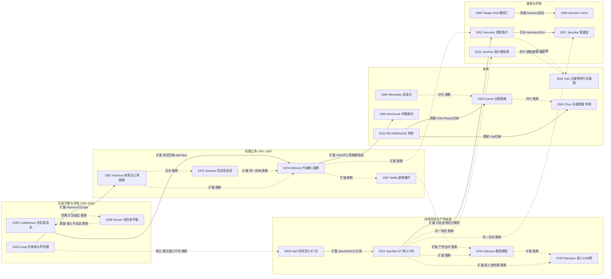

# D06 高代谢反应、营养与代谢调控

> **一句话判断**：这个方向研究大面积烧伤后身体为什么长期“多耗能、拆肌肉”，以及营养和药物能改变多少；它已从 1930–1970 年代“确认现象、争论机制”走到今天“生理终点多有改善、硬结局证据不足”的阶段——普萘洛尔、氧雄龙、生长激素主要在单中心儿童试验里改善了静息能量消耗或瘦体重（氧雄龙另有一项 81 例成人多中心 RCT，报告住院时间缩短 [D06-S33]），而本轮找到的唯一千例级多中心营养试验（成人、肠内谷氨酰胺，1200 例）是阴性 [D06-N16]。**对临床医生最重要的一点**：儿童的高代谢可持续到伤后 2–3 年 [D06-N14]，但支撑多数药物用法的证据集中在同一个单中心平台（Galveston Shriners），其核心注册 NCT00675714（登记入组 1126 人）已终止、登记称研究数据无法访问、没有登记结果（第 7 节）。

## 0 三分钟速读

1. **从哪里来**：起点是“伤后负氮平衡”的测量。Cuthbertson 1930 用代谢平衡在骨折病人身上测到氮、硫、磷丢失在伤后第 2–6 天达峰，推断主要来自肌肉 [D06-N01]；本轮找到的最早烧伤病人尿氮大量排出记录是 1940 年一例 40% 体表面积的病例报告 [D06-S01]。但 1948 年伯明翰的测量显示多数病人尿氮并不高，作者认为负氮平衡主要来自摄入不足 [D06-N02]——成因从一开始就有两说。
2. **为什么改变**：1953–1970 年“代谢率为什么升高”有几种解释并存：甲状腺（Cope 1953 测得甲状腺功能正常，予以排除）[D06-N17]、体表蒸发散热、儿茶酚胺（Harrison 1967：耗氧升高与尿儿茶酚胺排出显著相关）[D06-N18]。Zawacki 1970 用防水薄膜使不显性失水明显减少，升高的代谢率却无显著变化 [D06-N19]；Wilmore 1974 在代谢舱中用 α+β 阻断把代谢率从 69.6 降到 57.4 kcal/m²/h [D06-N03]，此后多数综述与药物试验以儿茶酚胺为主要介质，但阻断只能部分降低代谢率（见 2.2）。
3. **如何分化**：此后三条线并行——营养（高蛋白 [D06-N04]、早期肠内 [D06-N05]、热量超过测得能量消耗 1.2 倍只长脂肪 [D06-N09]、谷氨酰胺 [D06-N10][D06-N11]）；药物（1946 年起的雄激素、生长激素 [D06-N06] 及其成人 ICU 反证 [D06-N07]、普萘洛尔 [D06-N08]、氧雄龙 [D06-N12]、胰岛素 [D06-N13] 与二甲双胍）；“持续多久、热从哪来”（至少 9 个月 [D06-N21]、2–3 年 [D06-N14]、底物循环 [D06-N20]、白色脂肪褐变 [D06-N15]）。
4. **现在研究什么**：六个主题——谷氨酰胺在 1200 例阴性试验后的重估（出院存活时间 sHR 0.91，0.80–1.04）[D06-N16]；普萘洛尔能否延伸到成人和死亡等硬结局；氧雄龙 2023 年在美国撤销批准后用什么替代；二甲双胍替代胰岛素控糖；脂肪、菌群与表观遗传“加速衰老”机制；营养实施细节与中国专家共识（第 4 节）。
5. **用了什么数据**：历史上是代谢病房平衡、代谢舱、稳定同位素加肌肉活检、DEXA 和动物模型；1990–2016 年的药物证据主要来自 Galveston 单中心儿童随机试验，同一注册下产出多篇论文，胰岛素试验原文图 1 显示氧雄龙、普萘洛尔、胰岛素等试验从同一入组池分流随机 [D06-N13]；近五年增加了多中心 RCT、RCT 数据二次分析、TriNetX 电子病历网络、脂肪组织组学和 DNA 甲基化时钟（第 7 节）。
6. **还有什么不知道**：本轮未找到成人普萘洛尔的多中心硬结局试验（Galveston 成人普萘洛尔注册登记实际入组 47 人、状态为终止 [D06-S59]）；氧雄龙替代药物没有随机证据；本轮查到的唯一在册二甲双胍前瞻试验 NCT04530058 是 II 期、计划 250 例、尚未招募 [D06-R12]；三篇普萘洛尔 Meta 的试验数与病例数对不上（4、12、14 项 RCT），未见按注册号去重（第 4.2、8 节）。

**覆盖边界**：
- 纳入：创伤/烧伤后分解代谢与高代谢的认识史（负氮平衡、ebb/flow 分期、机制之争、持续时间）；环境温度；营养（热量目标、蛋白、早期肠内、肠外补充、谷氨酰胺等免疫营养、微量元素）；代谢药物（生长激素、雄激素/氧雄龙、普萘洛尔、胰岛素、二甲双胍）；底物循环、脂肪褐变、肌肉萎缩、菌群与表观遗传机制。
- 只点到为止：早期切痂对代谢的影响（D02）；肠屏障与肠源性感染（D04）；休克期与给药时机（D01）；器官功能与死亡风险（D07）；出院后运动康复与生长（D10）。
- 不含：吸入性损伤（D05）；创面愈合生物学（D08）；学科史完整叙述（X01）。

**本章口径**：
- 截止 2026-09-29；近期窗口 2021-09-29 至 2026-09-29，只用于第 4 节，不限制历史追溯。
- 阅读层级：L0=仅二手转述；L1=题录已核；L2=摘要已读；L3=原文部分页已读；L4=全文已读。只到 L0/L1 的写“据某来源转述”或“仅题录”，不写成已核对原文贡献。
- 核查状态：通过=题录与所引数字本轮对照 PubMed 记录、注册记录或原文页核对一致；修正=核对后改正（正文用修正值）；存疑=保留但证据不足或来源内部矛盾。
- 节点 22 个：L3 11 个（N01–N03、N05、N12–N15、N17–N19），L2 11 个；修正 4 个（N06、N12、N13、N14），其余通过。N12、N13 是第二轮完整性检查后按 PMC 全文升到 L3 的（见第 12 节）。近期代表研究 19 条（R01–R19），入口综述/指南 8 条（E1–E8），辅助文献 62 条（S01–S62），全部见 `data/evidence_D06.json`。N17–N22 是复审后增补的节点，编号不按年份；第 9 节按年份排列。
- 覆盖状态：**基本完整但有标注缺口**（按全报告统一口径于第二轮重评）。理由：① 六个问题都能据本章回答——从哪里来（第 1 节、2.1）、为什么改变（2.2–2.9）、如何分化（第 3 节分支图）、现在研究什么（第 4 节六个主题）、用了什么数据（第 7 节）、还有什么不知道（第 8 节）；② 覆盖边界内的主要分支都有节点：负氮平衡与消耗（N01、N02、N17）、机制之争（N18、N19、N03、N20）、营养与谷氨酰胺（N04、N05、N09–N11、N16）、合成代谢激素与普萘洛尔（N06–N08、N12）、血糖（N13）、持续时间与产热来源（N21、N14、N15、N22）；③ 主链关键转折都有可核实来源（早期转折读到原文页，药物线 RCT 至少读到摘要并对照 PubMed 记录）。缺口限于：1950 年代以前非英文原文与部分早期原文只到题录；Herndon 2001、Takala 1999、Heyland 2022 等 NEJM 付费全文只到摘要；CNKI/万方/维普未检索；三篇普萘洛尔 Meta 与一篇氧雄龙 Meta 的纳入试验未按注册号去重——均已在第 8 节标注。
- 引用写法：[D06-Nxx] 关键节点；[D06-Rxx] 近期代表研究；[D06-Exx] 入口综述/指南；[D06-Sxx] 辅助文献。

---

## 1 源头：最初在研究什么

**判断**：没有单一起点。“伤后全身分解代谢”先在骨折病人身上被量化；烧伤病人的氮丢失记录出现在 1940 年代，但当时对负氮平衡的成因（分解增加、创面渗出、摄入不足）并无共识；“烧伤高代谢”作为独立问题是在 1950–1970 年代的机制争论中成形的。

| 起点说法 | 分类 | 限定语与依据 |
|---|---|---|
| Cuthbertson 1930：骨折与非骨性损伤后尿氮、硫、磷丢失，第 2–6 天达峰，1–2 个月后仍有少量丢失；S:N 与 P₂O₅:N 比提示主要来自肌肉 [D06-N01] | 目前最早找到的文献（创伤，不是烧伤） | 原文 p1262 Summary 第 1、2、6 条（L3）。Jeschke 2016 称 Claude Bernard 1878 已描述失血性休克中的“创伤性糖尿病”，本轮未见原著（L0）[D06-E1] |
| Lucido 1940：27 岁男性、约 40% 体表面积，记录 30 天出入量，结论写尿氮排出量很高、提示大量蛋白分解，主张高蛋白摄入 [D06-S01] | 目前最早找到的烧伤病人氮代谢记录 | 单病例（L3，p640、p644）；早于常被引用的 Taylor 1943 Science 短报（仅题录）[D06-S02] |
| Taylor 等 1943 Ann Surg：波士顿市立医院 63 例烧伤中低蛋白血症常见；每日 100–125 g 蛋白、约 3000 kcal 的饮食对部分病人有效，最重者无反应或无法进食；作者认为单纯血浆渗出不能完全解释 [D06-S03] | 目前最早找到的烧伤蛋白营养系列观察 | 仅读 p215（L3）；p215 脚注写研究部分由战时 OSRD 医学研究委员会合同资助 |
| “ebb/flow 两相” | 被公认的奠基工作 | Jeschke 2016 第 2.1 节把出处写为 Cuthbertson 1942（Lancet 239:433-437；综述实际引用 2001 年 Nutr Hosp 重印版）[D06-S05] 和 Wolfe 1981 [D06-S06]；1942 原文未读（L1）。Wolfe 1981 摘要（L2）：ebb 期心输出量与代谢率降低，flow 期二者升高、可持续数周，并写“flow 期代谢反应的信号是什么”是最紧迫的问题 |
| Abbott 1946：改变氮/热量摄入或给丙酸睾酮对烧伤后氮平衡的影响 [D06-S04] | 目前最早找到的烧伤激素干预 | 仅题录（L1）；Jeschke 2016 写“早在 1946 年”[D06-E1] |
| “烧伤高代谢 19 世纪已被描述”（Jeschke 2016 摘要）[D06-E1] | 存在争议的首次 | 正文依据是 Bernard 描述的失血性休克代谢改变，不是烧伤；本轮能核实的烧伤特异原始记录最早为 1940 年 |
| Wilmore 1974：代谢舱 + α/β 阻断，确立儿茶酚胺介导 [D06-N03] | 被公认的奠基工作（需限定） | E1 引为奠基（ref 16）。但烧伤儿茶酚胺排出升高（Goodall 1957，仅题录）[D06-S07]、耗氧与儿茶酚胺相关（Harrison 1967，L3）[D06-N18]、温暖干燥空气对基础代谢率的影响（瑞典 Barr 1969、Birke 1972，仅题录）[D06-S09][D06-S10] 都更早。Wilmore 的贡献是把环境温度、儿茶酚胺与阻断放进同一代谢舱设计 |
| 白色脂肪褐变：Sidossis 2015-08（Galveston）与 Patsouris 2015-11（多伦多）[D06-N15][D06-S41] | 存在争议的首次 | 两组同年独立报告；本报告不判优先权 |
| 中国成人烧伤热量公式：1000×体表面积(m²)+25×烧伤面积% | 作者自称首次 | 样本数两说：Wang 1992 写 92 例、Xie 1993 写 75 例（L2）[D06-S47][D06-S48] |
| “肠源性高代谢”理论 | 作者自称首次 | 依据为大鼠实验（Peng 2001，88 只）[D06-S49]；汪仕良 2008 称“新理论”[D06-E8]；未见人体 RCT |

“最早找到”与“公认奠基”要分开读：前者是本轮在 PubMed/PMC 能定位并核实的最早记录，受检索范围限制（1940 年以前的德、法、北欧文献与中文文献未系统检索）；后者是综述反复引用、后续研究以之为前提的工作。同一时期还有 Blocker 1953 用放射性碘标记白蛋白研究烧伤蛋白代谢（仅题录）[D06-S08]。

---

## 2 关键转折：问题—新证据/新方法—认识变化—新问题

### 2.1 负氮平衡从哪里来：分解、渗出还是吃得少（1930–1953）

- **问题**：骨折愈合研究集中在血钙、血磷，结论互相矛盾（Cuthbertson 1930 p1244–1245）。**新方法**：在代谢病房做全身代谢平衡。**结果**：损伤本身引起全身蛋白分解，非骨组织损伤同样出现 [D06-N01]。**关系**：提出问题。
- **烧伤病人**：Lucido 1940 单病例尿氮很高 [D06-S01]；Taylor 1943 在 63 例中观察到低蛋白血症，高蛋白饮食只对部分病人有效 [D06-S03]。
- **Keyser 1948**（英国 MRC 伯明翰事故医院烧伤单元）[D06-N02]：尿氮 20 例、7 例共 16 次氮平衡、渗出氮 10 例。只有少数病人日尿氮明显高于正常，许多偏低；负氮平衡倾向被证实，但作者判断主要来自摄入低而非丢失增加；创面渗出氮占总氮排出（不含粪）2–25%（p625 Summary）。作者自述早期尿样收集不可靠、大量早期数据作废（p605）。**关系**：与“损伤后分解增加”的解释相对（质疑，本报告推断）；Keyser 致谢里列出 Cuthbertson（p625），两文方法相近，但正文未直接对比。
- **Cope 1953**（麻省总医院）[D06-N17]：12 例严重烧伤（20–68% 体表面积）、3 例中度烧伤，对照为 6 例大手术、6 例溃疡穿孔和 1 名高蛋白饮食志愿者。代谢率升高 +30 至 +60，可持续约 2 个月，随创面愈合逐渐恢复正常；8 例重度和 1 例中度烧伤的血清蛋白结合碘与 ¹³¹I 摄取均正常；结论是 11 例严重烧伤的代谢率升高足以解释消耗、甲状腺不参与、肾上腺皮质亢进是伴随而非原因（p173）。**认识变化**：把“消耗”与“代谢率升高”连在一起，并排除甲状腺；同时留下一个后来被修正的判断——代谢率随创面愈合恢复正常（见 2.7）。
- **新问题**：代谢率为什么升高？

### 2.2 代谢率为什么升高：几种解释并存，到代谢舱与阻断实验（1953–1990）

**判断**：机制线不是“一篇定案”，而是排除（甲状腺、蒸发）、相关（儿茶酚胺）、干预（阻断）、再补充（多激素、底物循环）的累积过程；“阻断只能部分降低代谢率”从 1974 年到 1990 年反复出现。

- **甲状腺说被排除**：Cope 1953 [D06-N17]。该文 p173 讨论还把疼痛、焦虑引起的肾上腺素释放列为多种叠加影响之一。
- **蒸发散热说**：认为大面积创面蒸发失水带走大量热，病人被迫产热代偿。Harrison 1967 引言把这一解释归于 Morgan 等 1955 年大鼠研究（仅见其参考文献，L0）[D06-N18]；Harrison HN 1964（作者含 Mason AD Jr，仅题录）[D06-S11]；斯德哥尔摩组 Barr 1969、Birke 1972 在温暖干燥空气治疗下测基础代谢率、蒸发失水与儿茶酚胺（仅题录）[D06-S09][D06-S10]。Zawacki 1970 写道该假说当时“被广泛接受”（p236、p240）。
- **儿茶酚胺相关**：Goodall 1957（仅题录）[D06-S07] 与 Birke 1957（仅见 Harrison 1967 参考文献，L0）报告烧伤后尿肾上腺素/去甲肾上腺素排出大增。Harrison 1967（密歇根大学）[D06-N18] 用 Benedict-Roth 肺量计测 30 例 >40% 体表面积成人，其中 6 例代谢率升高持续超过伤后两周者每周同测尿游离肾上腺素和去甲肾上腺素，代谢率升高幅度与排出增加显著相关（p169、p172）。这是相关研究，没有干预。
- **蒸发说的直接检验**：Zawacki 1970（美国陆军外科研究所）[D06-N19]：12 例（17.0–67.5%），连续两天自身对照——一天暴露、一天贴防水薄膜，两天都先涂磺胺米隆。薄膜使不显性失水明显减少，升高的代谢率无显著变化；结论是代谢率升高主要由蒸发冷却以外的机制驱动，并自述结论只适用于年龄、面积、环境、伤后时间和治疗可比的病人（p240）。**关系**：质疑（原文明确）。
- **代谢舱与阻断**：Wilmore 1974 [D06-N03]（同一研究所；Mason AD Jr 也是 Zawacki 1970 与 Harrison HN 1964 的作者）：20 例非感染烧伤成人（平均 45%，7–84%）加 4 名正常对照，在 19–33℃、恒定水汽压下测定。所有病人在各温度下都高代谢；代谢率与尿儿茶酚胺呈双曲线关系（55 次测定，r²=0.84）；α+β 阻断使代谢率由 69.6±5.3 降至 57.4±5.2 kcal/m²/h（P<0.01）；环境由 25℃ 升到 33℃ 时，<40% 者不变、大面积者由 72.0 降至 65.8；喂养或葡萄糖+胰岛素改善氮潴留但不降低代谢率。作者概括为“烧伤病人是体内热，不是体外冷”。**局限**：非随机、急性短时阻断；温暖环境只降 5–8 kcal/m²/h，不能恢复正常（p660 图 1 注）；Wilmore 1975 另 8 例同样显示 <60% 者升温对代谢率无影响 [D06-S14]。**关系**：扩展并部分修正（把驱动从“体表散热”改为“中枢调定点 + 儿茶酚胺”），给出两个可操作方向：提高环境温度（效果有限）与药物阻断。
- **对“单一儿茶酚胺”的补充**：
  - Bessey 1984 [D06-S17]：9 名健康男性持续输注皮质醇、胰高糖素、肾上腺素 74 小时，复现高代谢、负氮负钾平衡、糖耐量下降和胰岛素抵抗；单激素输注显示几种激素之间有相加与增效（synergistic）作用。受试者不是烧伤病人，激素浓度相当于轻中度损伤。
  - Wolfe 1987 [D06-N20]：稳定同位素测 18 例高代谢烧伤病人与 18 名志愿者，甘油三酯-脂肪酸循环升高 450%，糖酵解-糖异生循环升高 250%；输注普萘洛尔明显降低前者、不影响后者。**认识变化**：额外产热部分来自“空转”的底物循环，其中脂肪酸循环由 β 肾上腺素驱动——这是儿茶酚胺与后来“脂肪产热”研究之间的一座桥。
  - Breitenstein 1990 [D06-S22]：10 例非感染成人（平均 28%）静息代谢率为参考值 144%，静脉普萘洛尔降到 135%、口服降到 129%；作者结论是 β 肾上腺素亢进只是高代谢的介质之一。

### 2.3 喂多少、喂什么、何时喂（1971–2018）

- **热量：从“越多越好”到按测量值定量**。据 E1 转述，Wilmore 1971 提出“超常摄入”，建议量可高达约 8000 kcal/d [D06-S15]；Curreri 1974 提出按体重与烧伤面积计算热量的公式（仅题录）[D06-S16]。Saffle 1990 RCT [D06-S24]：49 例成人（平均 47%），Curreri 公式组摄入超过静息能量消耗（REE）43%，间接测热组约 1.2×REE，两组体重和生存相同。Hart 2002 [D06-N09]：1995–2001 年测 250 例存活者 REE；1998–2000 年 42 例 >60% 病人持续肠内营养，热量在 1.0–1.8×REE 之间，DEXA 连测体成分——瘦体重丢失不因热量增加而减轻，超过 1.2×REE 只增加脂肪；REE 下降与死亡相关。**关系**：修正“多喂保肌肉”的假设。ESPEN 2013 建议无间接测热时用 Toronto 公式（儿童 Schoffield）以防过度喂养 [D06-E3]。
- **蛋白**：Alexander 1980 [D06-N04]：18 例儿童（平均约 60%，每组 9 例）随机匹配，高蛋白组蛋白占热量 23.0%（常规 16.5%）；常规组调理素指数更差（0.42 vs 0.62）、C3/IgG/转铁蛋白更低、生存 5/9 vs 9/9（P<0.03）。事件极少，且常规组实际热量达标率更高，蛋白与热量混杂。ESPEN 2013 强推荐成人 1.5–2 g/kg、儿童 3 g/kg [D06-E3]；本报告未核实该推荐引用了哪些试验。
- **时机：早期肠内营养——实践被采纳，机制未被证实**。Mochizuki 1984 [D06-N05]：豚鼠 30% 烫伤 57 只，伤后 2 小时开始胃内喂养组第 13 天静息代谢为伤前 109%，适应 72 小时后再喂的两组为 144% 和 137%；空肠黏膜重量与皮质醇（r=−0.829）、胰高糖素负相关；讨论以尿 VMA 作为儿茶酚胺分泌指标（p304）。作者提出“立即喂养→保护黏膜→减少分解激素→降低高代谢”链条，属相关推断。同年 McArdle 1984 [D06-S18] 12 例（40–70%）早期经鼻十二指肠喂养，9.8 天达正氮平衡（无对照）；Chiarelli 1990 [D06-S23] 20 例（每组 10 例）伤后 4.4 h vs 57.7 h 开始补充，正氮平衡 8.8 vs 24.1 天。**反证**：Peck 2004 RCT [D06-S31]（24 h 内 vs 7 天）调整后早喂组平均能量消耗未降反升（P=0.07），死亡 28% vs 38%。Cochrane 2006（3 项 RCT）认为证据不足以下结论 [D06-S34]；Pu 2018（7 项 RCT、527 例，含 CNKI）死亡 OR 0.36（0.18–0.72）[D06-E5]。**认识变化**：证据的支点从“降低代谢”换成了“死亡、脓毒症等结局”。
- **途径**：Herndon 1987 [D06-S19]：28 例 >50% 随机，伤后 10 天内加用全肠外营养组 T 辅助/抑制比更低，死亡各 8 例。
- **早期切痂与代谢（与 D02 交叉）**：Hart 2003 [D06-S30]：46 例儿童的队列分析（按伤后转入本院的时间分组，非随机）；早期组接受的是早期切痂加同期积极肠内喂养的**组合干预**，结果不能单独归因于早切。早期组能量消耗**未降低**，但肌肉蛋白分解明显减轻，创面定植与脓毒症也较少。D02 收录的 Legrand 2026 前瞻队列方向相反：早切组脓毒症/感染性休克更多 [D02-R06]，D02 把这一信号列为未解释（D02 第 8.1 节）。两项都是观察性设计，“早切是否减少脓毒症”目前没有一致结论。Gao 2004 [D06-S53]：56 例成年男性，伤后 5 天内切痂组 14 天内 REE 较低。两者人群（儿童 vs 成年男性）、设计与终点（肌肉蛋白动力学 vs REE）不同，只能并列，不能合并。

### 2.4 合成代谢激素：儿童获益、成人反证、最后撤出市场（1946–2023）

- **更早的尝试**：Abbott 1946 丙酸睾酮 [D06-S04]、Liljedahl 1961 人生长激素 [D06-S12]、Wilmore 1974 SGO 生长激素加高热量 [D06-S13]（均仅题录）。
- **Herndon 1990** [D06-N06]：Galveston 40 例儿童（≥40% 且三度 ≥20%）双盲 RCT，rhGH 0.2 mg/kg/d 组 IGF-1 4.8 vs 1.6 U/mL，供皮区愈合缩短，住院日/%TBSA 由 0.80 降至 0.54（相当于 60% 患儿 46→32 天）。**定位（修正）**：是 Galveston rhGH→氧雄龙→普萘洛尔系列随机试验的起点之一，不是“药物调控高代谢”的开端。
- **Takala 1999**（反证与边界）[D06-N07]：芬兰和多国两项平行多中心双盲 RCT，532 例 ICU 成人（心脏手术、腹部手术、多发伤、急性呼吸衰竭，不含烧伤），rhGH 约 0.10 mg/kg/d、最长 21 天，院内死亡 39% vs 20%、44% vs 18%（RR 1.9 与 2.4）。**回应**：Ramirez 1998 [D06-S26] 明确提到“两项欧洲大型试验”，回顾 263 例烧伤儿童，受控研究中 rhGH 组与安慰剂组死亡均为 2%，但 rhGH 组高血糖发作和外源胰岛素需求更多。Hart 2002 [D06-S29]：56 例儿童四组随机，单用生长激素无显著获益，与普萘洛尔无叠加效应。Cochrane 2014 [D06-S40]：13 项 RCT、701 人，成人创面愈合快 9.07 天、未见死亡增加，高血糖 RR 2.65（1.68–4.16），样本小、偏倚风险高。Jeschke 2011 讨论写自 Takala 以来 rhGH 使用受限，转而讨论 IGF-1 [D06-N14]。**关系**：质疑 + 适用边界之争（烧伤儿童 vs 非烧伤成人、剂量不同），至今没有同人群试验裁决。
- **氧雄龙**：Demling 1997 [D06-S25] 在恢复期随机 7 vs 6 例（另 10 例回顾对照），前 3 周增重 14.5 vs 7.5 磅；Wolf 2006 [D06-S33] 成人多中心 81 例（20–60%），住院 31.6 vs 43.3 天，中期分析提前终止；Jeschke 2007 [D06-N12] 235 例儿童（对照 190、氧雄龙 45，4:1 区组随机；入组历时 8 年），ICU 住院日/%TBSA 0.48 vs 0.56（P=0.048），对照组瘦体重 −8%、氧雄龙组 +9%，AST/ALT 升高。第二轮读 PMC 全文（L3）补充：全体病人入院后先用安慰剂 7 天，再按分组给氧雄龙或安慰剂至 ICU 出院（约 30 天）；两组平均伤后第 7 天入院；表 1 中未按面积标化的 ICU 住院日氧雄龙组 28 天、对照组 31 天（P=0.4），死亡氧雄龙组 9%、对照组 6%（P=0.7），感染率无差异，REE 两组无差异；正文写对照组瘦体重降 9%–10%、氧雄龙组 +8%，与摘要数字略有出入；方法部分未指定主要终点，论文未报告注册号；Porro 2012 [D06-S37] 222 例（安慰剂 152、氧雄龙 70）用药 1 年、随访至 5 年，身高百分位与骨矿含量改善；Herndon 2016 [D06-S43] 612 例，氧雄龙与普萘洛尔联用使生长停滞缩短 84 天。
- **转折**：FDA 2023-06-28 联邦公报（文件号 2023-13733）撤销 Oxandrin 及 4 个仿制药的批准；公告正文写明标签所列安全问题包括肝紫癜、肝细胞肿瘤、与动脉粥样硬化风险相关的血脂改变，FDA 认为问题足够严重、药品应撤出市场，持有人随后自愿申请撤销 [D06-S56]。这是一条“试验终点获益、监管层面撤出”的路线（第 4.3 节）。

### 2.5 阻断驱动因素：普萘洛尔（1974–2016）

- **早期结果方向不一**：Herndon 1988 [D06-S20]：18 例儿童（70% 体表面积）静脉普萘洛尔 5 天，心率、左室做功、心率-血压乘积分别降 20%、22%、36%，但禁食状态尿素生成**升高** 54%（进食状态 12%），作者称需调整剂量与喂养以限制分解；Minifee 1989 [D06-S21] 6 例心肌耗氧指标下降；Breitenstein 1990 [D06-S22] 见 2.2。
- **Herndon 2001** [D06-N08]：25 例儿童（>40%；普萘洛尔 13、对照 12），口服 ≥2 周、使静息心率较基线降 20%；腿部稳定同位素测得肌肉蛋白净平衡较基线升 82%（对照降 27%，无统计学意义）；对照组去脂体重降 9±2%，普萘洛尔组无明显变化。**关系**：把 Wilmore 的急性阻断推进为可长期使用的干预（扩展，本报告推断）；与 1988 年“尿素生成升高”的结果方向相反，两者给药途径、时长、喂养与终点都不同，本轮未见原文讨论这一差异。
- **同一项目的延伸**：Hart 2002（56 例四组）[D06-S29]；Herndon 2012 [D06-S38]：179 例（对照 89、普萘洛尔 90），4 mg/kg/d 用 12 个月，降低 REE%预测值与心率%预测值、减少中心脂肪、防止骨量丢失、改善瘦体重，论文自报注册 NCT00675714。
- **成人**：Ali 2015 [D06-S42]：69 例（35/34，≥30%），植皮间隔 10 vs 17 天、围术期血细胞比容改善 5–7%，摘要未写随机；Rehou 2023 II 期 52 例（见 4.2）[D06-R03]。
- **给药时机（未解决）**：Xiao 2011（第三军医大学西南医院）[D06-S54]：大鼠伤后 0.5 小时给普萘洛尔，心肌损伤加重，肝、肾、肠血流下降、损伤加重。这是休克期动物结果，不能外推到 flow 期用药，但人体中“何时开始”本轮未找到专门研究（与 D01 交叉）。

### 2.6 血糖：从强化胰岛素到二甲双胍（2001–2016）

- Gore 2001 [D06-S27]：58 例 ≥60% 儿童的病历回顾，控糖差组（33 例）菌血症更多、植皮存活 64% vs 88%、死亡 27% vs 4%。同年 van den Berghe 2001 [D06-S28] 在 1548 例外科 ICU 成人中强化胰岛素使 ICU 死亡由 8.0% 降到 4.6%。
- Jeschke 2010 [D06-N13]：239 例 >30% 儿童（强化 60、对照 179，1:3），感染和脓毒症减少、器官功能改善、胰岛素抵抗与分解减轻，死亡 4% vs 11%（P=0.14，无统计学差异）；注册 NCT00673309。**关系**：把外科 ICU 的思路扩展到烧伤儿童。第二轮读 PMC 全文（L3）补充：
  - **样本分配**：随机 239 例，按图 1 排除后分析 186 例（强化 49、对照 137）；对照组排除 42 例（退出 3、医生判定无望或排除 7、接受其他药物 9、面积 <30% 22、伤后 >30 天入院 1），强化组排除 11 例（无望或排除 3、其他药物 7、面积 <30% 1），分析不是按随机分组全数计入。表 1 中强化组年龄更大（10.8 vs 7.7 岁）、三度面积更大（52% vs 44%）（均 P<0.05），与摘要“两组基线相似”的表述不一致。死亡 2/49 vs 15/137，脓毒症 4 例（8.2%）vs 31 例（22.6%）。
  - **主要终点**：论文方法部分未指定主要终点，目的写作“是否改善烧伤后并发症”；作者在讨论中自述死亡终点检验效能不足（按 50% 检验效能计算，等比例分组需 216 例，按 3:1 分组约需 570 例）。注册记录 NCT00673309 登记的主要结局是“稳定同位素测定的高代谢降低”，并发症与死亡、脓毒症是次要结局（第 7 节）。
  - **安全性**：严重低血糖（<40 mg/dl）强化组 26%、对照组 9% 的病人发生。
  - **同一入组池**：图 1 显示 2000-03 起入组 623 例，其中 150 例随机进入氧雄龙试验、153 例进入普萘洛尔试验、81 例进入其他试验、239 例进入本试验。
- NICE-SUGAR 2009 [D06-S35]：6104 例 ICU 成人，强化组 90 天死亡 27.5% vs 24.9%（OR 1.14，1.02–1.28），严重低血糖 6.8% vs 0.5%。烧伤领域的共识取中等目标：血糖 ≤8 mmol/L、葡萄糖 ≤5 mg/kg/h [D06-E3]。
- **二甲双胍分支**：Gore 2005 [D06-S32] 成人双盲 8 vs 5 例、用药 7 天，血糖与糖生成下降、肌肉蛋白合成率增加；Jeschke 2016 [D06-S44] II 期中期分析 44 例（二甲双胍 18、胰岛素 26），控糖相当，低血糖 6%（1 例）vs 15%。其后证据转为观察性（4.4）。

### 2.7 高代谢持续多久（1953–2018）

- **旧认识**：Cope 1953 写代谢率升高可持续约 2 个月、随创面愈合恢复正常 [D06-N17]；Harrison 1967 引言写耗氧升高可持续到伤后 3 个月 [D06-N18]；Hart 2000 摘要写“当前观点认为高代谢在创面完全闭合后不久消退”[D06-N21]。
- **Hart 2000**（Galveston）[D06-N21]：>40% 儿童（平均 65%，7.6 岁）在伤后 6、9、12 个月测 REE、肌肉蛋白动力学与 DEXA：REE 高于 Harris-Benedict 预测值并逐步下降；6、9 个月时净蛋白平衡与瘦体重仍呈分解；9–12 个月间好转。结论：至少持续 9 个月。摘要未写例数。
- **Gauglitz 2009** [D06-S36]：194 例（2002–2007）对比 95 名非烧伤儿童，尿皮质醇、儿茶酚胺与 REE 升高至 36 个月，胰岛素抵抗指标全程异常。
- **Jeschke 2011** [D06-N14]：977 例（1998–2008，>30%，平均 50%）对比 107 名非烧伤儿童，入院至伤后 36 个月分 15 个时间段测定。**修正**：Results 与图 1A 写 REE%预测值升高至伤后 2 年，摘要与 Discussion 写异常持续至 3 年——同文两种表述。心率约为正常儿童 2 倍、持续 3 年；肝脏平均增大 75%；IL-6、IL-8、G-CSF、MCP-1 最高约升 2000 倍；各时点测量数 31–307 不等。**定位（修正）**：在 Hart 2000（≥9 个月）与 Gauglitz 2009（至 36 个月）基础上用大队列把持续期延伸到 2–3 年，而不是单篇“改变认识”；Gauglitz 2009 的受试者很可能是其子集（本报告推断，原文未说明）。其讨论据心脏负荷持续升高支持使用抗分解药物（原文明确），随后 Herndon 2012 把普萘洛尔延长到 12 个月。
- **成人**：Stanojcic 2018（多伦多）[D06-N22]：2006–2016 年前瞻入组 1288 例成人，按 <20%、20–40%、>40% 分层：急性住院期 REE 升高，第 2–4 周白色脂肪褐变增加，高血糖与高胰岛素在伤后 7–14 天达峰；20–40% 组的口服糖耐量与胰岛素抵抗曲线下面积与 >40% 组相近。只覆盖急性住院期。
- **判断**：“持续 1–3 年”的结论主要来自同一儿童平台的系列队列；成人出院后 >1 年的代谢数据本轮未找到。

### 2.8 额外的热从哪里来：从底物循环到脂肪褐变（1987–2024）

- Wolfe 1987 的底物循环 [D06-N20] 把一部分产热落到脂肪酸循环（见 2.2）。
- **Sidossis 2015** [D06-N15]：Galveston 烧伤儿童 42 例（平均 54%）与成人 6 例的皮下白色脂肪活检，对照为健康儿童 10 例、成人 9 例，另有儿童 18 例、成人 6 例连续活检。晚期组 UCP1 mRNA 约为对照 80 倍（早期组约 15 倍），UCP1 蛋白 36.2 vs 2.7 ng/mg；前瞻儿童线粒体泄漏呼吸由 0.52 升至 1.46 pmol/s/mg，但仍比人棕色脂肪低约 20 倍；作者推测皮下脂肪可占 REE 约 13.5%（约 263 kcal/d），原文明确为推测。讨论以尿肾上腺素/去甲肾上腺素分别升高约 10 倍/6 倍联系“儿茶酚胺风暴”。同年 Patsouris 2015 [D06-S41]（小鼠 + 人）报告儿茶酚胺和 IL-6 参与褐变。
- Stanojcic 2018 在成人中观察到第 2–4 周褐变 [D06-N22]；Knuth 2024 小鼠脂肪移植实验见 4.5 [D06-R13]。
- **判断**：脂肪对总能量消耗的贡献仍是推算；肌肉、肝脏、脂肪各占多少没有直接比较。

### 2.9 谷氨酰胺：单中心阳性、多中心阴性（2003–2024）

- **单中心阳性**：Garrel 2003（蒙特利尔）[D06-N10]：45 例随机、41 例分析，谷氨酰胺组 vs 对照组血培养阳性 1.2 vs 4.3 天/人、铜绿假单胞菌 0 vs 6 例、ITT 死亡 2 vs 12 例（per-protocol 0 vs 8）；存活者护理时长无差异。Zhou 2003（北京协和医院，与 Wilmore 合作）[D06-N11]：40 例（50–80%），谷氨酰胺双肽 0.35 g/kg/d，第 3 天乳果糖/甘露醇比 0.025 vs 0.049、第 30 天愈合 86% vs 72%、住院 67 vs 73 天。西南医院 Peng 2004/2005 两篇报告同一 48 例试验（住院 46.6 vs 55.7 天）[D06-S51][D06-S52]，计为 1 项。**关系**：并行，终点不同。
- **背景**：REDOXS 2013 [D06-S39]：40 个 ICU、1223 例多器官衰竭机械通气成人，谷氨酰胺静脉 + 肠内给予，28 天死亡 32.4% vs 27.2%（校正 OR 1.28，1.00–1.64，P=0.05），院内与 6 个月死亡显著更高。同一第一作者（Heyland）随后在烧伤人群单独做了 RE-ENERGIZE。人群与途径不同，不能直接外推到烧伤。
- **RE-ENERGIZE 2022** [D06-N16]：国际多中心双盲 RCT，随机 1209 例、分析 1200 例（谷氨酰胺 596、安慰剂 604），平均 33% 体表面积（入选门槛按年龄 ≥10% 至 ≥20%），入院 72 小时内开始 0.5 g/kg/d 肠内给予。90 天内出院存活中位时间 40 vs 38 天，sHR 0.91（0.80–1.04），P=0.17；6 个月死亡 17.2% vs 16.2%，HR 1.06（0.80–1.41）。Garrel 是作者之一；作者单位表未见中国大陆中心。
- **证据合成**：Ortiz-Reyes 2023 [D06-E6] 10 项 RCT、1577 例，死亡 RR 0.65（0.33–1.28），单中心有效、多中心无效，试验序贯分析判单中心汇总结果为 I 类错误；Yue 2024 [D06-R01] 见 4.1。
- **判断**：对成人、肠内途径、中等面积人群，死亡终点已基本一致为无获益；住院日是否缩短仍有分歧（4.1）。ESPEN 2013 摘要列出的 8 条主要推荐中没有谷氨酰胺（全文未读）[D06-E3]，所以本章不断言“谷氨酰胺曾进入烧伤营养推荐”；RE-ENERGIZE 之后指南是否修订见第 8 节。

---

## 3 分支图

图例：实线=原文明确讨论或综述归纳的关系；虚线=本报告推断；边上写关系类型。节点为“年份 简称”。只到题录的起点线索（Taylor 1943 Science、Abbott 1946、Goodall 1957 等）未画入。

读图提示：
- **机制线**（B）不是单线：N18、N19 都在 N03 之前，N20 与多激素输注（Bessey 1984，未画入）是对“单一儿茶酚胺”的补充。
- **营养线**（C）的方向在 2002 年和 2022 年各被修正一次：多喂不保肌肉（N09），谷氨酰胺单中心阳性被多中心阴性质疑（N16）。
- **药物线**（D）的 N08、N12、N13 与 E 组的 N14 来自同一机构同一时期，受试者可能重叠，不能当作独立证据相加；N13 原文图 1 明确写出氧雄龙、普萘洛尔、胰岛素等试验从 2000-03 起的同一入组池分流随机。
- 复审时删去了一条原有的边（Takala 1999 → Jeschke 2011“修正”）：Jeschke 2011 只是在讨论中引用 Takala 说明 rhGH 受限，并没有修正 rhGH 的证据。

---

## 4 近五年重点（2021-09-29 至 2026-09-29）

### 4.1 谷氨酰胺在 RE-ENERGIZE 之后的重估
- **研究什么**：单中心阳性与多中心阴性为何不一致；是否还有亚组（途径、严重度、中国人群）获益。
- **数据与设计**：国际多中心 RCT；含试验序贯分析的系统综述；纳入 SinoMed/万方/CNKI 的 Meta；伞形综述；中国多中心 RCT。
- **代表研究**：RE-ENERGIZE（1200 例，sHR 0.91，0.80–1.04；6 个月死亡 17.2% vs 16.2%）[D06-N16]；Ortiz-Reyes 2023（10 项 RCT、1577 例，死亡 RR 0.65，0.33–1.28）[D06-E6]；Yue 2024（6 项 RCT、1398 例，检索至 2022-12，死亡 RR 0.37，0.06–2.37，感染与 MODS 无差异，住院日 −8.97 天）[D06-R01]；Naeini 2024 伞形综述（成人，11 篇 Meta 的 33 项原始试验）谷氨酰胺住院日 −6.23 天、低确定性 [D06-E7]；Wang ZE 2022（西南医院牵头的多中心单盲 RCT，55 例、30–70%）第 7、14 天 REE、血儿茶酚胺、胰高糖素、乳酸、HOMA 与器官损伤指标较低，住院日和死亡无差异 [D06-R02]。
- **分歧**：死亡终点趋于一致（无获益）；住院日缩短的汇总结果依赖单中心和中文小试验；中国多中心试验以代谢替代指标为终点，与 RE-ENERGIZE 的出院存活终点不可直接比较。
- **成熟度**：对成人肠内补充的死亡终点，阴性结论成熟；其余为发展中。

### 4.2 β 阻断：从儿童生理终点到成人与硬结局
- **研究什么**：成人中的效果与安全；死亡、脓毒症等硬结局；作用的代谢组学机制；真实世界用药差异。
- **数据与设计**：成人 II 期 RCT + 脂肪组织代谢组/脂质组；大型 RCT 数据的事后分析；多篇 Meta。
- **代表研究**：Rehou 2023 [D06-R03]：加拿大成人 II 期 RCT（≥20%；作者单位为 Hamilton Health Sciences、McMaster 与 Sunnybrook），52 例（普萘洛尔 23、对照 29），脂肪组织能量与核苷酸代谢通路改变，棕榈酸与饱和脂肪酸降低，激素敏感脂肪酶 Ser660 位点活化与磷酸化 JNK 降低。Hundeshagen 2024 [D06-R04]：RE-ENERGIZE 1200 例的事后分析，β 阻滞剂 293、氧雄龙 138、联用 282、均未用 487（40.6%）；用药比例随中心和地区差异很大；β 阻滞剂“使用天数比例”较高与院内死亡（HR 0.5，0.28–0.87）和 6 个月死亡（HR 0.44）较低相关；氧雄龙与出院更晚相关（每增加 100% HR 0.62）。Bhatti 2025 [D06-R05]：14 项 RCT、2114 例，心率、REE（WMD −168.83）、愈合时间下降，死亡、脓毒症、住院日无差异。
- **分歧（计数）**：三篇普萘洛尔 Meta（表中另列一篇氧雄龙 Meta 作对照）的试验数、病例数差别很大，只有一篇写明“多篇报告对应同一试验”：

| Meta | 检索截止 | 纳入 RCT | 报告数 | 病例数 | 摘要是否说明同一试验多篇报告的合并 | 死亡结果 |
|---|---|---|---|---|---|---|
| Hassoun-Kheir 2021 [D06-S46] | 摘要未写 | 4 项 | 11 篇 | 死亡分析：儿童 2 项 424 例、成人 2 项 148 例 | 是（“4 项 RCT 见于 11 篇报告”） | RR 0.82（0.48–1.39），极低确定性 |
| Ma 2020 [D06-S45] | 2020-04-10 | 12 项 | 未写 | 1887 | 未说明 | RD 0.00（−0.03 至 0.04） |
| Bhatti 2025 [D06-R05] | 摘要未写（PubMed、Cochrane） | 14 项 | 未写 | 2114 | 未说明 | 摘要把死亡效应写成“WMD = 0.98”（二分类结局却用 WMD，口径不清） |
| Lou 2025（氧雄龙）[D06-R08] | 2005–2025 年发表（9 个数据库） | 14 项 | 未写 | 2822（干预 1203、对照 1619） | 未说明 | RR 1.04（0.47–2.32） |

参照：同一平台论文自报的单个试验规模为 25 例（Herndon 2001）、56 例（Hart 2002）、179 例（Herndon 2012）、235 例（Jeschke 2007）、222 例（Porro 2012）、612 例（Herndon 2016），而 Herndon 2012 与 2016 自报的注册 NCT00675714 登记入组总数为 1126 人 [D06-S57]。在逐项核对注册号之前，上表病例数应读作“报告中的病例数，可能含重复”，不能当作约 2000–2800 例独立随机证据。Hundeshagen 2024 的暴露按“用药天数比例”定义，存活越久用药天数可能越多，需读全文确认是否处理了不朽时间偏倚；同时存在指征混杂（用药者面积更大、APACHE II 更高、更年轻）。
- **成熟度**：发展中；成人多中心硬结局证据空白（Galveston 成人普萘洛尔注册登记实际入组 47 人、状态为终止 [D06-S59]）。

### 4.3 氧雄龙撤出美国市场后的替代
- **研究什么**：2023 年 FDA 撤销批准后 [D06-S56]，睾酮、生长激素等替代方案的效果与安全。
- **数据与设计**：多中心回顾队列 + 倾向评分；单中心回顾队列；RCT Meta。
- **代表研究**：MASCOTS [D06-R06]：美国 12 家烧伤中心、2022-06 至 2025-06、813 例，合成代谢药物与体重维持无关（P=0.064），用药组住院/ICU 时间更长、VTE 更多（P=0.019）；总体死亡无差异（P=0.885），但氧雄龙组死亡高于睾酮组（P=0.001）。DeWitt 2026 [D06-R07]：单中心 70 例（氧雄龙 52、睾酮 18），转氨酶升高 38% vs 28%（P=0.596），提前停药 33% vs 0%（P=0.014）。Lou 2025 [D06-R08]：14 项 RCT，死亡 RR 1.04，成人转氨酶升高 19% vs 5%，I² ≥95%；摘要中住院日/%TBSA 的 SMD −1.07（−2.43 至 0.29）却标 P=0.007，体重 SMD 0.58（−1.21 至 2.38）标 P<0.001——置信区间跨 0 而 P 值很小，数据报告内部不一致，需读全文核对。
- **分歧**：RCT 显示替代终点获益；观察性多中心数据未见体重获益且有 VTE 信号。
- **成熟度**：早期线索（替代药物只有观察性证据）。

### 4.4 血糖与胰岛素抵抗：二甲双胍
- **研究什么**：避免胰岛素低血糖的替代降糖药；二甲双胍的抗脂解、抗炎作用；老年烧伤。
- **数据与设计**：TriNetX 电子病历网络倾向评分队列；单中心 15 年队列 + 脂肪单核 RNA 测序；注册记录。
- **代表研究**：Hallman 2024 [D06-R09]：TriNetX 伤后 1 周内用胰岛素、二甲双胍或二者，倾向评分匹配后 3 个月内，胰岛素组高血糖、低血糖、脓毒症、乳酸酸中毒、死亡风险均高于二甲双胍组（均 P<0.0001），摘要未给例数。Barayan 2025 [D06-R10]：加拿大一家省级烧伤中心，≥60 岁、15 年、二甲双胍 50 例 vs 对照 262 例，生存改善、低血糖无差异、乳酸酸中毒更少。Khalaf 2025 叙述性综述（仅题录）[D06-R11]。NCT04530058 [D06-R12]：Hamilton 老年烧伤二甲双胍 II 期，计划 250 例，登记开始 2024-11、预计完成 2029-03，状态“尚未招募”。
- **分歧**：证据主要是观察性数据和一项 44 例 II 期中期分析 [D06-S44]；TriNetX 等数据库存在指征混杂（用二甲双胍者可能多为既往糖尿病或病情较轻，原文摘要未给分层）。
- **成熟度**：早期线索。

### 4.5 机制：脂肪-免疫交互、肌肉萎缩与“加速衰老”
- **代表研究**：Knuth 2024（多伦多）[D06-R13]：小鼠中烧伤来源的皮下白色脂肪单独移植到健康小鼠即可引起高代谢，移植健康脂肪可缓解烧伤小鼠的代谢紊乱，提示烟碱型乙酰胆碱受体通路介导免疫-脂肪交互。Gao S 2025（武汉大学人民医院）[D06-R14]：动物实验中菌群紊乱上调结肠 IDO-1，色氨酸-犬尿氨酸经 AHR 加重骨骼肌萎缩；病人血清色氨酸降低；补充色氨酸缓解大鼠肌萎缩。Sullivan 2025（伯明翰）[D06-R15]（修正）：成人入院 53 例、6 个月 34 例、健康对照 29 例，PCGrimAge 加速入院 +9.23 年、6 个月仍 +4.18 年；DunedinPACE 入院高 31.65%、6 个月高 11.36%；PhenoAge 入院 +7.2 年但 6 个月已无差异；Horvath、Hannum 时钟无差异。
- **分歧**：动物机制能否转化到人未验证；脂肪、肌肉、菌群各自贡献大小未比较。
- **成熟度**：早期线索。

### 4.6 营养实施细节与本土化共识
- **代表**：中华医学会烧伤外科学分会等《成年严重烧伤患者肠内营养护理专家共识（2024 版）》（循证 + 德尔菲法，覆盖启动时机、营养风险筛查、吞咽与胃肠功能评估、能量评估、喂养途径、输注、血糖、监测、营养过渡等 11 个主题）[D06-R16]；《烧伤儿童肠内营养治疗专家共识（2025 版）》（文献、问卷、证据筛选）[D06-R17]；ESPEN 2023 ICU 实用与部分修订指南（摘要未写烧伤条款）[D06-R18]。彭曦 2021 述评提出重症烧伤代谢 4 期分期与分期营养策略 [D06-R19]——发表于 2021-09-20，早于窗口起点 9 天，只作背景。
- **分歧**：能量目标（公式还是间接测热、是否允许低热量）和蛋白剂量仍无烧伤专属大样本 RCT；中国文件是专家共识，不是 GRADE 指南。
- **成熟度**：发展中。

---

## 5 争议、负性结果与停滞路线

### 5.1 仍在争或说不清的问题

| 争议 | 各方与证据 | 现状 |
|---|---|---|
| 高代谢是儿茶酚胺单因还是多因素驱动 | 阻断降代谢（Wilmore 1974 [D06-N03]）；阻断只降一部分（Breitenstein 1990 [D06-S22]）；多激素相加与增效（Bessey 1984 [D06-S17]）；β 阻断只降脂肪酸循环（Wolfe 1987 [D06-N20]）；IL-6 参与脂肪褐变（Patsouris 2015 [D06-S41]） | 儿茶酚胺为主要介质的认识稳定，但各介质贡献大小未定量 |
| 谷氨酰胺是否有效 | 单中心阳性（N10、N11、Peng 2004/2005）vs 1200 例阴性（N16）；中国多中心 55 例以 REE 为终点阳性（R02） | 死亡终点基本定论无效；住院日与代谢替代终点存疑 |
| 普萘洛尔的硬结局、成人适用性与开始时机 | 儿童 RCT 一致改善 REE、心率、肌肉蛋白（N08、S38）；Meta 死亡无差异但计数口径不一（4.2 表）；观察性关联（R04）；大鼠休克期给药加重器官损伤（S54） | 未解决 |
| 氧雄龙获益与风险 | RCT 保留瘦体重、缩短住院（N12 为按面积标化的 ICU 住院日，未标化住院日无差异；S33）；Meta 无死亡获益、转氨酶升高（R08）；美国撤销批准（S56）；替代药物观察性数据（R06、R07） | 美国已无法使用；替代药物无随机证据 |
| 生长激素：烧伤儿童 vs 成人危重症 | 儿童受控研究死亡 2% vs 2%（S26）；非烧伤成人 ICU 死亡约翻倍（N07）；Cochrane 未见死亡增加、高血糖 RR 2.65（S40） | 人群边界未由同人群试验裁决；临床使用受限 |
| 血糖目标 | 烧伤儿童强化胰岛素减少感染与器官损伤，死亡差异不显著、严重低血糖更多（26% vs 9%）（N13）；普通 ICU 强化组死亡更高（S35）；ESPEN 2013 取 ≤8 mmol/L（E3） | 中等控制；替代药物待 III 期 |
| 早期肠内营养：降代谢还是改结局 | 动物与小样本人体支持降代谢（N05、S18、S23）；RCT 早喂组能量消耗未降（S31）；Meta 死亡 OR 0.36（E5） | 实践被采纳；“降代谢”机制在人体未被证实 |
| 微量元素与维生素 | ESPEN 2013 强推荐早期补充（E3）；伞形综述中微量元素对临床结局无显著作用（E7，成人） | 两者评价对象不同（推荐 vs Meta 汇总），本轮未读全文，未裁决 |
| 早期切痂是否降低 REE（与 D02 交叉） | 成年男性 56 例：早切组 REE 较低（S53）；儿童 46 例（早切加积极喂养的组合干预、队列设计）：不降 REE，但减轻肌肉分解（S30） | 人群与终点不同，两说并存 |
| 高代谢持续多久 | 同一文 Results 写 2 年、摘要与讨论写 3 年（N14）；成人只有急性住院期大样本（N22） | 儿童“至少 1–2 年”较一致；成人长期数据缺 |

### 5.2 负性结果、失败路线与停滞

1. **1940 年代病房平衡研究**：尿液收集不可靠，大量早期数据被作者作废（Keyser 1948 p605）[D06-N02]。
2. **甲状腺说**：Cope 1953 测得甲状腺功能正常 [D06-N17]。
3. **蒸发散热说与“温暖干燥环境/隔湿”思路**：防水薄膜使失水明显减少，代谢率不变 [D06-N19]；升温只降 5–8 kcal/m²/h，不能恢复正常 [D06-N03][D06-S14]。
4. **超常热量喂养**：>1.2×REE 只增加脂肪 [D06-N09]；Curreri 组超 REE 43% 与测热组生存相同 [D06-S24]。
5. **早期加用全肠外营养**：28 例随机，死亡各 8 例，T 辅助/抑制比更低 [D06-S19]。
6. **早期肠内营养降低能量消耗**：RCT 中未降反升（P=0.07）[D06-S31]。
7. **生长激素**：非烧伤成人 ICU 死亡增加 [D06-N07]；烧伤儿童单用 GH 未见显著合成代谢获益 [D06-S29]。
8. **短期静脉普萘洛尔**：尿素生成升高 54%（禁食）[D06-S20]——与后来的长期口服结论方向相反，应保留。
9. **肠内谷氨酰胺常规补充（成人）**：1200 例阴性 [D06-N16]；非烧伤危重症静脉 + 肠内给药死亡更高 [D06-S39]。
10. **其他免疫营养**：支链氨基酸、鱼油、鸟氨酸 α-酮戊二酸、微量元素、复合免疫营养对临床结局均无显著作用（伞形综述，成人）[D06-E7]。
11. **氧雄龙**：美国撤销批准 [D06-S56]；多中心观察性数据未见体重获益 [D06-R06]。
12. **停滞的试验**：Galveston 五项注册（合成代谢总注册 1126 人、成人普萘洛尔 47 人、儿童普萘洛尔 63 人、胰岛素/二甲双胍 36 人、非诺贝特 + 普萘洛尔 18 人）均为“终止”、无登记结果，登记写明研究数据无法访问 [D06-S57][D06-S59]–[D06-S62]。只陈述登记文本，不推测终止原因。

---

## 6 中国线

**判断**：中国线以第三军医大学西南医院（汪仕良、彭曦等）为主干，另有北京协和医院、解放军 304 医院（后称解放军总医院第一附属医院，PMID 27338528 单位字段）烧伤研究所（盛志勇、柴家科）；原创性工作集中在热量公式、“肠源性高代谢”与肠屏障相关营养研究；药物调控线（生长激素、普萘洛尔）在本轮可核实的中国人体研究中几乎空白。

- **热量公式**：1992–1993 年基于间接测热提出成人公式，样本数两说（92 例 vs 75 例）[D06-S47][D06-S48]。
- **肠源性高代谢**：大鼠 88 只（30% 三度）肠道去污染后 REE 与 LPS、TNF、IL-1 下降，REE 与这些指标相关（r=0.77–0.9）[D06-S49]；汪仕良 2008 综述称新理论 [D06-E8]；未见人体 RCT。
- **早期肠内与肠屏障**：Peng YZ 2001 22 例随机，早喂组乳果糖/甘露醇比、内毒素与 TNF-α 较低 [D06-S50]（与 D04 交叉）。
- **谷氨酰胺**：协和 Zhou 2003（40 例）[D06-N11]；西南医院 Peng 2004/2005（同一 48 例试验）[D06-S51][D06-S52]；西南医院牵头的多中心 Wang ZE 2022（55 例）[D06-R02]；Yue 2024 Meta 纳入 SinoMed/万方/CNKI [D06-R01]。
- **早期切痂与 REE**：解放军 304 医院烧伤研究所 Gao 2004，56 例成年男性 [D06-S53]，与 Galveston Hart 2003 结论不同（5.1）。
- **普萘洛尔**：西南医院 Xiao 2011 大鼠休克期给药加重器官损伤 [D06-S54]；中国作者 Ma 2020 Meta（12 项 RCT、1887 例）[D06-S45]。本轮未找到中国人体普萘洛尔 RCT。
- **近期**：徐州 Lou JQ 2021 强化胰岛素 ± 谷氨酰胺 4 组各 8 例 RCT（发表于 2021-09-20，窗口前）[D06-S55]；彭曦 2021 代谢 4 期分期述评 [D06-R19]；武汉大学人民医院 Gao S 2025 菌群-犬尿氨酸-肌萎缩机制 [D06-R14]；2024 成人肠内营养护理共识与 2025 儿童肠内营养治疗共识 [D06-R16][D06-R17]。
- **可数的规模**：本轮核实的中国人体随机试验 5 项（Peng YZ 2001 22 例、Zhou 2003 40 例、Peng 2004/2005 48 例、Lou 2021 32 例、Wang ZE 2022 55 例），样本 22–55 例，其中多中心 1 项。RE-ENERGIZE 作者单位中未见中国大陆中心。
- **缺口**：未检索 CNKI/万方/维普；2024 年以前的中华医学会烧伤营养指南或共识未检出；盛志勇、柴家科团队关于骨骼肌消耗（钙蛋白酶、26S 蛋白酶体）的原始研究未查到（第 8 节）。

---

## 7 数据路径小结（历史上 vs 现在）

| 时期 | 主要数据与方法 | 代表 | 能回答 | 回答不了 |
|---|---|---|---|---|
| 1930–1950 年代 | 代谢病房平衡（尿氮、硫、磷、渗出氮）、单病例与小病例系列 | N01、S01、S03、N02、N17 | 有没有负氮平衡、代谢率是否升高 | 成因（分解还是摄入不足）；收集误差大 |
| 1960–1970 年代 | 肺量计、环境代谢舱、尿儿茶酚胺、自身对照 | N18、N19、N03、S14 | 与温度、蒸发、儿茶酚胺的关系；急性阻断效果 | 长期干预效果；样本 12–30 例 |
| 1980–2000 年代 | 稳定同位素 + 股动静脉采血 + 肌肉活检；DEXA；间接测热；豚鼠、大鼠模型 | N05、N20、N08、N09、S32 | 肌肉蛋白动力学、体成分、底物循环 | 死亡等临床结局 |
| 1990–2016 年 | Galveston 单中心儿童 RCT 与长期队列（同一受试者池多篇报告） | N06、N08、N12、N13、N14、S37、S38、S43 | 儿童生理终点与 1–5 年随访 | 独立重复；成人；硬结局 |
| 1999–2022 年 | 多中心 RCT | N07、S33、S39、N16 | 死亡、出院存活等硬结局 | 药物线几乎没有烧伤多中心 RCT |
| 2018 年至今 | 成人前瞻队列、RCT 二次分析、TriNetX、12 中心回顾队列 | N22、R04、R09、R06 | 成人急性期、真实世界用药 | 因果（指征混杂、不朽时间偏倚） |
| 2015 年至今 | 脂肪活检线粒体呼吸、代谢组/脂质组、snRNA-seq、DNA 甲基化时钟、小鼠脂肪移植、菌群 | N15、R03、R10、R15、R13、R14 | 机制线索 | 各机制贡献大小；动物到人的转化 |
| 证据合成 | Cochrane、Meta/试验序贯分析、伞形综述、GRADE 推荐、专家共识 | S34、S40、E5、E6、E7、E3、R16 | 汇总方向 | 同一试验多篇报告的去重（4.2 表） |

**Galveston 相关注册的登记状态**（ClinicalTrials.gov，2026-09-29 读取）：

| 注册号 | 登记题目（意译） | 登记入组 | 状态 | 登记结果 | 终止理由（登记原文意译） | 论文自报该注册号的 |
|---|---|---|---|---|---|---|
| NCT00675714 [D06-S57] | 合成代谢药物对重度烧伤临床结局、恢复与康复的评估 | 1126（实际） | 终止（完成日 2019-07-15） | 无 | 应研究点要求关闭，研究数据无法访问，无法提交结果 | Herndon 2012 [D06-S38]、Herndon 2016 [D06-S43] |
| NCT00673309 [D06-S58] | 改善创面愈合机制评估（登记 10 个组：生长激素、高/低剂量胰岛素、氧雄龙、普萘洛尔、IGF-1/IGFBP-3、伊曲康唑、两种联用及对照）；登记主要结局为稳定同位素测定的高代谢降低 | 644（实际） | 已完成（2013-04） | 有结果区（2019-12 发布），但各组人数均填 0，限制说明写研究数据无法访问、无法提交结果数据 | — | Jeschke 2010 强化胰岛素 [D06-N13] |
| NCT01902810 [D06-S59] | 普萘洛尔对成人的保护作用 | 47 | 终止 | 无 | 同 NCT00675714 | 本轮未检索 |
| NCT01957449 [D06-S60] | 重度烧伤儿童普萘洛尔 | 63 | 终止 | 无 | 同上 | 本轮未检索 |
| NCT01666665 [D06-S61] | 胰岛素与二甲双胍改善创面愈合与蛋白合成的机制 | 36 | 终止 | 无 | 同上 | 本轮未检索 |
| NCT02452255 [D06-S62] | 烧伤病人非诺贝特与普萘洛尔 | 18 | 终止 | 无 | Shriners 烧伤医院关闭研究，数据无法访问 | 本轮未检索 |

Herndon 2016 还自报 NCT00239668，该注册是麻省总医院牵头的儿童烧伤功能与心理社会结局多中心基准研究（登记预计 3000 人），不是药物试验注册。**计数规则**：本章按“研究项目/注册号”而不是按文章数估计证据量；N08、N12、N13、N14、S29、S37、S38、S43 可能来自同一受试者池，已在证据表 `same_cohort_as` 字段标注（推断的写明“推断”）。其中“同一入组池”有一处原文直接依据：Jeschke 2010 图 1 写 2000-03 起入组 623 例，分流随机进入氧雄龙试验 150 例、普萘洛尔试验 153 例、其他试验 81 例、胰岛素试验 239 例 [D06-N13]；这些计数与各论文自报的样本数（如 Jeschke 2007 氧雄龙 235 例、入组历时 8 年）统计时段不同，本报告无法逐一对应。

---

## 8 还不知道什么（领域证据缺口）与本报告的检索缺口

### 8.1 领域证据缺口
1. **成人普萘洛尔的多中心硬结局 RCT**：现有 RCT 以 Galveston 儿童为主；成人普萘洛尔注册登记实际入组 47 人、状态为终止 [D06-S59]；Meta 计数未去重（4.2）。
2. **开始时机**：休克期给 β 阻滞剂在大鼠中加重器官损伤 [D06-S54]，人体中何时开始没有专门研究。
3. **氧雄龙退出后的替代合成代谢药物**：只有观察性研究 [D06-R06][D06-R07]。
4. **二甲双胍 III 期 RCT**：本轮查到的唯一在册前瞻试验是 II 期、尚未招募 [D06-R12]。
5. **成人出院后 >1 年的高代谢数据**：成人只有急性住院期大样本 [D06-N22]。
6. **烧伤专属能量与蛋白目标的大样本 RCT**：现有推荐依赖小试验与共识 [D06-E3][D06-R16]。
7. **终止试验的结果去向**：Galveston 五项注册终止且无登记结果，已发表论文与 1126 人登记入组的对应关系无法核对 [D06-S57]；状态为“已完成”的 NCT00673309 结果区各组人数也填 0，限制说明写研究数据无法访问 [D06-S58]。
8. **机制贡献的定量比较**：脂肪、肌肉、肝脏、菌群各占多少，没有同一研究内的比较。

### 8.2 本报告的检索缺口与待核线索
- **原文未读**：Cuthbertson 1932 QJM、1942 Lancet（及 2001 重印版 PMID 11708288）、Taylor 1943 Science、Abbott 1946、Goodall 1957（PMC1465560 有扫描版，本轮未读）、Harrison HN 1964、Barr 1969、Birke 1972、Liljedahl 1961、Wilmore 1971/1974 SGO、Curreri 1974 只到题录；Reiss、Pearson、Artz 1956 J Clin Invest 35:62-77（PMC438779）页面出现验证码，按规则未绕过。
- **只到摘要**：Herndon 2001、Takala 1999、Heyland 2022 等 NEJM/付费节点仍只到 L2，第二轮未补查全文；Porter 2016（PMC5753602）有 PMC 全文，未读。Jeschke 2007（PMC1959346）、Jeschke 2010（PMC2921599）已在第二轮升到 L3（PMC 网页全文，含表 1 与图 1 图片；Europe PMC 全文接口返回错误，NCBI efetch 显示出版方不允许下载 XML 全文，故改读网页），并读取 NCT00673309 注册记录核对主要结局。仍未核：Jeschke 2010 在线补充材料（图 E1 医嘱、图 E2 生存曲线）未读；Jeschke 2007 论文未报告注册号，是否登记在 NCT00673309 或其他注册下，本轮未能确认。
- **指南未核**：ESPEN 2013 全文（谷氨酰胺、微量元素条款）；ESPEN 2023 ICU 指南是否因 RE-ENERGIZE 修订烧伤谷氨酰胺条款 [D06-R18]；ASPEN/SCCM 2016、ISBI 实践指南中的烧伤条款。在查到之前，“谷氨酰胺在指南层面已失去支持”不写成定论。
- **注册与计数**：未逐项核对 Ma 2020、Bhatti 2025、Lou 2025 纳入试验的注册号；未检索除上述注册号以外的在研试验。
- **中文数据库**：CNKI、万方、维普未检索；中国线只取 PubMed 收录的《中华烧伤杂志》等摘要和期刊网页。
- **待核线索（无可定位来源，未写入正文叙事）**：Moore FD 1959 专著对烧伤营养的影响；Shaffer 与 Coleman 20 世纪初高热量喂养（仅 E1 一句转述）；Morgan 1955、Birke 1957（仅见 Harrison 1967 参考文献）；更早的中华医学会烧伤营养指南；盛志勇、柴家科团队骨骼肌消耗原始研究（Chai 2009、Ma & Chai 2013 仅见综述标题）；Gao 2004 中国 rhGH 调控高代谢（仅题录，未给定位）；Abdullahi 2019 Ann Surg（M2 巨噬细胞驱动褐变）、Kaur 2021（ATGL 敲除）；Tao 2024 J Burn Care Res 谷氨酰胺 Meta、Fang & Xia 2023 允许性低热量述评、Hudson 2022 术中肠内营养 Meta（仅题名，未给 PMID/DOI）；Wischmeyer 2001、Przkora 2006、Herndon 1978 小动物模型、Hart 2000 Ann Surg 肌肉分解决定因素（151 次研究/123 人）。

### 8.3 复审意见的处理记录
- **“1948→1974 机制空档、一句话判断线性化”（严重）**：已补 Cope 1953、Harrison 1967、Zawacki 1970 三个节点（原文页本轮复核），2.2 按“几种解释并存”重写；一句话判断与速读改为分叉写法，“1940 年代确认高分解”“环境温度可调”“1990 年代开启药物调控”等说法已删除或改写；谷氨酰胺阴性结论加了“成人、肠内、平均 33%”限定。
- **“核心注册状态未报告”（严重）**：已读取 ClinicalTrials.gov 登记，第 7 节列表；只陈述登记文本，不推测终止原因。
- **“Meta 研究数/报告数/患者数混用”（严重）**：4.2 加对照表，病例数一律标“可能含重复”；逐项注册号去重未完成，列入 8.2。
- **一般问题**：微量元素、早期切痂与 REE 两处来源矛盾已并列（5.1）；“谷氨酰胺进入推荐”无出处，已删除；Wolfe 1987 升为节点，Bessey 1984 入 2.2；Stanojcic 2018 升为节点，“成人数据少”收窄为“成人出院后长期数据少”；REDOXS 作为 RE-ENERGIZE 背景入 2.9；Xiao 2011 与 Ma 2020 入中国线；“中国研究多为单中心小样本”改为可数表述；Peng 2021 标为窗口前背景；Hundeshagen 2024 补不朽时间偏倚提示；Taylor 1943 升级为 Ann Surg 原文页；多个 L2 节点“改变了全领域”的写法改为“据某来源”或可观察的后续动作；Takala→Jeschke 2011 的“修正”边已删。
- **核查修正**：Herndon 1990 的定位、Jeschke 2011 的“2 年/3 年”与定位、Khalaf 2025 的 DOI（改为 10.1186/s13054-025-05662-7）、Sullivan 2025 的时钟名（PCGrimAge）、ebb/flow 出处（Wolfe 1981 与 Cuthbertson 1942 重印版）、烧伤氮代谢最早记录（改为 Lucido 1940）、Wilmore 1974 与普萘洛尔起点的限定语、Peng 2004/2005 同一试验标注，均已按核查结果改写。

---

## 9 本章节点速查表

| 编号 | 年份 | 第一作者+题名简写 | 期刊 | 节点作用 | 设计/数据/分析单位 | 样本 | 关键结果 | 阅读层级 | 核查状态 | PMID/DOI |
|---|---|---|---|---|---|---|---|---|---|---|
| D06-N01 | 1930 | Cuthbertson：骨与非骨损伤后代谢紊乱 | Biochem J 24:1244-63 | 提出问题：损伤引起全身分解 | 代谢病房病例系列/患者 | 读到页未写总例数（至少 15 例） | 伤后 2–6 天 N、S、P 丢失达峰，主要来自肌肉 | L3（p1244、1245、1262） | 通过 | 16744448 / 10.1042/bj0241244 |
| D06-N02 | 1948 | Keyser：烧伤代谢研究 | Ann Surg 127:605-26 | 反证：负氮平衡主要因摄入不足 | 烧伤单元病例系列/患者 | 尿氮 20 例；氮平衡 7 例 16 次；渗出氮 10 例 | 多数尿氮不高；渗出氮占 2–25%；早期数据作废 | L3（p605、625） | 通过 | 17859106 |
| D06-N17 | 1953 | Cope：急性烧伤后代谢率与甲状腺功能 | Ann Surg 137:165-74 | 排除甲状腺；“随愈合恢复”旧认识出处之一 | 前瞻观察 + 手术/溃疡对照/患者 | 重度 12、中度 3；对照 6+6+1 | 代谢率 +30~+60 持续约 2 个月；甲状腺不参与 | L3（p165、173） | 通过 | 13017515 / 10.1097/00000658-195302000-00003 |
| D06-N18 | 1967 | Harrison TS：耗氧升高与儿茶酚胺排出 | Ann Surg 165:169-72 | 最早找到的耗氧-儿茶酚胺定量关联 | 病例系列，每周同测/患者 | 30 例 >40%，详测 6 例 | 代谢率升高与尿游离肾上腺素/去甲肾上腺素显著相关 | L3（p169、172） | 通过 | 6017063 / 10.1097/00000658-196702000-00002 |
| D06-N19 | 1970 | Zawacki：蒸发失水是否引起高代谢 | Ann Surg 171:236-40 | 反证：否定蒸发主因 | 自身对照（暴露 vs 防水膜）/患者 | 12 例（17.0–67.5%） | 失水明显减少，代谢率无显著变化 | L3（p236、240） | 通过 | 5413459 / 10.1097/00000658-197002000-00011 |
| D06-N03 | 1974 | Wilmore：儿茶酚胺介导热损伤高代谢 | Ann Surg 180:653-69 | 关键方法 + 改变认识 | 环境代谢舱，α+β 阻断/患者 | 20 例 + 4 对照（另 10 例菌血症） | 阻断 69.6→57.4 kcal/m²/h；升温只降 5–8 | L3（摘要+p660） | 通过 | 4412350 / 10.1097/00000658-197410000-00031 |
| D06-N04 | 1980 | Alexander：积极高蛋白喂养 | Ann Surg 192:505-17 | 验证：蛋白与免疫、生存 | 单中心随机匹配/患者 | 18 例儿童（9/9） | 生存 9/9 vs 5/9（P<0.03）；事件极少 | L2 | 通过 | 7425697 / 10.1097/00000658-198010000-00009 |
| D06-N05 | 1984 | Mochizuki：早期肠内喂养防高代谢机制 | Ann Surg 200:297-310 | 形成新分支：早期肠内 | 豚鼠 30% 烫伤/动物 | 57 只（19/20/18） | 第 13 天静息代谢 109% vs 144%/137% | L3（摘要+p304） | 通过 | 6431918 / 10.1097/00000658-198409000-00007 |
| D06-N20 | 1987 | Wolfe：烧伤对葡萄糖与脂肪酸底物循环的影响 | NEJM 317:403-8 | 机制桥梁：产热去向 | 稳定同位素，病例对照/患者 | 烧伤 18、志愿者 18 | TG-FA 循环 +450%、糖酵解-糖异生 +250%；普萘洛尔只降前者 | L2 | 通过 | 3614284 / 10.1056/NEJM198708133170702 |
| D06-N06 | 1990 | Herndon：rhGH 与供皮区愈合 | Ann Surg 212:424-31 | Galveston 药物 RCT 系列起点之一（修正） | 单中心双盲 RCT/患者 | 40 例儿童 | 住院日/%TBSA 0.80→0.54 | L2 | 修正 | 2121109 / 10.1097/00000658-199010000-00005 |
| D06-N07 | 1999 | Takala：生长激素增加危重成人死亡 | NEJM 341:785-92 | 反证 + 适用边界 | 两项多中心双盲 RCT/患者 | 532 例（非烧伤） | 死亡 39% vs 20%、44% vs 18% | L2 | 通过 | 10477776 / 10.1056/NEJM199909093411102 |
| D06-N21 | 2000 | Hart：重度烧伤后肌肉分解持续 | Surgery 128:312-9 | 修正“愈合即恢复”：≥9 个月 | 前瞻纵向/患者 | >40% 儿童（摘要未写例数） | 6、9 个月仍分解，9–12 个月好转 | L2 | 通过 | 10923010 / 10.1067/msy.2000.108059 |
| D06-N08 | 2001 | Herndon：β 阻断逆转烧伤分解 | NEJM 345:1223-9 | 扩展：长期阻断保肌肉 | 单中心随机/患者 | 25 例儿童（13/12） | 肌肉蛋白净平衡 +82%；对照去脂体重 −9% | L2 | 通过 | 11680441 / 10.1056/NEJMoa010342 |
| D06-N09 | 2002 | Hart：多喂只增脂肪不增瘦体重 | Ann Surg 235:152-61 | 修正：热量上限约 1.2×REE | 回顾 + 前瞻，热量梯度非随机/患者 | 250 例测 REE，42 例梯度分析 | >1.2×REE 只增脂肪 | L2 | 通过 | 11753055 / 10.1097/00000658-200201000-00020 |
| D06-N10 | 2003 | Garrel：肠内谷氨酰胺降死亡与感染 | Crit Care Med 31:2444-9 | 提出问题（后被多中心否定） | 单中心双盲 RCT/患者 | 45 例随机、41 例分析 | ITT 死亡 2 vs 12 | L2 | 通过 | 14530749 / 10.1097/01.CCM.0000084848.63691.1E |
| D06-N11 | 2003 | Zhou：肠内谷氨酰胺与肠功能 | JPEN 27:241-5 | 中国本土 RCT | 单中心双盲 RCT/患者 | 40 例（50–80%） | L/M 比 0.025 vs 0.049；住院 67 vs 73 天 | L2 | 通过 | 12903886 / 10.1177/0148607103027004241 |
| D06-N12 | 2007 | Jeschke：氧雄龙对急性期反应的影响 | Ann Surg 246:351-62 | 验证：急性期氧雄龙 | 单中心双盲 RCT 4:1/患者；入院后先全体安慰剂 7 天；未指定主要终点、未报告注册号 | 235 例儿童（190/45） | ICU 住院日/%TBSA 0.48 vs 0.56（P=0.048），未标化 28 vs 31 天（P=0.4）；瘦体重 +9% vs −8%（正文 +8% vs −9%~−10%）；死亡 9% vs 6%（P=0.7）；REE 无差异 | L3（PMC 全文、表 1） | 修正 | 17717439 / 10.1097/SLA.0b013e318146980e |
| D06-N13 | 2010 | Jeschke：烧伤儿童强化胰岛素 | Am J Respir Crit Care Med 182:351-9 | 扩展 ICU 思路到烧伤 | 单中心 RCT 1:3/患者；未指定主要终点（注册主要结局为稳定同位素测高代谢）；非按随机全数分析 | 随机 239（60/179），分析 186（49/137） | 脓毒症 8.2% vs 22.6%；死亡 2/49 vs 15/137（P=0.14，作者自述效能不足）；严重低血糖 26% vs 9%；强化组更年长、三度面积更大 | L3（PMC 全文、表 1、图 1） | 修正 | 20395554 / 10.1164/rccm.201002-0190OC |
| D06-N14 | 2011 | Jeschke：重度烧伤病理生理反应长期持续 | PLoS One 6:e21245 | 用大队列把持续期延伸到 2–3 年（修正） | 单中心前瞻队列/患者 | 977 例儿童；107 名对照 | REE 至 2 年（Results）/3 年（摘要、讨论）；肝大 75% | L3（全文 XML） | 修正 | 21789167 / 10.1371/journal.pone.0021245 |
| D06-N15 | 2015 | Sidossis：严重肾上腺素能应激后人皮下白色脂肪褐变 | Cell Metab 22:219-27 | 新分支：脂肪产热 | 横断面 + 前瞻活检/组织样本 | 儿童 42、成人 6；对照 10+9 | UCP1 蛋白 36.2 vs 2.7 ng/mg；13.5% REE 为推测 | L3（PMC 全文） | 通过 | 26244931 / 10.1016/j.cmet.2015.06.022 |
| D06-N22 | 2018 | Stanojcic：成人烧伤病理生理反应 | Ann Surg 267:576-84 | 补成人急性期大样本 | 单中心前瞻队列/患者 | 1288 例成人 | REE 升高；第 2–4 周褐变；20–40% 与 >40% 相近 | L2 | 通过 | 29408836 / 10.1097/SLA.0000000000002097 |
| D06-N16 | 2022 | Heyland：RE-ENERGIZE 肠内谷氨酰胺 RCT | NEJM 387:1001-10 | 反证：多中心阴性 | 国际多中心双盲 RCT/患者 | 随机 1209、分析 1200 | sHR 0.91（0.80–1.04）；6 个月死亡 17.2% vs 16.2% | L2 | 通过 | 36082909 / 10.1056/NEJMoa2203364 |

---

## 10 本章入口文献与检索截止

| 编号 | 文献 | 类型 | 文中检索截止 | 阅读层级 |
|---|---|---|---|---|
| D06-E1 | Jeschke MG. Postburn Hypermetabolism: Past, Present, and Future. J Burn Care Res 2016;37:86-96（PMID 26132047） | 叙述性综述（含学术史） | 未说明 | L3（PMC 作者稿第 1–3 节与参考文献表） |
| D06-E2 | Porter C, et al. The metabolic stress response to burn trauma. Lancet 2016;388:1417-26（PMID 27707498） | 叙述性综述（Lancet 烧伤系列第 1 篇） | 未说明 | L2 |
| D06-E3 | Rousseau AF, et al. ESPEN endorsed recommendations: nutritional therapy in major burns. Clin Nutr 2013;32:497-502（PMID 23582468） | GRADE 推荐 | 纳入 1979–2011 年人体烧伤临床试验（未给具体日期） | L2（PubMed 标注有勘误） |
| D06-E4 | Jeschke MG, et al. Burn injury. Nat Rev Dis Primers 2020;6:11（PMID 32054846） | Primer 综述 | 未说明 | L2 |
| D06-E5 | Pu H, et al. Early enteral nutrition ... meta-analysis. Crit Care Med 2018;46:2036-42（PMID 30222632） | 系统综述/Meta（含 CNKI） | 2018-05-01 | L2 |
| D06-E6 | Ortiz-Reyes L, et al. Glutamine supplementation in severe adult burn patients: SR with trial sequential meta-analysis. Crit Care Med 2023;51:1086-95（PMID 37114912） | 系统综述 + TSA | 2023-02-10 | L2 |
| D06-E7 | Naeini F, et al. Nutritional interventions in patients with burn injury: umbrella review. Br J Nutr 2024;132:1317-24（PMID 39501634） | 伞形综述（成人） | 2024-08-01 | L2 |
| D06-E8 | 汪仕良. 中国烧伤代谢与营养研究进展. 中华烧伤杂志 2008;24:396-9（PMID 19103030） | 中文进展综述 | 未说明 | L2（英文摘要） |

入口综述中检索截止最晚为 2024-08-01（E7）；其后的 2024–2026 年研究（R04–R15）为本轮直接检索补入，检索与注册记录读取截至 2026-09-29。

---

## 12 复核修订记录（2026-09-29）

1. 跨章一致性｜第 6 节“判断”（304 医院首次出现处）、第 6 节“早期切痂与 REE”条、证据表 D06-S53 的 `data_source`｜改前写“解放军第 304 医院烧伤研究所”，未说明与后来院名的关系，各章写法不一→改后首次出现写“解放军 304 医院（后称解放军总医院第一附属医院，PMID 27338528 单位字段）”；全报告复核时核对 PubMed PMID 27338528 的单位字段为 “The First Affiliated Hospital of PLA General Hospital (Formerly 304th Hospital of PLA)”。后文统一简称“解放军 304 医院”。
2. 跨章关系｜第 2.3 节“早期切痂与代谢”条、第 5.1 节争议表“早期切痂是否降低 REE”行、证据表 D06-S30 的 `design`、`key_result`、`limitations`｜改前只写“按转入时间分组的队列分析，早期切痂加积极肠内喂养……减少创面定植与脓毒症”，未提示组合干预，也未提及 D02 的相反证据→改后注明：这是按伤后转入时间分组的非随机队列，干预是早切加同期积极肠内喂养的组合，结果不能单独归因于早切；并指出 D02 收录的 Legrand 2026 前瞻队列中早切组脓毒症/感染性休克更多 [D02-R06]，D02 把该信号列为未解释，两项都是观察性设计，“早切是否减少脓毒症”没有一致结论。全报告复核时对照 PubMed 摘要（PMID 12707540）核对：摘要写 “cohort analytic study”，按伤后转入本院的时间分组，结论为 “Early excision and concurrent aggressive feeding”。

### 第二轮（完整性检查）

依据：`data/qa_completeness.json` 中 D06 的 5 条“建议改”（无“必须改”）。本轮有限检索共 10 次请求（Europe PMC 全文接口 2 次，均返回服务器错误；NCBI efetch 2 次；PMC 网页 2 次；PMC 表图图片 2 次；ClinicalTrials.gov 注册记录 2 次），未用浏览器类工具。

1. 交叉引用｜2.1 节 Cope 1953 条末｜改前“代谢率随创面愈合恢复正常（见 2.6）”，2.6 讲血糖→改为“见 2.7”（2.7 讲高代谢持续多久）。
2. 计数口径｜4.2 节“分歧（计数）”句｜改前“三篇 Meta 的试验数、病例数差别很大”，但下表有 4 行，第 4 行 Lou 2025 是氧雄龙 Meta→改为“三篇普萘洛尔 Meta（表中另列一篇氧雄龙 Meta 作对照）”；表格内容不变。
3. 一句话判断｜章首“一句话判断”｜改前“普萘洛尔、氧雄龙、生长激素在单中心儿童试验里改善了……”，会让读者以为成人没有随机证据→改为“主要在单中心儿童试验里改善了……（氧雄龙另有一项 81 例成人多中心 RCT，报告住院时间缩短 [D06-S33]）”；依据为 2.4 节已有的 Wolf 2006 条目，未新增数字。
4. 措辞过度概括｜0 速读第 2 条末｜改前“此后综述与后续试验都以‘儿茶酚胺介导’为前提”，与 2.2 节“阻断只降一部分”有张力→改为“此后多数综述与药物试验以儿茶酚胺为主要介质，但阻断只能部分降低代谢率（见 2.2）”。
5. 阅读层级升级｜2.4 节 Jeschke 2007 条、2.6 节 Jeschke 2010 条、第 3 节读图提示药物线条、第 7 节注册表 NCT00673309 行与计数规则段、5.1 争议表两行（见第 7 条）、8.1 第 7 条、8.2“只到摘要”条、第 9 节 N12/N13 两行、本章口径节点计数、0 速读第 5 条、证据表 D06-N12、D06-N13、D06-S58 三行｜改前两项 RCT 只到摘要（L2）→改后读 PMC 网页全文（Jeschke 2007 PMID 17717439 / PMC1959346，含表 1 图片；Jeschke 2010 PMID 20395554 / PMC2921599，含表 1 与图 1 图片），均升为 L3，核查状态由“通过”改为“修正”（原引数字与摘要一致，但补入的全文信息改变了对样本和终点的描述）。核对结果：
   - Jeschke 2007：4:1 区组随机、对照 190/氧雄龙 45 与摘要一致；全体入院后先用安慰剂 7 天再按分组给药至 ICU 出院（约 30 天）；方法未指定主要终点，未报告注册号；表 1（氧雄龙 vs 对照）未标化 ICU 住院日 28 vs 31 天（P=0.4）、面积标化后 0.48 vs 0.56（P=0.048）、死亡 9% vs 6%（P=0.7）；REE 两组无差异；瘦体重正文（+8%、对照降 9%–10%）与摘要（+9±4%、−8±1%）数字略有出入。
   - Jeschke 2010：随机 239（60/179），按图 1 排除后分析 186（49/137），非按随机分组全数分析；表 1 强化组年龄更大、三度面积更大（P<0.05），与摘要“基线相似”不一致；方法未指定主要终点，作者自述死亡终点效能不足；严重低血糖 26% vs 9%；图 1 显示 2000-03 起 623 例同一入组池分流进入氧雄龙（150）、普萘洛尔（153）、其他（81）与胰岛素（239）试验。
   - 注册 NCT00673309（2026-09-29 读取 ClinicalTrials.gov API）：登记 10 个组，主要结局为“稳定同位素测定的高代谢降低”，并发症与死亡、脓毒症为次要结局；结果区 2019-12 发布，但各组人数均填 0，限制说明写研究数据无法访问、无法提交结果数据。第 7 节表格“登记结果”一栏由“有”改为如实描述，证据表 D06-S58 同步修改。
   - 未补查：Herndon 2001、Takala 1999、Heyland 2022（NEJM 付费全文，本轮未补查）仍为 L2；Porter 2016（PMC5753602）未读；Jeschke 2010 在线补充材料未读；Jeschke 2007 是否登记在某个注册号下未能确认。已写入 8.2。
6. 覆盖状态重评｜本章口径“覆盖状态”条｜按全报告统一口径重评，结论仍为“基本完整但有标注缺口”，并写明理由：六问都能据本章回答；覆盖边界内主要分支（负氮平衡、机制、营养与谷氨酰胺、合成代谢激素与普萘洛尔、血糖、持续时间与产热来源）都有节点；缺口限于个别原文只到题录或摘要、中文库未查、Meta 纳入试验未按注册号去重，均已在第 8 节标注。
7. 连带修改｜5.1 争议表“氧雄龙获益与风险”行与“血糖目标”行｜按第 5 条全文核对结果补限定：N12 的住院获益是按面积标化的 ICU 住院日、未标化无差异；N13 严重低血糖 26% vs 9%。
8. 未执行项｜无。完整性检查未提出新增证据表字段的要求。
