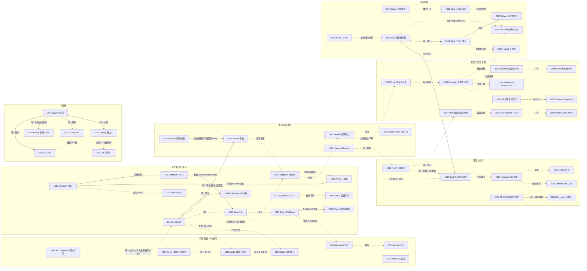

# D07 烧伤危重症：死亡风险、器官功能障碍、系统性炎症与救治体系

> **一句话判断**：这个方向研究重度烧伤病人"会不会死、为什么死、在哪里救"。本轮能读到原文的最早定量死亡标准是 1949 年伯明翰烧伤单元的 LA50（按年龄×面积算死亡概率），此后死亡评分、跨中心登记库、器官衰竭与系统性炎症机制三条主线并行发展，另有 TBSA 阈值与老年一个分支；现在常用评分的区分度多在 AUC 0.9 以上，研究重心移到校准与本地化、老年与虚弱、器官支持和脓毒症定义、用登记库比较中心，中国线则从 1958 年的个案救治走到两次打击 MODS 研究和本土评分校准。**对临床医生最重要的一点**：修订 Baux 等评分在新人群中常常"排序准、绝对值不准"（西南医院 9625 例中四个评分 AUC >0.890 但校准差 [D07-N34]），而且死亡率会被放弃或撤除生命支持的决定改变 [D07-N08]，用评分向家属交代预后或比较中心之前，要先确认它在本地校准过。

## 0 三分钟速读

1. **从哪里来**：三条线各有起点，不是同一篇文献。死亡标准：Bull & Squire 1949 把毒理学的 probit 方法用于 794 例烧伤，定义 LA50，15–44 岁组为 43% TBSA [D07-N01]。救治单元：主持这一单元的 Colebrook 在 1947–48 年已发表烧伤感染控制研究（仅题录）[D07-N20]。器官衰竭：MOF 概念来自普通外科与创伤危重症（Baue 1975 [D07-N22]；Moore 1996 早发/迟发两种模式 [D07-N24]），不是烧伤领域首创。
2. **为什么改变**：局部抗菌、及时切痂和闭合创面使侵袭性创面感染及相关死亡下降，这是 Pruitt 1992 的综述判断 [D07-N23]；同期一家中心 ≥30% TBSA 患者的晚期死亡率从 24% 降到 8%，早期死亡率基本不变 [D07-N26]。死于器官衰竭的比例于是凸显：Sheridan 1998 的 71 例死亡中 67% 为 MOF，死亡时临床上多无活动性感染 [D07-N09]。这些是作者判断和时间上的先后，不是因果证明；而且此前的首要死因随中心和尸检方法而不同，MGH 1962 年死因审计列的是呼吸道损伤（见 2.5 节）。
3. **如何分化**：分成三条主线，另有一个分支。评分线从 Baux 1961 到 ABSI 1982、Ryan 1998，再到修订 Baux 2010。登记与中心比较线从 NBIE 1964 起，到 BCQP（Galicia 2024：103 个中心）；烧伤中心认证与转诊标准的形成史本轮未检索，这一段未覆盖（见 8.2）。机制线从两次打击到 Glue Grant 的"基因组风暴"，再到小鼠模型之争。另有阈值与老年分支，给出儿童约 60%、成人约 40% TBSA 的阈值，但儿童数据主要来自 Galveston 一家机构 [D07-N14][D07-N17]。
4. **现在研究什么**：①预测模型的再校准与机器学习，后者多数只做了内部验证 [D07-R01]；②老年、虚弱与合并症；③器官支持与脓毒症定义：在 527,197 例成人烧伤中，三种脓毒症标准的阳性预测值只有 2.5%–6.0% [D07-R14]；④用登记库比较中心与转诊；⑤多组学与生物学衰老；⑥姑息治疗。
5. **用了什么数据**：数据来源先后有：单一单元连续病例（794 例），单中心 logistic 回归，全国登记（NBR 39,888 例 [D07-N12]；BCQP 累计 375,000 例 [D07-R07]），行政库与电子病历网络（NIS 146,455 例 [D07-R09]；TriNetX 527,197 例 [D07-R14]），Glue Grant 多中心转录组 [D07-N13]，以及小样本多组学 [D07-R10]。RCT 很少，且多为阴性或提前终止 [D07-N36][D07-R16]。
6. **还不知道什么**：同等严重度下生存是否仍在改善，各中心结论相反，且都没有校正撤除支持的影响 [D07-N11][D07-N31][D07-N32]（平台派的 Rashid 2001 样本数未知，见 2.4）；死亡到底由无菌性 MOF 还是感染驱动，受死因定义不统一所限；老年人的 TBSA 阈值未知；区域化转诊对死亡的因果效应没有高质量证据；中国没有全国烧伤登记。

**覆盖边界**：
- 纳入：死亡风险评估与评分；存活极限与 TBSA 阈值；死因谱与多器官功能障碍（MOF/MODS）；系统性炎症与免疫的机制研究（含 Glue Grant 与动物模型之争）；登记库、中心比较、转诊与区域化（其中烧伤中心认证与转诊标准的形成史本轮未检索，见 8.2）；老年与虚弱；器官支持与脓毒症定义在危重症中的表现；生命末期决策与姑息；中国危重症救治与批量伤员的救治组织。
- 不含（交给其他方向）：液体复苏（D01）；切痂植皮本身的疗效（D02）；皮肤替代物与微粒皮技术（D03）；感染的微生物学与抗菌治疗（D04）；吸入性损伤（D05）；高代谢与营养，含 RE-ENERGIZE 主试验的营养学含义（D06）；出院后长期死亡与功能（D10）；批量烧伤的流行病学与预案（D12）；中国学科形成史（X01）。交叉处只点到为止。

**本章口径**：
- 报告截止/执行日 2026-09-29；近期重点窗口 2021-09-29 至 2026-09-29，只用于第 4 节展开，不限制历史追溯。
- 阅读层级：L0=仅二手转述；L1=题录已在数据库核实；L2=摘要已读；L3=原文部分章节已读；L4=全文已读。只到 L0/L1 的，正文写"据某来源转述"或"仅题录"，不写成已核对原文贡献。多数节点只读到摘要，正文中这类结果前省略"据摘要"时，以第 9 节的层级为准。
- 核查状态：**通过**=本轮已对照 Europe PMC/PubMed 题录与摘要（或 PMC 原文扫描页、全文）核对，数字一致；**修正**=本轮核对后改正了数字、层级、措辞或关系判断，正文只用改正后的值；**存疑**=依据不足，保留但标注（本章没有存疑节点，存疑的说法见第 8.3 节待核线索）。
- 本章关键节点 38 个：L0 1 个（N03 Baux 1961），L1 4 个（N04、N20、N22、N25），L2 26 个，L3 7 个（N01、N02、N06、N13、N15、N16、N17），L4 0 个。**没有任何关键原始研究读到全文。**另有近期代表研究 22 条（L3 1 条：R02；其余 21 条 L2），入口综述 10 条（L2 6、L3 3、L4 1）。全部 70 条见 `data/evidence_D07.json`。
- 引用写法：[D07-Nxx]=关键节点，[D07-Rxx]=近期代表研究，[D07-Ex]=入口综述；只出现一次的辅助文献直接给 PMID 或 DOI。
- 覆盖状态：**基本完整但有标注缺口**（2026-09-29 第二轮完整性检查后按统一口径重评）。理由：①六个问题（从哪里来、为什么改变、如何分化、现在研究什么、用了什么数据、还有什么不知道）都能据本章回答。②覆盖边界列出的主要分支都有节点：评分，登记与中心比较，转诊，生存趋势，死因谱，炎症机制，阈值与老年，器官支持与脓毒症定义，姑息，中国线。③缺口都已在第 8.2 节标注，属于分支内部的一段或阅读深度不足，不是整条分支缺失：救治体系线中烧伤中心认证与转诊标准（如 ABA 认证项目）的形成史本轮未检索，这一段没有节点；但同一分支的单元、登记、中心比较和转诊结局都有节点（N20、N21、N05、N07、R07、R17）。中国烧伤中心网络与质控体系未覆盖，CNKI、万方未检索。Baux 1961 等原文未取得。5 个节点的样本数不全（N11、N28、N33、N38 样本数未知，N26 缺 ≥30% TBSA 亚组人数）。Heng 2023 检索截止后的 ECMO 研究未系统补查。

---

## 1 源头：最初在研究什么

**判断**：最早的问题是"怎么比较"，不是"为什么死"。1940 年代末，伯明翰单元要评价不同疗法，却只有"7000 例病死率 5%"这种不分年龄、面积的粗率，于是借用毒理学的剂量-反应方法，把死亡写成年龄×面积的概率 [D07-N01]。器官衰竭和系统性炎症是后来从外科与创伤危重症引入的问题。专科烧伤单元作为"救治体系"的载体，出现得比 LA50 还早。

| 说法 | 分类 | 依据与限定 | 层级 |
|---|---|---|---|
| 用 probit（LD50 思路）分析人类烧伤死亡，定义 LA50：Bull & Squire 1949 [D07-N01] | 作者自称首次 | 原文 p.165 作者写，据其所知这一方法此前从未用于任何人类死亡数据。本轮在 Europe PMC 检索 1900–1952 年的烧伤死亡题名和 1940–1960 年的 probit×burn，都没有找到更早的 probit 烧伤研究；OpenAlex 限流，德文、法文早期期刊没有检索。限定："首次"只指方法。用面积研究死亡更早已有，原文 p.160 引用了 Berkow 的面积估算，以及 Colebrook 等、Clarkson & Lawrie、Morrison 的面积研究 | L3 |
| LA50 这个术语和年龄×面积概率网格 | 目前最早找到的文献 | 定义在 p.167（Lethal Area for 50 per cent），分年龄 LA50 在 p.168 Table II，网格在 Table III；Bull & Fisher 1954 扩成 0–84 岁、每 5 岁一档的网格 [D07-N02]。只检索了英文数据库 | L3 |
| Baux 评分（年龄 + TBSA%）：Baux 1961 [D07-N03] | 被公认的奠基工作（据二手文献） | Jeschke 2020 称其约半个世纪前提出 [D07-E1]；Osler 2010 摘要称它被几代临床医生使用 [D07-N12]；题录据 Rein 2026 参考文献第 38 条：巴黎博士论文（AGEMP，1961）[D07-R02]。原文不在 PubMed/PMC。**名称注意**："modified Baux"一词在 Tobiasen 1982 的摘要中已出现 [D07-N38]，早于 Osler 2010 的 revised Baux，两者不是同一个东西 | L0 |
| ABSI：Tobiasen 等 1982 [D07-N04][D07-N38] | 被公认的奠基工作 | Ann Emerg Med 那篇无摘要（L1）。同组同年 Surg Gynecol Obstet 那篇有摘要（L2）：ABSI 预测死亡优于 Baux 和 modified Baux。组成项（年龄、性别、TBSA、全层烧伤、吸入性损伤）据 Rein 2026 转述 | L1/L2 |
| 专科烧伤单元与感染控制：Colebrook 等 1947、1948 [D07-N20] | 目前最早找到的文献（本轮） | Lancet 1947 的烧伤"附加感染"233 例研究（PMID 20288311）和 1948 年烧伤感染控制研究（PMID 18868186）。作者 Colebrook 主持了 Bull 1949 数据所在的 MRC 烧伤单元（据 Bull 1949 原文）；两篇是否出自同一单元未核。只核实题录，内容未读。不能据此说专科烧伤单元始于此处 | L1 |
| 美国全国性烧伤登记 NBIE 1964 年成立 | 目前最早找到的文献 | Feller & Jones 1987 摘要（PMID 3101211）与 Praiss 1980 摘要（PMID 7206840，称 1964 年在密歇根建立）两处一致；能查到的最早 NBIE 专文是 Feller & Crane 1970（PMID 4922829，L1）。成立年份来自当事人自述，1964 年当年的原始文献没有找到。它与后来 ABA 登记、NBR、BCQP 的承接关系，本轮没有原始说明 | L2 |
| 多器官衰竭（MOF）概念 | 目前最早找到的文献（本轮；外科危重症，不是烧伤） | Baue 1975 Arch Surg《Multiple, progressive, or sequential systems failure》[D07-N22]，只核实题录，无摘要。说明 D07 的器官衰竭线借自普通外科与创伤 | L1 |
| 早发/迟发两种 MOF 模式 | 目前最早找到的文献（本轮；创伤队列） | Moore 1996：457 例高危创伤，70 例（15%）发生 MOF，早发 39%、迟发 61%；休克指标与早发相关，高龄与迟发相关，感染对迟发更重要 [D07-N24]。它早于 Hu/Sheng 1998 的烧伤两次打击研究 [D07-N10]。"两次打击"一词最早出自哪篇，本轮未查到；Sheng 2013 称 Mishima 1997 大鼠实验证实了两次打击（据 Sheng 2013 参考文献第 19 条转述，原文未核）[D07-E7] | L2 |
| 代偿性抗炎反应（CARS）与 SIRS→CARS 时序范式 | 目前最早找到的文献（本轮） | Bone 1996 Crit Care Med《Sir Isaac Newton, sepsis, SIRS, and CARS》[D07-N25]，只核实题录。Glue Grant 总结把 SIRS/CARS/second hit 称为旧范式 [D07-E6] | L1 |
| "基因组风暴"：Xiao 2011 [D07-N13] | 作者自称首次 | 讨论部分写，作者不知道有其他疾病伴有同等多样性和幅度的基因组变化；Tompkins 2015 有同样表述 [D07-E6]。**口径注意**：摘要的">80%"指细胞功能与通路，讨论说的是多达 80% 的白细胞转录组，两者不要混写 | L3 |
| 大样本测定烧伤后各器官衰竭发生率 | 作者自称首次（限儿童） | Kraft 2014，Galveston 821 例儿童 [D07-N37]。成人的客观 MOD 评分更早已有：Cumming 2001 前瞻纳入 85 例，严重 MOD 28%（PMID 11265031，L2）。Kraft 2014 可能与 Kraft 2012 的 952 例共用病例（推断） | L2 |
| 中国现代烧伤医学起点：1958 年上海广慈医院（今瑞金医院）救治邱姓钢铁工人（89% TBSA，其中 III 度（全层）23%） | 被公认的奠基工作（中国学科起点） | Sheng 2013 全文（亲历者回顾）写 89% TBSA、全层 23%，医院用今名 Ruijin Hospital [D07-E7]；Sun 2018 摘要（PMID 30481908）写同一组数字（89% TBSA、Ⅲ度 23%），并写明医院当时名为上海广慈医院（现瑞金医院）；黄跃生等 2018 摘要首句称中国烧伤医学始于 1958 年 [D07-E9]。"89.3%"的写法没有可定位出处（见 8.3）。原始病例报告没有找到；Chin Med J 1959;78 有一组无署名的《Management of severe burns》三期连载（PMID 13639175、13639194、13639202，L1），能否对应该病例无法确认 | 转述来源 L4（Sheng 2013）/L2（Sun 2018）；原始病例 L0 |
| 同一病例为"世界首例"救治成功 | 作者自述首次，无对照 | Sun 2018 摘要称该病例"首获成功，改写了世界纪录"（PMID 30481908）。这是作者自述，没有同期对照证据，不能据此写成已确认的世界首例 | 转述来源 L2（Sun 2018）；原始病例 L0 |

---

## 2 关键转折：问题—新证据/新方法—认识变化—新问题

### 2.1 怎样让"死得多不多"可以比较：从 LA50 到多变量模型（1949–1986）

- **问题**：Bull & Squire 1949 开篇批评的是，只报粗病死率，不考虑面积和年龄，就没法比较不同中心、不同疗法 [D07-N01]。
- **新方法**：他们用 Colebrook 主持的 MRC 烧伤单元在 Glasgow（1942–43 年，72 例）和 Birmingham（1945–47 年，722 例）的连续住院病例共 794 例，按年龄分组做 probit 回归，得到 LA50：0–14 岁 51%、15–44 岁 43%、45–64 岁 23%、≥65 岁 9%（原文给的是 P=.95 的 fiducial limits，不宜写成置信区间）。他们还核对病历，发现没有证据支持当时"幼儿预后更差"的临床印象（p.168）[D07-N01]。
- **扩展（同一项目）**：Bull & Fisher 1954 把病例扩到 2807 例。0–4 岁组 1041 例的 LA50 为 50%，与年长儿童没有明显差别；≥75 岁组 60 例的 LA50 为 7%。作者给出 0–84 岁、每 5 岁一档的网格，写明可以用"期望死亡数对实际死亡数"来比较，这可以看作后来标准化死亡比思路的雏形（本报告推断）。原文也写明，吸入性损伤没有计入，这类病例的严重度会被低估 [D07-N02]。
- **方法转向**：Tompkins 1986 用 MGH 1974 年 7 月至 1984 年 1 月连续收治的 1103 例成人（13–93 岁，<15 岁只有 4 例）做 logistic 回归，面积、年龄、治疗时期都与死亡独立相关（p<0.001），住院日从 32 天降到 22 天 [D07-N06]。"治疗时期"项怎样解读，有两条限定，见 2.4 节。它的参考文献引用了 Bull 1949 和 Bull 1971，但摘要里对照的是 MGH 本院 1939–55、1955–70 年的 probit 分析，所以"probit→logistic"是本报告对方法转向的归纳，不是原文讨论的关系。原文 Fig.7 显示，70% BSA 的 80 岁患者生存没有改善（p.276）。这与摘要中"老年和巨大面积改善最明显"的说法要放在一起看 [D07-N06]。
- **新问题**：可比的尺度有了，但查网格表不方便，也没有纳入吸入性损伤。

### 2.2 床旁能算的评分：从 Baux 到修订 Baux，区分度见顶、校准成了问题（1961–2020）

- **简化**：Baux 1961 把年龄与 TBSA% 相加，结果近似等于预测死亡百分比。原文未读，这里据 Osler 2010 和 Jeschke 2020 转述 [D07-N03]。
- **加变量（并行）**：Tobiasen 1982 的 ABSI 加入性别、全层烧伤和吸入性损伤；同组同年的摘要称它预测死亡优于 Baux 和 modified Baux（摘要未给样本数，全文未取得）[D07-N04][D07-N38]。Ryan 1998 在 MGH（成人）与 Boston Shriners（儿童）的合并人群中（平均年龄 21±20 岁，摘要未给儿童占比）建模 1665 例，并前瞻检验 530 例。模型只用三个危险因素：年龄 >60 岁、TBSA >40%、吸入性损伤；0/1/2/3 个因素对应预测死亡率 0.3%/3%/33%/约 90% [D07-N08]。比利时 6 个中心的 BOBI 用 5246 例建模、981 例验证，AUC 0.94（PMID 19109825，L2）。Hussain 2013 的方法学综述在 45 项报告复合模型的研究中，只认为 8 个模型符合方法学标准（Modified Baux、ABSI、TBSI、Coste、Ryan、McGwin、Galeiras、BOBI）[D07-E3]。
- **修正**：Osler 2010 用 NBR 39,888 例重新校准，发现原版 Baux 预测偏悲观、缺吸入性损伤，于是提出修订 Baux：年龄 + TBSA% + 17×吸入性损伤（吸入性损伤相当于 17 岁或 17% TBSA）。同一数据中，复杂模型的区分度和校准都更好 [D07-N12]。Jeschke 2020 称含吸入性损伤的 Modified Baux 是目前最广泛接受的评分 [D07-E1]。评分中吸入损伤的权重（修订 Baux 的 +17）是预测系数，不等于独立因果效应；按严重度校正后的关联见 D05 2.3 节（Galeiras 2020 Meta，D05-E4），诊断标准问题见 D05 2.2 节。
- **外部验证与本地化**：鹿特丹 4389 例中，修订 Baux 的 AUC 为 0.96，但在高分组只有 0.81（Dokter 2014，PMID 24553558，L2）。西南医院 2008–2017 年 9625 例（总死亡率 1.14%）中，ABSI、Ryan、修订 Baux、BOBI 的 AUC 都 >0.890，但 Hosmer-Lemeshow 检验显示校准差（p<0.001）；作者另建的本地模型 AUC 0.940，验证集 HL p=0.588 [D07-N34]。
- **认识变化**：区分度（能不能把会死的人排在前面）在各评分之间已接近上限，差异主要落在校准，也就是预测的绝对概率在本地准不准，以及年龄两端。
- **新问题**：机器学习能否更好？Stylianou 2015 在英格兰与威尔士 iBID 人群登记中比较 logistic 回归与 ANN、SVM、随机森林、朴素贝叶斯，差异很少有统计学意义，临床意义也不大（病例队列的样本数摘要未给，全文未取得）[D07-N33]；十年后的 BoBS 称优于传统评分，但只做了内部交叉验证 [D07-R01]。

### 2.3 从单一单元到登记库：中心之间真有差别吗（1947–2024）

- **载体**：专科烧伤单元先于死亡标准出现。Bull 1949 的数据就来自 Colebrook 主持的 MRC 单元 [D07-N01]；Colebrook 在 1947–48 年已发表烧伤感染控制研究（仅题录）[D07-N20]。
- **扩展到多中心**：NBIE 1964 年成立（见第 1 节）。Feller 1980 汇总 1965–79 年 120 家机构 37,442 例，各严重度层级的生存率都在上升、住院时间缩短，且与全层创面更早闭合相关 [D07-N21]。Wolfe 1983 用 NBIE 约 12,000 例比较 11 个大型单元，仔细校正病例构成后，死亡率最多仍相差约 2 倍；全层创面闭合越快的机构死亡率越低 [D07-N05]。这是机构层面的关联，不能证明因果。
- **全国基准**：ABA 患者登记 1991–93 年 28 个中心 6417 例，存活 95.9%，吸入性损伤者死亡率 29.4%，青年 LA50 为 81% TBSA，平均住院 13.5 天 [D07-N07]。这个 81% 常被拿来与 Bull 1949 的 43% 对比，但两者的人群、年龄分组和年代都不同，不能直接相比。Saffle 1995 用的也是 probit/LA50 方法，摘要没有提 Bull 1949，是否引用未核。
- **负性结果**：同一篇写明，没有找到可靠的入院时生存预测方法 [D07-N07]。
- **容量与差异**：Light 2009 用 NBR 发现，中心间死亡率差异在校正中心容量后仍然存在，死亡率不随中心容量线性下降，而是趋于平台（PMID 19692917，L2）。澳新 BRANZ 10 个成人单元 7184 例，也发现单元间治疗与结局差异显著（Cleland 2016，PMID 26985850，L2）。
- **现在**：ABA 的 BCQP 整合了 NBR 与 BQIP，到 2021 年共 103 个中心、累计 375,000 例，数据元素与 ACS TQIP 对齐 [D07-R07]。
- **仍未回答**：差异里有多少是质量，有多少是病例选择和撤除支持决策。见 4.3 节与第 5 节。
- **本轮未覆盖**：国际上烧伤中心认证（如 ABA 认证项目）与转诊标准是怎样形成的，本轮没有检索，这一段没有节点。本节只覆盖专科单元、登记库、中心比较，以及转诊结局研究（4.3 节），缺口见 8.2。

### 2.4 同等严重度下，生存还在改善吗（1971–2018）

这是本方向最典型的"两派都有数据"的问题，按时间列出，不做统一判断。

- **改善派**：Feller 1980（NBIE 1965–79）[D07-N21]；Tompkins 1986（MGH 1974 年死亡率 24%，前 3 年降到 14%，1979–84 年平均 7%；logistic 回归中与面积、年龄并列，治疗时期仍与死亡独立相关；两条限定见下一条）[D07-N06]；Merrell 1987（该中心 1978–86 年共 1,458 例；≥30% TBSA 亚组的人数摘要未给、全文未取得；该亚组生存率 59%→77%，早期死亡率基本不变（17% 对 16%），晚期死亡率 24%→8%）[D07-N26]；Brusselaers 2005（根特 1985–2004 年 1385 例，校正后每 5 年 OR 0.73，同时患者面积逐年变小）[D07-N27]；Roberts 2012（英国一家区域中心 1982–2008 年 11,109 例，probit 与 logistic 回归，2000–08 年 LA50 按年龄组依次为 100%、76.4%、58.6%、30.8%，Baux50 为 109.6）[D07-N31]；Capek 2018（Galveston 1989–2017 年 10,384 例、355 例死亡，观察死亡率显著低于历史模型预测，约每年下降 2%）[D07-N32]。
- **Tompkins 1986 的两条限定**：①摘要称死亡下降与烧伤面积等病例构成的变化无关，正文却写平均烧伤面积下降、可部分解释死亡下降，摘要与正文关于面积变化的说法自相矛盾；②"治疗时期"项混合了同期所有改进，不能读作早切或任何单项的效果（见 D02-N13，正文页码与数字以 D02 为准）[D07-N06]。
- **平台派**：Rashid 2001（伯明翰 1979–88 与 1989–98 两期死亡曲线相同，与 1965–70 年相比也没有显著变化；摘要未给样本数，全文未取得，样本未知）[D07-N11]。Rashid 2001 摘要写，上一次显著改善见于 1971 年报告，这次改善被归因于引入 0.5% 硝酸银（Bull 1971 只核实题录，PMID 4107409）。这是该中心作者的归因，依据为同一中心的历史对照。死亡下降为多因素，本报告不做单因归因（见 D04 2.2）。
- **为什么说不清**：Roberts 2012 与 Rashid 2001 同是英国区域中心、同用 probit，结论相反。所有证据都是单中心或登记的前后比较，没有随机证据。病例构成在变，比如 Brusselaers 2005 指出患者面积逐年变小。Ryan 1998 指出 DNR 比例大幅上升，使不同时期的死亡率难以比较 [D07-N08]；Sheridan 1998 的死亡中 21% 是早期撤除支持 [D07-N09]。Capek 2018 把下降归因于多项流程改变，这是作者推断，而且它与 Kraft 2012 属同一机构。两派的证据分量也无法直接比较：平台派唯一的节点 Rashid 2001 样本数未知；改善派的 Merrell 1987 只知道全体 1,458 例，不知道 ≥30% TBSA 亚组有多少人。

### 2.5 死因谱变了：从创面感染到器官衰竭，再到"算感染还是算 MOF"（1987–2026）

- **背景变化**：Pruitt & McManus 1992 综述写明，局部化疗、及时切除与闭合创面显著减少了侵袭性创面感染及相关死亡；但感染仍是最常见的致病和致死原因，肺炎是当时最常见的感染 [D07-N23]。Merrell 1987 的"早期死亡不变、晚期死亡下降"是同一时期的单中心数据（≥30% TBSA 亚组，人数摘要未给）[D07-N26]。切痂与局部抗菌本身的疗效交 D02、D04。
- **起点口径**：本节"从创面感染起步"的叙事主要依据 USAISR 与 Pruitt 综述；MGH 1962 年死因审计把呼吸道损伤列为首要死因（D05-N19），死因构成随中心和尸检方法而不同。
- **新说法**：Sheridan 1998 回顾 MGH 6 年内全部 71 例死亡：MOF 48 例（67%）、早期撤除支持 15 例（21%）、复苏失败 4 例、孤立肺衰竭 4 例。MOF 死者病程中常有多次小感染，但死亡时临床上未感染，作者据此提出，持续的系统性炎症在感染控制后仍可导致 MOF 和死亡 [D07-N09]。这篇改变的是研究焦点，把部分注意力从"杀菌"移到"炎症本身"。"临床无感染"没有尸检微生物学全面确认。
- **反面证据**：Williams 2009 分析一家儿童烧伤中心 144 例尸检，20 年主要死因为脓毒症 47%；1989–99 年脓毒症占 35%，1999–2009 年升到 54%，以多重耐药菌为主 [D07-N29]。Gomez 2009 分析美国陆军外科研究所 2004–07 年 1,255 例入院，100 例死亡，74 例尸检；死因中感染 61%，多器官功能障碍 15%，军人伤员与平民的死因构成不同 [D07-N30]。
- **中间立场**：Bloemsma 2008 在鹿特丹 1996–2006 年的死亡中（死亡人数摘要未给，全文未取得），MOF 占 64.9%，其中 93% 死亡时有 SIRS，45.9% 被判为感染导致恶化 [D07-N28]。作者明确呼吁统一死因与吸入性损伤的分类。Brusselaers 2010 的欧洲综述（76 项研究、>186,500 例）认为（多）器官衰竭与脓毒症是最常见死因，<48 h 的早期死亡主要为烧伤休克与吸入性损伤 [D07-E2]。
- **定义问题浮出**：ABA 2007 共识指出，烧伤患者按定义已满足 SIRS，通用脓毒症标准不适用，于是制定烧伤专用定义，以便开展多中心试验 [D07-N35]。近二十年后，这些定义在真实数据中的表现见 4.4 节 [D07-R14]。
- **认识变化**：多数研究同意 MOF 是最终通路。分歧在感染占多大比重，而这个分歧有相当部分来自归类标准不同：是否尸检、成人还是儿童、军人还是平民。

### 2.6 器官衰竭的机制：两次打击、基因组风暴与小鼠之争（1975–2018）

- **引入**：MOF 概念与早发/迟发两种模式来自外科与创伤队列 [D07-N22][D07-N24]；SIRS→CARS 的时序范式见 Bone 1996（仅题录）[D07-N25]。
- **中国烧伤中的应用（1998）**：盛志勇团队在 45 例 >30% TBSA、早期严重休克、晚期脓毒症的患者中，13 例发生 MODS，其中 10 例死亡（77%）。他们用 32 只山羊建模（失血性休克组 6 只、内毒素组 6 只、失血性休克+门静脉内毒素组 20 只）：联合打击组 20 只中 18 只死亡（90%），12 只发生 MODS [D07-N10]。这是用失血性休克+内毒素模拟"休克+感染"，不是烧伤本身。Sheng 2002 进一步主张"钝化第一次打击、预防第二次打击"，并称几乎所有专门中和炎症介质或细胞因子的疗法都在临床试验中失败了（二手陈述，未逐一核对所指试验；PMID 12162895，L2）。与同年 Sheridan 1998 的"无菌性持续炎症"是两种并行的解释（本报告推断）[D07-N09]。
- **人类全基因组证据（2011）**：Glue Grant 是 22 家美国学术医学中心参与、资助 10 年加 2 年无费用延期的项目，纳入 >2,800 例创伤与烧伤患者，采集 76,000 份组织样本 [D07-E6]。Xiao 2011 从 1,637 例钝性伤中取 167 例（18–55 岁），做白细胞全转录组，采样至 28 天 [D07-N13]。结果有四点。①先天免疫与抗炎基因同时上调，适应性免疫基因下调，这挑战了"先促炎、后抗炎"的时序范式。②在创伤中改变 ≥2 倍的 5,136 个基因里，98% 在 133 例 >20% TBSA 烧伤中方向一致；创伤与烧伤的 r=0.95，创伤与内毒素的 r=0.64。③复杂恢复与简单恢复只在幅度和持续时间上不同，找不到 second hit 的基因组证据。④烧伤 90 天时一半以上基因仍未回到基线。**外推限定**：复杂与简单病程的比较只在创伤队列中做过，烧伤数据只用来比较表达方向；把"没有 second hit"推广到烧伤属于外推。Xiao 2011 也没有引用 Hu 1998，两者的测量层面不同（外周白细胞转录组对比临床与动物终点）。
- **小鼠能否代表人（2013–2015）**：Seok 2013 用同一项目数据（创伤 167 例、烧伤 244 例、内毒素 4 人）对照三个小鼠模型（每个模型处理与对照各 16 只），在 4,918 个基因上比较。人类创伤与烧伤之间 R²=0.91，小鼠与人类之间 R² ≤0.09，方向一致率约 47–63%，接近随机 [D07-N15]。Takao 2015 用同一批公开数据，只看两物种都显著改变的基因，得出 Spearman ρ 0.43–0.68、方向一致 77–93% 的相反结论 [D07-N16]。Warren 2015 回应称，Takao 只看了预先挑出的约 15% 基因；按 Takao 自己举的例子，人类烧伤 13,586 个改变基因中，小鼠感染模型只正确反映约 1,608 个（约 12%）（PMID 25540422，L3）。
- **认识变化**：争论从"像不像"转到"用什么口径衡量像不像"，脓毒症领域随后出了动物研究最低质量共识 MQTiPSS（Osuchowski 2018，PMID 30106875，仅题录）。同一项目还做了血浆蛋白组：32 例（死亡与存活各 16 例）（Finnerty 2013，PMID 23507713，L2）；以及 10 例老年对 20 例配对成人的转录组比较，老年呈低炎症反应（Dreckmann 2019，PMID 31834907，L2）。这些与 Xiao 2011 属同一数据库，不能算独立证据。
- **新问题**：机制研究在人类样本中能"描述"风暴，但至今没有落到有效的抗炎干预上（见第 5 节负性结果）。

### 2.7 多大面积算"高危"：TBSA 阈值与老年（1997–2015）

- **儿童**：Galveston 早年 103 例 ≥80% TBSA（≥70% 全层）儿童的死亡率为 33%（Wolf 1997，PMID 9193183，L2）。Kraft 2012 用同一中心 1998–2008 年 952 例 ≥30% TBSA 儿童，死亡 123 例（13%），死亡率从 30–39% 组的 3% 升到 90–100% 组的 55%；以 62% TBSA 为关键阈值（OR 10.07，95% CI 5.56–18.22），并据此建议 >60% TBSA 的儿童立即转入专科中心 [D07-N14]。
- **"多中心确认"的独立性有限**：Jeschke 2015 属 Glue Grant，8 年内入组 573 例（儿童 226 例），纳入 >20% TBSA 且至少手术一次的患者。结果是儿童的死亡、脓毒症、感染、MOF 阈值约 60% TBSA，成人（16–65 岁）约 40% [D07-N17]。摘要与正文称美国 6 个大型中心，伦理审批部分列了 5 家机构。正文 Discussion 写明，儿童患者大多由 Galveston Shriners 入组，入组时段又与 Kraft 2012 重叠（本章 L3 阅读 Methods 与 Discussion 相关段落）。因此儿童约 60% 这一阈值主要来自同一家医院，只是再分析，不是独立验证。成人约 40% 与 Ryan 1998 的">40% TBSA"危险因素相近，两者方法和人群不同，这里只算互补（本报告推断）[D07-N08]。
- **儿童证据集中**：Wolf 1997、Kraft 2012、Kraft 2014 [D07-N37]、Williams 2009 [D07-N29]、Capek 2018 [D07-N32] 以及 Glue 的儿童亚组，都出自 Galveston 一家或以它为主。
- **老年成了空白**：Jeschke 2015 把 >65 岁的 23 例排除在阈值分析之外 [D07-N17]。Romanowski 2015 转而用虚弱分层：单中心 89 例 ≥65 岁患者（平均 75.3 岁，平均 TBSA 9.6%，死亡 9 例），入院 CSHA 临床虚弱评分高与死亡（OR 1.67，1.01–2.7）和出院去护理机构（OR 2.5，1.3–4.8）独立相关 [D07-N18]。这开启了老年虚弱分支，见 4.2 节。ABA 2020 老年综述写道，截至当时烧伤领域研究虚弱与结局只用过 CSHA 临床虚弱量表 [D07-E8]。

### 2.8 器官支持：数据多是观察性，试验多为阴性或做不下去（2001–2023）

- **测量**：成人方面，Cumming 2001 前瞻纳入 85 例，严重 MOD 28%（PMID 11265031，L2）；儿童方面，Kraft 2014 纳入 821 例，作者自称第一项大规模测定器官特异性衰竭的研究 [D07-N37]。
- **基线**：Folkestad 2020 Meta 纳入 33 项观察性研究、8,200 例，ICU 烧伤 AKI 发生率 38%（30–46%），12% 接受 RRT，AKI 与死亡相关（OR 11.3，7.3–17.4）[D07-E10]。
- **干预试验**：美国 7 个烧伤中心的高容量血液滤过 RCT，4 年只随机了 28 例（另有 9 例导入期），因入组慢提前终止。升压药依赖指数和 MODS 评分下降，但生存无差异 [D07-N36]。ECMO 只有无对照病例系列的汇总 [D07-R15]。
- **认识**：器官衰竭能被量化，也与死亡强相关，但"支持哪个器官、怎样支持能改变生存"几乎没有随机证据。

---

## 3 分支图

图例：实线=原文明确讨论、同一项目/数据库，或综述归纳的关系；虚线=本报告推断；边上写关系类型。节点写"年份 简称"。

---

## 4 近五年重点（2021-09-29 至 2026-09-29）

### 4.1 死亡预测：再校准、外部验证与机器学习

- **研究什么**：检验修订 Baux、ABSI、Ryan、BOBI、FLAMES 在不同国家和年代的区分度与校准；用登记库大样本开发机器学习评分；给 ABSI 加合并症（BABSI）。
- **常用数据与设计**：系统综述与 Meta（合并 AUROC）；单中心或全国登记的回顾性验证；德国烧伤登记等 >10,000 例的机器学习建模，多数只做内部交叉验证。
- **代表研究**：Mrad 2022 检索至 2021 年 12 月，纳入 34 项研究、98,610 例；经典 Baux、修订 Baux、FLAMES 的合并 AUROC 分别为 0.92、0.92、0.94，三者差异不显著 [D07-E4]。Edgar 2023 纳入 21 项研究（每项 48–15,975 例），修订 Baux 的 AUC 为 0.682–0.99，汇总 0.93（0.91–0.95），在年龄两端预测力下降；检索截止日未知 [D07-E5]。BoBS 用德国烧伤登记 >10,000 例做随机森林和梯度提升，准确率 93.1%、ROC AUC 92.4%；作者承认需要登记以外的外部验证 [D07-R01]。Rein 2026 在单中心 644 例（2018-09 至 2022-05）中，AUC 依次为 BABSI 0.963、ABSI 0.952、ASA 0.916、CCI 0.851、mFI-5 0.760；BABSI 与 ABSI 校准良好，ASA 校准差 [D07-R02]。
- **分歧**：这里没有"哪个评分最好"之争。Mrad 2022 显示三者差异不显著，Edgar 2023 只评估修订 Baux，没有与 FLAMES 比较，两篇不构成对立。真正的分歧在两处：校准与本地化（西南医院 9625 例校准差 [D07-N34]），以及年龄两端和高分组（Edgar 2023；鹿特丹高分组 AUC 0.81）。机器学习方面，Stylianou 2015 显示在强预测因子很少的问题上，机器学习相对 logistic 回归增益有限 [D07-N33]；BoBS 称更优，但只有内部验证 [D07-R01]。
- **汇总证据的时效**：两篇 Meta 一篇检索到 2021 年底，另一篇截止日不明，所以 2022 年以后的外部验证只有单项研究，没有汇总。
- **成熟度**：传统评分的区分度验证已成熟；校准本地化与机器学习评分仍在发展。

### 4.2 老年、虚弱与合并症

- **研究什么**：用哪种虚弱工具（CFS、BFI、GFI、mFI-5），虚弱能否独立预测死亡，合并症在不同年龄段的相对权重，老年人的药物暴露。
- **常用数据与设计**：多中心前瞻测量学研究；ACS TQIP 等创伤登记；国际 RCT 数据的二次分析；单中心长期队列。
- **代表研究**：Cords 2026 为荷兰多中心前瞻研究，纳入 145 例 ≥50 岁患者。CFS 与 GFI 的完成率最高，达 97%；虚弱患病率 GFI 42.1%、CFS 19.4%、BFI 6.2%；虚弱能预测非回家出院，但不能预测并发症或住院日；作者推荐 CFS [D07-R03]。Litmanovich 2024 用 TQIP 2018，纳入 574 例 ≥65 岁、创伤合并 ≥10% TBSA 烧伤的患者（排除 AIS≥4），其中虚弱 172 例（30%），死亡率 23%；校正后虚弱不是死亡的独立预测因子（aOR 1.059，P=0.93），但与更长的住院和 ICU 时间相关 [D07-R04]。Dempsey 2026 用 RE-ENERGIZE 试验 1200 例做二次分析，发现最重要的合并症随年龄而变：<50 岁为神经系统疾病与恶性肿瘤，50–79 岁为高血压、糖尿病与神经系统疾病，≥80 岁为肺部疾病，几乎都是 COPD [D07-R05]。Barayan 2025 在单中心 15 年队列中比较 ≥60 岁的二甲双胍使用者 50 例与未使用者 262 例，用药组生存更好、乳酸酸中毒更少、器官损伤标志物更低；这是观察性研究，存在指征混杂 [D07-R06]。更早还有 Burn Frailty Index（Maxwell 2019，PMID 30477759，L2）。
- **分歧**：虚弱能否独立预测死亡，各研究结论不同：Romanowski 2015 纳入 89 例，OR 1.67 [D07-N18]；Litmanovich 2024 纳入 574 例，结果不显著。两者的样本量、工具和人群（纯烧伤对比创伤合并烧伤）都不同。虚弱预测非回家出院的结论较一致。
- **成熟度**：发展中；老年 TBSA 阈值仍未知。

### 4.3 登记库、质量基准、转诊与可及性

- **研究什么**：用全国或国际登记做中心比较、质量指标、性别与地区差异、转诊路径。
- **常用数据与设计**：ABA BCQP、德国烧伤登记、WHO Global Burn Registry、HCUP NIS 的回顾分析；方法学白皮书。
- **代表研究**：Galicia 2024 是 ABA 研究委员会的方法学白皮书：BCQP 到 2021 年共 103 个中心、累计 375,000 例，其中新数据字典下 12,000 例；数据元素与 ACS TQIP 对齐，并给出大数据研究的设计与统计建议 [D07-R07]。Mehta 2022 用 WHO Global Burn Registry 6431 例（期刊年份 2022，在线日期 2021-07-24，早于窗口起点，这里作背景），女性接受手术的比例更低（49% 对 56%），院内死亡更高（26% 对 16%）；在中等收入国家，女性院内死亡几率是男性的 2.16 倍（1.73–2.71）[D07-R08]。Billner 2026 用德国烧伤登记比较直接入院与二次转诊，直接入院到达烧伤中心更快（约 109 对 250 分钟）；未校正死亡率反而是直接入院更高（13% 对 9.9%），校正后不显著，作者认为是选择偏倚 [D07-R17]。
- **分歧**：中心间差异是否反映质量，一直有争论（Light 2009：差异不随容量线性变化）。死亡率作为质量指标，会受撤除支持决策影响（Ryan 1998 [D07-N08]）。登记研究在转诊和区域化问题上只能给出关联。
- **成熟度**：数据基础设施已成熟；用于质量改进的因果证据仍在发展。

### 4.4 器官特异性支持与诊断定义（AKI/RRT、ARDS/ECMO、烧伤脓毒症标准）

- **研究什么**：器官功能障碍的发生率与预后，器官支持手段（血液净化、ECMO）是否改变结局，脓毒症定义在烧伤中是否好用。
- **常用数据与设计**：观察性研究的 Meta；少量多中心 RCT；电子病历网络的诊断准确性研究。
- **代表研究**：Heng 2023 检索至 2022-03-18，纳入 15 项回顾性研究、318 例，全部没有对照组；合并院内死亡率 49%，成人 55%、儿童 35%；ECMO 相关并发症 67.46% [D07-R15]。这篇综述检索截止（2022-03-18）以后的 ECMO 研究，本章没有系统补查。交叉章节已收录一项：Lin 2025 用台湾全民健保数据库 2000–2015 年需机械通气的严重低氧烧伤患者 6,493 例，按年龄、性别和烧伤严重度做倾向评分匹配；ECMO 组院内死亡 47.09%，非 ECMO 组 38.71%，校正 1 年死亡 HR 3.19（PMID 41010824，L2，本轮经 PubMed 再核摘要；详见 D05 4.6，D05-R13）。ECMO 组死亡更高，可能反映只有最重者才用 ECMO，即适应证混杂（D05 的解读）。Danielski 2026 用 TriNetX 527,197 例成人烧伤，以 ICD 编码的脓毒症为参照。敏感度 ABA 86.7%、Mann-Salinas 86.6%、Sepsis-3 81.4%；特异度依次为 61.6%、77.0%、45.8%；阳性预测值只有 2.5%–6.0%；各定义之间 28 天死亡率无差异 [D07-R14]。它的局限是参照标准为行政编码。窗口之前的基线见 AKI Meta [D07-E10] 与 HVHF RCT [D07-N36]。
- **大样本 RCT 的阴性例子**：RE-ENERGIZE 纳入分析 1200 例，谷氨酰胺没有缩短存活出院时间（sHR 0.91，0.80–1.04），6 个月死亡率 17.2% 对 16.2%（HR 1.06，0.80–1.41）[D07-R16]。营养学含义交 D06。
- **中国数据**：见第 6 节（胃肠功能障碍 [D07-R18][D07-R19]）。
- **分歧**：ABA 2007 定义是为多中心试验设计的 [D07-N35]，但在真实数据中与 Sepsis-3 一样更像筛查工具；ECMO 能否降低死亡，没有随机对照数据，Meta 纳入的研究都没有对照组，本报告收录的一项匹配队列（Lin 2025）ECMO 组死亡更高，且受适应证混杂影响。
- **成熟度**：发展中；RCT 稀少，且多为阴性或提前终止。

### 4.5 系统性炎症与免疫：多组学分型与"生物学衰老"

- **研究什么**：在烧伤患者中用基因组、miRNA、蛋白组、单细胞转录组、表观遗传时钟，寻找脓毒症早期预警标志、中性粒细胞亚群和衰老加速。
- **常用数据与设计**：小样本前瞻多组学队列加小鼠验证；单细胞 RNA-seq；表观遗传时钟的病例-对照。
- **代表研究**：Huang 2023 为中国多中心研究，纳入 60 例重度烧伤，得到 7 个易感基因、4 个 miRNA（如 hsa-miR-16-5p）、2 个蛋白（S100A8、SERPINA10）作为脓毒症早期预警候选，S100A8 在小鼠中兼具治疗靶点作用 [D07-R10]。Huang 2021（刊期 2022-01-18）比较健康人与早期重度烧伤的外周中性粒细胞，分出 5 个亚群；伤后第 1 天与第 2–3 天的活化、脱颗粒、趋化、ROS 生成差异显著；摘要没有给人数 [D07-R11]。Khalaf 2025 纳入 59 例烧伤和 25 名对照，重度烧伤使 GrimAge/PhenoAge 生物学年龄加速 13–14 年，与烧伤面积正相关，并持续到伤后 28 天 [D07-R12]。
- **分歧**：候选标志物多、样本小、缺少独立验证；动物验证的外推性受 Seok/Takao 争论影响 [D07-N15][D07-N16]。
- **成熟度**：早期线索。

### 4.6 生命末期决策、姑息治疗与"无效治疗"的界定

- **研究什么**：高修订 Baux 患者中姑息会诊的使用频率与差异，姑息拔管，转介标准。
- **常用数据与设计**：全国行政数据库（NIS）回顾；单中心回顾。
- **代表研究**：Miller 2026 用 HCUP NIS 2016–2021 年加权样本 146,455 例，2.4% 接受了姑息会诊；5205 例院内死亡中 45.5% 有姑息接触，也就是一半以上的死者没有；修订 Baux 高、年龄大的患者更常接受，存在种族与地区差异 [D07-R09]。Jones 2025 为单中心研究，2015-07 至 2023-06 共 47 例姑息拔管，25 例（53.2%）在 1 h 内死亡；SOFA 较高（OR 2.851）和阴离子间隙较高（OR 1.687）与 1 h 内死亡相关 [D07-R13]。
- **分歧**：转介标准没有共识。撤除支持的比例会改变中心间死亡率比较：Ryan 1998 已指出这一点 [D07-N08]，Sheridan 1998 的死亡中 21% 为早期撤除支持 [D07-N09]。
- **成熟度**：早期线索。

---

## 5 争议、负性结果与停滞路线

### 5.1 仍在争的问题

| 争议 | 各方与证据 | 现状 |
|---|---|---|
| 同等严重度下生存是否仍在改善 | 改善：Feller 1980、Tompkins 1986、Merrell 1987、Brusselaers 2005、Roberts 2012、Capek 2018 [D07-N21][D07-N06][D07-N26][D07-N27][D07-N31][D07-N32]；平台：Rashid 2001 [D07-N11] | 未解决。全部是前后比较，都没有校正 DNR 或撤除支持；Roberts 与 Rashid 同为英国区域中心、同用 probit，结论相反。本报告不做统一判断 |
| 小鼠模型能否模拟人类急性炎症 | Seok 2013：R² ≤0.09；Takao 2015：只看共同改变的基因，ρ 0.43–0.68；Warren 2015：Takao 只看了约 15% 的预选基因 [D07-N15][D07-N16] | 未解决；分歧来自同一数据（GSE37069 等）的基因筛选口径和相关性度量，讨论转向评价口径与动物研究质量标准 |
| 死亡由无菌性持续炎症（MOF）还是感染驱动 | Sheridan 1998：MOF 67%，死亡时临床无感染；Williams 2009：脓毒症 47%，后 10 年 54%；Gomez 2009：感染 61%；Bloemsma 2008：MOF 64.9%，其中 45.9% 由感染导致恶化；Brusselaers 2010：两者都是最常见死因 [D07-N09][D07-N29][D07-N30][D07-N28][D07-E2] | 部分由定义差异造成，无法直接比较；多数同意 MOF 是最终通路。脓毒症标准本身的准确性也有问题 [D07-R14] |
| MODS 的两次打击范式与"基因组风暴" | Hu/Sheng 1998 临床加山羊模型支持两次打击 [D07-N10]；Xiao 2011 在创伤队列中找不到 second hit 的基因组证据 [D07-N13] | 未解决；测量层面不同，Xiao 的相关比较只在创伤中做过，推到烧伤属外推。本轮没有找到两者直接对话的文献 |
| 评分能否直接用于新人群 | 区分度相近（Mrad 2022 差异不显著 [D07-E4]；Edgar 2023 汇总 0.93 [D07-E5]）；校准差（Zhou 2020 [D07-N34]）；机器学习增益有限（Stylianou 2015 [D07-N33]）或只有内部验证（BoBS [D07-R01]） | 区分度层面接近共识；校准与本地化有争议 |
| 虚弱是否独立预测老年烧伤死亡 | Romanowski 2015：OR 1.67 [D07-N18]；Litmanovich 2024：不显著 [D07-R04]；Cords 2026：只预测出院去向 [D07-R03] | 未解决 |
| 中心间死亡率差异是否反映质量 | Wolfe 1983 约 2 倍 [D07-N05]；Light 2009 差异不随容量线性下降；BRANZ 单元间差异显著；Billner 2026 未校正差异来自选择偏倚 [D07-R17] | 关联证据为主；死亡率受病例选择与撤除支持影响 |

### 5.2 负性结果与失败路线

| 路线 | 发生了什么 | 出处 |
|---|---|---|
| 当时的临床印象：幼儿烧伤预后比年长儿童差 | 1949 年核查病历没有支持证据；1954 年 0–4 岁 1041 例的 LA50（50%）与年长儿童没有明显差异 | [D07-N01] p.168；[D07-N02] p.271 |
| 1990 年代初用登记数据在入院时可靠预测生存 | ABA 登记 6417 例中没有找到可靠方法 | [D07-N07] |
| 按 LA50 衡量的持续改善（伯明翰） | 1979–98 年两期曲线相同，与 1965–70 年相比也没有显著变化 | [D07-N11] |
| 老年巨大面积烧伤的生存改善 | MGH 1974–84 年，70% BSA 的 80 岁患者生存没有改善 | [D07-N06] Fig.7 |
| 专门中和炎症介质或细胞因子的疗法 | Sheng 2002 称几乎都在临床试验中失败（二手陈述，未逐一核对所指试验） | PMID 12162895 |
| 寻找区分复杂与简单恢复的 second hit 基因组特征 | 只有幅度与持续时间不同（创伤队列） | [D07-N13] |
| 把欧美评分直接用于中国人群 | 区分度好，校准差 | [D07-N34] |
| 机器学习显著优于 logistic 回归 | iBID 中差异很少有统计学意义，临床意义不大 | [D07-N33] |
| 高容量血液滤过救治烧伤脓毒症休克合并 AKI | 4 年只随机 28 例，提前终止；生存无差异 | [D07-N36] |
| 谷氨酰胺改善重度烧伤结局 | RE-ENERGIZE 1200 例阴性 | [D07-R16] |
| 虚弱评分预测老年创伤合并烧伤的死亡 | TQIP 574 例中不独立 | [D07-R04] |

### 5.3 停滞路线

- **机制到治疗的断点**：从 1998 年的两次打击 [D07-N10]、Sheridan 的无菌性 MOF [D07-N09]，到 2011 年的基因组风暴 [D07-N13]，对系统性炎症的描述越来越细。但本轮材料里没有一项针对炎症本身、在烧伤中取得生存获益的随机试验。
- **ECMO**：证据停在无对照的回顾性病例系列 [D07-R15]，另有一项行政库匹配队列（Lin 2025，PMID 41010824，见 D05 4.6），ECMO 组死亡更高、受适应证混杂影响；没有随机证据。2022-03 以后的研究本章未系统补查。
- **儿童阈值**：自 2015 年以来没有来自其他机构的独立验证（2.7 节）。

---

## 6 中国线

**判断**：中国线在本方向有三段可核实的内容：1958 年起的大面积烧伤救治个案与经验报告；1990 年代末以盛志勇团队为代表的 MODS 两次打击研究；2018 年以后的本土多中心描述、评分校准和批量伤员子队列分析。缺全国登记和全国死亡率时间序列。

1. **起点（1958）**：据 Sheng 2013（L4，亲历者回顾），1930 年代的外科教授认为 >30% TBSA 几乎必死。1958 年大炼钢铁中烧伤人数激增，邱姓钢铁工人（89% TBSA，其中 III 度（全层）23%）在上海广慈医院（今瑞金医院）经全院协作获救 [D07-E7]。Sheng 2013 用的是今名 Ruijin Hospital；广慈名称见 Sun 2018 摘要（L2，PMID 30481908），该摘要给出同一组数字，并称这是"首获成功，改写了世界纪录"。黄跃生等 2018 称中国烧伤医学始于 1958 年 [D07-E9]。两个说法要分开看："中国学科起点"是学科共同体的公认定性；"世界首例"是作者自述，没有对照。原始病例报告未见（L0）；1959 年 Chin Med J 的无署名三期连载只到题录（见第 1 节）。
2. **早期大面积烧伤救治报告（L1，仅题录）**：Tung FC 等 1963 年报告 11 例 >80% TBSA 救治成功（Chin Med J 82:104-116，PMID 13994776）；Chang TS 等 1962 年报告大面积烧伤切痂（Chin Med J 81:447-453）；Liu CH 等 1964 年研究大面积烧伤败血症（Chin Med J 83:779-794）。另据 Sheng 2013 转述：1971 年瑞金医院用大张异体皮开洞嵌植小块自体皮，救活 10 例 >90% TBSA（全层 >70%）患者，积水潭医院随后发展了微粒皮移植（技术交 D02/D03）；中国还按国人体型制定了"中国九分法"（原文写作 rule of nine or ten），便于中心间比较 LA50 [D07-E7]。
3. **MODS 与系统性炎症（L2）**：Hu、Sheng 等 1998 年的临床加山羊模型研究，以及 Sheng 2002 的"钝化第一次打击、预防第二次打击"主张 [D07-N10]。这一思路在创伤文献中有更早的相关来源（Moore 1996 早发/迟发 MOF [D07-N24]）；中国团队的工作是把它用于烧伤并建立大动物模型，不宜写成两次打击范式的源头。Sheng 2013 还提到 HMGB1、单核细胞 HLA-DR、淋巴细胞凋亡等免疫失调研究，以及一项乌司他丁+胸腺肽的多中心双盲试验降低了 28 天死亡率 [D07-E7]。本轮查到的对应试验（Lin 2007，中华医学杂志，PMID 17459221，L2）是 26 家教学医院 ICU 的一般严重脓毒症试验，不是烧伤专病试验。它共纳入 433 例：第一期 91 例无差异；第二期 342 例中，双倍剂量组 28 天死亡率从 38.32% 降到 25.14%。摘要没有写双盲或安慰剂，与 Sheng 2013 的描述不完全一致。
4. **本土死亡预测与多中心描述（L2）**：Tian 2018 汇总 8 个中心 2011–2015 年 1126 例重度烧伤，总死亡率 14.21%，作者呼吁建立全国烧伤数据库（PMID 29850643）。西南医院 Zhou 2020 纳入 9625 例，发现四个欧美评分校准差，另建本地模型 [D07-N34]。陆军军医大学 Zeng 2020 纳入 231 例特重度烧伤，建立列线图（PMID 32972070）。Zeng 2020 与 Zhou 2020 可能出自同一机构的数据，是否重叠待核。He 2022 纳入华南 3 家教学医院 2011–2020 年 328 例（TBSA 中位数 62%），90 天死亡率 23.2%，胃肠功能障碍发生率 45.4%，与 90 天死亡相关（OR 14.07）[D07-R18]。烧伤 ECMO 的 Meta 也由中国团队完成 [D07-R15]。
5. **批量伤员：昆山 8·2（2014）**：185 例烧伤患者被分送江苏、上海 20 家医疗机构（Tan 2016）[D07-N19]。已核子队列如下。解放军第 100 医院 8 例（TBSA 55%–98%，平均 89±15%；全层平均 80±21%；均合并严重休克、吸入性损伤和冲击伤），5 例在 36 h 内发生急性肾损伤、4 天内恢复，1 例死亡（Chai 2018）。无锡市第三人民医院 35 例，救治成功 27 例（77.14%）；Xie 2019 与 Fei 2019 报告的是同一批患者。救治组织采用烧伤科牵头的多学科模式（Chai 2018、Xie 2019 摘要；Lyu & Xie 2018 述评，PMID 29961286）。**同一队列反复分析**：长海医院团队 2024–2026 年至少用这 185 例写了 4 篇论文。第一篇称胃肠功能不全是死亡危险因素（HR 1.7，p=0.046），以长海医院队列作外部验证（HR 2.78）[D07-R19]。第二篇以长海 2010–2020 年 ≥70% TBSA 患者建模、以昆山队列作验证集 [D07-R20]。建模集与验证集在这两篇之间互换，长海队列是否包含 2014 年收治的昆山伤员本轮未核，因此"外部验证"不能当作独立证据。另外两篇讨论 ABO 血型：Zhang 2025 称 B 型血是独立不良预后因素 [D07-R21]，Yu 2026 称校正后 ABO 与无脓毒症生存不独立相关 [D07-R22]。两篇结局指标不同，结论方向也不一致，这里并列保留，不作解释。事件总死亡人数本轮没有找到单一权威来源。另一次中国火灾爆炸的批量烧伤救治评估见 Yan 2026（PMID 41980579，摘要无数字）；批量伤的组织层面交 D12。
6. **多组学（L2）**：Huang、Sun 等 2021/2023 年做了中性粒细胞单细胞转录组，以及 60 例多组学脓毒症预警研究 [D07-R11][D07-R10]。
7. **救治体系**：中国烧伤中心网络、分级转诊和质控体系，本轮没有检索到可核实的原始研究，列为检索缺口（8.2 节），不是说它不存在。

---

## 7 数据路径小结（历史上 vs 现在）

| 数据类型 | 历史上（代表） | 现在（代表） | 用它回答什么、局限 |
|---|---|---|---|
| 单一单元连续病例 + probit/LA50 | Bull 1949 794 例、1954 2807 例 [D07-N01][D07-N02]；Rashid 2001 [D07-N11] | Roberts 2012 11,109 例 [D07-N31]；伊朗等中心仍报告 LA50（Seyed-Forootan 2016，PMID 27857645，仅题录） | 时间趋势与中心自比；对病例构成、撤除支持敏感 |
| 单中心回顾队列 + logistic | Tompkins 1986 1103 例 [D07-N06]；Ryan 1998 1665+530 例 [D07-N08] | Brusselaers 2005 1385 例 [D07-N27]；Zhou 2020 9625 例 [D07-N34]；Capek 2018 10,384 例 [D07-N32] | 建模与本地校准；外推性有限 |
| 全国/国际登记 | NBIE（至 1986 年 1 月 130 家医院 94,594 例，Feller & Jones 1987）；Feller 1980 37,442 例 [D07-N21]；Wolfe 1983 约 12,000 例 [D07-N05]；ABA 登记 6417 例 [D07-N07] | NBR 39,888 例 [D07-N12]；BCQP 103 个中心、累计 375,000 例 [D07-R07]；BRANZ 7184 例；英格兰与威尔士 iBID 81,181 人次就诊、57,801 例入院（Stylianou 2015，PMID 25724981）；比利时 BOBI 5246+981 例；德国烧伤登记 >10,000 例 [D07-R01][D07-R17]；WHO Global Burn Registry 6431 例 [D07-R08] | 基准、中心比较、评分校准；自愿参与、定义不一、缺失 |
| 行政库/电子病历网络 | — | HCUP NIS 146,455 例 [D07-R09]；ACS TQIP 574 例 [D07-R04]；TriNetX 527,197 例 [D07-R14]；出院后长期死亡的人口链接研究（西澳 Duke 2015，PMID 26240461；安大略 Mason 2019，PMID 31082920，交 D10） | 大样本关联；诊断靠编码，临床细节少 |
| 尸检与死因审查 | Sheridan 1998 71 例死亡 [D07-N09] | Williams 2009 144 例尸检 [D07-N29]；Gomez 2009 74 例尸检 [D07-N30]；Bloemsma 2008 [D07-N28] | 死因谱；归类标准不统一 |
| 多中心前瞻转化队列与组学 | — | Glue Grant 22 家中心、>2,800 例、76,000 份样本 [D07-E6]，烧伤子集为 133、244、573 例，属嵌套子集，不能相加 [D07-N13][D07-N15][D07-N17]；中国多组学 60 例 [D07-R10]；表观遗传时钟 59 例 [D07-R12] | 机制描述；样本小、外部验证少 |
| 动物模型 | 山羊两次打击模型 32 只 [D07-N10] | 小鼠模型对照（每模型 16/16 只）[D07-N15]；多数组学研究附小鼠验证 | 机制；与人的对应性有争议 |
| RCT | — | HVHF 28 例随机后提前终止 [D07-N36]；RE-ENERGIZE 1200 例阴性 [D07-R16] 及其二次分析 [D07-R05] | 在本方向很少作为主要证据来源 |
| 系统综述/Meta | Hussain 2013 [D07-E3]；Brusselaers 2010 [D07-E2] | Mrad 2022 [D07-E4]；Edgar 2023 [D07-E5]；Folkestad 2020 [D07-E10]；Heng 2023 [D07-R15] | 汇总；评分类检索只到 2021 年底 |

**集中度提示**：儿童大面积烧伤的阈值与死因证据主要来自 Galveston 一家机构（Wolf 1997、Kraft 2012、Kraft 2014、Williams 2009、Capek 2018、Glue 儿童亚组），外部独立验证不足。昆山 185 例被多篇论文重复使用。

---

## 8 还不知道什么（领域证据缺口）与本报告的检索缺口

### 8.1 领域证据缺口

1. **区域化与转诊对死亡的因果效应**缺高质量证据，现有的多为机构间关联（Wolfe 1983、Light 2009、BRANZ、Billner 2026）。Klein 2009 只描述了地理可及性：约 80% 的美国人口在 2 小时内可到达经认证的中心，没有比较结局（PMID 19861669）。
2. **校准与本地化**：预测模型在低中收入国家和中国的校准不足；机器学习评分普遍缺少外部验证（Zhou 2020、BoBS 作者自述）。
3. **老年**：TBSA 阈值未知（Jeschke 2015 排除了 >65 岁患者），虚弱工具不统一。
4. **死因分类**：MOF、脓毒症、撤除支持没有统一定义，限制中心间与时期间比较（Bloemsma 2008 明确呼吁统一分类）。脓毒症标准在烧伤中阳性预测值很低 [D07-R14]。
5. **生存趋势**：2005 年以后缺少校正 DNR 和撤除支持的多中心生存趋势，现有的是单中心序列（Roberts 2012、Capek 2018）。
6. **儿童证据**：由单一机构主导，其他机构没有独立验证约 60% 的阈值。
7. **器官支持**：RCT 稀少，已有的多为阴性或提前终止；ECMO 没有随机对照数据，本报告收录的一项匹配队列受适应证混杂影响（Lin 2025，见 D05 4.6），2022-03 以后的研究本章未系统补查。
8. **机制到治疗**：没有一项针对炎症本身、在烧伤中取得生存获益的随机试验。
9. **中国**：缺全国烧伤登记，缺全国死亡率或 LA50 时间序列（Tian 2018 呼吁建立全国数据库）。

### 8.2 本报告检索缺口

- Baux 1961 原文未取得（L0，不在 PubMed/PMC）；Tobiasen 1982 Ann Emerg Med 无摘要、全文未读。
- Kraft 2012 [D07-N14] 有 PMC 全文（PMC3319312），本轮只读摘要。
- 1958 年病例原始报告、1959 年 Chin Med J 连载的内容未核。
- 没有检索 CNKI、万方等中文全文库；中文文献多只读到英文摘要。中国烧伤中心网络、转诊与质控体系没有覆盖。
- 烧伤中心认证与转诊标准的形成史（如 ABA 认证项目）本轮未检索，救治体系线的这一段没有节点；本章的救治体系只覆盖专科单元、登记库、中心比较和转诊结局研究。
- Heng 2023 ECMO Meta 检索截止（2022-03-18）以后的 ECMO 研究，本章没有系统补查；只引用了 D05 已收录的 Lin 2025（PMID 41010824，L2）。
- 昆山事件的总死亡数与全体患者结局，没有找到单一权威来源；长海队列与昆山队列是否重叠未核；Zeng 2020 与 Zhou 2020 是否同一机构数据未核。
- 5 个节点的样本数不全：Rashid 2001 [D07-N11]、Bloemsma 2008 的死亡人数 [D07-N28]、Stylianou 2015 [D07-N33]、Tobiasen 1982 SGO [D07-N38] 摘要都没有给；Merrell 1987 [D07-N26] 摘要只给全体 1,458 例，没有给 ≥30% TBSA 亚组人数。第二轮完整性检查时经 PubMed 再核这 5 篇摘要，并查 Europe PMC：5 篇都没有开放全文（均需订阅），所以没有补到。Edgar 2023 的检索截止日未知（全文非开放获取）。
- 全文检索主要用 Europe PMC 和 PMC 页面；OpenAlex 的 search 接口本轮暂停或限流，部分引文追踪只做了 Europe PMC。没有检索德文、法文的早期期刊。
- NBIE、ABA Patient Registry、NBR、BCQP 之间的承接关系没有找到原始说明。
- ABA NBR 的年度报告（如 Miller 2008、Bessey 2014）只在检索中出现，没有取得题录细节，没有使用。

### 8.3 待核线索（本轮材料没有可定位来源，不进正文叙事）

| 线索 | 为什么没用 |
|---|---|
| Weidenfeld 1902《Ueber den Verbrennungstod》讨论面积与死亡的关系 | 只见二手史料转述（据称见 Burns Open 2024 一篇烧伤面积估算史综述），本轮没有取得可定位的题录或原文 |
| 1958 年病例的医院名称"广慈医院"与面积写法 89.3% | 广慈名称见 Sun 2018 摘要（PMID 30481908），已用于正文；89.3% 的写法没有可定位出处，只见于中文二手史料（科学网、学会纪念稿、报纸），本轮没有记录可定位的 URL。Sheng 2013 全文与 Sun 2018 摘要都写 89% |
| 美国陆军外科研究所（USAISR）的长期 LA50 时间趋势报告 | 本轮检索没有命中 |
| 中国">80% TBSA 救治成功率"的全国汇总数字 | 没有找到可核实的原始出处 |
| PNAS 2015 另两封针对 Takao 的来信（E346、E347） | 只见标题，未检索作者与内容 |
| 盛志勇团队所在研究所的机构沿革与 MODS 研究时间线 | 只有 Sheng 2013 与 Sheng 2002 的间接信息 |

### 8.4 复审意见的处理

- **起点表述**：一句话判断改为"本轮能读到原文的最早定量死亡标准"，不再称 LA50 是整个方向的起点。第 1 节补了 MOF 概念（Baue 1975）、早发/迟发 MOF（Moore 1996）、CARS（Bone 1996）和专科烧伤单元（Colebrook 1947–48）四条起点，均标"本轮最早找到"。Hu/Sheng 1998 改写为"两次打击思路在中国烧伤中的应用"。
- **缺"为什么转向"的环节**：补入 Pruitt & McManus 1992（L2）与 Merrell 1987（L2），并注明这是作者的综述判断和时间先后，不是因果证明（2.5 节）。
- **同一机构数据被当作独立验证**：Kraft 2012 与 Jeschke 2015 的关系改为"同一机构数据的再分析，独立性有限"，并在 2.7 节、第 7 节写明儿童证据集中于 Galveston。
- **近五年缺器官支持与定义主题**：新增 4.4 节，删去"RCT 本轮只见 RE-ENERGIZE 二次分析"的错误说法，补入 RE-ENERGIZE 主结果（阴性）与 HVHF RCT（提前终止）。
- **其他修改**："哪个评分最好"不再写成对立（4.1 节）。"生存是否改善"补入 Roberts 2012 和 Capek 2018（2.4 节）。昆山队列标注重复使用，并写明验证集互换（第 6 节）。Xiao 2011 对烧伤的结论注明是外推（2.6 节）。中国线补入 He 2022，并标注 Zeng/Zhou 可能同一机构。
- **数字与层级的修正**：Sheridan 1998 的死亡总数改为 71；Tompkins 1986 升到 L3；Jones 2025 升到 L2；Xiao 2011 的">80%"口径；Ryan 1998 去掉"以儿童为主"；Hussain 2013 改为"45 项研究"；N01→N06、N01→N07 两条边改为推断；昆山"写入中文专业共识性讨论"一句因没有出处而删除。
- **未解决的**：Kraft 2012 全文、中国救治体系和 CNKI/万方，仍列在 8.2 节。

---

## 9 本章节点速查表

阅读层级、核查状态以证据表为准；样本栏按"研究数/患者数/其他"分开写，同一项目的不同报告已标注。先列 38 个关键节点（按年份），再列 22 条近期代表研究。

**关键节点**

| 编号 | 年份 | 第一作者+题名简写 | 期刊 | 节点作用 | 设计/数据/分析单位 | 样本 | 关键结果 | 阅读层级 | 核查状态 | PMID/DOI |
|---|---|---|---|---|---|---|---|---|---|---|
| N20 | 1947–48 | Colebrook：烧伤附加感染 233 例；烧伤感染控制 | Lancet 1947;1:321-324；1948;1:893-899 | 救治单元线最早找到 | 仅题录 | 233（1947 题名） | 内容未读 | L1 | 修正（1948 年期号按 Europe PMC 为 6511） | PMID 20288311；18868186 |
| N01 | 1949 | Bull & Squire：烧伤单元死亡率研究与疗效评价标准 | Ann Surg 130:160-173 | 作者自称首次：probit/LA50 | 单一 MRC 单元连续病例；患者 | 794（Glasgow 72、Birmingham 722） | LA50 0–14 岁 51%、15–44 岁 43%、45–64 岁 23%、≥65 岁 9%（95% fiducial limits）；幼儿不更差 | L3（p.160、161、165、167、168 已核） | 通过 | PMID 17859418 |
| N02 | 1954 | Bull & Fisher：修订估计 | Ann Surg 139:269-274 | 同一项目扩展 | 同单元扩充；患者 | 2807 | LA50 49/46/27/10%；0–4 岁 50%；≥75 岁 7%；0–84 岁网格 | L3（p.269–271） | 通过 | PMID 13149070 |
| N03 | 1961 | Baux：广泛热烧伤局部治疗研究（博士论文） | 巴黎论文（AGEMP） | 公认奠基：年龄+TBSA | 原文未读 | 未知 | 据转述：年龄与面积贡献相近；原版在现代偏悲观 | L0 | 通过 | 无 |
| N22 | 1975 | Baue：多发、进行性或序贯系统衰竭 | Arch Surg 110:779-781 | MOF 概念早期来源（外科） | 仅题录 | 不适用 | 内容未读 | L1 | 通过 | PMID 1079720 |
| N21 | 1980 | Feller：美国烧伤救治改善 1965–1979 | JAMA 244:2074-2078 | 登记线：NBIE 时间趋势 | NBIE 回顾；患者 | 37,442；120 家机构 | 各严重度生存上升、住院缩短，与创面更早闭合相关 | L2 | 通过 | PMID 7431540 |
| N04 | 1982 | Tobiasen：ABSI | Ann Emerg Med 11:260-262 | 公认奠基：多变量加分评分 | 原文无摘要 | 未知 | 组成项据 Rein 2026 转述 | L1 | 通过 | PMID 7073049 |
| N38 | 1982 | Tobiasen：烧伤死亡预测 | Surg Gynecol Obstet 154:711-714 | ABSI 同组同年报告 | 比较 ABSI 与 Baux/modified Baux | L2 限制，样本未知 | ABSI 预测死亡优于 Baux 与 modified Baux | L2 | 通过 | PMID 7071708 |
| N05 | 1983 | Wolfe：专科烧伤机构间死亡差异与创面闭合速度 | JAMA 250:763-766 | 用登记做中心比较 | NBIE；患者按机构 | 约 12,000；11 个单元 | 校正后最多约 2 倍差异；闭合快者死亡低 | L2 | 通过 | PMID 6876332 |
| N06 | 1986 | Tompkins：及时切痂与死亡率下降（MGH 1974–84） | Ann Surg 204:272-281 | 时期效应；方法转向 logistic | 单中心连续队列；患者 | 1103（13–93 岁） | 存活 985（89%）；面积/年龄/时期独立相关；住院日 32→22；70% BSA 的 80 岁无改善。限定：摘要与正文对面积变化的说法矛盾；时期项混合同期所有改进，不能读作早切效果（见 2.4、D02-N13） | L3（p.273、276） | 修正 | PMID 3753058 |
| N26 | 1987 | Merrell：重度烧伤生存提高，9 年回顾 | Am J Surg 154:623-627 | 晚期死亡下降 | 单中心回顾；患者 | 全体 1,458；≥30% TBSA 亚组人数未知（L2 限制） | ≥30% TBSA 生存 59%→77%；早期死亡基本不变（17%→16%），晚期 24%→8% | L2 | 通过 | PMID 3425806 |
| N23 | 1992 | Pruitt：烧伤感染流行病学的变化 | World J Surg 16:57-67 | 死因谱转变的综述判断 | 叙述性综述 | 不适用 | 侵袭性创面感染及相关死亡下降；感染仍最常见，肺炎为主 | L2 | 通过 | PMID 1290268 |
| N07 | 1995 | Saffle：ABA 患者登记近期结局 | J Burn Care Rehabil 16:219-232 | 全国 LA50 基准；负性结果 | 登记 probit；患者 | 6417；28 个中心 | 存活 95.9%；吸入伤死亡 29.4%；青年 LA50 81%；入院预测不可靠 | L2 | 通过 | PMID 7673300 |
| N24 | 1996 | Moore：创伤后 MOF 的双峰现象 | J Trauma 40:501-510 | 早发/迟发两种模式（创伤） | 前瞻观察；患者 | 457 | MOF 15%；早发 39%、迟发 61% | L2 | 通过 | PMID 8614027 |
| N25 | 1996 | Bone：SIRS 与 CARS | Crit Care Med 24:1125-1128 | CARS 来源 | 仅题录 | 不适用 | 内容未读 | L1 | 通过 | PMID 8674323 |
| N08 | 1998 | Ryan：烧伤死亡概率的客观估计 | N Engl J Med 338:362-366 | 三因素简化模型 | 两机构回顾建模+前瞻检验；患者 | 1665+530 | 0/1/2/3 因素 0.3/3/33/约 90%；DNR 增多干扰比较 | L2 | 修正 | PMID 9449729 |
| N09 | 1998 | Sheridan：烧伤单元的死亡——无菌性 MOF | Burns 24:307-311 | 改变认识：死亡时临床多无感染 | 单中心 6 年全部死亡；死亡患者 | 71 | MOF 67%、撤除支持 21%、复苏失败与孤立肺衰竭各 6% | L2 | 修正 | PMID 9688194 |
| N10 | 1998 | Hu、Sheng：迟发双相 MODS | Chin Med J 111:101-108 | 两次打击在中国烧伤的临床+山羊模型应用 | 临床描述+动物随机分组；患者/动物 | 45 例患者；32 只山羊 | 13 例 MODS 中 10 例死亡；联合打击组 90% 死亡 | L2 | 通过 | PMID 10374366 |
| N11 | 2001 | Rashid：伯明翰近 20 年死亡率修订估计 | Burns 27:723-730 | 反证：平台期 | 单中心 probit 两期比较；患者 | L2 限制，样本未知 | 两期曲线相同，与 1965–70 年无显著差异；1971 年改善归因于硝酸银是作者归因（历史对照） | L2 | 修正（归因标注） | PMID 11600252 |
| N27 | 2005 | Brusselaers：1985–2004 年重度烧伤生存变化 | Intensive Care Med 31:1648-1653 | 改善派 | 单中心历史队列；患者 | 1385 | 0–3 因素死亡 0.5/9.9/48.0/90.5%；每 5 年 OR 0.73 | L2 | 通过 | PMID 16220315 |
| N35 | 2007 | Greenhalgh：ABA 烧伤脓毒症与感染定义共识 | J Burn Care Res 28:776-790 | 定义问题 | 专家共识 | 不适用 | 烧伤患者按定义已满足 SIRS，需要烧伤专用定义 | L2 | 通过 | PMID 17925660 |
| N28 | 2008 | Bloemsma：烧伤中心死亡与死因 | Burns 34:1103-1107 | 死因争议中间立场 | 单中心死因归类；死亡患者 | L2 限制，死亡数未知 | MOF 64.9%；其中 93% 有 SIRS，45.9% 由感染导致恶化 | L2 | 通过 | PMID 18538932 |
| N29 | 2009 | Williams：儿童烧伤中心主要死因 | Crit Care 13:R183 | 反证：脓毒症为主 | 单中心尸检；死亡患者 | 144 例尸检 | 脓毒症 47%；后 10 年 54%，多重耐药菌为主 | L2 | 通过 | PMID 19919684 |
| N30 | 2009 | Gomez：军人与平民烧伤尸检死因 | J Am Coll Surg 208:348-354 | 死因争议：感染 | USAISR 尸检；死亡患者 | 入院 1,255；死亡 100；尸检 74 | 感染 61%；多器官功能障碍 15% | L2 | 通过 | PMID 19317995 |
| N12 | 2010 | Osler：修订 Baux | J Trauma 68:690-697 | 修正：全国登记重新校准 | NBR logistic；患者 | 39,888 | 年龄+TBSA+17×吸入伤（17 为预测系数，不等于独立因果效应）；复杂模型更好 | L2 | 通过 | PMID 20038856 |
| N13 | 2011 | Xiao：重伤人类的基因组风暴 | J Exp Med 208:2581-2590 | 挑战 SIRS→CARS→second hit | Glue Grant 转录组；患者纵向样本 | 创伤 167、烧伤 133、内毒素 4、对照 37 | >80% 细胞功能与通路受影响；创伤与烧伤 r=0.95；无 second hit 证据（创伤队列） | L3 | 修正 | PMID 22110166 |
| N14 | 2012 | Kraft：现代救治下儿童烧伤面积与生存 | Lancet 379:1013-1021 | 儿童阈值 | Galveston 前瞻队列；患者 | 952 | 死亡 13%；62% TBSA 阈值 OR 10.07 | L2 | 通过 | PMID 22296810 |
| N31 | 2012 | Roberts：Baux 已死，Baux 万岁（27 年队列） | J Trauma Acute Care Surg 72:251-256 | 改善派（英国 probit） | 单一区域中心回顾；患者 | 11,109 | 2000–08 年 LA50 100/76.4/58.6/30.8%；Baux50 109.6 | L2 | 通过 | PMID 22310134 |
| N15 | 2013 | Seok：小鼠模型难以模拟人类炎症 | PNAS 110:3507-3512 | 反证：小鼠不像人 | 人鼠转录组比较；基因 | 人：167+244+4；鼠：每模型 16/16 | 小鼠对人 R² ≤0.09 | L3 | 通过 | PMID 23401516 |
| N37 | 2014 | Kraft：儿童烧伤多器官功能障碍 | Ann Surg 259:381-387 | 作者自称首次：大样本器官特异性衰竭 | Galveston 单中心；患者 | 821 | Denver2 评分；作者称首项大规模研究 | L2 | 通过 | PMID 23511841 |
| N16 | 2015 | Takao：小鼠模型很好地模拟人类炎症 | PNAS 112:1167-1172 | 质疑：同一数据相反结论 | 二次分析；基因 | 同 N15 数据 | ρ 0.43–0.68；方向一致 77–93% | L3 | 通过 | PMID 25092317 |
| N17 | 2015 | Jeschke：现代救治下的并发症与生存概率 | Crit Care Med 43:808-815 | 阈值扩展到并发症；儿童部分与 N14 同机构 | Glue Grant 前瞻队列；患者 | 573（儿童 226） | 儿童约 60%、成人约 40% TBSA | L3（Methods、Discussion 相关段落） | 通过 | PMID 25559438 |
| N18 | 2015 | Romanowski：入院虚弱评分预测老年烧伤结局 | J Burn Care Res 36:1-6 | 老年虚弱分支 | 单中心回顾；患者 | 89（死亡 9） | 死亡 OR 1.67；去护理机构 OR 2.5 | L2 | 通过 | PMID 25383979 |
| N33 | 2015 | Stylianou：logistic 回归与机器学习比较 | Burns 41:925-934 | 机器学习早期负性证据 | iBID 人群登记病例队列；患者 | L2 限制，样本未知 | 差异很少显著，临床意义不大 | L2 | 通过 | PMID 25931158 |
| N19 | 2016–2019 | Tan 等：昆山 8·2 救治模式；Chai 2018；Xie 2019 | 中华烧伤杂志 32:26-30 等 | 中国批量伤员实例 | 事件总结+子队列病例系列；患者 | 事件 185；子队列 8、35 | 8 例中 1 例死亡；35 例成功 27 例（77.14%） | L2 | 修正 | PMID 27426066 |
| N36 | 2017 | Chung：烧伤脓毒症休克合并 AKI 的高容量血液滤过 RCT | Crit Care 21:289 | 器官支持 RCT 阴性/提前终止 | 7 中心 RCT；患者 | 随机 28 + 导入期 9 | 升压药依赖指数下降；生存无差异 | L2 | 通过 | PMID 29178943 |
| N32 | 2018 | Capek：当代烧伤生存 | J Am Coll Surg 226:453-463 | 改善派（2005 年后） | Galveston 单中心；患者 | 10,384（死亡 355） | 观察死亡低于历史预测；约每年降 2% | L2 | 通过 | PMID 29530306 |
| N34 | 2020 | Zhou：9625 例中验证四个烧伤评分 | Burns 46:1533-1539 | 本地化：校准差 | 西南医院回顾；患者 | 9625 | 四评分 AUC >0.890 但校准差；新模型 AUC 0.940 | L2 | 通过 | PMID 32900549 |

**近期代表研究**

| 编号 | 年份 | 第一作者+题名简写 | 期刊 | 节点作用 | 设计/数据/分析单位 | 样本 | 关键结果 | 阅读层级 | 核查状态 | PMID/DOI |
|---|---|---|---|---|---|---|---|---|---|---|
| R08 | 2022 | Mehta：WHO Global Burn Registry 性别差异 | Am J Surg 223:157-163 | 背景（在线早于窗口） | 国际登记回顾；患者 | 6431 | 女性手术 49% vs 56%；院内死亡 26% vs 16%；中等收入国家 OR 2.16 | L2 | 通过 | PMID 34330521 |
| R11 | 2021/2022 | Huang：重度烧伤早期中性粒细胞单细胞转录组 | Front Immunol 12:792122 | 多组学（中国） | scRNA-seq；细胞 | 摘要未给 | 5 个亚群；第 1 天与第 2–3 天功能差异 | L2 | 通过 | PMID 35116026 |
| R16 | 2022 | Heyland：RE-ENERGIZE 肠内谷氨酰胺 RCT | N Engl J Med 387:1001-1010 | 大样本 RCT 阴性（D06 交叉） | 国际 RCT；患者 | 1200 | sHR 0.91（0.80–1.04）；6 个月死亡 17.2% vs 16.2% | L2 | 通过 | PMID 36082909 |
| R18 | 2022 | He：华南重度烧伤胃肠功能障碍与死亡 | Mil Med Res 9:49 | 中国多中心器官功能障碍 | 3 院回顾；患者 | 328 | 90 天死亡 23.2%；GI 功能障碍 45.4%，OR 14.07 | L2 | 通过 | PMID 36064456 |
| R10 | 2023 | Huang：烧伤脓毒症多组学早期预警 | Burns Trauma 11:tkac050 | 多组学（中国） | 多中心前瞻+小鼠；患者 | 60 | 7 基因、4 miRNA、2 蛋白候选；S100A8 | L2 | 通过 | PMID 36659877 |
| R15 | 2023 | Heng：烧伤 ECMO 系统综述与 Meta | Burns Trauma 11:tkac056 | 器官支持证据汇总 | 15 项无对照回顾研究；患者 | 318 | 院内死亡 49%（成人 55%、儿童 35%）；并发症 67.46% | L2 | 通过 | PMID 36873286 |
| R04 | 2024 | Litmanovich：老年烧伤创伤患者与虚弱 | J Surg Res 293:327-334 | 虚弱不独立预测死亡 | TQIP 回顾；患者 | 574（虚弱 172） | 死亡 23%；aOR 1.059（P=0.93） | L2 | 通过 | PMID 37806218 |
| R07 | 2024 | Galicia：ABA BCQP 大数据分析指南 | J Burn Care Res 45:557-564 | 登记平台方法学 | 白皮书 | 103 个中心；累计 375,000 | 数据元素与 TQIP 对齐 | L2 | 通过 | PMID 37339870 |
| R01 | 2025 | Schmidt：BoBS 机器学习生存评分 | Burns 51:107614 | 机器学习评分 | 德国烧伤登记；患者 | >10,000 | 准确率 93.1%、AUC 92.4%；仅内部验证 | L2 | 通过 | PMID 40700784 |
| R06 | 2025 | Barayan：二甲双胍与老年烧伤结局 | npj Aging 11:43 | 老年药物暴露 | 单中心 15 年观察；患者 | 50 vs 262 | 生存更好、乳酸酸中毒更少；指征混杂 | L2 | 通过 | PMID 40419490 |
| R12 | 2025 | Khalaf：烧伤加速生物学衰老 | Aging Dis 17:2198-2212 | 表观遗传时钟 | 前瞻病例-对照+小鼠；患者 | 59 烧伤、25 对照 | 加速 13–14 年，持续至 28 天 | L2 | 通过 | PMID 40768637 |
| R13 | 2025 | Jones：烧伤单元姑息拔管 | J Burn Care Res 46:1276-1282 | 姑息治疗 | 单中心回顾；患者 | 47 | 53.2% 在 1 h 内死亡；SOFA OR 2.851 | L2 | 修正 | PMID 40709767 |
| R19 | 2025 | Huang：昆山 185 例胃肠功能不全 | BMC Gastroenterol 25:674 | 昆山队列事后分析 | 病例对照；患者 | 185 + 长海验证队列 | HR 1.7（p=0.046）；长海验证 HR 2.78 | L2 | 通过 | PMID 41023836 |
| R20 | 2025 | Huang：≥70% TBSA 列线图 | Int J Surg 111:55-69 | 昆山队列作验证集 | 长海建模+昆山验证；患者 | 摘要未给 | 与 R19 建模/验证角色互换 | L2 | 通过 | PMID 38963751 |
| R21 | 2025 | Zhang：B 型血与重度烧伤总生存 | Ann Med 57:2548046 | 昆山队列事后分析 | 病例对照；患者 | 昆山队列 | B 型血为独立不良预后因素 | L2 | 通过 | PMID 40831347 |
| R22 | 2026 | Yu：ABO 血型与重度烧伤脓毒症 | BMC Infect Dis 26:282 | 昆山队列事后分析 | 回顾队列；患者 | ≤185 | 校正后 ABO 与无脓毒症生存不独立相关 | L2 | 通过 | PMID 41514206 |
| R02 | 2026 | Rein：烧伤预后评分比较 | Eur Burn J 7:18 | ABSI/BABSI 与合并症评分 | 单中心回顾；患者 | 644 | AUC BABSI 0.963、ABSI 0.952、mFI-5 0.760 | L3（引言、参考文献） | 修正 | PMID 41892158 |
| R03 | 2026 | Cords：中老年烧伤虚弱筛查工具比较 | Burns 52:107841 | 虚弱工具 | 荷兰多中心前瞻；患者 | 145 | 推荐 CFS；只预测非回家出院 | L2 | 通过 | PMID 41576604 |
| R05 | 2026 | Dempsey：合并症对烧伤死亡的影响排序 | Burns 52:107986 | 分年龄合并症权重 | RE-ENERGIZE 二次分析；患者 | 1200 | ≥80 岁肺部疾病（COPD）最重 | L2 | 通过 | PMID 42119491 |
| R09 | 2026 | Miller：原发烧伤住院患者的姑息治疗 | J Burn Care Res 47:661-668 | 姑息使用与差异 | NIS 加权；患者 | 146,455 | 2.4% 姑息会诊；院内死亡者 45.5% 有接触 | L2 | 通过 | PMID 41288581 |
| R14 | 2026 | Danielski：Sepsis-3 在烧伤中的表现 | Burns 52:108073 | 脓毒症定义 | TriNetX 诊断准确性；患者 | 527,197 | PPV 2.5%–6.0%；28 天死亡无差异 | L2 | 通过 | PMID 42302549 |
| R17 | 2026 | Billner：直接入院与二次转诊 | Burns 52:107949 | 转诊与死亡 | 德国烧伤登记；患者 | 摘要未记录 | 未校正 13% vs 9.9%，校正后不显著 | L2 | 通过 | PMID 41830719 |

---

## 10 本章入口文献与检索截止

| 编号 | 文献 | 类型 | 文中检索截止 | 阅读层级 | 用在哪里 |
|---|---|---|---|---|---|
| E1 | Jeschke MG 等. Burn injury. Nat Rev Dis Primers 2020;6:11（PMID 32054846） | 领域综述（Primer，叙述性） | 未说明 | L3（PMC7224101 预后预测、Glue Grant、死因段落） | Baux 的定位；含吸入伤的 Modified Baux 最广泛接受 |
| E2 | Brusselaers N 等. Severe burn injury in Europe. Crit Care 2010;14:R188（PMID 20958968） | 系统综述 | 检索年限 1985–2009（语言限英、法、荷），具体月日未说明 | L2 | 76 项研究、>186,500 例；死亡率 1.4%–18%；主要死因 |
| E3 | Hussain A 等. Predicting survival in thermal injury. Burns 2013;39:835-850（PMID 23384617） | 系统综述（模型方法学） | 纳入 1949–2010 年发表的研究；截止日未说明 | L2 | 45 项研究，8 个模型方法学合格 |
| E4 | Mrad MA 等. Plast Reconstr Surg Glob Open 2022;10:e4694（PMID 36569241） | 系统综述+Meta | 建库至 2021 年 12 月（PubMed、MEDLINE、Embase） | L2 | 34 项研究 98,610 例；AUROC 0.92/0.92/0.94，差异不显著 |
| E5 | Edgar MC 等. J Burn Care Res 2023;44:1278-1288（PMID 37220881） | 系统综述+Meta（PROBAST） | 摘要未说明；全文未开放 | L2 | 21 项研究；修订 Baux 汇总 AUC 0.93 |
| E6 | Tompkins RG. Genomics of injury: The Glue Grant experience. J Trauma Acute Care Surg 2015;78:671-686（PMID 25742245） | 项目总结叙述综述 | 未说明 | L3（PMC4389222） | Glue Grant 规模；旧范式；对 Takao 的回应 |
| E7 | Sheng Z. A brief history of treatment of burn injury in China. Burns Trauma 2013;1:51-55（PMID 27574625） | 亲历者学术史料 | 未说明 | L4（PMC4978091） | 中国线起点、1971 年病例、MODS 研究线索 |
| E8 | Jeschke MG 等. State of the Science Burn Research: Burns in the Elderly. J Burn Care Res 2020;41:65-83（PMID 31999337） | 叙述性综述（作者明确说明不作为共识文件） | 未说明 | L3（PMC7456969 虚弱段） | 老年虚弱入口 |
| E9 | 黄跃生 等. 中国烧伤医学 60 年回顾与展望. 中华烧伤杂志 2018;34:437-441（PMID 30060343） | 中文学科史综述 | 未说明 | L2 | 中国烧伤医学始于 1958 年 |
| E10 | Folkestad T 等. Acute kidney injury in burn patients admitted to the ICU. Crit Care 2020;24:2（PMID 31898523） | 系统综述+Meta（PROSPERO CRD42017060420） | 检索至 2018-12-03（PubMed、UpToDate、NICE） | L2 | AKI 38%、RRT 12%、死亡 OR 11.3 |
| （R15） | Heng X 等. ECMO for burn patients. Burns Trauma 2023;11:tkac056（PMID 36873286） | 系统综述+Meta（兼近期代表） | 建库至 2022-03-18（PubMed、Web of Science、Embase） | L2 | 15 项无对照回顾研究、318 例 |

**本章检索与核对**：2026-09-29 本轮用 Europe PMC REST（检索与约 90 个 PMID 的题录、摘要调取）、PMC 文章页（Bull 1949、Bull & Fisher 1954、Tompkins 1986 扫描页；Xiao 2011、Seok 2013、Takao 2015、Warren 2015、Tompkins 2015、Sheng 2013、Jeschke 2020 两篇、Jeschke 2015 的全文或段落）、PubMed E-utilities（补核 5 条摘要中被截断的数字）完成核对。第二轮完整性检查（同日）另做 3 次查询：PubMed E-utilities 再核 N11、N26、N28、N33、N38 五篇摘要和 Lin 2025（PMID 41010824）摘要，Europe PMC 查这 5 篇的开放全文（均无）。OpenAlex 只能用 filter 查询，search 接口暂停或限流；没有检索 CNKI、万方、Embase、Web of Science。中间材料在 `<会话临时目录>/scratchpad/burns/D07/`（含 critic/、write/ 子目录）和同级 `D07verify/`（tomp86/ 下为 Tompkins 1986 扫描页）。（会话临时目录，不随报告交付，且曾在系统重启时被清空；回查以证据表中的 PMID/DOI/PMCID 与页码为准，各阶段原始结构化输出见 `data/pipeline/`）

---

## 12 复核修订记录（2026-09-29）

1. 来源：跨章一致性｜改了哪里：第 1 节起点表的 1958 年病例行（拆成两行）、第 6 节第 1 条、8.3 待核线索表对应行；证据表 D07-067（E7）的 `key_result`、`limitations`｜改前→改后要点：改前医院写"上海瑞金医院"，称"广慈医院"名称和 89.3% 都没有可定位出处，数字写"全层 23%"，层级标"L4（Sheng 2013）/L1"，定性只标"被公认的奠基工作" → 改后医院写"上海广慈医院（今瑞金医院）"，数字写"89% TBSA，其中 III 度（全层）23%"；8.3 改为"广慈名称见 Sun 2018 摘要（PMID 30481908）；89.3% 的写法没有可定位出处"；层级统一为"转述来源 L4（Sheng 2013）/L2（Sun 2018）；原始病例 L0"；定性拆开："中国学科起点"标被公认的奠基工作，"世界首例"标作者自述首次、无对照。全报告复核时核对 Sun 2018 摘要：写明医院为 Shanghai Guangci Hospital (now known as Ruijin Hospital)，89% TBSA、23% TBSA full-thickness，并自称首获成功；本次修订时经 PubMed E-utilities 再核一致。
2. 来源：跨章关系｜改了哪里：2.4 节"改善派"中 Tompkins 1986 处，另起"Tompkins 1986 的两条限定"一条；2.1 节"方法转向"加一句指向 2.4；第 9 节 N06 行"关键结果"；证据表 D07-006 的 `limitations`｜改前→改后要点：改前写"校正病例构成后时期效应仍独立"，没有限定 → 改后写"与面积、年龄并列，治疗时期仍与死亡独立相关"，并补两条限定：①摘要与正文关于面积变化的说法自相矛盾；②"治疗时期"项混合了同期所有改进，不能读作早切或任何单项的效果（见 D02-N13）。正文 p.274 本章没有读，这两条依据 D02 对原文的阅读。
3. 来源：跨章关系｜改了哪里：2.4 节"平台派"Rashid 2001 处；第 9 节 N11 行"关键结果"与核查状态（通过→修正）；证据表 D07-011 的 `key_result`、`limitations`、`verification_status`｜改前→改后要点：改前写"当时归因于 0.5% 硝酸银，这一归因据 Rashid 2001 转述" → 改后写明这是作者归因、依据为同一中心的历史对照，并加"死亡下降为多因素，本报告不做单因归因（见 D04 2.2）"。本次修订时经 PubMed E-utilities 再核 Rashid 2001 摘要：原文写这次改善"was attributed to"引入 0.5% 硝酸银（被动语态，指该中心自己的归因）。
4. 来源：跨章关系｜改了哪里：2.5 节新增"起点口径"一条；速读第 2 条末尾加一句；证据表 D07-023（N23）的 `limitations`｜改前→改后要点：改前死因谱叙事从"创面感染"起步，没有提 MGH 死因审计，也没有说明结论依赖中心和尸检方法 → 改后写明起点叙事主要依据 USAISR 与 Pruitt 综述；MGH 1962 年死因审计把呼吸道损伤列为首要死因（D05-N19），死因构成随中心和尸检方法而不同。
5. 来源：跨章关系｜改了哪里：2.2 节"修正"一条末尾；第 9 节 N12 行"关键结果"；证据表 D07-012 的 `limitations`｜改前→改后要点：改前只以评分系数呈现吸入损伤，没有讨论严重度混杂与诊断标准 → 改后加"评分中吸入损伤的权重（修订 Baux 的 +17）是预测系数，不等于独立因果效应"，按严重度校正后的关联指向 D05 2.3 节（Galeiras 2020 Meta，D05-E4），诊断标准问题指向 D05 2.2 节。
6. 来源：证据抽查｜改了哪里：第 10 节 E8 行"类型"栏；证据表 D07-068 的 `design`、`verification_status`（通过→修正）｜改前→改后要点："共识性叙述综述" → "叙述性综述（作者明确说明不作为共识文件）"。全报告复核时读 PMC7456969 全文，引言写明本文不作为具体诊疗建议的共识文件。说明：D07-068 在证据表中对应 Jeschke 2020 J Burn Care Res《Burns in the Elderly》（E8）；Jeschke 2020 Nat Rev Dis Primers（E1，D07-061）原本就标为"叙述性综述"，没有改。

### 第二轮（完整性检查）

依据最终完整性检查对本章的 4 条"建议改"意见（没有"必须改"）。本轮合计 3 次查询：PubMed E-utilities 2 次（一次取 N11、N26、N28、N33、N38 五篇摘要，一次取 Lin 2025 摘要），Europe PMC 1 次（查这 5 篇有无开放全文）。

1. 来源：完整性检查（建议改）｜改了哪里：覆盖边界"纳入"行；0 速读第 3 条；2.3 节新增"本轮未覆盖"一条；8.2 新增一条；本章口径新增的覆盖状态理由｜改前→改后要点：改前 8.2 只标了中国救治体系未覆盖，没有标国际上烧伤中心认证与转诊标准的形成史 → 改后在上述位置写明"烧伤中心认证与转诊标准的形成史（如 ABA 认证项目）本轮未检索，这一段没有节点"。这一条没有检索，也没有新增节点。
2. 来源：完整性检查（建议改）｜改了哪里：一句话判断；0 速读第 3 条｜改前→改后要点：改前一句话判断写"三条线并行发展"，速读写"分成四条线" → 改后一句话判断写"三条主线并行发展，另有 TBSA 阈值与老年一个分支"；速读写"分成三条主线，另有一个分支"，"阈值与老年线"改为"阈值与老年分支"。速读第 1 条"三条线各有起点"说的是死亡标准、救治单元、器官衰竭三条主线的起点，与此一致，没有改。
3. 来源：完整性检查（建议改）｜改了哪里：4.4 节代表研究与"分歧"；5.3 节 ECMO 条；8.1 第 7 条；8.2 新增一条；证据表 D07-053（R15）的 `limitations`｜改前→改后要点：改前只写 Heng 2023（检索至 2022-03-18），没有说截止后是否补查；4.4 分歧与 8.1 第 7 条写"ECMO 没有对照数据"，5.3 只写"证据停在无对照的回顾性病例系列" → 改后写明 2022-03 以后本章没有系统补查，引用 D05 4.6 已收录的 Lin 2025 台湾全民健保匹配队列（6,493 例；ECMO 组院内死亡 47.09%，非 ECMO 组 38.71%；校正 1 年死亡 HR 3.19；PMID 41010824，L2，本轮经 PubMed 再核摘要）。"没有对照数据"改为"没有随机对照数据，本报告收录的一项匹配队列 ECMO 组死亡更高、受适应证混杂影响"。适应证混杂是 D05 的解读；原文作者的结论是 ECMO 可能在仔细挑选的严重低氧患者中提供急性期支持。5.3 另补"2022-03 以后的研究本章未系统补查"。
4. 来源：完整性检查（建议改）｜改了哪里：2.2 节 Tobiasen 1982 SGO 与 Stylianou 2015 两处；2.4 节 Merrell 1987、Rashid 2001 两处，以及"为什么说不清"末尾新增一句证据分量说明；2.5 节 Merrell 1987、Bloemsma 2008 两处；0 速读第 6 条；8.2 样本数条目改写；第 9 节 N26、N11、N28、N33、N38 五行"样本"栏；证据表 D07-011、D07-026、D07-028、D07-033、D07-038 的 `n_patients`、`limitations`（D07-026 另改 `key_result`）｜改前→改后要点：PubMed 再核 5 篇摘要，Europe PMC 显示 5 篇都没有开放全文。只补到 Merrell 1987 的全体人数 1,458 例和早期死亡率 17%→16%（摘要原文，L2），≥30% TBSA 亚组人数仍未知。其余 4 篇速查表写"L2 限制，样本未知"（Bloemsma 写"死亡数未知"），2.2、2.4、2.5 对应处注明"摘要未给样本数，全文未取得"。N33 证据表另注：同组 Stylianou 2015（PMID 25724981）的 iBID 数据量是否即本研究样本，本轮未核。
5. 来源：统一覆盖评级口径｜改了哪里：本章口径新增"覆盖状态"条｜改前→改后要点：改前本章没有写覆盖状态 → 改后评为"基本完整但有标注缺口"，并写明理由：六问都能回答；覆盖边界列出的主要分支都有节点；中心认证与转诊标准的形成史属于救治体系分支内部的一段，同一分支的单元、登记、中心比较和转诊结局都有节点；其余缺口都已在 8.2 标注。
6. 来源：检索记录｜改了哪里：第 10 节"本章检索与核对"段内（PubMed E-utilities 一句之后）｜改前→改后要点：补写第二轮的 3 次查询及其结果。
