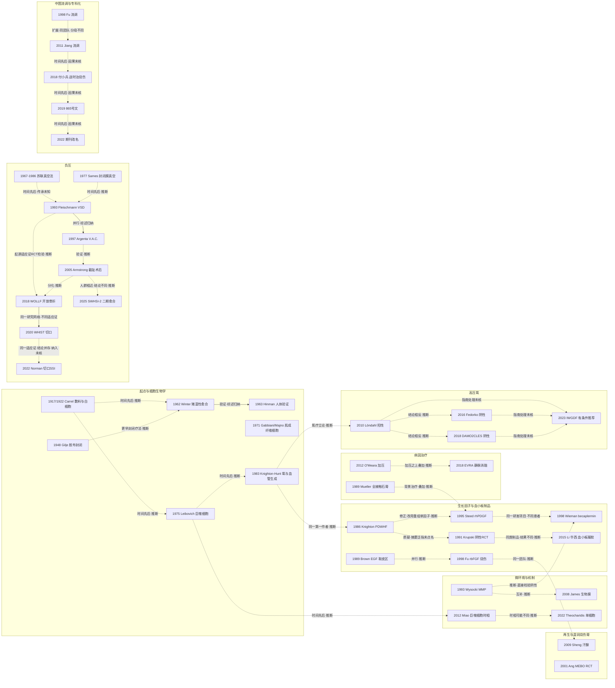

# D08 创面愈合生物学与慢性/难愈性创面修复

> **一句话判断**：这个方向研究“创面靠什么愈合、慢性创面为什么停在不愈、怎样让它闭合”，从 1917–1962 年的敷料环境与湿性愈合实验起步，先后分出生长因子、负压、微环境机制、病因治疗、干细胞与单细胞组学几条线，现阶段处在“按创面类型重新校准”证据的阶段。**对临床医生最重要的一点**：本章临床证据多数来自糖尿病足，局部疗法都是在清创、常规护理等背景治疗之上叠加比较，外推到其他创面要谨慎；负压只在一期缝合切口的感染预防上有中等确定性证据，高压氧的双盲试验结论相反。（具体数字见 0 速读；压力性损伤、放射性溃疡、下肢血运重建本轮未覆盖，见 0 速读第 6 条。）

## 0 三分钟速读

1. **从哪里来**：最早的实验问题是“敷料环境和伤口里的细胞怎样影响愈合”。Carrel 1917 在人体战伤上研究敷料渗透压，1922 年报告白细胞含“促生长物质” [D08-N19]；Winter 1962 在幼猪浅表创面上观察到湿润覆盖下上皮化约快一倍（据 Junker 2013 转述，原文未读）[D08-N01]；用胶布封闭治疗腿部溃疡的报告更早（Gilje 1948，仅题录）[D08-N20]。负压可追到 1967 年苏联的真空法记录，1997 年发表现代 V.A.C. 系统 [D08-N24][D08-N09]。
2. **为什么改变**：慢性溃疡在湿润覆盖等常规护理下仍长期不愈（Knighton 1986 系列平均病程 198 周）[D08-N03]；补生长因子的效果幅度有限（becaplermin 愈合 50% vs 35%）、随机试验结果不一 [D08-N05][D08-N11]，研究又分头转向微环境、负压、病因治疗和再生（这一顺序是本报告按时间归纳，不是单一原因）。中国的背景之一是病因谱变化：1998 年外科住院患者的慢性溃疡中创伤/感染占 67.48% [D08-N10]，2007–2008 年的调查中糖尿病成为首位病因 [D08-N17]；两次调查分母不同，不能读作趋势。
3. **如何分化**：分成五条线——病因治疗（减压、加压、静脉手术）；局部生物制剂（生长因子、血小板制品、细胞产品）；器械与物理治疗（负压、高压氧）；微环境与机制（蛋白酶、生物膜、巨噬细胞）；中国的创面专科化。分化最明显的是负压：一期缝合切口 SSI RR 0.73（62 个 RCT，中等确定性）[D08-R01]，而开放骨折、骨折术后切口、二期愈合手术创面三项大型 RCT 都为阴性 [D08-N18][D08-N32][D08-R03]。减压、加压、静脉消融这类病因治疗另有随机证据 [D08-N26][D08-N27][D08-N28]，不应被局部疗法的起落掩盖。
4. **现在研究什么**：负压证据重新校准（SWHSI-2 愈合时间 HR 1.08）[D08-R03]；糖尿病足新局部疗法（网络 Meta 51 个 RCT，多数比较为低到中等确定性）[D08-R08]；人体创面单细胞与空间组学 [D08-R10][D08-R11]；MSC/外泌体小样本试验 [D08-R12]；水凝胶与电子敷料（近五年 PubMed 1,750 篇，出版类型标为 RCT 或临床试验的 8 篇）；AI 预后模型（55 个模型全部高偏倚风险）[D08-R18]。
5. **用了什么数据**：从豚鼠、猪实验和无对照病例系列（Argenta 1997，300 个创面）[D08-N09]，到企业资助的注册 RCT（becaplermin 三期 382 例）[D08-N11]、英国 NIHR 务实 RCT（WHIST 1,548 例）[D08-N32]、Cochrane 汇总、理赔数据库（becaplermin 癌症队列 1,622 vs 2,809）和单细胞测序（17.5 万个细胞来自 17 例糖尿病患者，细胞数不是样本量）[D08-R10]。
6. **还不知道什么**：高压氧对糖尿病足是否有效（三项 RCT 结论不一）[D08-N29][D08-N30][D08-N31]；巨噬细胞极化的方向与时相；中国没有社区层面的慢性创面患病率；MSC 再生汗腺只有 5 例、未见独立重复 [D08-N16]；以“闭合”为终点是否足够（Sen 2023 提出“invisible wounds”）[D08-E4]。**本章没有覆盖的病种**：压力性损伤、放射性溃疡、下肢血运重建的脉络本轮未覆盖，本章不是这些病种的完整脉络（Cheng 2020 的住院样本中，主因为糖尿病或感染，其次为压力性溃疡、创伤和医源性创面 [D08-R16]；见第 8.2 节第 7 条）。

**覆盖边界**：
- 纳入：创面愈合的细胞与微环境机制（白细胞/巨噬细胞、肌成纤维细胞、氧、蛋白酶、生物膜、单细胞组学）；湿性愈合与敷料原理；慢性创面的定义、流行病学与负担；与愈合直接相关的病因治疗 RCT（减压、加压、静脉手术）；局部生物制剂（生长因子、血小板制品、MSC/外泌体/胎盘细胞）；负压与高压氧；AI 创面评估；中国慢性创面流行病学与创面修复专科化。
- 只点到为止：急性烧伤创面上的生长因子与湿润烧伤膏（MEBO）试验（与 D02、D04 交叉，只从“生长因子/湿润疗法”角度收录）；一期缝合切口的负压预防感染（属手术切口管理，本章只作对照）；水凝胶等生物材料（与 D03 交叉，只给规模和一篇代表）；烧伤残余创面（与 D02、D10 交叉，只列接口线索）。
- 不含：病理性瘢痕（D09）；皮肤替代物与组织工程皮肤（D03）；感染与生物膜的抗菌治疗（D04）；焦痂切除与植皮（D02）；皮瓣修复（D11）；学科形成的完整叙述（X01）。

**本章口径**：
- 截止 2026-09-29；近期窗口 2021-09-29 至 2026-09-29，只用于第 4 节，不限制历史追溯。
- 阅读层级：L0=仅二手转述；L1=题录已在数据库核实；L2=摘要已读；L3=原文部分章节已读；L4=全文已读。只到 L0/L1 的写“据某来源转述”或“仅题录”，不写成已核对原文贡献。
- 核查状态：通过=题录与所引数字经本轮对照 PubMed 记录或原文核对一致；修正=核对后改正（已用修正值）；存疑=保留但证据不足。N19、N21–N23、N26–N28、N30、N31、N33、N34、N36 与 R09、R19–R21 为后补文献，题录和所引数字经本轮对照 PubMed/NLM 记录核对一次，未经独立复核。
- 节点 36 个：L1 6 个（N01、N02、N20、N21、N23、N36）；L2 25 个；L1/L2 混合 1 个（N24）；L3 3 个（N03、N18、N22）；L4 1 个（N25）。其中 N01、N02、N20、N21、N23 只有题录，问题、数据、结果等要素不全，作为起点线索保留，速查表“节点作用”栏已注明“仅题录，要素不全”；N36 是期刊改名的 NLM 目录记录，记录本身就是该事件的依据，不加此注。近期代表研究 21 条（R01–R21；R06 在线日期早于窗口 26 天，R09、R16 为窗口外背景）；入口综述/指南/文件 13 组（E1–E13）。全部 98 行见 `data/evidence_D08.json`。
- 覆盖状态：**部分**（2026-09-29 第二轮按全报告统一口径重评，维持原评级）。理由：统一口径下，“基本完整但有标注缺口”要求章节范围内的主要分支都有节点、缺口只限于个别原文未读或中文库未查等已标注项目；“部分”指章节范围内至少有一个主要分支没有节点。本章主链（湿性愈合、生长因子、负压、微环境、病因治疗、高压氧、中国流调与专科化）都有摘要层级以上的原始节点，六个问题据主链都能回答；但压力性损伤属本章“慢性创面”范围（Cheng 2020 住院样本中列在糖尿病或感染之后的“其次”病因里 [D08-R16]），却没有节点；放射性溃疡没有节点；下肢血运重建是缺血性溃疡的病因治疗，2.4 节只写“未展开”。读者无法据本章回答这些病种从哪里来、如何分化，所以只能评为“部分”。其余缺口属标注缺口：早期原文（Winter、Hinman、苏联真空法）和细胞生物学经典多停在题录，中文数据库未查（见第 8 节）。
- 引用写法：[D08-Nxx]=关键节点，[D08-Rxx]=近期代表研究，[D08-Ex]=入口文献；只出现一次的辅助文献直接给 PMID。

---

## 1 源头：最初在研究什么

**判断**：现代“湿性愈合”常被写成始于 Winter 1962，但本轮找到更早的两类工作：Carrel 在 1917–1922 年研究敷料环境和白细胞对愈合的影响 [D08-N19]，Gilje 1948 用胶布封闭治疗腿部溃疡 [D08-N20]。所以 Winter 1962 应表述为“湿润环境加速上皮化”这一实验性概念的公认奠基，而不是“首次封闭治疗创面”。负压、生长因子、创面细胞生物学三条线的起点也都不是单一文献。

| 说法 | 分类 | 依据与限定 | 层级 |
|---|---|---|---|
| 敷料成分影响愈合：Carrel & du Noüy 1917 在人体战伤上研究敷料渗透压，并记录无菌敷料下创面反复再感染 | 目前最早找到的文献（本轮范围） | J Exp Med 1917;26:279-95（PMID 19868150）PMC 摘要段，按实验 1–6 分别描述，摘要段未给患者总数 [D08-N19]；据 Junker 2013 [D08-E5] 转述，湿润疗法“在最早的医学著作中已有例子”，本轮未追溯 | L2 |
| 用封闭物覆盖腿部溃疡（胶布疗法） | 目前最早找到的文献（就封闭治疗溃疡） | Gilje 1948 Acta Derm Venereol 28:454-67（PMID 18100123）；同作者后续系列的题录本轮未记录定位信息 [D08-N20] | L1 |
| 湿润环境使上皮化更快（Winter 1962，幼猪浅表创面） | 被公认的奠基工作（现代湿性愈合概念） | Junker 2013 写明该概念由 Winter 等于 1960 年代初提出，与当时“干燥环境最好”的普遍看法相反；“约快一倍”是 Junker 的转述，原文在 Nature 付费墙后、不在 PMC [D08-N01] | L1（数字 L0；仅题录，要素不全） |
| 湿性愈合的人体验证（Hinman & Maibach 1963） | 被公认的奠基工作 | Junker 2013 转述；同期同刊另有 Winter 同题短文（PMID 14087905）；Winter & Scales 1963 研究空气干燥与敷料（PMID 14001241）[D08-N02] | L1（仅题录，要素不全） |
| 伤口内有促生长物质：Carrel 1922“白细胞含促生长物质，并在白细胞聚集的组织和液体中释放” | 目前最早找到的概念表述 | J Exp Med 1922;36:385-91（PMID 19868680）PMC 摘要段；比 Cohen 1962 分离 EGF（J Biol Chem 237:1555-62，PMID 13880319，仅题录）早 40 年；两者之间没有核实的谱系关系 [D08-N19] | L2 |
| 巨噬细胞为修复所需（Leibovich & Ross 1975） | 目前最早找到的文献（本轮范围，就清除巨噬细胞实验） | 入口综述是否视其为奠基，本轮未核；六组豚鼠实验，动物数在摘要和方法段（扫描页 p72–75）中均未给出，结果部分未读 [D08-N22] | L3（摘要+方法段） |
| 肌成纤维细胞与创面收缩（Gabbiani 1971；Majno 1971） | 目前最早找到的文献（本轮范围） | 仅题录，要素不全 [D08-N21] | L1 |
| 生长因子治疗慢性创面（Knighton 1986 自体血小板因子） | 作者声称首次 | 摘要末句 “first clinical demonstration”（扫描页 p322 已读）；无对照；5 年后的 RCT 为阴性 [D08-N03][D08-N05] | L3 |
| 负压/真空治疗创面 | 存在争议的首次（多源、渐进出现） | 据 Miller 2012 [D08-E6] 转述可追溯到拔罐与 Bier 1890 年的吸杯（L0）；PubMed 可查最早的是 1967 年苏联 Mirazimov 用“真空蒸发法”处理久不愈合创面（L1），其后有 Demidov 1970（下肢营养性溃疡）、Sames 1977（BMJ，封闭膜真空引流，L4）、Nikolov 1981、Kostiuchenok 1984/1986、Davydov 1986；Bagaoutdinov 1985 只见新闻二手转述（L0）。1967–1984 年各篇无摘要，装置是否含泡沫、是否用于开放创面不详。“泡沫+封闭膜+持续负压”构型的最早记录以 Fleischmann 1993 和 Argenta/Morykwas 1997 为主。不认定唯一首创者 [D08-N24][D08-N25][D08-N06][D08-N09] | L0–L4 |
| 慢性创面的统一定义（Lazarus 1994，Wound Healing Society 定义文件） | 目前最早找到的文献 | Arch Dermatol 130:489-93（PMID 8166487）与 Wound Repair Regen 2:165-70（PMID 17156107）同年刊登；更早的定义未追溯 | L2 |
| MSC 再生汗腺（Sheng 2009） | 作者声称首次 | 摘要 “This is the first report”；5 例、无对照 [D08-N16] | L2 |
| 中国慢性创面流行病学（Fu 1998） | 目前最早找到的文献（英文多中心） | 中文库未查 [D08-N10] | L2 |
| 负压封闭引流（VSD）引入中国（裘华德 1994） | 综述声称首次（仅一篇中文综述和网页） | E11 原句“国内裘华德教授于1994年率先引进VSD技术”，引裘华德《负压封闭引流技术》（人民卫生出版社 2003:50-122）；1994 年原始报告未找到；PubMed 1994–2000 年 vacuum sealing AND China 为 0 条；E11 自己把 VSD 源头写作“1993 年 Fleischmann 等最先提出” [D08-E11] | L0（原始报告） |
| 湿润烧伤膏（MEBO） | 目前最早找到的文献（PubMed） | 徐荣祥 1988 Zhong Xi Yi Jie He Za Zhi 8:204-6,195（PMID 3191540），仅题录；1980–1990 年 PubMed 相关检索 35 条中只有这一篇 | L1 |
| 国家层面设立创面修复科（国卫办医函〔2019〕865号） | 目前最早找到的文献（国家文件） | 医院层面的创面中心据 Jiang 2016 最早建于 1999 年 [D08-E12][D08-E13] | L3/L4（经第三方转录全文，维基文库与 waizi.org.cn 转录本） |

**“最早找到”与“公认奠基”的区别**：“最早找到”只说明本轮在 PubMed、PMC、OpenAlex 和少数中文来源里能查到的最早记录；数据库对 1950 年前和俄文、中文文献收录不全，更早的工作可能存在。“公认奠基”需要入口综述或学术史文献明确这样叙述：Winter/Hinman 的地位依据 Junker 2013，Argenta/Morykwas 的“现代系统开创者”地位依据 Miller 2012。Carrel、Leibovich、Gabbiani/Majno 在本章只标“最早找到”，因为本轮没有核到入口综述把它们认定为奠基。

---

## 2 关键转折：问题—新证据/新方法—认识变化—新问题

按“问题怎么变”组织。关系类型后注明依据：“综述归纳”=入口综述明确这样叙述；“原文明确”=节点摘要里直接写出；“推断”=本报告根据时间和内容推断，没有原文互引证据。出版先后不等于因果；各分支是并存和叠加的，不是一条替换另一条。

### 2.1 愈合靠什么：敷料环境、白细胞、湿性愈合与细胞生物学（1917–1983）

- **原有问题**：一战战伤在无菌敷料下反复再感染，敷料成分如何影响愈合；伤口里有没有内源性促生长物质 [D08-N19]。据 Junker 2013 转述，当时普遍认为干燥环境最好 [D08-E5]。
- **新证据**：Winter 1962（猪）与 Hinman & Maibach 1963（人体实验创面）报告湿润覆盖下上皮化更快（据 Junker 2013 转述，两文原文未读）[D08-N01][D08-N02]。随后 Eaglstein & Mertz 1978 在猪模型中报告聚乙烯膜封闭使愈合快 40%（PMID 722115，L2），Alvarez 1983 报告封闭敷料增加胶原合成和再上皮化（PMID 6887836，L2）。
- **同期的细胞生物学**：Gabbiani 1971、Majno 1971 的题名分别为“肉芽组织中存在改良的成纤维细胞及其在创面收缩中的可能作用”和“肉芽组织体外收缩：与平滑肌相似”（仅题录）[D08-N21]；Leibovich & Ross 1975 在豚鼠身上全身用氢化可的松、创面周围注射抗巨噬细胞血清，创面巨噬细胞几乎消失，纤维蛋白和碎屑清除延迟，成纤维细胞从第 3 天推迟到第 5 天才出现，增殖也更慢；设六组，每只背部 6 条切口，伤后 1、2、3、5、7、10 天取材，动物数在摘要和方法段（PMC 扫描页 p72–75，第二轮补读）中均未给出，结果部分未读 [D08-N22]；Knighton & Hunt 1983 的题名为“氧分压调节巨噬细胞血管生成因子的表达”（仅题录）[D08-N23]。
- **认识变化**：据 Junker 2013，湿性敷料成为慢性创面的标准做法 [D08-E5]；入口综述把修复描述为炎症、血管新生、基质沉积与细胞募集的过程，成人修复以瘢痕告终、早期胎儿近似再生 [D08-E1][D08-E2]。
- **关系**：Winter→Hinman 为“验证”（综述归纳，E5）；Carrel→Winter、Gilje→Winter、Carrel 1922→Leibovich 1975→Knighton 1983 只标“时间先后·推断”，原文互引未核。
- **限制与负性结果**：原理被广泛接受，但“哪种湿性敷料更好”缺证据：Wu 2015 Cochrane 概要纳入 13 篇系统综述、17 个 RCT，只有 4 个直接比较显示差异，且为低或极低质量（PMID 26171906，L2）。
- **新问题**：慢性溃疡为什么在湿润覆盖下仍然不愈？

### 2.2 缺什么补什么：生长因子路线的起落（1986–2016）

- **原有问题**：Knighton 1986 系列的平均病程 198 周；其摘要写动物研究已显示血小板因子能刺激血管新生、成纤维细胞增殖和胶原合成 [D08-N03]。同一第一作者 1983 年做过氧与巨噬细胞血管生成因子的实验 [D08-N23]（前史关系为推断）。
- **新方法**：自体血小板离心、凝血酶释放上清（PDWHF），与微晶胶原混合外用，并用 20 项参数给创面分级。入组 49 例/95 个创面；4 例/13 个创面因截肢、植皮或一期缝合获手术治愈被剔除，4 例/11 个创面失访，分析 41 例/71 个创面（p324 Table 4）。分析集平均完全愈合 10.63±6.10 周；立即开始组 17 例 6.9±4.1 周 vs 延迟组 24 例 13.1±6.0 周（p<0.001，非随机分组）；复发为患者 11%、创面 7% [D08-N03]。它是本轮找到的最早系统使用生长因子混合物治疗慢性创面的临床系列之一（作者自称首次），同时做了清创、血运重建和感染控制，无法分离 PDWHF 的效果。
- **质疑**：Krupski 1991 双盲 RCT（18 例/26 个创面，78% 糖尿病、72% 外周血管病）愈合 33%（安慰剂）vs 24%（PDWHF），p>0.5；安慰剂组初始面积更大（28.9 vs 13.0 cm²）[D08-N05]。其摘要首句只泛指“先前研究提示 PDWHF 有效”，未点名 Knighton（关系：质疑；依据为摘要泛指，原文参考文献未核）。
- **修正（推断）**：转向成分明确的重组单因子 rhPDGF-BB。Steed 1995（118 例，神经性、TcPO2≥30 mmHg）愈合 48% vs 25%，p=0.01 [D08-N08]；Wieman 1998 三期（382 例）100 µg/g 组 50% vs 35%（P=0.007），闭合时间第 35 百分位 86 vs 127 天 [D08-N11]；Smiell 1999 合并四项多中心试验 922 例，50% vs 36%（PMID 10564562）。N08 与 N11 是同一 becaplermin 研发项目中的不同试验、患者不同（依据：合并分析与作者重叠；Smiell 摘要未列试验名称，“含 Steed 1995”为推断）。
- **清创证据的性质**：Steed 1996 对同一 118 例按中心回看，清创频率低的中心愈合率也低，与分组无关（PMID 8673309）。这是同一 RCT 内的事后中心间比较，不是清创的随机证据。试验方案要求随机前锐性清创、按需重复；背景治疗是否规定减压，本轮所读摘要未写明。
- **急性创面上的并行工作（推断）**：Brown 1989 在 12 例患者的配对取皮区上，EGF 侧到 25%/50% 愈合约早 1 天、到 75%/100% 约早 1.5 天（P<0.02）[D08-N04]；Fu 1998 rbFGF 在 600 例二度烧伤中缩短愈合 2.5–4.2 天 [D08-N12]。地区性产品（古巴病灶内注射 rhEGF，PMID 20051095；日本 bFGF 治疗糖尿病溃疡，PMID 19638336）本轮只核题录。
- **整体评价**：Martí-Carvajal 2015 Cochrane（检索至 2015 年 3 月；28 个 RCT/2,365 人；11 种生长因子）合并 RR 1.51（1.31–1.73），主要来自 PDWHF（2 项，RR 2.45）和 becaplermin（5 项，RR 1.47）；全部把握度不足、高偏倚风险，50% 由企业资助。Martinez-Zapata 2016 PRP Cochrane（10 个 RCT/442 人）整体 RR 1.19（0.95–1.50），糖尿病足 RR 1.22（1.01–1.49，2 个 RCT/189 人），静脉溃疡 RR 1.02 [D08-E9]。
- **安全性**：据厂商新闻稿与药学媒体（L0），FDA 2008 年给 becaplermin 加黑框警告、2018 年撤除，原始 FDA 文件未核。Ziyadeh 2011 参保人群配对队列（1,622 vs 2,809）：癌症总体 HR 1.2（0.7–1.9）；到 2003 年，≥3 次配药者癌症死亡 RR 5.2（1.7–17.6）；同一队列延长到 2006 年后整体 RR 1.0（0.5–2.3），>3 次配药亚组 RR 2.4（0.8–7.4）；摘要另报告临床试验延长随访的癌症 RR 2.8（0.6–12.8）。信号和“未见升高”来自同一队列、同一组作者（单位为 Ingenix, i3 Drug Safety；资助方原文未读），应读作“未达统计学显著、不能排除”，而不是被独立研究否定 [D08-N11]。
- **新问题**：外加因子为什么效果有限？是被慢性创面环境降解，还是问题不在“缺因子”？

### 2.3 慢性创面停在哪里：蛋白酶、生物膜与巨噬细胞（1993–2022）

- **蛋白酶**：Wysocki 1993 用明胶酶谱比较，急性创面液（乳房切除引流液）MMP-2、MMP-9 等较血清高 5–10 倍，慢性腿部溃疡创面液再高 5–10 倍，且有活化型和酶原型；样本数摘要未给出 [D08-N07]。这为清创和伤床准备（Schultz 2003，PMID 12654015，仅题录）提供了机制说法。
- **一个被直接检验、结果为阴性的推断**：“高蛋白酶环境降解外源生长因子、可部分解释疗效有限”是本报告的推断。本轮核到的唯一直接检验 Castronuovo 1998（12 名糖尿病或压力性溃疡受试者的创面液，PMID 9777974，L2）结果相反：作用 12 小时后 becaplermin 的量、条带和促有丝分裂活性都未改变，外用 12 小时后创面液中仍有活性 becaplermin。N07→N11 的关系因此只保留为“推断，直接检验阴性”。
- **蛋白酶调节类敷料**：Explorer 试验（Edmonds 2018，240 例神经缺血性糖尿病足）蔗糖八硫酸盐敷料闭合 48% vs 30% [D08-R09]。它检验的是敷料，不是蛋白酶机制本身。
- **生物膜**：James 2008 的慢性标本取自 77 名受试者、急性标本取自 16 名（据摘要），其中用光镜和电镜检查 50 份慢性、16 份急性创面标本，生物膜 30/50（60%）vs 1/16（6%），p<0.001；另 27 份慢性标本的分子分析发现培养漏检的多菌种群落和严格厌氧菌 [D08-N15]。Malone 2017 系统综述（9 项研究/185 个慢性创面）合并患病率 78.2%（PMID 28103163，L2）；之后有 2017 年共识（PMID 28960634）和猪模型中金黄色葡萄球菌生物膜致肉芽组织胶原缺陷的研究（Roy 2020，PMID 30614873），两者仅题录。横断面研究只说明相关，取材和判读标准不统一；抗生物膜治疗交 D04。N07 与 N15 是两套并存的微环境解释（互补，推断）。
- **巨噬细胞**：Leibovich 1975 显示去除巨噬细胞后修复延迟 [D08-N22]。上海市烧伤研究所（瑞金医院）Miao 2012 在 STZ 糖尿病大鼠中（动物数摘要未给；全文需订阅，未读）观察到：正常创面先出现经典活化巨噬细胞、随后替代活化占优；糖尿病创面早期经典活化不足、后期替代活化过多 [D08-N34]。人体单细胞研究 Theocharidis 2022 显示愈合者 M1 较多、不愈者 M2 较多，但比较的是 7 例愈合者对 4 例不愈者，空间转录组只有 2 对 2 [D08-R10]。动物与人体结果可能只是取材时相不同，未必矛盾（推断）；常见的“M1→M2 转换促愈合”叙述本轮没有找到原始出处，本章不以它作对照。

### 2.4 病因治疗：减压、加压与静脉手术（1989–2018）

- **原有问题**：足底压力和静脉高压这些病因不处理，局部换什么都可能无效。
- **减压**：Mueller 1989 RCT 纳入 40 例糖尿病足底溃疡，全接触石膏组 19/21 愈合（42±29 天），传统敷料组 6/19（65±29 天），感染也更少 [D08-N26]；它比 becaplermin 的试验早 6 年。Armstrong 2001 是比较减压方式的 RCT（PMID 11375363，仅题录）。
- **加压**：O'Meara 2012 Cochrane（检索至 2012-05-31；48 个 RCT/4,321 人）中，8 个 RCT（未合并）显示加压的愈合结局优于不加压；多组分优于单组分；5 个 RCT 的个体数据 Meta 中四层绷带快于短拉伸绷带，HR 1.31（1.09–1.58）；多数 RCT 样本小、偏倚风险不清或高 [D08-N27]。
- **静脉手术**：EVRA（Gohel 2018 NEJM，英国 20 个中心，随机 450 例静脉性腿部溃疡患者；两组例数摘要未给；第二轮对照 PubMed 摘要补入）在加压基础上比较早期与延迟的浅静脉腔内消融（两组均加压，据摘要），愈合 HR 1.38，中位愈合 56 vs 82 天 [D08-N28]。
- **认识变化**：本章收录的生长因子、负压、高压氧和 ON101 试验，对照组是安慰剂或“标准治疗/常规护理”，试验组在同样的背景治疗之上加用受试疗法（据各摘要），检验的是叠加效果（关系：叠加检验，推断）。所以局部疗法的阴性或小效应，不等于慢性创面“没有有效治疗”。
- **未展开**：下肢血运重建与愈合的关系本轮没有纳入节点（见第 8 节）。

### 2.5 负压：多源出现、形成现代系统，再按适应证重新检验（1967–2025）

- **前史**：见第 1 节。Kostiuchenok 1986 报告 116 例化脓创面经真空治疗后创面组织细菌量明显减少，Davydov 1986 报告 299 例化脓性哺乳期乳腺炎 [D08-N24]；Sames 1977 在 BMJ 描述用 Opsite 或家用保鲜膜封闭创面和引流管形成真空密封（扫描页已读）[D08-N25]。这些工作与后来的德、美系统有无传承关系，本轮未找到依据。
- **构型成形**：Fleischmann 1993 报告 1992 年 152 例开放骨折中 15 例接受 vacuum sealing：引流管埋入泡沫（摘要原文 “polyvinyl foam”，写作 PVA/聚乙烯醇是一种解读），填入创面、透明膜封闭后接负压；无骨感染，1 例软组织感染因封闭不当，改正后消退 [D08-N06]。Morykwas/Argenta 1997 猪模型 4 项实验（n=5/10/5/5）：125 mmHg 下血流增加 4 倍，肉芽形成速率连续负压增加 63.3±26.1%、间歇负压增加 103±35.3%，随意皮瓣存活高 21%；临床 300 个创面中 296 个“反应良好”，无对照 [D08-N09]。Miller 2012 称 Argenta/Morykwas 开创了现代系统，并转引 Fortune 报道提到专利之争 [D08-E6]；E11 把中国 VSD 的源头归于 Fleischmann。德、美两线为“并行”（综述归纳）。
- **第一次多中心随机验证**：Armstrong 2005（美国 18 中心，糖尿病足部分截肢术后、灌注充足）162 例，愈合 43/77（56%）vs 33/85（39%），p=0.040；开放标签，厂商资助细节原文未读 [D08-N14]。Liu 2018 Cochrane（共 11 个 RCT/972 人）中术后创面只有 2 项/292 人，愈合 RR 1.44（1.03–2.01）与 HR 1.91（1.21–2.99）都来自 Armstrong 2005 这一项试验，不是独立的新证据；非术后糖尿病足溃疡 5 项合并 RR 1.40（1.14–1.72），低确定性；截肢 RR 0.38（0.14–1.02），极低确定性 [D08-E8]。
- **在起源适应证中检验**：WOLLF 2018 在严重开放骨折（Fleischmann 1993 的适应证）中随机 460 例，NPWT 组用开孔泡沫或纱布：12 个月 DRI 45.5 vs 42.4，差值 -3.9（-8.9 至 1.2），P=.13；深部感染 7.1% vs 8.1% [D08-N18]（关系：N06→N18，推断）。
- **切口负压是另一个适应证**：WHIST 2020 检验的是骨折手术后一期缝合切口上的预防性负压，不是开放创面；1,548 例，30 天深部 SSI 5.84% vs 6.68%，OR 0.87（0.57–1.33），P=.52 [D08-N32]。它与 WOLLF 同属英国 Major Trauma Network。同一适应证的 Norman 2022 Cochrane（62 个 RCT/13,340 人，检索至 2021 年 1 月）显示 SSI 8.7% vs 11.75%，RR 0.73（0.63–0.85），中等确定性 [D08-R01]。WHIST 是否被纳入、权重多大，本轮未核；目前只能写成“合并结果 SSI 降低，大型单个试验 WHIST 为阴性”两者并存。
- **慢性与二期愈合创面**：SWHSI-2 2025（686 例，80.0% 糖尿病，90.4% 在足或腿部）愈合时间 HR 1.08（0.88–1.32）[D08-R03]；压力性溃疡（Shi 2023：8 个 RCT/327 人，完全愈合只有 1 项 12 人研究可用）[D08-R02]和腿部溃疡（Dumville 2015：只有 1 个 60 人的 RCT）[D08-E8] 证据极少；开放创伤创面另有 Cochrane（Iheozor-Ejiofor 2018，PMID 29969521，仅题录）。
- **认识变化**：从“负压普遍有益”变成按适应证分开看；Armstrong 2005 与 SWHSI-2 人群都以糖尿病下肢为主、结论不同（推断，设计与终点不同）。

### 2.6 高压氧：双盲试验结论相反（2010–2018）

- **原有问题**：缺氧创面加氧能否促进愈合。Knighton & Hunt 1983 的氧与巨噬细胞血管生成研究与氧疗的立论相关（推断，仅题录）[D08-N23]。
- **阳性**：Löndahl 2010 HODFU，单中心、双盲，以高压空气作安慰剂，94 例 Wagner 2–4 级溃疡；意向性分析 1 年指标溃疡愈合 25/48（52%）vs 12/42（29%），P=0.03 [D08-N29]。
- **阴性**：Fedorko 2016 双盲假治疗对照（125 kPa 空气），随机 107 例、分析 103 例；12 周符合截肢标准 11/49 vs 13/54，OR 0.91（0.37–2.28），愈合 20% vs 22% [D08-N30]。DAMO2CLES 2018（荷兰多中心，120 例缺血性溃疡）12 个月愈合 RD 3%（-14 至 21），保肢 RD 10%（-4 至 23）；高压氧组 35% 未能按计划完成疗程，完成者的阳性结果属事后分析，不能作为疗效证据 [D08-N31]。
- **指南**：IWGDF 2023 对高压氧给出有条件支持 [D08-E7]；其配套系统评价如何处理 Fedorko 与 DAMO2CLES，本轮未核，所以不写指南的理由。
- **状态**：未解决。三项试验的对照（高压空气/低压空气假治疗/不加高压氧）、人群（以神经性为主 vs 缺血性）和终点都不同，这本身就是争议的一部分。

### 2.7 从“闭合”到“再生”：干细胞与皮肤附属器（2001–2021）

- Fu 2001 Lancet 在 8 例 rhEGF 治疗患者的活检中，用免疫组化观察到表皮细胞“去分化”为干细胞（PMID 11589942，L2）；Badiavas & Falanga 2003 用骨髓来源细胞治疗 3 例慢性创面（PMID 12707099，L2）。
- Sheng 2009（付小兵团队）把体外诱导的骨髓 MSC 移植到 5 例深度烧伤后无汗瘢痕切除创面，术后 2–12 个月碘-淀粉发汗试验全部阳性，汗液成分近似正常 [D08-N16]。同团队此前有动物研究（Fu 2006，PMID 16808812），之后转向汗腺类器官（Sun 2021 小鼠，PMID 34569165）。OpenAlex 显示 97 篇文献引用 Sheng 2009，本轮未见独立团队的人体重复。
- **关系**：N12→N16 为同一团队从生长因子转向干细胞（推断）。目标从“加速闭合”扩展到“恢复附属器功能”，但人体证据仍停在 5 例。

### 2.8 急性烧伤创面上的湿润疗法：MEBO（1988–2020）

- 徐荣祥 1988 年的文章在 PubMed 只有题录；1990 年代支持性叙述只见于企业官网（利益相关方，L0）。
- Ang 2001 新加坡单中心 RCT（115 例：MEBO 57/常规 58）：75% 愈合中位时间 17 vs 20 天，HR 0.67（0.41–1.11），P=0.11；感染 HR 1.10（0.59–2.03）；前 5 天镇痛更好，费用低 8% [D08-N13]。Ang 2003（PMID 14501397）是同一 115 例试验的疼痛结局报告，不计为独立证据。Mabvuure 2020 系统综述（只收 PubMed 英文 RCT，6 个）认为证据差且不一致 [D08-E10]。
- 本章不把 MEBO 与 Winter 湿性愈合连成关系：曾被当作依据的 Atiyeh 2002 综述（PMID 12164477）题名和摘要都没有提到 MEBO，本轮也没有找到徐荣祥原始文献引用 Winter 的证据。

---

## 3 分支图

图例：实线=原文明确或综述归纳的关系；虚线=本报告推断；边上写关系类型。“叠加”表示在背景治疗之上比较，不是替代。

N13（MEBO）与湿性愈合线之间没有可靠依据，图中不连线。N21（肌成纤维细胞）与后续节点之间没有核到的关系，也不连线。

---

## 4 近五年重点（2021-09-29 至 2026-09-29）

### 4.1 负压证据按适应证重新校准
- **研究什么**：负压在一期缝合切口、二期愈合手术创面、压力性溃疡中是否真正改善愈合、感染和成本。
- **数据与设计**：英国 NIHR 资助的多中心务实 RCT、模型经济学评价、Cochrane 系统综述。
- **代表研究**：Norman 2022 Cochrane（一期缝合切口，62 个 RCT/13,340 人）SSI RR 0.73（0.63–0.85），中等确定性；死亡 RR 0.78（0.47–1.30），低确定性 [D08-R01]。Shi 2023 Cochrane（压力性溃疡，8 个 RCT/327 人）完全愈合只有 1 项 12 人研究，RR 3.00（0.15–61.74），极低确定性 [D08-R02]。SWHSI-2（29 个 NHS Trust，开放标签，686 例）HR 1.08（0.88–1.32），p=0.47；Discussion 写低于 NICE 阈值时具成本效果的概率 <50% [D08-R03]。Saramago 2025 用经济模型把一项 Meta 分析的效应外推到患者终生，NPWT 成本更高、QALY 略高，具成本效果的概率 <30% [D08-R04]。Vas & Chong 2026 在 Lancet 以“糖尿病足的愈合不能一刀切”回应 SWHSI-2（仅题录）[D08-R05]。
- **分歧**：切口 SSI 有中等证据，但同一适应证中的大型单个试验 WHIST（1,548 例）为阴性 [D08-N32]；二期愈合创面和压力性溃疡为阴性或证据极少。
- **成熟度**：切口 SSI 预防较成熟；慢性和二期愈合创面中，高质量证据为阴性或不确定。

### 4.2 糖尿病足新局部疗法、指南与高压氧分歧
- **研究什么**：蔗糖八硫酸盐敷料、胎盘来源产品、LeucoPatch、局部氧疗、巨噬细胞调节药 ON101 等能否在标准治疗之外提高愈合率。
- **数据与设计**：多中心双盲或评估者盲 RCT、GRADE 指南、贝叶斯网络 Meta。
- **代表研究**：IWGDF 2023（29 条推荐）对蔗糖八硫酸盐敷料、术后 NPWT、胎盘来源产品、LeucoPatch、局部氧疗、高压氧给出有条件支持，并强调只在标准治疗无效且资源允许时使用 [D08-E7]；与这些推荐相关的 Explorer（PMID 29275068）、LeucoPatch（PMID 30243803）、TWO2（PMID 31619393）试验都发表于窗口前，IWGDF 对它们的引用本轮未逐一核对，本章只核了 Explorer 的数字 [D08-R09]。ON101 三期（美国、中国大陆和台湾 21 中心，评估者盲，FAS 236 例）16 周完全愈合 60.7% vs 35.1%，OR 2.84（1.66–4.84）；Limitations 段承认开放标签、没有 2 周导入期；在线日期 2021-09-03，早于窗口 26 天 [D08-R06]。其事后分析摘要写 276 例、FAS 61.7% vs 37.0%，与原始报告的 236 例不一致，两说并存 [D08-R07]。Chen 2026 网络 Meta（检索至 2025-02-01；51 个 RCT/6,161 人/23 种干预）12 种局部疗法优于标准治疗，胎盘来源产品 OR 7.85（4.62–14.15），多数比较为低到中等确定性 [D08-R08]。
- **分歧**：效应量大的试验多为企业资助或开放标签；指南推荐都附“标准治疗无效时”的条件；高压氧有条件推荐的同时存在两项阴性 RCT（2.6 节）。
- **成熟度**：发展中。

### 4.3 人体创面的单细胞与空间组学
- **研究什么**：急性创面各愈合阶段和糖尿病足、静脉溃疡中，哪些细胞亚群与“愈合/不愈”相关。
- **数据与设计**：scRNA-seq、空间转录组、同一受试者多时间点活检。
- **代表研究**：Theocharidis 2022 分析 17 例糖尿病患者（11 例糖尿病足：12 周愈合 7 例、不愈 4 例；6 例无溃疡）和 10 例非糖尿病者的 54 份样本，测序 174,962 个细胞；愈合者中高表达 MMP1/MMP3/MMP11/HIF1A/CHI3L1/TNFAIP6 的成纤维细胞亚群富集、M1 巨噬细胞增多；空间转录组（2 例愈合者 vs 2 例不愈者）显示愈合者 M1 多、不愈者 M2 多 [D08-R10]。Liu 2025 Cell Stem Cell 在同一个体的炎症期、增殖期、重塑期取样，鉴定 FOSL1 为再上皮化的关键驱动因子，并描述促炎巨噬细胞与成纤维细胞以“接力”方式支持角质细胞迁移；摘要未给样本数 [D08-R11]。
- **分歧**：见 2.3 节巨噬细胞时相问题；分析单位是患者，细胞数不是样本量；结论都是相关，缺少因果验证。
- **成熟度**：早期线索。

### 4.4 MSC、外泌体与细胞来源产品
- **代表研究**：Kishta 2025 三臂 RCT（随机入组 110 例）外泌体组平均完全愈合时间 6 周 vs 对照 20 周；摘要称共 53 例（62%）痊愈，62% 的分母约为分析集 85 例（全文基线表合计），不是入组的 110 例 [D08-R12]。Pollak 2025 二期多中心双盲（159 例，胎盘来源细胞三个剂量肌注）只在外周动脉病亚组的 3×10⁶ 剂量组看到最高疗效（38.5% vs 22.6%），摘要未报告总体主要终点的检验 [D08-R13]。Arango-Rodríguez 2022 一/二期随机（28 例：MSC 衍生物 12、MSC 6、PolyMem 敷料 10）未报告不良事件，两个细胞组闭合比例更高 [D08-R14]。
- **分歧与成熟度**：效应量大的多为单中心或亚组结果；制备标准和剂量不统一。早期线索。

### 4.5 生物材料、水凝胶与电子敷料（与 D03 交叉）
- **规模**：PubMed 检索 `(hydrogel*[tiab]) AND (diabetic wound*[tiab] OR diabetic ulcer*[tiab] OR diabetic foot[tiab]) AND 2021/09/29:2026/09/29[dp]` 共 1,750 篇；加 China[ad] 为 1,368 篇（78%，[ad] 匹配任一作者单位）；出版类型标为 RCT 或临床试验的 8 篇；按 MeSH 只标动物的 435 篇（新文献标引未完成，此数偏低）。这条线体量很大（未与其他主题做同口径比较），标为临床试验的极少，作者单位以中国为主（仅检索计数，未读文献，L1）。
- **代表研究**：Jiang 2023 Nat Biotechnol 的无线闭环电子敷料（阻抗、温度监测加电刺激）只在小鼠中验证，愈合约快 25%，真皮重塑约提高 50% [D08-R19]。
- **成熟度**：以动物研究为主；材料本身归 D03。

### 4.6 AI 创面评估与预后
- **代表研究**：Anisuzzaman 2022 系统综述认为基于图像的 AI 创面评估系统“仍处于起步阶段”，检索截止日与纳入数本轮未核 [D08-R17]。Silva 2025 系统综述（检索至 2023 年 7 月）评价机器学习预后模型（预测愈合、截肢、死亡），11 项研究/13 篇文献、55 个模型，AUROC 0.56–0.94，全部高偏倚风险，缺少外部验证 [D08-R18]。
- **成熟度**：只有综述层面的证据，本轮未见前瞻性临床验证的原始研究。

### 4.7 负担、终点定义与中国专科化
- **代表研究**：Falanga 2022 Primer 称过去的标准治疗已过时，基础科学、生物工程和临床研究的进展形成了新的循证标准，但仍有知识缺口 [D08-E3]。Sen 2023 负担汇编称美国 Medicare 受益人中有 1,050 万名慢性创面患者（比 2014 年版多 230 万），并提出按 FDA 定义已“闭合”的创面可能仍有屏障功能缺陷（“invisible wounds”），建议重新审视闭合终点 [D08-E4]。中国医师协会创面修复专业委员会 2026 年发布静脉性溃疡专家共识，写明“随着中国创面修复专科的建立和发展” [D08-R15]。原始数据方面，Cheng 2020 回顾 2018 年 17 家三甲医院 3,300 例住院电子病历，主因是糖尿病或感染，其次为压力性溃疡、创伤和医源性创面（窗口外背景）[D08-R16]。2022 年 1 月《中华烧伤杂志》改名为《中华烧伤与创面修复杂志》[D08-N36]。
- **分歧**：负担数字多依赖美国 Medicare 数据；中国没有社区层面的患病率。
- **成熟度**：发展中。

### 4.8 与烧伤临床的接口
- 本章的临床证据主要来自糖尿病足（第 4.2、4.3 节的代表研究和负压的多数 RCT），推到压力性损伤、静脉溃疡、放射性溃疡要谨慎。
- 烧伤特有的难愈创面在窗口内仍有中国研究：大面积烧伤残余创面的超声清创（He 2022，《中华烧伤与创面修复杂志》，回顾队列）[D08-R20]、严重烧伤残余创面的小片自体皮与冻存异体皮混合移植（Ji 2025，Burns，回顾研究）[D08-R21]，两篇仅题录。残余创面的植皮属 D02，功能结局属 D10。烧伤瘢痕癌变（Marjolin 溃疡）本轮未检索。

---

## 5 争议、负性结果与停滞路线

### 5.1 仍在争的问题

| 争议 | 各方证据 | 当前状态 |
|---|---|---|
| 负压对谁有效 | 支持：Argenta/Morykwas 1997 无对照系列 [D08-N09]、Armstrong 2005 [D08-N14]、Norman 2022 切口 SSI RR 0.73 [D08-R01]。质疑：WOLLF [D08-N18]、WHIST [D08-N32]、SWHSI-2 [D08-R03]、压力性溃疡与腿部溃疡证据极少 [D08-R02][D08-E8] | 按适应证分化；注意 Liu 2018 的术后创面效应就是 Armstrong 2005 一项试验，不能与之重复计数 |
| 负压发明优先权 | 苏联 1967 年起多篇真空法记录 [D08-N24]、Sames 1977 [D08-N25]、Bagaoutdinov 1985（L0）、Fleischmann 1993 [D08-N06]、Argenta/Morykwas 1997 [D08-N09]；Miller 2012 提到专利之争 | 未解决，不认定唯一首创者 |
| 高压氧治疗糖尿病足 | Löndahl 2010 阳性 [D08-N29]；Fedorko 2016 [D08-N30]、DAMO2CLES 2018 [D08-N31] 阴性；IWGDF 2023 有条件推荐 [D08-E7] | 未解决；对照设计、人群、终点不同 |
| 外用生长因子的价值与安全 | becaplermin 50% vs 35% [D08-N11]；Cochrane RR 1.51 但高偏倚、50% 企业资助 [D08-E9]；癌症信号在同一队列延长随访后未达显著 [D08-N11] | 疗效幅度有限、证据质量低；安全信号“不能排除” |
| 湿性敷料选哪种 | 原理由动物实验支持 [D08-N01]；Wu 2015 概要未见可靠差异 | 原理被接受，品类选择缺证据 |
| MEBO | 推广方叙述只见企业官网（L0）；Ang 2001 P=0.11 [D08-N13]；Mabvuure 2020 证据差 [D08-E10] | 未解决；中文 RCT 未检索 |
| 干细胞再生汗腺 | Sheng 2009 5 例 [D08-N16] | 早期线索，需独立重复 |
| 巨噬细胞极化方向 | 大鼠：糖尿病创面早期经典活化不足、后期替代活化过多 [D08-N34]；人体 7 vs 4 例：愈合者 M1 多 [D08-R10]；ON101 以调节巨噬细胞为立论 [D08-R06] | 时相问题未定，二者未必矛盾 |

### 5.2 负性结果、失败与停滞路线

- **自体血小板因子（PDWHF）**：无对照阳性系列之后，首个双盲 RCT 未见获益（33% vs 24%）[D08-N05]；PRP 对慢性创面整体 RR 1.19（0.95–1.50）[D08-E9]。华西 Li 2015 自体血小板凝胶 RCT 为阳性 [D08-N33]，同类制品的结果方向并不一致。
- **“蛋白酶降解外源生长因子”的推断**：唯一核到的直接检验为阴性（Castronuovo 1998）。
- **负压用于开放骨折、骨折术后切口和二期愈合创面**：WOLLF、WHIST、SWHSI-2 均阴性，SWHSI-2 还不具成本效果 [D08-N18][D08-N32][D08-R03][D08-R04]。
- **负压用于压力性溃疡和腿部溃疡**：RCT 极少，无法下结论 [D08-R02][D08-E8]。
- **高压氧**：两项阴性 RCT，DAMO2CLES 中 35% 未完成疗程 [D08-N30][D08-N31]。
- **becaplermin 癌症信号**：到 2003 年的信号在同一队列延长到 2006 年后未达统计学显著，>3 次配药亚组点估计仍为 2.4；黑框警告的加与撤只有二手来源 [D08-N11]。
- **MEBO 作为优于常规治疗的烧伤外用药**：境外 RCT 未显示愈合时间优势 [D08-N13]。
- **更换湿性敷料品类**：糖尿病足中没有可靠证据显示某类更优（Wu 2015）。

---

## 6 中国线

- **团队集中，不是彼此独立的证据**：本轮核到的中国原始研究多数出自付小兵、盛志勇团队——Fu 1998 流调（单位为解放军 304 医院（后称解放军总医院第一附属医院，PMID 27338528 单位字段）创面愈合研究室）[D08-N10]、Fu 1998 rbFGF RCT [D08-N12]、Sheng 2009 [D08-N16]、Jiang 2011 流调（解放军总医院创面愈合研究室，作者含 Fu X）[D08-N17]、Jiang 2016 创面中心调查 [D08-E13]、Cheng 2020 [D08-R16]、2018 年两篇学科评论 [D08-N35]，2026 年静脉溃疡共识的作者也有付小兵 [D08-R15]。
- **流行病学：两个数字不可比**：

| 研究 | 年份与样本 | 分母 | 数值 | 主要病因 |
|---|---|---|---|---|
| Fu 1998 [D08-N10] | 15 家医院，筛查 3 万名外科住院患者，发现 489 例 | 外科住院患者 | 1.5%–3.0% | 创伤和感染 67.48%；糖尿病 4.91%；静脉 6.54% |
| Jiang 2011 [D08-N17] | 2007–2008 年，17 家医院，2,513 例 | 全部住院患者 | 1.7‰ | 糖尿病（男 31.3%/女 35.3%）；创伤（男 26.4%/女 19.2%） |
| Cheng 2020 [D08-R16] | 2018 年，17 家三甲医院，3,300 例电子病历 | 未报告患病率 | — | 糖尿病或感染，其次压力性溃疡、创伤、医源性 |

两个比例一个以外科住院患者为分母、一个以全部住院患者为分母，数值相差约 10 倍，抽样框也不同，不能读作患病率的变化趋势；能比较的只有病因构成。Jiang 2011 还报告只有 22.4% 用了现代敷料或新技术，77.8% 用了抗生素，自费 42.3%，出院时完全愈合 1,345/2,513。
- **生长因子**：Fu 1998 Lancet rbFGF 600 例 [D08-N12]；Fu XB 1999 用 bFGF 治疗 28 例/33 个慢性创面，4 周愈合率 93.9%，无对照（PMID 12080816）；Fu 2001 Lancet 表皮细胞去分化（8 例）。
- **干细胞与附属器**：Sheng 2009 → Sun 2021 类器官（见 2.7 节）。
- **其他团队**：四川大学华西医院内分泌代谢科糖尿病足诊治中心的 Li 2015 RCT（2007–2011 年，117 个溃疡，其中糖尿病足 103 个）自体血小板凝胶组愈合 1 级 50/59（84.8%）vs 对照 40/58（69.0%）[D08-N33]；上海市烧伤研究所（瑞金医院）的 Miao 2012 糖尿病大鼠巨噬细胞活化研究和 Niu 2012（33 例腹部皮肤，糖尿病者真皮更薄、AGE 蓄积更多）[D08-N34]，是烧伤研究所做慢性创面机制研究的例子。
- **负压**：VSD 由裘华德 1994 年引入国内，只见一篇 2008 年中文综述和网页的叙述 [D08-E11]。
- **MEBO**：见 2.8 节；中文 RCT 与 1990 年代争论的原始文献未检索。
- **学科建设（只列时间，不推断因果）**：
  - 1999 年起医院层面建创面中心，2010 年后加快；69 家中心中多数隶属烧伤科 [D08-E13]。
  - 2018 年付小兵在《中华烧伤杂志》提出“战时治烧伤，平时治创面”，主张在烧伤患者减少时把体表慢性难愈创面作为烧伤学科的日常工作之一，并视为学科转型之机 [D08-N35]；同年另有《中国特色创面修复中心建设 20 年回顾》（仅题录）。
  - 2019-11-29 国卫办医函〔2019〕865号：有条件的医疗机构可参考《医疗机构创面修复科基本标准（试行）》建科；三级医院开放床位≥20 张（建科初期不少于 10 张）、医师至少 8 名，二级医院床位≥10 张、医师至少 4 名；正文没有“诊疗科目”字样 [D08-E12]。
  - 2022 年 1 月《中华烧伤杂志》（到 2021 年第 37 卷第 12 期停刊）改名为《中华烧伤与创面修复杂志》（ISSN 2097-1109）[D08-N36]。
  - 这几件事是否互相引用、Jiang 2011 的数据是否被 865 号文采用，本轮都未核；只能说它们在时间上先后发生。

---

## 7 数据路径小结（历史上 vs 现在）

| 数据类型 | 历史上怎么用 | 现在怎么用 | 分析单位与注意 |
|---|---|---|---|
| 动物实验 | 豚鼠（巨噬细胞清除 [D08-N22]）、家猪浅表或全层创面（Winter 1962、Eaglstein 1978、Morykwas 1997 各组 n=5–10） | 糖尿病大鼠 [D08-N34]、小鼠（汗腺类器官、电子敷料 [D08-R19]）；水凝胶论文（标为临床试验的只有 8 篇） | 动物创面；猪浅表创面不等于慢性溃疡 |
| 健康人实验创面/取皮区配对 | Hinman & Maibach 1963；Brown 1989（12 对）[D08-N04] | 少见 | 创面；急性、健康皮肤 |
| 无对照病例系列 | 技术出现初期常见且结果乐观：Knighton 1986、Fleischmann 1993、Argenta 1997、Sheng 2009、Fu XB 1999 | 仍用于新技术首报 | 患者与创面常混用（Knighton 49 例/95 创面） |
| 企业资助注册 RCT | Steed 1995（118）、Wieman 1998（382）；合并分析 Smiell 1999（922） | Explorer 2018（240）、ON101 2021（236） | 患者；同一研发项目的试验与合并分析不重复计数 |
| 病因治疗 RCT | Mueller 1989（40） | EVRA（450）；加压以 Cochrane 汇总为主 | 患者；多为小样本 |
| 研究者发起的大型务实 RCT | — | WOLLF（460）、WHIST（1,548）、SWHSI-2（686），英国 NIHR 网络 | 患者；结果多为阴性 |
| 系统综述/Cochrane | 生长因子（28 个 RCT）、PRP、敷料概要 | NPWT 系列、网络 Meta（51 个 RCT）[D08-R08] | 研究数与人数分开写 |
| 创面液与组织标本 | Wysocki 1993（酶谱）、James 2008（慢性标本 50 份镜检+27 份分子分析；急性 16 份） | — | 标本；样本数常不明 |
| 单细胞与空间组学 | — | Theocharidis 2022、Liu 2025 | **分析单位是患者**：17.5 万个细胞来自 17 例糖尿病患者，比较是 7 vs 4 例 |
| 行政与理赔数据库 | becaplermin 癌症配对队列（1,622 vs 2,809）；Medicare 负担汇编 | Sen 2023 | 同一队列的信号和后续分析要标同源 |
| 中国住院横断面/电子病历 | Fu 1998、Jiang 2011 | Cheng 2020 | 住院样本；分母各不相同 |
| 创面照片与临床变量 | — | AI 分割、分类与预后模型 [D08-R17][D08-R18] | 多为回顾性，缺外部验证 |

---

## 8 还不知道什么（领域证据缺口）与本报告的检索缺口

### 8.1 领域证据缺口
1. **高压氧**：双盲 RCT 结论相反，人群和对照设计不同，缺少能解释分歧的试验 [D08-N29][D08-N30][D08-N31]。
2. **机制的因果验证**：单细胞组学的“愈合相关细胞亚群”都是相关，样本小（7 vs 4 例）；巨噬细胞极化的时相问题未定 [D08-R10][D08-N34]。
3. **终点**：“闭合”是否等于功能恢复，Sen 2023 已提出问题 [D08-E4]；多数 RCT 仍以闭合为主要终点。
4. **外推**：临床证据集中在糖尿病足；负压治疗压力性溃疡和腿部溃疡缺高质量 RCT [D08-R02][D08-E8]；放射性溃疡、烧伤残余创面的原始证据本章几乎没有。
5. **中国**：没有社区或人群层面的慢性创面患病率，已有研究都是住院样本、分母不同 [D08-N10][D08-N17]；多数原始研究出自同一团队。
6. **再生**：MSC 再生汗腺只有单一团队 5 例 [D08-N16]；MSC/外泌体试验制备与剂量不统一 [D08-R12][D08-R13][D08-R14]。
7. **MEBO**：缺设盲、多中心、与现代敷料对照的 RCT（Mabvuure 2020 的结论，只限英文文献）[D08-E10]。
8. **材料学转化**：近五年水凝胶×糖尿病创面 1,750 篇中标为临床试验的只有 8 篇。

### 8.2 本报告的检索缺口（含待核线索）
1. Winter 1962、Hinman & Maibach 1963 原文未读（Nature 付费墙，不在 PMC），结果依据 Junker 2013 转述；OpenAlex 显示 Winter 1962 被引 2,258 次。
2. 创面生物学经典实验只补了 Carrel、Gabbiani/Majno、Leibovich、Knighton-Hunt 四组，其中三组只到题录或摘要（Leibovich 第二轮补读了方法段，见第 14 条）；生长因子的发现史（PDGF 的血小板来源等）、血管新生与干细胞动员只追到综述层面；Cohen 1962 被命名为 EGF 以及 1986 年诺贝尔奖的说法未核。
3. 负压起源：Chariker 1989（Contemporary Surgery）在 PubMed/OpenAlex 均未找到；Bagaoutdinov 1985 只有新闻转述；Fleischmann“1992 年首创”只见中文网页；1967–1984 年苏联各篇无摘要，装置构型不详；Fleischmann 1995 的后续报告只见 OpenAlex 题录。
4. 高压氧：IWGDF 2023 配套系统评价的检索截止日及其对 Fedorko 2016、DAMO2CLES 的处理未核。
5. Norman 2022 是否纳入 WHIST 及其权重未核。
6. becaplermin：FDA 2008 年黑框警告与 2018 年撤除的原始文件未打开（只见厂商新闻稿与药学媒体，L0）；Steed 1995、Armstrong 2005 的企业资助细节原文未读。
7. 病因治疗：下肢血运重建、Armstrong 2001 结果、压力性损伤分期沿革（NPIAP）未追溯；压力性损伤、放射性溃疡没有独立节点；这是本章覆盖状态评为“部分”的主要原因（见本章口径）。
8. 中国：CNKI/万方未检索（MEBO 中文 RCT 与 1990 年代争论、裘华德 1994 年 VSD 首篇报告、全国创面修复科数量）；“创面修复科”正式列入《医疗机构诊疗科目名录》的文号与科目代码未核；国内首个 rhEGF/rbFGF 外用药的获批年份未核；徐荣祥 MEBO 获新药证书及 1992 年、1994 年文件只见企业官网（L0）。
9. 湿性愈合前史：Odland 1958 水疱研究在 PubMed 未找到；Gilje 1951、1955 胶布-海绵绷带系列只见检索提示，未记录定位信息。
10. 865 号文 gov.cn 原页面抓取失败，经两处第三方转录（维基文库与 waizi.org.cn）读取全文。阅读层级与 X01 统一记为“L3/L4（经第三方转录全文，维基文库与 waizi.org.cn 转录本）”：全文内容已读，但读的是转录本，不是 gov.cn 原页面。
11. Europe PMC 多次返回 503，引用追踪主要改用 OpenAlex；被引次数只查了 Sheng 2009 和 Winter 1962。
12. 近五年 AI 主题没有找到前瞻性临床验证的原始研究；Anisuzzaman 2022 的检索截止日未核。
13. 烧伤残余创面和 Marjolin 溃疡只到题录或未检索。
14. 第二轮（完整性检查）有限补查，共 9 次请求（PubMed E-utilities 2 次；PMC 文章页 1 次、PDF 1 次（返回验证页，未绕过）、扫描页 4 次；Europe PMC 1 次）：EVRA 随机 450 例、英国 20 个中心已从 PubMed 摘要补入（L2），两组例数摘要未给；Leibovich 1975 补读方法段扫描页 p72–75（升为 L3），摘要和方法段都没有给动物数，结果部分与表格未读，动物数仍未知；Miao 2012 摘要未给动物数，Europe PMC 显示全文需订阅，未读；Wysocki 1993 与 Carrel 1917/1922 摘要段未给样本数，全文未补查；James 2008 摘要确认慢性标本取自 77 名受试者（50 份镜检、27 份分子分析）、急性取自 16 名。N01、N02、N20、N21、N23 只有题录，第二轮未补查、未升级阅读层级。

### 8.3 审阅意见的处理记录

| 问题（等级） | 处理 |
|---|---|
| 叙事写成“局部产品换代史”，漏掉减压、加压等病因治疗（严重） | 已改：新增 2.4 节和 N26–N28；一句话判断写明局部疗法是在背景治疗之上叠加比较；N08 删去“把清创+减压写进标准治疗”的归功，Steed 1996 标为事后中心间比较。血运重建未展开，列入 8.2 |
| 高压氧只写指南有条件推荐（严重） | 已改：新增 2.6 节与 N29–N31，5.1 列为未解决争议；指南理由未核，列入 8.2 |
| 创面生物学主干缺失、起点压到 1962 年（严重） | 部分处理：新增 N19、N21–N23，第 1 节改写起点；各节点之间只标“时间先后·推断”。多数只到题录或摘要，列入 8.2 |
| 一句话判断把 L0/L1 内容写成“证明”、负压“独立出现”、Armstrong“高质量”（严重） | 已改：Winter/Hinman 写“据 Junker 2013 转述”；负压写“多源出现、不认定首创者”；Armstrong 2005 标开放标签、低确定性 |
| 中国线单一团队、漏其他团队和期刊改名、出处与分母问题（严重） | 已改：第 6 节标明团队集中；补华西 N33、瑞金 N34、期刊改名 N36；“战时治烧伤”补 PMID（N35）；Cheng 2020 补 PMID；两个分母并列成表。其他中文来源仍未检索 |
| WHIST 误归开放骨折；单细胞 n 用细胞数；becaplermin 信号来源；时间先后写成因果；M1/M2 对立框架；缺烧伤接口；近期漏材料学（一般） | 均已改：见 2.5、4.3、2.2、2.3、4.5、4.8 节；N09“带动推广”、N17“成为数据依据”已删；N09→N18 改为 N06→N18 |
| 核对中发现的事实问题 | Knighton 分析集剔除原因已补；Liu 2018 效应改为单项试验来源；Castronuovo 1998 为阴性直接检验；MEBO 与 Winter 的边已删；Ang 2003 确认为同一试验；Saramago、Arango-Rodríguez、Silva 的设计与层级已改 |

---

## 9 本章节点速查表

| 编号 | 年份 | 第一作者+题名简写 | 期刊 | 节点作用 | 设计/数据/分析单位 | 样本 | 关键结果 | 阅读层级 | 核查状态 | PMID/DOI |
|---|---|---|---|---|---|---|---|---|---|---|
| N19 | 1917/1922 | Carrel：敷料渗透压与愈合；白细胞的促生长功能 | J Exp Med 26:279；36:385 | 起点：敷料环境；内源性促生长物质 | 人体战伤观察；实验研究 | 摘要段未给（1917 年按实验 1–6 分别描述） | 无菌敷料下反复再感染；白细胞含促生长物质并在聚集处释放 | L2 | 通过（后补） | PMID 19868150；19868680 |
| N20 | 1948 | Gilje：胶布治疗腿部溃疡 | Acta Derm Venereol 28:454 | 更早的封闭疗法（仅题录，要素不全） | 仅题录 | 未知 | 仅题名 | L1 | 通过 | PMID 18100123 |
| N01 | 1962 | Winter：幼猪浅表创面结痂与上皮化速度 | Nature 193:293 | 湿性愈合概念奠基（仅题录，要素不全） | 猪实验；原文未读 | 未知 | 据 Junker 转述，湿润下上皮化约快一倍 | L1（数字 L0） | 通过 | PMID 14007593 |
| N02 | 1963 | Hinman & Maibach：空气暴露与封闭对人体实验创面 | Nature 200:377 | 人体验证（仅题录，要素不全） | 人体实验创面；原文未读 | 未知 | 无数字 | L1 | 通过 | PMID 14087904 |
| N21 | 1971 | Gabbiani：肉芽组织中的改良成纤维细胞；Majno：肉芽组织体外收缩 | Experientia 27:549；Science 173:548 | 肌成纤维细胞起点（仅题录，要素不全） | 仅题录 | 未知 | 仅题名 | L1 | 通过（后补） | PMID 5132594；4327529 |
| N22 | 1975 | Leibovich & Ross：巨噬细胞在修复中的作用 | Am J Pathol 78:71 | 巨噬细胞线起点 | 豚鼠实验，六组；动物创面（每只 6 条切口） | 摘要与方法段未给动物数（结果部分未读） | 清除巨噬细胞后碎屑清除延迟，成纤维细胞第 5 天才出现（对照第 3 天） | L3（摘要+方法段扫描页 p72–75） | 通过（后补） | PMID 1109560 |
| N23 | 1983 | Knighton & Hunt：氧分压调节巨噬细胞血管生成因子 | Science 221:1283 | 氧与血管生成；PDWHF 前史（仅题录，要素不全） | 仅题录 | 未知 | 仅题名 | L1 | 通过（后补） | PMID 6612342 |
| N03 | 1986 | Knighton：慢性创面分级与 PDWHF 治疗 | Ann Surg 204:322 | 生长因子临床起点（作者称首次） | 单中心无对照系列；患者与创面 | 入组 49 例/95 创面，分析 41 例/71 创面 | 10.63±6.10 周；立即 6.9 vs 延迟 13.1 周（p<0.001） | L3 | 修正 | PMID 3753059 |
| N04 | 1989 | Brown：外用 EGF 促进愈合 | N Engl J Med 321:76 | 重组因子人体随机证据 | 双盲自身配对；取皮区 | 12 例/24 取皮区 | 愈合早 1–1.5 天（P<0.02） | L2 | 通过 | PMID 2659995 |
| N26 | 1989 | Mueller：全接触石膏治疗糖尿病足底溃疡 | Diabetes Care 12:384 | 病因治疗：减压 | RCT；患者 | 40（21/19） | 愈合 19/21 vs 6/19 | L2 | 通过（后补） | PMID 2659299 |
| N05 | 1991 | Krupski：自体 PDWHF 随机试验 | J Vasc Surg 14:526 | 反证（阴性 RCT） | 双盲安慰剂 RCT；患者与创面 | 18 例/26 创面 | 33% vs 24%，p>0.5 | L2（摘要截断） | 通过 | PMID 1920650 |
| N06 | 1993 | Fleischmann：开放骨折软组织损伤的 vacuum sealing | Unfallchirurg 96:488 | 负压构型之一 | 病例系列；患者 | 15（来自 152 例） | 无骨感染；1 例软组织感染 | L2 | 通过 | PMID 8235687 |
| N07 | 1993 | Wysocki：慢性溃疡创面液 MMP-2/9 升高 | J Invest Dermatol 101:64 | 蛋白酶微环境 | 横断面酶谱；创面液 | 摘要未给 | 急性较血清高 5–10 倍，慢性再高 5–10 倍 | L2 | 修正（后续文献层级） | PMID 8392530 |
| N08 | 1995 | Steed：rhPDGF 治疗糖尿病足溃疡 | J Vasc Surg 21:71 | 重组单因子 RCT | 多中心双盲 RCT；患者 | 118（61/57） | 48% vs 25%，p=0.01 | L2 | 通过 | PMID 7823364 |
| N09 | 1997 | Morykwas/Argenta：V.A.C. 动物与临床 | Ann Plast Surg 38:553；563 | 现代负压系统 | 猪实验+无对照系列 | 动物 n=5/10/5/5；300 创面 | 血流 4 倍；肉芽 +63%/+103%；296/300 反应良好 | L2 | 通过 | PMID 9188970；9188971 |
| N10 | 1998 | Fu：中国慢性皮肤溃疡流调 | Wound Repair Regen 6:21 | 中国疾病谱首个多中心描述 | 横断面；外科住院患者 | 30,000 筛查，489 例 | 创伤/感染 67.48%；1.5%–3.0% | L2 | 通过 | PMID 9776847 |
| N11 | 1998 | Wieman：becaplermin 三期 | Diabetes Care 21:822 | 注册关键证据 | 多中心双盲三臂 RCT；患者 | 382 | 50% vs 35%（P=0.007） | L2 | 通过 | PMID 9589248 |
| N12 | 1998 | Fu：rbFGF 治疗二度烧伤 | Lancet 352:1661 | 急性烧伤大样本因子 RCT | 随机安慰剂对照；患者 | 600（300/300） | 浅二度 9.9 vs 12.4 天；深二度 17.0 vs 21.2 天 | L2 | 通过 | PMID 9853438 |
| N24 | 1967–1986 | Mirazimov：真空蒸发法；Kostiuchenok、Davydov：真空治疗化脓创面/乳腺炎 | Khirurgiia 43:40；Vestn Khir 137:18；137:66 | 负压前史 | 无摘要/病例系列；患者 | Kostiuchenok 116；Davydov 299 | 创面组织细菌量下降（Kostiuchenok） | L1/L2 混合 | 修正 | PMID 5611609；3787969；3824787 |
| N25 | 1977 | Sames：真空引流封闭创面 | BMJ 2:1223 | 封闭膜+负压早期英文记录 | 短文 | 不适用 | Opsite/保鲜膜封闭创面与引流管 | L4 | 通过 | PMID 589064 |
| N13 | 2001 | Ang：MEBO 与常规治疗二度烧伤 RCT | MedGenMed 3:3 | 境外对 MEBO 的随机检验 | 单中心 RCT；患者 | 115（57/58） | 17 vs 20 天，HR 0.67（P=0.11） | L2 | 修正（同一试验） | PMID 11549952 |
| N14 | 2005 | Armstrong：糖尿病足部分截肢后 NPWT | Lancet 366:1704 | NPWT 首个多中心 RCT 之一 | 18 中心开放 RCT；患者 | 162（77/85） | 56% vs 39%，p=0.040 | L2 | 修正（Cochrane 效应来源） | PMID 16291063 |
| N15 | 2008 | James：慢性创面中的生物膜 | Wound Repair Regen 16:37 | 生物膜分支 | 横断面；创面标本 | 慢性标本 50 份（镜检）+27 份（分子）；急性 16 份（摘要写分别取自 77 名、16 名受试者） | 60% vs 6%，p<0.001 | L2 | 通过 | PMID 18086294 |
| N16 | 2009 | Sheng：MSC 再生汗腺样结构 | Wound Repair Regen 17:427 | 附属器再生（作者称首次） | 无对照；患者 | 5 | 碘-淀粉试验全部阳性 | L2 | 通过 | PMID 19660052 |
| N29 | 2010 | Löndahl：高压氧（HODFU） | Diabetes Care 33:998 | 高压氧阳性 RCT | 单中心双盲；患者 | 94 | 52% vs 29%，P=0.03 | L2 | 通过 | PMID 20427683 |
| N17 | 2011 | Jiang：中国慢性创面流调 | Wound Repair Regen 19:181 | 病因谱转向糖尿病 | 横断面；全部住院患者 | 2,513 | 1.7‰；糖尿病首位 | L2 | 通过 | PMID 21362085 |
| N27 | 2012 | O'Meara：静脉溃疡加压 Cochrane | Cochrane CD000265 | 病因治疗：加压 | 系统综述；研究 | 48 个 RCT/4,321 人 | 8 个 RCT 加压优于不加压；HR 1.31 | L2 | 通过（后补） | PMID 23152202 |
| N34 | 2012 | Miao：糖尿病创面巨噬细胞活化异常（及 Niu 2012） | Wound Repair Regen 20:203 | 巨噬细胞时相；瑞金线 | STZ 大鼠 | 摘要未给动物数（全文需订阅，未读） | 早期经典活化不足、后期替代活化过多 | L2 | 通过（后补） | PMID 22380690；23008344 |
| N33 | 2015 | Li：自体血小板凝胶治疗糖尿病难愈溃疡 | Wound Repair Regen 23:495 | 华西 DFU 临床线 | 单中心 RCT；溃疡 | 117（DFU 103） | 84.8% vs 69.0% | L2 | 通过（后补） | PMID 25847503 |
| N30 | 2016 | Fedorko：高压氧不减少截肢指征 | Diabetes Care 39:392 | 高压氧阴性 RCT | 双盲假治疗；患者 | 随机 107/分析 103 | OR 0.91（0.37–2.28）；愈合 20% vs 22% | L2 | 通过（后补） | PMID 26740639 |
| N18 | 2018 | Costa：WOLLF 开放骨折 NPWT | JAMA 319:2280 | 起源适应证中的阴性 RCT | 多中心 RCT；患者 | 460（226/234） | DRI 差值 -3.9（-8.9 至 1.2） | L3 | 通过 | PMID 29896626 |
| N28 | 2018 | Gohel：EVRA 早期腔内消融 | N Engl J Med 378:2105 | 病因治疗：静脉手术 | 多中心（英国 20 中心）RCT；患者 | 随机 450（两组例数摘要未给） | 愈合 HR 1.38；56 vs 82 天 | L2 | 通过（后补） | PMID 29688123 |
| N31 | 2018 | Santema：DAMO2CLES 缺血性溃疡高压氧 | Diabetes Care 41:112 | 高压氧阴性 RCT | 多中心 RCT；患者 | 120 | 愈合 RD 3%；保肢 RD 10% | L2 | 通过（后补） | PMID 29074815 |
| N35 | 2018 | 付小兵：战时治烧伤，平时治创面（及创面中心 20 年回顾） | 中华烧伤杂志 34:434；34:859 | 学科转型主张 | 述评 | 不适用 | 提出把慢性难愈创面作为烧伤学科日常工作 | L2/L1 | 通过 | PMID 30060342；30585048 |
| N32 | 2020 | Costa：WHIST 骨折术后切口 NPWT | JAMA 323:519 | 切口负压阴性大型 RCT | 多中心 RCT；患者 | 1,548 | 深部 SSI 5.84% vs 6.68%，OR 0.87 | L2 | 修正（归类） | PMID 32044942 |
| N36 | 2022 | 《中华烧伤杂志》改名《中华烧伤与创面修复杂志》 | NLM Catalog 100959418 | 学科转向标志 | 目录记录 | 不适用 | 2021 年第 37 卷第 12 期停刊；ISSN 2097-1109 | L1 | 通过（后补） | NLM ID 100959418 |

近期代表研究 R01–R21 与入口文献 E1–E13 的完整字段见 `data/evidence_D08.json`。

---

## 10 本章入口文献与检索截止

| 编号 | 文献 | 类型 | 文中检索截止 | 阅读层级 | 用在哪里 |
|---|---|---|---|---|---|
| E1 | Gurtner GC 等. Wound repair and regeneration. Nature 2008;453:314-21（PMID 18480812） | 叙述性综述 | 未说明 | L2 | 修复以瘢痕告终、胎儿近似再生的框架 |
| E2 | Eming SA 等. Sci Transl Med 2014;6:265sr6（PMID 25473038） | 叙述性综述 | 未说明 | L2 | 炎症、血管新生、基质、细胞募集失调 |
| E3 | Falanga V 等. Chronic wounds. Nat Rev Dis Primers 2022;8:50（PMID 35864102） | 疾病入门综述 | 未说明 | L2 | 旧标准治疗已过时、新循证标准形成、仍有知识缺口 |
| E4 | Sen CK 等. Wound Repair Regen 2009;17:763-71（PMID 19903300）；Adv Wound Care 2021;10:281-92（PMID 33733885）；2023;12:657-70（PMID 37756368） | 负担汇编系列 | 未说明 | L2 | 2009 年美国 650 万人、年花费超 250 亿美元；2023 年 Medicare 1,050 万人；invisible wounds |
| E5 | Junker JP 等. Adv Wound Care 2013;2:348-56（PMID 24587972，PMC3842869） | 含学术史段落的综述 | 未说明 | L3 | Winter、Hinman 的奠基地位与转述数字 |
| E6 | Miller C. J Am Coll Clin Wound Spec 2012;4:61-2（PMID 26236637，PMC4511545） | 负压学术史短文 | 未说明 | L4 | Bier 吸杯、Bagaoutdinov（转引 Fortune）、Argenta/Morykwas、专利之争 |
| E7 | Chen P 等. IWGDF 2023 糖尿病足愈合干预指南. Diabetes Metab Res Rev 2024;40:e3644（PMID 37232034） | GRADE 指南 | 摘要未写；配套系统评价截止日未核 | L2 | 现行推荐与“有条件支持”清单 |
| E8 | Cochrane NPWT 系列：Liu 2018 CD010318（PMID 30328611）；Norman 2022 CD009261（=R01）；Shi 2023 CD011334（=R02）；Dumville 2015 CD011354（PMID 26171910） | 系统综述 | Liu：2018 年 1 月；Norman：2021 年 1 月；Shi：2022-01-13；Dumville：2015-05-21 | L2 | 负压按创面类型的证据确定性；Liu 2018 术后创面效应来自单项试验 |
| E9 | Martí-Carvajal 2015 CD008548（PMID 26509249）；Martinez-Zapata 2016 CD006899（PMID 27223580） | 系统综述 | 2015 年 3 月；2015 年 6 月 | L2 | 生长因子与 PRP 的整体证据 |
| E10 | Mabvuure NT 等. J Plast Surg Hand Surg 2020;54:337-43（PMID 32876517） | 系统综述（仅 PubMed 英文 RCT） | 2019 年 11 月 | L2 | MEBO 英文证据 |
| E11 | 刘政军, 林才. 封闭负压引流技术在烧伤创面的应用进展. 中华烧伤杂志 2008;24(4)（期刊官网 PDF：https://zhsszz.xml-journal.net/cn/article/pdf/preview/0dbda36a-ff32-4130-9c4e-166d107410e9.pdf） | 中文综述 | 未说明 | L3 | 裘华德 1994 年引入 VSD 的叙述；VSD 源头写作 Fleischmann 1993 |
| E12 | 国家卫生健康委办公厅. 国卫办医函〔2019〕865号及附件1《医疗机构创面修复科基本标准（试行）》，2019-11-29（https://www.gov.cn/zhengce/zhengceku/2019-12/19/content_5462308.htm） | 政策文件 | 不适用 | L3/L4（经第三方转录全文，维基文库与 waizi.org.cn 转录本） | 创面修复科建设条件 |
| E13 | Jiang Y 等. Survey of Wound-Healing Centers and Wound Care Units in China. Int J Low Extrem Wounds 2016;15:274-9（PMID 25724595） | 问卷调查 | 不适用 | L2 | 69 家中心，最早 1999 年，多数隶属烧伤科 |

没有一篇入口综述被当作整个方向的历史：湿性愈合用 E5，负压用 E6 与 E11 交叉，并用 PubMed 追到更早的俄文与英文记录；生长因子与负压的证据确定性用 E8、E9 的 Cochrane；近期部分按 E7 与 E8 的检索截止日往后补查。

**检索与中间材料**：检索于 2026-09-29 完成，使用 PubMed（E-utilities）、Europe PMC（多次 503）、OpenAlex、PMC 扫描页（Knighton 1986 p322–329、Sames 1977）、PMC 全文（Junker 2013、Miller 2012、WOLLF、SWHSI-2、ON101、Theocharidis 2022 方法段）、期刊官网 PDF（E11）、WebSearch（865 号文、VSD、MEBO、FDA 黑框）和 NLM Catalog；69 条检索记录、补充检索与下载的原始页面保存在报告仓库之外的会话临时目录 `scratchpad/burns/D08/`，不入库。被引次数（OpenAlex，2026-09-29）：Winter 1962 为 2,258，Sheng 2009 为 97；被引多少不等于实际影响，节点入选依据是它在问题演变中的作用。主要排除与合并：Steed 1996、Smiell 1999、Ziyadeh 2011 并入 N08/N11 行；Ang 2003 并入 N13；Castronuovo 1998 并入 N07；Armstrong 2001 并入 N26；Niu 2012 并入 N34；Lazarus 1994、Schultz 2003 为框架性文件，只在正文引用；Badiavas 2003、Fu 2001 Lancet 只作背景；Armstrong 2017 NEJM 综述无摘要未读。（中间材料位于会话临时目录，不随报告交付，且曾在系统重启时被清空；回查以证据表中的 PMID/DOI/PMCID 与页码为准，各阶段原始结构化输出见 `data/pipeline/`）

---

## 12 复核修订记录（2026-09-29）

1. 跨章一致性｜第 6 节“团队集中”条中 Fu 1998 流调的单位；证据表 D08-017 的 data_source｜“304 医院创面愈合研究室”→“解放军 304 医院（后称解放军总医院第一附属医院，PMID 27338528 单位字段）创面愈合研究室”。PMID 27338528 的单位字段写作 “The First Affiliated Hospital of PLA General Hospital (Formerly 304th Hospital of PLA)”，全报告复核时核对。
2. 跨章一致性｜第 1 节“国家层面设立创面修复科”行、第 8.2 节第 10 条、第 10 节 E12 行；证据表 D08-097 的 reading_level 与 limitations｜865 号文阅读层级“L4（经转录）/L4（经第三方转录）”→与 X01 统一为“L3/L4（经第三方转录全文，维基文库与 waizi.org.cn 转录本）”，并在第 8.2 节写明：全文内容已读，但读的是转录本，不是 gov.cn 原页面。
3. 跨章一致性｜无改动｜烧伤中心护理人力调查（PMID 37805740）在本章正文和证据表中都没有出现，无需统一层级。
4. 证据抽查｜第 4.4 节 Kishta 2025 句；证据表 D08-072 的 n_patients、key_result、result_location、limitations、verification_status｜“中位愈合 6 周 vs 对照 20 周”→“平均完全愈合时间 6 周 vs 对照 20 周”（摘要与 Results 均写 mean，只有 Discussion 写 median）；“分母与分组表述不清”→“62% 的分母约为分析集 85 例（全文基线表合计），不是入组的 110 例”；核查状态“通过”→“修正”。全报告复核时对照 PMC 全文核对。

### 第二轮（完整性检查）

依据最终完整性检查对本章列出的 5 条意见（均为“建议改”）逐条处理；有限补查共 9 次请求，查到的只补入 PMID 已有的节点，未新增文献。

1. 压力性损伤等未覆盖病种不显眼｜0 速读第 6 条、一句话判断末尾、本章口径覆盖状态、第 8.2 节第 7 条｜0 速读第 6 条新增“本章没有覆盖的病种”：压力性损伤、放射性溃疡、下肢血运重建的脉络本轮未覆盖，本章不是这些病种的完整脉络（附 Cheng 2020 病因排序与第 8.2 节指引）；一句话判断末尾加括注指向该条；第 8.2 节第 7 条补一句说明这是评为“部分”的主要原因。
2. 关键节点缺样本数｜2.1、2.3、2.4 节正文，第 1 节 Carrel 行与 Leibovich 行，第 7 节“病因治疗 RCT”行，第 9 节 N19、N07、N22、N34、N28 行；证据表 D08-036、D08-037、D08-041、D08-050、D08-056｜N28 EVRA：“本轮材料未记录”→“随机 450（两组例数摘要未给）”，并补“英国 20 个中心”（PubMed 摘要，PMID 29688123，L2）；第 7 节 EVRA 后补“（450）”。N22 Leibovich：补读 PMC 扫描页 p72–75 方法段（L2→L3），写明六组设计、每只 6 条切口、伤后 1–10 天取材，动物数在摘要和方法段均未给出、结果部分未读；本章口径的层级计数相应改为 L2 25 个、L3 3 个。N34 Miao：“未记录”→“摘要未给动物数（全文需订阅，未读）”，正文同步注明。N19 Carrel：“未记录”→“摘要段未给（1917 年按实验 1–6 分别描述）”。N07 Wysocki：“未报告”→“摘要未给”。补查经过与未查到的部分记入第 8.2 节第 14 条。
3. 只有题录的节点缺要素｜本章口径节点计数条，第 1 节 Winter、Hinman、Gabbiani/Majno 行，第 9 节 N01、N02、N20、N21、N23 行“节点作用”栏；证据表 D08-001、D08-005、D08-038、D08-039、D08-040、D08-042 的 role｜不删除节点，统一注明“仅题录，要素不全”，并在本章口径写明这 5 个节点作为起点线索保留；N36 为期刊改名的 NLM 目录记录，记录本身即依据，不加此注。Winter“约快一倍”维持“据 Junker 2013 转述”。这 5 个节点第二轮未补查、未升级阅读层级（第 8.2 节第 14 条）。
4. James 2008 分析单位混写｜第 9 节 N15 行、2.3 节、第 7 节“创面液与组织标本”行；证据表 D08-026 的 data_source、n_patients、n_wounds_flaps_other｜速查表“慢性 77 例/急性 16 例”→“慢性标本 50 份（镜检）+27 份（分子）；急性 16 份（摘要写分别取自 77 名、16 名受试者）”；第 7 节“77 例慢性创面标本”→“慢性标本 50 份镜检+27 份分子分析；急性 16 份”；2.3 节补“慢性标本取自 77 名受试者、急性取自 16 名（据摘要）”。PubMed 摘要（PMID 18086294）原句为标本 “obtained from 77 subjects”，所以 77 同时是受试者数和慢性标本总数，这里把两者分开写。
5. 一句话判断过长｜一句话判断、0 速读第 1、2、3 条｜压缩为两句：方向与阶段一句，临床要点一句（证据多来自糖尿病足、局部疗法为叠加比较、负压只在切口 SSI 有中等确定性证据、高压氧结论相反）。移出的内容放入 0 速读：负压 1967 年苏联记录与 1997 年 V.A.C.（第 1 条）、becaplermin 50% vs 35%（第 2 条）、减压/加压/静脉消融另有随机证据（第 3 条）；WOLLF、WHIST、SWHSI-2 阴性与水凝胶 1,750/8 篇原已在第 3、4 条。
6. 覆盖状态重评｜本章口径“覆盖状态”条｜按全报告统一口径重评，维持“部分”，并写明理由：六问据主链都能回答，但压力性损伤、放射性溃疡属本章慢性创面范围而没有节点，下肢血运重建只写“未展开”，读者无法据本章回答这些病种从哪里来、如何分化。
