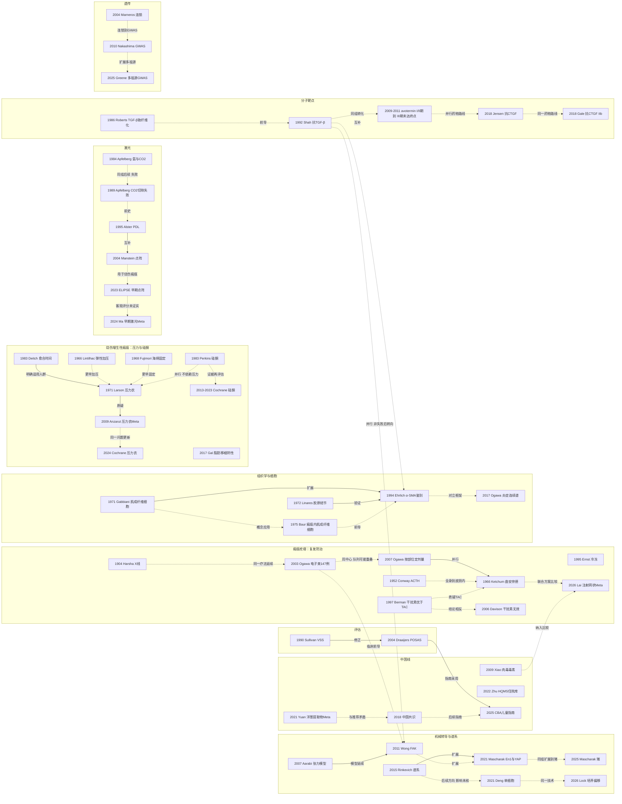

# D09 病理性瘢痕（增生性瘢痕与瘢痕疙瘩）

> **一句话判断**：这个方向研究烧伤和手术后为什么有人长出增生性瘢痕或瘢痕疙瘩，以及怎么量、怎么防、怎么治。放疗（1903 年已有学会记录）、激素注射（1950 年代起）、加压（1966 年已有报告）、硅酮（1983）、激光和联合注射先后加入后一直并存，没有哪一种被后来者取代；机制上组织学、TGF-β、机械力、成纤维细胞谱系几种解释也同时在用，现在的重心是单细胞组学、猪模型上的机械转导抑制、注射方案网状 Meta 和早期激光，多数仍停在小样本或动物阶段。**对临床医生最重要的一点**：最常用的压力衣和硅酮，在 Cochrane 系统评价里的证据确定性都是"极低"或"很有限"（压力衣 15 项研究 1,179 人，全部比较为极低确定性，检索至 2023-06-08；硅酮最新版检索至 2021-12）[D09-E06][D09-E08]；本轮按这两个截止日补查到 2026-09-29，新增的原始 RCT 样本都不大（摘要可见的最大为 153 人）、结果不一致，没有一项比较穿与不穿压力衣（见 4.5），而 TGF-β3 与抗 CTGF 两条药物路线在 II/III 期都没能稳定证明疗效 [D09-N08][D09-N36]。另需注意：烧伤增生性瘢痕线的起点（Larson 1971 压力衣、Linares 1972 组织学）原文未读，这一段依赖综述转述。

## 0 三分钟速读

1. **从哪里来**：两个源头互不相干。瘢痕疙瘩一侧，keloid 一词本轮找到的最早文献是 Addison 1854 [D09-E11]，最早找到的治疗记录是 1903 年芝加哥外科学会例会上 Harsha 报告的 X 线照射（约 1901 年开始）[D09-N19]。烧伤增生性瘢痕一侧，1966、1968 年已有加压或固定的报告 [D09-N21][D09-N22]，本轮找到的早期系统工作集中在 1971–1975 年 Galveston 的 Shriners 烧伤研究所（压力衣、组织学、肌成纤维细胞）[D09-N03][D09-N04][D09-N23]（Larson 1971、Linares 1972 原文未读：压力衣内容据 Cochrane 2024 与 Finnerty 2016 转述，组织学内容据 Ehrlich 1994 的引用）。
2. **为什么改变**：认识的改变主要来自新工具和新证据，不是一种疗法淘汰另一种。1990 年 VSS 量表提供了共同终点 [D09-N07]；1994 年 α-SMA 免疫组化把两种病变分开（瘢痕疙瘩 15/17 为阴性）[D09-N09]；2009 年压力衣 Meta 分析显示整体瘢痕评分无差异 [D09-N14]；2011 年 TGF-β3 欧洲 III 期未达终点 [D09-N08]。
3. **如何分化**：本报告归纳为两套证据体系：烧伤增生性瘢痕以压力、硅酮、激光和评估量表为主，瘢痕疙瘩以皮损内注射、术后放疗和遗传学为主。机制上组织学、细胞因子、机械转导、谱系/单细胞四种框架并行；机械线的临床观察（2003）和动物模型（2007）都早于 TGF-β3 失败（2011），不是"失败后转向"[D09-N29][D09-N32]。
4. **现在研究什么**：单细胞与空间转录组拆分成纤维细胞亚群，但传代培养后疾病特征只部分保留 [D09-R04]；猪模型上单次维替泊芬防瘢痕 [D09-R06]；早期激光（儿童 Meta：<12 个月 SMD −1.97，>12 个月 −0.59）[D09-R10]；注射方案网状 Meta（24 项 RCT，TAC+5-FU 最稳定）[D09-R11]；多祖源 GWAS（26 个位点）[D09-R13]。
5. **用了什么数据**：活检组织学（Ehrlich 59 份活检）、大鼠/小鼠/猪模型、单中心病例系列，本方向常用的半瘢痕或同一创面自身对照试验（列出的几项多为 10–20 人），Cochrane 系统评价，百万级对照 GWAS，以及中国 HQMS 住院库（1,064 家三级医院，177,586 例瘢痕住院）[D09-R20]。
6. **还不知道什么**：压力衣和硅酮到底有多大效果。系统评价层面的证据截至 2023-06-08（压力衣）和 2021-12（硅酮，瘢痕疙瘩版；增生性瘢痕版截至 2021-04）；此后到 2026-09-29，本轮在 PubMed 与 Europe PMC 补查到压力衣 RCT 4 项（都是比较加压方式或急性期加压，没有一项比较穿与不穿）[D09-R39]–[D09-R42]，涉及硅酮的 RCT 18 项（直接比较硅酮与不用硅酮或安慰剂的只有 5 项：1 项阳性、1 项阴性、1 项 VSS 有差而 POSAS 无差且作者判为无临床改善、1 项只在 6 周色素上有差异、1 项未报告硅酮组与不治疗组的比较）[D09-R21]–[D09-R38]，摘要可见的样本最大为 153 人，只读摘要、未做偏倚评价与合并（见 4.5）；瘢痕疙瘩术后放疗、激素、干扰素缺高质量 RCT，且两项 TAC/干扰素比较结论相反 [D09-N28][D09-N31]；按 Tai 2021 综述，尚无获批的抗瘢痕疗法 [D09-E09]；机械转导抑制没有人体试验；瘢痕疙瘩与增生性瘢痕是两种病还是同一炎症谱，仍无定论 [D09-N09][D09-E04]。

**覆盖边界**：
- 纳入：病理性瘢痕的鉴别、组织学与细胞学（胶原结节、肌成纤维细胞）、分子与机械机制（TGF-β、CTGF、机械转导、成纤维细胞谱系与单细胞）、遗传；评估量表；非手术防治（压力、硅酮、激素、5-FU、干扰素、放疗、冷冻、激光、肉毒毒素、脂肪移植、洋葱提取物、生物制剂）及指南共识。
- 不含：挛缩的手术松解与重建（Z 成形、皮瓣、扩张）交给 D11；康复中的挛缩预防、夹板、按摩交给 D10；创面愈合基础生物学（胎儿无瘢痕愈合、筋膜来源成纤维细胞）交给 D08，只在机制处点到；中国学科形成史交给 X01。

**本章口径**：
- 报告截止/执行日 2026-09-29；近期重点窗口 2021-09-29 至 2026-09-29，只用于第 4 节，不限制历史追溯。窗口归属按 PubMed 记录的首次在线日期判断（本轮已核）。
- 阅读层级：L0=仅二手转述；L1=题录已在数据库核实；L2=摘要已读；L3=原文部分章节已读；L4=全文已读。只到 L0/L1 的，正文写"据某来源转述"或"仅题录"。
- 核查状态：**通过**=对照 PubMed/Crossref 题录、摘要或 PMC 原文核对一致（本轮补入的文献按补入时所读层级记为通过；本章涉及的 PMID 本轮都用 PubMed 记录统一复核过作者、题名、期刊和卷页）；**修正**=核对后改正了起点说法、作者、关系依据或影响判断，正文只用改正后的说法；**存疑**=依据不足或未能独立复核，保留但标注。
- 本章关键节点 37 个：L1 7 个（N20、N01、N21、N22、N02、N03、N04，均为"要素不全"：只有题录，没有可读摘要），L2 26 个，L3 3 个（N09、N16、N18），L4 1 个（N19，仅限 p.454 的 Harsha 病例段）。1966–1972 年的四个奠基节点（N01–N04）都只到 L1（不在 PMC，属付费存档），内容依赖综述转述；第二轮尝试取 Larson 1971、Linares 1972 原文未成（见 8.2 第 1 条）。另有附属证据 23 行（挂在所属节点编号下，例如 N08 下的 avotermin 各期试验）、近期代表研究 42 条（R01、R02、R08、R21、R27 在线日期早于窗口，只作背景；R21–R42 为第二轮按 Cochrane 截止日补查的硅酮与压力衣原始 RCT）、入口综述/指南 15 条。全部 117 行见 `data/evidence_D09.json`。
- 覆盖状态：**基本完整但有标注缺口**（2026-09-29 第二轮完整性检查后按全报告统一口径重评）。理由：①六个问题都能据本章回答——从哪里来（第 1 节，烧伤线起点据 Cochrane 2024、Finnerty 2016 转述并已标明）、为什么改变（第 2 节）、如何分化（第 2、3 节）、现在研究什么（第 4 节，压力衣与硅酮已按 Cochrane 检索截止日补查原始 RCT）、用了什么数据（第 7 节）、还有什么不知道（第 8 节）；②覆盖边界内的主要分支（放疗、激素与注射、干扰素、冷冻、压力衣、硅酮、激光、评估量表、组织学与细胞、TGF-β 与 CTGF、机械转导与谱系、遗传、免疫与生物制剂、中国线）都有节点；③主链关键转折都有可核实来源：烧伤压力衣起点与 TGF-β3 III 期失败虽然没有读到原始文献，但分别据 Cochrane 2024、Finnerty 2016、Arno 2014、Tai 2021（均为 L3）转述，其余转折节点到摘要层或以上。缺口限于第 8.2 节已标注的项目：7 个奠基节点只有题录；CNKI、万方、CENTRAL 和试验注册库未查；注射方案与激光时机两个主题的窗口内原始 RCT 未系统补查；补查到的硅酮与压力衣 RCT 只读摘要、未做偏倚评价。所以不降为"部分"。
- 引用写法：[D09-Nxx]=关键节点（含其附属证据）；[D09-Rxx]=近期代表研究；[D09-Exx]=入口综述/指南；只出现一次的辅助文献直接给 PMID 或 DOI。

---

## 1 源头：最初在研究什么

**判断**：最早的问题是两件具体的临床事：瘢痕疙瘩切了又长怎么办；大面积烧伤活下来的人瘢痕增生、挛缩怎么办。前者 19 世纪中叶已有专门讨论，20 世纪初开始试放射；后者本轮找到的报告从 1966 年开始，集中出现在 1970 年代初。

下表的"目前最早找到"只代表本轮在 PubMed、OpenAlex、Europe PMC 能查到的最早记录（1945 年前 PubMed 收录不全，非英语文献覆盖差）；"被公认的奠基工作"表示有入口综述明确这样定位，但它不一定是最早的，压力衣就是例子。

| 说法 | 分类 | 依据与限定 | 层级 |
|---|---|---|---|
| keloid 术语：Addison 1854 [D09-E11] | 目前最早找到的文献 | 标题检索的最早记录；p.27 称 keloid 最初由 Alibert 描述，并另提一种"真 keloid"。Alibert 原文未找到；p.27 复核时 PMC 出现验证页，未能再读，**存疑** | L3（存疑） |
| X 线治疗瘢痕疙瘩：Harsha 1903 [D09-N19] | 目前最早找到的书面记录 | 1903-12-07 芝加哥外科学会例会记录（Ann Surg 1904 刊出，p.454）：18 岁男性耳后瘢痕疙瘩多次切除后复发，约 2 年前开始 X 线照射，已缩至不足原来的 1/6；讨论者 Ochsner 说已在多例中使用，所以这不是"首次使用"。后续记录有 Sequeira 1909（PMC2046943）、Taussig 1923 镭治疗（Cal State J Med 21:520）；Ogawa 2009 摘要称瘢痕疙瘩放疗已有百余年 [D09-N13] | L4（仅 p.454 该段） |
| 激素：Conway & Stark 1952 全身 ACTH [D09-N20] | 目前最早找到的文献 | 1953 年 Degos、Coste 报告皮损局部注射氢化可的松（PMID 13115885、13115886），Clarkson 1953 报告可的松辅助手术（PMID 13045452），Asboe-Hansen 1955 局部注射（PMID 13281962）；曲安奈德（TAC）有 Murray 1963 PRS（PMID 13936787）、Maguire 1965 JAMA（PMID 14271986）、1966 年 PRS 同期 Griffith 与 Ketchum [D09-N01]。1945 年前未检索 | L1（要素不全：仅题录） |
| 加压防治烧伤增生性瘢痕：Larson 1971 [D09-N03] | 被公认的奠基工作（限"现代烧伤压力衣"） | Finnerty 2016 写"Since the 1970s"并引 Larson 1971 [D09-E03]；Cochrane 2024 背景称起源于 1970 年代美国一家烧伤中心 [D09-E06]。更早已有 Lintilhac 1966 法语报告（持续弹性加压预防增生性瘢痕）[D09-N21] 和 Fujimori 1968 PRS 海绵固定法 [D09-N22]，都只核了题录；Linares 1993 的压力治疗史（PMID 8435111）未读；Larson 1971 原文未读，本行内容据综述转述 | L1（要素不全：仅题录） |
| 硅酮凝胶片：Perkins 1983 [D09-N06] | 存在争议的首次 | 1960–1986 年检索未见更早的硅酮凝胶片治瘢痕报告（1964–1967 年硅油浸泡治急性烧伤、1977 年液体硅酮注射属于不同疗法）；Cochrane 2013 摘要说"始于 1981 年"，原始出处未找到，两说并存 [D09-E08] | L2 |
| 肌成纤维细胞：Gabbiani 1971 [D09-N02] | 被公认的奠基工作 | 据 Tai 2021 [D09-E09] 转述；同组同年还有 Majno 1971 Science（PMID 4327529）。在增生性瘢痕中报告肌成纤维细胞的早期文献是 Baur 1975 [D09-N23]，是否最早未系统检索 | L1（要素不全：仅题录） |
| 胶原结节与两种瘢痕的组织学鉴别 | 存在争议的首次 | Ehrlich 1994 描述结节时同时引 Glucksmann 1951（PMID 14858797）、Blackburn & Cosman 1966（题名：瘢痕疙瘩与增生性瘢痕鉴别的组织学基础，PMID 5938452）和 Linares 1972 [D09-N04]，三篇只核题录。两者"临床上怎么区分"的概念来源，候选文献 Peacock 1970（PMID 5427162）题录已核、内容未读，不能当作定义出处 | L1（要素不全：仅题录） |
| 激光治疗瘢痕疙瘩：Apfelberg 1984 [D09-N24] | 目前最早找到的文献（限 1975–1995 年题名检索） | 同年还有 Henderson 1984（氩/CO2，PMID 6427540）、Abergel 1984（Nd:YAG，PMID 6390045），只核题录；这条剥脱切除路线后来有失败报告 [D09-N26] | L2 |
| TGF-β 作为瘢痕靶点 | 代表性早期工作，不标"首次" | Roberts 1986：新生小鼠皮下注射 TGF-β（<1 µg）2–3 天内形成肉芽组织 [D09-N25]（第二轮读摘要，L2）；Shah 1992 用中和抗体减少成年大鼠伤口瘢痕 [D09-N08] | L2 |
| VSS：Sullivan 1990 [D09-N07] | 被公认的奠基工作 | Baryza 1995 摘要称其"常被称为 Vancouver Scar Scale"（PMID 8537427） | L2 |
| POSAS：Draaijers 2004 [D09-N11] | 作者自称首次 | 摘要自称"newly developed" | L2 |
| 点阵光热解：Manstein 2004 [D09-N12] | 作者自称首次 | 摘要"We introduce… a new concept"；原研究对象是光老化皮肤，不是瘢痕 | L2 |
| 瘢痕疙瘩 GWAS：Nakashima 2010 [D09-N15] | 目前最早找到的文献（限病例对照 GWAS） | 更早有 Marneros 2004 家系全基因组连锁扫描（2q23、7p11）[D09-N30] 和 Yan 2007 中国家系连锁分析（PMID 17393690） | L2 |
| 激素与放疗防复发的随机比较：Sclafani 1996 | 作者自称首次 | 摘要称"first randomized, prospective trial"；共治疗 31 个耳垂瘢痕疙瘩，差异无统计学意义 [D09-N13] | L2 |
| 术后减张装置的 I 级证据：Longaker 2014 | 作者自称首次 | 开放标签、半切口对照，65 人随机、36 人完成 12 个月评估；同一摘要中期刊标注的证据等级是 Therapeutic II，与作者自称的 I 级不一致 [D09-N16] | L2 |

---

## 2 关键转折：问题—新证据/新方法—认识变化—新问题

以下按问题组织。九条线的起点从 1903 年到 2015 年交错出现，彼此并行，不是一条接一条的接力。

### 2.1 瘢痕疙瘩切了又长：放疗、激素、干扰素、冷冻长期并存（1903–2017）

- **最早的对策是照射**。Harsha 1903 的病例是多次切除后复发才改用 X 线 [D09-N19]。这条线一直没有中断：Ogawa 2003 报告 1988–2000 年术后电子束 15 Gy 治疗 129 人/147 个病灶，总复发 32.7%，高张力部位 41.1%、非高张力部位 13.5%（p=0.0017）[D09-N29]；同中心 Ogawa 2007 改为按部位定剂量（高风险部位 20 Gy/4 次/4 天，耳垂 10 Gy/2 次/2 天），总复发从 29.3%（2002 年前）降到 14.0%（2003 年后）[D09-N13]。关系：同一中心的**扩展与修正**。两点限制：2007 年用的是历史对照，不是随机；其 2002 年前 15 Gy 组（218 人/249 个部位）与 2003 年报告的时间段、方案重叠，**极可能含同一批患者**（本报告推断，原文未核），不能当两项独立证据。
- **1950 年代加入激素**。先是全身 ACTH [D09-N20]，1953 年起局部注射氢化可的松，1963–1966 年多篇报告曲安奈德皮损内注射。Ketchum 1966 [D09-N01] 原文未读，只能说它是 1966 年 PRS 同期两篇 TAC 报告之一，不是 TAC 进入整形外科的起点（Murray 1963 已在 PRS 发表）。到 2002 年，国际建议把皮损内激素和硅酮凝胶片列为仅有的两种证据足以给出建议的疗法 [D09-E01]。
- **TAC 能不能减少术后复发，两项比较结论相反**（**质疑**，两说保留）。Berman 1997：单纯切除复发 22/43（51.1%），术后 TAC 38/65（58.4%），术后干扰素 α-2b 3/16（18.7%），p=0.025，作者认为 TAC 不减少复发 [D09-N28]。Davison 2006 前瞻比较 34 人/39 个瘢痕疙瘩：干扰素组 7/13（54%）复发，TAC 组 4/26（15%），试验在中期终止 [D09-N31]。TAC 的副作用也有记录：Manuskiatti 2002 配对随机 10 例胸骨切口瘢痕，单用 TAC 的节段 5/10 出现萎缩、色素减退或毛细血管扩张，各疗法疗效无显著差异 [D09-N01]。
- **5-FU 与联合注射**：Fitzpatrick 1999 报告皮损内 5-FU 的经验（PMID 10193972）；2014 年国际更新写到 5-FU 作用增大、瘢痕疙瘩更早使用 5-FU [D09-E02]；2026 年两项网状 Meta 支持 TAC+5-FU（见 4.4）。
- **放疗与激素正面比较很少**。Sclafani 1996 随机比较：放疗组 2/16（12.5%）、激素组 4/12（33%）复发，差异不显著 [D09-N13]。Mankowski 2017 Meta（72 项研究/9,048 个瘢痕疙瘩）：术后放疗复发 22%，单纯放疗 37%，近距离放疗 15%；是否剔除同一中心的重复报告（如上面的 Ogawa 系列）本轮未核 [D09-N13]。安全性上，Ogawa 2009 在文献中找到 5 例与瘢痕疙瘩放疗相关的致癌病例，约 80% 放疗科医生认为可以接受 [D09-N13]。
- **冷冻是一条并行分支**：Ernst & Hundeiker 1995 报告 394 名患者的液氮冷冻结果，瘢痕疙瘩 336 例中 64%、增生性瘢痕 58 例中 82% 完全或部分成功；作者主张瘢痕疙瘩首选冷冻，增生性瘢痕因几乎都会在数年内自行消退，只在例外情况下冷冻。Har-Shai 2003 用皮损内冷冻针治疗 10 名患者的 12 处增生性瘢痕和瘢痕疙瘩，单次治疗后体积平均缩小 51.4%，随访 18 个月 [D09-N27]。两篇都是无对照病例系列，只读了摘要。
- **认识变化**：没有哪种辅助疗法胜出。中国 2018 共识把成人术后放疗列为一线、皮损内 5-FU 列为注射首选 [D09-E05]；中国 2025 儿童指南则把放疗留给常规治疗无效者 [D09-E07]。**新问题**：各方案之间的相对效果和复发控制（见 4.4）。

### 2.2 烧伤增生性瘢痕：压力衣从"默认有效"到"疗效未证实"（1966–2024）

- **问题规模**：Finnerty 2016 称烧伤后增生性瘢痕发生率最高可达 70% [D09-E03]。
- **起点**：1966 年 Lintilhac、1968 年 Fujimori 已有加压或固定的报告 [D09-N21][D09-N22]；1971 年 Galveston 的 Larson 等（作者单位据 OpenAlex 核实为 Shriners Burns Institute/UTMB）被公认为现代压力衣的起点 [D09-N03]。据 Cochrane 2024 背景：这种做法起源于 1970 年代美国一家烧伤中心，重度烧伤患者使用后瘢痕"立即改善"，但没有对照试验；此后在缺乏设计良好试验的情况下推广到几乎所有烧伤中心，并受到商业化推动（引 Linares 1993）[D09-E06]。据 Finnerty 2016 转述，压力被认为通过减少血流、调节胶原重塑起作用 [D09-E03]。
- **谁需要压力衣**（**明确适用边界**，综述归纳）：Deitch 1983 前瞻随访 100 人/245 个烧伤部位 9–18 个月，26% 的部位形成增生性瘢痕；14–21 天愈合者约 1/3 增生，超过 21 天愈合者 78% 增生，年龄无关 [D09-N05]。分析单位是部位，同一患者的多个部位不独立。Finnerty 2016 写道现行做法是愈合超过 3 周者穿压力衣，并转述 Cubison 2006（>500 例儿童烫伤）的临界在 21–25 天 [D09-E03]。
- **质疑**：Anzarut 2009 Meta（6 项试验/316 人，含 1 项未发表试验）：整体瘢痕评分 WMD −0.46（95% CI −1.07 至 0.16），高度 SMD −0.31（−0.63 至 0.00），血管、柔韧度、颜色无差异 [D09-N14]。
- **部分支持**：Engrav 2010 在同一创面内随机（研究持续 12 年），正常压力比低压力更软、更薄，但只在中重度瘢痕中有临床意义；样本 67 人据 Finnerty 2016 转述 [D09-N14]。
- **做确定性试验的难处**：PEGASUS 2018 可行性 RCT 88 人，同意率 47%，摘要给出英国压力衣花费约 £2.17M，医护人员缺乏 equipoise [D09-N14]。
- **现状**：Cochrane 2024（检索至 2023-06-08）纳入 15 项研究/1,179 人，各比较均为极低确定性，证据不足以推荐压力衣或替代方案，可让患者偏好指导选择；背景还指出完整效果约需 18 个月才显现 [D09-E06]。
- **硅酮是并行的另一条线**：Perkins 1983 给 42 名烧伤患者用硅酮凝胶片，作者报告全部成功，并强调其作用不依赖压力，但无对照、无量化指标 [D09-N06]。Cochrane 三版：2013 年 20 项试验/873 人，预防 RR 0.46（0.21–0.98）但高偏倚风险；2021 年增生性瘢痕 13 项（每项 10–60 人）；2023 年瘢痕疙瘩只有 2 项（16 人、20 人）[D09-E08]。
- **认识变化**：压力衣和硅酮仍是标准做法（中国 2018 共识推荐早期联用 [D09-E05]），但证据评级一直很低。**新问题**：确定性大样本 RCT 能否做成。

### 2.3 怎么量：从 VSS 到 POSAS（1990–2025）

- **问题**：没有通用评估方法，中心之间、疗法之间无法比较。Sullivan 1990 提出按色素、血管、柔韧度、高度评分，73 名患者由 3 名作业治疗师评估，各项 Cohen κ 约 0.5±0.1 [D09-N07]。
- **修正**（原文直接比较）：Draaijers 2004 的 POSAS 加入患者量表。20 名患者/49 个 3×3 cm 瘢痕区域/4 名观察者：Cronbach α 患者量表 0.76、观察者量表 0.69、VSS 0.49；单观察者信度 0.73（VSS 0.69）；与 VSS 相关 r=0.89；患者总体评价主要受瘙痒和厚度影响 [D09-N11]。
- **评价**：Tyack 2012 系统评价（29 项研究/18 个量表）中只有 POSAS 在总分信度和血管分量表上获得高质量评级，VSS 的效度、信度、反应度均为"不确定"[D09-N07]。之后有 POSAS 3.0 的定性开发（Carrière 2023，PMID 36914442）和 POSAS 2.0 的最小重要变化研究（Legemate 2024，PMID 38902132），两篇只核题录。中国 2025 儿童指南推荐 VSS 与 POSAS 并用 [D09-E07]。
- **遗留问题**：医生评分和患者评分经常不一致。ELIPSE 试验中 VSS 无差异、患者 POSAS 厚度与质地改善 [D09-R09]；抗 CTGF IIb 期正相反，医生 POSAS 有差异、患者评分无改善 [D09-N36]。以哪个为准，没有定论。

### 2.4 两种病还是一个谱：组织学、肌成纤维细胞与"炎症连续谱"（1951–2021）

- **组织学描述**：Glucksmann 1951、Blackburn & Cosman 1966、Linares 1972 [D09-N04] 描述增生性瘢痕的结节。Ehrlich 1994 引用这三篇时写道：结节内细胞和胶原高度密集，呈雪茄形，沿张力线排列。
- **细胞学概念**：Gabbiani 1971 在肉芽组织中发现胞质含 40–80 Å 微丝、类似平滑肌的成纤维细胞样细胞，命名 myofibroblast，推测其参与伤口收缩（据 Tai 2021 转述）[D09-N02]；Baur 1975 在增生性瘢痕中观察到肌成纤维细胞 [D09-N23]。
- **验证与扩展**（原文明确讨论）：Ehrlich 1994 收集 4 个中心的 59 份活检（正常皮 13、正常瘢痕 7、瘢痕疙瘩 17、增生性瘢痕 22），做偏振光、α-SMA 免疫组化、电镜和细胞培养。α-SMA 阳性肌成纤维细胞**主要见于**增生性瘢痕结节，17 个瘢痕疙瘩中 15 个没有（P<10^-5，按标本做 χ² 检验）；瘢痕疙瘩为粗厚、紧密平行的胶原束，增生性瘢痕结节内是细而随机的纤维；体外培养后两类细胞 α-SMA 表达相近，作者据此认为体内微环境起作用 [D09-N09]。Gabbiani 是共同作者。Ehrlich 讨论 TGF-β1 诱导 α-SMA 时引的是 Desmoulière 1993（J Cell Biol 122:103），不是 Shah 1992，所以两者的"互补"只是本报告推断。
- **对立框架**：Ogawa 2017 认为两者的差异"只是"网状真皮炎症在强度、频率和持续时间上的不同 [D09-E04]。
- **新证据不能直接对比**：Deng CC 2021 单细胞研究中，ACTA2 阳性肌成纤维细胞在瘢痕疙瘩占 26.0%±4.3%，在正常瘢痕占 13.3%±6.4% [D09-R01]。这看起来与 Ehrlich 的"瘢痕疙瘩多为 α-SMA 阴性"方向不同，但一个测蛋白、一个测转录本，对照组也不同（正常瘢痕对增生性瘢痕），不能直接比较。大型数据的病例定义常把两者合并（UK Biobank 研究用"过度瘢痕"，972 例）[D09-R14]。
- **现状**：未解决，两种框架并存，指南仍对两种病变分别给出路径。

### 2.5 分子靶点：TGF-β3 与抗 CTGF 两条药物路线（1986–2018）

- **前导**：Roberts 1986 报告新生小鼠皮下注射 TGF-β 2–3 天内形成肉芽组织，体外促进成纤维细胞胶原合成，作者据此认为 TGF-β 是组织修复的重要介质 [D09-N25]（摘要）；胎儿伤口无瘢痕愈合的系列研究（如 Longaker 1990 第 VI 篇，PMID 2299547，属 D08）也在此前。
- **动物验证**：Shah 1992 在成年大鼠伤口边缘注射 TGF-β 中和抗体，对照伤口全部形成瘢痕，抗体组无瘢痕组织形成，巨噬细胞与血管更少，胶原和纤连蛋白更低，抗张强度相同 [D09-N08]。同组 1995 年报告中和 TGF-β1/β2 或外源添加 TGF-β3 可减少大鼠伤口瘢痕（据题名）[D09-N08]。
- **人体扩展**：同组 Ferguson 2009 报告 3 项 I/II 期试验（健康志愿者 1 cm 切口），avotermin 50 ng 使 VAS 在第 6 个月改善 5 mm（p=0.001）、第 12 个月改善 8 mm（p=0.023）；McCollum 2011（156 例，500 ng，ToScar 差 16.49 mm，p=0.036）；So 2011（60 例瘢痕修整，200 ng，21.93 mm，p=0.04）[D09-N08]。
- **失败**：欧洲 III 期 REVISE 于 2011 年 2 月由 Renovo 公告未达主要和次要终点，公司把原因归于 III 期剂量只有既往试验的一半（据 Arno 2014 [D09-E10] 与 Tai 2021 [D09-E09] 转述，L0；III 期同行评议全文本轮未找到）。
- **并行的第二条药物路线**：抗 CTGF 反义寡核苷酸。Jensen 2018 在 23 名女性乳房瘢痕修整后做受试者内对照，结果阳性，摘要自述其设计假定受试者内变异很小 [D09-N35]。Gale 2018 的 IIb 期（100 人）只在 4 针方案的医生 POSAS 上有差异（0.68，P=0.022），3 针方案 P=0.4，患者评分无改善；作者写修整手术本身的效应约为药物效应的 3 倍 [D09-N36]。另一抗 CTGF 药 RXI-109 有 3 项 II 期登记，2 项已完成但未公布结果（NCT02030275，25 人；NCT02079168，16 人），NCT02246465 状态不明 [D09-N36]。
- **认识变化**：动物有效 → 人体 I/II 期小幅改善 → III 期失败、IIb 疗效不稳定。Tai 2021 称尚无获批的抗瘢痕疗法 [D09-E09]。
- **不能写成"TGF-β 失败后研究转向机械力"**：机械线的临床观察（2003）和动物模型（2007）更早（见 2.6）；TGF-β/SMAD 仍是 2022 年单细胞研究的解释框架之一 [D09-R03]。

### 2.6 张力：从复发部位统计到机械转导通路（2003–2025）

- **临床观察**：Ogawa 2003 的高张力部位复发 41.1% 对非高张力部位 13.5% [D09-N29]。
- **动物模型**：Aarabi 2007（2007-05 在线）在增殖期给小鼠伤口加约 1 周机械负荷，形成的瘢痕持续 6 个月以上，体积和细胞密度约增加 20 倍，凋亡约减少 4 倍，机制是经 Akt 途径减少细胞凋亡（动物数摘要未给）[D09-N32]。
- **分子通路**（方法延续，原文引用 Aarabi 模型）：Wong 2011/2012 在该模型上做成纤维细胞特异性 FAK 敲除，第 10 天瘢痕真皮面积少 69%（P=0.002）、细胞密度少 48%（P<0.001）；通路为 FAK→ERK→MCP-1，MCP-1 敲除小鼠瘢痕极少；人成纤维细胞受牵张 5 分钟内 FAK 激活；局部注射 FAK 抑制剂 PF573228 使瘢痕面积"170% less"（原文表述，P=0.003）[D09-N16]。
- **临床转化**：Longaker 2014 的 embrace 减张装置 RCT（腹部整形半切口对照）12 个月 VAS 2.90 对 3.29（p=0.027）[D09-N16]，限制见第 1 节。
- **与谱系线合并**：Mascharak 2021 显示机械张力经经典机械转导信号激活 En1；伤后第 0 天单次注射 YAP 抑制剂维替泊芬（1 mg/ml）不影响愈合速度，伤口以 En1 阴性细胞为主，第 90 天长出毛囊等附属器样结构、抗张强度恢复；注射 4 次时 En1 阳性细胞几乎耗尽，但伤口闭合延迟 [D09-N18]。FAK 与 YAP 的上下游关系本轮未核原文，Wong→Mascharak 的"扩展"是本报告推断。
- **新问题**：从小鼠松弛皮肤到人。2025 年同组在红色杜洛克猪上验证（见 4.2）[D09-R06]，人体试验尚无；PF573228 未进入临床。

### 2.7 成纤维细胞不是一种细胞：谱系与单细胞（2015–2026）

- Rinkevich 2015 在小鼠背部皮肤用谱系示踪、移植和消融，发现至少两个成纤维细胞谱系，其中单一谱系（后被称为 En1 谱系）负责胚胎发育、伤口愈合、放射纤维化和肿瘤间质中的大部分结缔组织沉积；CD26/DPP4 可作分选标志，抑制其酶活性可减少瘢痕 [D09-N17]。
- Mascharak 2021 以"En1 谱系阳性细胞已知参与瘢痕"为起点，研究 En1 阴性细胞如何转化（原文明确讨论）[D09-N18]。
- 人瘢痕疙瘩的单细胞研究从 2021 年起出现 [D09-R01][D09-R02]，是否直接建立在 Rinkevich 的谱系框架上，本轮未核后续文献的引用。详见 4.1。

### 2.8 激光：从剥脱切除失败到血管靶向与点阵（1984–2025）

- **早期路线失败**：Apfelberg 1984 用氩和 CO2 激光治疗 13 名瘢痕疙瘩患者，只有 1 名耳垂瘢痕疙瘩有效 [D09-N24]；Apfelberg 1989 用 CO2 激光切除 7 名患者的 9 个瘢痕疙瘩，8 个在 10–22 个月内复发 [D09-N26]。
- **血管靶向**：Alster 1994 已报告 585 nm 脉冲染料激光（PDL）改善红斑性和增生性瘢痕（仅题录）；Alster 1995 用半瘢痕自身对照治疗 16 名胸骨切开术后瘢痕，每 6–8 周 1 次共 2 次，治疗侧红斑、高度、纹理和瘙痒显著改善，至少持续 6 个月 [D09-N10]。它是 PDL 路线的代表性对照研究，不是激光治疗瘢痕的起点。Manuskiatti 2002 中 PDL 与 TAC、5-FU、TAC+5-FU 疗效无显著差异，但纹理改善更好 [D09-N01]。
- **点阵**：Manstein 2004 在光老化皮肤上提出点阵光热解（微热损伤区直径 100 µm、深 300 µm，1 天内再上皮化）[D09-N12]。转到烧伤瘢痕：Anderson 2014 的 8 人专家共识称剥脱点阵是"突破"；Hultman 2014 前后对照队列 147 名烧伤患者/415 次治疗，VSS 从 10.43 降到 5.16，25 个月时 3.29，PDL 用于瘙痒/红斑、点阵 CO2 用于僵硬/质地（**互补**）；Douglas 2019 RCT 招募 20 人、19 人完成短期随访，6 周时疼痛与瘙痒改善 [D09-N12]。2014 年国际更新写到激光应用变广 [D09-E02]。
- **解读注意**：Hultman 2014 是前后对照，增生性瘢痕本身也会随时间成熟，这种设计分不清疗效和自然消退。
- **新问题**：什么时候开始打（见 4.3）。

### 2.9 遗传：从家系到百万级对照（2004–2025）

- Marneros 2004 对两个常染色体显性遗传家系做全基因组连锁扫描：日本家系连锁到 2q23（LOD 3.01），非裔美国家系连锁到 7p11（LOD 3.16）[D09-N30]；Yan 2007 做了中国家系连锁分析（PMID 17393690）。
- Nakashima 2010 是本轮找到的首个瘢痕疙瘩病例对照 GWAS：日本人群 824 例/3,205 名对照，1q41、3q22.3-23、15q21.3 三个区域 4 个位点；rs873549 联合 P=5.89×10^-23，OR 1.77；NEDD4 rs8032158 OR 1.51 [D09-N15]。
- 复制与扩展：Zhu F 2013 在中国汉族（714 例/2,944 名对照）复制了 1q41 与 15q21.3（NEDD4 rs2271289）；Velez Edwards 2014 在非裔美国人中用混合定位找到 15q21.2-22.3 [D09-N15]；Greene 2025 多祖源 Meta（7,837 例/1,593,009 名对照）找到 26 个位点 [D09-R13]。

---

## 3 分支图

图例：实线=原文明确讨论或综述归纳；虚线=本报告推断（含同组/同一项目但未核原文引用的情形）；边上写关系类型。节点写"年份 简称"。AV 为 N08 下的附属证据（avotermin 各期试验）。

几条边的依据：N05→N03 依据 Finnerty 2016 把愈合时间与压力衣适用对象相连（Deitch 摘要本身没有点名 Larson）；N13→N01 依据 Sclafani 1996 的随机比较；N10→N12 依据 Hultman 2014 与中国 2018 共识的按症状分工；N32→N16 是 Wong 2011 明确使用 Aarabi 的模型。R20 单列，与其他节点无引用关系。

---

## 4 近五年重点（2021-09-29 至 2026-09-29）

### 4.1 单细胞与空间转录组：成纤维细胞和血管细胞亚群

- **研究什么**：瘢痕疙瘩里哪些成纤维细胞亚群扩增、成纤维细胞与内皮细胞如何相互作用、体外培养能否保留疾病特征。
- **数据与设计**：手术切除的瘢痕疙瘩与相邻正常组织或非皮损真皮配对；scRNA-seq、空间转录组（Visium、Xenium）、多重免疫荧光。多数摘要未给出患者数。
- **代表研究**：窗口前导两篇——Deng CC 2021（在线 2021-06-17，40,655 个细胞，间充质成纤维细胞增多）[D09-R01]、Liu X 2022（在线 2021-07-07，28,064 个细胞，21 个簇/11 个谱系，成纤维细胞与血管内皮亚群扩增，TWIST1 抑制剂 harmine 抑制瘢痕疙瘩成纤维细胞纤维化）[D09-R02]。窗口内：Shim 2022（scRNA-seq+空间转录组，疾病相关成纤维细胞富集于瘢痕疙瘩深部、靠近内皮信号区，内皮细胞呈间充质激活，涉及 TGF-β/SMAD 失调）[D09-R03]；Lock 2026（患者配对 scRNA-seq 与传代 4 次以上的培养细胞比较，培养后亚群趋同，瘢痕疙瘩特征只部分保留）[D09-R04]；Deng M 2026（Xenium，题名：间充质成纤维细胞扩增与保守的纤维化 ECM 程序；PMC 有全文 PMC13570645，本轮未读）[D09-R05]。
- **分歧**：三篇摘要对扩增亚群的叫法各不相同（间充质成纤维细胞、谱系特异性改变、疾病相关成纤维细胞），能否对应同一群细胞本轮未核；Lock 2026 对以传代细胞为模型的传统做法提出质疑。
- **成熟度**：发展中，以描述为主。

### 4.2 机械转导抑制：从小鼠到大动物

- **研究什么**：阻断 YAP 等机械信号能否在接近人皮肤的模型上实现无瘢痕愈合。
- **数据与设计**：红色杜洛克猪伤口、人皮肤异种移植、材料学递送。
- **代表研究**：Mascharak 2025：猪伤口单次维替泊芬即可防止瘢痕并促进再生，人皮肤异种移植模型验证，并鉴定出 YAP/IL-33 信号轴 [D09-R06]。Wang P 2024（在线 2023-12-12）：维替泊芬生物黏附纳米颗粒预防增生性瘢痕，仅核题录（复核时所见摘要为大鼠尾模型）[D09-R07]。
- **分歧**：尚无人体试验；多次给药会延迟愈合 [D09-N18]；唯一的减张装置 RCT（2014，窗口前）是开放标签，作者自称的证据等级与期刊标注不一致 [D09-N16]。
- **成熟度**：早期线索。

### 4.3 激光：介入时机

- **研究什么**：伤后早期（<3 个月或 <12 个月）打点阵 CO2 或 PDL 是否优于晚期。
- **数据与设计**：同一患者不同瘢痕区域的自身对照 RCT、Meta、GRADE 指南。
- **代表研究**：本主题窗口内的原始 RCT 以 ELIPSE（Lewis 2023）为代表（激光时机主题的窗口内 RCT 未系统补查；4.5 的硅酮补查中顺带见到术后早期激光加硅酮的 RCT，如 Zhang B 2022 [D09-R28]）：15 名成人伤后约 3 个月的烧伤瘢痕，自身对照随机；VSS、红斑、色素无显著差异，患者 POSAS 厚度与质地改善，盲法照片评价更好，RNA-seq 显示成纤维细胞转录改变至少持续 3 个月 [D09-R09]。Ma 2024 儿童 Meta（检索至 2022-05，7 项研究/467 人）：<12 个月早期激光 SMD −1.97（−3.08 至 −0.87），>12 个月 −0.59；非剥脱激光最优；间隔 <4 周更好 [D09-R10]。中国 2025 儿童指南推荐创伤愈合后 1–2 周、烧伤愈合后 2 周、植皮后 2–4 周开始激光（证据低），低能量点阵 CO2 治疗有痛痒的增厚瘢痕（强推荐，证据高）[D09-E07]。窗口前背景：Waibel 2020（19 名伤后 <3 个月患者，MSS 改善 63%，摘要称挑战了"等 1 年再治疗"的做法）[D09-R08]。
- **分歧**：Meta 与指南偏向早期，但 ELIPSE 的客观评分无差异；参数和间隔不统一。
- **成熟度**：发展中，确定性低。

### 4.4 皮损内注射方案比较与肉毒毒素

- **研究什么**：TAC、5-FU、TAC+5-FU、A 型肉毒毒素、维拉帕米等的相对疗效和复发。
- **数据与设计**：网状 Meta。本主题窗口内的原始 RCT **未补查**（第二轮补查只覆盖硅酮与压力衣，不能读成窗口内没有注射 RCT）；两项 NMA 底层试验的来源和样本量本轮未提取。硅酮补查中顺带找到 1 项以硅酮敷料为对照的注射试验：Ren 2026 单中心 RCT（105 名甲状腺切除术患者，硅酮/IPL+点阵 CO2/A 型肉毒毒素三组），12 个月时肉毒毒素组与激光组 POSAS、mVSS 均优于硅酮组，两治疗组无差异，色度与三维成像无差异 [D09-R37]（L2）。
- **代表研究**：Lai 2026（检索至 2025-05，只纳入 RCT，24 项，对象含增生性瘢痕与瘢痕疙瘩）：TAC+5-FU 在疗效和控制复发上最稳定，肉毒毒素反应率排第一但未降低复发，维拉帕米疗效低于 TAC [D09-R11]。Sanchez Cruz 2026（检索至 2025-07，PROSPERO 注册，含非随机研究，51 项/3,234 人/23 种干预）：5-FU+激素相比单用激素 RR 1.59（1.31–1.92），各干预之间复发无显著差异 [D09-R12]。
- **分歧**：两项 NMA 对复发的结论不一致，纳入标准不同（是否只纳入 RCT）。
- **成熟度**：发展中。

### 4.5 压力衣与硅酮的证据再评估

- **研究什么**：最常用的两种物理疗法到底有没有效。
- **数据与设计**：Cochrane 系统评价，加上第二轮按各评价检索截止日补查的原始 RCT（只读摘要，L2；未做偏倚评价，未合并）。
- **系统评价**：Cochrane 2024 压力衣（检索至 2023-06-08，15 项研究/1,179 人，全部极低确定性）[D09-E06]；Cochrane 硅酮三版，最新的 2023 年瘢痕疙瘩版检索至 2021-12（仅 2 项研究，16 人与 20 人），2021 年增生性瘢痕版检索至 2021-04 [D09-E08]。
- **补查方法**（2026-09-29 执行）：
  - 硅酮，PubMed：`(silicone[tiab] AND (scar[tiab] OR scars[tiab] OR keloid*[tiab] OR cicatri*[tiab])) AND randomized controlled trial[pt] AND 2021/12/01:2026/09/29[dp]`，命中 16 条，纳入 13 条；同样主题词改用 `random*[tiab]`、排除已标 RCT 和综述类，命中 14 条，纳入 3 条；为补上增生性瘢痕版的截止差（2021-04 至 2021-11），用 `(randomized controlled trial[pt] OR random*[tiab])` 检索 2021/04/01:2021/11/30，命中 6 条，新纳入 2 条（Pangkanon 2021 在线日期 2021-01，早于截止，未纳入）。Europe PMC 同主题（2021-12-01 起，排除综述）命中 29 条，没有新的已索引 RCT，另见 1 条会议摘要（Burke 2025，硅酮胶带用于腹部供区瘢痕，无 PMID，未纳入）。
  - 压力衣，PubMed：`((pressure garment*[tiab] OR pressure therapy[tiab] OR pressure garment therapy[tiab] OR compression garment*[tiab] OR compression therapy[tiab] OR compression[tiab]) AND (scar[tiab] OR scars[tiab] OR burn*[tiab] OR keloid*[tiab])) AND randomized controlled trial[pt] AND 2023/06/08:2026/09/29[dp]`，命中 7 条，纳入 4 条（排除切口负压、眼睑术后加压敷料、静脉曲张各 1 条）；改用 `random*[tiab]` 的补充检索命中 7 条，纳入 0 条（负压创面治疗、静脉溃疡、试验方案等）。Europe PMC 同主题命中 9 条，没有新的原始试验；其中有一项压力治疗单用及联合硅酮预防增生性瘢痕的 Meta（Zhang P 2023，PMID 37648929），只核题录。
  - 未查 CENTRAL、试验注册库和中文数据库。排除的记录包括：乳房假体、创面愈合用硅酮泡沫敷料、指尖损伤指套、小鼠实验、观察性研究、试验方案、读者来信和系统评价（硅酮加激光 Meta，Xie 2026，PMID 42603050，只核题录）。另见 1 条撤稿声明：Surakunprapha 2020 年 Heliyon 上的硅酮凝胶加草药对安慰剂预防胸骨前增生性瘢痕 RCT 已于 2025 年撤稿（撤稿声明 PMID 41215914），该试验是否曾被 Cochrane 纳入未核。
- **补查结果：压力衣**（Cochrane 2024 截止后 4 项，没有一项比较穿与不穿压力衣）：

| 编号 | 研究 | 设计与样本 | 比较 | 主要结果（摘要） |
|---|---|---|---|---|
| R39 | Hwang 2024 Burns（PMID 38937166） | 单盲 RCT，12 名面部烧伤住院患者/48 处瘢痕，12 周 | 带压力传感器的定制 3D 加压面罩（15–25 mmHg）对 对照组（处理摘要未写明） | 面罩组瘢痕厚度下降（p=0.010），VSS 柔韧度与高度、POSAS 多个分项更好；样本以瘢痕计，同一患者多处瘢痕可能不独立 |
| R40 | Xu J 2026 Adv Wound Care（PMID 40068120） | RCT，82 名关节周围增生性瘢痕患者（41/41），6 个月；另有巴马猪模型 | 压力监测指导下的压力衣 对 常规压力衣 | 监测组厚度为初始的 47.76%，比对照多减少 11.33%；VSS 6.44 对 7.33 |
| R41 | Albuquerque 2025 J Burn Care Res（PMID 39188050） | 单盲随机试点，22 名深度烧伤后增生性瘢痕患者（11/11），90 天 | 肌效贴最大张力 对 无张力 | VSS 两组相近，最大张力无额外改善 |
| R42 | da Silva Mendes 2026 J Burn Care Res（PMID 41674156） | RCT，32 名成人/40 只急性手部烧伤 | 伤后早期 8 mmHg 加压+标准护理 对 标准护理 | 被动活动度、握力、水肿更好；**未测瘢痕结局** |

- **补查结果：硅酮**（Cochrane 截止后 18 项，按比较对象分组；R21、R27 在线日期早于近期窗口，只作背景）：

| 比较类型 | 研究 | 设计与样本 | 主要结果（摘要） |
|---|---|---|---|
| 硅酮 对 不用硅酮或安慰剂 | Karanfilian 2025（PMID 39946309）[D09-R24] | 双盲受试者内对照，96 人/192 个眼睑，凡士林为安慰剂 | 任一结局、任一时间点均无差异（阴性） |
| 同上 | Shamohammadi 2025（PMID 41192060）[D09-R25] | 双盲受试者内对照，34 人，右侧硅酮、左侧凡士林（摘要未描述随机分侧） | 血管、色素、柔韧度、高度、瘙痒硅酮侧更好，疼痛无差异 |
| 同上 | Poelchow 2024 Burns（PMID 38614897）[D09-R23] | 单盲 RCT，55 名面颈部浅二度烧伤，对标准润肤剂，3 个月 | 愈合时间 9 对 7 天（p=0.056）；仅 6 周 mVSS 色素更好（p=0.043） |
| 同上 | Nissen 2022（PMID 35972834）[D09-R26] | 双盲 RCT（硅酮贴下激素对安慰剂）加不护理对照组，拔中心静脉导管的肿瘤患儿，样本摘要未给 | 12 个月贴硅酮组 VSS 更低、瘢痕窄 0.1 cm，POSAS 无差异；作者判为无临床改善 |
| 同上 | Kao 2021（PMID 33966730）[D09-R27] | 三组 RCT，60 名剖宫产女性：不治疗/硅酮/硅酮+rhEGF | 显著差异只报告在 rhEGF 组与另两组之间；硅酮对不治疗未报告 |
| 硅酮 对 压力衣 对 联合 | Wiseman 2021（PMID 34107792）[D09-R21] | 平行三组 RCT，153 名烧伤儿童，12 个月随访 86 人 | 瘢痕厚度与瘙痒三组无差异 |
| 同一试验的经济学评价 | McPhail 2022（PMID 36329128）[D09-R22] | 同上 153 名儿童（本报告推断为同一试验） | 硅酮成本最低（$382.87 对 压力衣 $1,327.02），QALY 无差异 |
| 新疗法 对 硅酮（硅酮作活性对照） | Lim 2024 BJD（PMID 39230675）[D09-R33] | 单盲半瘢痕随机，8 周 | siRNA 微针贴侧体积 8.88 对 12.77 mm³（P=0.005） |
| 同上 | Giri 2026（PMID 42170550）[D09-R36] | RCT，34 人（17/17），皮损内 PRP 对 硅酮产品 | PRP 组 POSAS 组内下降；组间统计量摘要未给 |
| 同上 | Ren 2026（PMID 41882220）[D09-R37] | 三组 RCT，105 名甲状腺切除术患者 | 肉毒毒素与 IPL+点阵 CO2 的 POSAS、mVSS 均优于硅酮敷料 |
| 同上 | Li ZC 2026（PMID 42088054）[D09-R38] | 多中心双盲非劣效 RCT，样本摘要未给 | 维 A 酸乳膏预防增生性瘢痕不劣于硅酮凝胶，风险差 −8.65%（90% CI −23.03 至 5.74） |
| 硅酮加其他 对 单用硅酮 | Zhang B 2022（PMID 35364722）[D09-R28] | RCT，70 人随机/64 人完成，内眦成形术后 | 加 1540 nm 非剥脱点阵激光组 6 个月 POSAS 更好 |
| 同上 | Mohamed 2025（PMID 39891719）[D09-R34] | 随机比较，30 名术后增生性瘢痕 | 加 577 nm 激光组 VSS 改善更大 |
| 同上 | Napavichayanun 2022（PMID 34658139）[D09-R30] | 双盲半瘢痕，剖宫产瘢痕，样本摘要未给 | 含洋葱提取物与含维生素 C 的硅酮凝胶 POSAS、VSS 无差异，仅红斑改善更大 |
| 同上 | Waibel 2021（PMID 34687435）[D09-R31] | 双盲安慰剂对照，42 人入组/32 人完成 | 含 copaiba 油硅酮凝胶 Manchester 量表改善更大；安慰剂凝胶成分摘要未写明 |
| 不同硅酮剂型 | Jiang M 2022（PMID 35852693）[D09-R29] | 评估者盲半瘢痕随机，74 人入组/61 人完成，甲状腺切除术后 | 弹性硅酮贴瘢痕更窄、VSS 更好 |
| 同上 | Ma YK 2023（PMID 37075300）[D09-R32] | 非盲随机，68 人（43/25） | 硅酮棒与硅酮凝胶 VSS 无差异（P=0.635） |
| 同上 | Raghavan 2025（PMID 40182461）[D09-R35] | 鱼缸法分组，10 人，鼻唇沟皮瓣术后 | 硅酮凝胶优于硅酮贴 |

- **怎么读这批试验**：直接回答"硅酮有没有效"的只有第一组 5 项，结论不一致，人群多为手术切口而非烧伤增生性瘢痕或瘢痕疙瘩（这 5 项中唯一的烧伤试验是浅二度烧伤、随访 3 个月）；其余 13 项中，2 项（同一试验）比较硅酮与压力衣，未设不治疗组；11 项把硅酮当作对照、背景治疗或比较不同剂型，说明试验设计者仍把硅酮当作标准对照，但这些试验不能用来证明硅酮本身有效。压力衣方面，窗口内的试验都在研究"怎么加压更准"（传感器、3D 面罩）或加压的替代与延伸（肌效贴、急性期加压），没有回答 Cochrane 2024 提出的"穿不穿"问题。
- **分歧**：临床普遍使用、中国 2018 共识推荐早期联用 [D09-E05]，与系统评价"不确定"的结论之间有张力；Wiseman 2021 三组无差异，而经济学评价显示硅酮最便宜 [D09-R21][D09-R22]。
- **成熟度**：疗法普及，证据质量低。**证据截至**：系统评价层面为 2023-06-08（压力衣）与 2021-12/2021-04（硅酮）；其后到 2026-09-29 的原始 RCT 已在 PubMed 与 Europe PMC 补查，只到摘要层，未做偏倚评价与合并，也未查 CENTRAL、试验注册库和中文库。

### 4.6 遗传与大型生物库

- **研究什么**：多祖源易感位点、遗传度、共病。
- **数据与设计**：GWAS Meta（含百万级对照）、生物库 PheWAS。
- **代表研究**：Greene 2025：7,837 例/1,593,009 名对照，26 个位点，12 个在独立数据集复制，欧洲/东亚/非洲祖源遗传度 6%/21%/34%，指向整合素信号 [D09-R13]。Ung 2023 UK Biobank 230,078 人（972 例过度瘢痕）：与特应性皮炎相关（OR 1.68），黑人参与者中与高血压相关（OR 2.05）[D09-R14]。Dand 2025 欧洲人群 GWAS Meta（仅题录）[D09-R15]。
- **分歧**：基于诊断编码的病例定义可能混合两种瘢痕；同期大量两样本孟德尔随机化研究本轮未计数、未纳入。
- **成熟度**：发展中。

### 4.7 免疫与生物制剂

- **研究什么**：IL-4/IL-13 通路（度普利尤单抗）、JAK-STAT 能否用于瘢痕疙瘩。
- **数据与设计**：病例报告/病例系列的系统评价、患者来源异种移植模型。
- **代表研究**：Bitterman 2024 系统评价（3 篇病例报告+3 个病例系列，共 15 名患者）：有改善、无变化，也有加重，推荐等级 D（检索截止本轮未记录）[D09-R16]。Luk 2022 报告 2 名 17 岁弥漫性瘢痕疙瘩患者，度普利尤单抗治疗 3 个月无改善，其中 1 名加重 [D09-R19]；Tirgan & Uitto 2022（在线 2021-10-02，题名：度普利尤单抗治疗无效）[D09-R18] 只核题录。机制上，Chao 2023 发现瘢痕疙瘩成纤维细胞 IL-13RA2 下调，经 JAK/STAT6 促纤维化，STAT6 抑制剂 AS1517499 可抑制异种移植瘢痕疙瘩 [D09-R17]。
- **分歧**：个案改善与无效/进展报告并存。
- **成熟度**：早期线索。

中国作者的近期工作（HQMS 全国住院库、单细胞）见第 6 节。

---

## 5 争议、负性结果与停滞路线

### 5.1 仍在争的问题

| 争议 | 各方立场与证据 | 现状 |
|---|---|---|
| 瘢痕疙瘩与增生性瘢痕：两种实体，还是同一炎症谱 | Ehrlich 1994：组织学与 α-SMA 显著不同（瘢痕疙瘩 15/17 阴性），但培养后相近 [D09-N09]；Ogawa 2017：差异只是炎症强度、频率、持续时间不同 [D09-E04]；Deng CC 2021 的 ACTA2 比例与免疫组化口径不同，不能直接对比 [D09-R01] | 未解决，两框架并存 |
| 压力衣是否有效 | Anzarut 2009 整体无差异 [D09-N14]；Engrav 2010 仅中重度瘢痕有临床意义 [D09-N14]；Cochrane 2024 全部极低确定性 [D09-E06]；Cochrane 截止后补查到的 4 项 RCT 都不比较穿与不穿 [D09-R39]–[D09-R42]；Wiseman 2021 硅酮、压力衣、联合三组 12 个月无差异 [D09-R21] | 证据不确定，仍是标准做法 |
| 术后 TAC 能否减少瘢痕疙瘩复发，干扰素是否更好 | Berman 1997：TAC 58.4%、干扰素 18.7%、单纯切除 51.1% [D09-N28]；Davison 2006：干扰素 54%、TAC 15%，中期终止 [D09-N31]；Mustoe 2002 把皮损内激素列为证据充分 [D09-E01] | 两说并存 |
| 术后放疗的地位与安全 | 中国 2018 共识：成人一线 [D09-E05]；Ogawa 2009：文献中 5 例相关致癌 [D09-N13]；中国 2025 儿童指南：留给常规治疗无效者 [D09-E07]；随机试验很少（Sclafani 1996 共 31 个 [D09-N13]；另有 Deng K 2021 中国 Sr-90 RCT，31 人/42 个瘢痕疙瘩，PMID 33755674，见第 6 节） | 成人较被接受，儿童仍有顾虑 |
| 5-FU 是否应作注射首选 | 中国 2018 共识推荐 5-FU 为首选 [D09-E05]；2014 国际更新强调 5-FU [D09-E02]；两项 2026 NMA 支持联合方案，对复发结论不一 [D09-R11][D09-R12] | 联合方案趋同，单用 5-FU 是否优于 TAC 未定 |
| 激光介入时机 | Waibel 2020、Ma 2024、中国 2025 指南偏向早期 [D09-R08][D09-R10][D09-E07]；ELIPSE 客观评分无差异 [D09-R09] | 方向偏早期，确定性低 |
| 评估工具 | VSS 使用最广但 α=0.49 [D09-N11]；Tyack 2012 只给 POSAS 部分高质量评级 [D09-N07]；医生与患者评分常不一致 [D09-R09][D09-N36] | POSAS 渐成主流，VSS 仍并用 |
| 洋葱提取物 | 中国 2018 共识推荐 [D09-E05]；Yuan 2021 Meta（13 项 RCT）：与其他常用外用药无差异（研究者评分 P=0.56，患者评分 P=0.39），不良反应和因不耐受退出更多 [D09-N37] | 中国线内部矛盾，未解决 |

### 5.2 负性结果与失败

| 路线 | 发生了什么 | 证据 |
|---|---|---|
| TGF-β3（avotermin）预防性抗瘢痕药 | I/II 期 VAS 改善约 5–22 mm；欧洲 III 期 2011 年 2 月公告未达主要和次要终点 | [D09-N08]；III 期结果据 [D09-E10][D09-E09] 转述，L0 |
| 抗 CTGF 反义寡核苷酸 | IIb 期（100 人）只在一个方案的医生评分上有差异，患者评分无改善；RXI-109 两项已完成的 II 期未公布结果 | [D09-N35][D09-N36] |
| 1980 年代氩/CO2 激光切除瘢痕疙瘩 | 13 人中 1 人有效；CO2 切除 9 个中 8 个复发 | [D09-N24][D09-N26] |
| 干扰素 α-2b | Davison 2006 中期终止（复发 54%），与 Berman 1997 的阳性结果相反 | [D09-N31][D09-N28] |
| 单次自体脂肪移植改善成熟烧伤瘢痕 | 随机双盲安慰剂对照试点，8 名儿童完成，与生理盐水无差异，停止继续入组 | [D09-N34] |
| 度普利尤单抗治疗瘢痕疙瘩 | 15 名患者中有改善、无变化和加重；另有"无效"和"无反应与进展"报告 | [D09-R16][D09-R18][D09-R19] |
| 早期剥脱点阵 CO2 改善客观评分 | ELIPSE 中 VSS、红斑、色素无差异 | [D09-R09] |
| 以传代培养成纤维细胞作瘢痕疙瘩模型 | 传代 4 次以上亚群趋同，疾病特征只部分保留 | [D09-R04] |
| 压力衣作为"已证实"的标准疗法 | 半个世纪常规使用，未得到高确定性证据 | [D09-N14][D09-E06] |
| 硅酮凝胶片 | 三版 Cochrane 均显示研究质量差、样本小 | [D09-E08] |
| 洋葱提取物 | 13 项 RCT 的 Meta 未显示优于其他外用药 | [D09-N37] |

### 5.3 停滞路线

- 局部 FAK 抑制剂 PF573228 停在小鼠实验 [D09-N16]。
- RXI-109 的 II 期登记显示已完成，但没有公布结果 [D09-N36]。
- TGF-β3 III 期之后，本轮没有找到同行评议的 III 期全文 [D09-N08]。
- 维替泊芬从 2021 年小鼠到 2025 年猪，人体试验登记本轮未检索 [D09-N18][D09-R06]。

---

## 6 中国线

**判断**：从英文数据库能看到的部分，中国工作集中在五块：1990 年代中文期刊的临床与细胞研究、2000 年代的 TGF-β/Smad 体外研究、2009 年起的肉毒毒素临床、2013 年的 GWAS 复制，以及 2021 年后的单细胞、全国住院库和指南。中国工作是否改变了国际认识，本轮只做了一次窄检索，**无法判断**。

1. **1990 年代**：本轮补充检索 PubMed 收录的《中华整形烧伤外科杂志》等中文期刊 1975–1996 年瘢痕相关记录共 52 条，例如 Guan 1991 增生性瘢痕患者血、尿羟脯氨酸测定（PMID 1782581）、Shang 1993 瘢痕成纤维细胞培养与生长动力学（PMID 8143214）、Fan 1993 硅酮凝胶防治烧伤增生性瘢痕（PMID 8143216，比 Perkins 1983 晚 10 年），均只核题录。
2. **2000–2008 年机制研究**（均只核题录）：Liu W 2002 阻断 TGF-β 受体信号下调瘢痕疙瘩成纤维细胞 TGF-β1 自分泌（PMID 11904067）；Chen W 2003、2004 用 cDNA 芯片比较瘢痕疙瘩与正常皮肤（PMID 12957131、15198891）；Gao Z 2006 用 siRNA 沉默 Smad2（PMID 17051103）、Wang Z 2007 抑制 Smad3（PMID 17889631）调控瘢痕疙瘩胶原合成；Xie JL 2008 研究正常皮肤与增生性瘢痕成纤维细胞在 TGF-β1 刺激下的 Smad 蛋白表达（PMID 18616749）。一次 PubMed 检索（题名含增生性瘢痕/瘢痕疙瘩与 TGF/Smad、地址含 China、1995–2008）共 31 条，逐篇设计未统计。
3. **遗传**：Yan 2007 中国家系连锁分析（PMID 17393690）；Zhu F 2013 在汉族 714 例/2,944 名对照中复制了日本 GWAS 的 1q41 与 15q21.3 位点 [D09-N15]。
4. **临床**：
   - Xiao 2009 报告 19 例皮损内 A 型肉毒毒素治疗增生性瘢痕：每月注射 1 次（2.5 U/cm³）共 3 个月，随访至少半年，红斑、瘙痒、柔韧度评分治疗后均低于治疗前（P<0.01），全部患者"可接受改善"（摘要）。PubMed 把它标为 RCT，摘要也说患者被"随机分配"，但没有描述对照组，实际是单组治疗前后对照，分不清疗效与自然成熟 [D09-N33]。它是本轮找到的最早用肉毒毒素**治疗已形成的**增生性瘢痕的报告；用肉毒毒素**预防**瘢痕的研究更早：Gassner 2000 灵长类（PMID 10839391）、Gassner 2006 面部伤口安慰剂对照（PMID 16901024）、Wilson 2006 防面部瘢痕增宽（PMID 16651948）。2026 年网状 Meta 已把肉毒毒素纳入比较 [D09-R11]。
   - Deng K 2021 的 RCT（PLoS One 16(3):e0248799，PMID 33755674）：Sr-90 近距离放疗使 TAC+5-FU 注射后 1 年复发率从 85.7% 降至 44.4%（31 名患者/42 个瘢痕疙瘩，注册号 ChiCTR2000030141）。数字已对照摘要核对；样本小，摘要未给出两组各自人数 [D09-N13]。
   - 全国住院数据：Zhu Z 2022 用 HQMS 数据库（1,064 家三级医院，2013–2018）分析 177,586 例瘢痕住院，其中瘢痕疙瘩 21,777 例，占比从 9.2% 升到 15.1% [D09-R20]。同一数据还发表了瘢痕共病研究（Kong 2021，PMID 34212062）和儿童住院分析（Zhu 2023，PMID 36918334），三篇同源，不能当作独立证据重复计数。
5. **单细胞**：Deng CC 2021 [D09-R01]、Liu X 2022（阜外医院）[D09-R02]。
6. **指南与共识**：
   - 中国临床瘢痕防治专家共识（Lv K, Xia Z；2015-01-17 组建 12 人专家组，此后约 3 年起草）：推荐硅酮与压力早期联用、烧伤瘢痕尽早激光、瘢痕疙瘩注射首选 5-FU（Recommendation 4）、成人术后放疗为一线（Recommendation 5），并推荐中药外用与洋葱提取物 [D09-E05]。其中洋葱提取物的推荐与 2021 年西南医院作者的 Meta 结论相矛盾 [D09-N37]。
   - 中华医学会烧伤外科学分会 2025 年儿童瘢痕防治指南：GRADE，20 条推荐，检索含 CNKI、万方，截至 2024-06-01 [D09-E07]。
   - Lyu & Xia 2021 比较中日共识：两国专家组的组织形式和主要内容基本相似，但专家构成、内容的逻辑组织和具体评估、诊断、治疗方案细节有明显差异 [D09-E12]。
7. **香港**：Candy 2010（Burns 36:1234）在中国人群比较不同压力水平，只见于 Finnerty 2016 参考文献（L0）[D09-E03]。

**未覆盖**：CNKI、万方未检索；1950–1990 年代中国烧伤瘢痕防治史料、2018 年《中国瘢痕疙瘩临床治疗推荐指南》原文未读（见 8.3）。

---

## 7 数据路径小结（历史上 vs 现在）

| 数据类型 | 历史上 | 现在 | 解读时要注意 |
|---|---|---|---|
| 病理标本 | Glucksmann 1951、Linares 1972、Ehrlich 1994（59 份活检）[D09-N09] | 单细胞与空间转录组（Deng 2021 40,655 个细胞；Shim 2022；Xenium 2026）[D09-R01][D09-R03][D09-R05] | 横断面，只给关联；免疫组化与转录本口径不同 |
| 动物模型 | 大鼠伤口注射抗体（Shah 1992）[D09-N08]；小鼠张力模型（Aarabi 2007、Wong 2011）[D09-N32][D09-N16] | 谱系示踪与条件敲除 [D09-N17][D09-N18]；红色杜洛克猪与人皮异种移植 [D09-R06]；患者来源异种移植 [D09-R17]；大鼠尾模型 [D09-R07] | 小鼠松弛皮肤与人皮肤不同 |
| 单中心病例系列 | Harsha 1903、Perkins 1983（42 例全部成功）、Fitzpatrick 1999、Xiao 2009（19 例） | 仍用于新疗法首报 | 增生性瘢痕会随时间自然成熟、变软变平，无对照设计分不清疗效与自然消退 |
| 前后对照/历史对照队列 | Deitch 1983（100 人/245 个部位）；Ogawa 2003/2007 [D09-N05][D09-N29][D09-N13] | Hultman 2014（147 人/415 次）[D09-N12] | 同上；部位不独立；同中心报告可能重叠 |
| 自身对照/半瘢痕/同一创面随机 | Alster 1995（16 人）；Manuskiatti 2002（10 人）；Engrav 2010；Ferguson 2009 健康志愿者切口 | Longaker 2014（65 人随机/36 人完成）；Jensen 2018（23 人）；Douglas 2019（20 人）；ELIPSE 2023（15 人） | 依赖左右两侧可比、没有系统性溢出效应；Jensen 2018 摘要自述假定受试者内变异很小 |
| 平行组 RCT | Sclafani 1996（31 个瘢痕疙瘩）；Davison 2006（中期终止） | Gal 2017（试点，8 人完成）；Gale 2018（100 人）；PEGASUS 2018（可行性，88 人） | 样本小，终点不一 |
| 系统评价/Meta/NMA | Anzarut 2009；Cochrane 硅酮 2013 | Mankowski 2017；Cochrane 2021/2023/2024；Ma 2024；Lai 2026；Sanchez Cruz 2026 | 底层试验小、偏倚高；同中心重复报告有重复计数风险 |
| 量表与测量学 | Sullivan 1990；Draaijers 2004 | Tyack 2012；POSAS 3.0（2023）；MIC/MCID（2024） | 医生评分与患者评分常不一致 |
| 遗传流行病学 | Marneros 2004 连锁；Nakashima 2010 GWAS | Zhu 2013 复制；Velez Edwards 2014；Greene 2025；Ung 2023 PheWAS | 诊断编码常合并两种瘢痕 |
| 行政/登记数据 | — | 中国 HQMS 住院库（三篇同源）[D09-R20] | 只含住院病例；同源多篇不能重复计数 |
| 专家共识/指南 | Mustoe 2002 [D09-E01] | Gold 2014；中国 2018 共识；中国 2025 儿童指南（GRADE）[D09-E02][D09-E05][D09-E07] | 推荐与系统评价的证据判断可能不一致（压力衣、硅酮、洋葱提取物） |

**变化的要点**：本章列出的早期证据几乎都是单中心、无对照或历史对照；列出的半瘢痕对照和小样本 RCT 都在 1990 年代以后；2009 年起系统评价反复显示证据薄。机制研究从组织切片走向小鼠遗传学，再到单细胞；本章列出的最接近人的模型（猪、人皮异种移植）是 2025 年的研究。人群层面的数据（GWAS、生物库、全国住院库）都在 2010 年以后。

---

## 8 还不知道什么（领域证据缺口）与本报告的检索缺口

### 8.1 领域证据缺口

1. 压力衣缺确定性大样本 RCT：PEGASUS 只完成可行性研究（同意率 47%），完整效果约需 18 个月，而多数研究随访更短 [D09-N14][D09-E06]；Cochrane 2024 检索截止（2023-06-08）后到 2026-09-29，PubMed 与 Europe PMC 没有找到比较穿与不穿压力衣的新 RCT，找到的 4 项都在比较加压方式或急性期加压 [D09-R39]–[D09-R42]。
2. 硅酮治疗瘢痕疙瘩的 RCT 只有 2 项（16 人、20 人），增生性瘢痕研究每项 10–60 人 [D09-E08]；Cochrane 截止后补查到的 18 项 RCT 中，直接比较硅酮与不用硅酮或安慰剂的 5 项结论不一致，且都不是瘢痕疙瘩人群 [D09-R23]–[D09-R27]。
3. 瘢痕疙瘩术后放疗、激素、干扰素的高质量 RCT 稀少（Ogawa 2009 摘要明确称 RCT 仍缺乏）[D09-N13]，TAC 与干扰素的两项比较结论相反 [D09-N28][D09-N31]。
4. 至少两个分子靶点（TGF-β3、CTGF）的药物在 II/III 期未能稳定证明疗效；RXI-109 两项已完成的 II 期未公布结果；TGF-β3 III 期无同行评议全文 [D09-N08][D09-N36]。按 Tai 2021，尚无获批的抗瘢痕疗法 [D09-E09]。
5. 机械转导抑制没有人体试验，多次给药延迟愈合 [D09-N18][D09-R06]。
6. 两种病变是否同一疾病谱：组织学和单细胞口径不同，没有直接比较的研究 [D09-N09][D09-R01][D09-E04]。
7. 医生评分与患者评分不一致时以哪个为准，没有定论 [D09-R09][D09-N36]。
8. 共识推荐与系统评价不一致（洋葱提取物）[D09-E05][D09-N37]；大型数据的病例定义常合并两种瘢痕 [D09-R14]。

### 8.2 本报告检索缺口

1. Larson 1971、Linares 1972、Ketchum 1966、Gabbiani 1971 原文未读（不在 PMC、属付费存档），四个奠基节点只到 L1，历史细节依赖二手转述。第二轮尝试：Larson 1971 在 OpenAlex 标为非开放获取；Linares 1972 在 OpenAlex 标为出版社免费阅读，但出版社页面返回人机验证，按规则未绕过；两篇及 Conway 1952、Lintilhac 1966、Gabbiani 1971 在 PubMed 都没有摘要，Fujimori 1968 只有 Crossref 题录。Roberts 1986、Marneros 2004 读到摘要，升为 L2。
2. Lintilhac 1966、Fujimori 1968 只核题录；Linares 1993 压力史（PMID 8435111）与 Finnerty 2016 引用的 MacMillan 书章未读；冷冻（Ernst 1995、Har-Shai 2003）只读摘要，原文未读。
3. 本轮后期 PMC 页面出现验证页，按规则未绕过：Addison 1854 p.27 未能复核；日本瘢痕工作组 2018 共识等全文未读。
4. 未检索 CNKI、万方；中国 1950–1990 年代史料、2018 年瘢痕疙瘩指南原文未读。
5. Monstrey 2014 国际指南、德国 S2k 指南正文未读，本轮材料也未给出可定位编号；Anderson 2014 只读摘要。
6. 1994 年前 PDL 治瘢痕的报告、点阵激光首次用于烧伤瘢痕的原始报告未系统检索。
7. 被引追踪主要依靠 OpenAlex 计数和后续综述，未逐条遍历引用列表；因此 Ogawa 2007 是否推动了按部位定剂量、Rinkevich 2015 是否为单细胞研究提供了框架等"影响"判断，都没有核对后续文献是否直接引用。
8. 2024–2026 年大量孟德尔随机化和公共单细胞数据二次分析，本轮未计数，也未纳入代表研究。
9. 近期"注射方案"主题只有窗口内的系统评价，窗口内原始 RCT **未补查**；两项 NMA 底层试验的来源与样本未提取；激光时机主题的窗口内 RCT 也未系统补查；Bitterman 2024 的检索截止未记录。"压力衣/硅酮"已于 2026-09-29 按 Cochrane 检索截止日补查 PubMed 与 Europe PMC（检索式与命中数见 4.5），纳入 22 项只读摘要，未做偏倚评价与合并；未查 CENTRAL、试验注册库和中文库；Wiseman 2021 等截止日附近的试验是否已被 Cochrane 纳入未核；两项同期 Meta（Zhang P 2023、Xie 2026）只核题录。
10. Deng M 2026 有 PMC 全文（PMC13570645）未读；Wang P 2024 只到题录；Deng K 2021 Sr-90 RCT 只读摘要（PMC7987169 全文未读）。
11. Europe PMC 间歇性 503，PubMed 与 OpenAlex 限流，部分检索改用其他接口。

### 8.3 待核线索（本轮材料没有可定位来源或内容未读，不进正文叙事）

- Alibert 在 19 世纪初首次描述并命名 keloid（常见说法为 1806 或 1817 年）。
- Tilbury Fox 1876 讲稿题名把 morphoea 称作"Addison's keloid"（Europe PMC、Crossref 均未查到）。
- 1906 年前后法国 De Beurmann & Gougerot 等报告镭治疗瘢痕疙瘩；Pfahler 1920（Arch Dermatol Syphilol）X 线或镭联合切除；Cumberbatch 1914 放疗记录——均缺卷页或未查到。
- Ward 1991（J Burn Care Rehabil 12:257）关于 1970 年代以前压力使用的历史内容，只见于 Cochrane 2024 参考文献。
- Renovo 2011 年 2 月关于 Juvista III 期的公告原文。
- 中国整形美容协会《中国瘢痕疙瘩临床治疗推荐指南》（2018，中国美容整形外科杂志 29 卷 5 期）：治疗原则"非手术为主、药物注射为主、5-FU 联合激素"，只见网页检索摘要。
- 2018 年光电与射频治疗创伤性瘢痕中国共识（中华烧伤杂志）、日本 JSW 2018 共识、德国 S2k 2012/2020、Monstrey 2014——未给出可定位编号。
- Correa-Gallegos 2019 Nature 瘢痕基质来自皮下筋膜成纤维细胞（属 D08）；Huang 2022 PLoS Genet 瘢痕疙瘩 bulk RNA-seq+Hi-C；Li H 2001 兔耳模型；Shin 2016 PRS 放疗与激素 Meta；Swanson 2014 PRS 对 embrace 试验的读者来信；Xiao 2009 PRS 肉毒毒素治疗瘢痕疙瘩通讯——均无编号。
- "瘢痕疙瘩注射 RCT 多来自埃及、伊朗、中国"——无出处。

### 8.4 复审意见的处理

| 复审问题（等级） | 处理 |
|---|---|
| TGF-β→机械转导写成"临床失败后分化"，时间顺序矛盾（严重） | 已改：删去"失败后"因果；补 Ogawa 2003（N29，张力部位复发 41.1% 对 13.5%）与 Aarabi 2007（N32，2007-05 在线）为机械线前导；N08→N16 改为虚线"并行，非失败后转向"；2.5 末尾写明不能这样读 |
| 治疗线与机制线写成接力式进步史（严重） | 已改：一句话判断与速读写成"先后加入、长期并存"；第 2 节开头说明各线交错；2.5 注明 TGF-β/SMAD 仍在 2022 年单细胞研究中使用 |
| 负性结果只剩 TGF-β3（严重） | 已改：补抗 CTGF（N35、N36，含 RXI-109 登记）、干扰素两说（N28、N31）、1980 年代激光切除失败（N24、N26）、洋葱提取物（N37）；5.1 增加"TAC/干扰素"与"洋葱提取物"两条争议；8.1 改为"至少两个分子靶点在 II/III 期未能稳定证明疗效" |
| 压力、激光起点说过头；临床鉴别概念来源缺失（一般） | 已改：N03 限定为"现代烧伤压力衣"，补 Lintilhac 1966（N21）、Fujimori 1968（N22）；N10 改为"PDL 代表性对照研究"，删去"激光从会产生瘢痕变成治疗工具"一句；第 1 节加"临床鉴别"一行，Peacock 1970 标为候选、内容未读 |
| Ogawa 2003 与 2007 同一队列未标注（一般） | 已改：N29 标"与 N13 历史对照可能重叠"；Mankowski 2017 注明是否剔除重复报告未核 |
| N01 抹平矛盾、"进入主流"无来源（一般） | 已改：删去"进入主流"，改为"1966 年同期两篇 TAC 报告之一"；并列 Berman 1997 与 Davison 2006 |
| 影响归因过度（一般） | 已改：N08 补 Roberts 1986（N25）和胎儿无瘢痕愈合前导，不再写"转向操控细胞因子"；N13、N17 的"推动/提供框架"改为"影响未核"，列入 8.2 |
| 边的依据标高（一般） | 已改：N05→N03 改为综述归纳（Finnerty 2016）；N06→N03 改为本报告推断；N08→N09 按核查改为推断（Ehrlich 引的是 Desmoulière 1993）；N15→N09 依据不足，已删除 |
| N09 写"只见于"（一般） | 已改：写"主要见于"，并写明瘢痕疙瘩 2/17 阳性；争议中加入 Deng 2021 的 ACTA2 比例并注明口径不同 |
| 近期窗口口径不一（一般） | 已改：统一按首次在线日期；Liu 2022（2021-07-07）与 Deng 2021（2021-06-17）都作窗口前导；各主题注明窗口内是否有原始研究；Bitterman 2024 检索截止列为未记录 |
| 中国线"未见原创转折"判断过强（一般） | 已改：改为"无法判断"；补 1990 年代中文期刊 PubMed 记录（52 条，举 3 例）；Xiao 2009 限定为"治疗已形成瘢痕的最早找到报告"；Xie JL 2008 内容按核查改正 |
| 冷冻治疗分支缺失（一般） | 已补 N27（Ernst 1995，另附 Har-Shai 2003），列入 8.2；全报告复核后两篇已读摘要（L2），见第 12 节 |
| 前后对照未提醒自然成熟混杂（一般） | 已在 2.8 与第 7 节写明；半瘢痕设计的前提假设一并写入 |

---

## 9 本章节点速查表

| 编号 | 年份 | 第一作者+题名简写 | 期刊 | 节点作用 | 设计/数据/分析单位 | 样本 | 关键结果 | 阅读层级 | 核查状态 | PMID/DOI |
|---|---|---|---|---|---|---|---|---|---|---|
| N19 | 1904 | Harsha：X 线治疗瘢痕疙瘩（芝加哥外科学会 1903-12-07 例会） | Ann Surg 39(3):454 | 放疗最早找到的书面记录 | 单病例报告+讨论；患者 | 1 例 | 约 1901 年起照射，缩至不足原来 1/6；讨论者称已有多例 | L4（仅 p.454 该段） | 修正 | PMID 17861434 |
| N20 | 1952 | Conway & Stark：ACTH 治疗瘢痕疙瘩 | AMA Arch Surg 64(1):47-50 | 激素最早找到的文献 | 临床报告；内容未读 | 未核 | 仅题录 | L1（要素不全） | 通过 | PMID 14877398 |
| N01 | 1966 | Ketchum：曲安奈德治疗增生性瘢痕、瘢痕疙瘩与挛缩 | Plast Reconstr Surg 38(3):209-218 | 1966 年同期两篇 TAC 报告之一（非最早） | 病例系列（据题名）；原文未读 | 未核 | 原文未读；附属：Manuskiatti 2002 TAC 副作用 5/10 | L1（要素不全） | 修正 | PMID 5919604 |
| N21 | 1966 | Lintilhac：Dunlopillo 敷料持续弹性加压防增生性瘢痕 | Maroc Med 45:253-265 | 早于 Larson 的加压报告 | 内容未读 | 未核 | 仅题录 | L1（要素不全） | 通过 | PMID 5934527 |
| N22 | 1968 | Fujimori：海绵固定法治疗早期瘢痕 | Plast Reconstr Surg 42(4):322-327 | 早于 Larson 的固定/加压报告 | 内容未读 | 未核 | 仅题录（Crossref） | L1（要素不全） | 通过 | DOI 10.1097/00006534-196810000-00006 |
| N02 | 1971 | Gabbiani：肉芽组织中的变异成纤维细胞 | Experientia 27(5):549-550 | 公认：肌成纤维细胞概念 | 电镜（据 Tai 2021 转述）；组织/细胞 | 未核 | 据 Tai 2021 转述：40–80 Å 微丝，命名 myofibroblast | L1（要素不全） | 通过 | PMID 5132594 |
| N03 | 1971 | Larson：减少烧伤瘢痕与挛缩的技术 | J Trauma 11(10):807-823 | 公认：现代烧伤压力衣起点（限定） | 原文未读；Galveston Shriners | 未核 | 据 Cochrane 2024 转述：未经对照即推广 | L1（要素不全） | 修正 | PMID 4937679 |
| N04 | 1972 | Linares：人增生性瘢痕的组织结构 | J Invest Dermatol 59(4):323-331 | 胶原结节早期描述之一 | 组织学（据题名）；标本 | 未核 | 被 Ehrlich 1994 引为结节描述之一 | L1（要素不全） | 通过 | PMID 4569103 |
| N23 | 1975 | Baur：增生性瘢痕中观察到肌成纤维细胞 | Surg Gynecol Obstet 141(1):22-26 | 把肌成纤维细胞概念用到增生性瘢痕 | 组织学；标本 | 未提取 | 增生性瘢痕中观察到肌成纤维细胞 | L2 | 通过 | PMID 1154208 |
| N05 | 1983 | Deitch：烧伤增生性瘢痕的变量分析 | J Trauma 23(10):895-898 | 明确适用边界：愈合时间 | 单中心前瞻随访 9–18 个月；部位 | 100 人/245 个部位 | 26% 增生；14–21 天约 1/3，>21 天 78% | L2 | 通过 | PMID 6632013 |
| N06 | 1983 | Perkins：硅酮凝胶治疗烧伤瘢痕与挛缩 | Burns Incl Therm Inj 9(3):201-204 | 不依赖压力的新分支 | 无对照病例系列；患者 | 42 | 作者报告全部成功 | L2 | 通过 | PMID 6831286 |
| N24 | 1984 | Apfelberg：氩与 CO2 激光治疗瘢痕疙瘩初步结果 | Lasers Surg Med 4(3):283-290 | 激光治瘢痕疙瘩早期路线（阴性） | 病例系列；患者 | 13 | 仅 1 例耳垂瘢痕疙瘩有效 | L2 | 通过 | PMID 6438418 |
| N25 | 1986 | Roberts：TGF-β 体内迅速诱导纤维化与血管生成 | PNAS 83(12):4167-4171 | TGF-β 致纤维化前导 | 新生小鼠皮下注射+体外成纤维细胞培养；动物/细胞 | 摘要未给 | <1 µg 皮下注射 2–3 天内形成肉芽组织；体外促胶原合成，EGF 拮抗 | L2 | 通过 | PMID 2424019 |
| N26 | 1989 | Apfelberg：CO2 激光切除瘢痕疙瘩失败 | Lasers Surg Med 9(4):382-388 | 失败路线 | 病例系列；瘢痕疙瘩 | 7 人/9 个 | 8/9 在 10–22 个月内复发 | L2 | 通过 | PMID 2503668 |
| N07 | 1990 | Sullivan：烧伤瘢痕评分（VSS） | J Burn Care Rehabil 11(3):256-260 | 建立评估方法 | 量表开发+评估者间信度；患者 | 73 | 4 项评分；3 名治疗师 κ≈0.5±0.1 | L2 | 通过 | PMID 2373734 |
| N08 | 1992 | Shah：TGF-β 中和抗体控制成年伤口瘢痕 | Lancet 339:213-214 | 分子靶点代表工作（人体 III 期后来失败） | 成年大鼠伤口；动物 | 摘要未给 | 抗体组无瘢痕组织，抗张强度相同；附属：avotermin I/II 期 | L2 | 修正 | PMID 1346175 |
| N09 | 1994 | Ehrlich：瘢痕疙瘩与增生性瘢痕的形态与免疫化学差异 | Am J Pathol 145(1):105-113 | 组织学鉴别标准 | 4 中心活检横断面；标本 | 59 份活检（13/7/17/22） | α-SMA+ 主要见于增生性瘢痕结节；瘢痕疙瘩 15/17 阴性（P<10^-5） | L3（p.106、107、112） | 修正 | PMID 8030742 |
| N10 | 1995 | Alster：585 nm PDL 治疗胸骨切口瘢痕疙瘩样瘢痕 | Lancet 345:1198-1200 | PDL 代表性对照研究（非激光起点） | 半瘢痕自身对照；患者 | 16 | 红斑、高度、纹理、瘙痒改善，持续 ≥6 个月 | L2 | 修正 | PMID 7739306 |
| N27 | 1995 | Ernst：394 例增生性瘢痕与瘢痕疙瘩的冷冻结果 | Hautarzt 46(7):462-466 | 冷冻分支代表 | 无对照病例系列；患者 | 394（瘢痕疙瘩 336、增生性瘢痕 58） | 完全或部分成功：瘢痕疙瘩 64%、增生性瘢痕 82%；附属 Har-Shai 2003：10 人/12 处皮损内冷冻，单次后体积平均缩小 51.4% | L2 | 通过 | PMID 7672984 |
| N28 | 1997 | Berman：切除后 TAC 或干扰素注射的复发率 | J Am Acad Dermatol 37(5):755-757 | 质疑 TAC 防复发 | 三组比较；瘢痕疙瘩 | 43/65/16 | 复发 51.1%/58.4%/18.7%，p=0.025 | L2 | 通过 | PMID 9366822 |
| N29 | 2003 | Ogawa：术后电子束照射 147 例，随访 ≥18 个月 | Plast Reconstr Surg 111(2):547-553 | 张力部位复发高；N13 前导 | 单中心回顾；病灶 | 129 人/147 个 | 总复发 32.7%；高张力 41.1% 对 13.5%（p=0.0017） | L2 | 通过 | PMID 12560675 |
| N11 | 2004 | Draaijers：患者与观察者瘢痕评估量表（POSAS） | Plast Reconstr Surg 113(7):1960-1965 | 修正评估：加入患者视角 | 信度/效度；瘢痕区域 | 20 人/49 个区域 | α 0.76/0.69 对 VSS 0.49；r=0.89 | L2 | 通过 | PMID 15253184 |
| N12 | 2004 | Manstein：点阵光热解 | Lasers Surg Med 34(5):426-438 | 点阵技术原理（非瘢痕人群） | 原型设备试验；受试者 | 15+30 | 微热损伤区 100/300 µm；皱纹改善 18% | L2 | 通过 | PMID 15216537 |
| N30 | 2004 | Marneros：全基因组扫描提示 2q23、7p11 易感位点 | J Invest Dermatol 122(5):1126-1132 | GWAS 之前的全基因组连锁 | 两个常染色体显性家系的全基因组连锁扫描；家系 | 2 个家系（成员数摘要未给） | 日本家系 2q23（LOD 3.01），非裔美国家系 7p11（LOD 3.16） | L2 | 通过 | PMID 15140214 |
| N31 | 2006 | Davison：干扰素 α-2b 治疗瘢痕疙瘩无效 | Plast Reconstr Surg 117(1):247-252 | 与 Berman 1997 结论相反 | 前瞻比较；瘢痕疙瘩 | 34 人/39 个 | 干扰素 54% 对 TAC 15% 复发；中期终止 | L2 | 通过 | PMID 16404275 |
| N13 | 2007 | Ogawa：术后放疗方案，370 个部位随访 ≥18 个月 | Ann Plast Surg 59(6):688-691 | 按部位定剂量（历史对照） | 单中心新方案对历史对照；部位 | 109+218 人/121+249 个部位 | 复发 29.3%→14.0% | L2 | 修正 | PMID 18046154 |
| N32 | 2007 | Aarabi：机械负荷经减少凋亡启动增生性瘢痕 | FASEB J 21(12):3250-3261 | 小鼠张力模型 | 动物模型 | 摘要未给动物数 | 约 1 周负荷后瘢痕持续 >6 个月；体积与细胞密度约增 20 倍，凋亡约减 4 倍（Akt） | L2 | 通过 | PMID 17504973 |
| N14 | 2009 | Anzarut：压力衣预防异常瘢痕的 Meta | J Plast Reconstr Aesthet Surg 62(1):77-84 | 对标准疗法的系统性反证 | RCT 的 Meta；研究/患者 | 6 项/316 人 | 整体 WMD −0.46（−1.07 至 0.16） | L2 | 通过 | PMID 18249046 |
| N33 | 2009 | Xiao：皮损内 A 型肉毒毒素治疗增生性瘢痕 | Aesthetic Plast Surg 33(3):409-412 | 中国线：治疗已形成瘢痕的最早找到报告 | 单组治疗前后对照（PubMed 标为 RCT，摘要未描述对照组）；患者 | 19 | 每月注射共 3 个月，随访 ≥6 个月：红斑、瘙痒、柔韧度评分均低于治疗前（P<0.01） | L2 | 修正 | PMID 19357910 |
| N15 | 2010 | Nakashima：日本人群瘢痕疙瘩 GWAS | Nat Genet 42(9):768-771 | 首个病例对照 GWAS（最早找到） | 多阶段病例对照；个体 | 824/3,205 | 4 个位点；rs873549 OR 1.77 | L2 | 修正 | PMID 20711176 |
| N16 | 2011 | Wong：FAK 经炎症信号连接机械力与皮肤纤维化 | Nat Med 18(1):148-152 | 机械转导分子通路 | 小鼠张力模型+条件敲除+体外牵张；动物/细胞 | 多为每组 6 只 | FAK 敲除真皮面积少 69%、细胞密度少 48% | L3 | 通过 | PMID 22157678 |
| N17 | 2015 | Rinkevich：具有内在致纤维化潜能的真皮谱系 | Science 348:aaa2151 | 成纤维细胞谱系分支 | 小鼠谱系示踪；动物/细胞 | 摘要未给 | 单一谱系负责大部分结缔组织沉积；CD26/DPP4 | L2 | 修正 | PMID 25883361 |
| N34 | 2017 | Gal：自体脂肪移植不改善烧伤瘢痕外观 | Burns 43(3):486-489 | 负性结果 | 随机双盲安慰剂对照试点；患者 | 8 名儿童完成 | 与生理盐水无差异，停止入组 | L2 | 通过 | PMID 28041747 |
| N35 | 2018 | Jensen：抗 CTGF 寡核苷酸减轻术后增生性瘢痕 | Plast Reconstr Surg 142(2):192e-201e | 抗 CTGF 路线 II 期（阳性） | 随机双盲受试者内对照；患者 | 23 | 结果阳性（摘要） | L2 | 通过 | PMID 30045185 |
| N36 | 2018 | Gale：PF-06473871 安慰剂对照研究 | Plast Reconstr Surg Glob Open 6(9):e1861 | 抗 CTGF IIb：疗效不稳定 | IIb 期 RCT；患者 | 100 | 仅 4 针方案医生 POSAS 差 0.68（P=0.022）；患者评分无改善 | L2 | 通过 | PMID 30349773 |
| N18 | 2021 | Mascharak：阻止 En1 激活实现无瘢痕再生 | Science 372:eaba2374 | 谱系线与机械线合并 | 转基因小鼠+维替泊芬；动物 | 见原文图注 | 单次给药第 90 天再生附属器；4 次给药延迟闭合 | L3 | 通过 | PMID 33888614 |
| N37 | 2021 | Yuan：洋葱提取物凝胶不优于其他外用药（Meta） | Int Wound J 18(3):396-409 | 与中国 2018 共识推荐矛盾 | RCT 的 Meta；研究 | 13 项 RCT | 研究者评分 P=0.56，患者评分 P=0.39；不良反应更多 | L2 | 通过 | PMID 33372412 |

附属证据 23 行（如 N08 下的 Ferguson 2009、McCollum 2011、So 2011，N13 下的 Ogawa 2009、Mankowski 2017、Sclafani 1996、Deng K 2021）、近期代表研究 R01–R42（R21–R42 为第二轮补查的硅酮与压力衣 RCT，见 4.5）、入口综述 E01–E12 的完整字段见 `data/evidence_D09.json`。

---

## 10 本章入口文献与检索截止

| 编号 | 文献 | 类型 | 文中检索截止 | 阅读层级 | 用在哪里 |
|---|---|---|---|---|---|
| E01 | Mustoe TA 等. International clinical recommendations on scar management. Plast Reconstr Surg 2002;110(2):560-571（PMID 12142678） | 国际专家组建议 | 摘要未说明 | L2 | 2002 年基线：只有硅酮凝胶片与皮损内激素证据充分 |
| E02 | Gold MH 等. Updated international clinical recommendations on scar management: part 1/part 2. Dermatol Surg 2014;40(8):817-824、825-831（PMID 25068543、25068544） | 国际专家组更新 | 摘要只称 MEDLINE 检索，未给日期 | L2 | 激光应用变广、5-FU 作用增大 |
| E03 | Finnerty CC 等. Hypertrophic scarring: the greatest unmet challenge after burn injury. Lancet 2016;388:1427-1436（PMID 27707499） | 叙述性综述（烧伤瘢痕） | 不适用 | L3 | 发生率最高 70%、压力治疗史、Engrav 67 人、Cubison 转述 |
| E04 | Ogawa R. Keloid and hypertrophic scars are the result of chronic inflammation in the reticular dermis. Int J Mol Sci 2017;18(3):606（PMID 28287424） | 叙述性综述（观点） | 不适用 | L2 | "连续谱"一方 |
| E05 | Lv K, Xia Z 等. Chinese expert consensus on clinical prevention and treatment of scar. Burns Trauma 2018;6:27（PMID 30263894） | 中国专家共识 | 未说明（2015-01-17 组建专家组，约 3 年起草） | L3 | 中国推荐条目 |
| E06 | Harris IM 等. Pressure-garment therapy for preventing hypertrophic scarring after burn injury. Cochrane 2024;1:CD013530（PMID 38189494） | Cochrane 系统评价 | 2023-06-08 | L3 | 压力衣证据现状与起源叙述 |
| E07 | Chinese Burn Association. Clinical practice guideline for pediatric scar prevention and treatment (2025 edition). Burns Trauma 2025;13:tkaf065（PMID 41281968） | 中国 GRADE 指南 | 2024-06-01（PubMed、Web of Science、Cochrane、CNKI、万方） | L3 | 激光时机、评估工具、儿童放疗 |
| E08 | Cochrane 硅酮三版：O'Brien 2013 CD003826（PMID 24030657）；Jiang 2021 CD013357（PMID 34564840）；Tian 2023 CD013878（PMID 36594476） | Cochrane 系统评价 | 2013-05；2021-04；2021-12 | L2 | 硅酮证据质量 |
| E09 | Tai Y 等. Myofibroblasts: function, formation, and scope of molecular therapies for skin fibrosis. Biomolecules 2021;11(8):1095（PMID 34439762） | 叙述性综述 | 未说明；ClinicalTrials.gov 检索于 2021-06-25 | L3 | Gabbiani 1971 转述、Juvista 失败、无获批疗法 |
| E10 | Arno AI 等. New molecular medicine-based scar management strategies. Burns 2014;40(4):539-551（PMID 24438742） | 叙述性综述 | 未说明 | L3 | REVISE III 期 2011 年 2 月公告与剂量解释 |
| E11 | Addison T. On the keloid of Alibert, and on true keloid. Med Chir Trans 1854;37:27-47（PMID 20896031） | 历史原始文献 | 不适用 | L3（p.27；复核未完成，存疑） | keloid 术语早期使用 |
| E12 | Lyu KY, Xia ZF. [Deliberation on the similarities and differences of the diagnosis and treatment of scars and keloids in China and Japan]. 中华烧伤杂志 2021;37(4):306-311（PMID 33887880） | 中日共识比较（述评） | 不适用 | L2 | 中国线：中日共识差异 |

检索截止：本章所有检索与核对的最晚日期为 2026-09-29。

---

## 12 复核修订记录（2026-09-29）

以下修改来自全报告复核，摘要均在 PubMed 记录上重新核对过。

| # | 来源 | 改了哪里 | 改前→改后要点 |
|---|---|---|---|
| 1 | 证据抽查 | 证据行 D09-043；5.1"术后放疗的地位与安全"一行；第 6 节"临床"中 Deng K 2021 一条；8.2 第 10 条 | 改前：题名、期刊、卷页、PMID、DOI 均缺，标"存疑"，正文写"期刊与 PMID 本轮材料未给出"。改后：补全题录 Deng K, Xiao H, Liu X, Ogawa R, Xu X, Liu Y. PLoS One 2021;16(3):e0248799，PMID 33755674，DOI 10.1371/journal.pone.0248799；31 例、42 个瘢痕疙瘩、1 年复发率 85.7%→44.4% 与摘要一致，保留 L2，核查状态改为"通过"；正文补 PMID，删去"存疑"；8.2 改为"只读摘要，PMC 全文未读" |
| 2 | 证据抽查 | 证据行 D09-028（N27）、D09-029（N27 附属）；2.1"冷冻是一条并行分支"；第 9 节 N27 行；8.2 第 2 条；8.4"冷冻治疗分支缺失"一行；本章口径中关键节点层级计数 | 改前：两篇均为 L1、仅题录、无疗效数字。改后：读摘要升为 L2。Ernst 1995：394 例（瘢痕疙瘩 336、增生性瘢痕 58），完全或部分成功 64%、82%；Har-Shai 2003：10 名患者、12 处皮损，单次皮损内冷冻后体积平均缩小 51.4%，随访 18 个月。关键节点计数由 L1 10 个/L2 23 个改为 L1 9 个/L2 24 个 |
| 3 | 证据抽查 | 证据行 D09-079（R19）；4.7"代表研究" | 改前：L1，"仅题录"，样本"未核"。改后：读摘要升为 L2，样本填 2 例（均 17 岁）；正文改为"2 名弥漫性瘢痕疙瘩患者度普利尤单抗治疗 3 个月无改善，其中 1 名加重"，Tirgan & Uitto 2022 仍只核题录 |

### 第二轮（完整性检查）

依据最终完整性检查对本章的 4 条意见（1 条必须改、3 条建议改）。本轮共做 16 次查询：PubMed 检索 5 次、题录摘要批量获取 5 次，Europe PMC 2 次，OpenAlex 2 次，出版社页面 2 次（返回人机验证，未绕过）；检索日期 2026-09-29。

| # | 意见（等级） | 改了哪里 | 改前→改后要点 |
|---|---|---|---|
| 1 | 压力衣与硅酮未按 Cochrane 检索截止日补查原始 RCT（必须改） | 一句话判断；0 速读第 6 条；4.3、4.4 的"数据与设计/代表研究"；4.5 全节重写；5.1"压力衣是否有效"一行；8.1 第 1、2 条；8.2 第 9 条；第 9 节表下说明；本章口径计数；证据表新增 D09-096 至 D09-117（R21–R42，kind=近期代表研究，均 L2），D09-069 角色说明 | 改前：4.5 写"窗口内没有列出新的原始试验"，4.4 写"窗口内的原始 RCT 本轮材料未列出"。改后：硅酮从 2021-12（瘢痕疙瘩版）起、并补 2021-04 至 2021-11（增生性瘢痕版截止差）查到 2026-09-29，压力衣从 2023-06-08 查到 2026-09-29；4.5 写出 PubMed 与 Europe PMC 检索式、命中数和纳入数（硅酮 16/14/6 条命中，纳入 13+3+2=18 项；压力衣 7/7 条命中，纳入 4 项；Europe PMC 29 条与 9 条无新增）。结论：压力衣 4 项都不比较穿与不穿；硅酮直接对照的 5 项结论不一致，其余 13 项中 2 项（同一试验）比较硅酮与压力衣、11 项把硅酮当对照、背景或比较剂型。另记 1 条撤稿（PMID 41215914）和 2 项同期 Meta（只核题录）。4.4 改为"注射方案窗口内 RCT 未补查"，并列出补查中顺带找到的 Ren 2026；4.3 改为"以 ELIPSE 为代表，激光时机窗口内 RCT 未系统补查"。成熟度改写为"证据截至"写法 |
| 2 | 速读第 1 条未说明 N03、N04 只到 L1（建议改） | 0 速读第 1 条 | 加限定：Larson 1971、Linares 1972 原文未读，压力衣内容据 Cochrane 2024 与 Finnerty 2016 转述，组织学内容据 Ehrlich 1994 的引用（按章内实际来源写，不照搬意见中的"均据 Cochrane 与 Finnerty"） |
| 3 | N33、N32、N17 缺结果或样本（建议改） | 第 9 节 N33、N32、N17 行；第 6 节 Xiao 2009 一条；2.6 Aarabi 一条；证据行 D09-048、D09-044、D09-054 | N33：补摘要结果（每月注射共 3 个月，随访 ≥6 个月，红斑、瘙痒、柔韧度评分治疗后均降低，P<0.01），并注明 PubMed 标为 RCT 但摘要未描述对照组；N32：样本改为"摘要未给动物数"，结果补"持续 >6 个月、凋亡约减 4 倍"；N17：样本改为"摘要未给" |
| 4 | 9 个 L1 节点要素空缺，烧伤线起点依赖转述（建议改） | 本章口径；一句话判断；第 1 节起点表层级栏；第 2.5、2.9 节；第 9 节 N25、N30 及 7 个 L1 行；8.2 第 1 条；证据行 D09-015、D09-037 | 尝试取 Larson 1971（OpenAlex 标为非开放）、Linares 1972（OpenAlex 标为出版社免费阅读，但页面返回人机验证，未绕过），均未取得原文；8 个有 PMID 的 L1 节点批量取 PubMed 摘要，Roberts 1986（N25）、Marneros 2004（N30）有摘要，升为 L2 并补设计、结果；其余 7 个（N20、N01、N21、N22、N02、N03、N04）在起点表和速查表层级栏标"要素不全"；一句话判断加"烧伤增生性瘢痕线的起点原文未读，依赖综述转述"。关键节点层级计数由 L1 9/L2 24 改为 L1 7/L2 26 |
| 5 | 覆盖状态按统一口径重评 | 本章口径新增"覆盖状态"一条 | 评为"基本完整但有标注缺口"，理由见本章口径：六问可答，主要分支都有节点，主链转折有可核实来源（部分为 L3 综述转述），缺口均已在 8.2 标注 |
