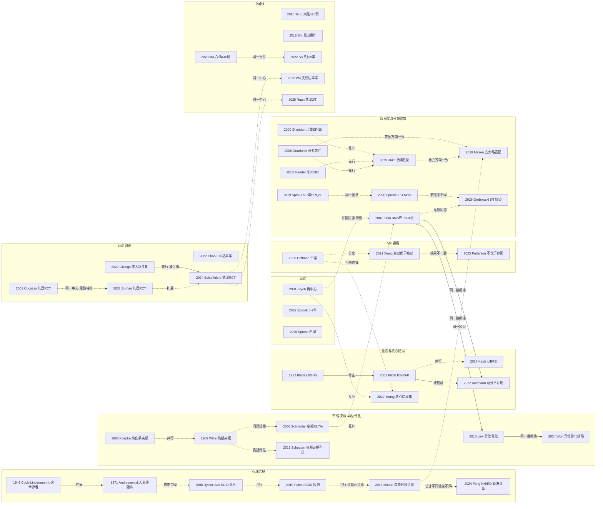

# D10 烧伤康复、功能与长期结局

> **一句话判断**：这个方向研究烧伤病人"活下来之后"的功能、心理、工作和寿命。它起于 Cocoanut Grove 火灾幸存者的精神科观察（1942 年火灾，1943 年 Ann Surg 系列报告）和更早就有的夹板防挛缩做法，1980 年代起有了烧伤专用量表（1982 年 BSHS），1990 年代起有了美国 Burn Model System 多中心随访库（1994 年设立），2000 年代起陆续有了运动训练的随机试验（此前只有 1987 年 6 例烧伤手的小型随机比较）和出院后死亡的关联数据；国际核心结局集直到 2022 年才定下"至少要测什么"，常用量表的结构仍有争议，现在处在"统一测量口径、检验早期活动/运动/VR"的阶段。**对临床医生最重要的一点**：出院不等于风险结束——西澳和安大略两个独立的人群匹配研究都显示出院后长期死亡率高于未受伤对照（死亡率比 1.4–1.6；5 年死亡 11% 对 4%）[D10-N12][D10-N14]，而运动和 VR 改善的主要是肌力、肌量和操作时疼痛，多数试验没有看到生活质量获益。

## 0 三分钟速读

1. **从哪里来**：两条最早的线索互不相干。一条是 1942 年 Boston Cocoanut Grove 夜总会火灾后，麻省总医院精神科系统评估了 17 名伤员，存活者中至少 14 人有神经精神问题（1942 年火灾，1943 年 Ann Surg 系列报告）[D10-N01]；另一条是用夹板防烧伤挛缩，至少可追溯到 1866 年的一篇短文，1960 年代起康复治疗师开始系统报告 [D10-N18][D10-N02]。
2. **为什么改变**：作者们自己给的理由集中在一点："只看死亡已经不够"。Andreasen 1971 写明局部抗菌药让 40% TBSA 以上的年轻患者多能存活 [D10-N03]（这是 Andreasen 的归因；同期死亡下降的归因见 D04 2.2，不能单独归于局部药）；Blades 1979 写明当时衡量重度烧伤结局的唯一办法是死亡率，随后做出 1982 年的 BSHS 量表 [D10-N04]；Klein 2007 写明"只看存活已不够"，这是 1994 年设立美国 Burn Model System（BMS）的出发点 [D10-N11]。
3. **如何分化**：分成心理、挛缩与夹板、量表、运动训练、返岗、VR 镇痛、出院后死亡与健康 7 条线，起点从 1866 年到 2005 年交叠出现，不是一条接一条的接力；本章的分期只是阅读框架。
4. **现在研究什么**：统一测什么（2022 年核心结局集 7 项，其中 4 项属本方向）[D10-N16]；急性期早期活动与运动（武汉 58 例 RCT：肌量丢失减少，生活质量基本无获益）[D10-N17]；用行政和电子病历数据看出院后的死亡、精神障碍和心血管事件（TriNetX 71,426 对：MACE HR 1.95，但绝对风险差只有 0.9%）[D10-R04]；返岗和社会参与。
5. **用了什么数据**：从病例观察和访谈（1943、1971），到量表开发（1982–2017）、小样本 RCT（最早是 1987 年 6 例烧伤手随机比较，运动训练 RCT 2001 年起）、BMS 多中心纵向库（1994 年起，到 2004 年录入 4600 例）[D10-N11]，再到挪威、华盛顿州、西澳、安大略、台湾 NHIRD 的关联或行政数据，以及 TriNetX 电子病历网络。
6. **还不知道什么**：静态夹板到底能不能防挛缩（没有足够样本的 RCT）[D10-N31]；运动和 VR 能否改善长期生活质量（随访多在 12 周内）；烧伤专门的心理干预 RCT 很少；中国大陆没有基于人群关联或医保数据的长期结局研究；伤后 5 年以上的纵向数据仍少。本报告自身的检索缺口：长期疼痛与瘙痒的历史线、Galveston 儿童长期心理社会队列都未补查（见 8.2）。

**覆盖边界**：
- 纳入：挛缩预防（体位、夹板、早期活动）；运动训练；异位骨化的功能后果；心理结局（PTSD、抑郁、伤前精神病史）；操作时疼痛与长期疼痛/瘙痒；生活质量与患者报告结局（PROM）、量表开发；出院后长期死亡与健康结局；返岗、返校与社会参与；儿童长期结局；核心结局集；VR 镇痛。
- 不含（交给其他方向）：压力治疗与瘢痕治疗（D09）；挛缩松解、异位骨化切除与重建手术（D11）；运动训练的代谢与肌肉分解机制（D06）；住院死亡预测与救治体系（D07）；八仙、昆山等批量烧伤事件本身的流行病学与救治（D12）；中国学科形成史（X01）。交叉处只点到为止。

**本章口径**：
- 报告截止/执行日 2026-09-29；近期重点窗口 2021-09-29 至 2026-09-29，只用于第 4 节展开，不限制历史追溯。
- 阅读层级：L0=仅二手转述；L1=题录已在数据库核实；L2=摘要已读；L3=原文部分章节已读；L4=全文已读。只到 L0/L1 的，正文写"据某来源转述"或"仅题录"，不写成"已核对原文贡献"。
- 核查状态：**通过**=本轮已对照 PubMed/Crossref 题录与摘要（或 PMC 原文）核对，数字一致；**修正**=本轮核对后改正了数字、阅读层级、起点说法或关系判断，正文只用改正后的值；**存疑**=依据不足，保留但标注。本轮复审阶段补入的文献（N18–N30、R16、R20–R22 等）都已对照 PubMed 摘要或题录核对数字，记为"通过"。
- 本章节点 31 个：L1 2 个（N02、N18），L2 26 个，L3 3 个（N01、N03、N17），L4 0 个。**没有任何关键原始研究读到全文。**另有近期代表研究 22 条（全部 L2；R09 发表在窗口之前，只作背景；R20 的在线日期本轮未核）、入口综述/调查 10 条（L1 1、L2 7、L3 2）。全部 63 条见 `data/evidence_D10.json`。第二轮（完整性检查）有限检索补入 2 篇辅助文献：Esselman 2007 三中心返岗（PMID 18036982）和 Giannoni-Pastor 2016 PTSD Meta（PMID 25970798），均读到摘要（L2），在正文直接给 PMID，未进证据表，不计入上面的数目。
- **覆盖状态：基本完整但有标注缺口**（按全报告统一口径评定，2026-09-29 第二轮）。理由：① 六个问题（从哪里来、为什么改变、如何分化、现在研究什么、用了什么数据、还有什么不知道）都能据本章回答，分别见速读第 1–6 条和第 1、2、4、7、8 节；② 本章范围内的 7 条主线（心理、挛缩与夹板、量表、运动训练、返岗、VR 镇痛、出院后死亡与健康）以及异位骨化子线和中国线都有节点；长期疼痛与瘙痒有近期节点（[D10-R03]、[D10-R21]）和八仙问卷数据（Hsu 2019），缺的是历史线，不是整条分支没有节点；③ 主链关键转折（1942 年火灾后的精神科观察、1971 年成人长期随访、1982 年 BSHS、1994 年 BMS、2015 年人群匹配死亡研究、2022 年核心结局集）都有可核实来源（PMID 或 DOI，阅读层级 L2 或 L3）；夹板线的早期文献只到题录（L1），但这条线的关键转折（Schouten 2012 质疑）为 L2。缺口限于第 8 节已标注的项目：疼痛与瘙痒历史线未梳理、Galveston 儿童长期心理社会队列未补查、多数节点只读到摘要、CNKI 和万方未查、部分主干文献只有作者加年份（8.3）。
- 引用写法：[D10-Nxx]=关键节点，[D10-Rxx]=近期代表研究，[D10-Ex]=入口综述；只出现一次的辅助文献直接给 PMID、DOI 或 URL。

---

## 1 源头：最初在研究什么

**判断**：最早的问题不是"康复"，而是两件具体的事：火灾幸存者会不会出现精神问题，以及烧伤关节会不会挛缩。前者有明确的"公认起点"（Cocoanut Grove：1942 年火灾，1943 年 Ann Surg 系列报告），但原文只有数月内的观察；后者没有公认起点，本轮找到的最早记录是 1866 年的一篇短文。"康复与长期结局"作为一个独立问题被提出来，是 1970–1980 年代的事，作者给出的理由是更多人活了下来、只看死亡率已经不够。

| 说法 | 分类 | 依据与限定 | 层级 |
|---|---|---|---|
| 火灾/烧伤幸存者的精神后果：Cobb & Lindemann 1943 [D10-N01] | 被公认的奠基工作（限定：本轮找到的追认来源只有 Andreasen 1971 一篇） | Andreasen 1971 p.785 说在这次火灾之前，精神科对烧伤患者的研究兴趣"essentially nil"。原文 p.814–815、822–824 本轮已读：麻省总医院收治 39 人、62 小时内死亡 7 人（p.823），系统评估 17 人（p.815）；存活者中至少 14 人有神经精神问题；作者提出精神科参与灾难救治分三期，第三期是出院后的社区再适应；观察仍在进行、尚无结论（p.823）。相当篇幅讨论的是丧亲者的急性悲伤（p.822），不全是烧伤患者本人 | L3（p.816–821 未读） |
| "约半数幸存者一年随访时有心理并发症" | 仅二手转述，不能单独归属 | 据 Andreasen 1971 p.785 转述，出处写的是 Adler 1943 与 Cobb & Lindemann 1943 两篇合称。Cobb & Lindemann 刊于 1943 年 6 月，文中没有一年数据；Adler A. JAMA 1943;123(17):1098（12 月刊，DOI 10.1001/jama.1943.02840520014004）时间上更可能是一年数据的出处，但本轮未读。同年 Veltfort & Lee 的研究（DOI 10.1037/h0063188）讲的是社会心理层面的"找替罪羊"，不是幸存者随访 | 数字 L0；Adler L1 |
| 成人烧伤出院后长期精神科随访：Andreasen 1971 [D10-N03] | 目前最早找到的文献（限定为成人） | PubMed 检索 1800–1978 年题名含 long-term/follow-up/sequelae 的烧伤文献，没有更早的成人长期精神随访。儿童及父母的远期精神后遗症研究更早：Vigliano 1964 Am J Orthopsychiat 34:753（据 Andreasen 参考文献第 20 条，未读）；Wright & Fulwiler 1974 Pediatr Res（PMID 4614211）也是儿童 | L3 |
| 用夹板预防烧伤挛缩 | 目前最早找到的文献：1866 年 | 《Splint to Prevent Contraction after Burns》Boston Med Surg J 1866;74(14):281-282（DOI 10.1056/nejm186605030741403）；Hilbert JW. JAMA 1930;95(14):1021（旋涡浴加后侧夹板治疗烧伤挛缩，DOI 10.1001/jama.1930.27210140002010a）。PubMed 可查的最早体位/夹板报告是 Gronley 1960 Phys Ther Rev（暴露疗法下烧伤手的体位，PMID 13829544）和 Koepke 1963 Am J Occup Ther [D10-N18]；其后有 Yeakel 1964 J Trauma（玻璃纤维体位装置，PMID 14106398）、Cramer 1964 PRS（颈部夹板，PMID 14209178）、Johnson & Graham 1969 PRS（热塑夹板治疗烧伤手，PMID 5809012） | 全部 L1（仅题录） |
| Willis 1969 Orthoplast 热塑夹板 [D10-N02] | 代表性工作，不是最早 | 热塑材料夹板进入烧伤职业治疗的早期报告之一，对象是急性期儿童；1970 年发表随访（PMID 5418048），1973 年与 Larson、Abston 合写《Positioning and splinting the burned patient》（PMID 4490373）。三篇都无摘要，内容未读 | L1 |
| 烧伤专用生活质量量表：Blades 1979 / BSHS 1982 [D10-N04] | 作者自称首次 | 1979 年摘要原话：衡量重度烧伤结局的唯一现有方法是死亡率（32 例，访谈加体检，PMID 469967）。更早已有以残疾和劳动能力为结局的报告（Buglaev 1971，俄文，腿部深度烧伤，PMID 5145300），但不是多领域量表 | L2 |
| VR 用于烧伤疼痛：Hoffman 2000 [D10-N06] | 作者自称首次 | 摘要原话 "This case report provides the first evidence..."；PubMed 检索 1990–2000 年 "virtual reality" 加 burn 只命中 Hoffman 2000 两篇 | L2 |
| 烧伤儿童运动训练 RCT：Cucuzzo 2001 [D10-N19] | 目前最早找到的文献（限定：儿童、有结构的运动计划） | 同一 Galveston 中心的 Cucuzzo 2001 刊于 5–6 月，早于 Suman 2001（9 月）[D10-N07]；两篇受试者是否重叠未知。成人方面更早有 Richard 1987 的 6 例烧伤手随机比较（被动运动对静态包扎，PMID 3436982）；Melchert-McKearnan 2000 是 2 名儿童的单被试随机设计（游戏活动对机械练习，PMID 10932308） | L2 |
| 出院后长期死亡的关联研究：Onarheim 2005 [D10-N20] | 目前最早找到的文献（限定：单中心关联死亡证明） | Onarheim 2005 挪威单中心；Mandell 2013 华盛顿州出院库关联 National Death Index [D10-N23]；Duke 2015 是本轮找到的最早"人群匹配未受伤对照"研究 [D10-N12]。北欧登记研究没有系统检索 | L2 |
| 多中心长期结局数据库：Burn Model System [D10-N11] | 被公认的奠基工作 | Klein 2007：NIDRR 于 1994 年设立，4 个中心；此后大量论文以"A Burn Model System Study"为题（Europe PMC 题名检索 104 篇）。机构名称：2014 年《劳动力创新与机会法》（WIOA）把 NIDRR 从教育部移到卫生与公众服务部 ACL，并改名 NIDILRR（ACL 官网 https://acl.gov/NIDILRR40 ）；Levi 2015 题名已用新全称 [D10-N24] | L2 |
| 烧伤研究核心结局集：Young 2022 [D10-N16] | 目前最早找到的文献 | Falder 2009 提出 7 个核心评估域的概念框架 [D10-E3]，但不是按 COMET 方法做的共识，二者不能等同。PubMed 检索 2000–2017 年 "core outcome" 加 burn 只见 Young 2017 方案（PMID 28669969）和 Jones 2017 瘢痕管理中患者看重的结局（PMID 29031889，属 D09 交叉） | L2 |
| 中国烧伤康复的起点 | 存在争议的首次 | Guo 2018 说 1970 年代中期从压力疗法起步；Chen 2013 说专科烧伤单元自 1958 年设立，但康复发展"appears to be slow"、实践历史短 [D10-E9]。一份以瘢痕压力治疗为起点，一份以系统康复服务为起点，界定不同，本章不作裁定 | L2 |

**"最早找到"与"公认奠基"的区别**：Cocoanut Grove 是后来文献追认的起点，但它本身只是数月内的观察，不是长期结局研究；成人长期随访本轮最早找到的是 Andreasen 1971。夹板线里 Willis 1969 常被当作起点，其实只是热塑材料的早期报告。运动 RCT 和长期死亡两条线的"最早"，都是不限作者重新检索后才前移的（Cucuzzo 2001、Onarheim 2005）。以上"最早"都只限于本轮 PubMed、Crossref、OpenAlex 的检索范围；非英文早期文献没有系统检索。

---

## 2 关键转折：问题—新证据/新方法—认识变化—新问题

下面按"问题怎么变"组织。每一步注明关系类型和依据："原文明确"=节点原文或摘要直接讨论了前者；"综述归纳"=入口综述这样叙述；"推断"=本报告根据时间和内容推断，没有互引证据。出版先后不等于因果。

### 2.1 活下来的人心里怎样：从灾难观察到成人长期随访（1943–1972）

- **原有问题**：1942 年火灾后，外科关注的是休克与感染（交 D01、D04），据 Andreasen 1971 p.785 转述，此前精神科对烧伤几乎没有研究兴趣。
- **新证据**：Cobb & Lindemann 1943 系统评估 17 人，存活者中至少 14 人有神经精神问题，并把出院后的社区再适应列为精神科参与的第三期 [D10-N01]。
- **扩展**（原文明确：Andreasen p.785 讨论了 Cobb & Lindemann）：Andreasen 1971 纳入 Iowa 大学烧伤单元 1965–1969 年 >20% TBSA 的成人，50 人合格、33 人联系上、20 人来访（优先选面部烧伤、大面积和 20–40 岁者），伤后平均 2.3 年。结果 30% 有继发于烧伤的情绪问题（轻度 20%、中度 10%），最常见是创伤性神经症和轻度抑郁；多数人的工作、家庭和人际恢复到伤前，作者称预后"quite good" [D10-N03]。
- **驱动**（作者自述）：作者写明，Sulfamylon、硝酸银等局部抗菌药让 40% TBSA 以上的年轻患者多能存活，才需要问这些人几年后怎样。这是 Andreasen 的归因；同期死亡下降的归因见 D04 2.2，不能单独归于局部药。
- **限定**：Andreasen 排除了酒精成瘾、癫痫和既往精神病住院史者；无对照组。同组 Andreasen & Norris 1972（J Nerv Ment Dis，PMID 4260337）很可能是同一批 20 人，本轮未读，不计为独立证据。
- **新问题**：发生率到底多高？伤前的精神问题算不算烧伤的后果？（见 2.8）

### 2.2 挛缩怎么防：夹板是老做法，证据一直薄（1866–2012）

- **原有做法**：1866 年已有夹板防烧伤挛缩的短文，1930 年 JAMA 有旋涡浴加后侧夹板的报告；1960 年代康复治疗师在物理治疗和职业治疗期刊上报告烧伤手的体位和夹板 [D10-N18]；1969 年前后热塑材料进入急性期儿童夹板 [D10-N02]。这些文献本轮全部只到题录，做法细节和效果都未读。
- **问题规模**（关系：说明问题规模，推断）：Schneider 2006 前瞻收集一家区域烧伤中心 1993–2002 年 985 名成人存活者的资料，出院时 381 人（38.7%）至少一个大关节挛缩，有挛缩者平均 3 处；肩 38%、肘 34%、膝 22%；多为轻度（60%）或中度（32%）；住院时长、烧伤面积和植皮面积预测挛缩发生 [D10-N10]。作者据此强调急性期体位和强化治疗的重要，同时呼吁寻找更好的预防办法。**该文没有检验夹板本身**，不能读成"夹板无效"。
- **质疑**（关系：质疑做法；Schouten 是否引用 N02、N18 本轮未核）：Schouten 2012 综述（PubMed、Cochrane、CINAHL、PEDro）报告挛缩发生率 5–40%，没有找到静态夹板有效的强证据；又据体外和动物研究指出机械张力会刺激肌成纤维细胞，认为静态夹板可能适得其反，呼吁做 RCT [D10-N31]。
- **现状**：本轮只看到两项小型肩部夹板试验的线索，没有可定位来源（列入 8.3）。夹板线处于"长期标准做法、证据不足、未见大样本 RCT"的停滞状态。
- **另一种关节后果**：异位骨化（HO）。BMS 2979 例中 98 例（3.5%）发生 HO，>30% TBSA 者比值比 11.5，上肢需植皮者 96.4 [D10-N24]；HO 的手术处理交 D11。

### 2.3 "活下来之后怎样"怎么量：从死亡率到专用量表，再到量表结构之争（1979–2022）

- **原有问题**：Blades 1979 摘要说，重度烧伤唯一可用的结局指标是死亡率（PMID 469967）。
- **新方法**：1982 年 BSHS，由专业人员和患者组成的评判组筛出 114 条、6 个领域，在 40 例中测信度（摘要未给系数）；摘要称大面积烧伤者的心理社会表现落后，恢复在出院后至少 1 年内仍在变化 [D10-N04]。此后有简版 BSHS-A（Munster 1987，PMID 3573091）。
- **修正**（原文明确）：Kildal 2001 让 Uppsala 1980–1995 年的前患者回答旧版本的 94 条，350 人中 248 人（70.9%）应答，用主成分因子分析得出 40 条、9 个领域的 BSHS-B，领域间相关 0.11–0.56，α 0.75–0.93 [D10-N08]。它后来成为最常用的烧伤专用量表之一（OpenAlex 被引 280 次）；中国大陆汉化版为 38 条、6 个领域（Ling-Juan 2012，Burns 38:1216，3 个烧伤单元 271 例，α 0.97）。
- **分化**（并行，推断）：Kazis 2017 的 LIBRE 转向"社会参与"，并改用项目反应理论（IRT）和计算机自适应测验：601 名幸存者（便利样本，伤后平均 15.4 年）、192 条，得到 6 个单维量表，边际信度 0.84–0.93，天花板效应 <15% [D10-N15]。BSHS-B 测烧伤专用健康状态，LIBRE 测社会参与，构念不同。
- **质疑**：Amtmann 2022 用 653 名 BMS 成人检验 BSHS-B：9 个子量表各自单维，但 40 条总分不单维；9 个子量表都有明显天花板效应；6 对条目局部依赖，11 条不拟合 IRT，至少 15 条选项过多；作者说单一总分不应用于任何用途 [D10-R06]。
- **认识变化**：测量对象从"死没死"到"烧伤专用健康状态"，再到"社会参与"；常用量表的领域结构在不同样本中不稳定（9 个领域、中国版 6 个领域），总分用法被直接否定。
- **新问题**：到底该测哪些结局？（见 2.10）

### 2.4 能不能把功能练回来：运动训练的随机试验（1987–2024）

- **原有问题**：Suman 2001 摘要背景写，烧伤后显著而持久的肌肉分解和无力，在常规物理和职业治疗下仍然存在（机制交 D06）。
- **早期小样本**：Richard 1987 把 6 例烧伤手随机分到被动运动或静态包扎（PMID 3436982）。
- **儿童出院后**（同一项目）：Cucuzzo 2001 在 Galveston 医院的儿童康复中心随机分组 21 名 >40% TBSA 儿童（平均 59.7%；运动 11、家庭常规 10），伤后 6–9 个月做 12 周抗阻加有氧训练：肌力提高 80.1% 对 37.7%，步行距离提高 39.5% 对 12.5% [D10-N19]。同中心 Suman 2001 随机 35 例（19/16），运动组肌力、功率和瘦体重显著改善，摘要未给数值 [D10-N07]。两篇同中心、同年、设计几乎相同，受试者是否重叠未知，**不计为两项独立 RCT**。
- **扩展到成人急性期，结果不一致**：
  - Gittings 2021：48 例成人伤后 72 小时内开始 4 周高强度抗阻训练对假训练，主要终点 6 个月生活质量总分、肌力和肌量都无组间差异，只有 BSHS-B 功能域（p=0.017）和上肢 QuickDASH（p<0.001）改善，未见伤害 [D10-N27]。
  - Chao 2022：多中心 RCT，54 名 >30% TBSA 儿童（对照 18、运动 36）在 ICU 内做短时功率车，两组功能性行走都显著改善，运动没有额外获益 [D10-R13]。
  - Schieffelers 2024：武汉市第三医院 58 名 ≥40% TBSA 成人（每组 29），入院后中位第 7 天开始，出勤率 93%；0–6 周运动组肌量丢失较少（股四头肌厚度 β 0.05 cm，P=0.010），6–12 周肌力增加更多（β 3.102 N，P<0.001）；生活质量除 BSHS-B 情感和人际两个领域边缘显著外均无获益；无严重不良事件。参与者对分组设盲，治疗师和评估者未设盲 [D10-N17]。它的讨论引用了 Gittings 2021，所以它背景里"急性期缺乏证据"的说法并不完全准确。
- **综合证据**：Abonie 2024 Meta（8 项 RCT、393 人）有氧能力 g=1.13、肌力 g=2.27，生活质量未改善 [D10-E6]。ABA 2023 指南有条件推荐 ICU 早期活动康复以减少 ICU 获得性无力和谵妄，对缩短机械通气、压力性损伤和移植物损伤无法给出推荐 [D10-R12]。
- **认识变化**：肌肉和体能终点多数改善；生活质量终点多为阴性；急性期开始训练的两项成人试验都没有看到伤害。
- **新问题**：12 周以后的功能怎样？生活质量阴性是干预无效，还是所用量表不敏感——现有材料无法区分。

### 2.5 回得去工作吗：返岗从"率"到"回没回原岗位"（2001–2025）

- **原有问题**：返岗文献零散。
- **新证据**：Brych 2001 检索 1966 年至 2000 年 10 月的文献，只有 10 篇有客观数据，平均误工 10 周，%TBSA 是最重要的预测因素；两中心 363 名伤前在外就业的成人，伤后 6 个月和 24 个月返岗 66% 和 90%，24 个月内返岗者平均误工 17 周；精神病史和四肢烧伤降低返岗概率；华盛顿大学子集中只有 37% 在 24 个月时回到同一雇主的同一岗位且无需调整 [D10-N09]。
- **认识变化**："回到工作"不等于"回到原岗位"。
- **同期三中心随访**（第二轮有限检索补入，L2，摘要）：Esselman 2007 在 3 个烧伤中心纳入 154 名符合 ABA 重度烧伤标准、伤前每周工作至少 20 小时的住院患者，出院后前 4 个月每 2 周、之后每月电话随访到 1 年：1 年时 79.7% 返岗；出院早期的障碍是躯体和创面问题，躯体能力到 1 年仍是主要障碍，长期未返岗者中工作环境（温度、湿度、安全）和心理社会因素（噩梦、闪回、外观顾虑）变得重要（Arch Phys Med Rehabil 2007;88(12 Suppl 2):S50-6，PMID 18036982）。摘要只写"3 个国家级站点"，是否使用 BMS 数据未核。
- **综合与延伸**：Mason 2012 系统综述 26 项研究，平均伤后 41 个月 72.03% 返岗，约 28% 从未返岗 [D10-E10]。荷兰 Spronk 2022 伤后 5–7 年 213 人：70% 在职，在职者中 12% 有生产力损失，19% 因伤改变工作 [D10-R20]。
- **进入核心结局**（互补，推断）："返校或返岗"成为 7 项核心结局之一 [D10-N16]。
- **口径提醒**：返岗率随人群严重度差别很大，比如西澳 953 例中位 TBSA 仅 2.4%，12 个月返岗 92% [D10-R18]，不能和大面积烧伤队列直接比。Brych 的两中心与后来的 BMS 作者重叠，但摘要没写 BMS，二者是否同源待核（存疑）。

### 2.6 从单中心到多中心纵向库：Burn Model System（1994– ）

- **原有问题**：单中心、横断面的结局研究样本小、随访时点不一。
- **驱动**：Klein 2007 摘要开头写，重症和外科救治已显著提高存活率，但"survival alone is an insufficient outcome"；NIDRR 于 1994 年设立 BMS 项目，专门评估烧伤的长期后遗症 [D10-N11]。**为什么是 1994 年、为什么是这 4 个中心，摘要没有说明。**
- **新方法**：4 个中心按统一字段收集住院资料，出院后 6、12、24 个月随访功能和心理问卷；1994–2004 年录入 4600 例，其中 3449 例（75%）存活出院并同意随访 [D10-N11]。
- **衍生**：挛缩 [D10-N10]（作者与 BMS 重叠，摘要只写"区域烧伤中心"，关系为推断）、HO [D10-N24][D10-R22]、BSHS-B 心理测量 [D10-R06]、5 年 HRQoL 轨迹 [D10-R05]（摘要只写多中心纵向队列，按作者推断为 BMS）、心理社会恢复 [D10-R08]、社区困境与返岗 [D10-R19]（摘要只写多中心烧伤数据库，推断为 BMS）。
- **提醒**：这些论文共用一个数据源，不能当作互相独立的多项验证；BMS 只覆盖美国少数中心，摘要未报告失访率。

### 2.7 出院不是终点：长期死亡与健康（2005–2026）

- **原有认识**：烧伤死亡负担按住院死亡计算。Duke 2015 的成人论文结论写明，只靠住院死亡数据会低估烧伤的真实死亡负担（PMID 26240461）。
- **先行研究**：
  - Onarheim 2005：挪威单中心 1984–2003 年 999 名出院者，关联死亡证明，平均随访 9.6 年；意外或暴力死亡（含自杀 5 例、物质或酒精相关 12 例）约每 1000 人年 40 例，作者估计比挪威一般人群高一个数量级 [D10-N20]。
  - Mandell 2013：华盛顿州出院数据库 1996–2005 年关联 National Death Index，2388 名 ≥45 岁出院者，2 年内 45% 至少再入院一次；≥75 岁组 2 年死亡 OR 2.90——这是与 45–54 岁烧伤者比，**不是与未受伤人群比** [D10-N23]。
- **人群匹配对照**：Duke 2015 用西澳 Data Linkage System 1980–2012 年数据，<15 岁儿童 10,426 人对 40,818 名未受伤者，中位随访 18.1 年，调整后全因死亡率比 1.6（1.3–2.0），估计该队列 38% 的死亡可归因于烧伤 [D10-N12]。同一系统的 ≥45 岁成人：6014 对 25,759，死亡率比 1.4，轻度烧伤 2.1、重度 1.3，归因 29%（PMID 26240461）；同系统还有青中年死亡（PMID 26432064）和与苏格兰合作的癌症风险研究（PMID 24441050）。这几篇属同一项目，不计为独立验证。轻度烧伤的死亡率比高于重度，材料中没有解释。
- **独立方向一致**（推断；本轮未核 Mason 是否引用 Duke）：Mason 2019 用安大略 ICES 数据，2003–2013 年 1965 名重度烧伤存活者（中位 TBSA 15%）按年龄、性别、躯体与精神共病和边缘化指数匹配 8671 名对照：5 年死亡 11% 对 4%；风险比第一年 4.15（3.17–5.42），第五年 1.65（1.02–2.67）；创伤相关死亡率比 9.8，精神疾病相关 9.1 [D10-N14]。Onarheim 2005 早已提示意外、暴力、自杀和物质相关死亡升高，死因方向与 Mason 2019 一致（推断）。
- **看似矛盾**（互补，推断）：Sheridan 2000 单中心 80 名 ≥70% TBSA 儿童伤后平均 14.7 年，SF-36 各域总体接近常模，但躯体功能和躯体角色分别有 15% 和 20% 的人低于常模 2 个标准差以上 [D10-N05]。它测的是能随访到的存活者的生活质量，Duke 测的是全人群死亡，选择偏倚不同，两者可以同时成立。
- **认识变化**：研究者开始把烧伤当作有长期超额死亡的慢性状态，重点指向伤害预防和精神卫生。
- **新问题**：可干预的环节在哪里？Little 2026 发现初级保健签约与 5 年死亡没有显著关联 [D10-R02]（见 4.1）。

### 2.8 精神问题是伤前带来的，还是烧伤造成的（1971–2024）

- **1971 年的口径**：Andreasen 排除有精神病住院史者后，30% 有情绪问题 [D10-N03]。
- **临床诊断访谈口径**：Dyster-Aas 2008 用 SCID 评估 Uppsala 连续入院的 73 例：66% 有终生精神障碍诊断；12 个月时（64 人）重性抑郁 16%、PTSD 9%；有精神病史者伤后问题更多 [D10-N21]。Palmu 2010 用 SCID-I/II 评估 Helsinki 连续 107 例：61% 有终生障碍；Axis I 患病率从伤前 1 个月的 40% 升到急性期的 48%，谵妄从 0.9% 升到 13% [D10-N22]。
- **关系判断**（修正口径，推断）：两项研究说明终生精神障碍在烧伤住院者中占 61–66%，所以 1971 年排除病史后得出的 30% 不能代表全体烧伤存活者。但 Andreasen 排除的是精神病住院史、酒精成瘾和癫痫，与 SCID 的"终生诊断"不是同一口径，不能折算它排掉了多少人。
- **行政急诊口径**：Mason 2017 用安大略 1530 名重度烧伤存活者做伤前伤后自身对照：精神卫生急诊率伤前 141、伤后 154/1000 人年，总体无差异（RR 0.97，0.78–1.20）；伤前几乎不就诊者（摘要结果部分写"<1 次"，结论部分写"≤1 次"）伤后增至约 3 倍（RR 3.72）；自伤急诊增至约 2 倍（RR 1.95）；伤前 12 周内就诊最多 [D10-N13]。
- **排除伤前诊断口径**：Peng 2024 用台湾 NHIRD，排除伤前 5 年有精神诊断者，10,045 名烧伤者对 40,180 名对照，新发精神障碍 aHR 1.21；≥30% TBSA 者 1.49，10–29% TBSA 者反而较低（0.85）[D10-R01]。
- **认识变化**：两说并存。伤前易感是解释烧伤后精神问题的重要部分；烧伤本身也增加一部分风险（急性期谵妄、自伤、大面积者新发诊断）。Andreasen 1971 与 Mason 2017 设计、人群、年代都不同，Mason 未讨论 Andreasen，二者是对照/并行，不是"后者修正前者"。
- **患病率估计**：Van Loey 2003 综述给出抑郁 13–23%、PTSD 13–45% [D10-E2]；Giannoni-Pastor 2016 系统综述与 Meta（第二轮有限检索补入，L2，摘要；成人；190 篇初筛，24 篇进入系统综述，19 篇进入 Meta；检索截止摘要未写）按时点给出 PTSD 患病率范围：伤后 1 个月 3–35%、3–6 个月 2–40%、伤后 1 年内 9–45%、2 年以上 7–25%，基线急性应激障碍 2–30%；最强的预测因素是感知到生命威胁，其次是急性闯入症状和烧伤相关疼痛（J Burn Care Res 2016;37(1):e79-89，PMID 25970798）；Boersma-van Dam 2025 合并 32 项研究，伤后两年内 PTSD 合并患病率 20.5%（16.4–24.6），每月下降约 0.37%，问卷研究和 2000 年后的研究更容易显示下降 [D10-E7]。
- **限定**：本节没有纳入儿童专门的心理结局研究。Galveston 团队的儿童长期心理社会研究未补查（第二轮只到题录，见 8.2 第 6 条）；Patterson 1993、McKibben 2008 等心理主干文献仍未定位（见 8.3）。

### 2.9 操作时疼痛：VR 从个案到 Meta，有效成分仍未定（2000–2026）

- **原有问题**：换药时单用阿片常常镇痛不足（Hoffman 2000 背景）。
- **新方法**：Hoffman 2000 两名青少年，同一次换药中 VR 与电子游戏相比，4 项评分分别低 80、80、58、93 mm（病例 1）[D10-N06]；同年 12 例成人物理治疗受试者内对照，"想着疼痛的时间"从 60 mm 降到 14 mm（PMID 11014398）。二者是个案和受试者内对照，不是试验。
- **验证与限定**：Carrougher 2009 做 39 例随机交叉，VR 让疼痛评分下降 27–37%，但关节活动度改善没有统计学或临床意义（P=.243，PMID 19692911）。
- **分化**：主动 VR 是否优于被动、是否优于简单分心，见 4.3。
- **与核心结局的区别**（推断）：核心结局集里的是"神经病理性疼痛与瘙痒"这类长期症状 [D10-N16]，VR 研究测的是操作时的急性疼痛，两者不是同一个问题。长期疼痛与瘙痒的历史线本轮没有梳理，第二轮也未补查（见 8.2 第 5 条）。

### 2.10 统一测什么：核心结局集（2009–2022）

- **原有问题**：各研究用的结局五花八门，无法汇总比较。
- **前身框架**（推断：Young 2022 是否引用 Falder 2009 本轮未核）：Falder 2009 提出 7 个核心评估域：皮肤、神经肌肉、感觉与疼痛、心理、躯体角色、社区参与、主观生活质量 [D10-E3]。
- **新方法**：Young 2022 在 2017 年 4 月至 2019 年 11 月间，从系统综述和利益相关者访谈中识别 1021 个结局，归并为 88 个候选；第一轮 Delphi 有 668 名专业人员（77 国，18% 来自低收入或中低收入国家）和 126 名英国患者或照护者（方案原计划患者 150 人，PMID 28669969）；共识会议最终定下 7 项：死亡、特定并发症、日常活动能力、创面愈合、神经病理性疼痛与瘙痒、心理健康、返校或返岗 [D10-N16]。其中 4 项属于本方向。
- **同期佐证**（不是动机）：Patel 2022 纳入 58 项儿童研究，107 种测量工具中只有 8 种被 3 项以上研究使用 [D10-E5]。它发表于 Delphi 之后，只能说明问题同期存在。
- **限定**：只规定"测什么"，没规定"用什么工具测"；患者样本只来自英国；发表后近期试验的采纳情况本轮未检索。

---

## 3 分支图

图例：实线=原文明确讨论或同一数据库/同一事件；虚线=本报告推断；边上写关系类型。节点写"年份 简称"。

---

## 4 近五年重点（2021-09-29 至 2026-09-29）

每个主题注明窗口内 L2 以上代表研究的数量。窗口外的研究只作背景。

### 4.1 出院后的长期健康结局：行政数据与电子病历网络

- **研究什么**：出院后多年的全因与死因别死亡、新发精神障碍、心血管事件、瘙痒，以及初级保健等可干预因素。
- **数据与设计**：行政或电子病历数据的匹配队列（台湾 NHIRD、安大略 ICES、美国 TriNetX），Cox 回归和时间分层模型。窗口内 L2 代表研究 4 项，涉及 3 个数据系统（R03 与 R04 同属 TriNetX，但人群和结局不同，不算同一队列）。
- **代表研究**：
  - Peng 2024（NHIRD 2000–2013）：见 2.8，新发精神障碍 aHR 1.21 [D10-R01]。
  - Little 2026（安大略 2010–2022，1968 人）：86% 签约了初级保健医生；5 年死亡签约组 11%、未确定签约组 9%；时间分层 Cox 显示签约与死亡无显著关联（≤2 年 HR 0.77，0.41–1.43；>2 年 HR 0.77，0.38–1.57）[D10-R02]。
  - Kleinhapl 2026（TriNetX，257,360 人）：记录到的瘙痒患病率儿童 3.29–7.95%、成人 1.50–9.75%，20–39% TBSA、41–60 岁和伤后 3 年内最高；用药路径不统一 [D10-R03]。
  - Lin 2026（TriNetX 美国协作网络，2014–2019 年成人烧伤急诊或住院者，1:1 倾向评分匹配，观察伤后 3 个月到 5 年）：71,426 对；MACE HR 1.95（1.84–2.07），VTE HR 1.99（1.80–2.19），全因死亡 HR 2.29（2.10–2.49）；绝对风险差分别只有 0.9%、0.4%、0.7% [D10-R04]。
- **分歧**：精神障碍风险取决于设计（自身对照 vs 排除伤前诊断，见 2.8）。Little 2026 的阴性结果提示"签约"不等于实际获得照护，这是作者的解释。TriNetX 的瘙痒患病率是诊断编码口径，八仙队列伤后 3 年的 46.6% 是问卷自报（Hsu 2019，PMID 31378622），两种口径不能直接比。Lin 2026 的相对风险高但绝对差小。
- **成熟度**：超额死亡的方向有两个独立的人群匹配系统（西澳、安大略）一致支持，加上更早的挪威单中心和华盛顿州数据；心血管、精神障碍等死因机制和可干预环节仍是早期线索。

### 4.2 核心结局集与患者报告结局

- **研究什么**：统一"测什么"，改进"怎么测"，描述长期恢复轨迹。
- **数据与设计**：Delphi 共识；BMS 多中心纵向队列；IRT 心理测量；PROM 系统综述。窗口内 L2 代表研究 4 项（N16、R05、R06、R07），其中 R05、R06 同属 BMS。
- **代表研究**：Young 2022 核心结局集 7 项 [D10-N16]；Amtmann 2022 否定 BSHS-B 总分用法 [D10-R06]；Li 2024 系统综述（MEDLINE、EMBASE、CINAHL、Cochrane，552 条初筛、133 篇全文评估、纳入 21 篇，定性综合），结论是现有烧伤专用 PROM 需要进一步验证 [D10-R07]；Grobowski 2026（1113 人，随访到伤后 5 年）：到 24 个月时心理 HRQoL 和生活满意度接近伤前水平，躯体 HRQoL 缺损随烧伤面积增大而加重（P<.0001）[D10-R05]。
- **分歧**：核心结局集没规定工具；BSHS-B 结构不稳定。**参照系不同**：Grobowski 比的是伤前回忆值；同属 BMS 的 Kaur 2026 比的是人群常模，6–24 个月抑郁和焦虑仍高于常模 [D10-R08]；欧洲 Spronk 2020 个体数据合并（5 国 10 项研究、1687 人）也显示 24 个月时疼痛不适和焦虑抑郁两维仍低于一般人群常模 [D10-N25]。"接近伤前"和"低于常模"可以同时成立。
- **成熟度**：发展中。

### 4.3 VR 用于操作时疼痛

- **研究什么**：换药和物理治疗时用 VR 减轻疼痛和焦虑；VR 或体感游戏对关节活动度、功能和生活质量的作用。
- **数据与设计**：小样本 RCT 或受试者内随机顺序设计；多篇 Meta。窗口内 L2 原始研究只有 1 项（R10）；Meta 2 项（E8 发表于窗口内，但检索截止 2021 年 8 月，早于窗口；R11）。
- **代表研究**：
  - 窗口前背景：Xiang 2021（2021 年 6 月）90 名门诊儿童三臂 RCT，主动 VR 总体疼痛 VAS 24.9 对标准照护 47.1（P=.02），最痛评分主动 VR 27.4 对被动 VR 47.9（P=.04）[D10-R09]。
  - Patterson 2023：48 名重度烧伤者（44 成人、4 儿童），第 1 天 44 人比较交互 VR 与在同一头显中看静态自然图片，最痛评分 71.06 对 68.19，无差异；第 2 天 13 人比较 VR 与不做分心，54.23 对 63.85（p<.05）[D10-R10]。
  - Lan 2023 Meta（16 项 RCT、535 人）：ROM SMD 0.72，疼痛 SMD -1.26，握力和捏力无改善；作者还称 VR 在生活质量和工作表现上优于常规康复 [D10-E8]。
  - Moreno-Martínez 2026 Meta（2025 年 3 月检索，11 项 RCT、936 人，纳入烧伤、手术和肢体创面）：合并 g=-1.528（-2.259 到 -0.797），I²=95.5%；儿童 g=-2.348，青少年 -0.538，成人 -1.453 且不显著 [D10-R11]。
- **分歧**：有效成分是交互沉浸，还是任何分心都行（Xiang 与 Patterson 结果不一致）；成人是否有效（Moreno-Martínez 成人亚组不显著）。多数试验样本小、难以设盲、只测操作当时的疼痛；多篇 Meta 纳入的原始 RCT 可能高度重叠。
- **成熟度**：儿童短时操作痛较成熟；成人效果和对长期功能、生活质量的作用仍是早期线索。

### 4.4 急性期早期活动与运动训练

- **研究什么**：ICU 内早期活动、急性期抗阻或有氧训练，对肌量、肌力、ICU 获得性无力、谵妄和生活质量的作用。
- **数据与设计**：小到中样本 RCT、ABA 指南、Meta。窗口内 L2 以上：RCT 3 项（R13、N17、R14）、指南 1 项（R12）、Meta 1 项（E6）。
- **代表研究**：Cartotto 2023 ABA 指南 [D10-R12]；Chao 2022 ICU 儿童功率车无额外获益 [D10-R13]；Schieffelers 2024 成人急性期肌量肌力获益、生活质量基本无获益 [D10-N17]；Wu KP 2022 同中心 40 例大面积烧伤下肢功能障碍者，常规康复加功率车 2 个月后 6 分钟步行 488±39 m 对常规组 429±25 m [D10-R14]；Abonie 2024 Meta 生活质量未改善 [D10-E6]。窗口前的 Gittings 2021 主要终点阴性 [D10-N27]。
- **分歧**：肌肉和体能终点多数改善，生活质量多为阴性。Vigneron 2026 发表了一篇运动对成人 HRQoL 的 Meta（PMID 41447903），本轮材料只到题录，结果未纳入，列入缺口。本领域有 2 篇 Int Wound J 相关系统综述已被撤稿（撤稿通知 PMID 40000238、40031931，2023 年呼吸训练对疼痛焦虑的 Meta、2024 年运动对创面愈合的综述）。
- **成熟度**：发展中。R14 与 N17 同在武汉市第三医院，招募期约重叠 1 年，受试者是否重叠未说明。

### 4.5 心理结局：患病率、轨迹与干预

- **研究什么**：PTSD 和抑郁的合并患病率与随时间的变化；危险因素；心理干预。
- **数据与设计**：Meta（层级和自相关模型）、系统综述、多中心纵向队列、灾难队列。窗口内 L2 代表研究 4 项（E7、R15、R08、R16）；**窗口内没有检到 L2 以上的心理干预 RCT**。
- **代表研究**：Boersma-van Dam 2025 PTSD 合并 20.5% [D10-E7]；Paggiaro 2022 系统综述（EMBASE 和 PubMed，2009–2020 年，8 项 RCT：3 项儿童、5 项成人）：舍曲林和普萘洛尔不能减轻应激症状，催眠和信息教育项目也无效，4 项认知行为治疗研究效果最好 [D10-R15]；Kaur 2026（BMS，≥20% TBSA 成人 815 人）：6/12/24 个月抑郁和焦虑仍高于人群常模，社会参与逐步改善，≥70% TBSA 组心理改善最大 [D10-R08]；Su 2022（八仙 99 名成人，5 年）：可能 PTSD 13.1%、重性抑郁 14.1%、创伤后成长 51.5% [D10-R16]。
- **分歧**：见 4.2 的参照系问题；早期综述的宽区间（Van Loey 2003 为 13–45%；Giannoni-Pastor 2016 按时点为 2–45%，见 2.8）收窄到两年内合并 20.5%，但问卷与诊断访谈本身就是调节因素。
- **成熟度**：患病率发展中偏成熟；干预仍是早期线索。

### 4.6 返岗、返校与社会参与

- **研究什么**：返岗率与时间、回原岗位的比例、社区困境等影响因素。
- **数据与设计**：维多利亚州创伤登记、西澳登记、BMS、荷兰多中心、武汉前瞻队列。窗口内 L2 且有返岗数字的：R18、R19、R21 三项；R20 卷期在 2022 年，在线日期本轮未核。
- **代表研究**：
  - Tracy 2025（维多利亚州 2009–2022 年 ≥20% TBSA，287 人，63 人即 21.9% 完全失访）：24 个月时报告"无问题"的比例：行动 70.2%、自理 77.8%、日常活动 48.0%、疼痛不适 49.7%、焦虑抑郁 51.5%；摘要中没有返岗率数字 [D10-R17]。
  - Spronk 2025（西澳 2006–2024 年登记 953 人，占全州烧伤人群 16.5%，中位 TBSA 2.4%）：6 周返岗 38%，12 个月 92%，平均 40 天；工作受损 1 个月 79%、12 个月 50%；伤后 1–3 个月接受较多职业治疗者工作受损较少 [D10-R18]。
  - Agoubi 2025（多中心烧伤数据库 1998–2021 年，18–65 岁 1960 人）：住在困境程度最高的邮编区，6 个月失业 OR 2.21（1.39–3.52），与种族无交互作用 [D10-R19]。
  - Ruan 2025（武汉，216 名成人，出院后 2 年）：≤60 岁者 83.1% 返岗 [D10-R21]（见第 6 节）。
- **分歧**：返岗率依赖定义、随访时点和人群严重度（Brych 90% 但原岗位仅 37%；Esselman 2007 三中心 1 年 79.7%，见 2.5；Mason 2012 综述 72%；西澳 92% 为小面积为主人群）；登记数据失访率高。
- **成熟度**：发展中。

### 4.7 异位骨化的功能结局（本轮补入的子线）

Won 2024 用 BMS 2015–2022 年 861 人（HO 33 人，3.8%），用 PROMIS-29 随访到 12 个月：调整后 HO 者躯体功能持续更差，心理社会结局无显著差异 [D10-R22]。窗口内 L2 代表研究 1 项，与 Levi 2015 [D10-N24] 同属 BMS。成熟度：早期。

---

## 5 争议、负性结果与停滞路线

### 5.1 仍在争的问题

| 争议 | 一方 | 另一方 | 状态 |
|---|---|---|---|
| 静态夹板能否预防挛缩 | 自 1960 年代起是急性期标准做法 [D10-N18][D10-N02] | Schouten 2012 没找到强证据，并提出机械张力可能适得其反 [D10-N31]；Schneider 2006 显示现行做法下出院时仍有 38.7% 挛缩（未检验夹板）[D10-N10] | 未解决；缺足够样本的 RCT |
| 烧伤后精神障碍：伤前易感还是烧伤所致 | 新发风险升高（Peng 2024 aHR 1.21）[D10-R01]；急性期 Axis I 与谵妄上升 [D10-N22] | 终生精神障碍占 61–66% [D10-N21][D10-N22]；自身对照下总体急诊率无差异，伤前 12 周就诊最多 [D10-N13] | 未解决；结论取决于口径（临床诊断访谈、行政急诊、排除伤前诊断）。另：Mason 2019 的精神疾病相关死亡率比 9.1 [D10-N14] 是死亡结局，不直接回答发病归因，不列入任何一方 |
| PTSD 患病率为何差异大 | 早期综述 13–45% [D10-E2]；Giannoni-Pastor 2016 按时点分列 2–45%（PMID 25970798，L2，见 2.8） | 2025 年合并 20.5%，问卷研究与诊断研究的时间趋势不同 [D10-E7] | 部分收敛 |
| 长期生活质量：多数良好还是慢性病 | Andreasen 1971 "quite good" [D10-N03]；Sheridan 2000 多数接近常模 [D10-N05]；Grobowski 2026 心理 HRQoL 24 个月接近伤前 [D10-R05] | Tracy 2025 24 个月约半数仍有日常活动、疼痛或焦虑抑郁问题 [D10-R17]；Spronk 2019 伤后 5–7 年严重烧伤者 81% 至少一维有问题 [D10-N28]；Spronk 2020 与 Kaur 2026 低于常模 [D10-N25][D10-R08]；Grobowski 2026 的躯体 HRQoL 缺损随面积增大而加重 [D10-R05] | 并存；差异来自测量领域（躯体/心理）、**参照系（伤前回忆 vs 人群常模）**、人群选择和失访 |
| VR 的有效成分与适用人群 | 主动 VR 优于被动 [D10-R09] | 交互 VR 不优于静态自然图片 [D10-R10]；成人亚组不显著 [D10-R11] | 未解决 |
| 运动能否改善生活质量 | 肌量、肌力、有氧能力多数改善 [D10-N19][D10-N17][D10-E6] | 生活质量多为阴性或边缘显著 [D10-E6][D10-N17][D10-N27][D10-R13] | 未解决；随访多在 12 周内；Vigneron 2026 Meta 未读 |
| BSHS-B 能不能当一个总分用 | 常用为总分和各领域分 | 总分不满足单维性，作者说不应用于任何用途；9 个子量表都有天花板效应 [D10-R06] | 结构问题已被直接指出，修订未见 |

### 5.2 负性结果、失败与停滞

| 路线 | 结果 | 证据 |
|---|---|---|
| 交互式 VR 优于简单分心 | 与头显中的静态自然图片相比，最痛评分无差异 | Patterson 2023 [D10-R10] |
| VR 改善物理治疗时的关节活动度 | 疼痛下降 27–37%，ROM 改善不显著（P=.243） | Carrougher 2009（PMID 19692911） |
| VR 用于成人操作痛 | 成人亚组 g=-1.453，不显著 | Moreno-Martínez 2026 [D10-R11] |
| 运动改善生活质量 | Meta 未改善；成人急性期 RCT 生活质量总分无差异 | Abonie 2024 [D10-E6]；Gittings 2021 [D10-N27]；Schieffelers 2024 [D10-N17] |
| ICU 内短时功率车 | 可行，但无额外获益 | Chao 2022 [D10-R13] |
| 早期活动缩短机械通气 | 指南认为证据不足，不能推荐 | Cartotto 2023 [D10-R12] |
| 烧伤后总体精神卫生急诊率上升 | 自身对照下无差异（RR 0.97） | Mason 2017 [D10-N13] |
| 药物和部分心理手段预防 PTSD | 舍曲林、普萘洛尔、催眠、信息教育均无效 | Paggiaro 2022 [D10-R15] |
| 心理 debriefing | 在烧伤患者中未显示正效应（综述二手总结，原始研究未查） | Van Loey 2003 [D10-E2] |
| 初级保健签约降低长期死亡 | 无显著关联 | Little 2026 [D10-R02] |
| 静态夹板预防挛缩 | 无强证据 | Schouten 2012 [D10-N31] |
| BSHS-B 总分 | 不满足单维性，不应使用 | Amtmann 2022 [D10-R06] |
| 运动、呼吸训练相关二次研究 | 2 篇 Int Wound J 系统综述被撤稿 | 撤稿通知 PMID 40000238、40031931（题录） |

### 5.3 停滞路线

- **夹板 RCT**：Schouten 2012 呼吁做 RCT，本轮没有找到有足够样本的试验。
- **烧伤专门的心理干预 RCT**：Van Loey 2003 就说很少，Paggiaro 2022 只找到 8 项，窗口内没有检到新的 L2 以上 RCT。
- **长期功能终点**：运动和 VR 试验的随访多在 12 周内，缺少 1 年以上的功能和生活质量终点。

---

## 6 中国线

**判断**：中国线的材料以学科史、现况调查、指南共识和量表汉化为主，外加少量原始研究。原先"中国没有本土长期结局研究"的说法需要收窄：**中国大陆没有找到基于人群关联或医保数据的长期死亡和健康结局研究**，但有单中心前瞻队列（武汉 2025）、灾难队列（昆山 2018；台湾八仙 2019–2022）、康复医院回顾研究（2016），以及台湾 NHIRD 人群队列（2024）。CNKI 和万方没有检索，所以中文原始研究覆盖不足。

1. **学科史**（均为摘要）：Guo 2018 说中国烧伤康复在 1970 年代中期从压力疗法起步，此后陆续开展瘢痕内注射、塑形夹板、浸浴、器械锻炼等，21 世纪加入心理康复和作业治疗，仍面临人员短缺、缺乏多学科合作等问题；Wu & Wang 2019 把发展分为萌芽期、起步期、发展期三阶段，依据是文章发表、指南制订、专著出版、学会成立等事件，摘要没有给年份 [D10-E9]。压力治疗的细节交 D09，学科形成交 X01。
2. **现况调查**：Chen、Li-Tsang 等 2013 向 87 个烧伤中心发问卷，39 个（44.8%）回复，覆盖约 70% 的省级行政区；主要障碍是康复治疗师短缺、学历偏低、缺乏标准指南和政府资金，急性期康复尚未被广泛接受 [D10-E9]。
3. **指南共识**：中华医学会烧伤外科学分会与中国医师协会烧伤科医师分会 2015 年《Guidelines for burn rehabilitation in China》（Burns Trauma，PMID 27574666，L2，强调团队协作和 PT/OT 纲要）；中国老年医学学会烧创伤分会 2020 年《烧伤儿童心理康复治疗全国专家共识》（PMID 33238680，L2）；2026 年《成人烧伤康复护理实践指南》（PMID 42706046，L1）；2023 年中华烧伤与创面修复杂志关于康复评定和康复体系建设的两篇述评（PMID 38129296、38129295，L1）。
4. **本土化测量**：大陆版 BSHS-B 用 Delphi 法汉化，38 条 6 个领域，3 个烧伤单元 271 例 α 0.97（Ling-Juan 2012，Burns 38:1216）；台湾版 BSHS-B 的来源本轮没有可定位信息（见 8.3）。
5. **大陆原始研究**：
   - Tang 2016：一家康复医院（据本轮核对信息为广东省工伤康复医院，摘要未写院名）415 名烧伤患者的回顾性研究，分析出院时功能、生活质量和出院后 6 个月内返岗的预测因素 [D10-N30]。
   - Shi 2018：昆山"8·2"铝粉尘爆炸 65 名特重度烧伤者，伤后 2 年以上横断面调查，改良 Barthel 指数 76±22 分，83.08% 能完全自理或只有轻度 ADL 障碍；用 COPM 描述作业活动障碍的分布 [D10-N29]。事件本身交 D12。
   - 武汉市第三医院（武汉大学同仁医院）是大陆 3 项研究的共同来源：Wu KP 2022 功率车 RCT（40 例）[D10-R14]；Schieffelers 2024 与比利时 Antwerp 大学合作的急性期运动 RCT（58 例，NCT04372550）[D10-N17]；Ruan 2025 前瞻队列（216 名成人，出院后 2 年，≤60 岁者 83.1% 返岗；最困扰的问题是瘢痕 81.0%、瘙痒 26.4%、疼痛 17.6%）[D10-R21]。前两项试验招募期约重叠 1 年，受试者是否重叠未说明；据本轮核对摘要，Ruan 队列以轻中度烧伤为主，返岗率不能与大面积烧伤队列直接比。
6. **台湾原始研究**：
   - 2015 年八仙乐园粉尘爆炸约 500 人受伤，已有多篇纵向报告：Hsu 2019（81 人，用 BSHS-B 中文版追踪 3 年，伤后 3 年仍有中重度疼痛 29.2%、瘙痒 46.6%、睡眠问题 58.1%，就业和体像两个领域 3 年内没有明显改善，PMID 31378622）；Ma 2020（445 名住院幸存者，平均 TBSA 41.1%，2 年结局，女性烧伤更重、返校返社会更晚）[D10-N26]；Su 2022（99 名成人，5 年，见 4.5）[D10-R16]。三篇来自同一事件，受试者可能重叠，**不计为三项独立证据**。
   - Peng 2024 NHIRD 精神障碍队列 [D10-R01]。
7. **与国际线的关系**：昆山和八仙两次粉尘爆炸与 1942 年 Cocoanut Grove 同属"灾难幸存者队列"这一设计类型（本报告归类，无引用关系）；武汉的急性期运动 RCT 是中比合作研究，引用了 Galveston 团队的工作；它是否被 Abonie 2024 等 Meta 纳入，本轮未核。
8. **仍缺什么**：全国性的烧伤后功能障碍流行病学数据、中国早期康复介入的原始研究、大陆人群关联或医保数据的长期死亡研究，本轮都没有找到。

---

## 7 数据路径小结（历史上 vs 现在）

| 阶段 | 数据与设计 | 代表 | 能回答 | 回答不了 |
|---|---|---|---|---|
| 1940s–1970s | 灾难幸存者临床观察；访谈加 MMPI 的小样本随访 | N01（17 人）、N03（20 人） | 有没有精神问题、大致比例 | 发生率（选择偏倚大）、因果、伤前状态 |
| 1860s–1970s | 夹板与体位的经验报告（1960 年代起多由康复治疗师发表） | N18、N02 | 做法是什么 | 是否有效（无对照、本轮未读） |
| 1979– | 量表开发与心理测量 | N04（40 例）、N08（248 例）、N15（601 例，IRT/CAT）、R06（653 例） | 测量工具的结构和信度 | 工具能否跨人群稳定使用 |
| 2000 | 单中心长期横断面 | N05（80 例，SF-36 对常模） | 存活者的长期生活质量 | 未随访到者、死亡者 |
| 1987–2024 | 小样本 RCT 与受试者内设计 | N19、N07、N27、R13、N17、R14；VR：N06、R09、R10 | 短期肌力、肌量、操作痛 | 长期功能和生活质量（随访多 ≤12 周） |
| 1994– | 美国 BMS 多中心纵向库 | N11（4600 例）、N24、R05、R06、R08、R19、R22 | 6/12/24 个月乃至 5 年的轨迹 | 美国以外人群；多篇论文同源不能互证 |
| 2005– | 出院记录关联死亡登记 | N20（999 人）、N23（2388 人） | 出院后死亡和死因 | 与未受伤人群的比较（Mandell 无外部对照） |
| 2008– | 连续入院的 SCID 临床队列 | N21（73 例）、N22（107 例） | 伤前与伤后精神诊断 | 大样本、长期 |
| 2015– | 人群匹配的行政关联数据 | 西澳 N12；安大略 N13、N14、R02；台湾 R01 | 相对未受伤人群的长期死亡与精神风险 | 烧伤面积等临床细节、行为混杂 |
| 2019– | 欧洲多中心 PROM 与个体数据合并 | N28、N25（1687 人）、R20 | 5–7 年横断面与 24 个月轨迹 | 5 年以上纵向 |
| 2020s | 创伤或烧伤登记 | R17（维多利亚州）、R18（西澳） | 登记人群的返岗与 HRQoL | 失访（R17 21.9%） |
| 2026 | 商业电子病历网络 TriNetX | R03（257,360 人）、R04（71,426 对） | 大样本相对风险 | 编码完整性；绝对差很小 |
| 2015– | 灾难幸存者队列（中文人群） | N29、N26、R16 | 同一事件的长期功能与心理 | 推广到非灾难烧伤 |
| 2017–2022 | 共识方法；GRADE/PICO 指南 | N16、R12 | 该测什么、证据够不够推荐 | 用什么工具测 |

本方向本轮没有找到动物实验或多组学路径；运动的代谢和肌肉分解机制交 D06。

---

## 8 还不知道什么（领域证据缺口）与本报告的检索缺口

### 8.1 领域证据缺口

1. **静态夹板和体位能否预防挛缩**：缺少足够样本的 RCT [D10-N31]。
2. **伤后 5 年以上**：已有荷兰伤后 5–7 年的横断面数据 [D10-N28][D10-R20] 和 BMS 5 年轨迹 [D10-R05]，但 5 年以上的纵向数据和质性研究仍少（Cimino 2020 范围综述结论 [D10-E4]）。
3. **心理干预**：烧伤专门的 PTSD 与抑郁干预 RCT 很少；窗口内没有检到 L2 以上的新 RCT。
4. **运动和 VR 的长期效果**：随访多 ≤12 周，缺少长期功能和生活质量终点；生活质量阴性的原因（无效还是量表不敏感）无法区分。
5. **中低收入国家**：核心结局集的患者样本只来自英国；巴基斯坦多中心整群 RCT 本轮只见会议摘要（Eur Psychiatry 2023，https://pmc.ncbi.nlm.nih.gov/articles/PMC10479179/ ），未找到正式全文。
6. **中国大陆**：没有基于人群关联或医保数据的长期死亡和健康结局研究。
7. **核心结局集的工具**：只规定测什么，没规定用什么工具；BSHS-B 需要修订。
8. **死因机制与可干预环节**：超额死亡的方向一致，但为什么死、在哪个环节可干预仍不清楚。

### 8.2 本报告检索缺口

1. **多数节点只读到摘要**：31 个节点中 26 个为 L2；只有 N01、N03、N17 读到原文部分章节；没有全文级节点。
2. **中文数据库**：CNKI 和万方没有检索；中国烧伤后功能障碍流行病学、早期康复介入的中文原始研究没有覆盖。
3. **检索服务不稳**：Europe PMC 在本轮大部分时间返回 503/500，主要改用 PubMed E-utilities、Crossref 和 OpenAlex；Europe PMC 的被引追踪基本没做。第二轮（完整性检查）的 5 次有限查询用 Europe PMC 完成，服务可用。
4. **"最早"的判断**：夹板、运动 RCT、长期死亡三条线最初只按单一作者检索，本轮复审后才前移起点；其他线（如 VR、量表）是否也有更早记录，只做了一条检索路径。
5. **没有梳理的子题**：疼痛与瘙痒的历史线（1970–2005 年检索命中 23 条，未选读；第二轮未补查）；睡眠、性功能、体像与污名、烧伤夏令营与同伴支持、神经认知、电烧伤神经心理后果只做了零星检索。**对结论的影响**：长期疼痛与瘙痒在本章只有近期几个时点的数字（TriNetX 编码患病率 [D10-R03]、八仙问卷 Hsu 2019、武汉队列 [D10-R21]），读者不能据本章回答"长期疼痛瘙痒何时成为研究问题、患病率估计怎样变化"；2.9 节的 VR 线只涉及操作时的急性疼痛，不能代替这条线。
6. **未完成的系统梳理**：BSHS-R（修订版）的原始出处；Galveston 儿童长期心理社会队列（第二轮一次 Europe PMC 检索：作者为 Blakeney P 或 Meyer WJ、题名含 burn 及 long-term/adjustment/psychosocial，1990–2012 年命中题录 8 条，其中部分为其他中心的合作研究；例如 Blakeney 1990 家庭价值观与重度烧伤儿童远期心理适应，PMID 2246319；Thomas 2009 高危青少年烧伤存活者长期适应中的精神障碍，PMID 19349893；均只到题录 L1，未判断哪篇是队列主干，结果未补查）；核心结局集发表后近期试验的采纳情况。**对结论的影响**：儿童心理结局的历史叙述主要依靠 Sheridan 2000 [D10-N05]、Patel 2022 综述 [D10-E5] 和八仙队列，儿童心理问题的患病率和长期轨迹在本章可能偏薄。
7. **返岗与 PTSD 的主干文献（第二轮部分补查）**：Esselman 2007 三中心返岗（PMID 18036982）和 Giannoni-Pastor 2016 PTSD Meta（PMID 25970798）已定位并读摘要（L2），分别补入 2.5 和 2.8；Dyster-Aas 2007 瑞典横断面、Patterson 1993、McKibben 2008 等仍未定位（见 8.3）。**对结论的影响**：本章的返岗数字主要来自美国（Brych、Esselman、BMS）、澳大利亚、荷兰、武汉队列和一篇 2012 年综述；PTSD 患病率主要来自三篇综述或 Meta（Van Loey 2003、Giannoni-Pastor 2016、Boersma-van Dam 2025）和少数队列。未读研究如果纳入，返岗率区间和 PTSD 患病率区间可能偏窄或偏移，方向无法预判。
8. **未读的关键文献**：Adler 1943（DOI 10.1001/jama.1943.02840520014004，可能是"一年约半数"的真正出处）；Andreasen & Norris 1972（PMID 4260337，可能与 N03 同一批人）；Hamburg 1953 NEJM 住院期情绪问题（PMID 13025697）、Woodward 1959 BMJ 烧伤儿童情绪障碍（PMID 13638614）只到题录；Vigneron 2026 运动对成人 HRQoL 的 Meta（PMID 41447903）结果未纳入；Cobb & Lindemann p.816–821 未读。
9. **题录经核对的错误线索**："Richardson & Mustard 2009 返岗研究"实际是 Richardson P、Mustard L 的烧伤病房疼痛管理综述（Burns 2009;35:921-936，PMID 19505764），与返岗无关；"Mason 2017 JAMA Surg"应为 J Am Coll Surg（N13）。

### 8.3 待核线索（本轮材料没有可定位来源，不进正文叙事）

以下说法在本轮材料中只有"作者+年份"或主题描述，没有 PMID、DOI、卷页，待补定位后才能使用：
- 挛缩与夹板：Kolmus 2012、Jang 2015 小型肩部夹板试验；Schneider 2008 手部关节挛缩；Goverman 2017 BMS 成人与儿童挛缩；Godleski 2018 挛缩严重度；Pham 2020 出院时挛缩影响返岗；Larson 1974 Clin Plast Surg 挛缩与瘢痕；Dobbs 1999《Burn therapy of years ago》；Nedelec 2012 下肢植皮后早期下地指南；Grube 1992 足部植皮 100 例早期下地。
- 运动：de Lateur 2007 成人运动研究；Al-Mousawi 2010、Hardee 2014、Rivas 2018 Galveston 后续研究；Diego 2013 实践调查；Palackic 2021 综述。
- 心理：Patterson 1993 Psychol Bull 综述；Fauerbach 2000 人格与 PTSD；McKibben 2008 急性应激障碍前瞻研究；Stoddard 2006 幼儿急性应激；Stubbs 2011 面部烧伤儿童 390 例；Meyer、Blakeney 的 Galveston 儿童心理社会研究（第二轮题名检索只到题录，见 8.2 第 6 条）；Long & Cope 1961 NEJM；Duke 2018 西澳精神卫生入院。
- 返岗：Dyster-Aas 2007 瑞典横断面（31% 未返岗）。
- 量表与结局：Willebrand & Kildal 2008、2011 BSHS-B 高阶结构；Kaat 2018 Shriners/ABA 结局问卷；Cartwright 2019 LIBRE 儿童期受伤者；LIBRE 学龄前版和青少年版（Brady 2020、Grant 2021、McGwin 2026）与 LIBRE GO! 应用（Deng 2026）；Davies 2020 创面感染指标集 ICon-B；Holavanahalli 2010/2016 大面积烧伤长期结局；Richard 2009 烧伤康复共识峰会纪要；Kneib 2019 早期加巴喷丁对长期疼痛瘙痒；Van Loey 2016 烧伤瘙痒问卷。
- 中国线：台湾版 BSHS-B（Hwang 2016）；Zhao 2023 老年下肢功能障碍渐进式运动处方 RCT；He 2021 面部深度烧伤出院前 VR 视频心理干预；香港 Bayuo 2024 过渡期远程康复 RCT。
- 第二轮已定位并移出本清单：Giannoni-Pastor 2016 PTSD Meta（PMID 25970798，见 2.8）；Esselman 2007 三中心返岗（PMID 18036982，见 2.5）。

### 8.4 复审意见的处理

| 复审问题（等级） | 处理 |
|---|---|
| 夹板起点被说成 Willis 1969（严重） | 已改：起点改为 1866 年短文（Crossref），PubMed 最早为 Gronley 1960、Koepke 1963；新增节点 N18；Willis 1969 改为"热塑材料早期报告"，删去依据题名推断的"前移到急性期"一句 |
| 运动 RCT 起点被说成 Suman 2001，且可能与同中心研究同一队列（严重） | 已改：新增 Cucuzzo 2001 为最早找到的儿童运动 RCT（N19）；N07 标同一项目、受试者重叠待核，不计为两项独立 RCT；另补成人急性期 Gittings 2021（N27）作为 Schieffelers 2024 的先行负性结果 |
| 长期死亡起点被说成 Duke 2015，"2015 年后"转向时间失真（严重） | 已改：新增 Onarheim 2005（N20）、Mandell 2013（N23）；Duke 2015 改为"最早找到的人群匹配未受伤对照研究"；加 N20→N14 死因方向一致的推断边；一句话判断不再把 2015 年写成起点；注明 Mandell 的 OR 是年龄组内比较 |
| 中国线漏掉灾难队列和武汉前瞻队列（严重） | 已改：第 6 节补八仙（N26、R16、Hsu 2019，同一事件不重复计数）、昆山（N29）、武汉 Ruan 2025（R21）、Tang 2016（N30）；结论收窄为"没有人群关联或医保数据研究" |
| 精神障碍争议缺临床诊断证据（一般） | 已改：新增 Dyster-Aas 2008、Palmu 2010（N21、N22），把 N03→N13 的"修正"改为经过临床诊断研究的链条；未采纳"Andreasen 排掉的是多数"的说法，因排除标准与 SCID 终生诊断口径不同 |
| 荷兰长期数据缺失、参照系被抹平（一般） | 已改：新增 N28、N25、R20；4.2 与 5.1 写明"伤前回忆"与"人群常模"两种参照系 |
| 近期代表研究不够新或层级不足（一般） | 已改：每个主题注明窗口内 L2 数量；Xiang 2021 标窗口前背景；Lan 2023 标检索截止早于窗口；返岗补窗口内数字（R18、R19、R21）；心理干预写明窗口内未检到 RCT |
| BMS 多篇报告未标同源（一般） | 已改：2.6 与证据表 data_source 字段逐条标 BMS（推断的注明推断）；4.1 成熟度改为"两个独立人群匹配系统" |
| 关系标签过强（一般） | 已改：N02→N10 改"问题规模"；N12→N14 改"独立方向一致"；N03→N13 改"对照/并行"；N16 的动机不再引用 Patel 2022，改为同期佐证；N09→N11 改"可能同源，待核" |
| 分支不全：异位骨化、疼痛瘙痒史（一般） | 部分处理：补 HO 子线（N24、R22）；疼痛瘙痒历史线未梳理，列入 8.2 |
| 表述过度与线性叙事（一般） | 已改：VR 写成"个案报告和受试者内对照"；N01 注明追认来源只有一篇；速读第 3 条写明各线起点交叠、分期只是阅读框架 |
| 第二次转向的原因无来源（一般） | 部分处理：BMS 引 Klein 2007 摘要自述的理由（只看存活已不够）；关联数据研究引 Duke 2015 结论（住院死亡低估负担）；"为什么是 1994 年"原文未说明；NIDILRR 更名已据 ACL 官网确认（2014 年，WIOA） |

---

## 9 本章节点速查表

| 编号 | 年份 | 第一作者+题名简写 | 期刊 | 节点作用 | 设计/数据/分析单位 | 样本 | 关键结果 | 阅读层级 | 核查状态 | PMID/DOI |
|---|---|---|---|---|---|---|---|---|---|---|
| N01 | 1943 | Cobb & Lindemann：Cocoanut Grove 神经精神观察 | Ann Surg 117:814-824 | 公认起点：火灾幸存者精神后果 | 单一灾难病例观察；患者 | 收治 39、62 小时内死亡 7（p.823）；系统评估 17（p.815） | 存活者至少 14 人有神经精神问题；提出出院后社区再适应期；观察未结束 | L3（p.814–815、822–824） | 修正 | PMID 17858228 |
| N18 | 1963 | Koepke：重度烧伤手的夹板 | Am J Occup Ther 17:147-150 | 夹板线 PubMed 早期记录 | 经验报告；内容未读 | 未知 | 仅题录 | L1 | 通过 | PMID 14034146 |
| N02 | 1969 | Willis：Orthoplast 热塑夹板治疗急性期烧伤儿童 | Am J Occup Ther 23:57-61 | 热塑夹板早期报告（非最早） | 经验报告；儿童 | 未知 | 仅题录 | L1 | 修正 | PMID 5782558 |
| N03 | 1971 | Andreasen：重度烧伤成人长期精神并发症 | Ann Surg 174:785-793 | 成人长期精神随访最早找到 | 单中心随访，访谈+MMPI；患者 | 合格 50，联系 33，来访 20 | 30% 继发情绪问题（轻 20%、中 10%）；多数恢复伤前功能 | L3 | 通过 | PMID 5113460 |
| N04 | 1982 | Blades：烧伤专用健康量表 BSHS | J Trauma 22:872-875 | 作者自称首个专用量表 | 量表开发；患者 | 40 | 114 条 6 领域；大面积者心理社会落后 | L2 | 通过 | PMID 7131607 |
| N05 | 2000 | Sheridan：极大面积烧伤儿童长期结局 | JAMA 283:69-73 | 验证：多数生活质量接近常模 | 单中心回顾横断面；患者 | 80（SF-36 60 人） | 平均 14.7 年；躯体功能/角色 15%/20% 低于常模 2SD | L2 | 通过 | PMID 10632282 |
| N06 | 2000 | Hoffman：VR 辅助换药镇痛 | Pain 85:305-309 | 新分支：VR（作者自称首次） | 个案，受试者内比较；患者 | 2 | 比电子游戏低 58–93 mm | L2 | 通过 | PMID 10692634 |
| N19 | 2001 | Cucuzzo：运动计划对传统门诊治疗 | J Burn Care Rehabil 22:214-220 | 最早找到的儿童运动 RCT | 单中心 RCT；患者 | 21（11/10） | 肌力 +80.1% 对 +37.7%；步行 +39.5% 对 +12.5% | L2 | 通过 | PMID 11403243 |
| N07 | 2001 | Suman：12 周抗阻训练对烧伤儿童肌力 | J Appl Physiol 91:1168-1175 | 同中心 RCT（同一项目） | 单中心 RCT；患者 | 35（19/16） | 肌力、功率、瘦体重显著改善（无数值） | L2 | 通过 | PMID 11509512 |
| N08 | 2001 | Kildal：BSHS-B 简版开发 | J Trauma 51:740-746 | 修正量表 | 单中心问卷，因子分析；患者 | 248/350 | 40 条 9 领域，α 0.75–0.93 | L2 | 通过 | PMID 11586169 |
| N09 | 2001 | Brych：烧伤后误工与返岗 | J Burn Care Rehabil 22:401-405 | 返岗首批多中心数字 | 文献回顾+两中心前瞻；研究/患者 | 10 篇；363 人 | 6/24 个月返岗 66%/90%；原岗位无调整仅 37% | L2 | 通过 | PMID 11761392 |
| N20 | 2005 | Onarheim：既往烧伤成人意外死亡高风险 | Burns 31:297-301 | 长期死亡线最早找到 | 单中心出院者关联死亡证明；患者 | 999 | 平均 9.6 年；意外暴力死亡约 40/1000 人年，约高一个数量级 | L2 | 通过 | PMID 15774283 |
| N10 | 2006 | Schneider：烧伤挛缩的问题规模 | J Burn Care Res 27:508-514 | 明确问题规模 | 单中心前瞻；患者 | 985 | 出院挛缩 38.7%，每人平均 3 处 | L2 | 通过 | PMID 16819356 |
| N11 | 2007 | Klein：NIDRR Burn Model System 数据库 | J Burn Care Res 28:84-96 | 多中心纵向库奠基 | 4 中心数据库描述；患者 | 4600 录入，3449 随访 | 6/12/24 个月随访；1994 年设立 | L2 | 通过 | PMID 17211206 |
| N21 | 2008 | Dyster-Aas：重性抑郁与 PTSD 和终生精神病史 | J Trauma 64:1349-1356 | 临床诊断口径：伤前病史 | 连续入院 SCID 前瞻；患者 | 73（12 个月 64） | 终生诊断 66%；12 个月 MDD 16%、PTSD 9% | L2 | 通过 | PMID 18469660 |
| N22 | 2010 | Palmu：急性烧伤患者精神障碍 | Burns 36:1072-1079 | 伤前易感与烧伤致病并存 | 连续入院 SCID-I/II；患者 | 107 | 终生 61%；Axis I 40%→48%；谵妄 0.9%→13% | L2 | 通过 | PMID 20483541 |
| N31 | 2012 | Schouten：静态夹板预防挛缩综述 | Burns 38:19-25 | 质疑夹板证据 | 叙述性文献综述；研究 | 未报告 | 挛缩 5–40%；无强证据；机械张力可能适得其反 | L2 | 通过 | PMID 21831527 |
| N23 | 2013 | Mandell：老年烧伤者再入院与死亡 | J Burn Care Res 34:e36-e41 | 州级关联 NDI 早期研究 | 州出院库关联 NDI；患者 | 2388（≥45 岁） | 2 年 45% 再入院；≥75 岁对 45–54 岁 OR 2.90 | L2 | 通过 | PMID 23292594 |
| N12 | 2015 | Duke：儿童烧伤后死亡，33 年人群研究 | Pediatrics 135:e903-e910 | 首个人群匹配未受伤对照 | 西澳关联数据；患者 | 10,426 对 40,818 | 中位 18.1 年；死亡率比 1.6；归因 38% | L2 | 通过 | PMID 25802351 |
| N24 | 2015 | Levi：重度烧伤成人异位骨化危险因素 | J Trauma Acute Care Surg 79:870-876 | 功能子线：HO | BMS 数据库；患者 | 2979（HO 98） | HO 3.5%；>30% TBSA OR 11.5；上肢植皮 OR 96.4 | L2 | 通过 | PMID 26496115 |
| N30 | 2016 | Tang：中国大陆烧伤者功能、生活质量与返岗预测 | Burns Trauma 4:32 | 中国大陆院内结局与返岗 | 单家康复医院回顾；患者 | 415 | 出院时功能、生活质量与出院后 6 个月返岗的预测因素 | L2 | 通过 | PMID 27826591 |
| N13 | 2017 | Mason：烧伤与精神疾病，自身匹配队列 | J Am Coll Surg 225:516-524 | 适用边界：伤前易感 | 安大略行政数据自身对照；患者 | 1530 | 总体 RR 0.97；伤前少就诊者 RR 3.72；自伤 RR 1.95 | L2 | 通过 | PMID 28774550 |
| N15 | 2017 | Kazis：LIBRE 社会参与量表开发 | Qual Life Res 26:2851-2866 | 新方法：IRT/CAT | 便利样本，因子分析+IRT；患者 | 601 | 6 个单维量表；边际信度 0.84–0.93 | L2 | 通过 | PMID 28493205 |
| N29 | 2018 | Shi：昆山批量特重度烧伤恢复期作业障碍 | 中华烧伤杂志 34:624-628 | 中国大陆灾难队列 | 横断面；患者 | 65 | 伤后 2 年以上 MBI 76±22；83.08% 自理或轻度障碍 | L2 | 通过 | PMID 30293366 |
| N14 | 2019 | Mason：烧伤存活者长期死亡率升高 | Ann Surg 269:1192-1199 | 独立方向一致并给死因 | 安大略匹配队列；患者 | 1965 对 8671 | 5 年死亡 11% 对 4%；HR 4.15→1.65；创伤 MRR 9.8、精神疾病 9.1 | L2 | 通过 | PMID 31082920 |
| N28 | 2019 | Spronk：轻重度烧伤后 5–7 年 HRQoL | Burns 45:1291-1299 | 伤后 5 年以上数据 | 荷兰多中心横断面；患者 | 256 | 严重 81%、轻度 45% 至少一维有问题；疼痛不适最常见 | L2 | 通过 | PMID 31174971 |
| N25 | 2020 | Spronk：烧伤后 HRQoL 恢复 IPD Meta | PLoS One 15:e0226653 | 常模参照的 24 个月轨迹 | 5 国 10 项研究个体数据合并；患者 | 1687 | 前 6 个月恢复最多；24 个月疼痛不适与焦虑抑郁低于常模 | L2 | 通过 | PMID 31923272 |
| N26 | 2020 | Ma：445 名批量烧伤幸存者 2 年结局 | Burns 46:1444-1457 | 中文人群灾难队列（八仙） | 回顾性队列；患者 | 445 | 平均 TBSA 41.1%；女性更重、返校返社会更晚 | L2 | 通过 | PMID 32499049 |
| N27 | 2021 | Gittings：急性烧伤成人抗阻训练 RCT | Burns 47:84-100 | 成人急性期运动先行负性结果 | RCT（假训练对照）；患者 | 48（23/25） | 6 个月生活质量总分、肌力肌量无差异；BSHS-B 功能域与 QuickDASH 改善 | L2 | 通过 | PMID 33280953 |
| N16 | 2022 | Young：烧伤研究核心结局集 | BMJ Med 1:e000183 | 国际核心结局集 | Delphi+共识会议；结局条目 | 1021→88 个结局；668 名专业人员+126 名英国患者 | 7 项核心结局，4 项属本方向 | L2 | 通过 | PMID 36936572 |
| N17 | 2024 | Schieffelers：重度烧伤早期运动 RCT | Burns Trauma 12:tkae005 | 扩展到成人急性期（中国中心） | 单中心 RCT，参与者设盲；患者 | 58（29/29） | 肌量丢失减少、肌力增加；生活质量基本无获益 | L3（Methods） | 修正 | PMID 38716050 |

近期代表研究 R01–R22 与入口综述 E1–E10 的完整字段见 `data/evidence_D10.json`。

---

## 10 本章入口文献与检索截止

| 编号 | 文献 | 类型 | 文中检索截止 | 阅读层级 | 用在哪里 |
|---|---|---|---|---|---|
| E1 | Esselman PC 等. Burn rehabilitation: state of the science. Am J Phys Med Rehabil 2006;85(4):383-413（PMID 16554686） | 叙述性综述 | 未说明 | L1（无摘要） | 仅作康复综述入口定位 |
| E2 | Van Loey NE, Van Son MJ. Am J Clin Dermatol 2003;4(4):245-272（PMID 12680803） | 叙述性综述（心理） | 未说明 | L2 | 抑郁 13–23%、PTSD 13–45%；debriefing 无正效应 |
| E3 | Falder S 等. Core outcomes for adult burn survivors. Burns 2009;35(5):618-641（PMID 19111399） | 结局测量概念框架 | 未说明 | L2 | 7 个核心评估域 |
| E4 | Cimino SR 等. J Burn Care Res 2020;41(3):472-502（PMID 31504597） | 范围综述（成人长期结局） | 纳入 2000-01-01 至 2018-08-31 发表的文献（MEDLINE、EMBASE、CINAHL、PsycINFO） | L2 | 54 篇；>5 年数据与质性研究少 |
| E5 | Patel KF 等. J Burn Care Res 2022;43(2):343-352（PMID 34922361） | 系统综述（5–18 岁儿童） | 纳入 1980 年后至 2021 年 4 月发表的英文文献（PubMed、Web of Science，加手工查参考文献），据全文 Methods | L3 | 58 篇；107 种工具仅 8 种被 ≥3 项研究使用；心理功能差于非烧伤人群 |
| E6 | Abonie US 等. PLoS One 2024;19:e0316658（PMID 39739910） | 系统综述与 Meta（运动） | 首次检索 2024-05-15，更新至 2024-09-27（PubMed、CINAHL、Cochrane、WoS），据全文 Methods | L3 | 8 项 RCT 393 人；有氧 g=1.13、肌力 g=2.27；生活质量未改善 |
| E7 | Boersma-van Dam E 等. Health Psychol Rev 2025;19(2):278-304（PMID 39511919） | 系统综述与 Meta（PTSD） | 摘要未写 | L2 | 32 项研究，合并 20.5% |
| E8 | Lan X 等. Arch Phys Med Rehabil 2023;104(3):502-513（PMID 36030891） | 系统综述与 Meta（VR） | 建库至 2021 年 8 月（PubMed、Cochrane、Embase、WoS），早于近期窗口 | L2 | 16 项 RCT 535 人；ROM SMD 0.72；疼痛 SMD -1.26 |
| E9 | Chen J 等. Burns 2013;39(2):269-278（PMID 22981799）；Guo ZR 等. 中华烧伤杂志 2018;34(12):835-839（PMID 30585042）；Wu J, Wang YZ. 中华烧伤杂志 2019;35(2):81-85（PMID 30798572） | 中国现况调查与学科史料 | 不适用 | L2 | 中国线起点与阶段 |
| E10 | Mason ST 等. Return to work after burn injury: a systematic review. J Burn Care Res 2012;33(1):101-109（PMID 22138806） | 系统综述（返岗） | 纳入 1970 年后英文文献；摘要未写截止日 | L2 | 26 项研究，41 个月时 72.03% 返岗 |

**本章检索与核对**：本轮于 2026-09-29 用 PubMed E-utilities（约 45 个 PMID 的摘要分批取回，另对复审补入的 36 个 PMID 取回摘要核对）、Europe PMC REST（前半段可用，后多次 503/500）、OpenAlex（老文献题录与被引数）、Crossref（1866、1930 年夹板文献与 Lin 2026 摘要）和 PMC 文章页扫描图（Andreasen 1971、Cobb & Lindemann 1943）。没有检索 CNKI、万方、Embase 和 Web of Science。中间材料在 `<会话临时目录>/scratchpad/burns/D10/`（verify/ 下有 PubMed 记录、扫描页和 PMC 全文文本；write/ 下有复审补入文献的摘要）。（会话临时目录，不随报告交付，且曾在系统重启时被清空；回查以证据表中的 PMID/DOI/PMCID 与页码为准，各阶段原始结构化输出见 `data/pipeline/`）

---

## 12 复核修订记录（2026-09-29）

全报告复核时核对后，本章做了以下修改。每条写：来源｜改了哪里｜改前→改后要点。

1. 跨章一致性｜一句话判断；速读第 1 条；第 1 节"判断"段｜改前：一句话判断写"起于 1943 年火灾幸存者的精神科观察"，第 1 节写"公认起点（Cocoanut Grove 1943）"，读起来像火灾发生在 1943 年 → 改后：三处统一写成"1942 年火灾，1943 年 Ann Surg 系列报告"。节点编号、速查表年份和"Cobb & Lindemann 1943"这类作者+年份引用仍按发表年，不改。
2. 跨章关系｜速读第 2 条；2.1 节"驱动"；证据表 D10-004 的 key_result｜改前：把 Andreasen 1971"局部抗菌药让 40% TBSA 以上的年轻患者多能存活"直接写成研究长期结局的驱动，没有提醒这是单因归因 → 改后：补写"这是 Andreasen 的归因；同期死亡下降的归因见 D04 2.2，不能单独归于局部药"；2.1 节标为"作者自述"，删去原来的"（与 D04 交叉）"。
3. 证据抽查｜证据表 D10-001 的 n_patients 与 result_location；第 1 节表格 Cobb & Lindemann 一行；第 9 节速查表 N01 的"样本"列｜改前：n_patients 写"收治 39；62 小时内死亡 7；系统精神科评估 17（p.815）"，唯一的页码放在末尾，读起来三个数都出自 p.815，而收治与死亡数实际在 p.823；result_location 只写"p.814–815、822–824" → 改后：n_patients 为"收治 39、62 小时内死亡 7（p.823）；系统精神科评估 17（p.815）"；result_location 逐项写明页码（收治与死亡见 p.823 Discussion，系统评估见 p.815，至少 14 人有神经精神问题见 p.823，三期分法见 p.823–824）；正文和速查表同步标页码。数字本身不变。

### 第二轮（完整性检查）

依据：`data/qa_completeness.json` 中 D10 的 top_issues（4 条，均为"建议改"，无"必须改"）。本轮有限检索共 5 次查询（Europe PMC：3 次题名检索、2 次按 PMID 取摘要）。每条写：来源｜改了哪里｜改前→改后要点。

1. 完整性检查第 1 条（时间线冲突）｜一句话判断；速读第 5 条｜改前：一句话判断写"2000 年代起陆续有了随机试验、美国多中心随访数据库和出院后死亡的关联数据"，与 2.6 节 BMS 1994 年设立、2.4 节 Richard 1987 的 6 例随机比较冲突；速读第 5 条写"小样本 RCT（2001 年起）" → 改后：一句话判断改为"1980 年代起有了烧伤专用量表（1982 年 BSHS），1990 年代起有了美国 Burn Model System 多中心随访库（1994 年设立），2000 年代起陆续有了运动训练的随机试验（此前只有 1987 年 6 例烧伤手的小型随机比较）和出院后死亡的关联数据"；速读第 5 条改为"小样本 RCT（最早是 1987 年 6 例烧伤手随机比较，运动训练 RCT 2001 年起）"。没有采用建议原文里的"成规模的随机试验"，因为 2001 年的两项儿童 RCT 分别只有 21 例和 35 例。
2. 完整性检查第 2 条（结局混淆）｜5.1 节争议表"烧伤后精神障碍"一行；证据表 D10-025（N14）的 limitations｜改前：Mason 2019 的精神疾病相关死亡率比 9.1 列在"烧伤致病"一方 → 改后：从该方移出，在"状态"列注明"是死亡结局，不直接回答发病归因，不列入任何一方"；"烧伤致病"一方只保留 Peng 2024 和 Palmu 2010；证据表 N14 的 limitations 追加同样说明。2.7 节和速查表里作为死因结果的 9.1 不变。
3. 完整性检查第 3 条（主干文献待核、缺口没写影响）｜2.5 节；2.8 节；2.9 节；4.5 节"分歧"；4.6 节"分歧"；5.1 节 PTSD 一行；速读第 6 条；本章口径；8.2 第 3、5、6 条和新增第 7 条（原第 7、8 条顺延为第 8、9 条）；8.3 心理、返岗两行和末尾说明｜改前：Esselman 2007、Giannoni-Pastor 2016 只在 8.3 有作者加年份；Galveston 儿童队列和疼痛瘙痒历史线只列为缺口，没写对结论的影响 → 改后：
   - Esselman 2007 定位为 Arch Phys Med Rehabil 2007;88(12 Suppl 2):S50-6（PMID 18036982），读摘要（L2），补入 2.5 节（3 个中心，154 人，1 年返岗 79.7%，早期障碍为躯体和创面，长期未返岗者中工作环境和心理社会因素变得重要；是否使用 BMS 数据未核），4.6 节"分歧"引用该数字。
   - Giannoni-Pastor 2016 定位为 J Burn Care Res 2016;37(1):e79-89（PMID 25970798），读摘要（L2），补入 2.8 节（成人，24 篇进系统综述、19 篇进 Meta；PTSD 按时点 1 个月 3–35%、3–6 个月 2–40%、1 年内 9–45%、2 年以上 7–25%；最强预测因素为感知到生命威胁），4.5 节"分歧"和 5.1 节 PTSD 一行同步引用。原 8.3 写的"各时点 2–45%"与摘要一致。
   - 两篇从 8.3 移出，在 8.3 末尾注明已定位；两篇作为辅助文献直接给 PMID，未进证据表，本章口径中写明。
   - Galveston 儿童长期心理社会队列：一次 Europe PMC 检索（作者 Blakeney P 或 Meyer WJ 加题名词）命中 1990–2012 年题录 8 条，部分为其他中心合作研究，只到 L1（举例 Blakeney 1990，PMID 2246319；Thomas 2009，PMID 19349893），未判断主干、结果未补查；在 8.2 第 6 条、2.8 节新增的"限定"和速读第 6 条注明"未补查"。
   - 疼痛与瘙痒历史线：未补查；在 8.2 第 5 条、2.9 节和速读第 6 条注明。
   - 8.2 第 5、6 条和新增第 7 条各加"对结论的影响"：长期疼痛瘙痒只能据近期几个时点作答；儿童心理结局的历史叙述可能偏薄；返岗率区间和 PTSD 患病率区间可能因未读研究偏窄或偏移，方向无法预判。
   - 8.2 第 3 条补记第二轮查询用 Europe PMC 完成、服务可用。
4. 完整性检查第 4 条（证据表缺"相比此前改变了什么""后续如何回应"字段）｜未改｜按本轮修订规则，证据表不新增 change_vs_prior、followup 字段；这两项内容已在第 2 节各小节的"原有问题/新证据/认识变化/新问题"关系句和第 3 节分支图的边标签里。
5. 覆盖状态评定｜本章口径｜新增"覆盖状态：基本完整但有标注缺口"及理由：六问都能据本章回答；7 条主线、异位骨化子线和中国线都有节点，长期疼痛瘙痒有近期节点但缺历史线；主链关键转折都有 PMID 或 DOI 且为 L2 或 L3；缺口限于第 8 节已标注的项目。
