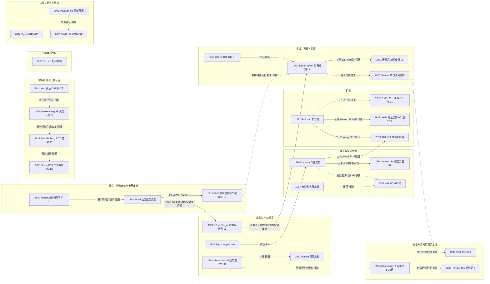

# D11 整形重建：皮瓣、显微外科与组织扩张（以烧伤与创面修复为主要应用）

> **一句话判断**：这个方向研究的是烧伤后的缺损和瘢痕挛缩用什么带血供的组织去补、怎样让它成活、什么时候做；技术库从 19 世纪的局部和远位带蒂皮瓣，经管状皮瓣、轴型与肌皮瓣、显微游离、穿支和皮肤扩张不断扩充，但这些技术大多先在创伤、肿瘤和乳房重建中建立，再移植到烧伤。荷兰三家烧伤中心 1768 例患者随访 10 年，重建最常用的仍是“松解+随意皮瓣/植皮”[D11-N24]，游离皮瓣只用于少数局部办法用尽的病例。**对临床医生最重要的一点**：挛缩修复“皮瓣优于植皮”目前只有两项各约 30 例的随机试验支持（随访 ≤1 年）[D11-N26][D11-N28]；急性期游离皮瓣的时机与电击伤风险仍只有观察性证据：时机结论相互矛盾；两项观察研究都提示电击伤需单独考虑（其中行政数据的电击伤 OR 置信区间为 2.98–550.64，估计极不精确）[D11-N23][D11-N27]。

## 0 三分钟速读

1. **从哪里来**：最早的问题是“烧伤瘢痕把颈、腕拉成畸形，切开后拿什么盖”。本轮找到的最早烧伤畸形手术记录是 Mütter 1842（只到题录）[D11-N19]；被综述认作奠基的是 Wood 1863 用腹部远位带蒂皮瓣修复 8 岁女孩的腕部烧伤挛缩（本轮读了原文扫描页）[D11-N01]。
2. **为什么改变**：远位和管状皮瓣需要多期手术 [D11-N01][D11-N20]；1967–1987 年一批解剖研究把皮瓣设计从“长宽比”改为“按血管走行”[D11-N03][D11-N10]，1973 年起组织可以靠显微吻合一次移到远处 [D11-N04]。本轮找到的最早烧伤游离皮瓣专文是 Sharzer 1975（5 例烧伤）[D11-N21]。
3. **如何分化**：分成四条并行技术线（轴型/肌皮/筋膜皮瓣、显微游离、穿支与螺旋桨、皮肤扩张及预扩张穿支皮瓣），外加两条边界线（脂肪移植、面部异体移植）。少数技术从一开始就用在烧伤上：螺旋桨皮瓣为烧伤挛缩设计 [D11-N13]，中国的超薄皮瓣首批病例包括电烧伤和化学烧伤 [D11-N30]。
4. **现在研究什么**：急性期游离皮瓣是否安全（一篇 Meta 汇总全失败率 9.91%，另一篇综述急性期成功率 92.7%，两者定义不同、方向一致）[D11-R01][D11-E4]；挛缩用皮瓣还是植皮；预扩张穿支皮瓣修复大面积面颈瘢痕（中国单中心为主）；脂肪移植用于急性烧伤创面和成熟烧伤瘢痕（开放标签或主观评估的研究多报告改善，本报告找到的唯一双盲安慰剂对照试点为阴性 [D09-N34]）。
5. **用了什么数据**：早期是个案和尸体墨汁注射；现在主体是单中心病例系列，以及建在病例系列上的比例 Meta 分析；随机试验只有少数几项（Stekelenburg 2017 皮瓣 16 例对全厚皮 14 例 [D11-N26]），行政数据只有美国 NIS 一项 [D11-N27]。
6. **还不知道什么**：急性期何时做游离皮瓣最安全、电击伤是否应单独分析；皮瓣、植皮、真皮替代物、预扩张皮瓣之间缺少长期比较；中低收入国家的实际做法缺少系统数据；综述明确写道，严重烧伤瘢痕造成的肌腱滑动障碍和致残性关节挛缩至今没有合适的重建办法 [D11-E1]。

**覆盖边界**：
- 纳入：皮瓣概念演变（随意、轴型、肌皮、筋膜皮、血管体区、穿支、螺旋桨、超薄皮瓣）；显微外科（再植、游离皮瓣）及其进入烧伤的时点；急性期与延迟期烧伤游离皮瓣；皮肤软组织扩张、扩张并发症、外置扩张、预扩张（穿支）皮瓣；烧伤挛缩的皮瓣与植皮比较；脂肪移植（放射损伤起源与烧伤应用）；面部异体移植（只作边界）。
- 不含（交给其他方向）：切痂与自体皮移植本身（D02）；真皮替代物与组织工程皮肤（D03，本章只引用 Almeida 2023 晚期挛缩松解场景的负性 RCT 作为比较证据）；创面愈合生物学与慢性创面（D08，压疮螺旋桨皮瓣、外置扩张用于慢性溃疡只点到）；瘢痕的非手术治疗（D09）；挛缩的康复、功能与长期结局（D10）；电击伤等特殊原因烧伤的流行病学与资源受限环境（D12）；中国学科史（X01）。乳房再造、唇腭裂、淋巴水肿、美容手术不展开。

**本章口径**：
- 执行日/报告截止日：2026-09-29。近期重点窗口：2021-09-29 至 2026-09-29，只用于第 4 节展开，不限制历史追溯。窗口外但必须引用的研究在文中标“窗口外”。
- 阅读层级：L0=仅二手转述；L1=题录已在数据库核实；L2=摘要已读；L3=原文部分章节已读；L4=全文已读。只到 L0/L1 的，正文写“据某来源转述”或“只到题录”，不写成已核对原文贡献。
- 核查状态：**通过/修正**=逐条对照 PubMed 题录/摘要或 PMC 全文核对（修正项已用修正值）。N01–N18、R01–R04、R06–R16、E1–E8 经第二人独立复核；后期补充检索加入的 N19–N21、N24–N26、N28–N30、R05、R17–R19、R21、E9，以及未单列复核的 N22、N23、N27、R20，在成稿时对照 PubMed 摘要、Crossref 题录或 PMC 全文逐项核对数字后记为“通过”（未经第二人独立复核）。本章没有核查结论为“存疑”的条目；来源之间冲突的说法在正文写成“两说并存”。
- 本章关键节点 30 个：L0 1 个（N20）、L1 6 个（N02、N03、N04、N07、N19、N29）、L2 22 个、L3 1 个（N01）、L4 0 个。**只有 Wood 1863 一篇奠基原文读到了原文页面（11 页中的 9 页）**，1970 年代的奠基文献（McGregor、Daniel & Taylor、Harii）和中国 1960–80 年代原始报告都只到题录。另有近期代表研究 21 条（L2 18 条；R01–R03 于 2026-09-29 补读全文方法与结果段，升为 L3；R14、R20、R21 发表在窗口外，只作背景）、入口综述 9 条（L4 1、L3 4、L2 4）。全部 60 条见 `data/evidence_D11.json`。
- 引用写法：[D11-Nxx]=关键节点，[D11-Rxx]=近期代表研究，[D11-Ex]=入口综述；只出现一次的辅助文献直接给 PMID 或 DOI。
- 检索说明：初稿检索期间 Europe PMC 持续返回 502/503，实际使用 PubMed E-utilities、NCBI PMC 全文与扫描页、OpenAlex、Crossref；没有做系统的被引列表追踪（见 8.2）。2026-09-29 修订时 Europe PMC 已恢复，只用于调取 R01–R03 全文和题录，没有补做被引追踪。
- 覆盖状态：**基本完整但有标注缺口**（2026-09-29 按全报告统一口径重评）。理由：①六个问题都能据本章回答：从哪里来见第 1 节，为什么改变见第 2 节，如何分化见第 3 节分支图，现在研究什么见第 4 节，用了什么数据见第 7 节，还有什么不知道见第 8.1 节。②章节范围内的主要分支都有节点：四条技术线（轴型/肌皮/筋膜皮瓣、显微游离、穿支与螺旋桨、扩张与预扩张皮瓣）、急性期游离皮瓣安全性、挛缩修复的比较证据、中国线，以及脂肪移植和面部移植两条边界线。③主链转折都有可核实来源：1970 年代奠基节点虽只到题录，题录已在数据库核实，转折关系另有 E1 全文（L4）支持。④缺口都已在第 8.2 节标注：1970 年代奠基文献与中国 1960–80 年代原始报告只到题录；CNKI/万方未查；没有系统被引追踪；各综述检索截止日之后的原始研究只对 2025-01 以后做了有限补查，2023 年至 2024 年底之间未补查。

---

## 1 源头：最初在研究什么

**判断**：最初的问题很具体：烧伤瘢痕把颈、腕、肘拉成畸形，切开松解后缺损大，植皮又会再缩，需要带血供的整块皮肤来盖。本轮找到的最早烧伤畸形手术记录是 Mütter 1842 [D11-N19]，但只到题录，是否用了皮瓣未知；被综述认作奠基的是 Wood 1863 [D11-N01]，而综述认定的范围是“上肢缺损的首例远位皮瓣覆盖”，不是“烧伤修复的最早记录”。此后轴型、游离、穿支、扩张等“首次”大多出现在创伤、肿瘤或乳房重建中，再用于烧伤。

“最早找到”只说明本轮在 PubMed、OpenAlex、Crossref 中检索到的最早一条，检索范围之外可能还有更早的；“公认奠基”指入口综述或同行文献明确称其为奠基或首例，不等于它真的最早。

| 说法 | 分类 | 依据与限定 | 层级 |
|---|---|---|---|
| 烧伤畸形的手术修复：Mütter TD. Cases of Deformity from Burns, relieved by Operation. Am J Med Sci 1842;4(7):66-80 | 目前最早找到的文献 | Crossref 题录已核（DOI 10.1097/00000441-184207000-00005）；比 Wood 早 21 年。Harris & Morgan 1994 摘要称 Mütter 以同名颈部皮瓣闻名（PMID 7985975）；1842 年原文是否用了该皮瓣本轮未读 | L1 |
| 远位带蒂皮瓣修复烧伤挛缩：Wood 1863 | 被公认的奠基工作（限“上肢缺损的远位皮瓣”） | E1 称其为上肢缺损首例远位皮瓣覆盖，并指出半个世纪后才流行。手术在 1862 年，论文宣读和发表在 1863 年；E1 只写 1862 | L3 |
| 管状带蒂皮瓣：Filatov 1916、Gillies 1917 | 被公认的奠基工作（仅据 E1 转述） | 原始文献本轮未找到档案定位 | L0 |
| 轴型/随意皮瓣分类：McGregor & Morgan 1973 | 被公认的奠基工作（分类命名的定型） | 更早已有 Milton 1969/1970 题名质疑“长宽比”（PMID 4889101、4913490），Fujino 1967 题名已用 axial 与 perforator vasculature（PMID 5335195）；均只到题录 | L1 |
| 断肢再植 | 存在争议的首次 | E1 称 Malt & McKhann 1962 为首例成功“前臂”再植；Malt 1972 自己的随访（扫描页 p334）写明该例为右臂、肱骨平面。陈中伟等 1963 题名为前臂完全离断再植。更像两个离断平面各自的首例；陈中伟病例手术日期未核 | L1 |
| 游离（显微吻合）组织移植 | 存在争议的首次 | 候选：Nakayama 1964 游离肠段、中国 1965 足趾-拇指移植（均据 E1）；Antia & Buch 1971 腹部真皮脂肪组织（PMID 4251275）；McLean & Buncke 1972 大网膜修头皮（PMID 4551236）；Daniel & Taylor 1973 腹股沟皮瓣到足 [D11-N04]。“首例”取决于定义 | L0–L1 |
| 烧伤游离皮瓣：Sharzer 1975 | 目前最早找到的文献 | 本轮找到的最早烧伤专文；另有 Ohmori 1978（PMID 354224，L1） | L2 |
| 皮肤软组织扩张：Neumann 1957；Radovan 1982 | Neumann=目前最早找到的文献；Radovan=被公认的奠基工作 | Neale 1993 摘要称 Radovan 1982 为 landmark work；同年 Austad & Rose 1982 另有自膨胀扩张器（PMID 7122748），两条路线并行。Bennett 1993 [D11-E2] 所述“古代起源”未核 | L1/L2 |
| 筋膜皮瓣：Pontén 1981 | 目前最早找到的文献 | 仅限题名用语；早于 1981 年的不同称谓未系统检索 | L2 |
| 血管体区（angiosome）：Taylor & Palmer 1987 | 被公认的奠基工作 | E1 列 Manchot 1889、Salmon 1936 为前驱（L0） | L2 |
| 穿支皮瓣 | 存在争议的首次 | E1 称 Koshima & Soeda 1989 为首例穿支皮瓣，E3 称 Koshima 1989 提出该术语；Kroll & Rosenfield 1988 题名已用“perforator-based flaps”（5 例） | L2 |
| 螺旋桨皮瓣：Hyakusoku 1991 | 作者自称首次 | 起源叙述来自原创者本人（E3）；东京共识沿用 | L2 |
| 前臂游离皮瓣（“中国皮瓣”） | 存在争议的首次 | E1 写 1979 年由杨果凡完成；中文原文 1981 年；英文最早见 Song R 1982（PMID 7094519）；1997 年 BJPS 重刊 | L1 |
| 大腿（股前外侧）皮瓣：宋业光 1984 | 目前最早找到的文献 | 中文原始出处未检 | L2 |
| 中国烧伤扩张：张涤生、金一涛 1985 | 目前最早找到的文献（PubMed 可查） | 题名为软组织扩张器用于烧伤后病例 10 例；不写成“首篇” | L1 |
| 面部复合组织异体移植：Devauchelle 2006 | 作者自称首次 | 手术 2005 年（Longo 2023），发表 2006 年 | L2 |
| 脂肪移植治疗放射损伤：Rigotti 2007 | 目前最早找到的文献 | 只限题名检索；脂肪移植本身的起源未追溯 | L2 |
| Z 成形 | 存在争议的首次 | Ivy 1971 题名归于 Denonvilliers（PMID 4924438），Borges 1973 另有“The original Z-plasty”（PMID 4580014）；只到题录 | L1 |

---

## 2 关键转折：问题—新证据/新方法—认识变化—新问题

### 2.0 先校正一个印象：技术谱系不等于烧伤里的实际用量

一条从随意皮瓣到穿支、游离皮瓣的技术谱系，容易被读成“烧伤重建一路升级”。三组数据不支持这种读法：

- **Platt 1996**（英国 Newcastle 烧伤中心，1989–1993）：1699 例入院，604 例（35.5%）需手术；其中 582 例（96.4%）做切痂加刃厚皮移植，13 例（2.1%）用局部皮瓣，9 例（1.5%）做游离组织移植 [D11-N22]。
- **Hop 2014**（荷兰三家烧伤中心，1998–2001 年入院 1768 例，随访 10 年）：229 例（13.0%）做过重建手术，人均 3.6 次（1–25 次）；最主要的指征是瘢痕挛缩，最常用的技术是“松解+随意皮瓣/植皮”；人均重建费用 8342 欧元 [D11-N24]。
- **Perrault 2020**（美国 NIS 2002–2014，加权 306,924 次急性烧伤住院）：526 次用了皮瓣（带蒂或游离），占 0.17% [D11-N27]。Fan 2025 的摘要开头写道，显微外科在烧伤处理中的使用“仍极有限”[D11-E4]。

三组数据的年代、国家和分析单位不同（Platt、Hop 按患者，Perrault 按住院），不能合成一个比例，但方向一致：大多数烧伤手术靠植皮，重建以局部手段为主。下表把通用里程碑与本轮找到的烧伤应用对照：

| 技术 | 奠基文献（原始用途） | 本轮找到的烧伤应用首篇或代表 |
|---|---|---|
| 腹股沟轴型皮瓣 | McGregor & Jackson 1972 [D11-N03]（仅题录，结果与数据未核） | Sharzer 1975 游离腹股沟皮瓣用于 2 例急性电烧伤、3 例挛缩 [D11-N21]；E1 把 Wood 1863 回溯归类为腹股沟轴型血供皮瓣 |
| 游离皮瓣 | Daniel & Taylor 1973（足部缺损，据 E1）[D11-N04]（仅题录，结果与数据未核） | Sharzer 1975 [D11-N21]；Ohmori 1978（PMID 354224，L1） |
| 肌瓣/肌皮瓣分型 | Mathes & Nahai 1981 [D11-N05] | Baumeister 2005：高压电烧伤早期多用肌瓣 [D11-N23]；Arellano 2024 [D11-R03] |
| 筋膜皮瓣 | Pontén 1981（小腿缺损）[D11-N06] | Arellano 2024 筋膜皮瓣组 [D11-R03]；烧伤首篇未找到 |
| 血管体区 | Taylor & Palmer 1987（尸体研究）[D11-N10] | 未找到烧伤专门应用证据 |
| 穿支皮瓣、股前外侧皮瓣 | Koshima 1989 [D11-N12]、Wei 2002（以头颈肿瘤为主）[D11-N14] | Stekelenburg 2017 穿支蒂插入皮瓣 RCT [D11-N26]；Chang 2021 胸背动脉穿支游离皮瓣 25 例 [D11-R20] |
| 螺旋桨皮瓣 | Hyakusoku 1991 [D11-N13] | 起源就是烧伤挛缩（肘窝、腋窝） |
| 皮肤扩张 | Radovan 1982（乳房再造）[D11-N08] | Neale 1988 儿童烧伤 [D11-N11]；张涤生、金一涛 1985 [D11-N29]（仅题录，结果与数据未核；10 例只来自题名） |
| 预扩张穿支皮瓣 | 昝涛 2013（病因未全部限定为烧伤）[D11-N18] | 同组 2016 年颈部烧伤瘢痕 37 例（PMID 27562155） |
| 超薄皮瓣 | Sun YH 1991 [D11-N30] | 首批病例包括电接触烧伤、化学烧伤和绞轧伤造成的深度损伤 |
| 脂肪移植 | Rigotti 2007（放射损伤）[D11-N16] | Abouzaid 2022 急性烧伤 RCT [D11-R11] |
| 面部异体移植 | Devauchelle 2006 [D11-N15] | 烧伤是适应证之一；受者中烧伤人数本轮未提取 |

### 2.1 烧伤挛缩拿什么盖：局部、远位与管状皮瓣（1842–1945）

- **更早的记录**：Mütter 1842 的题名是“烧伤畸形经手术缓解的病例”[D11-N19]。Robson 1976 把“Mütter 皮瓣”描述为以乳突-枕部为蒂的肩部皮瓣，21 块这种皮瓣不经延迟直接转移，用于头颈癌重建（PMID 1015537，L2）。1842 年原文用了什么方法本轮未读，只能写到“有更早的烧伤畸形手术记录”。
- **Wood 1863**（单例，本轮读了扫描页 p149–151、p154–159）[D11-N01]：8 岁女孩 1862 年 1 月因颈部和双臂烧伤入 King's College Hospital。颈部在 1862 年 10 月 4 日先用局部 V-Y 加邻近皮瓣松解，**瘢痕再次挛缩**，1863 年 1 月 31 日再切除瘢痕、直接缝合，此后未再收缩，作者归因于颈颏转角处形成细线状一期愈合瘢痕。腕部是**背侧（伸侧）挛缩**，手被拉向背侧；1862 年 11 月 5 日横行松解后，从腹部掀起基底朝左腹股沟的皮瓣覆盖腕部。皮瓣到 11 月 27 日已与创面完全愈合，11 月 29 日起分期断蒂（蒂宽约 1¾ 英寸，每次每侧切开约半英寸），12 月 6 日再断一部分，之后每周一次共两次，1863 年 1 月 3 日完全断蒂。右肘挛缩只用夹板牵伸。这一例证明了远位带蒂皮瓣可以用于烧伤挛缩，同时记下了一次失败：邻近皮瓣修颈部后复发。
- **管状皮瓣与战争**（据 E1 转述，原文 L0）[D11-N20]：E1 记载 Filatov 1916、Gillies 1917 引入管状带蒂皮瓣，使远位皮瓣更容易维护、成活更好；二战时上肢重建依赖管状皮瓣和远位皮瓣（下腹-腹股沟皮瓣、胸腹皮瓣）。McIndoe 作为英国皇家空军整形顾问在 East Grinstead 建立整形单位，他治疗的烧伤伤员组成 Guinea Pig Club；他把康复和社会回归看得与身体重建同样重要（Geomelas 2011 摘要，PMID 21422943；Jackson 1979 McIndoe 讲座摘要，PMID 386890）。
- **关系与限定**：E1 写 Wood 的技术“半个世纪后才流行”，这是综述归纳的时间先后，Wood 是否影响了后人未见依据。管状皮瓣需要多期转移；它后来在多大程度上、因什么被轴型和游离皮瓣替代，本轮没有找到直接讨论的来源（列入 8.3 待核）。

### 2.2 皮瓣为什么能活：从长宽比到血管地图（1967–1987）

- **问题**：随意皮瓣受长宽比约束，远位修复需要延迟和多期手术。
- **新证据与新方法**：Fujino 1967 题名已用“axial and perforator vasculature”；Milton 1969/1970 题名直指“长宽比的谬误”；McGregor & Jackson 1972 发表腹股沟皮瓣，Smith、Foley、McGregor 1972 发表其解剖基础（PMID 4550070），McGregor & Morgan 1973 提出 axial 与 random pattern 的分类命名，Smith 1973 写轴型皮瓣的血管基础（PMID 4574779）[D11-N03]。以上全部只到题录（均无摘要），结果与数据未核；2026-09-29 在 Europe PMC 和 OpenAlex 再查 McGregor & Jackson 1972，仍无摘要，且非开放获取，未能升到 L2。腹股沟皮瓣以旋髂浅血管为蒂的写法见 Sharzer 1975 摘要 [D11-N21]。
- **认识变化**：分类命名在 McGregor & Morgan 1973 定型，但质疑长宽比（Milton）和使用轴向血管概念（Fujino）都更早，这个转变不能归于单一作者 [D11-N03]。
- **扩展与并行**：McCraw 1977 定义了 13 个临床肌皮瓣的血管区（PMID 142995，L2）；Mathes & Nahai 1981 提出 5 型肌肉血供模式，用来预测旋转弧、皮岛范围、远端蒂和游离移植 [D11-N05]；同年 Pontén 报告 23 块小腿筋膜皮瓣，认为带上深筋膜即可安全设计大皮瓣，不需额外设备（摘要无成活率数字）[D11-N06]。两条路线同年出现，本报告判为并行（推断）。Taylor & Palmer 1987 用新鲜尸体和离体肢体做墨汁注射、解剖、穿支标记和放射学分析，提出 angiosome：血供是贯穿各组织层的三维血管网，平均每具标本标出 374 支主要穿支，“还有很多潜在皮瓣”[D11-N10]。
- **新问题**：以上都是解剖和通用重建工作。进入烧伤的时点见 2.0 表；angiosome 本轮未找到烧伤专门应用证据。

### 2.3 能否一次移到远处：再植与游离皮瓣（1962–1978）

- **问题**：远位带蒂皮瓣需要多期手术、肢体长期固定。
- **再植的“首次”**：E1 写 Malt & McKhann 1962 年完成首例成功“前臂”再植（JAMA 1964 题名 Replantation of severed arms，PMID 14175645）。Malt 等 1972 年的长期随访（Ann Surg 176:334，PMID 4672460，扫描页 p334）写明病例 1 是 12 岁男孩的右臂，1962 年 5 月 23 日再植，后来在原骨折处发生肱骨再骨折，离断平面在上臂。陈中伟、钱允庆、鲍约瑟 1963 年在 Chin Med J 报告前臂完全离断再植，同一病例另见中华外科杂志 1963;11:767-72（PMID 14110571）；仅题录，结果与数据未核 [D11-N02]。E1 的“forearm”与 Malt 本人的随访不一致；两例更像不同离断平面各自的首例，本报告不裁定。
- **游离组织移植的候选“首例”**：据 E1，Nakayama 1964 游离肠段、中国 1965 年足趾-拇指移植（当时外界不知）；Antia & Buch 1971 经直接血管吻合转移腹部真皮脂肪组织（PMID 4251275）；McLean & Buncke 1972 大网膜修复头皮大缺损（PMID 4551236；E1 写作 1971 年、颅骨缺损，与 PubMed 记录不符）；Daniel & Taylor 1973 用显微吻合把腹股沟岛状皮瓣转移到足部，E1 称其为首例四肢显微游离重建 [D11-N04]；Harii 等 1974 年题名为 10 块游离皮瓣成功临床转移（PMID 4591857），E1 另记 Harii 1973 年把游离腹股沟皮瓣移到手部。全部只到题录，结果与数据未核；Daniel & Taylor 1973 于 2026-09-29 在 Europe PMC 和 OpenAlex 再查，仍无摘要，且非开放获取，未能升到 L2。
- **关系**：Daniel & Taylor 转移的正是腹股沟皮瓣，E1 支持“轴型皮瓣→游离皮瓣”的扩展关系。再植与游离皮瓣共享显微血管吻合技术，本报告把陈中伟病例与游离皮瓣列为并行（推断；E1 该段未提陈中伟）。
- **上肢成为供区**：E1 写 1979 年杨果凡完成前臂桡动脉皮瓣，并称中国 1970 年代的显微外科进展到 1980 年国际代表团访华后才为外界所知 [D11-N07]。中文原文 1981 年（56 例，1997 年 BJPS 作为 classic reprint 重刊）；英文早期报告见 Song R 等 1982（PMID 7094519）；Khoo 1997 有关于杨果凡与前臂皮瓣的札记（PMID 9047225）。均只到题录，结果与数据未核（56 例只来自题名）。
- **进入烧伤**：Sharzer 等 1975 年报告游离腹股沟皮瓣用于 2 例急性电烧伤、3 例瘢痕挛缩（另 1 例放射性骨坏死），结果均满意，并列出禁忌：受区或供区血管异常、暴发性感染、全身衰弱、肥胖 [D11-N21]。

### 2.4 不带肌肉：大腿皮瓣与穿支皮瓣（1984–2006）

- **问题**：肌皮瓣臃肿、牺牲肌肉，腹直肌肌皮瓣可致腹壁疝。
- **大腿皮瓣**：宋业光、陈果长等 1984 年提出以肌间隔皮动脉为基础的游离大腿皮瓣，称其神经血管蒂长而粗，可游离或岛状转移，可替代下腹、腹股沟、阔筋膜张肌等皮瓣（摘要无病例数）[D11-N09]。Koshima 等 1989 年在 8 例股前外侧皮瓣中报告了两种蒂部变异，另有 5 例找不到穿支（PMID 2758197，L2）。
- **穿支概念与“首次”冲突**：Kroll & Rosenfield 1988 题名已用“perforator-based flaps”，以下背部中线附近的无名穿支为蒂做了 5 例（PMID 3279442，L2）；Koshima & Soeda 1989 报告 2 例不带腹直肌、以肌穿支为蒂的腹壁下动脉皮瓣，仅靠单支肌穿支即可存活 [D11-N12]。E1 称后者为首例穿支皮瓣，E3 称 Koshima 1989 提出了 perforator flap 一词，两处说法都与 Kroll 1988、Fujino 1967 的题名用法冲突，本报告两说并存。E1 把 Taylor 的血管地图列为穿支皮瓣出现的前提 [D11-N10]。Allen & Treece 1994 用腹壁下深动脉穿支皮瓣完成 15 例乳房再造（PMID 8141534，边界外，只作参照）。
- **大样本验证与修正**：Wei 等 2002 年（长庚，1996 年 6 月–2000 年 8 月）672 块股前外侧皮瓣/660 例：头颈 484、上肢 58、下肢 121、躯干 9；全失败 12 块（1.79%），部分失败 17 块（2.53%）；439 块为肌皮穿支皮瓣；皮肤型和筋膜皮型皮瓣中 87.1% 的皮支是肌皮穿支、12.9% 是肌间隔血管；只有 6 例找不到皮支 [D11-N14]。同一样本中 439 块穿支皮瓣的子集见 Celik 2002：完全成功 96.58%（424/439），失败 15 块（全失败 8、部分失败 7），再探查 34 块、挽救 19 块（PMID 12045538，同一队列，不计为独立证据）。Wei 2002 把“肌间隔皮动脉”的前提修正为“以肌皮穿支为主、不论皮支类型都能切取”（修正，本报告推断：Wei 摘要未直接讨论宋业光 1984）。Wei & Mardini 2004 进一步提出只凭术前多普勒信号切取的 free-style 游离皮瓣（13 块，全部用于口咽癌，PMID 15468398）。
- **新问题**：Wei 2002 以头颈肿瘤重建为主，烧伤未单列。烧伤中的应用见 Stekelenburg 2017 [D11-N26] 和 Chang 2021：薄型胸背动脉穿支游离皮瓣修复 25 例四肢烧伤挛缩，14 例活动度改善，4 例部分坏死（窗口外）[D11-R20]。

### 2.5 就地旋转：螺旋桨皮瓣（1991–2011）

- **问题**：肘窝、腋窝等关节屈侧的烧伤挛缩需要带正常皮肤的局部修复。
- **方法**：Hyakusoku 等 1991 年报告把皮瓣像螺旋桨一样掀起旋转，松解肘窝和腋窝挛缩结果满意，建议用于腹股沟、腘窝、手指等烧伤挛缩好发的屈侧部位（摘要无例数）[D11-N13]。原创者本人的回顾称这类带蒂皮瓣是 1980 年代在日本医科大学为大量烧伤后挛缩开发的 [D11-E3]。
- **分化**：E3 称 Hallock 2006 把穿支概念用于螺旋桨皮瓣；这篇实际是内收肌穿支皮瓣的螺旋桨版本，用于坐骨和转子压疮（PMID 16641632，L2），不是烧伤。2009 年第一届东京穿支与螺旋桨皮瓣会议形成共识（Pignatti 2011，PMID 21285776）：螺旋桨皮瓣定义为“经轴向旋转到达受区的岛状皮瓣”，按蒂的类型（皮下、穿支、增压）和旋转角度（90–180°）分类。
- **与 Wood 的关系**：两者都处理关节部位的烧伤挛缩，但 Wood 的腕部是背侧挛缩，Hyakusoku 针对屈侧；只能说是同类问题的不同时代解法，本报告不画为直接关系。

### 2.6 让邻近皮肤长出来：扩张术的推广与收缩（1957–2017）

- **问题**：缺损附近颜色、质地、感觉相近的皮肤不够。
- **起点与并行**：Neumann 1957 题名为用皮下球囊逐步扩张获取耳再造用皮肤（PMID 13419574，L1）。Radovan 1982 用临时扩张器做乳房再造 68 例（平均随访 18 个月，平均扩张 6 周），1984 年用于软组织重建超过 130 例（间断注入生理盐水，供区皮瓣面积约翻倍，平均 3–6 周形成）[D11-N08]。同年 Austad & Rose 1982 报告自膨胀扩张器，豚鼠组织学和临床结果都“令人鼓舞”，但需要通透性更好的膜（PMID 7122748，L2）。Neumann 与 Radovan 相隔 25 年，本轮没有检索这段时间的中间记录；Radovan 是否参考 Neumann 本轮未核实，不写成继承关系。同期 Manders 1984 称未选择病例中主要并发症约每 4 例 1 例，但多导致延期而非组织丢失（PMID 6484036，L2）。
- **进入烧伤后的质疑**：Neale 等 1988 年回顾 Burn Institute 1984 年 6 月–1987 年 6 月全部扩张病例，122 个扩张器/77 例儿童：绝对并发症（扩张器丢失、需额外手术或完全未达计划）23/122（20%），相对并发症 14/122（11%），最常见的是头皮伤口裂开导致扩张器外露；头皮 20/92（22%）、颈面 2/20（10%）、下肢 1/4、躯干 0/6；作者认为高并发症可能是儿童烧伤特有 [D11-N11]。同组 Neale 1993（1984–1990 年，52 个扩张器/37 例，与 1988 年样本时间重叠）明确写道：Radovan 1982 曾被视为万能方法，本组“用过而且可能过度使用了”扩张器；并提出颈面部原则：扩张颈部皮肤推进越过下颌缘要谨慎（瘢痕增宽、唇或睑外翻风险），颈部垂直缝线可能需要改向以防线状挛缩（PMID 8446716）。这一“质疑并收缩适用边界”的关系出自 1993 年续篇，不是 1988 年原文。
- **修正**：Bozkurt 2008（57 例烧伤/102 个扩张器，8 年）发现部位（p=0.0156）和扩张器容量（p=0.0417）与失败相关，年龄、性别、每人扩张器数与形状无关（PMID 18706766）。Fochtmann 2013（1994–2011 年，73 例/148 个扩张器）比较烧伤瘢痕组 31 例与其他适应证组 42 例，并发症无差异（p=0.1412），年龄 <10 岁（p=0.0043）和 TBSA 更大（p=0.0258）与并发症相关（PMID 23276651）。于是“烧伤本身是否增加风险”出现两说（见 5.1）。
- **分化一：外置扩张**：中国团队 1995 年认为内置硅胶扩张器有手术并发症、费用高、材料不能重复使用，设计了外置机械扩张器，1993 年 6 月起治疗 44 例晚期烧伤瘢痕，报告满意（无对照）（Mingli 1995，PMID 7480279，L2）。
- **分化二：预扩张（穿支）皮瓣**：昝涛等 2013 年（上海九院，2005 年 5 月–2011 年 7 月）69 例面颈修复，用 6 类预扩张胸前皮瓣：带蒂锁骨上动脉胸支皮瓣 33、带蒂胸廓内动脉穿支皮瓣 11、游离胸廓内动脉穿支皮瓣 8、增压锁骨上动脉胸支皮瓣 4、预构皮瓣 17、增压预构皮瓣 3，并按缺损特征和胸前优势血管提出选择流程（摘要无并发症数字，病因未全部限定为烧伤）[D11-N18]。同组 2016 年把颈部大面积烧伤瘢痕按范围分 3 型，用背部预扩张穿支皮瓣修复 37 例，3 块皮瓣尖端坏死经换药愈合（PMID 27562155）。Wang 等 2017 年综述把预扩张穿支皮瓣定义为扩张术与穿支皮瓣的结合，同时指出其定义和扩张对浅表血管构筑的影响仍有争议 [D11-E9]。

### 2.7 急性期能不能做游离皮瓣（1975–2021）

- **问题**：急性烧伤患者的全身状态和受区血管条件与择期重建不同，游离皮瓣是否更易失败、何时做。
- **负性信号**：Platt 1996 报告烧伤患者游离皮瓣丢失 22%，同期非烧伤显微重建 3%（烧伤组只有 9 例）[D11-N22]。
- **按时机看**：Baumeister 2005 回顾 60 例/75 块游离皮瓣（20 种）：高压电烧伤（26 例）多在伤后 21 日内用肌瓣早期覆盖，火焰、接触、液体烧伤多在伤后 3–6 周或二期用皮瓣；总失败 13%（10 块），其中 8 块发生在伤后 5–21 日、全部 10 块在伤后 5 日至 6 周之间，二期重建无失败；作者主张电烧伤与热烧伤是不同实体，需分别设计 [D11-N23]。
- **行政数据在时机上给出相反结论**：Perrault 2020 用 NIS 分析 526 次皮瓣，皮瓣并发症（定义为以 ICD-9 编码记录的返回手术室修整皮瓣）6.4%，手术时机与并发症无关，唯一独立预测因素是电击伤（OR 40.49，95%CI 2.98–550.64）[D11-N27]。这个置信区间跨两个数量级：分析只有 526 次皮瓣、并发症 6.4%，事件数少，估计极不精确，只能说明方向，不能说明风险大小。Ziegler 2021（德国 Ludwigshafen 叙述性综述）认为严格掌握指征时，急性期游离皮瓣的并发症率可与其他创伤性肢体缺损相当，重建期更低（窗口外）[D11-R21]。
- **认识变化与新问题**：从“急性期高风险、宜推迟”变为“选择性使用”，但时机结论相互矛盾：Baumeister 按伤后天数看失败集中在 5–21 日，Perrault 在行政数据中看不到时机效应。两者的结局定义（皮瓣失败 vs 返回手术室）和数据来源不同，不能直接比较；两者都指向电击伤需要单独考虑（与 D12 交叉）。2021 年后的汇总见 4.1。

### 2.8 从病例系列到第一批随机比较（2014–2023）

- **问题**：挛缩松解后用皮瓣还是植皮、要不要加真皮替代物。
- **证据状态**：Stekelenburg 2015 系统综述在 1649 篇中只找到 17 篇符合标准（3 项对照试验、14 项队列），全部有方法学缺陷、多数统计方法不当，无法得出结论 [D11-N25]。
- **第一项多中心 RCT**：Stekelenburg 2017（荷兰三地）比较穿支蒂插入皮瓣 16 例与全厚皮片 14 例，主要结局是皮瓣或皮片面积变化：3 个月 123% vs 87%，12 个月 142% vs 92%（均 p<0.001），POSAS 观察者评分和颜色也更好；摘要称此前没有同类 RCT [D11-N26]。
- **中低收入国家的随机比较**：Saaiq 2021（巴基斯坦伊斯兰堡两家机构）30 例颈部挛缩，一半随机接受锁骨上动脉皮瓣、一半植皮：颜色质地满意 84.66% vs 42.66%；1 年再挛缩植皮组 73.33%、皮瓣组 0；皮瓣组供区增生性瘢痕 13%、皮瓣尖端坏死 6.66%，植皮组 33% 部分失败 [D11-N28]。该文 2021 年 1 月发表，比近期窗口起点早约 8 个月。
- **负性 RCT**：Almeida 2023（巴西 Ribeirão Preto，四臂）对伤后至少 1 年的挛缩，比较 Integra、Matriderm、Pelnac 加刃厚皮与单纯刃厚皮，术后至少 1 年用 VSS、硬度计、皮肤弹性计评估，组间无差异 [D11-R05]（与 D03 交叉）。这项试验只针对晚期挛缩松解；急性创面的瘢痕证据见 D03 第 2.4 节。
- **独立性**：Hop 2014、Stekelenburg 2015、Stekelenburg 2017 都有 Stekelenburg CM 署名，前两篇的单位含荷兰烧伤中心协会，三篇是同一研究群体的连续工作，不是相互独立的外部验证。
- **认识变化与新问题**：从“病例系列为主、少量对照试验质量低”变为“两项小 RCT 支持皮瓣优于植皮（面积保持、再挛缩）；在晚期挛缩松解场景中，替代物加植皮的获益未被 RCT 证实（Almeida 2023）”；急性创面的瘢痕证据见 D03 第 2.4 节。两项皮瓣 RCT 合计约 60 例、随访 ≤1 年、结局指标不同，回答不了“哪种皮瓣、哪个部位、多久”。

### 2.9 边界：再生取向与异体移植（2006–2008）

- **脂肪移植**：Rigotti 2007 用纯化脂肪抽吸物反复注射治疗 20 例 LENT-SOMA 3–4 级放射损伤（2002 年起入组，随访至 31 个月），所有受评患者症状改善或缓解；2 cc 抽吸物的基质血管组分中间充质干细胞样细胞平均占 1.07±0.5%（n=4）；“干细胞介导”是观察性推论，无对照 [D11-N16]。它把脂肪移植从“填充容量”扩展到“改善组织质量”的假说，进入烧伤的代表是 Abouzaid 2022（急性创面，开放标签）[D11-R11]；成熟烧伤瘢痕上的双盲安慰剂对照试点 Gal 2017 为阴性 [D09-N34]（见 4.4）。
- **面部异体移植**：Devauchelle 2006 报告首例部分面部移植：38 岁女性，鼻远端、双唇、颏和部分颊部缺失；缺血 4 小时；第 20 日轻度排斥，经 3 次泼尼松冲击消退；第 1 周末可进食；随访 4 个月；摘要未写致伤原因 [D11-N15]。郭树忠等 2008 年报告另一中心的 2 年随访：30 岁男性，2004 年 10 月熊咬伤，2006 年 4 月手术，第 3、5、17 个月 3 次急性排斥，术后第 3 日高血糖需药物控制 [D11-N17]。两例都是单例，“验证”力度有限；郭树忠病例为熊咬伤，Devauchelle 摘要未写致伤原因，两例都不能说明烧伤受者的情况。它在“自体组织阶梯”之外增加了一个需要终身免疫抑制的选项。

---

## 3 分支图

图例：实线=原文明确讨论或综述归纳的关系；虚线=本报告推断；边上写关系类型。“回溯归类”指综述用后来的概念给早期工作归类，不表示早期工作影响了后来者。L0/L1 标在节点上。

---

## 4 近五年重点（2021-09-29 至 2026-09-29）

**先说明数据性质**：窗口内发表的烧伤皮瓣证据以系统综述为主。Fan 2025 纳入的是 2005–2023 年发表的研究 [D11-E4]。Kasmirski 2023、Liu 2024、Arellano 2024 的摘要未报告检索截止日；2026-09-29 补读三篇的 PMC 全文方法段（L3）后确认：检索执行日分别为 2023-02-08、2023-02-08、2023-09-15，不限发表年份，只收英文，排除少于 5 例的研究；纳入研究的发表年份，Kasmirski 为 1986–2022 年（据正文纳入文献的引文编号推定），Liu 为 1991–2022 年，Arellano 为 1992–2023 年（均据各自表 1）[D11-R01–R03]。三篇出自同一团队，前两篇共用 PROSPERO CRD42023404478。**窗口内的原始研究只来自主题检索，没有按各综述截止日做系统补查**；2026-09-29 只对 2025-01 以后（E6、E7 检索截止之后）用 1 组 PubMed 检索式做了有限补查（结果见 4.1 末条），2023 年各综述截止日至 2024 年底之间的原始研究未补查。窗口内的原始研究多为单中心病例系列，随机试验只有 Almeida 2023（负性）和 Abouzaid 2022（脂肪移植）。

### 4.1 急性期与延迟期烧伤游离皮瓣的安全性

- **研究什么**：急性期做游离皮瓣的失败率与返回手术室率；肌瓣与筋膜皮瓣的差别；一期与二期重建的手术负担。
- **数据与设计**：已发表病例系列的比例 Meta 分析；单中心回顾性队列。
- **代表研究**：
  - Kasmirski 2023：31 篇、427 例、454 块急性期游离皮瓣；全失败 9.91%（95%CI 7.48–13.02%），部分失败 4.76%，静脉血栓 6.41%，动脉血栓 5.08%，急性返回手术室 20.63%；下肢失败 8.33%，上肢 6.74% [D11-R01]。全文补读（L3）：只纳入伤后 6 周内做的游离皮瓣；电烧伤占 60%，按病因分层后全失败率电烧伤 9.13%（5.98–13.73%）、非电烧伤 7.48%（4.19–13.00%），作者说明因缺少比较研究，没有做直接比较；讨论段把约 10% 的失败率与择期肿瘤术后重建的 2–5% 相比，认为偏高。
  - Liu HY 2024（同一注册号、同一团队）：延迟重建 40 篇、928 例、1026 块；平均伤后 94.68 个月重建；全失败 3.80%，部分失败 5.95%，挛缩复发 0.62% [D11-R02]。延迟重建定义为伤后 ≥6 周、已完成急性期确定性处理（全文方法段，L3）；没有对照组，是单臂比例。
  - Arellano 2024（同一团队、另一注册号）：12 项研究、181 块（肌瓣 87、筋膜皮瓣 94）；肌瓣全失败 RR 2.32（1.01–5.32），动脉血栓 RR 3.13（1.17–8.42），截肢 RR 8.89（1.27–70.13）；静脉血栓和再干预无差异；摘要称既往研究皮瓣丢失率最高达 44% [D11-R03]。急性期定义为伤后 6 周内（全文方法段，L3）。
  - Fan 2025：13 项研究、396 块；每块皮瓣平均成功率急性期 92.7%、重建期 95.7%；多数急性期手术在伤后 5–22 日；作者认为急性期显微重建的成功率和并发症谱与创伤重建相似 [D11-E4]。
  - Kang 2026（韩国单中心，2012–2025）：55 例/65 块（一期 35、二期 30）。二期组 TBSA 更大（中位 18% vs 3%）、缺损更大（348.5 vs 203.3 cm²），伤后中位 534 日 vs 30 日；手术时间 236.3 vs 170.7 分钟（p<0.001；校正后差 55.2 分钟，95%CI 20.4–90.1）；皮瓣总成活 98.5%（64/65）；并发症一期 2.9% vs 二期 6.7%（p=0.59）；90.8% 用胸背血管系皮瓣 [D11-R04]。Kang 2026 与 Chang 2021 [D11-R20] 都有 Kim YH 署名，病例是否重叠未核。
  - **2025–2026 年有限补查**（2026-09-29；PubMed 1 组检索式，发表日期 2025-01-01 至 2026-09-29，命中 21 条；不是系统检索；以下均为单中心回顾性研究，只读摘要，L2）：
    - Sanchez 2026（美国 UT Southwestern，2016-10 至 2024-09）：96 例显微重建（创伤 67、烧伤 29）；皮瓣成功率烧伤 96.6%、创伤 92.5%，并发症无差异（p=0.356）；急性病例中烧伤 100%、创伤 92%（PMID 41776942；DOI 10.1055/a-2824-5824）。
    - Bonetti 2025（美国匹兹堡大学，2010-08 至 2022-12，下肢急性烧伤）：28 例；游离皮瓣 11 例，总并发症 54.5%、全失败 18.2%；带蒂皮瓣 17 例 28 次，分别为 25.0%、0%（全失败 p=0.021）（PMID 40209804；DOI 10.1097/SAP.0000000000004344）。
    - Chaturvedi 2026（印度 AIIMS Bhopal，四肢高压电烧伤）：23 例；早期（伤后 <21 日）失败 1/6，延迟（>21 日、至少清创 2 次）失败 2/17（P=1.00）；并发症 66.7% vs 47.1%（P=0.34）；总成活 87%（PMID 41538784；DOI 10.1097/SAP.0000000000004627）。
    - Verdaguer 2025（西班牙 Vall d'Hebron 烧伤中心，2005–2022）：30 块急性期股前外侧游离皮瓣，最常见病因为高压电烧伤，伤后平均 22 日手术，成活 96.6%（PMID 40558629；DOI 10.3390/ebj6020034）。
    - Cheng L 2025（北京积水潭医院，2019–2023）：25 例高压电烧伤腕手部，用双皮岛股前外侧游离皮瓣，22 块完全成活，静脉淤血、动脉血栓、脓肿各 1 例；摘要未给手术距伤时间（PMID 40400052；DOI 10.1097/SAP.0000000000004370）。
    - 另有 Watson 2026 腋窝重建 12 例/13 块（急性 3 例，无全失败；PMID 41297242）和 Sagnon 2026 3 例（PMID 41782768），样本更小，未展开。
    - 这些研究样本 3–96 例，全部回顾性，结论不一致，没有改变本节的判断。
- **分歧**：Kasmirski 的全失败 9.91% 与 Fan 的急性期成功率 92.7% 方向一致、定义不同（全失败 vs 成功），不构成对立；两者解读不同，是因为参照组不同：Kasmirski 与择期肿瘤术后重建（2–5%）比，认为偏高，Fan 与创伤重建比，认为相似。真正的分歧有两处：①时机：Baumeister 的失败集中在伤后 5–21 日 [D11-N23]，Perrault 看不到时机效应 [D11-N27]；②年代差：1990 年代单中心 Platt 报告 22% [D11-N22]、Arellano 摘要所说既往最高 44%，而近期汇总约 7–10%；原文没有说明差距来自技术进步、病例选择还是发表偏倚。有限补查到的 2025–2026 年单中心研究也不一致：Sanchez 2026 烧伤与创伤成功率相近，Bonetti 2025 下肢急性期游离皮瓣全失败高于带蒂皮瓣，Chaturvedi 2026 的高压电烧伤早晚两组失败率无差异，但只有 23 例。
- **独立性**：R01–R03 出自同一团队，R01 与 R02 共用注册号，它们与 E4 的纳入研究可能重叠（未核），不应当作四份独立证据。R01 正文在“纳入 31 篇”处引用的文献编号中含 Perrault 2020 [D11-N27] 和 Ziegler 2021 [D11-R21]（32 个引文编号对应 31 篇，逐篇对应未核），因此这两篇与 R01 也可能不独立。
- **成熟度**：发展中；底层全部是观察性数据。

### 4.2 烧伤挛缩的皮瓣修复：结局汇总与少数随机比较

- **研究什么**：局部、区域带蒂、游离皮瓣以及植皮、真皮替代物在功能、外观、复发上的差别。
- **数据与设计**：系统综述/比例 Meta（底层几乎全是单中心病例系列）；少数 RCT；中低收入国家单中心系列。
- **代表研究**：
  - Elemosho 2025：27 项研究、830 个关节挛缩；挛缩解除带蒂 98.9% vs 游离 90.1%，复发 1.8% vs 0.6%，全失败 1.5% vs 2.9%，部分失败 6.9% vs 5.2%，差异均无统计学意义 [D11-E5]。讨论段转引 Sunil 2015 手部刃厚皮复发 17%（原文未核），并提到脱细胞真皮基质可能降低复发（证据尚早）。
  - Shulkin 2025（颈部，检索至 2025 年 1 月）：54 项研究、1346 名受试者、1466 次皮瓣手术；最常用肩胛/肩胛旁皮瓣（27.3%）和锁骨上动脉皮瓣（25.7%）；主要并发症 5.7%、次要 7.2%、复发 <1%；局部、带蒂、游离之间并发症无差异；只有 33.3% 的研究报告患者满意度；挛缩分级系统和结局指标不统一 [D11-E7]。
  - Jović 2026（颈部，**仅成人**，检索至 2025-01-21）：46 项研究、1636 例；功能改善 92%，外观满意 90%，并发症 15%（游离皮瓣更高），再挛缩约 6%；认为区域皮瓣在外观与并发症之间平衡最好，植皮和真皮替代物结局较不稳定、复发倾向更高 [D11-E6]。
  - Almeida 2023：伤后至少 1 年的挛缩松解中，真皮替代物加植皮与单纯植皮无差异（见 2.8）[D11-R05]；急性创面的瘢痕证据见 D03 第 2.4 节。
  - 中低收入国家：Dutta 2021（印度，11 例/12 处上肢挛缩，方形皮瓣，随访 ≥6 个月无复发）[D11-R17]；Saurabh 2023（印度，25 例膝屈曲挛缩，腓肠肌肌瓣，无皮瓣丢失）[D11-R18]；Mukherjee 2026（印度，38 例中 12 例符合条件，桡/尺侧返动脉穿支皮瓣修复肘屈曲挛缩，MEPS 由 60 升至 98，6 周时评估）[D11-R19]；以及窗口前的 Saaiq 2021 RCT [D11-N28]。这些系列样本小、随访短，除 Saaiq 外没有同期对照。
- **分歧**：区域皮瓣与游离皮瓣谁更优，Jović 倾向区域皮瓣，Elemosho 和 Shulkin 认为无显著差异。颈部两篇综述检索截止都在 2025 年 1 月，纳入研究很可能重叠。
- **成熟度**：发展中。随机证据只有 N26、N28（均早于窗口）和 R05（负性，属替代物）。

### 4.3 预扩张（穿支/轴型）皮瓣修复大面积面颈部烧伤瘢痕

- **研究什么**：扩张器数量与容量、皮瓣类型（锁骨上动脉、胸廓内动脉穿支、胸背等）、增压与术中灌注评估、并发症。
- **数据与设计**：中国单中心回顾性病例系列为主，样本 12–29 例。
- **代表研究**：
  - Zhang W 2023（武汉，2016–2022）：17 例、34 个扩张器、32 块扩张皮瓣；扩张 4–15 个月，注水 238–2000 mL，扩张期无并发症；局部、带蒂、游离三种转移方式并用，7 块动脉增压，术中吲哚菁绿荧光评估灌注；二期术后 2 块带蒂皮瓣远端部分坏死，其余成活；3 块臃肿行修薄；随访 6–18 个月，8 例非常满意、9 例比较满意 [D11-R06]。
  - Liu P 2026（中国医学科学院整形外科医院，2015–2024）：21 例（中位 11 岁）、42 块双侧预扩张锁骨上动脉皮瓣，全部成活；平均随访 5.85 年，满意 95.2%（20/21）。摘要称“19.0% of flaps”有并发症（裂开 1、远端静脉淤血 3），但 4/42=9.5%、4/21=19.0%，按皮瓣还是按患者计算原文未说清 [D11-R07]。
  - Cheng 2026（北京积水潭医院）：12 例、24 个扩张器（200–350 mL），平均扩张 21.1 周、总注水 1244.5 mL；10 例一期愈合、完全成活；静脉淤血 2、远端坏死 1、皮瓣下血肿 1 [D11-R08]。
  - Qiao 2023（中南大学湘雅二医院，2014–2020）：29 例全部成功、无主要并发症；中位缺损 17×13 cm²；平均扩张 15.2 周；最常用预扩张胸廓内动脉穿支皮瓣 [D11-R09]。
  - 背景：De La Cruz 2018 系统综述（检索至 2018-10-05）汇总 35 篇、68 名儿童头颈烧伤扩张修复，平均扩张 99.7 日 [D11-E8]。Tong 2022 汇总外置扩张装置（66 项研究、1686 例，并发症 15.7%），对象是筋膜切开、创伤、慢性溃疡、开放腹部等一般缺损，不针对烧伤，也不涉及预扩张皮瓣 [D11-R10]（与 D08 交叉）。
- **分歧**：并发症从“无主要并发症”到约 19% 不等，各研究的定义和分母不同；没有与游离皮瓣或植皮直接比较的前瞻性研究；所有系列均为回顾性。
- **成熟度**：发展中（技术描述多，比较证据缺）。

### 4.4 脂肪移植用于急性烧伤创面与烧伤瘢痕

- **研究什么**：自体脂肪、纳米脂肪、脂肪来源干细胞对愈合、瘢痕质地、挛缩的影响。两种适应证要分开看：急性烧伤创面，和已经成熟的烧伤瘢痕。
- **代表研究：急性烧伤创面**
  - Abouzaid 2022：前瞻性、开放标签、单中心 RCT，100 例浅/深二度烧伤（TBSA 10–25%），2019 年 3 月–2020 年 3 月；单次自体脂肪注射加纳米脂肪敷料 vs 1% 磺胺嘧啶银等常规换药；脂肪组总住院日更短（p<0.001）、再植皮更少（p=0.003）、挛缩更少（p<0.002）、瘢痕质地改善（p<0.001）；摘要只给 p 值，没有效应量；NCT03791710 [D11-R11]。
- **代表研究：成熟烧伤瘢痕**
  - Gal 2017（窗口外，D09 关键节点）：随机双盲安慰剂对照试点，8 名儿童的成熟烧伤瘢痕单次自体脂肪移植与生理盐水注射无差异，试点后停止入组 [D09-N34]。
  - El Sewify 2025（检索至 2024 年 11 月；对象为烧伤瘢痕的二期处理，摘要未按瘢痕成熟度区分）：14 项研究、885 例，全部报告改善，但 9 项只用主观临床评估；3 项用 POSAS，平均改善 7.28 [D11-R12]。摘要未说明是否纳入 Gal 2017。
- **两种适应证合并的综述**：Lesmanawati 2024：6 项研究（2 项 RCT、1 项回顾性队列、3 项实验研究），同时涵盖急性烧伤和烧伤相关瘢痕，只有 1 项针对急性烧伤；功能改善很小；存在选择与混杂偏倚 [D11-R13]。
- **分歧**：开放标签或主观评估的研究多报告改善，本报告找到的唯一双盲安慰剂对照试点（Gal 2017，成熟瘢痕）为阴性 [D09-N34]；系统综述对偏倚风险判断谨慎，功能获益不明确。急性创面只有 1 项开放标签 RCT，成熟瘢痕只有 8 人的阴性双盲试点，一种适应证的结果不能直接外推到另一种。
- **成熟度**：早期线索（与 D08、D09 交叉）。

### 4.5 面部移植的长期结局（边界，压缩）

- Tchiloemba 2021（随访 ≥3 年的 23 例，平均 5.3 年）：65% 至少出现 1 种肿瘤或代谢并发症；2 例因慢性血管性排斥在第 8、9 年失去移植物；2 例死亡（窗口外）[D11-R14]。
- Longo 2023（合并同行评议文献、媒体报道和中心随访，至 2023 年 4 月）：46 例患者 48 次手术，不良结局 14 例（29%），移植物丢失 7 例（14.6%），死亡 10 例（21.7%）；移植到不可逆慢性排斥的中位时间 90 个月 [D11-R15]。
- Huelsboemer 2025（Brigham 单中心，9 例，中位随访 120 个月）：4 个移植物（40%）出现慢性排斥临床和病理征象；66.7% 感觉改善 [D11-R16]。
- **分歧**：单中心长期报告总体偏正面，汇编了未发表病例和媒体信息的 Longo 2023 显示死亡和移植物丢失比例更高。**受者中烧伤病因的人数本轮未提取**，因此这条线与“烧伤为主要应用”的关联没有量化。

---

## 5 争议、负性结果与停滞路线

### 5.1 仍在争的问题

| 问题 | 一方 | 另一方 | 现状 |
|---|---|---|---|
| 急性期游离皮瓣能否做、何时做 | 急性期失败率偏高，宜推迟或慎用：Platt 1996（1990 年代单中心）丢失 22% vs 非烧伤 3% [D11-N22]；Baumeister 2005 失败集中在伤后 5–21 日 [D11-N23] | 选择合适时接近创伤重建，时机不是独立危险因素：Perrault 2020 [D11-N27]；Ziegler 2021 [D11-R21]；Fan 2025 作者认为急性期成功率和并发症谱与创伤重建相似 [D11-E4] | 未解决；对立只在两处：①时机（Baumeister vs Perrault，结局定义不同）；②年代差（Platt 22% vs 近期汇总约 7–10%）。近期汇总之间不对立：Kasmirski 2023 全失败 9.91% [D11-R01] 与 Fan 2025 急性期成功率 92.7% [D11-E4] 定义不同、方向一致，解读不同只因参照组不同（见 4.1）。全部是观察性证据；2025–2026 年有限补查的单中心研究结论不一（见 4.1）。电击伤：两项观察研究方向一致，Perrault 中电击伤是唯一独立危险因素（OR 置信区间 2.98–550.64，估计极不精确），Baumeister 主张与热烧伤分开处理 |
| 烧伤瘢痕扩张的并发症是否特别高 | 儿童烧伤高、集中在头皮：Neale 1988 绝对并发症 20% [D11-N11] | 烧伤适应证本身不增加风险，年龄 <10 岁、TBSA、部位、容量才关键：Bozkurt 2008、Fochtmann 2013 | 部分共识（部位、年龄）；“烧伤本身”两说并存 |
| 挛缩修复用皮瓣、植皮还是真皮替代物 | 皮瓣对植皮：两项小 RCT 支持皮瓣 [D11-N26][D11-N28]。另有皮瓣组单臂复发率低（R02 延迟重建游离皮瓣复发 0.62%；E5 带蒂 1.8%、游离 0.6%）[D11-R02][D11-E5]，但两者都没有植皮对照（E5 比较的是带蒂与游离），不能用来支持“皮瓣优于植皮” | 替代物：E5 讨论段称可能降低复发；但 Almeida 2023 RCT（伤后至少 1 年的挛缩）替代物加植皮与单纯植皮无差异 [D11-R05] | 皮瓣优于植皮有初步随机证据；在晚期挛缩松解场景中，替代物加植皮的获益未被 RCT 证实（Almeida 2023）；急性创面的瘢痕证据见 D03 第 2.4 节 |
| 急性期游离皮瓣用肌瓣还是筋膜皮瓣 | Baumeister 2005 在电烧伤早期多用肌瓣 [D11-N23] | Arellano 2024 肌瓣全失败、动脉血栓、截肢风险更高 [D11-R03] | 发展中；181 块皮瓣、置信区间宽；电烧伤与热烧伤可能需分开讨论 |
| 区域皮瓣 vs 游离皮瓣（颈部） | Jović 2026 倾向区域皮瓣（成人）[D11-E6] | Shulkin 2025、Elemosho 2025 无显著差异 [D11-E7][D11-E5] | 纳入研究重叠，底层为病例系列 |
| “首次”归属 | 再植：Malt 1962（上臂/肱骨平面）vs 陈中伟 1963（前臂）；游离组织移植：Nakayama、中国 1965、Antia 1971、McLean & Buncke 1972、Daniel & Taylor 1973；穿支皮瓣：Kroll 1988 vs Koshima 1989；轴型概念：Fujino 1967、Milton 1969/1970 vs McGregor 1972/1973；前臂皮瓣 1979/1981/1982；扩张器 Radovan vs Austad 1982；Z 成形 Denonvilliers vs Borges | — | 本报告不裁定；中文一手出处多数未核 |

入口综述自身与原始文献不一致的三处，引用 E1 时需注意：①Wood 病例写作 1862（手术年），论文发表于 1863；②Malt 1962 写成“forearm”，Malt 1972 显示为上臂平面；③McLean & Buncke 写作 1971 年颅骨缺损，PubMed 为 1972 年头皮缺损。

### 5.2 负性结果、失败与停滞

- **Tagliacozzi 上臂远位皮瓣鼻再造（16 世纪）**：据 E1 转述，技术公开后未被当时外科界接受，西方皮瓣技术再次中断（原著未查，L0）。
- **Wood 1863 的颈部第一次松解**：局部 V-Y 加邻近皮瓣后瘢痕复发挛缩，需二次切除 [D11-N01]；其腕部远位皮瓣技术据 E1 半个世纪后才流行。
- **管状皮瓣**：据 E1 需多期转移；它何时、因何退出主流，本轮没有来源（待核）。
- **带蒂肌瓣治疗骨髓炎（Stark 1946）**：据 E1 没有立即推广，直到 1960 年代后期才由 Ger 普及（L0）。
- **早期复合组织异体移植（1964 年手移植）**：据 E1 在 3 周内因急性排斥失败，1998 年才有首例成功手移植（L0）。
- **扩张器在儿童面颈部烧伤中的广泛使用**：Neale 组自述“可能过度使用”，并记录下颌缘以上推进导致瘢痕增宽、唇或睑外翻风险、垂直缝线挛缩等问题，重新界定适应证 [D11-N11]。
- **内置硅胶扩张器**：中国团队以并发症、费用、不可重复使用为由改用外置机械扩张器（无对照）[见 2.6]。
- **超薄皮瓣的不可预测坏死**：Hyakusoku 1994 摘要称大幅修薄的皮瓣有部分会发生浅层或全层坏死，因而加做显微增压（PMID 7952817）。
- **1990 年代急性期游离皮瓣**：Platt 1996 烧伤组丢失 22% [D11-N22]。
- **真皮替代物加植皮**：在晚期挛缩松解场景中，替代物加植皮的获益未被 RCT 证实（Almeida 2023）[D11-R05]；急性创面的瘢痕证据见 D03 第 2.4 节。
- **面部异体移植**：至 2023 年 4 月的汇编中 48 次手术有 7 例移植物丢失、10 例死亡 [D11-R15]。
- **报告质量问题**：Liu P 2026 摘要的并发症百分比与事件数不符 [D11-R07]；预扩张皮瓣系列的并发症定义不统一 [见 4.3]。
- **仍未解决**：E1 写明，严重烧伤瘢痕造成的肌腱滑动障碍和致残性关节挛缩，常规植皮和扩大切除加皮瓣都没有找到合适的重建办法 [D11-E1]。

---

## 6 中国线

**判断**：中国线分四段，核实层级不一。显微外科起步和两种原创皮瓣（前臂、大腿）在国际文献中有记载，但 1960–80 年代的中文原始报告本轮全部只到题录；烧伤专科自己的原创工作（超薄皮瓣、扩张器引入与国产化、预扩张皮瓣）有 PubMed 可查的记录，近五年以单中心病例系列为主。与 X01 横切交叉。

1. **显微外科起步（1963–1982）**：陈中伟、钱允庆、鲍约瑟 1963 年报告前臂完全离断再植（英文版 PMID 14075301、中文版 PMID 14110571，L1）[D11-N02]。Malt 的“首例”离断平面在上臂（见 2.3），两者更像不同平面的首例。E1 记载中国 1965 年完成足趾-拇指显微移植、1970 年代进展到 1980 年国际代表团访华后才为外界所知（L0）。Chen ZW & Bao YS 1980《Microsurgery in China》（Clin Plast Surg，PMID 7014074）、Lee & Li 1982 史料札记（J Microsurg 3:180-3，PMID 6757373）、Zhang & Chen 2002 断肢再植回顾（PMID 11891875）只到题录或摘要。
2. **原创皮瓣（1979–1984）**：杨果凡等前臂游离皮瓣（E1 记为 1979 年手术，中文 1981 年 56 例，英文 Song R 1982，1997 年重刊，L1）[D11-N07]；宋业光、陈果长等 1984 年以肌间隔皮动脉为基础的大腿皮瓣（L2）[D11-N09]，是股前外侧皮瓣的概念起点之一，其“肌间隔”前提后被 Wei 2002 修正 [D11-N14]。
3. **烧伤专科的原创与引入（1985–1995）**：
   - 超薄皮瓣：北京积水潭医院 Sun YH 1991 年报告 24 具尸体墨汁灌注研究，1984–1990 年对 18 例电接触烧伤、绞轧伤、化学烧伤等深度损伤做保留真皮下血管网（留约 2 mm 脂肪）的超薄皮瓣，取自胸、腹或上臂，最大的腹股沟区超薄皮瓣蒂宽 7 cm、长 15 cm、远端宽 20 cm，全部成活，术后 3–5 日断蒂 [D11-N30]。Hyakusoku、Pennington、Gao JH 1994 年（日本医科大学）的摘要写明“超薄皮瓣技术最初在中国设计”，特别适用于大面积烧伤瘢痕的颈、面、手，并用显微增压应对修薄区的坏死（PMID 7952817，L2）。
   - 扩张器：张涤生、金一涛 1985 年题名为软组织扩张器用于烧伤后病例 10 例（L1）[D11-N29]；同年金一涛另有扩张术报告（PMID 3939829，L1）；1988 年有两篇国产扩张器用于烧伤后修复和瘢痕挛缩的报告（PMID 3151671、3151672，L1）；鲁开化 1989 年用扩张前额皮瓣再造鼻 8 例（全鼻 6、上部 2），随访 1 年以上外形满意（PMID 2514021，L2）。这些是 PubMed 可查的较早记录，不写成“首篇”。
   - 外置扩张：Mingli 等 1995 年外置机械扩张器治疗 44 例晚期烧伤瘢痕（L2，见 2.6）。
4. **预扩张皮瓣与面部移植（2006–2026）**：上海九院昝涛等 2013 年 6 类预扩张胸前皮瓣流程（69 例）[D11-N18]、2016 年颈部烧伤瘢痕分型加背部预扩张穿支皮瓣（37 例）；Wang 等 2017 年 Clin Plast Surg 预扩张穿支皮瓣综述（Part 2 与 Hyakusoku 合著）[D11-E9]；近五年单中心系列来自武汉 [D11-R06]、中国医学科学院整形外科医院 [D11-R07]、北京积水潭 [D11-R08]、湘雅二院 [D11-R09]。西京医院郭树忠等 2006 年完成部分面部移植，2008 年在 Lancet 发表 2 年随访（受者为熊咬伤）[D11-N17]；Yi & Guo 2009 年 Lancet 通讯题名为《Facial transplantation: lessons so far》（PMID 19608266，L1）。
5. **没找到的**：中国扩张并发症的全国性或多中心登记数据；1960–80 年代中文原始报告的正文（未查 CNKI/万方）；近五年中国预扩张皮瓣的对照研究。

---

## 7 数据路径小结（历史上 vs 现在）

| 数据类型 | 历史上（至约 2010） | 现在（近五年） | 读的时候要注意 |
|---|---|---|---|
| 单病例/技术报告 | 主体：Wood 1863 [D11-N01]、陈中伟 1963 [D11-N02]、Koshima 1989（2 例）[D11-N12]、Devauchelle 2006 [D11-N15]、郭树忠 2008 [D11-N17] | 仍用于新术式 | 只能说明“可行”，不能说明“更好” |
| 尸体与解剖注射 | Taylor & Palmer 1987 [D11-N10]、Sun 1991（24 具尸体）[D11-N30]、宋业光 1984 [D11-N09] | 本轮未专门检索 | 回答“有多少可用血管”，不回答临床成活 |
| 实验加临床对照 | Mathes & Nahai 1981 [D11-N05]；Rigotti 2007 流式与超微结构 [D11-N16] | Abouzaid 2022 加组织学 [D11-R11] | 机制推论多为观察性 |
| 单中心回顾性病例系列 | Wei 2002（672 块/660 例）[D11-N14]、Neale 1988（122 个扩张器/77 例）[D11-N11]、Baumeister 2005 [D11-N23]、Bozkurt、Fochtmann | 预扩张皮瓣 12–29 例 [D11-R06–R09]、Kang 2026 [D11-R04]、印度系列 [D11-R17–R19] | **分析单位在患者、扩张器、皮瓣、关节之间切换**，同一篇里的百分比分母可能不同（如 Liu P 2026） |
| 人群级真实使用数据 | Platt 1996（单中心全体入院）[D11-N22]、Hop 2014（荷兰三中心 1768 例 10 年）[D11-N24] | 无新增 | 最能校正“技术谱系=实际用量”的印象 |
| 行政数据库 | — | Perrault 2020 美国 NIS（加权 306,924 次住院）[D11-N27] | 结局靠编码定义（返回手术室），缺皮瓣类型和失败细节 |
| 随机对照试验 | 无（Stekelenburg 2015 找到 3 项对照试验，质量低）[D11-N25] | Stekelenburg 2017 [D11-N26]、Saaiq 2021 [D11-N28]（均窗口前）、Almeida 2023 [D11-R05]、Abouzaid 2022 [D11-R11] | 每项约 30–100 例（Almeida 摘要未给样本量），单中心或少中心；两项皮瓣 RCT 随访 ≤1 年 |
| 系统综述/比例 Meta | Stekelenburg 2015 | 2023–2026 年集中出现 [D11-R01–R03][D11-E4–E7] | 底层是无对照病例系列；同团队、同注册号的综述不能当独立证据 |
| 共识 | Pignatti 2011 东京螺旋桨皮瓣共识 | — | 只统一术语，不涉疗效 |
| 多来源汇编 | — | Longo 2023 合并文献、媒体报道、中心随访 [D11-R15] | 纳入未发表病例，结果与单中心报告不同 |

---

## 8 还不知道什么（领域证据缺口）与本报告的检索缺口

### 8.1 领域证据缺口

1. **挛缩修复的比较证据仍少而小**：本轮找到两项皮瓣对植皮的 RCT（各约 30 例，随访 ≤1 年）[D11-N26][D11-N28] 和一项晚期挛缩松解场景的真皮替代物 RCT [D11-R05]；Stekelenburg 2015 已指出 17 篇研究全有方法学缺陷 [D11-N25]。“证据少、质量低”是长期状态，不是近年才出现的新缺口。挛缩分级和结局指标不统一（E6、E7 均指出）。
2. **急性期游离皮瓣的最佳时机**：Baumeister 与 Perrault 的时机结论相反，缺少前瞻性数据；电击伤与热烧伤常被混在一起分析 [D11-N23][D11-N27]。两项研究都提示电击伤需单独考虑，但 Perrault 的电击伤 OR 置信区间为 2.98–550.64，估计极不精确；Kasmirski 按病因分层后电烧伤 9.13%、非电烧伤 7.48%，因缺少比较研究没有做直接比较 [D11-R01]；有限补查找到的唯一一项高压电烧伤早晚时机比较只有 23 例（Chaturvedi 2026，见 4.1）。
3. **汇总证据的独立性**：2023–2026 年的多篇综述出自同一团队或检索期相近，底层研究池可能大量重叠 [D11-R01–R03][D11-E6][D11-E7]。
4. **预扩张穿支皮瓣**：缺多中心数据、统一的并发症定义，以及与游离皮瓣或植皮的对照 [D11-R06–R09]。
5. **脂肪移植**：急性创面只有 1 项 RCT（开放标签、只报 p 值）[D11-R11]；成熟瘢痕本报告只找到 1 项双盲安慰剂对照试点（8 名儿童，阴性，停止入组）[D09-N34]；多数研究用主观评估 [D11-R12][D11-R13]。
6. **严重挛缩伴肌腱滑动障碍**：E1 明确写道常规植皮和扩大切除加皮瓣都没有合适办法 [D11-E1]。
7. **中低收入国家**：烧伤挛缩的负担和实际做法缺少系统数据；本轮只找到巴基斯坦 1 项 RCT 和印度 3 个小系列 [D11-N28][D11-R17–R19]。“资源受限环境仍以局部皮瓣和植皮为主”这一判断没有找到系统数据，待确认（与 D12 交叉）。
8. **面部移植受者中烧伤的比例与结局**未提取 [D11-R14–R16]。

### 8.2 本报告检索缺口

1. 初稿检索期间 Europe PMC 不可用（502/503），没有调取系统的被引列表；向前追踪依赖主题检索和后续综述，可能漏掉重要后续研究。2026-09-29 修订时 Europe PMC 已恢复，但只用于调取 R01–R03 全文，被引追踪仍未做。
2. 奠基文献多只到题录：McGregor 1972/1973、Milton、Fujino、Daniel & Taylor 1973、Harii 1974、Antia 1971、Neumann 1957、陈中伟 1963、杨果凡 1981、张涤生 1985、Mütter 1842。PMC 扫描原文只读了 Wood 1863（9/11 页）和 Malt 1972 的 p334。2026-09-29 尝试把 Daniel & Taylor 1973 和 McGregor & Jackson 1972 升到 L2：Europe PMC 和 OpenAlex 都没有摘要，两篇都不是开放获取，未升级，仍为 L1。
3. 中文一手史料（杨果凡 1981 中华医学杂志原文、陈中伟再植的手术日期、中国扩张器引入史、司徒朴等超薄皮瓣更早的中文出处）未查 CNKI/万方。
4. Gillies 与 Filatov 管状皮瓣原文、Tagliacozzi 1597 原著、Cormack & Lamberty 筋膜皮瓣分型未独立核实。
5. Kasmirski 2023、Liu 2024、Arellano 2024 的全文方法段已于 2026-09-29 补读（L3）：检索执行日分别为 2023-02-08、2023-02-08、2023-09-15；纳入研究发表于 1986–2022、1991–2022、1992–2023 年（Kasmirski 据引文编号推定）。**窗口内的原始研究只来自主题检索，没有按各综述截止日做系统补查**：2025-01 以后只用 1 组 PubMed 检索式做了有限补查（命中 21 条，收入 4.1 的 5 篇、另点名 2 篇）；2023 年各综述截止日至 2024 年底之间的急性期游离皮瓣原始研究未补查；Embase、Web of Science 和中文库均未用于补查。
6. Z 成形等局部组织重排只到题录；超级显微外科在烧伤中的应用没有专门检索。
7. 面部移植汇编中烧伤受者人数未提取。

### 8.3 待核线索（有线索但缺可定位来源或缺内容，不进入正文叙事）

- Halsted W. Plastic operation for extensive burn of neck. Bull Johns Hopkins Hosp 1896（见 E1 参考文献表，卷页不全，L0）。
- 管状皮瓣被轴型/游离皮瓣替代的时间与原因：本轮没有找到直接讨论的来源。
- 西京医院马显杰组 2008–2010 年扩张三角肌胸大肌皮瓣、头面部扩张皮瓣系列中文报告，以及 2022 年儿童扩张综述：材料中未给 PMID/DOI。
- 2021–2026 年《中华烧伤与创面修复杂志》的扩张游离髂腹股沟皮瓣、扩张胸背动脉穿支皮瓣、预扩张肩胛皮瓣等小样本系列（Zhang W 2023 以外）：未给可定位来源。
- 杨东岳、顾玉东 1977/1979 年第二足趾移植再造拇指（40 例/78 例）、1976 年游离肌肉移植：只见于 E1 参考文献表。
- Klinger 等脂肪注射治疗严重烧伤瘢痕的原始论文：只找到 2020 年的 Update（PMID 32766903，无摘要）。
- Hamilton 1854 交腿皮瓣、Manchot 1889、Salmon 1936：只据 E1 转述。
- Sunil 2015 手部刃厚皮复发 17%：只据 E5 讨论段转述。
- Teo 对螺旋桨皮瓣的贡献：只据 E3 摘要转述。

### 8.4 批评意见的处理记录

| 批评意见（等级） | 处理 |
|---|---|
| Wood 1863 被写成“已核实最早烧伤记录”（严重） | 已改：加 Mütter 1842 节点 [D11-N19]（L1）；Wood 限定为“上肢缺损的远位皮瓣”，写明 1862 手术/1863 发表；Halsted 1896 列入 8.3。**未解决**：Mütter 原文未在 HathiTrust/Internet Archive 查找，仍为 L1 |
| RCT 被写成只有 Abouzaid 2022、“缺少前瞻性对照”（严重） | 已改：加 Stekelenburg 2015 SR、2017 RCT、Saaiq 2021 RCT 节点，Almeida 2023 负性 RCT 列为近期代表并进入争议与负性结果；8.1 改为“对照试验少且小”。Saaiq 2021 实际发表于 2021 年 1 月，早于窗口，已标注 |
| 线性升级叙事、节点脱离烧伤实际（严重） | 已改：一句话判断改为并存结构；加 Hop 2014、Platt 1996、Perrault 2020 的实际用量数据和 E4“使用仍极有限”（2.0）；逐项列出通用里程碑进入烧伤的首篇或代表，找不到的写明；E1 的未解决陈述进入 5.2 与 8.1 |
| 1863–1963 年断档（一般） | 已加管状皮瓣/二战节点 [D11-N20]（E1 全文段落+Geomelas 2011、Jackson 1979 摘要）；“被替代”原因无来源，列入 8.3 |
| 中国线缺烧伤专科线索（一般） | 已加 Sun 1991 超薄皮瓣 [D11-N30]、张涤生 1985 [D11-N29]、鲁开化 1989、1988 年国产扩张器、Hyakusoku 1994“超薄技术源于中国” |
| 综述检索截止未记、同团队综述当独立证据（一般） | 已在 4 节开头和 4.1 写明；R01–R03 标同一团队/同注册号；E6/E7 标可能重叠 |
| Kasmirski 与 Fan 被写成对立（一般） | 已删；分歧改为时机与年代差 |
| 跨百年的“扩展”“并行”边、Neumann→Radovan 继承（一般） | N01→N03 改为“回溯归类·非影响关系”；N01→N13 删除，正文写明腕部为背侧挛缩；Neumann 与 Radovan 之间写明空白、不写继承 |
| 再植“前臂/上臂”矛盾（一般） | 已用 Malt 1972 p334 第一手记录写明为上臂/肱骨平面，与陈中伟前臂病例两说并存 |
| 中低收入国家数据缺位、面部移植占位（一般） | 已加 Saaiq 与印度 3 个系列；面部移植压缩为边界并注明烧伤受者人数未提取 |

---

## 9 本章节点速查表

| 编号 | 年份 | 第一作者+题名简写 | 期刊 | 节点作用 | 设计/数据/分析单位 | 样本 | 关键结果 | 阅读层级 | 核查状态 | PMID/DOI |
|---|---|---|---|---|---|---|---|---|---|---|
| N19 | 1842 | Mütter：烧伤畸形经手术缓解的病例 | Am J Med Sci 4(7):66-80 | 目前最早找到的烧伤畸形手术记录 | 病例报告；原文未读 | 未知 | 仅题录；是否用皮瓣未知 | L1 | 通过 | DOI 10.1097/00000441-184207000-00005 |
| N01 | 1863 | Wood：颈与前臂烧伤瘢痕极度畸形，经牵伸、切除与邻近/远位皮肤移植治愈 | Med Chir Trans 46:149-59 | 奠基（上肢远位皮瓣） | 单病例；患者 | 1 例；远位腹部皮瓣 1 块 | 腹部皮瓣 1862-11-27 愈合，11-29 起分期断蒂，1863-01-03 完全断蒂；颈部第一次局部皮瓣松解后复发，1863-01-31 再切除直接缝合后未再收缩；腕部为背侧挛缩 | L3（9/11 页） | 修正 | PMID 20896211；DOI 10.1177/095952876304600114 |
| N20 | 1916–1945 | 管状皮瓣与二战烧伤重建（E1；Geomelas 2011；Jackson 1979） | 综述与史料 | 填补 1863–1963 断档 | 二手史料 | 不适用 | Filatov 1916、Gillies 1917 管状皮瓣；二战上肢重建靠管状/远位皮瓣；McIndoe East Grinstead、Guinea Pig Club | L0（原文）；史料 L2/L4 | 通过 | PMID 21422943；386890；24731604 |
| N02 | 1963 | 陈中伟：前臂完全离断再植 | Chin Med J 82:633-8 | 显微再植（中国线） | 单病例；患者 | 1 | 仅题录；Malt 1962 为上臂平面（Malt 1972 p334） | L1 | 通过 | PMID 14075301（中文版 14110571） |
| N03 | 1972 | McGregor & Jackson：腹股沟皮瓣；McGregor & Morgan 1973 轴型与随意皮瓣 | Br J Plast Surg 25:3-16；26:202-13 | 分类命名定型 | 技术报告；原文未读 | 未知 | 仅题录；更早有 Milton 1969/70、Fujino 1967 | L1 | 修正 | PMID 4550433；4580012；DOI 10.1016/s0007-1226(72)80003-1 |
| N04 | 1973 | Daniel & Taylor：显微吻合远位转移岛状皮瓣 | Plast Reconstr Surg 52:111-7 | 游离皮瓣（争议首次之一） | 技术报告；原文未读 | 未知 | 仅题录，结果与数据未核；据 E1：腹股沟皮瓣游离到足 | L1 | 通过 | PMID 4578998；DOI 10.1097/00006534-197308000-00001 |
| N21 | 1975 | Sharzer：烧伤患者游离皮瓣的临床应用 | J Trauma 15:766-71 | 最早找到的烧伤游离皮瓣专文 | 病例系列；患者 | 6 例（急性电烧伤 2、挛缩 3、放射性骨坏死 1） | 游离腹股沟皮瓣（旋髂浅血管），结果均满意；列出禁忌 | L2 | 通过 | PMID 1099224；DOI 10.1097/00005373-197509000-00003 |
| N05 | 1981 | Mathes & Nahai：肌肉血管解剖分型 | Plast Reconstr Surg 67:177-87 | 肌瓣血供分型 | 解剖+实验+临床对照；肌肉 | 未给 | 5 型肌肉循环模式 | L2 | 通过 | PMID 7465666 |
| N06 | 1981 | Pontén：筋膜皮瓣用于小腿缺损 | Br J Plast Surg 34:215-20 | 新分支：筋膜皮瓣 | 病例系列；皮瓣 | 23 块 | 带深筋膜可安全设计大皮瓣；无成活率数字 | L2 | 通过 | PMID 7236984；DOI 10.1016/s0007-1226(81)80097-5 |
| N07 | 1981 | 杨果凡：前臂游离皮瓣移植 56 例（1997 重刊） | Br J Plast Surg 50:162-5 | 前臂供区（中国原创） | 病例系列；患者 | 56（据题名） | 结果未读；E1 记为 1979 年完成 | L1 | 通过 | PMID 9176001；DOI 10.1016/s0007-1226(97)91363-1 |
| N08 | 1982 | Radovan：临时扩张器乳房再造；1984 软组织扩张 | Plast Reconstr Surg 69:195-208；74:482-92 | 扩张术奠基 | 两个单中心系列；患者 | 68；>130 | 平均扩张 6 周；皮瓣面积约翻倍、3–6 周 | L2 | 通过 | PMID 7054790；6484035 |
| N09 | 1984 | 宋业光：以肌间隔皮动脉为基础的游离大腿皮瓣 | Br J Plast Surg 37:149-59 | 大腿皮瓣概念（中国原创） | 解剖+技术；未给例数 | 未给 | 蒂长而粗，可游离或岛状转移 | L2 | 通过 | PMID 6713155；DOI 10.1016/0007-1226(84)90002-x |
| N29 | 1985 | 张涤生、金一涛：软组织扩张器用于烧伤后病例 | 中华整形烧伤外科杂志 1:241-2 | 中国烧伤扩张较早记录 | 病例报告；患者 | 10（据题名） | 仅题录 | L1 | 通过 | PMID 3939801 |
| N10 | 1987 | Taylor & Palmer：全身血管体区 | Br J Plast Surg 40:113-41 | angiosome 概念 | 尸体墨汁注射+放射学；标本 | 标本数未给 | 三维连续血管网；平均每具 374 支主要穿支 | L2 | 通过 | PMID 3567445；DOI 10.1016/0007-1226(87)90185-8 |
| N11 | 1988 | Neale：儿童烧伤可控扩张的并发症 | Plast Reconstr Surg 82:840-8 | 反证与边界 | 单中心回顾；扩张器 | 122 个/77 例 | 绝对并发症 20%，相对 11%；头皮 22% | L2 | 修正（同组 1993 续篇病例重叠） | PMID 3174872；DOI 10.1097/00006534-198811000-00018 |
| N12 | 1989 | Koshima & Soeda：不带腹直肌的腹壁下动脉皮瓣 | Br J Plast Surg 42:645-8 | 穿支皮瓣（争议首次） | 临床报告；患者 | 2 例/2 块（摘要写用于 2 例患者，每例 1 块为推定） | 单支肌穿支即可存活；Kroll 1988 更早用“perforator-based” | L2 | 通过 | PMID 2605399；DOI 10.1016/0007-1226(89)90075-1 |
| N30 | 1991 | Sun YH：保留真皮下血管网的超薄皮瓣 | 中华整形烧伤外科杂志 7:8-10 | 中国烧伤专科原创 | 尸体灌注+病例系列；患者 | 24 具尸体；18 例 | 全部成活，术后 3–5 日断蒂 | L2（英文摘要） | 通过 | PMID 2032186 |
| N13 | 1991 | Hyakusoku：螺旋桨皮瓣法 | Br J Plast Surg 44:53-4 | 为烧伤挛缩设计的局部旋转皮瓣 | 技术报告；未给例数 | 未给 | 肘窝、腋窝挛缩结果满意 | L2 | 通过 | PMID 1993239；DOI 10.1016/0007-1226(91)90179-n |
| N22 | 1996 | Platt：游离组织移植用于烧伤 | Burns 22:474-6 | 负性信号+实际用量 | 单中心全体入院；患者 | 1699 入院/604 手术/9 游离 | 96.4% 切痂植皮、1.5% 游离；游离皮瓣丢失 22% vs 非烧伤 3% | L2 | 通过 | PMID 8884009 |
| N14 | 2002 | Wei：672 块股前外侧皮瓣 | Plast Reconstr Surg 109:2219-26 | 大样本验证与修正 | 单中心回顾；皮瓣 | 672 块/660 例 | 全失败 1.79%、部分 2.53%；皮支 87.1% 为肌皮穿支；穿支子集完全成功 96.58%（Celik） | L2 | 通过 | PMID 12045540；DOI 10.1097/00006534-200206000-00007 |
| N23 | 2005 | Baumeister：烧伤与电烧伤显微重建原则 | Burns 31:92-8 | 时机与电烧伤分型 | 单中心回顾；皮瓣 | 75 块/60 例 | 失败 13%，8/10 在伤后 5–21 日，二期无失败 | L2 | 通过 | PMID 15639372 |
| N15 | 2006 | Devauchelle：首例人面部异体移植 | Lancet 368:203-9 | 边界：异体移植 | 单例；患者 | 1 | 缺血 4 h；第 20 日排斥经冲击消退；随访 4 个月 | L2 | 通过 | PMID 16844489；DOI 10.1016/S0140-6736(06)68935-6 |
| N16 | 2007 | Rigotti：脂肪抽吸物移植治疗放射损伤 | Plast Reconstr Surg 119:1409-22 | 再生取向分支 | 前瞻性连续病例；患者 | 20（细胞学 n=4） | 所有受评患者改善；MSC 样细胞 1.07±0.5% | L2 | 通过 | PMID 17415234；DOI 10.1097/01.prs.0000256047.47909.71 |
| N17 | 2008 | 郭树忠：面部异体移植 2 年随访 | Lancet 372:631-8 | 第二中心随访（中国线） | 单例；患者 | 1 | 3 次急性排斥（第 3、5、17 个月）；术后高血糖 | L2 | 通过 | PMID 18722867；DOI 10.1016/S0140-6736(08)61276-3 |
| N18 | 2013 | 昝涛：多类预扩张胸前皮瓣修复面颈 | J Plast Reconstr Aesthet Surg 66:1074-81 | 预扩张皮瓣流程（中国线） | 单中心回顾；患者/皮瓣 | 69 例；6 类皮瓣 | 按缺损与优势血管选皮瓣；摘要无并发症数字 | L2 | 通过 | PMID 23685004；DOI 10.1016/j.bjps.2013.04.028 |
| N24 | 2014 | Hop：烧伤后重建手术 10 年随访 | Burns 40:1544-51 | 人群级实际用量 | 三中心回顾性队列；患者 | 1768 例/229 例重建 | 13.0% 做重建，人均 3.6 次；最常用松解+随意皮瓣/植皮 | L2 | 通过 | PMID 24927990；DOI 10.1016/j.burns.2014.04.014 |
| N25 | 2015 | Stekelenburg：烧伤挛缩治疗系统综述 | J Burn Care Res 36:e153-61 | 证据质量低的长期状态 | SR；研究 | 1649 篇中 17 篇（3 项对照试验） | 全有方法学缺陷，无法下结论 | L2 | 通过 | PMID 25051521；DOI 10.1097/BCR.0000000000000106 |
| N26 | 2017 | Stekelenburg：穿支蒂插入皮瓣 vs 全厚皮片 | Plast Reconstr Surg 139:501e-509e | 首个多中心 RCT | RCT；患者 | 皮瓣 16/全厚皮 14 | 面积 12 个月 142% vs 92%（p<0.001） | L2 | 通过 | PMID 28121892；DOI 10.1097/PRS.0000000000002993 |
| N27 | 2020 | Perrault：急性烧伤皮瓣时机不影响并发症 | J Burn Care Res 41:967-970 | 行政数据反向结论 | NIS 2002–2014；住院 | 加权 306,924 次/526 次皮瓣 | 皮瓣 0.17%；并发症 6.4%；时机无关；电击伤 OR 40.49（95%CI 2.98–550.64，极不精确） | L2 | 通过 | PMID 32582915 |
| N28 | 2021 | Saaiq：锁骨上动脉皮瓣 vs 植皮治颈部挛缩 | World J Plast Surg 10:15-21 | 中低收入国家随机比较（窗口前） | 随机比较；患者 | 30（各 15） | 1 年再挛缩 73.33% vs 0 | L2 | 通过 | PMID 33833949；DOI 10.29252/wjps.10.1.15 |

**近期代表研究速查**

| 编号 | 年份 | 第一作者+简写 | 期刊 | 设计 | 样本 | 关键结果 | 层级 | 核查 | PMID |
|---|---|---|---|---|---|---|---|---|---|
| R01 | 2023 | Kasmirski：急性烧伤游离皮瓣失败 SR/MA | PRS Glob Open 11:e5311 | SR+MA（检索 2023-02-08） | 31 篇/427 例/454 块 | 全失败 9.91%，返回手术室 20.63%；电烧伤 9.13%、非电烧伤 7.48%（未直接比较） | L3 | 修正（同团队） | 37817922 |
| R02 | 2024 | Liu HY：延迟重建游离皮瓣 SR/MA | PRS Glob Open 12:e6026 | SR+MA（检索 2023-02-08） | 40 篇/928 例/1026 块 | 全失败 3.80%，复发 0.62%（单臂，无植皮对照） | L3 | 修正（同注册号） | 39129842 |
| R03 | 2024 | Arellano：肌瓣 vs 筋膜皮瓣 | PRS Glob Open 12:e6027 | SR+MA（检索 2023-09-15） | 12 项/181 块 | 肌瓣全失败 RR 2.32 | L3 | 通过 | 39129843 |
| R04 | 2026 | Kang：一期 vs 二期游离皮瓣 | J Clin Med 15:6600 | 单中心回顾 | 55 例/65 块 | 二期多 55.2 分钟；成活 98.5% | L2 | 修正 | 42739606 |
| R05 | 2023 | Almeida：脱细胞真皮基质 RCT | Ann Surg 277:198-205 | 四臂 RCT（伤后≥1 年挛缩松解） | 未在摘要给出 | 与单纯植皮无差异（负性）；只适用于晚期挛缩，急性创面见 D03 第 2.4 节 | L2 | 通过 | 35081576 |
| R06 | 2023 | Zhang W：扩张皮瓣修复面颈瘢痕 | 中华烧伤与创面修复杂志 39:826-834 | 单中心回顾 | 17 例/34 扩张器/32 皮瓣 | 2 块远端部分坏死 | L2 | 修正 | 37805798 |
| R07 | 2026 | Liu P：双侧预扩张锁骨上动脉皮瓣 | J Stomatol Oral Maxillofac Surg 127:102632 | 单中心回顾 | 21 例/42 块 | 全部成活；并发症百分比与事件数不符 | L2 | 修正 | 41130362 |
| R08 | 2026 | Cheng：预扩张锁骨上穿支皮瓣 | Ann Plast Surg 96:25-30 | 回顾观察 | 12 例/24 扩张器 | 10 例一期愈合 | L2 | 通过 | 41417704 |
| R09 | 2023 | Qiao：预扩张穿支皮瓣 | Facial Plast Surg Aesthet Med 25:68-73 | 回顾病历 | 29 例 | 无主要并发症 | L2 | 通过 | 34619036 |
| R10 | 2022 | Tong：外置扩张装置 SR/MA | Burns Trauma 10:tkac045 | SR+单臂 MA | 66 项/1686 例 | 并发症 15.7%；非烧伤专项 | L2 | 修正 | 36518877 |
| R11 | 2022 | Abouzaid：急性烧伤自体脂肪移植 RCT | Burns 48:1368-1385 | 开放标签 RCT（急性创面） | 100 例 | 住院日、再植皮、挛缩均减少（仅 p 值）；成熟瘢痕的双盲试点为阴性（D09-N34） | L2 | 修正 | 34906386 |
| R12 | 2025 | El Sewify：脂肪移植治烧伤瘢痕 SR | J Burn Care Res 46:1269-1275 | SR | 14 项/885 例 | 9 项只用主观评估 | L2 | 通过 | 40679411 |
| R13 | 2024 | Lesmanawati：脂肪移植与 ADSC SR | Tzu Chi Med J 36:203-211 | SR | 6 项 | 仅 1 项急性烧伤；偏倚风险 | L2 | 通过 | 38645780 |
| R14 | 2021 | Tchiloemba：面部移植长期结局 SR（窗口外） | Transplantation 105:1869-1880 | SR | 23 例 | 65% 有肿瘤或代谢并发症 | L2 | 通过 | 33148976 |
| R15 | 2023 | Longo：面部移植 18 年不良结局 | JPRAS 87:187-199 | 多来源汇编 | 46 例/48 次 | 丢失 14.6%，死亡 21.7% | L2 | 通过 | 37879143 |
| R16 | 2025 | Huelsboemer：面部移植 10 年随访 | Am J Transplant 25:611-622 | 单中心队列 | 9 例 | 40% 移植物慢性排斥征象 | L2 | 通过 | 39413877 |
| R17 | 2021 | Dutta：方形皮瓣治上肢挛缩 | Ann Burns Fire Disasters 34:259-263 | 病例系列 | 11 例/12 处 | 无复发 | L2 | 通过 | 34744542 |
| R18 | 2023 | Saurabh：腓肠肌肌瓣治膝屈曲挛缩 | Ann Burns Fire Disasters 36:251-256 | 前瞻性系列 | 25 例 | 无皮瓣丢失 | L2 | 通过 | 38680430 |
| R19 | 2026 | Mukherjee：返动脉穿支皮瓣治肘屈曲挛缩 | Injury 57:113034 | 前瞻性观察 | 12 例 | MEPS 60→98（6 周） | L2 | 通过 | 41547588 |
| R20 | 2021 | Chang：薄型胸背动脉穿支游离皮瓣（窗口外） | ANZ J Surg 91:E578-E583 | 病例系列 | 25 例 | 14 例活动度改善，4 例部分坏死 | L2 | 通过 | 33792136 |
| R21 | 2021 | Ziegler：急性与重建期游离皮瓣（窗口外） | Medicina (Kaunas) 57(7):718 | 叙述性综述 | 不适用 | 严格指征下并发症可与创伤重建相当 | L2 | 修正（卷期） | 34356999（DOI 10.3390/medicina57070718；PMC8306341） |

---

## 10 本章入口文献与检索截止

| 编号 | 文献 | 类型 | 文中检索截止 | 阅读层级 | 用在哪里 |
|---|---|---|---|---|---|
| E1 | Fang F, Chung KC. An evolutionary perspective on the history of flap reconstruction in the upper extremity. Hand Clin 2014;30(2):109-22（PMID 24731604，PMC4160825） | 叙述性学术史综述 | 未说明 | L4 | 向后追溯主线；Wood、管状皮瓣、再植与游离皮瓣、中国显微外科、穿支；未解决问题。**与原始文献不一致三处**：Wood 年份、Malt 离断平面、McLean & Buncke 年份与部位（见 5.1） |
| E2 | Bennett RG, Hirt M. A history of tissue expansion. J Dermatol Surg Oncol 1993;19(12):1066-73（PMID 8282903） | 叙述性史料 | 未说明 | L2 | 扩张术史入口（“古代起源”未核） |
| E3 | Hyakusoku H, Ono S. The History of Propeller Flaps. Semin Plast Surg 2020;34(3):133-138（PMID 33041681） | 原创者本人回顾 | 未说明 | L2 | 螺旋桨皮瓣起源；其“Koshima 提出 perforator flap 一词”与 Kroll 1988 冲突 |
| E4 | Fan C 等. Free Flap Reconstruction in Burns: A Systematic Review. Microsurgery 2025;45(5):e70086（PMID 40552611，PMC12186291） | 系统综述 | 未给检索执行日；纳入 2005–2023 年发表的研究 | L3 | 烧伤游离皮瓣近期证据；“使用仍极有限” |
| E5 | Elemosho A 等. Outcomes of Microsurgical Reconstruction of Post-Burn Joint Contracture. Microsurgery 2025;45(6):e70104（PMID 40817644，PMC12357132） | SR+比例 Meta | 未说明（方法段只列数据库） | L3 | 关节挛缩带蒂 vs 游离 |
| E6 | Jović M 等. Reconstruction of Post-Burn Neck Contractures: SR & MA. J Clin Med 2026;15(14):5583（PMID 42513497，PMC13413205） | SR+Meta（**仅成人**；PROSPERO CRD420251002768） | **建库至 2025-01-21** | L3 | 颈部挛缩皮瓣、植皮、替代物比较 |
| E7 | Shulkin A 等. Flap reconstruction of post-burn neck contractures: A systematic review. Burns 2025;51:107745（PMID 41110342） | 系统综述 | 建库至 2025 年 1 月（具体日未说明） | L2 | 颈部皮瓣类型分布与结局报告异质性 |
| E8 | De La Cruz Monroy MFI 等. Tissue expansion reconstruction of head and neck burn injuries in paediatric patients. JPRAS Open 2018;18:78-97（PMID 32158842，PMC7061622） | 系统综述 | **2018-10-05** | L3 | 儿童头颈烧伤扩张（35 篇、68 名儿童）；该文有勘误 |
| E9 | Wang C 等. An Overview of Pre-expanded Perforator Flaps: Part 1 & Part 2. Clin Plast Surg 2017;44(1):1-11、13-20（PMID 27894570、27894574） | 叙述性综述 | 未说明 | L2 | 预扩张穿支皮瓣定义与争议；N08/N12→N18 边的依据 |

没有一篇入口综述被当作整个方向的历史：皮瓣与显微主线用 E1，但凡 E1 与原始报告不一致之处都以原始报告为准并两说并存；扩张线用 E2 与原始系列交叉；螺旋桨线用原创者回顾 E3 并注明其自述性质；近期证据以 E4–E7 的检索截止为起点，再补单中心原始研究。

**检索记录摘要**（2026-09-29）：PubMed 题名与主题检索约 25 组（历史/演化综述、扩张与烧伤、穿支与预扩张、急性期游离皮瓣、脂肪移植、面部移植、中国作者单位限定等）；PubMed efetch 批量取回约 100 篇摘要并逐条比对题录；NCBI PMC 全文 7 篇；PMC 扫描页 2 篇（Wood 1863、Malt 1972）；OpenAlex 用于老文献题录与被引数；Crossref 用于 Mütter 1842。Europe PMC 初稿期间 502/503 不可用。2026-09-29 完整性修订另做 7 次查询：Europe PMC 题录与摘要 1 次（N12、N03、N04、R01–R03）、R01–R03 全文 XML 3 次、OpenAlex 奠基文献摘要 1 次（N03、N04）、PubMed 2025–2026 急性期烧伤游离皮瓣检索 1 次与摘要批量取回 1 次。中间材料在本机 scratchpad 的 `burns/D11/`、`burns/D11_check/` 目录（不入仓库）。（中间材料位于会话临时目录，不随报告交付，且曾在系统重启时被清空；回查以证据表中的 PMID/DOI/PMCID 与页码为准，各阶段原始结构化输出见 `data/pipeline/`）

---

## 12 复核修订记录（2026-09-29）

全报告复核时核对了证据行、跨章事实和跨章关系，本章据此做了下面三处修订。

| 来源 | 改了哪里 | 改前→改后要点 |
|---|---|---|
| 跨章一致性（与 D03） | 覆盖边界；2.8“负性 RCT”与“认识变化”；4.2 Almeida 条；5.1 表“皮瓣、植皮还是真皮替代物”一行；5.2“真皮替代物加植皮”；8.1 第 1 条；9 节 R05 行；证据表 D11-035 的 role 与 limitations | 改前：“真皮替代物加植皮未显示优于单纯植皮”“替代物的获益未被 RCT 证实”，没有限定场景，读起来与 D03 急性创面的瘢痕获益证据相反。改后：“在晚期挛缩松解场景中，替代物加植皮的获益未被 RCT 证实（Almeida 2023）；急性创面的瘢痕证据见 D03 第 2.4 节”。Almeida 2023 的对象是伤后至少 1 年的挛缩（PubMed 摘要已核） |
| 跨章关系（与 D09） | 0 速读第 4 条；2.9 脂肪移植段；4.4 全节；8.1 第 5 条；9 节 R11 行；证据表 D11-041、D11-042 的 limitations | 改前：4.4 写“原始研究普遍报告改善”，没有引用 D09 的阴性双盲试验，也没有区分适应证。改后：补引 Gal 2017 [D09-N34]（随机双盲安慰剂对照试点，8 名儿童的成熟烧伤瘢痕单次脂肪移植与生理盐水无差异，停止入组；PubMed 摘要已核）；4.4 分为“急性烧伤创面”（Abouzaid 2022）和“成熟烧伤瘢痕”（Gal 2017、El Sewify 2025）两种适应证，Lesmanawati 2024 单列为合并两种适应证的综述；“普遍报告改善”改为“开放标签或主观评估的研究多报告改善，本报告找到的唯一双盲安慰剂对照试点为阴性” |
| 证据抽查（D11-051） | 证据表 D11-051；9 节 R21 行 | 改前：Ziegler 2021 卷期记为 57(8)，DOI 空缺，核查状态“通过”。改后：卷期 57(7):718，补 DOI 10.3390/medicina57070718、PMCID PMC8306341（url 填 PMC 链接），核查状态改为“修正（卷期）”；结论表述经复核与摘要一致，未改 |

### 第二轮（完整性检查）

依据 `data/qa_completeness.json` 中本章的 5 条“建议改”意见逐条修订（本章无“必须改”）。有限检索共 7 次查询（Europe PMC 4 次、OpenAlex 1 次、PubMed 2 次，PubMed 请求间隔 ≥1.5 秒），查到的内容都附 PMID/DOI 并标阅读层级；查不到的写进 8.2。

| 序号 | 意见 | 改了哪里 | 改前→改后要点 |
|---|---|---|---|
| 1 | 5.1 争议表第 1 行把 Kasmirski 2023 与 Fan 2025 放在对立两侧，与 4.1 矛盾 | 5.1 表第 1 行；4.1“分歧” | 改前：Kasmirski 全失败 9.91% 列在“失败率偏高”一方。改后：从“一方”栏删去 Kasmirski，移到“现状”栏，写明近期汇总约 7–10%、与 Fan 方向一致；对立只保留时机（Baumeister vs Perrault）和年代差（Platt 22% vs 近期汇总）。补读 R01 全文后在 4.1 加一句：两者解读不同只因参照组不同（Kasmirski 比择期肿瘤术后重建 2–5%，Fan 比创伤重建） |
| 2 | 5.1“皮瓣、植皮还是真皮替代物”一行用 R02、E5 支持“皮瓣优于植皮” | 5.1 表该行；9 节 R02 行；证据表 D11-032（R02）、D11-056（E5）limitations | 改前：“皮瓣：两项小 RCT 支持；综述复发率低 [R02][E5]”。改后：“皮瓣对植皮：两项小 RCT [N26][N28]”；R02、E5 另写为皮瓣组单臂复发率低、无植皮对照（E5 比较的是带蒂与游离），不能用来支持皮瓣优于植皮 |
| 3 | 一句话判断把电击伤也写成“结论相互矛盾”；2.7 未提示 Perrault 电击伤 OR 极不精确 | 一句话判断；2.7 行政数据条；5.1 表第 1 行“现状”；8.1 第 2 条；9 节 N27 行；证据表 D11-029（N27）limitations | 改前：“时机与电击伤风险……结论相互矛盾”。改后：“时机结论相互矛盾；两项观察研究都提示电击伤需单独考虑”。2.7 在 OR 后加：置信区间 2.98–550.64 跨两个数量级，526 次皮瓣、并发症 6.4%，事件数少、估计极不精确；小标题改为“行政数据在时机上给出相反结论”。8.1 第 2 条补入 R01 全文的病因分层（电烧伤 9.13%、非电烧伤 7.48%，未直接比较）和补查到的 Chaturvedi 2026（23 例） |
| 4 | 1970 年代奠基节点只有题录、第 2 节提示不齐；N12 皮瓣数记为“未报告” | 2.0 对照表 N03、N04、N29；2.2 N03；2.3 N02、N04、N07；8.2 第 2 条；9 节 N04、N12 行；证据表 D11-005（N03）、D11-006（N04）limitations，D11-016（N12）n_wounds_flaps_other | 第 2 节这 5 个节点处统一加“仅题录，结果与数据未核”。尝试升级：Europe PMC 与 OpenAlex 均无 Daniel & Taylor 1973、McGregor & Jackson 1972 的摘要，两篇均非开放获取，**未升级，仍为 L1**，已写入 8.2 第 2 条。N12：Europe PMC 摘要写“用于 2 例患者”，皮瓣数改为“2 块（每例 1 块为推定，原文未读）”，没有直接写成“2 块已核” |
| 5 | R01–R03 检索截止日未知；窗口内原始研究没有从综述截止日后补查 | 4 节开头“先说明数据性质”；4.1 R01–R03 条与新增“2025–2026 年有限补查”条；4.1“分歧”“独立性”；5.1 表第 1 行；8.2 第 1、5 条；9 节 R01–R03 行；10 节检索记录；本章口径（层级计数、检索说明）；证据表 D11-031、D11-032、D11-033（R01–R03）的 data_source、key_result（R01）、result_location、limitations、url、reading_level | ①补读 R01–R03 的 PMC 全文方法段（Europe PMC 全文 XML），升为 L3：检索执行日 2023-02-08、2023-02-08、2023-09-15；不限发表年份、只收英文；纳入研究发表于 1986–2022（R01，据引文编号推定）、1991–2022（R02，表 1）、1992–2023 年（R03，表 1）；R01 纳入文献引文编号含 Perrault 2020 与 Ziegler 2021（逐篇对应未核），已写进“独立性”。②4 节开头写明“窗口内的原始研究只来自主题检索，没有按各综述截止日做系统补查”。③对 2025-01 至 2026-09-29 用 1 组 PubMed 检索式做有限补查（命中 21 条），收入 5 篇单中心回顾性研究（Sanchez 2026 PMID 41776942、Bonetti 2025 PMID 40209804、Chaturvedi 2026 PMID 41538784、Verdaguer 2025 PMID 40558629、Cheng L 2025 PMID 40400052，均 L2），另点名 2 篇（PMID 41297242、41782768）；作为辅助文献直接给 PMID/DOI，没有加入证据表和节点编号。④2023 年各综述截止日至 2024 年底之间、以及 Embase/Web of Science/中文库的补查**未做**，已写进 8.2 第 5 条 |
| 6 | 覆盖状态按统一口径重评 | 本章口径新增“覆盖状态”条 | 评为“基本完整但有标注缺口”：六问都能据本章回答；范围内主要分支（四条技术线、急性期游离皮瓣安全性、挛缩比较证据、中国线、两条边界线）都有节点；1970 年代奠基节点虽只到题录，但题录已核、转折关系有 E1 全文支持；其余缺口（原文未读、中文库未查、被引追踪未做、2023–2024 年补查未做）都已在第 8.2 节标注 |

没有改动：分支图（mermaid）边标签；证据表条目数（仍 60 条）与字段结构；0 速读（原有表述与修订后正文一致）。
