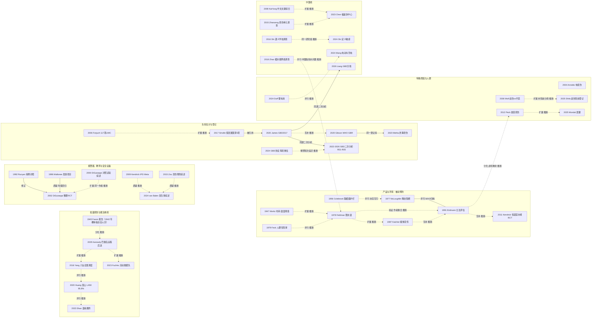

# D12 烧伤流行病学、预防与批量/特殊原因烧伤

> **一句话判断**：这个方向回答三件事——谁在什么情况下被烧伤、能不能在受伤之前拦住、大批伤员同时到来时救治体系接不接得住。它不是一条“从灾难走到全球差距”的单线，而是五条长期并行的线：产品与环境的被动预防（英国 1950 年代取暖器护栏法、美国 1970–90 年代睡衣阻燃和热水器限温）、报警器与安全设备、中低收入国家的家庭能源与炊事烧伤、故意烧伤、灾难与战伤，外加一套负担估计与登记系统；近五年新增证据以 GBD 同源二次分析、医院登记和备灾研究为主，以伤害发生率为结局的对照研究仍很少。
> **对临床医生最重要的一点**：改产品、改环境的三项措施证据强度不同：限水温有华盛顿州立法前后对比支持（Erdmann 1991，无同期对照，入院 18 例）[D12-N06]；儿童睡衣阻燃只有单中心转诊前后对比，作者承认存在其他解释 [D12-N03]；取暖器护栏只查到立法和病例描述，没有检到伤害率前后对比 [D12-N17]。单纯宣传教育或免费发放设备，多数只改善了知识、设备拥有率或水温，对照研究里伤害率没有看到下降（个体数据 Meta：就医热损伤 IRR 1.12，0.81–1.56 [D12-N20]；伦敦报警器整群 RCT：火灾伤害 RR 1.3，0.9–1.9 [D12-N08]）；近五年有限补查到的几项非随机前后对比或时间序列报告了下降，唯一的小 RCT 无显著差异（4.3）。

## 0 三分钟速读

1. **从哪里来**：三个起点并存。1942 年波士顿 Cocoanut Grove 夜总会火灾（491 人死亡；1943 年 Ann Surg 系列报告）把批量烧伤变成医院组织问题 [D12-N01]；1947 年 Moritz 与 Henriques 以猪皮肤为主、少量人皮肤验证，测出“44°C 约 6 小时、≥70°C 不到 1 秒”的烧伤阈值 [D12-N02]；1949–1956 年英国 Colebrook 用 2000 例住院病例论证家中取暖器和衣物着火，1952 年取暖器护栏法随后实施 [D12-N17]。
2. **为什么改变**：同一类伤反复出现在同一种产品和环境里（Colebrook 病例中 82% 的死亡来自衣物着火 [D12-N17]；西雅图 80% 受测家庭浴缸水温 ≥54°C [D12-N04]），而大众媒体宣传只把认知从 72% 提到 89%，一般人群的测温调温行为没有变 [D12-N05]，于是重心转向出厂预设和立法 [D12-N06]。
3. **如何分化**：被动预防、报警器与安全设备、中低收入国家炊事与家庭能源、故意烧伤、灾难与战伤五条线并行；负担估计从单地区人群率（纽约州 27/10 万/年 [D12-N26]）走到 GBD 统一模型 [D12-N14] 和 WHO 全球烧伤登记 [D12-N15]。
4. **现在研究什么**：GBD 同源二次分析（至少 5 篇，用的是同一套 IHME 模型输出）、中低收入国家登记与人群调查（孟加拉儿童非致死烧伤 866.7/10 万/年 [D12-R08]）、预防证据综合（按 Price 2021 检索截止 2020-09 做了 3 次有限补查，窗口内找到 5 篇以发生率或伤害率为结局的原始研究：4 篇非随机前后对比或时间序列报告下降，1 篇 60 人 RCT 无显著差异；只读摘要，见 4.3）、批量烧伤备灾与灾后随访、锂电池和电动车等新致伤原因、故意烧伤与武装冲突烧伤（本轮证据很少，仅 1–2 篇）（第 4 节）。
5. **用了什么数据**：从动物实验、事件报告、入户测温，到病例对照、整群 RCT、个体数据 Meta、医院/国际登记、全国人群调查、媒体报道、军队院前登记和 GBD 模型；中国以医院构成比为主，另有地区学校调查和网络调查（第 6、7 节）。
6. **还有什么不知道**：教育和安全设备能不能降低伤害发生率；全球每年烧伤死亡 12 万到 30 万以上的差距有多少来自纳入范围和版本不同；中国缺少全国代表性的发病率——同一地区换一种伤害定义，结果就是 5.92% 对 2.23% [D12-R28]。

**覆盖边界**：
- 纳入：全球与中国负担（WHO、GBD、登记库、人群调查）；高收入与中低收入国家差距；被动/主动预防证据（热水温度、取暖器护栏、儿童睡衣阻燃、烟雾报警器、恒温混水阀、炊具）；儿童烫伤；电、化学、故意烧伤与新致伤原因的流行病学；批量烧伤事件与备灾；战伤烧伤的流行病学对比；中国烧伤单元分布。
- 不含：Cocoanut Grove 的液体复苏、吸入伤和创面处理细节（交 D01、D05、D02）；死亡预测评分与救治体系本身（交 D07）；灾后生活质量与心理结局（只点到为止，交 D10）；电烧伤的皮瓣修复（交 D11）；1958 年抢救邱财康在学科史上的意义（交 X01）。

**本章口径**：
- 报告截止：2026-09-29。近期重点窗口：2021-09-29 至 2026-09-29，只用于第 4 节，不限制历史追溯。
- 阅读层级：L0=仅二手转述；L1=题录已在数据库核实；L2=摘要已读；L3=原文部分章节已读；L4=全文已读。L0/L1 的内容写成“据某来源转述”或只写题名。
- 核查状态：**通过/修正**=本轮已对照 PubMed 记录、PMC 全文或扫描页逐条核对，修正项一律用修正值；N17–N27 和多数近期代表研究是后补入的文献，成稿时再对照 PubMed 摘要（N17 对照 PMC 扫描页 p1379）核对数字。本章没有被判“删除”或“存疑”的节点；个别说法本轮无法核实的，正文就地标“未核实”。
- 本章节点 27 个：L3 7 个（N01、N02、N08、N12、N13、N14、N17），L2 20 个，L1/L0 0 个。近期代表研究 28 条（L1 3 条：R05、R19、R22；其余 L2），入口综述/指南/协议 11 条（L1 1、L2 7、L3 3）。全部 66 条见 `data/evidence_D12.json`。另有只在正文出现一次的辅助文献，直接给 PMID，多为 L1；第二轮完整性检查时预防主题补查到的 9 篇（4.3，L2，只读摘要）也按辅助文献处理，直接给 PMID/DOI，不计入证据表。
- 引用写法：[D12-Nxx] 关键节点；[D12-Rxx] 近期代表研究；[D12-Ex] 入口综述/指南/协议。
- 覆盖状态：**基本完整但有标注缺口**。理由：①六个问题（从哪里来、为什么改变、如何分化、现在研究什么、用了什么数据、还有什么不知道）都能据本章回答（第 0 节逐条对应第 1–8 节）；②一句话判断列出的五条线和负担系统，加上中国线，都有带 PMID 的节点：产品与环境被动预防（N02、N17、N03、N04、N06）、报警器与安全设备（N07、N18、N19、N08、N20）、中低收入国家家庭能源与炊事烧伤（E3、R06；另有中低收入国家登记与人群调查 R07、R08）、故意烧伤（E9、R23）、灾难与战伤（N01、N23、N12、N13、N10、R24）、负担估计与登记（N26、N14、N15）、中国线（N11、N24、N25、N27、N16）；电烧伤和新致伤原因另有 N09、R17–R21；③主链转折（Cocoanut Grove、Moritz 阈值、Colebrook 与护栏法、热水立法、报警器三层证据、GBD 与 GBR）都有可核实来源，其中 7 个节点达到 L3（原文部分章节已读）。缺口都已在第 8.2 节标注：CNKI、万方没有检索；中低收入国家 2011 年以前的一手研究缺位（Mashreky 26 条命中未处理）；批量烧伤 1943–2001 年没有检索；电烧伤流行病学只追到 1986 年；化学烧伤只有单中心报告、没有节点（本章把它看作“特殊原因”分支下的子项，这一分支另有电、故意、战伤节点，所以不据此降为“部分”）；故意烧伤和武装冲突烧伤各只有 1–2 篇近期文献；Kendrick 2009、van Balen 2024 等原文未读；预防主题的近期补查只做了 3 次英文检索。

---

## 1 源头：最初在研究什么

**判断**：这个方向没有单一起点。批量烧伤、热损伤阈值、产品立法三件事分别从 1940 年代起步，互相之间本轮没有查到引用关系。“最早找到”只说明本轮检索范围内没有更早的；“公认奠基”说明后来的综述或史料把它当起点，两者不等价。

| 主题 | 起点说法 | 分类 | 依据与限定 | 层级 |
|---|---|---|---|---|
| 批量烧伤是医院组织问题 | 1942-11-28 Cocoanut Grove 夜总会火灾（1943 年 Ann Surg 系列报告） | 被公认的奠基工作 | Saffle 1993 摘要称此事件促成首次较全面描述吸入伤，并推动烧伤救治机构组织、公共安全立法和烧伤预防 [D12-E8]；一手记录 Faxon 1943 [D12-N01]。**不是最早的火灾烧伤报告**：更早有 Fell 1887《Treatment of Burns—Lessons from the “Richmond” Fire》（Buffalo Med Surg J 27:55-63，PMID 36668429，仅题录） | N01 L3；E8 L2；Fell L1 |
| 人皮肤时间-温度烧伤阈值 | Moritz & Henriques 1947 | 目前最早找到的文献 | 原文 p695 写明此前只有小鼠（Hudack & McMaster 1932）和豚鼠（Leach、Peters、Rossiter 1943–44）数据；所以它是本轮找到的最早**人皮肤**定量阈值，且主要数据来自猪，人皮肤只做少量验证暴露、未做显微镜检查（p698、p712） | L3 |
| 用住院病例推动产品立法（被动预防） | Colebrook 夫妇 1949（1000 例）、1951（2000 例）、1956 年随访 | 目前最早找到的文献 | 1956 年文 p1379 在“目标实现情况”一节首先列出 1952 年取暖器护栏法；法案出台是否因这项研究推动，本轮没有独立史料。只查了 PubMed/PMC；与美国 1970 年代睡衣、热水器线之间没有查到引用关系 | 1956 L3；1949、1951 L1 |
| “被动 vs 主动”预防的概念 | Haddon 1968 AJPH（PMID 5691377）；Haddon 1974 J Trauma 社论题名即“passive vs. active approaches”（PMID 4819627） | 目前最早找到的文献（仅题名层面） | 伤害控制范式的来源线索；烧伤预防论文是否直接引用 Haddon，本轮未核 | L1 |
| 限制家庭热水温度可预防儿童烫伤 | Feldman 1978 | 目前最早找到的文献 | PubMed 与 OpenAlex 英文检索未见更早的家庭水温预防论文；Sorensen 1976《Prevention of burns and scalds in a developed country》（J Trauma，PMID 1263284）无摘要，是否讨论水温未知；Baptiste & Feck 1980 独立提出降低家庭热水温度（PMID 7386711） | L2 |
| 热水器预设温度立法的效果评估 | Erdmann 1991 | 目前最早找到的文献 | 限 PubMed、OpenAlex 英文检索 | L2 |
| 以火灾伤害为结局的烟雾报警器 RCT | DiGuiseppi 2002 | 目前最早找到的文献 | 此前 26 项对照试验中 13 项随机，随机试验都没有报告火灾伤害结局（DiGuiseppi & Higgins 2000 [D12-N19]） | L3 |
| 中国烧伤单元全国调查 | Zhanzeng 2015 | 作者自称首次 | 摘要原话“To the best of our knowledge, this is the first survey” [D12-N11] | L2 |
| WHO 全球烧伤登记（GBR） | 2018 年启动 | 事件年份，据二手文献转述（不属于上述四类） | 据 Gibson 2020 [D12-N15] 与 Hebron 2022 [D12-R09] 摘要；WHO 原始发布文件未读 | L2 |
| 中国现代烧伤学科起点 | 1958 年上海广慈医院（今瑞金医院）抢救钢铁工人邱财康（部分史料写“丘财康”） | 分两个命题：①“中国现代烧伤学科起点”＝被公认的奠基工作；②“世界首例、改写世界纪录”＝作者自称首次，无对照 | 伤情：89% TBSA，其中 III 度（全层）23%（Sheng 2013 全文，PMID 27574625；Sun 2018 摘要，PMID 30481908，中文摘要写“Ⅲ度”）；网页另有 89.3% 的写法（L0，如中华医学会烧伤外科分会网站 2018-07-19 纪念报道，burns.cma.org.cn）。“世界首例”出自 Sun 2018 摘要自述。原始病例报告未取得；史实交 X01 | 转述来源 L4（Sheng 2013）/L2（Sun 2018）；原始病例 L0 |

---

## 2 关键转折：问题—新证据/新方法—认识变化—新问题

### 2.1 大批伤员同时到来：从一家医院腾床到跨地区调度（1942–2020）

**问题**：平时火灾一次送来上百名伤员，医院怎么接？
**新证据**：Faxon 1943（Ann Surg 系列报告之一）记录了麻省总医院对 1942 年这场火灾的应对 [D12-N01]。夜总会额定 600 人，当晚约 1000 人；旋转门卡死，约 200 名遇难者堆在门后；火灾共 491 人死亡，181 名存活伤者和近 300 名到院已死亡者被送往各医院。麻省总医院 22:30 到 00:45 接收 114 人，其中 75 人到院已死亡或数分钟内死亡；腾空白楼六层 40 张床；39 名存活者中 30 人有具临床意义的体表烧伤，许多人有呼吸道损伤（部分 24 小时后才出现），5 人气管切开；两周内两院共 39 人院内死亡（麻省总医院 7 人、市立医院 32 人）。医院启用的是为战时伤员准备的 Civilian Defense 预案（p803）。许多死者没有烧伤、呈一氧化碳中毒的樱桃红色，作者判断多数死于窒息（p804）。
**认识变化**：批量烧伤首先是分拣、腾床和呼吸道问题，不只是体表创面（吸入伤交 D05）。
**断档说明**：本章在 1943 到 2001 年之间没有批量烧伤节点，这是检索缺口，不代表这段时间没有研究（见 8.2）。

**2002 年巴厘岛爆炸：远程后送** [D12-N23]。伤员远程后送到澳大利亚各烧伤单元；悉尼 Concord 医院收治 12 例，无死亡，但出现了该单元以前没见过的多重耐药菌（感染交 D04）。同期出现成文预案：美国烧伤协会 2005 年 Disaster Readiness Plan（Jordan 2005，PMID 15756122，L1）、瑞士 2010 年方案（Potin 2010，PMID 20185244，L1）、纽约市 2012 年更新建议（Leahy 2012，PMID 22964548，L1）。这一步是**分化**：从“一家医院怎么接”分出“跨地区烧伤床位与后送怎么预先安排”（本报告推断）。

**2015 年台湾八仙乐园粉尘爆炸：全国实时调度** [D12-N12]。499 名伤者 6 小时内送到 34 家医院，第 2 天 437 人收住 46 家医院；平均年龄 23 岁，平均烧伤面积 44%（SD 23%），>40% TBSA 277 人。全国每 6 小时统计一次空余 ICU 和烧伤床位，伤后第 2 天起免除自付 3 个月。3 个月内死亡 12 人（2.4%），作者对比的预测值为 26.8%；>40% TBSA 者 4.3%，美国同类参考值（16–39 岁、>40% TBSA）为 31.2%。**限定**：两位作者（Yang CC、Shih CL）都在台湾卫生福利部任职，属自我评估；表注明说两地面积分布差异太大，对比“仅供参考，不应视为有意义或充分的比较”；3 个月死亡数不一定是最终数。

**2014 年昆山铝粉尘爆炸：极重度成批烧伤** [D12-N13]。据 Tan 2016 摘要（PMID 27426066，L2），185 名烧伤患者分送江苏和上海 20 家机构，超过千名医务人员参与。Huang 2020 报告 18 个 ICU 的 167 例：中位年龄 38 岁，71% 烧伤面积 ≥90% TBSA，91% 有吸入伤，按 Brooke 公式复苏；28、60、90 天死亡率分别为 13.8%、29.9%、37.1%；烧伤面积 LA50 为 95.8% TBSA。原文没有说明 167 例怎样从 185 人中选出。八仙与昆山是**并行**关系：两起粉尘爆炸相隔一年，但伤情严重度差别极大、结局时间点不同（3 个月对 90 天），不能直接比较救治效果（本报告推断）。

**2020 年温岭液化石油气槽罐车爆炸** [D12-R15]：事故发生于 2020-06-13，8 家医院共收住 176 人，一半以上是农民；Jin 2022 报告其中 16 例特重度烧伤（平均 83.03% TBSA）[D12-R16]，属同一事件子集。
**新问题**：灾后报告多由参与救治的机构撰写，结局定义和随访时间各不相同；一次事件需要多少专科人员和床位，要靠备灾建模回答（4.4）。

### 2.2 伤在家里发生：产品和环境能不能先改（1947–1991，英美两条独立起源）

**物理依据** [D12-N02]：Moritz & Henriques 用快速流动的热液直接接触皮肤（表面与热源温差 <0.1°C，p696），主要在猪身上系统测定（p698：没有别的常用动物的皮肤与人如此相近），人皮肤只做少量验证暴露（暴露口径人 7 mm、动物 25 mm，p698），人皮肤没有做显微镜检查，只比较是否出现全层表皮坏死，结论是人与猪阈值相近（p712）。结果：44°C 约 6 小时才造成基底细胞层不可逆损伤；≥70°C 不到 1 秒全层表皮坏死；44–51°C 之间每升 1°C 烧伤速率约翻倍（p718）。研究由美国科学研究与发展局和化学战勤务部资助（p695 脚注），背景是战时热损伤。动物数和人体暴露数本轮未读到。

**英国线：病例→产品标准→法律** [D12-N17]。Colebrook 夫妇在伯明翰事故医院 MRC 烧伤研究单元，1949 年用 1000 例（PMID 18136270，L1）、1951 年用 2000 例住院病例（PMID 14874447，L1）提出全国减少烧伤的方案。1956 年随访文（p1379，L3）概括：三分之二发生在家中或家附近，50% 是儿童；82% 的死亡来自衣物着火造成的大面积烧伤，受害者主要是妇女和女童，起火面料多为法兰绒类棉布和人造丝；烫伤例数与烧伤相近，但死亡少得多；英格兰和威尔士烧烫伤住院估计约 87.5 万床日/年。《Heating Appliances (Fireguards) Act 1952》随 1953-03-24 的实施条例于 1954-10-01 生效；但已在使用的无护栏取暖器中，只有约 1.5%（约 7.3 万台）加装了护栏。**新问题**：新产品能管住，存量产品覆盖不到。

**概念**：“被动预防”（不依赖个人每次行动的产品/环境改造）这一说法的来源线索是 Haddon 的伤害控制范式（1968、1974，均 L1）；烧伤文献是否直接引用它，本轮未核。

**美国睡衣线** [D12-N03]：一个儿童烧伤单元 8 年 678 名急性烧伤儿童中，单一火源火焰烧伤占 50%，高于烫伤（27%）和房屋火灾（12%）；1969–1973 年这类烧伤 32% 涉及睡衣；联邦严格标准出台后此类转诊“显著下降”（摘要未给下降后的数字）。作者自己指出数据可能不具代表性，不能排除款式、家庭习惯和转诊模式改变。后续：Bergman 1977 评论（Pediatrics，PMID 263284，题名带质疑语气，L1）；Cusick 1997 讨论消费品安全委员会放宽儿童睡衣可燃性标准（PMID 9313132，L1）。放宽之后的效果，本轮没有证据。

**美国热水线**：
- **人群分母** [D12-N26]：Feck & Baptiste 1979 统计纽约州北部 2 年全部住院烧伤，住院率 27/10 万/年；同组 1980 年估计该地每年约 347 例自来水烫伤需住院，并提出降低家庭热水温度（PMID 7386711，L2）。
- **阈值与目标** [D12-N04]：Feldman 1978（西雅图）：自来水烫伤占住院儿童烫伤 7%–17%，45% 是无人看护的患儿或同伴自己开水龙头，28% 由虐待造成；80% 受测家庭浴缸水温 ≥54°C，此温度下 30 秒即可全层烫伤；建议限制在 52°C 以下，新热水器出厂预设、旧热水器由家庭调低。它与 Moritz 阈值口径一致，但 Feldman 是否引用 Moritz 未核（**扩展**，本报告推断）。Katcher 1981 JAMA（威斯康星 Dane 县 10 年 33 例，建议 48.9–51.7°C，PMID 7265410，L2）是同期的另一组病例。
- **教育行不行** [D12-N05]：Katcher 1987 在覆盖 200 万人的地区做媒体宣传并免费提供液晶温度计（被索取 14 万支）。一般人群认知从 72% 升到 89%，但测温和调低热水器的比例没有增加；主动索取温度计者的测温率高 58.1 个百分点（55.3–60.9），其中 43% 水温 ≥54.4°C，这些人中 52% 调低了恒温器，估计约 2 万台热水器被调低。结局是自报行为，没有测烫伤。Adams 1991 的题名就是《Awareness is not the problem》（PMID 2022688，L1）。
- **立法行不行** [D12-N06]：华盛顿州 1983 年立法要求新热水器出厂预设 49°C。1988 年 77% 家庭水温 <54°C（立法后安装的 84%，立法前安装的 70%），而 1977 年 80% 家庭 >54°C；平均水温 61°C→50°C；同一烧伤中心自来水烫伤入院从 1970 年代每年 5.5 例降到 2.4 例（1979-07 至 1988-05 共 18 例），面积、死亡、植皮、瘢痕、住院日都减少。**限定**：前后对比，没有同期对照州；教育和立法同时存在，作者把两者一起列为原因；剩余病例中虐待所致升到约一半。Peck 2010 回顾美国各州热水温度立法，据摘要各州规范差异大（PMID 20864897）。
- **关系**：N04→N06 为**验证**，依据是作者重合（Feldman 为共同作者）和地区相同，Erdmann 摘要并未提到 Feldman 1978（本报告推断）；1977 年基线测温是否就是 Feldman 1978 的数据，摘要未说明。N05→N06 为**互补**（本报告推断，两篇摘要互不提及）。英国护栏线与美国睡衣、热水线是**并行**关系，没有查到互引。WHO 2023 事实清单把降低热水龙头温度、儿童睡衣阻燃面料并列为推荐措施 [D12-E1]（综述归纳）。
- **后续的中间结局 RCT** [D12-N21]：Kendrick 2011 在格拉斯哥社会住房 124 个有 5 岁以下儿童的家庭安装恒温混水阀，12 个月浴缸热水中位温度 46°C 对 55°C（差 −9.0°C，−11.8 到 −6.2）；结局是水温，没有测烫伤发生（**互补**，本报告推断）。
- **新问题**：限温管不住故意伤害（Feldman 28%、Erdmann 剩余病例约一半为虐待），这部分归入故意烧伤线（2.6）；存量产品和各州标准不一仍是空档。

### 2.3 给了设备就等于有保护吗：烟雾报警器的三层证据（1992–2002）

1. **观察性** [D12-N07]：Runyan 1992 在北卡罗来纳州收集 13 个月内单户住宅的全部 151 起致死火灾（法医系统识别），从随机抽取的消防部门记录中选同期非致死火灾作对照（对照数摘要未写）。致死火灾更多由吸烟引起（31% 对 6%）；没有烟雾探测器 OR 3.4（2.1–5.6）；现场有酒精影响者 OR 7.5（4.4–12.7），是最强的独立风险因素；移动房屋 OR 1.7（1.1–2.6）。
2. **非随机阳性** [D12-N18]：Mallonee 1996 在俄克拉荷马城火灾伤害率最高的区域向 9291 户发放 10 100 个报警器，4 年后 45% 仍能工作；目标区火灾伤害率从 15.3 降到 3.1/10 万（−80%），全市其余地区从 3.6 升到 3.9；每 100 起火灾的伤害率比 0.3（0.1–0.6）。
3. **证据缺口被点明** [D12-N19]：DiGuiseppi & Higgins 2000 汇总 26 项对照试验，其中 13 项随机，随机试验都没有报告火灾伤害结局；另有 2 项非随机试验显示直接发放报警器减少了火灾伤害。
4. **整群 RCT 阴性** [D12-N08]：DiGuiseppi 2002 把伦敦两个行政区 40 个贫困选区（每区 2179–5586 户）按 Jarman 评分配对后随机分组，干预组免费发放报警器（共 20 050 个）并可上门安装，随访 2 年。火灾相关伤害率比 1.3（0.9–1.9），住院和死亡 1.3（0.7–2.3）；抽查显示已安装报警器 30% 对 32%，能正常工作的 16% 对 17%。Discussion 第 2–3 段：严重伤害在干预选区只降 13%，对照选区降 50%；作者认为俄克拉荷马城的效果可能部分来自向均值回归。
- **关系**：N07→N08 为**修正**（DiGuiseppi 引言引用 Runyan，原文明确）；N18→N08 为**质疑**（原文 Discussion 明确讨论）；N19→N08 同一第一作者（本报告推断）。
- **认识变化**：在伦敦贫困多族裔城市社区，**单纯发放没有提高有效安装率，所以没有减少伤害**。这不等于“报警器无效”：Runyan 的观察证据说明家里有能用的报警器与死亡风险低相关；也不能从这一项试验推到所有预防措施。俄克拉荷马城是高发区靶向干预，人群与伦敦不同，两说并存（第 5 节）。

### 2.4 教育和安全设备能不能降低伤害发生率：证据综合为何说法不一（2009–2025）

**问题**：宣传、上门指导、发安全设备，确实改变了知识和设备拥有，那伤害少了吗？
**新证据**：
- Kendrick 2009 个体数据 Meta [D12-N20]：对象是接受家庭安全教育（可加免费或打折安全设备）的 0–19 岁儿童青少年；干预提高有效报警器拥有率（OR 1.83，1.22–2.74）和安全热水温度（OR 1.35），但就医的热损伤率没有下降（IRR 1.12，0.81–1.56）。IRR 1.12 比较的是干预组与对照组的就医热损伤发生率；发生率按儿童、家庭还是随访人时计算，纳入研究数和参与者数，摘要都未报告，全文不在 PMC，本轮未读。
- Zou 2015 综述之综述加原始研究综述 [D12-N22]（检索至 2012 年 10 月，14 篇系统综述、39 项原始研究）：几乎没有证据显示干预降低儿童烫伤发生率；达到安全热水温度的证据较多。
- 中低收入国家：Rybarczyk 2016 从 12 568 条题录只纳入 11 篇，多数是教育项目 [D12-E5]；Price 2021 的 24 篇中 16 篇是教育干预，都提高了知识，但很少测量发病率，其中 4 篇人群层面的教育干预报告了发病率下降 [D12-E6]。
- van Balen 2024 只纳入以儿童烧伤发生率为结局的研究：14 项中 9 项显著下降、5 项无效；针对高危人群、主动与被动策略结合的项目更容易成功 [D12-E7]。
- Salt 2025 只纳入 RCT（8 项）：知识结局结果不一致，4 项测量自我效能的都提高了 [D12-R10]。
**认识变化**：几篇综述的结论不一致，首先是因为结局层级不同——知识/心理、行为/设备/水温、伤害发生率——而不是互相推翻；能证明“发生率下降”的研究最少（本报告推断）。
**新问题**：以发生率为结局、有同期对照的研究在中低收入国家仍很少；各综述纳入标准不同，本轮没有逐项比较它们的重叠研究。

### 2.5 负担在哪里、由谁来数：从单地区人群率到全球模型和登记（1979–2022）

- **单地区人群率**：Feck & Baptiste 1979 用纽约州北部全部住院烧伤算出 27/10 万/年 [D12-N26]。
- **中低收入国家的证据早已存在，只是分散**：Forjuoh 2006 检索 MEDLINE 1974–2003，汇总 117 项中低收入国家研究，风险因素包括儿童已有残障、看护疏忽、家中存放易燃物、母亲受教育程度低、居住拥挤 [D12-E3]；据出版页题录和检索结果，WHO 2008 年发布《A WHO plan for burn prevention and care》[D12-E10]（正文未读）；Peck 2011 综述称 2004 年全球近 1100 万人烧伤需就医、烧伤与火灾每年超过 30 万人死亡、90% 在中低收入国家 [D12-E2]。所以“中低收入国家的关注”不是从 2011 年才开始，2006–2011 年的几篇综述和计划只是把分散研究集中呈现。
- **文献路线的上限**：Smolle 2017 检索 PubMed（2016-03-02 至 03-10），只纳入 2001 年以后、覆盖至少 5 年的原始研究，46 项中 69%（32 项）来自极高发展国家，低发展国家 0 项（全文口径；摘要写“无中低收入国家研究”），并呼吁建立带最小数据集的国际数据库 [D12-E4]。
- **模型路线** [D12-N14]：James 2020（GBD 2017）估计 2017 年全球火、热和热物质伤害新发 8 991 468 例（7 481 218–10 740 897）、死亡 120 632 例（101 630–129 383）；年龄标化发病率 119/10 万，1990–2017 年下降 5.4%，不显著（−11.1 到 0.3），只有高 SDI 组显著下降 12.0%（−17.4 到 −6.7）；年龄标化死亡率显著下降；死亡与发病比（MIR）所有地区都下降，大洋洲最高、澳大拉西亚最低。方法：死亡取 ICD-10 X00–X06.9、X08–X19.9，非致死部分用 DisMod-MR 2.1 建模，并用“低收入地区病死率更高”的先验；伤害性质矩阵用到中国国家伤害监测系统等双编码数据。**限定**：按这一编码范围，GBD 这一类不含电流暴露（W85–W87）、以火自伤（X76–X77）和以火他伤（X97–X98）；化学腐蚀伤也不在这一编码范围内（按编码范围推断，未逐码核对）。
- **登记路线** [D12-N15]：Gibson 2020 分析 WHO GBR 早期数据（2020-01-05 导出）：17 国 28 家机构 4307 例，低资源组（低收入+中低收入）1362 例、高资源组 2945 例；两组年龄相近（24.2 对 24.5 岁），低资源组面积更大（30.5% 对 19.8% TBSA）、火焰烧伤更多（55.2% 对 39.0%）；病死率 31.9% 对 9.4%，修正 Baux 评分 59.4 对 45.3，低资源是独立死亡风险因素（OR 4.2，3.2–5.4）；低资源组除 ≥65 岁外 LA50 只有 30%–43% TBSA；低资源组儿童病例比例明显偏低，作者推测很多儿童没有到专科中心。Hebron 2022 指出 GBR 使用率低、参与不稳定 [D12-R09]。
- **关系**：N14 与 N15 **互补**——模型给人群层面的估计，登记给临床细节但不代表人群；两者都与 Smolle 指出的“低发展国家没有数据”有关（James 2020 参考文献列有 Smolle 2017；Gibson 2020 摘要未提 Smolle；本报告推断）。

### 2.6 特殊原因与特殊人群：电、故意、战伤（1986–2025）

- **电烧伤**：本轮找到的最早电烧伤病例系列是 1986 年的两篇：Hanumadass 1986 的 10 年经验（PMID 3768755）和 Chang ZD 1986《中华外科杂志》147 例早期切除加皮瓣修复（PMID 3829841）；另有 Xu XZ 1988 304 例（PMID 3151683），均 L1（修复技术交 D11/D02）。1986 年以前的电烧伤流行病学文献本轮没有追溯，所以 1986 年只是“本轮最早找到”，不代表这条线从 1986 年开始（见 8.2）。Arnoldo 2004 [D12-N09] 是一个 20 年机构登记分析（700 例：高压 263、低压 143、电弧闪光 277、雷击 17）：死亡率雷击 17.6%、高压 5.3%、低压 2.8%、不经过人体的电弧伤 1.1%；高压组平均住院 18.9 天、手术 3 次；摘要指出**高压**伤多与工作有关，常见职业是线路工和电工。它提供按电压和机制分层的**验证**性数据，不是这一分支的起点。
- **故意烧伤**：Peck 2012 [D12-E9]（Part I 的姊妹篇）据全球住院资料，以火或热液伤人占住院烧伤 3%–10%；以火自伤的全球死亡率约 65%；印度年轻女性比例特别高。热水线里的虐待性烫伤（Feldman 28%、Erdmann 剩余约一半）也属于这条线：限温对它无效，这是适用边界（**分化**，本报告推断）。
- **战伤** [D12-N10]：Wolf 2006 在美军外科研究所烧伤中心比较 2003-04 至 2005-05 的 751 例（军人 273 例）：军人更年轻（26 对 41 岁）、到烧伤中心更晚（6 对 1 天）、ISS 更高、吸入伤更多（13% 对 8%），死亡率 3.8% 对 7.1%（P=0.076），把平民限定在军人年龄范围后为 5.0%，两组无差异；死亡预测模型 AUC 0.97。Kauvar 2006 两篇（PMID 16899341、16580688）为同一中心、时间重叠的病例（274 例中 52% 为爆炸伤、简易爆炸装置占 55%、手部 80%、面部 77%），不计为独立证据；其中 J Surg Res 一篇比较的是军人中的战斗伤与非战斗伤（死亡 5% 对 2%）。**限定**：只有住院后结局，战场死亡不在分母内。2025 年以色列研究用院前登记补了这一段（4.7）。
- **化学烧伤**：本轮没有找到流行病学奠基文献，只有若干单中心报告（见 8.2）。

---

## 3 分支图

图例：实线 = 原文明确讨论或综述归纳的关系；虚线 = 本报告推断；边上写关系类型。节点为“年份 简称”。

---

## 4 近五年重点（2021-09-29 至 2026-09-29）

### 4.1 GBD 同源二次分析
- **研究什么**：全球、区域、国家和中国各省的烧伤发病、死亡、DALY 趋势，与 SDI 的关系，预测到 2040 年。
- **数据与设计**：GBD 2017/2019/2021 公开结果的二次分析（Joinpoint、EAPC、分解、前沿分析、贝叶斯年龄-时期-队列模型）。**这些论文用的都是 IHME 同一套模型输出，不是独立数据来源**，不能按篇数累加证据。
- **代表研究**：Chen Z 2022（GBD 2017）：年龄标化 DALY 率从 1990 年 197/10 万降到 2017 年 111/10 万（−43.7%），1–4 岁和 80 岁以上最重，低和中低 SDI 的 AAPC 均为 −2.1% [D12-R01]。Yin 2025（GBD 2019）：2019 年 8 378 122 例，年龄标化发病、死亡、DALY 率分别比 1990 年低 22%、43%、43%，发病率与 SDI 正相关 [D12-R02]。Zhang 2025（GBD 2021，对象写作“thermal burns”）：2021 年新发约 619 万、YLD 约 267 万、患病约 1.0476 亿（比 1990 年 +11.38%），人口增长是阻碍负担下降的主要因素 [D12-R03]。Liang 2026（GBD 2021 中国分省）：年龄标化 DALY 率从 1990 年 135.6/10 万降到 2021 年 33.6/10 万（−75.2%），YLL 率降 81.4%、YLD 率降 54.5%；2021 年 ≥80 岁组最高（147.3/10 万）；省级前三为云南 45.4、贵州 43.8、上海 43.3（/10 万）[D12-R04]。Feng 2025 BRICS 分析及两篇评论（PMID 41109169、41455305）只读题录 [D12-R05]。
- **怎么读这些数字**：GBD 协议写明，每一轮都用全部数据重新估计 1990 年以来的完整时间序列，旧结果存档 [D12-E11]。所以 James 2020（GBD 2017：发病率 −5.4%，不显著）与 Yin 2025（GBD 2019：−22%）的差异是**版本修订**，不是两项研究互相冲突；899 万（2017，GBD 2017 轮）、838 万（2019，GBD 2019 轮）、619 万（2021，GBD 2021 轮）来自三轮不同估计，**不能读成“4 年下降三成”**。Zhang 2025 的“thermal burns”与 James 2020 的“火、热和热物质”是否同一口径，原文未说明。要看趋势，应只用最新一轮自身的 1990–2021 序列；GBD 2021 全球年龄标化发病趋势本章未取得。
- **成熟度**：方法成熟、数量多；新增信息主要是换一轮数据或换一个地区。

### 4.2 中低收入国家的登记与人群调查
- **数据与设计**：WHO GBR、南亚烧伤登记（SABR）、全国入户伤害调查。
- **代表研究**：Mehta 2023（GBR）：炊事相关烧伤 1723 例（占 GBR 25%），其中炉具相关 311 例；炉具相关组女性更多（65% 对 53%）、面积更大（中位 30% 对 15%）、死亡更多（41% 对 11%）；用电炊事的比例低收入国家 1.6%、高收入国家 49.6% [D12-R06]。Ahmed 2024（SABR）：孟加拉国和巴基斯坦 2 家公立烧伤中心 883 例，**数据期 2014-09 至 2015-01**，只是发表在窗口内 [D12-R07]。Abedin 2022（孟加拉 2016 年全国伤害调查）：299 216 人中 100 842 名儿童，437 例非致死烧伤，儿童年发病率 866.7/10 万（785.6–947.8），1–4 岁 2028.3/10 万，约 70% 在农村——这是少见的中低收入国家**人群分母**数据 [D12-R08]。Hebron 2022：GBR 2018 年正式启动，但使用率低、参与不稳定 [D12-R09]。
- **分歧**：登记只收参与医院的病例（Gibson 2020 已发现低资源组儿童偏少），与 GBD 人群估计口径不同；本轮没有找到比较两者的研究。
- **成熟度**：发展中。

### 4.3 预防措施的证据综合
- **代表研究与检索截止**：Price 2021（补检 2015-01 至 2020-09）[D12-E6]；van Balen 2024（检索截止摘要未写；全文在 Amsterdam UMC 机构库，下载时遇到人机验证页，未绕过，**原文未读**；DOI 中的稿件编号为 2022 年，据此推断检索不晚于 2022 年，**未核**）[D12-E7]；Salt 2025（只纳入 RCT，8 项；知识结果不一致，4 项测自我效能的都提高）[D12-R10]。
- **窗口内补查（2026-09-29，有限检索）**：按 Price 2021 的检索截止做了 3 次英文检索——Europe PMC 1 次（2020-09-01 起；题名含 burn/scald 且含 prevent/intervention/programme/legislation/campaign 等，摘要含 incidence、injury rate 或 admissions，排除综述；35 条）；PubMed 2 次（限 2021-09-29 至 2026-09-29；一次针对预防项目评估，122 条；一次针对立法、产品标准、报警器、热水、烟花、炉具，68 条）。按题名筛出 9 篇读摘要（均 L2）。以发生率或伤害率为结局的原始研究 5 篇：
  1. Gunsmaa 2022，蒙古（Inj Prev 28:353-357；PMID 35197276；DOI 10.1136/injuryprev-2021-044509）：乌兰巴托国家创伤骨科中心急诊 2009–2018 年 <5 岁患儿 23 459 例（烫伤 18 433 例），中断时间序列。2014-06 第一次全国运动后，烫伤总体月发生率开始下降，干预结束时相对变化 −32%；第二次运动（2017-01）开始前发生率已回升，并持续到运动期间和之后；重度烫伤率全程无显著变化。数据期在窗口前，发表在窗口内。
  2. Al-Hajj 2023，加拿大 Surrey HomeSafe 项目（Int J Environ Res Public Health 20:6369；PMID 37510600；DOI 10.3390/ijerph20146369）：2008–2019 年覆盖 120 349 户，与干预前比较，火灾率 −80%、有效报警器 +60%、火灾伤亡 −40%。结局是火灾和伤亡，不专指烧伤；前后对比。
  3. Castañeda-Rodríguez 2024，墨西哥 Aguascalientes 州 No+Quema2 项目（Burns 50:107279；PMID 39442476；DOI 10.1016/j.burns.2024.09.018）：用国家流行病学监测系统 2014–2022 年数据分析 <9 岁儿童；项目培训了 1750 所小学的 2.5 万余名学生。实施后该州烧伤发生率相对全国均值显著下降，作者估计研究期间约少发生 3839 例（604 例/年）；作者自己指出依赖政府上报数据，需要更强的设计来验证。
  4. Kruchevsky 2026，美国孟菲斯（J Burn Care Res 47:598-602；PMID 41134197；DOI 10.1093/jbcr/iraf202）：一家区域烧伤中心 2019-07 至 2024-06 收治 481 例，其中火灾相关 204 例；实施免费安装报警器、“关门”宣传和城市衰败区整治后，火灾相关入院占比从 2020 年的 58% 降到 2023 年的 32.9%（P=.0003），人口学和伤情没有同步变化；贫困率 >30% 的邮编区伤害率下降最多，贫困较低地区方向相反。主要结局是入院构成比；单中心前后对比，无同期对照。
  5. Karahan 2026，土耳其（Comput Inform Nurs 44:e01417；PMID 41431874；DOI 10.1097/CIN.0000000000001417）：Kahramanmaraş 地震后阿德亚曼集装箱住房中 60 名家庭成员的两臂 RCT，干预组用手机 App 做 2 个月烧伤急救培训；干预组急救知识更高，烧伤发生对照组更多，但差异无统计学意义。
  同一批检索中另有 4 篇只测知识、家中风险因素或接受度，不算发生率证据：Yondem 2024（PMID 38461079）、Gorka 2025（PMID 42344565）、Huang 2026（PMID 41733786）、Gunsmaa 2022 厨房架（PMID 34716044），均 L2。
- **判断**：窗口内以发生率或伤害率为结局的原始研究仍然少，本轮只补到 5 篇，其中 4 篇是非随机的前后对比或时间序列，报告的下降无法排除同期趋势和其他因素（本报告推断；墨西哥研究作者也要求更强的设计），唯一的 RCT 只有 60 人、差异无统计学意义。Price 2021 和 van Balen 2024 的结论主要反映 2020–2022 年以前的原始研究。窗口前的两项负性综合（Kendrick 2009、Zou 2015，见 2.4）应与 van Balen 2024 并列解读。**限定**：补查只有 3 次英文关键词检索，没有查 Embase、CINAHL 和中文库，可能漏检（8.2）。
- **成熟度**：发展中（以发生率为结局的高质量试验仍少）。

### 4.4 批量烧伤备灾与灾后随访
- **代表研究**：Fuchko 2023 范围综述（检索至 2022 年 1 月，6132 条纳入 26 篇）：WHO 2021 年建议各国组建可部署的烧伤专家队 [D12-R11]。Wong 2024 用 Emergo Train System 模拟 8 名患者并与本中心真实历史患者匹配：每名患者每天约需 8 名工作人员，前两周近 75 小时手术时间 [D12-R12]。灾难队列随访：八仙 5 年随访 99 人，PTSD 13.1%、重度抑郁 14.1%、创伤后成长 51.5% [D12-R13]（同一事件队列，详交 D10）；昆山 185 例病例对照，胃肠功能不全 HR 约 1.7，并用长海医院队列外部验证 [D12-R14]（同一事件队列）。中国温岭 2020 年事件的分拣报告 [D12-R15]、[D12-R16]。
- **分歧**：灾后报告多为参与救治机构的自我总结，缺少统一结局定义；八仙对比美国参考值，原作者自己说不应视为有意义的比较。
- **成熟度**：备灾部分发展中；多事件汇总比较仍是早期线索。

### 4.5 新致伤原因：锂电池、电动两轮车、电子烟
- **代表研究**：Segalovich 2022（以色列国家烧伤中心，2016-02 至 2020-10）：9 例，平均 27.5% TBSA，3 例吸入伤 [D12-R17]。Duff 2024（澳大利亚，2014-01 至 2023-10 住院病例系列加昆士兰急诊监测数据）：住院病例中电动滑板车占 57.1% [D12-R18]。Kusu-Orkar 2022 电子烟烧伤来信 [D12-R19]（L1）。中国：Wang 2024 瑞金医院 2015–2021 年 63 例电动自行车充电器火焰烧伤对 1412 例其他火焰烧伤，56 例发生在夜间，更多是多人同时受伤，死亡率更高 [D12-R20]；Zhao 2023 中国北方一家医院 2009–2020 年 82 例儿童电动车电瓶闪络烧伤，均为轻伤，2 周内愈合 [D12-R21]。
- **分歧**：本轮未见；都没有人群发病率分母。
- **成熟度**：早期线索。

### 4.6 故意烧伤（自焚、以火或热液伤人、泼酸）
- **代表研究**：El Hayek 2023 阿拉伯世界自焚系统综述 [D12-R22]（L1，只核对题录）。Mondal & Shoji 2025 用 2005–2023 年孟加拉媒体报道确认 625 起泼酸袭击、836 名受害者，77% 为女性，超过四分之一的施害者是丈夫或前夫 [D12-R23]——**媒体报道是一种新的数据路径，但有报道偏倚**。背景见 Peck 2012 [D12-E9]。
- **成熟度**：本章证据只到早期线索层面（自焚综述未读摘要）。

### 4.7 武装冲突中的烧伤
- **代表研究**：Shilo Yaacobi 2025 用以色列国防军院前登记加国家创伤登记，统计 2023-10 至 2024-04 的 2627 名受伤军人，其中 249 名烧伤，全部男性，平均 22 岁，多数合并其他损伤 [D12-R24]。含院前记录，补上了 Wolf 2006 “战场死亡不在分母内”的缺口 [D12-N10]。
- **缺口**：PubMed 检索“burn* AND Ukraine”命中 23 条，本轮没有处理（8.2）。
- **成熟度**：本轮证据不足。

### 4.8 中国大样本医院流行病学与人群调查
Li Z 2024（33 619 例中特殊原因 4452 例）[D12-R25]、Li P 2025 Meta [D12-R26]、Han D 2022 [D12-R27]、Shi 2024 [D12-R28] 及 Chen K 2023 [D12-N16]，详见第 6 节。

---

## 5 争议、负性结果与停滞路线

### 5.1 仍在争或说不清的问题

| 问题 | 各方说法（出处） | 现状 |
|---|---|---|
| 全球每年烧伤死亡多少 | 超过 30 万（Peck 2011，2004 年数据）[D12-E2]；超过 25 万（Rybarczyk 2016 引 WHO）[D12-E5]；约 18 万（WHO 2023）[D12-E1]；120 632（GBD 2017，2017 年）[D12-N14] | **部分可解释**：①GBD 这一类不含电伤、以火自伤、以火他伤，按编码范围也不含化学伤（2.5）；②前三个数字可能是 WHO 不同年份的估计版本（Peck 2011 所用 2004 年数据的来源本轮未逐一核对）。WHO 的死亡口径定义本轮未查到，没有找到把几个数字放在一起对照的研究 |
| 全球烧伤发病率是否在下降 | Smolle 2017：纳入研究显示发病率、严重度、住院日和死亡率总体下降，但几乎全来自极高发展国家 [D12-E4]；GBD 2017 轮：年龄标化发病率 −5.4%，不显著 [D12-N14]；GBD 2019 轮：−22% [D12-R02] | **不属于学术争议**：GBD 两轮的差异是版本修订 [D12-E11]；Smolle 的文献口径不代表全球。死亡率下降在各来源中方向一致；GBD 2021 全球年龄标化发病趋势本章未取得 |
| 发放烟雾报警器能否减少火灾伤害 | 俄克拉荷马城非随机项目 −80% [D12-N18]；伦敦整群 RCT 无效（RR 1.3，0.9–1.9）[D12-N08]；窗口内补查到两项含报警器安装的非随机项目评估，报告火灾伤亡或火灾相关入院下降（加拿大 Surrey 2023、美国孟菲斯 2026，只读摘要，4.3） | **部分解决**：两说并存。人群不同（高发区靶向 vs 贫困多族裔社区）；伦敦试验失败在有效安装率没有提高；DiGuiseppi 认为俄克拉荷马城效果可能部分来自向均值回归。其他人群中的效果仍需证据 |
| 教育与安全设备能否降低伤害发生率 | Katcher 1987 认知升、行为不变 [D12-N05]；Kendrick 2009 IRR 1.12 [D12-N20]；Zou 2015 几乎没有证据 [D12-N22]；Price 2021 有 4 篇人群教育报告发病率下降 [D12-E6]；van Balen 2024 14 项中 9 项下降 [D12-E7]；窗口内补查：蒙古（重度烫伤无变化，总体烫伤率后来回升）、墨西哥两项非随机评估报告下降，土耳其 60 人 RCT 无显著差异（只读摘要，4.3） | **未解决**：结局层级不同（知识/行为、设备与水温、发生率）；中低收入国家缺少以发生率为结局的对照研究 |
| 儿童睡衣阻燃标准的效果与后来放宽 | McLoughlin 1977 转诊显著下降但作者承认有其他解释 [D12-N03]；Bergman 1977 评论、Cusick 1997 讨论放宽标准（均 L1） | **证据不足以判断** |
| 用外国登记库做批量烧伤死亡率参照 | Yang 2016 用美国参考值对比，同文表注又说不应视为有意义的比较 [D12-N12] | 原作者自己保留了限定，不是外部争议 |

### 5.2 负性结果、失败路线与停滞

- **单靠大众媒体教育改变家庭水温**：认知 72%→89%，一般人群行为不变 [D12-N05]。
- **在伦敦贫困城市社区免费发放报警器**：伤害、住院、死亡都没减少，有效安装率两组相同（16% 对 17%）[D12-N08]。限定在这一人群。
- **教育加安全设备**：设备拥有和安全水温提高，就医热损伤率没有下降 [D12-N20]；儿童烫伤发生率几乎没有干预有效的证据 [D12-N22]；儿童预防项目 14 项中 5 项无效 [D12-E7]。
- **用已发表文献描述全球趋势**：低发展国家 0 项，描述不了 [D12-E4]。
- **存量产品覆盖不到**：英国护栏法生效后，已在用的无护栏取暖器只有约 1.5% 加装 [D12-N17]。
- **全球登记参与不足**：GBR 使用率低、参与不稳定 [D12-R09]。
- **中国国家烧伤数据库（NBRC）**：Zhanzeng 2015 为筹建 NBRC 摸底 [D12-N11]，本轮没有找到其公开产出（这只说明本轮没检到，不等于项目停滞）。
- **不是失败、是适用边界**：华盛顿州限温立法后入院减少，剩余 18 例中约一半为虐待，限温管不住故意伤害 [D12-N06]；恒温混水阀降了水温，但没测烫伤发生 [D12-N21]。

---

## 6 中国线

**判断**：中国线的证据以医院来源的构成比为主，另有两类少见数据——地区学校调查和全国网络调查——以及三次成批烧伤事件的同一队列多篇报告。准确的说法不是“中国没有人群层面数据”，而是**缺少全国代表性的人群发病率**，现有地区调查的结果随伤害定义和抽样方式变化 2–3 倍。

1. **起点**（转述来源 L4/L2；原始病例 L0）：1958 年上海广慈医院（今瑞金医院）抢救邱财康，89% TBSA，其中 III 度（全层）23%（Sheng 2013 PMID 27574625；Sun 2018 PMID 30481908）；网页另有 89.3% 的写法（L0）。作为中国学科起点是公认的奠基工作；“世界首例”是 Sun 2018 的作者自述，无对照（第 1 节表格）。学科史交 X01。
2. **成批烧伤**：Zhou YP 2008 总结“50 年成批烧伤救治经验”（中华烧伤杂志，PMID 19103006，L1）。2014 年昆山：185 名伤者、20 家机构（Tan 2016，L2）；Huang 2020 的 167 例 90 天死亡率 37.1%、LA50 95.8% TBSA [D12-N13]；2018–2019 年十余篇报告和 2025 年的新报告（如胃肠功能不全 [D12-R14]、血型研究 PMID 40831347）都属同一队列，不计为独立证据。2015 年台湾八仙乐园 [D12-N12]。2020 年温岭槽罐车爆炸 [D12-R15]、[D12-R16]。
3. **体系与资源** [D12-N11]：Zhanzeng 2015 全国问卷，31 个省份 405 家医院回复，63.7% 为三甲；最常见组织模式是烧伤整形合科（63.0%）；每单元平均医生 9.43 名、护士 16.48 名、床位 39.91 张，45% 的单元有 20–39 张床；作者估计中国大陆每 10 万人口有烧伤单元 0.05 个、烧伤医生 0.5 名、护士 0.8 名、床位 1.9 张。应答率摘要未写。2023 年一项 39 个烧伤中心护理人力横断面调查（PMID 37805740，摘要已读，L2；全报告复核时核对）。
4. **医院来源流行病学**：
   - 最早找到的中文文献综合是 Kai-Yang 2008 [D12-N24]：检索中国生物医学、维普、中国期刊全文 3 个中文库 2000–2005 年，纳入 28 篇住院儿童烧伤回顾性研究，病死率 0.49%–9.08%；摘要称已形成“家庭-学校-工厂-政府”预防模式，**本轮未核实**。
   - 单中心：西南医院 2011–2015 年 2478 例儿童（Li H 2017，PMID 28372828，L2）；中南（Zhou B 2014，PMID 23747041，L1）；郑州市第一人民医院 2013–2019 年 5569 例儿童，占该中心全部烧伤的 43.9%，烫伤 90.63%、电烧伤 1.17% [D12-R27]；华南 376 例电烧伤（Ding 2020，PMID 31854209，L1）；武汉 33 619 例中特殊原因烧伤 4452 例（13.2%），住院更长、费用更高、截肢更多，但校正后死亡几率没有增加 [D12-R25]。
   - 多中心：福棠儿童医院数据库 23 家医院 2016–2019 年 6741 例：男性 63.23%，1–2 岁 69.95%，热液烫伤 80.57%，春季最多（26.73%）[D12-N16]。只含儿童专科医院住院病例。
   - Meta：Li P 2025 合并 23 项研究的 465 433 名住院患者（1980–2022 年）：烫伤 50%（43–57）、火焰 27%、夏季 29%、合并死亡率 3%、吸入伤 OR 6.670 [D12-R26]。大中心常就重叠年份发表多篇报告，**这项 Meta 是否剔除同一中心的重复报告未核实**，465 433 可能含重复计数。
   - 1980 年代已有较大样本电烧伤系列：Chang ZD 1986 147 例、Xu XZ 1988 304 例（2.6）。
5. **人群层面**：
   - 遵义农村 9 所学校 1842 名儿童，12 个月自报烧伤发生率 12.7%（11.2–14.2），留守是风险因素 [D12-N25]。
   - 同一研究组 2024 年在 12 所学校 3548 名儿童中比较两种操作定义：按 1996 年定义 5.92%，按 2011 年定义 2.23% [D12-R28]。
   - 全国微博网络调查：0–72 月龄儿童烫伤患病率 5.5%；75.5% 的家庭使用暖水瓶，只有 6.1% 用了防倾倒装置 [D12-N27]。网络调查有自选择偏倚。暖水瓶可以看作中国版的“热水问题”，但本轮没有找到相应的产品标准或干预评估。
   - GBD：Liang 2026 分省分析 [D12-R04]；GBD 的伤害性质矩阵用到中国国家伤害监测系统数据（James 2020 Methods）[D12-N14]。
6. **新致伤原因**：电动自行车充电起火 [D12-R20]、儿童电动车电瓶闪络烧伤 [D12-R21]。中国电动车保有量大，但本轮只有这两篇单中心报告。
7. **空白**：中国本土的预防干预评估（热水、暖水瓶、炉具、烟花、电动车电池）本轮没有检到；CNKI、万方没有检索。

---

## 7 数据路径小结（历史上 vs 现在）

| 数据路径 | 历史上的代表 | 现在的代表 | 能回答什么 / 不能回答什么 |
|---|---|---|---|
| 动物与人皮肤暴露实验 | Moritz 1947（猪为主）[D12-N02] | 本章未见近期同类 | 给物理阈值；儿童和老人皮肤原文未覆盖 |
| 事件报告与灾后机构总结 | Faxon 1943 [D12-N01]；Kennedy 2005 [D12-N23] | 八仙、昆山、温岭同一队列多篇报告 [D12-N12][D12-N13][D12-R15] | 一手记录；多为自我评估，结局定义不一 |
| 病例系列加家庭环境测量 | Feldman 1978 入户测温 [D12-N04]；Colebrook 住院病例 [D12-N17] | Zhao 2018 暖水瓶使用调查 [D12-N27] | 找出可改的产品和环境；没有人群分母 |
| 单地区人群住院率 | Feck 1979 [D12-N26] | — | 有分母，只到住院层面 |
| 立法/项目前后对比 | Erdmann 1991 [D12-N06]；Mallonee 1996 [D12-N18] | — | 看到同时变化；没有同期随机对照 |
| 人群随机调查（行为） | Katcher 1987 [D12-N05] | — | 认知和自报行为；不测伤害 |
| 病例对照 | Runyan 1992 [D12-N07] | 昆山胃肠功能不全病例对照 [D12-R14] | 风险因素；有混杂 |
| RCT（整群/个体） | DiGuiseppi 2002 [D12-N08] | Kendrick 2011 TMV [D12-N21]；Salt 2025 汇总的 8 项 RCT [D12-R10] | 最强因果证据，但以伤害为结局的很少 |
| 个体数据 Meta / 系统综述 | DiGuiseppi 2000 [D12-N19]；Forjuoh 2006 [D12-E3] | Kendrick 2009、Zou 2015、van Balen 2024、Li P 2025 | 结局层级不同导致结论不一 |
| 机构登记库 | Arnoldo 2004 [D12-N09]；Wolf 2006 [D12-N10] | Li Z 2024 [D12-R25] | 临床细节；单中心，无人群分母 |
| 国际/区域登记 | — | WHO GBR [D12-N15][D12-R06]；SABR [D12-R07] | 跨国直接比较；参与自愿、不代表人群 |
| 行政/保险数据 | — | 台湾健保实时床位报告 [D12-N12]；福棠病案首页 [D12-N16] | 大样本；编码质量未评估 |
| 全国机构问卷 | — | Zhanzeng 2015 [D12-N11] | 资源底数；不含患者 |
| 全国/地区人群调查 | — | 孟加拉全国伤害调查 [D12-R08]；遵义学校调查 [D12-N25][D12-R28]；微博网络调查 [D12-N27] | 人群发病率；对定义和抽样敏感 |
| 媒体报道 | — | 孟加拉泼酸 [D12-R23] | 能数到故意伤害；报道偏倚 |
| 军队院前登记 | — | 以色列院前加国家创伤登记 [D12-R24] | 补战场前段分母 |
| 全球模型估计 | — | GBD [D12-N14]；二次分析 [D12-R01]–[D12-R05] | 覆盖全部国家；依赖模型和协变量，各轮重估 |
| 模拟与资源建模 | — | Emergo Train System [D12-R12] | 备灾资源需求；样本小 |

**一句话**：历史上靠“病例＋环境测量＋前后对比”把产品问题找出来；现在数量最大的是 GBD 同源二次分析和医院登记，能证明“伤害少了”的对照研究一直是少数。

---

## 8 还不知道什么（领域证据缺口）与本报告的检索缺口

### 8.1 领域证据缺口

1. 教育、上门指导和安全设备能不能降低伤害**发生率**：现有个体数据 Meta 为阴性（IRR 1.12）[D12-N20]，以发生率为结局的综述结果不一 [D12-E7]；中低收入国家缺少有同期对照的高质量试验 [D12-E5][D12-E6]。
2. 全球死亡数 12 万到 30 万以上的差距：纳入范围和版本不同能解释一部分，但没有研究把 WHO 与 GBD 的口径逐项对照。
3. 中国缺少全国代表性的人群发病率；地区调查对定义高度敏感（5.92% 对 2.23%）[D12-R28]；NBRC 公开产出未见 [D12-N11]。
4. 登记库与人群的关系：GBR 参与自愿、低资源组儿童偏少 [D12-N15]，使用率低 [D12-R09]。
5. 存量产品怎么覆盖：英国护栏法的 1.5% [D12-N17]；美国各州热水立法不一（Peck 2010）。
6. 新致伤原因（锂电池、电动车）没有人群分母 [D12-R17]–[D12-R21]。
7. 批量烧伤：缺少统一结局定义和跨事件比较；昆山 185 例全队列的最终死亡结局、八仙最终死亡人数本轮未取得。

### 8.2 本报告的检索缺口

- **中文库**：CNKI、万方没有检索；中国本土预防干预评估因此空缺。
- **待核线索（没有可定位来源，未写进正文）**：“中国烧伤协会 2012 年启动全国调查”（Zhanzeng 2015 摘要没有这两项信息）；“昆山是中国近 30 年重度烧伤人数最多的事件”；八仙乐园另一组伤情数字（>40% TBSA 281 人、>80% 41 人）和“最终死亡 15 人”（只见网页检索摘要）；化学烧伤单中心报告（上海金山 Li W 2013、浙西 Ye C 2016）和苏州 Zhang Y 2024 未取得 PMID/DOI；邱财康病例的原始医学报告；Cancio 2005 战伤论文（检索未找到）。
- **未处理的检索命中**：Mashreky SR 孟加拉烧伤研究 26 条（2011 年以前的中低收入国家一手研究在本章因此缺位）；“burn* AND Ukraine”23 条。
- **原文未读**：WHO 2008 计划 [D12-E10] 与 WHO GBR 启动文件；美国 Flammable Fabrics Act（1953）、1967 年修正与 1970 年代儿童睡衣标准的法规文本（PubMed 只见 Bergman 1967 一条题录，PMID 6042330）；Bergman 1977、Cusick 1997 只到题录；Sorensen 1976 无摘要；Mallonee 1996 全文；McLoughlin 1977、Feldman 1978 的 Inj Prev 1998 重刊版在 PMC 只有 PDF（有反机器人验证页，未尝试绕过）；Katcher 1987 与 Wolf 2006 的 PMC 全文可取但本轮未读；van Balen 2024 全文（Amsterdam UMC 机构库的 PDF 下载时遇到人机验证页，未绕过），所以检索截止日未知，只按 DOI 稿件编号推断不晚于 2022 年，未核；Kendrick 2009 个体数据 Meta 全文（不在 PMC），纳入研究数、参与者数和 IRR 的分母摘要都未报告；Feng 2025 两篇评论。
- **未做的核对**：Li P 2025 纳入研究是否去重；Moritz 1947 的动物数和人体暴露数；Zhanzeng 2015 应答率；Feldman 1978 的 DOI（PubMed 记录中没有）；清洁炉灶 RCT（如 RESPIRE、HAPIN）是否报告烧伤结局。
- **预防主题的近期补查只做了有限检索**：按 Price 2021 检索截止（2020-09）补查 3 次（Europe PMC 1 次从 2020-09-01 起，PubMed 2 次限 2021-09-29 起），只用英文关键词，没有查 Embase、CINAHL 和中文库；2020-09 至 2021-09-28 之间只由 Europe PMC 那一次覆盖。找到的 5 篇以发生率或伤害率为结局的研究和 4 篇只测知识或风险因素的研究都只读摘要（4.3）。
- **被引追踪**：Europe PMC 本轮多次返回 502/503，OpenAlex 匿名检索被限流，followup 主要靠 PubMed 检索和后续综述，没有系统拉取被引列表。
- **批量烧伤 1943–2001 年未检索**：本章批量烧伤线从 Faxon 1943 直接跳到 2002 年巴厘岛事件（2.1），中间的文献（如 1970–1990 年代美国烧伤协会的分拣与备灾文献）没有检索。
- **电烧伤流行病学的起点未追溯**：本轮找到的最早电烧伤病例系列是 1986 年（Hanumadass 1986、Chang ZD 1986，均 L1；2.6），更早的文献没有检索。
- **其他**：非美国（含中国）军事医学的战伤烧伤数据；化学烧伤流行病学的奠基文献；Brigham 1996 美国烧伤发病与就医量估计（PMID 8675512）只作线索，未用。

### 8.3 复审意见的处理记录

| 复审指出的严重问题 | 处理 |
|---|---|
| 起点只讲美国，漏掉英国 1949–1956 年的产品立法先例；“被动预防”概念来源未交代 | 新增 [D12-N17]（L3）；第 1 节列 Haddon 1968/1974（L1）；英美两线写成并行，未写承接 |
| “2011 年转向全球差距”以综述出版年为转折 | 改为：中低收入国家研究 1970 年代起即分散存在，Forjuoh 2006、WHO 2008、Peck 2011 集中呈现（2.5）；全章改为并行分支结构。Mashreky 命中未处理，写入 8.2 |
| GBD 不同轮次被当成相互矛盾的证据 | 引 GBD 协议 [D12-E11] 说明每轮重估；标出 5 篇二次分析同源；删去“未找到解释”的说法（4.1、5.1） |
| 故意烧伤分支缺失；GBD 编码范围未说明 | 新增 [D12-E9]、[D12-R22]、[D12-R23] 和 4.6 节；5.1 第 1 行补编码范围与 WHO 版本问题 |
| 预防证据链漏掉 Mallonee 1996 与两项负性综合；一项 RCT 结论被外推；Erdmann 被错标为失败 | 新增 [D12-N18]–[D12-N22]；结论限定为伦敦贫困社区；Erdmann 移到“适用边界” |
| “中国没有人群层面数据”说过头 | 改为“缺少全国代表性”；新增 [D12-N24]、[D12-N25]、[D12-N27]、[D12-R28]、[D12-R20]、[D12-R21] |

一般问题也已处理：温岭事故年份改为 2020-06-13 并标同一事件 [D12-R15][D12-R16]；1942–2014 年断档补 [D12-N23]，并在 2.1 写明仍有断档；战伤补 [D12-R24]；Arnoldo 2004 不再称分支起点；Li P 2025 标注去重未核实；锂电池与备灾代表研究补到 L2。中间材料清单与实际目录不一致的问题见第 10 节。

---

## 9 本章节点速查表

| 编号 | 年份 | 第一作者+题名简写 | 期刊 | 节点作用 | 设计/数据/分析单位 | 样本 | 关键结果 | 阅读层级 | 核查状态 | PMID/DOI |
|---|---|---|---|---|---|---|---|---|---|---|
| N01 | 1943 | Faxon：Cocoanut Grove 灾难的医院管理问题（1942 年火灾，1943 年 Ann Surg 系列报告之一） | Ann Surg 117:803-8 | 提出问题：批量烧伤是医院组织问题 | 单中心事件描述；患者 | 491 人死亡；MGH 接收 114（存活 39） | 多数死者死于窒息；启用战时 Civilian Defense 预案；5 例气管切开 | L3（p803–804） | 修正 | PMID 17858226；DOI 10.1097/00000658-194306000-00002 |
| N02 | 1947 | Moritz：时间与表面温度在皮肤烧伤中的作用 | Am J Pathol 23:695-720 | 建方法：时间-温度阈值 | 实验；猪为主，人皮肤少量验证 | 未读到 | 44°C 约 6 h；≥70°C <1 s；44–51°C 每升 1°C 速率约翻倍 | L3（p695–699、712、718） | 修正 | PMID 19970955；PMC1934304 |
| N17 | 1956 | Colebrook：预防烧伤事故现状调查（含 1949、1951） | BMJ 1:1379-86 | 提出问题并与产品立法同期 | 住院病例系列＋随访；患者 | 2000 例（1951） | 82% 死亡来自衣物着火；护栏法 1954-10-01 生效；存量仅 1.5% 加装 | L3（p1379） | 通过 | PMID 13316164；DOI 10.1136/bmj.1.4980.1379 |
| N03 | 1977 | McLoughlin：儿童烧伤单元睡衣相关烧伤 | Pediatrics 60:405-9 | 验证：阻燃标准后转诊下降 | 单中心 8 年前后对比；患者 | 678 | 火焰 50%；1969–73 年 32% 涉及睡衣；“显著下降” | L2 | 通过 | PMID 905002 |
| N04 | 1978 | Feldman：儿童自来水烫伤 | Pediatrics 62:1-7 | 提出问题并给出限温阈值 | 病例系列＋入户测温 | 摘要未写总例数 | 80% 家庭 ≥54°C；30 s 全层；建议 <52°C；28% 虐待 | L2 | 通过 | PMID 683765 |
| N26 | 1979 | Feck：纽约州烧伤流行病学 | Public Health Rep 94:312-8 | 提供人群分母 | 2 年全部住院烧伤；人群 | 纽约州北部 | 住院率 27/10 万/年 | L2 | 通过 | PMID 472090 |
| N05 | 1987 | Katcher：多媒体预防自来水烫伤评估 | Am J Public Health 77:1195-7 | 反证：认知升、行为不变 | 前后随机调查；受访者 | 337/318/325 | 认知 72%→89%；一般人群行为不变 | L2 | 通过 | PMID 3618853；DOI 10.2105/ajph.77.9.1195 |
| N06 | 1991 | Erdmann：热水立法效果 | Pediatrics 88:572-7 | 验证：立法与水温、入院下降同步 | 立法前后对比；家庭＋患者 | 入院 18 例 | 77% <54°C；61→50°C；入院 5.5→2.4 例/年；剩余约一半为虐待 | L2 | 修正 | PMID 1881739 |
| N07 | 1992 | Runyan：住宅致死火灾风险因素 | N Engl J Med 327:859-63 | 建方法：病例对照 | 病例对照；火灾事件 | 151 起致死火灾 | 无探测器 OR 3.4；酒精 OR 7.5 | L2 | 通过 | PMID 1508246；DOI 10.1056/NEJM199209173271207 |
| N18 | 1996 | Mallonee：住宅火灾伤害监测与预防 | N Engl J Med 335:27-31 | 非随机阳性证据 | 有对照的前后对比；人群 | 9291 户 | 伤害率 15.3→3.1/10 万（−80%）；RR 0.3 | L2 | 通过 | PMID 8637539；DOI 10.1056/NEJM199607043350106 |
| N19 | 2000 | DiGuiseppi：促进报警器的对照试验综述 | Arch Dis Child 82:341-8 | 点明缺口：随机试验无伤害结局 | 系统综述；试验 | 26 项（13 项随机） | 随机试验均未报告火灾伤害；2 项非随机试验发放减少伤害 | L2 | 通过 | PMID 10799419；DOI 10.1136/adc.82.5.341 |
| N08 | 2002 | DiGuiseppi：免费发放报警器后火灾与伤害 | BMJ 325:995 | 反证并明确适用边界 | 整群 RCT；选区 | 40 选区；20 050 个报警器 | 伤害 RR 1.3（0.9–1.9）；有效安装 16% 对 17% | L3 | 修正 | PMID 12411355；DOI 10.1136/bmj.325.7371.995 |
| N09 | 2004 | Arnoldo：电损伤 20 年回顾 | J Burn Care Rehabil 25:479-84 | 验证：按电压和机制分层 | 单机构登记；患者 | 700 | 死亡：雷击 17.6%、高压 5.3%；高压多与工作有关 | L2 | 修正 | PMID 15534455；DOI 10.1097/01.bcr.0000144536.22284.5c |
| N23 | 2005 | Kennedy：巴厘岛烧伤灾难 | J Burn Care Rehabil 26:125-31 | 分化：跨地区后送 | 事件报告；患者 | Concord 12 例 | 无死亡；出现未见过的多重耐药菌 | L2 | 通过 | PMID 15756113；DOI 10.1097/01.bcr.0000155532.31639.0d |
| N10 | 2006 | Wolf：平民烧伤与战伤比较 | Ann Surg 243:786-92 | 验证：后送战伤结局不差 | 单中心回顾；患者 | 751（军人 273） | 死亡 3.8% 对 7.1%（P=0.076）；AUC 0.97 | L2 | 通过 | PMID 16772782；DOI 10.1097/01.sla.0000219645.88867.b7 |
| N24 | 2008 | Kai-Yang：中国住院儿童烧伤文献综述 | Pediatrics 122:132-42 | 中国最早找到的中文文献综合 | 文献综述；研究 | 28 篇 | 病死率 0.49%–9.08%；预防模式说法未核实 | L2 | 通过 | PMID 18595996；DOI 10.1542/peds.2007-1567 |
| N20 | 2009 | Kendrick：教育与安全设备预防儿童热损伤 Meta | Inj Prev 15:197-204 | 负性综合 | 个体数据 Meta；0–19 岁儿童青少年个体数据，防护行为按家庭比例报告 | 纳入研究数、参与者数摘要未报告（全文未读） | 有效报警器 OR 1.83；就医热损伤 IRR 1.12（0.81–1.56；干预组对对照组的发生率之比，率的分母摘要未报告） | L2 | 通过 | PMID 19494100；DOI 10.1136/ip.2008.020677 |
| N21 | 2011 | Kendrick：恒温混水阀 RCT | Arch Dis Child 96:232-9 | 中间结局有效 | RCT；家庭 | 124 户 | 浴缸水温 46°C 对 55°C；未测烫伤 | L2 | 通过 | PMID 20554769；DOI 10.1136/adc.2009.175059 |
| N11 | 2015 | Zhanzeng：中国烧伤救治体系基础调查 | Burns 41:279-88 | 作者自称首次全国调查 | 问卷；医院 | 405 家 | 每 10 万人口 0.05 单元、1.9 张床；合科 63.0% | L2 | 修正 | PMID 25027828；DOI 10.1016/j.burns.2014.06.003 |
| N22 | 2015 | Zou：家庭内儿童烫伤预防综述 | Burns 41:907-24 | 负性综合 | 综述之综述＋原始研究；研究 | 14 篇综述＋39 项研究 | 几乎没有证据降低烫伤发生率 | L2 | 通过 | PMID 25841997；DOI 10.1016/j.burns.2014.11.002 |
| N12 | 2016 | Yang：台湾 2015 彩色粉尘爆炸协调应对 | Am J Public Health 106:1582-5 | 验证：国家调度下 3 个月死亡低 | 事件与政策分析；患者 | 499 | 3 个月死亡 2.4%；每 6 h 统计全国床位 | L3 | 通过 | PMID 27459446；DOI 10.2105/AJPH.2016.303261 |
| N25 | 2016 | Shi：遵义农村儿童意外烧伤 | Sci Rep 6:35445 | 中国地区人群发生率 | 学校分层抽样调查；儿童 | 1842 | 12 个月发生率 12.7%；留守为风险因素 | L2 | 通过 | PMID 27748426；DOI 10.1038/srep35445 |
| N27 | 2018 | Zhao：儿童烫伤全国网络调查与暖水瓶 | Burns 44:318-325 | 中国特有致伤产品 | 网络横断面调查；家庭 | 摘要未写 | 患病率 5.5%；暖水瓶 75.5%，防倾倒 6.1% | L2 | 通过 | PMID 29032981；DOI 10.1016/j.burns.2017.08.007 |
| N13 | 2020 | Huang：昆山灾难年轻成人大面积烧伤 | Ann Transl Med 8:1053 | 验证：极重度成批烧伤结局 | 多中心观察；患者 | 167（18 ICU） | 90 天死亡 37.1%；LA50 95.8% TBSA | L3 | 修正 | PMID 33145272；DOI 10.21037/atm-20-288 |
| N14 | 2020 | James：GBD 2017 火、热和热物质伤害 | Inj Prev 26(Suppl 1):i36-i45 | 建方法：全球统一估计 | GBD 建模；国家-年-年龄-性别 | 195 个国家和地区 | 2017 年新发 899 万、死亡 12.1 万；发病率 −5.4% 不显著 | L3 | 通过 | PMID 31857422；DOI 10.1136/injuryprev-2019-043299 |
| N15 | 2020 | Gibson：全球烧伤登记 | J Burn Care Res 41:929-934 | 分化：登记跨国比较 | 登记分析；患者 | 4307（17 国 28 机构） | 病死率 31.9% 对 9.4%；OR 4.2 | L2 | 修正 | PMID 32483614；DOI 10.1093/jbcr/iraa078 |
| N16 | 2023 | Chen K：中国 2016–2019 儿童烧伤流行病学 | BMJ Paediatr Open 7:e001796 | 扩展：多中心数据库 | 病案首页回顾；患者 | 6741（23 家医院） | 1–2 岁 69.95%；热液烫伤 80.57% | L2 | 通过 | PMID 37156562；DOI 10.1136/bmjpo-2022-001796 |

---

## 10 本章入口文献与检索截止

| 编号 | 文献 | 类型 | 文中检索截止 | 阅读层级 | 用在哪里 |
|---|---|---|---|---|---|
| E1 | WHO. Burns (fact sheet), 2023-10-13. https://www.who.int/news-room/fact-sheets/detail/burns | 国际组织事实清单 | 未说明 | L3（网页全文） | 约 18 万死亡/年；近三分之二在非洲区和东南亚区；中低收入国家儿童烧伤死亡率高 7 倍以上；预防措施清单 |
| E2 | Peck MD. Part I: Distribution and risk factors. Burns 2011;37:1087-100（PMID 21802856） | 叙述性综述 | 未说明 | L2 | 2004 年近 1100 万需就医、>30 万死亡、90% 在中低收入国家 |
| E3 | Forjuoh SN. Burns in LMICs. Burns 2006;32:529-37（PMID 16777340） | 文献综述 | MEDLINE 1974–2003 | L2 | 117 项研究与风险因素 |
| E4 | Smolle C 等. Recent trends in burn epidemiology worldwide. Burns 2017;43:249-257（PMID 27600982） | 系统综述 | PubMed 2016-03-02 至 03-10 | L3 | 46 项研究、低发展国家 0 项 |
| E5 | Rybarczyk MM 等. Prevention of burn injuries in LMICs. Burns 2016;42:1183-92（PMID 27161088） | 系统综述 | 至 2015 年 10 月 | L2 | 11 篇纳入；WHO 口径 >25 万死亡 |
| E6 | Price K 等. Burns Trauma 2021;9:tkab037（PMID 34729373） | 范围综述 | 补检 2015-01 至 2020-09 | L2 | 24 篇，16 篇教育干预 |
| E7 | van Balen NIM 等. Inj Prev 2024;30:68-74（PMID 38050048） | 系统综述 | 摘要未说明；全文下载遇人机验证页未读；按 DOI 稿件编号推断不晚于 2022 年（未核） | L2 | 14 项中 9 项发生率下降 |
| E8 | Saffle JR. The 1942 fire at Boston's Cocoanut Grove nightclub. Am J Surg 1993;166:581-91（PMID 8273835） | 学术史综述 | 未说明 | L2 | Cocoanut Grove 的公认地位 |
| E9 | Peck MD. Part II: intentional burns in adults. Burns 2012;38:630-7（PMID 22325849） | 叙述性综述 | 未说明 | L2 | 故意烧伤：他伤 3%–10%，自焚死亡约 65% |
| E10 | WHO. A WHO plan for burn prevention and care. 2008. https://www.who.int/publications/i/item/9789241596299 （IRIS：https://apps.who.int/iris/handle/10665/97852） | 机构计划 | 不适用 | L1（出版页题录） | 说明 2008 年已有机构计划 |
| E11 | IHME. GBD Protocol, version 2024-06-04. https://www.healthdata.org/sites/default/files/2024-06/GBD%20Protocol%20060424.pdf | 研究协议 | 不适用 | L3（相关段落） | 每轮重估完整时间序列、旧结果存档 |

没有一篇入口综述被当作整个方向的历史：起点用一手文献（N01、N02、N17）交叉 Saffle 1993；预防证据用 E5–E7 加两项负性综合（N20、N22）并列；负担用 E2–E4 与 GBD 协议（E11）对照；近期部分按各综述检索截止日之后补查。

**检索与中间材料**：检索日 2026-09-29；来源为 PubMed E-utilities、PMC 全文与扫描页、Europe PMC（多次 502/503）、OpenAlex（匿名检索被限流）、WHO 与 IHME 网页。原检索记录中列出的部分中间文件（log_pm.txt、moritz/、faxon/ 等）在 D12 目录中不存在；可复核的材料在 scratchpad `burns/D12/verify/`（含 Faxon、Moritz 扫描页 scans/，Yang、DiGuiseppi、Smolle、James 全文文本）、`burns/D12_critic/`（Colebrook 1956 扫描页、中国人群调查与英国预防研究摘要、GBD 协议文本）和 `burns/D12/write/`（本章补入文献的 PubMed 记录）。（中间材料位于会话临时目录，不随报告交付，且曾在系统重启时被清空；回查以证据表中的 PMID/DOI/PMCID 与页码为准，各阶段原始结构化输出见 `data/pipeline/`）

---

## 12 复核修订记录（2026-09-29）

全报告复核后，本章按以下各条修订。PMID 与原文句子在修订时用 PubMed E-utilities 再核对过一次：Sheng 2013（PMID 27574625，PMC4978091 全文）原句为“89% TBSA, of which 23% TBSA was whole-thickness injury”；Sun 2018（PMID 30481908）英文摘要写 89% TBSA、23% TBSA full-thickness，中文摘要写“Ⅲ度”，并自述“首获成功，改写了世界纪录”。

| # | 来源 | 改了哪里 | 改前 → 改后要点 |
|---|---|---|---|
| 1 | 跨章一致性（1958 年邱财康病例的伤情数字、定性和层级；与 X01、D02、D07、D01 对齐） | 第 1 节起点表“中国现代烧伤学科起点”行；第 6 节中国线第 1 条 | 伤情：“烧伤面积 89.3%、深度烧伤 23%（各来源用词不一）”→“89% TBSA，其中 III 度（全层）23%（Sheng 2013 PMID 27574625；Sun 2018 PMID 30481908）”；89.3% 降为“网页另有 89.3% 的写法（L0）”；删去“深度烧伤”（中文分度里它通常包括深 II 度和 III 度，比“全层”宽）。定性：单一的“被公认的奠基工作（据二手史料）”→拆成两个命题：“中国学科起点”＝公认奠基，“世界首例”＝作者自称首次、无对照。层级：“L0”→“转述来源 L4（Sheng 2013）/L2（Sun 2018）；原始病例 L0”。第 6 节还补上“（今瑞金医院）”，与第 1 节一致 |
| 2 | 跨章一致性（同一文献在不同章的阅读层级） | 第 6 节中国线第 3 条末句 | 先查 Zhanzeng 2015（PMID 25027828）：本章第 1 节表格、第 9 节速查表 N11、`data/evidence_D12.json` 行 D12-019 都标 L2，没有标 L3 的地方，与摘要相符，**不改**。复核在这一行实际指出的是同一句里的 PMID 37805740（2023 年 39 个烧伤中心护理人力调查）：X01 已按摘要引用它的数字，本章却写“只读题录”。修订时已调取并读了它的摘要，改为“（PMID 37805740，摘要已读，L2；全报告复核时核对）”，没有新增数字。这篇文献不在证据表中，证据表不改 |
| 3 | 跨章一致性（Cocoanut Grove 事件年与发表年混用） | 第 0 节速读第 1 条；第 1 节起点表 Cocoanut Grove 行；2.1 节“新证据”；第 3 节分支图 N01 节点；第 9 节速查表 N01 行 | 本章原本没有把火灾写成 1943 年，但分支图节点“1943 Faxon 椰林夜总会火灾”读起来像火灾发生在 1943 年。统一写成“1942 年火灾，1943 年 Ann Surg 系列报告”：分支图节点改为“1943 Faxon 报告（1942 年椰林夜总会火灾）”；速读、起点表、2.1 节、速查表题名都加注“1943 年 Ann Surg 系列报告”。证据表 D12-001 已写明“1942-11-28 火灾”、年份 1943、同一事件 1943 Ann Surg 系列，不改 |

### 第二轮（完整性检查）

依据：`data/qa_completeness.json` 中 D12 的 top_issues（1 条必须改、4 条建议改），全部落实。本轮共发出 12 次网络请求（PubMed E-utilities 6 次、间隔 ≥1.5 秒；Europe PMC 3 次，其中 1 次读取中断后重试；OpenAlex 1 次；Amsterdam UMC 机构库 2 次，第 2 次遇到人机验证页，未绕过）。查询日志和原始返回保存在 scratchpad `D12_r2/`（querylog.txt 与 q01–q12 文件）。新增文献只有预防主题补查到的 9 篇，均附 PMID/DOI，阅读层级 L2（只读摘要），按辅助文献处理，不计入证据表；证据表仍为 66 行，字段不变。（中间材料位于会话临时目录，不随报告交付，且曾在系统重启时被清空；回查以证据表中的 PMID/DOI/PMCID 与页码为准，各阶段原始结构化输出见 `data/pipeline/`）

| # | 检查意见 | 改了哪里 | 改前 → 改后要点 |
|---|---|---|---|
| 1 | 必须改：“对临床医生最重要的一点”把护栏和面料阻燃说成有前后对比证据支持，与 2.2 节和 5.1 节矛盾 | 章首“对临床医生最重要的一点” | “改产品、改环境（限水温、加护栏、面料阻燃）有前后对比证据支持”→三项分开写：限水温有华盛顿州立法前后对比支持（Erdmann 1991，无同期对照，入院 18 例）[D12-N06]；儿童睡衣阻燃只有单中心转诊前后对比，作者承认存在其他解释 [D12-N03]；取暖器护栏只查到立法和病例描述，没有检到伤害率前后对比 [D12-N17]。“伤害率没有看到下降”限定为“对照研究里”，并补一句窗口内补查结果（见第 3 条） |
| 2 | 建议改：速查表 N20 行样本“未记录”，分析单位和 IRR 分母不清 | 2.4 节 Kendrick 2009 条；第 9 节 N20 行；证据表 D12-017 | 重读 PubMed 摘要（PMID 19494100）：纳入研究数、参与者数摘要未报告，改标“摘要未报告”；分析单位写成 0–19 岁儿童青少年的个体参与者数据，防护行为按家庭比例报告；说明 IRR 1.12 是干预组与对照组就医热损伤发生率之比，率的分母（儿童、家庭或随访人时）摘要未报告。Europe PMC 显示全文不在 PMC，未读。没有新增数字 |
| 3 | 建议改：预防主题没有按 Price 2021 检索截止（2020-09）补查，van Balen 2024 检索截止未知 | 4.3 节（重写“代表研究与检索截止”，新增“窗口内补查”，改“判断”）；速读第 4 条；章首临床要点末句；5.1 节报警器行和教育行；8.2 节“原文未读”并新增“预防主题的近期补查只做了有限检索”；第 10 节 E7 行；证据表 D12-062；本章口径 | 做了 3 次英文检索（Europe PMC 从 2020-09-01 起 35 条；PubMed 窗口内两次 122 条、68 条），读 9 篇摘要。窗口内以发生率或伤害率为结局的原始研究 5 篇：Gunsmaa 2022 蒙古中断时间序列（PMID 35197276）、Al-Hajj 2023 加拿大 HomeSafe（PMID 37510600）、Castañeda-Rodríguez 2024 墨西哥 No+Quema2（PMID 39442476）、Kruchevsky 2026 美国孟菲斯（PMID 41134197）、Karahan 2026 土耳其 60 人 RCT（PMID 41431874）；另 4 篇只测知识或风险因素（PMID 38461079、42344565、41733786、34716044）。原“窗口内新增研究数量本轮未统计”改为上述结果和判断：4 篇非随机研究报告下降但无法排除同期趋势（本报告推断），唯一 RCT 无显著差异；补查只用英文关键词、没查 Embase/CINAHL/中文库，写入 8.2。van Balen 2024：OpenAlex 指向 Amsterdam UMC 机构库，PDF 下载遇到人机验证页，未绕过；检索截止仍未知，只按 DOI 稿件编号推断不晚于 2022 年，标“未核” |
| 4 | 建议改：电烧伤没有写出最早找到的文献，8.2 没有列电烧伤起点和批量烧伤 1943–2001 年断档 | 2.6 节电烧伤段；8.2 节新增两条 | 2.6 节写明本轮最早找到的是 1986 年两篇（Hanumadass 1986、Chang ZD 1986，均 L1），1986 年以前没有追溯，“不代表这条线从 1986 年开始”。8.2 新增“批量烧伤 1943–2001 年未检索（如 1970–1990 年代美国烧伤协会的分拣与备灾文献）”和“电烧伤流行病学的起点未追溯（本轮最早 1986）”。未做新检索 |
| 5 | 建议改：速读第 4 条把故意烧伤、武装冲突烧伤与其他主题并列，没有提示证据薄 | 速读第 4 条 | 在“故意烧伤与武装冲突烧伤”后加“（本轮证据很少，仅 1–2 篇）”。Ukraine 的 23 条命中仍未处理，8.2 原有记录不变 |
| 6 | 按统一口径重评覆盖状态 | 本章口径新增“覆盖状态” | 评为**基本完整但有标注缺口**：六问都能据本章回答；一句话判断列出的五条线、负担系统和中国线都有带 PMID 的节点；主链转折都有可核实来源。化学烧伤没有节点，本章把它看作“特殊原因”分支下的子项（该分支另有电、故意、战伤节点），所以不据此降为“部分”；其余缺口（中文库、中低收入国家 2011 年以前一手研究、1943–2001 年批量烧伤、电烧伤 1986 年以前、故意与武装冲突证据薄、部分原文未读、预防补查有限）都已在 8.2 标注 |
