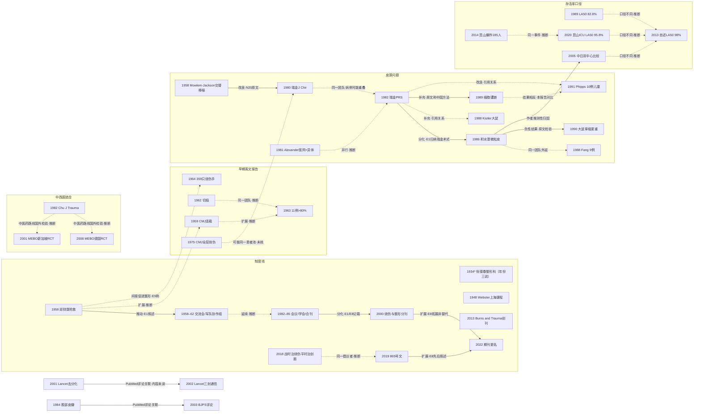

# X01 中国烧伤整形学科的形成与关键事件（横切）

> **一句话判断**：这个方向讲中国烧伤整形怎样从 1958 年一次抢救，变成有学会、专刊和科室标准的学科，以及它为什么在 2019 年后把重心转向“烧伤＋创面修复”。现有叙述大多出自当事单位的回忆和述评，中文数据库（CNKI、万方）本轮没有检索，1959–1982 年的中国原始英文报告本轮只查到题录；国外把“中国方案”称为 Chinese method，而同一瑞金团队 1980 年的原文自称它是对西方 Mowlem-Jackson 自异体皮交替移植的改进 [X01-N20]。**对临床医生最重要的一点**：“中国烧伤治愈率世界领先”至今没有统一口径的比较证据；2019 年后的创面修复科建设也还没有评价效果的结局研究。

## 0 三分钟速读

1. **从哪里来**：学科共同体把 1958 年上海广慈医院（今瑞金医院）抢救炼钢工人邱财康（TBSA 89%、III 度 23%）定为起点 [X01-N18]。同一年，西南医院烧伤研究所由黎鳌创建。一篇科技史口述访谈把这次抢救放在“大跃进”运动背景中理解 [X01-E9]。
2. **为什么改变**：1960–80 年代的主要问题是自体皮不够。瑞金团队用大张异体皮开洞、嵌植小块自体皮，1980 年原文自称是对 Mowlem-Jackson 法的改进 [X01-N20]；1971 年用此法救活 10 例 >90% TBSA 的患者，这个数字只来自 E1 的转述 [X01-E1]。积水潭团队随后把自体皮剪成微粒铺开，1986 年报告扩展比最高 15:1 [X01-N08]。2018 年以后，当事人提出的问题变成“烧伤减少、慢性难愈合创面分散在近 10 个科室收治”（前者见 [X01-N32]，后者见 [X01-E6]），并以此为理由申请设科，2019 年国卫办医函〔2019〕865 号文发布 [X01-N14]。
3. **如何分化**：1985 年烧伤和整形两个专业合办一本期刊，2000 年分刊，分刊原因原文未说明 [X01-N22][X01-N27]。2019 年起建创面修复科，2022 年《中华烧伤杂志》更名为《中华烧伤与创面修复杂志》，主编写明这次更名“是拓展而不是替代” [X01-N34]。
4. **现在研究什么**（学科层面）：近五年的代表文献主要是创面修复科建设述评、学会主刊的计量分析（全身治疗类文献占比从 84.0% 降到 40.3%）、以及 196 家医院 333,995 例的病案流行病学 [X01-R06][X01-R07]。各项临床研究主题见 D01–D12。
5. **用了什么数据**：1958–1980 年代以单中心病例系列和当事单位专著为主；2021 年后出现非概率抽样的多中心病案库、儿童医院联盟数据库和烧伤中心问卷普查。到本章截止，全国烧伤登记库仍未建立，2022 年的流行病学论文作者也在呼吁建库 [X01-R07]。
6. **还不知道什么**：“多个中心 LA50 达 98% TBSA”是自述 [X01-E1]。唯一一项中日直接比较（129 例）摘要中未见校正 [X01-N13]。昆山 18 个 ICU 的队列算出 LA50 为 95.8%，但只代表一次灾难中的青壮年伤员 [X01-N33]。创面修复科建科后，结局有没有改善，目前没有研究评价。中文数据库（CNKI、万方）本轮未检索（第二轮仍未补查，见第 8 节），学科史主干依赖当事单位的回忆与述评（E1、E2、E4、E6），独立史学来源只有 E3、E5、E7、E9 四篇，都只读到摘要。

**覆盖边界**：
- 纳入：中国烧伤整形学科的起点事件、协作网络、学会与期刊沿革、科室形态（烧伤、整形、创面修复）、政策文件；国际上对中国原创技术的采用、改良和反证（只写到“谁、何时、结论是什么”这一层）；存活率比较口径；中西医结合路线的去向；批量烧伤事件；近五年学科层面的研究（建科、计量、全国流行病学、史料）。
- 不含，交给其他方向：植皮技术的国际谱系与操作细节（D02）；皮肤替代物、异体皮与培养细胞（D03）；局部用药与感染（D04）；吸入性损伤（D05）；营养代谢（D06）；死亡风险模型与救治体系（D07）；去分化、慢性创面生物学（D08）；康复（D10）；皮瓣与显微外科技术史，包括股前外侧皮瓣、中国前臂皮瓣（D11）；流行病学与批量烧伤处置细节（D12）。**整形外科只写到它和烧伤交叉的部分，主线是烧伤**；整形外科自身的制度史本轮只找到零星来源，见第 8 节。

**本章口径**：
- 报告截止/执行日：2026-09-29。近期重点窗口：2021-09-29 至 2026-09-29，只用于第 4 节展开，不限制历史追溯。
- 阅读层级：L0=仅二手转述；L1=题录已在数据库核实；L2=摘要已读；L3=原文部分章节已读；L4=全文已读。L0/L1 的内容写成“据某来源转述”或“仅题录”，不写成已核对原文贡献。事件类节点（如 1958 年抢救、学会成立）的层级指描述该事件的来源，不是事件本身的原始记录。
- 核查状态：**通过**=题录、数字和归属已逐条核对；**修正**=核对后改动了题录、数字、归属或关系定性，正文用修正后的值；**存疑**=来源互相矛盾，或只有单一未复核来源。本章补充的来源（1980 年 J Chir、Colson 1958、昆山两篇、湿润烧伤膏两项试验、胡钧 2011）已对照本轮保存的 PubMed/OpenAlex 摘要核对数字。
- 本章节点 34 个，按主要来源的层级计：L1 7 个（N01–N06、N17），L2 23 个（其中 N15 另有两条 L0 说法；N18、N19、N30 的部分来源达 L3–L4，按较低者计；N18 的原始病例报告未取得，为 L0），L3 3 个（N14、N22、N27；N14 标 L3/L4，经第三方转录全文，按较低者计），L4 1 个（N34）。**1959–1982 年的中国原始英文报告（N01–N06）都没有读到摘要以上。** 另有近期代表研究 10 条（L1 1、L2 8、L3 1）、入口文献 9 条（L2 6、L4 3）。全部 53 条见 `data/evidence_X01.json`。
- 覆盖状态：**基本完整但有标注缺口**（2026-09-29 第二轮完整性检查后按统一口径重评）。理由：① 六个问题（从哪里来、为什么改变、如何分化、现在研究什么、用了什么数据、还有什么不知道）都能据本章回答，分别见第 1、2、3、4、7、8 节；② 本章范围内的主要分支都有节点：起点事件与协作网络、皮源问题与国外采用或反证、存活率比较口径、中西医结合路线、学会与期刊沿革、烧伤与整形的合与分、创面修复科、批量烧伤事件、近五年学科层面研究；③ 主链转折都有可核实来源，其中 1958 年抢救经 E1、Sun 2018 转述（原始病例报告未取得），865 号文经第三方转录读到全文。缺口限于第 8 节已标注的项目：中文数据库（CNKI、万方）未检索，学科史主干因此依赖当事单位的回忆与述评；1959–1982 年中国原始英文报告和西方前身只到题录（N06 第二轮补查仍无摘要）；湿润暴露疗法的国内争论未核。
- 引用写法：[X01-Nxx] 为关键节点，[X01-Rxx] 为近期代表研究，[X01-Ex] 为入口文献。只出现一次的辅助文献直接给 PMID、DOI 或 URL。

---

## 1 源头：最初在研究什么

**判断**：最早的问题是“大面积烧伤能不能救活”。1930 年代的外科教学认为，烧伤面积超过 30% TBSA 几乎必死；此后的 Evans 补液公式（1952）还规定，面积超过 50% TBSA 的患者一律按 50% 计算补液量（据 [X01-E1]，E1 作者为亲历者）。1958 年的抢救被公认为转折，但它是**同一年里的一组事件**：广慈医院的抢救、西南医院烧伤研究所的创建（PMID 30060344）、上海全国经验交流会 [X01-N19]。这次抢救也发生在政治运动之中（“大跃进”），不能只当作一例医学成功来读 [X01-E9]。

| 说法 | 分类 | 依据与限定 | 层级 |
|---|---|---|---|
| 1958 年广慈医院抢救邱财康（TBSA 89%、III 度 23%）是中国现代烧伤医学的学科起点 | 被公认的奠基工作（学科共同体定性） | E1、E2、E4、Sun 2018（PMID 30481908）都以此为起点；89%/23% 这组数字见 E1（即 Sheng 2013）和 Sun 2018。原始病例报告未读 [X01-N18] | 转述来源 L4（Sheng 2013）/L2（Sun 2018）；原始病例 L0 |
| 同一病例是“世界首例”（Sun 2018 称其“首获成功，改写了世界纪录”） | 作者自述首次，无对照 | 这是 Sun 2018 的自述，本轮没有找到国际同期文献可以对照。它和上一行是两个命题：“中国学科起点”有学科共同体的一致定性，“世界首例”没有比较依据 [X01-N18] | 转述来源 L2（Sun 2018）；原始病例 L0 |
| 同一事件的历史语境 | 独立史学表述 | 胡钧 2011 年《中国科技史杂志》访谈抢救组成员张涤生，摘要称：抢救发生在“大跃进”开始时，在医学界和全国引起轰动，推动了烧伤医学的“大跃进”，并间接促进了中国整形外科的发展；作者指出，特定历史时期的政治运动对医学影响很大 [X01-E9] | L2（英文摘要，全文未读） |
| Chin Med J 1959 年三期连载《Management of severe burns》（无署名） | 目前最早找到的文献（PubMed 收录范围内最早的中国烧伤英文题录） | 在 PubMed 检索 Chin Med J 1940–1968 年题名含 burn 的文献，共 12 条，最早一条为 1959 年；OpenAlex 按年份检索 1920–1957 年，没有找到中国烧伤专题文献。**PubMed 对 1959 年以前 Chin Med J 的收录有限**，该刊 1932 年已经创刊，所以“最早”只在索引范围内成立。这篇连载是否就是邱财康病例的报告，无法确认 [X01-N01]。同期中文报告在 PubMed 有 3 条题录，均无摘要：《中华外科杂志》1959 年烧伤感染与毒血症（PMID 13808943）、1960 年肾脏改变（PMID 14419228）、1961 年中西医结合 84 例（PMID 14020943） | L1 |
| 大张异体皮开洞、嵌植小块自体皮（瑞金）；“邮票状”自异体皮混合移植 | 作者自称首次，有西方前身 | ① 同一瑞金团队 1980 年在法国 J Chir 发文，摘要自称该法是对 Mowlem-Jackson 法的“很大改进”，并称在 90% 体表面积的 III 度烧伤中取得成功 [X01-N20]。② 法国 Colson 等 1958 年已报告自异体皮交替移植（Mowlem-Jackson）治疗大面积烧伤的临床结果和组织生物学研究，1962 年续报（PMID 14022455）[X01-N17]；Jackson 1954 年 BJPS 一文只核到题录，内容未读（PMID 13149795）。③ E2 摘要把开洞嵌植归于广慈医院（“创用”），但“邮票状”术式没有写明首创单位；E1 对瑞金的用词是“advocated”（提倡），不是首创。④ 国外同行把这种方法称为“Chinese method”或“developed in the PR China”（Hufnagel 1989，PMID 2524244；[X01-N25]）。因此，中方“首次”只能限定为“开洞嵌植这一具体做法，以及它在 >80–90% TBSA 患者中的应用（作者自述）” | L1–L2 |
| 微粒皮移植（漂浮法铺皮加异体皮覆盖） | 作者自称首创，国际有跟进 | 首创依据全部来自中国作者：E1 称积水潭“developed”漂浮法；张明良 2008 年回顾称 1985 年开始使用（PMID 19103012）[X01-N08]。“小块自体皮扩展”的思路在国际上早有先例：Meek 1958 年的 microdermagrafting（PMID 13571547，题录），以及 1950–60 年代的 postage stamp、ultra postage stamp 植皮（PMID 14373300、5331555、4909265，题录）。国外跟进研究中，Fang CH 本人是张明良 1988 年论文的合作者，所以 Fang/Alexander 系列，包括 1990 年的两项大鼠研究（Fang 1990 [X01-N26]；Yeh 1990，PMID 2373729），都不是独立的国外验证 [X01-N23] | L1–L2 |
| 中国最早的整形外科科室由倪葆春建立 | 目前最早找到的文献（年份有争议） | 孔繁祜 2000 年考证 1949 年前的医学期刊，认为科室出现于 1934 年，并统计 1949 年前整形外科论文共 27 篇 [X01-E5]。另有两说：1929 年在圣约翰大学医学院附属同仁医院开设整形外科门诊（中国整形美容协会网页，注明转自《中华整形外科杂志》，capa.org.cn/contents/751/519.html）；1928 年开设门诊（中文维基百科“倪葆春”词条）。三个年份可能分别指门诊、科室和正式建科，本轮无法判定 [X01-N15] | L2（1934）；L0（1928、1929）；**存疑** |
| 创面修复科的设立 | 目前最早找到的文献 | 国卫办医函〔2019〕865 号，2019 年 11 月 29 日 [X01-N14]。E6 作者称该通知把创面修复规定为“新的独立外科三级学科”，但通知原文没有这句话，也没有“诊疗科目”字样 | L3/L4（经第三方转录全文，维基文库与 waizi.org.cn 转录本：全文内容已读，但读的是转录本，不是 gov.cn 原页面） |

**“最早找到”与“公认奠基”的区别**：1959 年的连载只是 PubMed 里能查到的最早一条，受索引覆盖的限制，本轮没有读到内容；1958 年的抢救是学科共同体一致认定的起点，但定性来自当事单位，原始病例报告没有取得；“世界首例”是另一个命题，只有 Sun 2018 的作者自述，没有对照。再往前，E1 记载了 1930 年代外科教学用单宁酸、硝酸银涂布创面防止毒素吸收，患者仍在数日内死亡；1950 年代初提倡的枣树皮煎剂外用，也因无效很快被放弃。Webster 1948 年在上海为 13 名中国外科医师开设的 4 周课程中已包括烧伤外科处理 [X01-N16]。这些都说明 1958 年以前已有烧伤治疗，只是没有形成专科。

---

## 2 关键转折：问题—新证据/新方法—认识变化—新问题

### 2.1 大面积烧伤能不能救活（1958–1960 年代中期）

**阅读层级提示**：本段 1959–1963 年的英文报告（N01–N03）只到题录，内容未读；1958 年病例的面积数字和存活结局来自 E1、Sun 2018 的转述，1963 年“11 例”只来自 N03 的题名。

- **问题**：据 E1，1930 年代认为 >30% TBSA 几乎必死，后来的 Evans 公式又把 >50% TBSA 的补液量封顶在 50%。
- **新证据**：1958 年的抢救成功 [X01-N18]。E1 说这次抢救“打破了当时的治疗定式”，激励了国内外科医师，市属医院和军队医院纷纷开展烧伤救治，其中军队医院投入尤其集中。随后形成了一个协作网络：1958 年上海全国经验交流会，1959 年军队会议，1960 年 1 月第三军医大学烧伤研究所主办首届全国烧伤会议，1962 年军队医院烧伤科组成经验交流组织 [X01-N19]。英文报告接连出现：1959 年连载 [X01-N01]，1962 年大面积烧伤切痂 [X01-N02]，1963 年“11 例 >80% TBSA 成功处理” [X01-N03]。
- **认识变化**：病例从单例扩展到病例系列（N01→N03 为**扩展**，本报告推断：两篇原文都没有读到）。N02 和 N03 有三位作者重叠（Shih CH、Tung FC、Chu TA），推断为**同一团队**，但两篇的病例是否重叠未知。
- **新问题与限定**：N01–N03 都只有题录，存活的定义、面积估算方法和随访情况都不清楚。“>80% TBSA 被视为不可存活”这一背景说法没有找到出处，E1 也不支持，属于本报告推断。作者姓名的中文对应（如 Tung FC 是否即董方中、Shih CH 是否即史济湘）未核，见第 8 节。

### 2.2 自体皮不够怎么办：从交替移植到开洞嵌植，再到微粒皮

**阅读层级提示**：本段 1982 年以前的节点只到题录或摘要：西方前身 N17、1979 年 Chirurgie（PMID 119616）和 1982 年 PRS（N06）只到题录（N06 第二轮补查仍无摘要，见第 8 节），1980 年 J Chir（N20）只读到英文摘要；瑞金 1971 年 10 例的病例数和结局来自 E1 转述。1986 年以后的微粒皮节点（N08、N23、N26）读到摘要。

- **问题**：切痂以后，大面积全层烧伤患者可供取皮的健康皮肤很少。
- **西方前身**：1950 年代西方已有自异体皮交替移植（Mowlem-Jackson），1958 年法国有临床和组织学报告 [X01-N17]。
- **中国改良**：瑞金团队改为大张异体皮开数百个洞、洞内嵌植小块自体皮。E1 记载，1971 年用此法救活 10 例 >90% TBSA、全层 >70% 的患者（E1 介绍该术式时引用的是瑞金 1975 年的中文专著）。同一团队 1979 年在法国 Chirurgie 报告 4 例 >90% 体表面积 III 度烧伤康复（PMID 119616，仅题录，L1；题录未写所用术式），1980 年在法国 J Chir、1982 年在美国 PRS 发表法文或英文报告，1980 年摘要明确把此法写成对 Mowlem-Jackson 法的**改良**（原文明确讨论）[X01-N20][X01-N06]。1979 年这篇的作者串（Tsi-Siang S、Chih-Chun Y 等）与 1980 年 J Chir 重叠，按同一团队计。**计数提醒**：1963 年 11 例、1971 年 10 例、1975 年 Chin Med J 英文报告 [X01-N05]、1979 年 Chirurgie 4 例 >90% III 度（PMID 119616，L1）、1980 年 J Chir 和 1982 年 PRS，很可能来自同一团队、同一批患者，本章只按“同一团队多次报告”计为一个证据来源。其中 1979、1980、1982 年三篇出自同一团队，病例可能来自同一患者池；各篇之间病例是否重叠，本轮无法核实。
- **同期并行**：美国 Alexander 等 1981 年报告宽网自体皮加网状异体皮覆盖，共 14 例 [X01-N21]。它和中国方法之间有没有相互影响，没有找到原文讨论（**并行**，本报告推断）。
- **分化出微粒皮**：E1 说开洞嵌植“费时费力”，几年后积水潭发展出漂浮法微粒皮（**分化**，E1 综述归纳。注意 E1 指的是瑞金术式，不是 N06 这篇论文本身）。张明良团队 1986 年报告：兔实验 12 只中 8 只创面完全覆盖，扩展比 7:1–15:1，4 只因异体皮移动而失败；临床 8 例中 7 例成活，愈合 22–45 天，1 例因异体皮脱落失败。1988 年续报 17 例，全部存活，扩展比最高 1:18，另有 12.2% 的部位（4 个肢体和 1 个胸壁）微粒皮没有成活 [X01-N08]。
- **同一团队外延**：1988 年北京医科大学第一附属医院报告 9 例（平均 74.9% TBSA），8 例存活，作者 Fang CH 是张明良 1988 年论文的合作者，美方 Alexander JW 合著 [X01-N23]。1990 年，Fang 与 Alexander 在大鼠上比较，发现微粒皮加异体皮组的**挛缩更重**：7 周时缩到原面积的 43%，整张同系皮组 4 周时为 72% [X01-N26]（**负性结果**，原文直接检验这一术式）。同一中美合作组同年还有第二项大鼠研究：Yeh 1990（作者含 Fang CH、Alexander JW，Shriners Cincinnati）在 10:1 扩展比下比较**中国式自异体皮间植与微粒皮**，中国式间植的瘢痕挛缩较少（PMID 2373729，L2）。两篇的比较对象不同：Fang 1990 是微粒皮加异体皮 vs 整张同系皮，Yeh 1990 是中国式间植 vs 微粒皮；两篇都出自与微粒皮原团队有作者重叠的合作组，并列看待，都不是独立验证。后续还有：台湾 Lin SD 1991 年用猪皮代替异体皮覆盖，做了 15 只兔的实验（PMID 1793496）；Chen XL 2011 年报告 1997–2010 年 63 例 >70% TBSA 患者，总存活率 63.5%（PMID 21531080）。
- **新问题**：以上几乎都是没有对照的病例系列，结局只看“成活/愈合”，缺少功能和瘢痕随访；动物实验中的挛缩信号，本轮没有找到临床随访来回答。技术谱系细节交 D02。

### 2.3 国外怎样看“中国方法”：采用、改良，以及一对相反的结果

- **“验证”这个说法需要降级**。国外的实际情况是：日本 Sawada 1985 年报告 1 例儿童（PMID 3899316）；德国 Aachen 团队做了大鼠实验；英国报告 10 名儿童的病例系列。这些是动物实验和小样本临床采用，不是独立验证。
- **德国大鼠组织学（补充）**：Kistler 1988 年发现，单纯异系皮片 3 周内全部被排斥；混合移植中，自体表皮覆盖在异体真皮上，异体真皮被接受，弹力纤维基本保留，但皮肤附件被排斥 [X01-N09]。这篇摘要没有提到中国；它和 Yang 1982 的关系只来自 OpenAlex 的引用记录（**补充**，依据是引用关系）。同一团队 1989 年的摘要则明确写“Chinese method”（Hufnagel，PMID 2524244）和“developed in the PR China”[X01-N25]。
- **英国临床改良**：Phipps & Clarke 1991 年报告，他们单位用培养角质细胞的效果“令人失望”，又因 HIV 风险放弃尸体异体皮，改用宽网自体皮加父母网状异体皮，共 10 名儿童。父母皮肤长期存留、未见排斥，异体真皮参与最终覆盖，但父母皮肤的细胞成分没有存活 [X01-N10]（**改良**；和中国方法的联系只来自参考文献，依据是引用关系）。
- **相反结果**：Aachen 团队 1989 年做了细胞遗传学分析，在移植后第 53 天和第 111 天仍检出存活的异体细胞，结论是混合皮形成“细胞镶嵌” [X01-N25]。这和 Phipps 的“异体细胞成分不存活”相反：一个是大鼠核型分析，一个是人体 Y 染色体鉴定，物种和方法都不同。两者的矛盾没有解决，本报告不做调和。
- **推广受阻**：Hettich 1992 年的摘要写明，混合移植在西方的推广“长期受制于高成本”，团队为此设计了一台制备机器（PMID 1393246）。

### 2.4 “存活率世界领先”能不能比较

- **自述**：E2、E4、Ni 2019（E3）、Sun 2018 反复写“治愈率世界领先”“治疗水平世界领先” [X01-E2][X01-E3][X01-E4]；E2 还把理论研究描述为“跟跑—并跑—领跑”。E1 的措辞更谨慎：“不少中心**声称** LA50 达到 98% TBSA”。这些都是自评，不是比较研究。
- **可量化的数字**：Guo ZR 等 1989 年总结作者团队 2630 例全血抗休克经验，LA50 为 82.8% TBSA、III 度 57.4% [X01-N24]。昆山 2014 年粉尘爆炸后，18 个 ICU 收治 167 例：中位年龄 38 岁，90 天死亡 37.1%（62/167），71% 的患者 TBSA ≥90%，按 TBSA 计 LA50 为 95.8%，按全层面积计为 88.6% [X01-N33]。
- **直接比较**：Saitoh 2005 年比较日本防卫医大医院 34 例与长海医院 95 例（1999–2003 年，伤后 3 天内入院、TBSA >20%）。日本组自杀性烧伤占 41.2%，中国组 1.1%，日本组年龄更大、吸入伤更多；在 TBSA >80% 或烧伤指数 >60 的患者中，长海存活率更高。作者“部分”归因于早期气管切开和微粒皮/混合移植 [X01-N13]。这是一项**摘要中未见多因素校正的双中心描述性比较**，归因是作者推测，不能当作对微粒皮的验证。它也不是国际同行的独立检验：中方合作者（Ben D、Huan J、Xia Z）来自被比较的一方。其中有一次核对认为 Xia Z、Ben D 属长海医院；另一次核对指出 PubMed 只列出第一作者单位，中方作者单位无法确认。两说并存。
- **判断**：以上数字分别来自单中心回顾（1989）、一次灾难中以青壮年为主的伤员（2020）和两家医院的描述性比较（2005），口径都不相同。它们**既不能证实、也不能否定**“LA50 98%”的自述，只能说明有定义的队列目前处在什么水平。面积估算方法也影响比较：中国早期自订“rule of nine or ten”，因为体型不同而不用 Wallace 九分法（E1 原文用词，细节交 D01）。

### 2.5 中西医结合路线后来怎样了

- **起点**：Chu 1982 年在 J Trauma 向美国读者介绍中国烧伤研究，把中医药用于液体复苏和创面处理写成中国与西方路线“有所不同”的特征；第 II 篇还提到微血管外科修复烧伤后组织缺损已获成功 [X01-N07]。同期进入国际期刊的是个案：Sci Sin 1977 年 2 例（PMID 327540），Burns 1982 年 1 例 98% TBSA（PMID 7151004）。1965 年 Chin Med J 有一篇无署名的《Utilize Mao Tse-Tung's thinking to the full in treating burned patients》（PMID 5864042，题录），只作为当时政治化表述的背景线索，内容未读，不做解读。
- **国外检验**：本轮读到两项中国来源的湿润烧伤膏（MEBO）境外随机对照试验。新加坡 Ang 2001 年纳入 115 例 <40% BSA 的 II 度烧伤，75% 创面愈合的中位时间为 17 天对 20 天，HR 0.67（0.41–1.11），P=0.11；感染率相近；前 5 天镇痛效果更好，住院费用低 8%；作者结论是与常规疗法效果相当，“不是万能药” [X01-N28]。德国 Hirsch 2008 年 40 例，主要指标是经表皮失水，不是愈合指标，差异无统计学意义（P=0.78）[X01-N29]。Mabvuure 2020 系统综述（PMID 32876517）纳入 6 项英文 RCT，与 1% SSD 相比，3 项中 2 项结果有利于 MEBO，但偏倚风险高、结论不一致（见 D08）。
- **认识变化**：Ang 2001 的愈合时间差异没有统计学意义，同时报告了镇痛和费用方面的结果；Hirsch 2008 的主要指标（经表皮失水）没有差异。系统综述层面，Mabvuure 2020 的结论是英文文献中关于愈合速度和镇痛的证据差、结果不一致。国内学术界围绕湿润暴露疗法的争论，PubMed 没有收录相应的中文题名，本轮未能核实（见第 8 节）。

### 2.6 烧伤与整形：先合在一起，后来分开

- 1949 年以前，整形外科已经出现：倪葆春建科（年份三说）[X01-N15]，Webster 1948 年课程的学员“许多人此后在各自医院创立整形外科” [X01-N16]。
- 1960 年代，整形技术被用于烧伤后遗症：1964 年报告 359 只烧伤手的挛缩修复 [X01-N04]；同年同刊还有烧伤手畸形（PMID 14168118）和颞动脉带蒂皮瓣修复面部烧伤（PMID 14140011，与 N04 同为 Kuei SJ、Li SY 团队）。胡钧 2011 年访谈认为，1958 年的抢救“间接促进”了整形外科发展 [X01-E9]。这是目前唯一把两者联系起来的独立表述，只到摘要层级。
- 制度上的“合”：1982 年召开第一届全国烧伤整形外科学术会议；1983 年中华医学会烧伤学会成立（据 E1）；1985 年创办《中华整形烧伤外科杂志》[X01-N22]。1984 年，以肌间隔皮动脉为基础的股部皮瓣发表在 BJPS，OpenAlex 截至 2026-09-29 被引 1485 次（当前累计值，不代表发表时的影响）[X01-N12]。
- 制度上的“分”：1999 年分刊，2000 年 2 月《中华烧伤杂志》在重庆出版第 1 期，《中华整形外科杂志》同年另行出版 [X01-N27]。**合刊和分刊的具体原因，现有来源都没有说明**。本报告不根据两个专业之间的关系去推断原因。
- “烧伤整形科”作为统一科室名称的正式规定，本轮没有找到。能核实的依据有会议名称（1982）和合刊（1985–1999）；华西医院 1963 年成立的科室也叫“烧伤整形外科”（PMID 30157551）。2015 年全国问卷中，烧伤整形合科占 63.0%，是回复医院中最常见的组织模式（Zhanzeng 2015，PMID 25027828，405 家医院回复，应答率未报告，见 D12）。这说明合科是常见形态；正式命名规定仍未找到。

### 2.7 烧伤减少以后，学科做什么：创面修复科

- **问题**：付小兵 2018 年称，“初步流行病学资料显示”我国烧伤总体发生率下降，提出“战时治烧伤、平时治创面”：有重大群体性烧伤事件时救烧伤，平时以慢性难愈合创面作为日常工作的重要内容，把它视为烧伤学科“转型发展和生存之机会” [X01-N32]。摘要只说依据是“初步的流行病学资料”，没有给出数据来源；本轮能找到的是 196 家非概率抽样医院的**入院数**逐年下降 [X01-R07]，不是人群发病率。E6 另称，慢性难愈合创面此前分散在近 10 个科室收治。
- **制度行动**：据当事人 E6（L4），1992 年黎鳌、史济湘牵头国家自然科学基金重大项目；2008 年起培训医护近 20000 人；2010 年以来近 500 家医院在相关外科设立创面病房。2019 年 3 月 10 日，付小兵与 Huang Yuesheng、Lu Shuliang 商议后，认为可以申请把创面修复设为独立的外科三级学科；4 月，付小兵与 28 位院士、2 位专家联署；5 月 5 日报送国家卫健委；7 月 9 日征求意见；11 月 29 日发布 865 号文 [X01-N14]。
- **通知原文实际写了什么**：有条件的医疗卫生机构“可参考”基本标准建立创面修复科；三级医院开放床位 ≥20 张（建科初期不少于 10 张），二级医院 ≥10 张；尚未具备条件的机构，加强内分泌科、普外科、骨科、烧伤科等相关科室的能力建设。**“三级学科”是 E6 作者的说法，通知原文没有；通知也没有写“诊疗科目”。**
- **后续**：E6 称通知发布 2 年多后，约 400 家医院在筹建、数十家已建科。2022 年期刊更名，主编寄语把更名放在卫健委批准设立创面修复科之后叙述，并强调这次更名“拓展而不是替代” [X01-N34]。Huang YS 等 2020 年专门回应“建创面修复科会影响烧伤学科”的担忧 [X01-R10]。
- **新问题**：建科以后，患者结局有没有改善？本轮补充检索 2020–2026 年“创面修复科/中心”的结局评价，在 PubMed 命中 3 条，都不是评价建科效果的研究。另外，1958 年烧伤学科兴起时依托大批烧伤伤员，今天的转型依托慢性创面人群，这两个阶段是同一学科在不同时期的主要任务，不是技术上的直接承接。

**基础研究的一个插曲**：Fu X 等 2001 年在 Lancet 报告，8 例 rhEGF 治疗的下肢溃疡患者，再生表皮棘层和颗粒层出现 K19、β1 整合素阳性细胞，作者解释为分化细胞逆转为干细胞 [X01-N11]。E6 称该发现被国际同行评为“组织修复与再生的第四种机制”，这是作者方转述。Lancet 2002 年刊出 Kume 等、Eisendle & Zelger、Brouard & Barrandon 三封通信，附作者回复，本轮没有读到内容，**不能确认是质疑还是讨论**。交 D08。

---

## 3 分支图

实线表示原文明确讨论，或综述已经归纳的关系；虚线表示本报告的推断。边上的标签写关系类型和依据。

读图提示：
- 制度线上的实线只表示来源明确写了两件事的承接：1958→1962 的“推动”是 E1 亲历者的叙述；1985→2000 的分刊见 E1 和 E8；2000→2022、2019→2022 是 E8 主编寄语的叙述。N15、N16、N30 只标时间位置，没有找到与其他节点的明确关系。其余制度节点之间只是时间先后，本报告没有把它们写成因果。
- “皮源问题”一栏里，实线只有三条：改良（1980 年原文）、分化（E1 归纳）、负性结果（1990 年原文检验）。国外采用都是虚线或引用关系。
- N31→N33：昆山 167 例是 185 名伤员中进入 18 个 ICU 的部分，这是本报告推断，两篇原文没有写明两个数字之间的关系。

---

## 4 近五年重点（2021-09-29 至 2026-09-29）

**先说明**：以下四个主题都是学科组织层面的研究，代表文献以当事人述评为主。近五年中国烧伤的临床研究，例如复苏、感染、瘢痕和皮肤替代物，分别见 D01–D12，不要把本节当作中国烧伤研究现状的全部。

### 4.1 创面修复科建设（865 号文之后）
- **研究什么**：建科标准、区域模式、专科联盟、人才培训，以及与烧伤科的边界。
- **数据与设计**：当事人述评、单中心或区域经验总结；没有对照研究。
- **代表研究**：E6（2022，L4）给出“约 400 家筹建、数十家已建、近 500 家设创面病房、培训近 20000 人”，都是作者自述 [X01-E6]。Fu XB 2023 年提出影响学科建设的 10 个方面 [X01-R01]；2024 年介绍若干专科或区域联盟模式 [X01-R02]；2026 年总结皖南、赣南、海南县域基层体系的阶段性成果 [X01-R04]。Cheng SW 2025 年介绍海南医科大学第一附属医院把创面修复并入紧急医学救援体系的“海南模式” [X01-R03]。Front Surg 2023 年出了专题社论，本轮只到题录 [X01-R05]。
- **分歧**：窗口前的 Huang YS 等 2020 年一文回应“影响烧伤学科”的担忧 [X01-R10]；创面修复科与内分泌科、血管外科、骨科的收治边界，由各医院自行划定（E6）；“三级学科”的说法在通知原文中找不到依据。
- **成熟度**：发展中。效果评价是空白。本轮补充检索的 3 条结果都不评价建科效果。

### 4.2 学会主刊的计量分析
- **研究什么**：《中华烧伤杂志》2000–2021 年发文主题的变化。
- **数据与设计**：用 CNKI 检索该刊全部文献，做文献计量和 CiteSpace 关键词聚类。
- **代表研究**：Huang Z 等 2022 年分析 4485 篇文献，烧伤全身治疗类文献占比从 2000–2002 年的 84.0%（430/512）降到 2018–2021 年的 40.3%（373/926）；急性创面、整形美容、慢性创面、烧伤康复的占比分别“上升 11.7%、9.1%、10.7%、5.5%”（原文没有写明是百分点还是相对增幅）；学科管理类文献在 2018–2021 年增加到 49 篇 [X01-R06]。E8 统计的是另一个口径：2000–2021 年创面修复相关论文约占三分之一（1624/5277），相关指南和共识占 14/30 [X01-E8]。
- **分歧**：两文分类口径不同，Huang Z 一文中全身治疗类整体占 60.2%，不能和 E8 的“三分之一”直接对比。另外，分析对象是学会自己的主刊，而这本刊的编辑方针本身就在向创面修复扩展（2022 年更名），所以发文构成的变化有一部分反映的是收稿范围，**不能单凭它推出临床工作的转型**。
- **成熟度**：发展中，属于单刊描述。

### 4.3 全国烧伤流行病学与烧伤中心资源
- **研究什么**：住院烧伤患者的构成与趋势，儿童烧伤，烧伤中心护理人力。
- **数据与设计**：
  - Yang J 等 2022 年，196 家医院，覆盖 31 个省级行政区，2009–2018 年。方法部分写明医院为**非概率抽样**，用 SQL 从 Oracle 数据库提取电子病历，医院类型未说明。共 333,995 例，占这些医院全部住院患者的 0.76%；男性 66.61%；0–10 岁占 38.10%；烫伤 60.19%，火焰 20.45%；年入院数逐年下降。摘要称 0–10% TBSA 占 37.19%、90–100% TBSA 占 21.74%，**后一个数字作者没有解释，合理性存疑**。作者在结论中呼吁建立“China database of burns” [X01-R07]。
  - Chen K 等 2023 年，福棠儿童医学发展研究中心数据库，23 家儿童医院，2016–2019 年，6741 例；男 63.23%，1–2 岁 69.95%，热液烫伤 80.57%，肺炎是最常见并发症（21%）[X01-R08]。
  - Wang SJ 等 2023 年，自设问卷，调查 39 个烧伤中心的 1441 名护士（2022 年 1–3 月调查 2021 年情况）。护士离职率 9.03%（143/1584），“重要军事斗争战略区域”为 18.14%（80/441）；除成渝地区外都设有烧伤重症监护室 [X01-R09]。阅读层级 L2（摘要）；以上数字全报告复核时与摘要核对一致。
- **分歧**：“0.76%”的分母只是这 196 家医院的住院总数；各研究纳入的医院不同，不能合并；到 2022 年全国仍没有烧伤登记库。
- **成熟度**：发展中。人群发病率交 D12。

### 4.4 学科史料与国际交流史
- **代表研究**：Marquez 等 2026 年查阅 Columbia 大学 Webster 档案，说明 1948 年经 ABMAC（American Bureau for Medical Aid to China）开设的 4 周课程培训了 13 名中国外科医师，课程含烧伤外科处理 [X01-E7]。窗口前还有医史期刊的考证（E3、E5）和科技史口述（E9）。
- **分歧**：2018 年 60 周年的系列回顾多由当事单位撰写，自评性表述较多；独立史学来源目前只有 E3、E5、E7、E9 四篇，都只读到摘要。
- **成熟度**：早期线索。

---

## 5 争议、负性结果与停滞路线

**争议**

| 争议 | 各方说法 | 证据状态 |
|---|---|---|
| “治愈率世界领先” | 自述：E2、E3、E4、Sun 2018。谨慎表述：E1 写“不少中心声称 LA50 98%” | 统一口径的比较证据没有。可量化的数字只有 82.8%（1989 单中心）[X01-N24]、95.8%（昆山灾难 ICU 队列）[X01-N33]，以及一项摘要中未见校正的中日比较 [X01-N13]。本轮没有找到 1960–80 年代西方同行对中国存活率报道的书面评价原文 |
| “首创”的归属 | 开洞嵌植：E2 称广慈“创用”，E1 用“advocated”；邮票状混合移植：E2 摘要未写首创单位；微粒皮：积水潭团队自述 | 瑞金团队 1980 年原文自称是 Mowlem-Jackson 法的改进 [X01-N20]；法国 1958 年已有交替移植报告 [X01-N17]。三项首创的主张方分别是瑞金、西南（E2 作者单位）和积水潭的当事人或同系统作者 |
| 混合移植后异体细胞是否存留 | 大鼠核型分析：第 53、111 天仍有存活的异体细胞 [X01-N25]；人体 Y 染色体鉴定：父母皮的细胞成分不存活 [X01-N10] | 未解决。物种和检测方法都不同 |
| 表皮细胞去分化 | Fu 2001 的解释 vs Lancet 2002 三封通信 | 通信内容未读，性质未定 [X01-N11]，交 D08 |
| 创面修复科的地位 | E6 称“独立外科三级学科”；E8 称“批准成立了创面修复科（专业）”；通知原文只写“可参考标准建立” | 是否在《医疗机构诊疗科目名录》中新增了科目代码，本轮未核 [X01-N14] |
| 中华医学会烧伤学会的成立年份 | E1 写 1983 年成立；中华医学会官网“改革开放 40 年掠影”只写 1982 年召开第一届全国烧伤整形外科学术会议（cma.org.cn/art/2019/1/28/art_14_25052.html），没有写学会成立 | 两说可能并不矛盾，但没有学会官方沿革页可以核对，**存疑** [X01-N22] |

**负性结果与失败路线**
- 1930 年代单宁酸、硝酸银涂布创面，没能降低大面积烧伤死亡；1950 年代初的枣树皮煎剂因无效很快被放弃（E1）。
- 微粒皮的失败病例：兔实验 4/12 失败，1986 年临床 1/8 失败，1988 年 12.2% 的部位没有成活 [X01-N08]；大鼠挛缩更重，缩到原面积 43%，对照为 72% [X01-N26]；同一合作组的 Yeh 1990 大鼠比较中，微粒皮的瘢痕挛缩多于中国式间植（PMID 2373729）。这两项都出自与微粒皮原团队有作者重叠的中美合作组，不是独立验证。
- 英国用培养角质细胞替代中厚皮，效果“令人失望” [X01-N10]。
- 混合移植在西方的推广长期受制于高成本（Hettich 1992，PMID 1393246）。
- 湿润烧伤膏：本轮读到两项境外 RCT（Ang 2001 愈合时间 P=0.11 [X01-N28]；Hirsch 2008 主要指标为经表皮失水，无差异 [X01-N29]）；Mabvuure 2020 系统综述（PMID 32876517）纳入 6 项英文 RCT，与 1% SSD 相比 3 项中 2 项有利于 MEBO，但偏倚高、结论不一致（见 D08）。
- 外源性表面活性物质治疗吸入性损伤无效（E1，交 D05）。

**停滞：需要重新理解的一条**
- E2 称“文革”使烧伤医学发展中断，1969 年后开始复苏。这一说法**只有 E2 一个来源**。同一时期 E1 记载 1971 年瑞金救活 10 例 >90% TBSA 的患者。英文报道的空档也不能当作独立证据：据 NLM 目录，Chin Med J 1932–1966 年出版，1966–1968 年改为 China's Medicine，1975 年起以新卷号出版英文版；《中华医学杂志》1967–1972 年停刊。所以 1965–1975 年英文烧伤报告的空缺，至少有一部分是期刊停刊和改刊造成的 [X01-N05]。

---

## 6 中国线

本章本身就是中国线。下面按“时间—事件—来源”列出能核实的部分，再写三条读者需要知道的结构性事实。

| 时间 | 事件 | 来源（层级） |
|---|---|---|
| 1928/1929/1934 | 倪葆春开设整形外科门诊或科室（三说） | E5（L2）；capa.org.cn、维基（L0）[X01-N15] |
| 1948 | Webster 在上海培训 13 名外科医师，课程含烧伤处理 | E7（L2）[X01-N16] |
| 1958 | 广慈医院抢救邱财康；西南医院烧伤研究所由黎鳌创建；上海全国烧伤经验交流会 | 邱财康病例：转述来源 L4（Sheng 2013，即 E1）/L2（Sun 2018），原始病例 L0；研究所创建：PMID 30060344（L2）；交流会：E1（L4）[X01-N18][X01-N19] |
| 1959–1962 | 军队会议（1959）；首届全国烧伤会议（1960 年 1 月，第三军医大学烧伤研究所主办）；军队烧伤科经验交流组织（1962） | E1（L4）[X01-N19] |
| 1959–1964 | Chin Med J 英文报告：严重烧伤处理、切痂、11 例 >80%、359 只手 | 题录（L1）[X01-N01]–[X01-N04] |
| 1963 | 华西医院成立烧伤整形外科 | PMID 30157551（L2） |
| 1966–1974 | Chin Med J 改刊、停刊；E2 称学科中断，1969 年后复苏 | NLM 目录（L3）；E2（L2） |
| 1971/1975 | 瑞金开洞嵌植，10 例 >90% TBSA 存活；Chin Med J 英文版复刊后的烧伤报告 | E1 转述（L4）；题录（L1）[X01-N05] |
| 1979–1982 | 瑞金团队在 Chirurgie（1979，4 例 >90% III 度）、J Chir（1980）、PRS（1982）发文，三篇出自同一团队，病例可能来自同一患者池；Chu 在 J Trauma 发表综述 | PMID 119616（L1）；N20（L2）、N06（L1）、N07（L2）[X01-N20][X01-N06][X01-N07] |
| 1982–1985 | 第一届全国烧伤整形外科学术会议（1982）；中华医学会烧伤学会（1983，据 E1）；《中华整形烧伤外科杂志》（1985） | cma.org.cn（L3）；E1（L4）[X01-N22] |
| 1986–1988 | 积水潭微粒皮；北京医科大学第一附属医院 9 例（中美合作） | L2 [X01-N08][X01-N23] |
| 1992 | 黎鳌、史济湘牵头国家自然科学基金重大项目 | E6（L4） |
| 2000 | 分刊：《中华烧伤杂志》（ISSN 1009-2587，重庆）、《中华整形外科杂志》（ISSN 1009-4598） | NLM 100959418、100957850（L3）；E8（L4）[X01-N27] |
| 2013 | Burns & Trauma 创刊，编辑部设在西南医院烧伤研究所 | NLM 101651457（L3）；PMID 30060344（L2）[X01-N30] |
| 2014 | 昆山粉尘爆炸，185 名烧伤伤员分送江苏和上海 20 家机构，千余名医务人员参与 | Tan 2016（L2）[X01-N31] |
| 2018 | “战时治烧伤、平时治创面” | Fu 2018（L2）[X01-N32] |
| 2019 | 865 号文 | 第三方转录全文（L3/L4）；E6（L4）[X01-N14] |
| 2022 | 更名为《中华烧伤与创面修复杂志》（国新出审〔2021〕1965 号，ISSN 2097-1109） | E8（L4）；NLM（L3）[X01-N34] |

**结构性事实一：军队与地方双轨，军队一侧更集中。** 这里只写来源里明说的内容。E1 说抢救之后“市属和军队医院”都开始投入，“尤其是军队医院”；E1 列出的早期领先中心有第三、第四军医大学，301 医院和后来的解放军 304 医院（后称解放军总医院第一附属医院，PMID 27338528 单位字段），瑞金医院，积水潭医院，名单中包括第三、第四军医大学等军队单位。1959 年有专门的军队烧伤会议，1962 年成立军队烧伤科交流组织 [X01-N19]。《中华烧伤杂志》和 Burns & Trauma 的编辑部都在西南医院烧伤研究所（PMID 30060344）。付小兵 2018 年的“战时治烧伤”[X01-N32]、Wang SJ 2023 年单列“重要军事斗争战略区域”[X01-R09]，也都延续了这条线。军队体系对学科形态有多大影响，本轮没有独立研究。

**结构性事实二：史料来源集中在当事单位。** 按 PubMed 单位字段：E2（Yang ZC）、E4（Huang YS 等）、E8（罗高兴）来自陆军军医大学第一附属医院烧伤研究所；E1（Sheng Z）来自解放军总医院第一附属医院（即原解放军 304 医院，PMID 27338528 单位字段写作 “The First Affiliated Hospital of PLA General Hospital (Formerly 304th Hospital of PLA)”）烧伤研究所；E6 由 Huang YS（南方科技大学医院）与 Fu X（解放军总医院）合写。三项“首创”分别出自瑞金、西南、积水潭的当事人或同系统作者。独立史学来源只有 E3、E5、E7、E9 四篇，都只读到摘要。读本章时要考虑自评偏差。

**结构性事实三：原始记录的缺口有一部分来自期刊和索引，不一定是学科本身停滞。** 1959、1965、1975、1980 年多篇英文报告没有署名，原文未说明原因；1966–1974 年期刊改刊、停刊；PubMed 对早年 Chin Med J 收录有限。

---

## 7 数据路径小结（历史上 vs 现在：动物/病例系列/RCT/登记库/行政数据/组学等）

| 时期 | 主要证据形式 | 例子 | 主要问题 |
|---|---|---|---|
| 1958–1980 年代 | 单例、单中心病例系列、经验总结 | 1959 连载、1963 年 11 例、1980 年 1 例 94% 儿童（PMID 6768507）、1982 年 1 例 98% TBSA（PMID 7151004） | 无对照；面积估算法不统一；随访不明；多篇报告可能来自同一患者池；原文多未署名 |
| 同期 | 当事单位专著和内部资料 | 瑞金 1975 年《烧伤治疗》、黎鳌 1995 年《烧伤治疗学》、杨宗城 2008 年《中华烧伤医学》（E1 参考文献，均未读） | 后来的综述反复转引，本轮无法核对 |
| 1980–1990 年代 | 动物实验加小样本临床 | 微粒皮：12 只兔加 8 例、17 例 [X01-N08]；Aachen 大鼠系列 [X01-N09][X01-N25]；Fang、Yeh 大鼠（同一中美合作组）[X01-N26]、PMID 2373729 | 物种差异；动物与人体结果相反（异体细胞存留） |
| 1989 | 单中心大样本回顾 | 2630 例，LA50 82.8% [X01-N24] | 单中心，口径不可外推 |
| 2001–2008 | 境外 RCT（中国来源的疗法） | MEBO：本轮读到 115 例、40 例两项 [X01-N28][X01-N29]；Mabvuure 2020 系统综述纳入 6 项英文 RCT（PMID 32876517，见 D08） | 只限中小面积 II 度烧伤；Hirsch 2008 主要指标不是愈合；综述判定偏倚高、结论不一致 |
| 2005 | 国际双中心描述性比较 | 129 例 [X01-N13] | 摘要中未见校正；合作方即被比较方 |
| 2008、2018 | 纪念性、回忆性学科史 | 50、60 周年专题，E1 | 自评性强 |
| 2014–2020 | 灾难事件的多中心 ICU 队列 | 昆山 167 例 [X01-N33] | 单次灾难、青壮年、按入 ICU 纳入 |
| 2021 年后 | 多中心病案库（非概率抽样）、儿童医院联盟库、问卷普查、期刊计量 | 196 家医院 333,995 例 [X01-R07]；23 家儿童医院 6741 例 [X01-R08]；39 个中心 [X01-R09]；4485 篇文献 [X01-R06] | 不是人群发病率；有异常值未解释；没有全国登记库；计量有内生性 |
| 制度核实 | 政策原文、期刊登记记录 | 865 号文、NLM 目录、国新出审〔2021〕1965 号（E8 转述） | gov.cn 原页面本轮连不上，865 号文经两处第三方转录读取全文（L3/L4） |

**变化的要点**：历史上，证据的主体是当事单位的病例系列和回忆；现在开始出现多中心数据，但抽样方式、分母和数据质量都还没有达到登记库的标准。本方向本轮没有找到中国本土的对照研究，也没有找到使用行政医保数据或组学数据的学科层面研究。

---

## 8 还不知道什么（领域证据缺口）与本报告的检索缺口

**领域证据缺口**
1. 统一口径下的中外存活率比较：需要统一 LA50 算法、面积估算法，并对人群构成做调整。现有数字见 2.4。
2. 全国烧伤登记库和人群发病率：到 2022 年仍没有 [X01-R07]；“烧伤发生率下降”只有当事人自述 [X01-N32]。
3. 创面修复科建科效果：没有建科前后或建科与未建科之间的结局比较。
4. 混合移植和微粒皮的长期功能与瘢痕结局：只有同一中美合作组的两项大鼠挛缩数据 [X01-N26]（PMID 2373729），没有找到临床随访。
5. 混合移植后异体细胞的命运：动物和人体结果相反 [X01-N25][X01-N10]。
6. 军队体系对学科形态的影响：只有描述，没有研究。

**本报告的检索缺口**
1. **中文一手文献没有检索**：1958–1966 年《中华外科杂志》（PubMed 只收了 3 条题录）、瑞金 1959 年《严重灼伤的治疗》和 1975 年《烧伤治疗》专著、黎鳌 1995 年《烧伤治疗学》和杨宗城 2008 年《中华烧伤医学》（见第 7 节，均未读）、1990 年代《中华整形烧伤外科杂志》上围绕湿润暴露疗法的争论。原因：本轮只用公开资料、不登录不付费、不使用浏览器类工具；CNKI 回溯全文需要机构订阅，中文数据库（CNKI、万方）本轮都没有检索。第二轮完整性检查后仍**未补查**：万方、CNKI 的检索结果页需要浏览器渲染，本次修订不使用浏览器类工具。后果：学科史主干依赖当事单位的回忆与述评（E1、E2、E4、E6），独立史学来源只有 E3、E5、E7、E9 四篇，都只读到摘要。
2. 1959–1964 年 Chin Med J 原始报告：不在 PMC，没有摘要，需要图书馆纸本。
3. 1979 年 Chirurgie 原文（仅题录）、1980 年 J Chir 法文原文、1982 年 PRS 全文（付费墙）、Jackson 1954 和 Colson 1958 原文都没有读，所以瑞金术式与 Mowlem-Jackson 法的具体差别只到摘要层级。第二轮补查（2026-09-29，共 5 次查询，其中 1 次同时复核 N12 的 OpenAlex 被引数）：N06 在 Europe PMC、OpenAlex、Crossref 均没有摘要，出版社（LWW）页面写明未提供摘要、全文为付费 PDF，因此 N06 仍为 L1，未能升级；N01–N05、N17、1979 年 Chirurgie（PMID 119616）和 Jackson 1954（PMID 13149795）在 Europe PMC 也都没有摘要，且不在 PMC。
4. 西方同行 1960–80 年代对中国存活率的书面评价：只找到 Müller 1979 年德文访华报告、Khoo Boo-Chai 1974 年 PRS 访问记、Silverstein 1984 年和 Tempest 1984 年书评（DOI 10.1016/0007-1226(84)90063-8）的题录，原文均未读；Lu M 1982 年 PRS《History of plastic surgery in China》（PMID 7048374）也只到题录。
5. 积水潭医院、301 医院、304 医院烧伤科的建科年份和创建人；中华医学会烧伤外科学分会、整形外科学分会的官方成立年份（学会网页为动态加载，无法抓取）。
6. 《医疗机构诊疗科目名录》是否新增“创面修复科”代码（卫健委原页面无法直连）。
7. “烧伤整形科”作为统一科室名称的正式来源（合科常见的问卷数据见 2.6 节）。
8. 首轮检索时 Europe PMC 接口全程返回 503，改用 PubMed、OpenAlex 和 PMC 页面；第二轮补查时 Europe PMC 可用，只用于核对早期节点有没有摘要（见第 3 条）。

**待核线索（没有可定位的来源，不进入正文叙事）**
- 抢救组组长董方中、副组长史济湘（据文汇报 2018 年报道和维基百科，页址未留存）；瑞金医院 1963 年正式成立烧伤科（据学会官网纪念稿或文汇报，出处未分清）。
- 史济湘 1988 年获美国烧伤学会“伊文思奖”、黎鳌 1994 年获“伊文斯奖”（两份中文二手网页，页址未留存）。在 PubMed 检索题名“Everett Idris Evans Memorial Lecture”，得到 1986–2003 年 J Burn Care Rehabil 的 12 条记录，例如 Ohura 1987（PMID 3356736）、Pegg 1989（PMID 2246320），其中没有 1988 年和 1994 年的，也没有史济湘或黎鳌的署名文章。中文所说的“伊文思奖”可能指这项纪念讲座，这是推断。下一步可查 ABA 历届 Evans 讲座名录，或 J Burn Care Rehabil 1988、1994–1995 年的目录。
- 1982 年 5 月上海召开全国首届整形外科学术会议、成立外科学会整形外科学组（搜索摘要，原网页未定位）。
- 中国医学科学院整形外科医院 1957 年由宋儒耀创建；张涤生 1961 年在广慈医院建整形外科，1966 年在九院改名“整复外科”；张涤生 1996 年、黎鳌 1995 年当选院士的具体年份（医院宣传页、百科和新闻摘要，官方页面无法直连）。
- 上海市医学会整形外科专科分会 1984 年由外科分会“整形烧伤学组”分立，首届主任委员张涤生（上海市医学会官网分会简史页已读，但页址没有留存，按待核处理）。
- 1959 年连载即邱财康病例报告；Tung FC=董方中、Shih CH/Shih Tsi-siang=史济湘、Yang Chih-chun=杨之骏、Chang TS=张涤生（只凭拼写推测）。
- 《三级与二级医院创面修复科基本配置标准的专家共识（2021 年版）》（DOI 10.3877/cma.j.issn.1673-9450.2022.03.003，只见题名）。
- Sino-American Burn Conference 四届的年份和会议记录（E1 只写了“四届”）；Burns & Trauma 的创刊主编。

---

## 9 本章节点速查表

| 编号 | 年份 | 第一作者+题名简写 | 期刊 | 节点作用 | 设计/数据/分析单位 | 样本 | 关键结果 | 阅读层级 | 核查状态 | PMID/DOI |
|---|---|---|---|---|---|---|---|---|---|---|
| N01 | 1959 | 无署名·Management of severe burns（三期连载） | Chin Med J 78 | PubMed 收录范围内最早的中国烧伤英文题录 | 不详（原文未读） | 报告 3（连载） | 原文未读 | L1 | 修正 | 13639175; 13639194; 13639202 |
| N02 | 1962 | Chang TS·Excision of eschar in extensive burns | Chin Med J 81:447 | 大面积烧伤切痂的早期英文报告 | 病例经验（据题名） | 未知 | 原文未读 | L1 | 修正 | 13878114 |
| N03 | 1963 | Tung FC·11 cases >80% TBSA | Chin Med J 82:104 | 从单例扩展到病例系列 | 病例系列/患者 | 患者 11（题名） | 据题名“成功处理” | L1 | 修正 | 13994776 |
| N04 | 1964 | Kuei SJ·烧伤手挛缩中厚皮修复 | Chin Med J 83:343 | 整形技术用于烧伤后遗症 | 病例系列/手 | 手 359 | 原文未读 | L1 | 修正 | 14156850 |
| N05 | 1975 | 无署名·大面积全层烧伤经验 | Chin Med J (Engl) 1:99 | 英文版复刊后的烧伤报告 | 经验总结 | 未知 | 原文未读 | L1 | 修正 | 811437 |
| N06 | 1982 | Yang CC·A Chinese concept… | PRS 70:238 | 在美国整形外科主刊系统介绍中国方案 | 方法介绍 | 未知 | OpenAlex 被引 47 | L1 | 修正 | 7048371 / 10.1097/00006534-198208000-00025 |
| N07 | 1982 | Chu CS·Burns updated in China I/II | J Trauma 22:566, 574 | 向美国读者介绍中国烧伤研究（含中西医结合） | 叙述性综述 | 不适用 | 自 1958 年起发展；中医药用于复苏和创面 | L2 | 通过 | 7047760; 7047761 |
| N08 | 1986 | Zhang ML·Microskin grafting I/II | Burns 12:540, 544 | 微粒皮（作者自称首创） | 兔实验+病例系列 | 兔 12；患者 8（1988 续报 17） | 8/12 兔覆盖，扩展比 7–15:1；7/8 例成活 | L2 | 修正 | 3331553; 3331554 |
| N09 | 1988 | Kistler D·混合移植大鼠形态学 | Burns 14:115 | 大鼠组织学补充 | 大鼠实验 | 摘要未给 | 异体真皮被接受，附件被排斥 | L2 | 修正 | 3292015 |
| N10 | 1991 | Phipps AR·父母异体皮混合移植 | BJPS 44:608 | 英国临床改良 | 病例系列/患者 | 儿童 10 | 父母皮存留，但细胞成分不存活 | L2 | 修正 | 1773225 |
| N11 | 2001 | Fu X·表皮细胞去分化 | Lancet 358:1067 | 高影响期刊原创观察，引发通信 | 活检免疫组化/患者 | 患者 8+对照 | 棘层、颗粒层 K19/β1 阳性 | L2 | 修正 | 11589942 |
| N12 | 1984 | Song YG·Free thigh flap | BJPS 37:149 | 中国整形原创皮瓣 | 解剖+技术 | 摘要未给 | 肌间隔皮动脉股部皮瓣；OpenAlex 截至 2026-09-29 被引 1485（当前累计值） | L2 | 修正 | 6713155 |
| N13 | 2005 | Saitoh D·中日烧伤结局差异 | Tohoku J Exp Med 206:283 | 摘要中未见校正的双中心描述性比较 | 回顾性/患者 | 患者 34+95 | 自杀 41.2% vs 1.1%；>80% 亚组长海存活更高 | L2 | 修正 | 15997198 |
| N14 | 2019 | 国家卫健委·865 号文 | 政策文件 | 创面修复科建设标准 | 行政通知 | 不适用 | 可参考标准建科；三级 ≥20 床、二级 ≥10 床 | L3/L4（经第三方转录全文） | 通过 | https://www.gov.cn/zhengce/zhengceku/2019-12/19/content_5462308.htm |
| N15 | 1934* | Kong F·整形外科起源考证 | 中华医史杂志 30:138 | 整形科起点（年份三说） | 期刊考证 | 论文 27 篇 | 1934 年倪葆春建科（另有 1928/1929 说） | L2/L0 | 存疑 | 11624683 |
| N16 | 1948 | Marquez JM·Webster 1948 上海课程 | Ann Plast Surg 96:127 | 1949 年前的整形教学 | 档案研究 | 学员 13 | 课程含烧伤处理；学员多创立整形科 | L2 | 修正 | 41452809 |
| N17 | 1958 | Colson P·Mowlem-Jackson 交替移植 | Ann Chir Plast 3:275 | 中国方案的西方前身 | 临床+组织学（据题名） | 未知 | 原文未读 | L1 | 通过 | 13617695 |
| N18 | 1958 | 事件·广慈医院抢救邱财康 | E1/Sun 2018/E9 | 公认的学科起点（“世界首例”为作者自述，无对照） | 单例（经转述） | 患者 1 | TBSA 89%、III 度 23%，存活 | 转述来源 L4（Sheng 2013）/L2（Sun 2018）；原始病例 L0 | 通过 | 27574625; 30481908 |
| N19 | 1958–62 | 事件·交流会、首届全国会议、军队协作组 | E1 | 协作网络形成 | 史料 | 不适用 | 1958 沪会、1959 军队会、1960 全国会、1962 军队组织 | L2（最低） | 通过 | 27574625; 30060344 |
| N20 | 1980 | Chih-Chun Y·自异体皮联合移植 | J Chir (Paris) 117:443 | 自称改良 Mowlem-Jackson 法；同一团队 1979 年 Chirurgie 4 例报告更早（PMID 119616，L1，可能同一患者池） | 经验+组织学 | 未知 | 90% 体表 III 度烧伤成功 | L2 | 通过 | 7000806 |
| N21 | 1981 | Alexander JW·宽网自体+网状异体 | J Trauma 21:433 | 美国同期并行方法 | 病例系列 | 患者 14 | 宽网自体皮加网状异体皮覆盖 | L2 | 通过 | 7230295 |
| N22 | 1982–85 | 事件·全国烧伤整形会议、学会、合刊 | E1/cma.org.cn/NLM | 学会与专刊出现 | 史料 | 不适用 | 1982 会议；1983 学会（E1）；1985 合刊 | L3 | 存疑（学会年份） | 27574625 |
| N23 | 1988 | Fang CH·微粒皮加整张异体皮 9 例 | J Burn Care Rehabil 9:629 | 同一团队外延，中美合作 | 病例系列 | 患者 9 | 平均 74.9% TBSA；8 例存活 | L2 | 通过 | 3065340 |
| N24 | 1989 | Guo ZR·全血抗休克 | J Burn Care Rehabil 10:226 | 可量化的 LA50 | 单中心回顾（题名另含实验研究） | 患者 2630 | LA50 82.8% TBSA、III 度 57.4% | L2 | 通过 | 2473076 |
| N25 | 1989 | Kistler D·异体真皮细胞遗传学 | Burns 15:82 | 与人体结果相反 | 大鼠核型 | 摘要未给 | 第 53、111 天仍有存活异体细胞 | L2 | 通过 | 2660847 |
| N26 | 1990 | Fang CH·微粒皮后创面挛缩 | Burns 16:190 | 负性结果 | 大鼠 | 摘要未给 | 缩至 43%（7 周），对照 72%（4 周）；同组 Yeh 1990（PMID 2373729）比较中国式间植 vs 微粒皮，间植挛缩较少 | L2 | 通过 | 2383359 |
| N27 | 2000 | 事件·烧伤与整形分刊 | E8/NLM | 分化 | 期刊记录 | 不适用 | 1999 分刊，2000.2 重庆出版第 1 期 | L3 | 通过 | 35012267 |
| N28 | 2001 | Ang ES·MEBO vs 常规 RCT | MedGenMed 3:3 | 中医药路线的国外检验 | RCT | 患者 115 | 75% 愈合 17 vs 20 天，P=0.11 | L2 | 通过 | 11549952 |
| N29 | 2008 | Hirsch T·MEBO RCT | Eur J Med Res 13:505 | 同上 | RCT | 患者 40 | 主要指标为经表皮失水（非愈合指标），差异不显著（P=0.78） | L2 | 修正 | 19073386 |
| N30 | 2013 | 事件·Burns & Trauma 创刊 | NLM | 英文专刊 | 期刊记录 | 不适用 | 编辑部在西南医院烧伤研究所 | L2（最低） | 通过 | NLM 101651457 |
| N31 | 2014 | Tan Q·昆山爆炸救治 | 中华烧伤杂志 32:26 | 批量烧伤事件 | 救治回顾 | 伤员 185 | 分送 20 家机构，千余人参与 | L2 | 通过 | 27426066 |
| N32 | 2018 | Fu XB·战时治烧伤平时治创面 | 中华烧伤杂志 34:434 | 转型主张 | 述评 | 不适用 | 以慢性创面为转型方向 | L2 | 通过 | 30060342 |
| N33 | 2020 | Huang YZ·昆山年轻人大面积烧伤 | Ann Transl Med 8:1053 | 有定义队列的 LA50 | 观察性多中心 ICU | 患者 167（18 ICU） | 90 天死亡 37.1%；LA50 95.8%/88.6% | L2 | 通过 | 33145272 |
| N34 | 2022 | 事件·期刊更名 | E8 | 拓展到创面修复 | 主编寄语 | 论文 5277 | 创面相关 1624/5277；“拓展非替代” | L4 | 通过 | 35012267 |

---

## 10 本章入口文献与检索截止

| 编号 | 文献 | 类型 | 文中检索截止 | 本轮层级 |
|---|---|---|---|---|
| E1 | Sheng Z. A brief history of treatment of burn injury in China. Burns Trauma 2013;1(2):51-55. PMID 27574625 | 亲历者叙述综述（解放军总医院第一附属医院烧伤研究所，即原解放军 304 医院，PMID 27338528 单位字段） | 未说明 | L4 |
| E2 | Yang ZC. 回顾中国烧伤医学 60 年辉煌. 中华烧伤杂志 2018;34(8):497-499. PMID 30157548 | 亲历者回忆（陆军军医大学） | 未说明 | L2 |
| E3 | Ni J. 中国现代烧伤外科发展概述. 中华医史杂志 2019;49(1):19-24. PMID 30970420 | 医史期刊 | 未说明 | L2 |
| E4 | Huang YS, Xiao GX, Wang SL, Peng YZ. 中国烧伤医学 60 年回顾与展望. 中华烧伤杂志 2018;34(7):437-441. PMID 30060343 | 学科 60 周年综述 | 未说明 | L2 |
| E5 | Kong F. 整形外科起源及其在中国的早期发展. 中华医史杂志 2000;30(3):138-141. PMID 11624683 | 医史考证（1949 年前期刊） | 检索范围为 1949 年前期刊，截止日未说明 | L2 |
| E6 | Huang Y, Fu X. The establishment and development of wound repair discipline in China. Front Surg 2022;9:1046494. PMID 36329975 | 当事人撰写的学科建设叙述 | 未说明 | L4 |
| E7 | Marquez JM, Dagi AF, Bogue JT. "You Have Sown the Seed and Only Time Will Tell": Dr Jerome P. Webster's contribution to the development of plastic surgery in China through his 1948 course in Shanghai. Ann Plast Surg 2026;96(2):127-130. PMID 41452809 | 档案研究 | 不适用 | L2 |
| E8 | Luo GX. 应势而为 续写辉煌. 中华烧伤与创面修复杂志 2022;38(1):1-3. PMID 35012267 | 主编寄语 | 不适用 | L4 |
| E9 | 胡钧. 抢救钢铁工人邱财康：张涤生访谈. 中国科技史杂志 2011;(2). OpenAlex W2348468062；http://en.cnki.com.cn/Article_en/CJFDTOTAL-ZGKS201102010.htm | 独立科技史口述 | 不适用 | L2（英文摘要） |

**其他制度性来源**：国卫办医函〔2019〕865 号（https://www.gov.cn/zhengce/zhengceku/2019-12/19/content_5462308.htm ；阅读层级 L3/L4（经第三方转录全文，维基文库与 waizi.org.cn 转录本）：gov.cn 原页面本轮连不上，全文内容已读，但读的是转录本，两个转录本一致）；NLM Catalog 期刊记录（Chin Med J 0005256、China's Medicine 0116405、Chin Med J (Engl) 7513795、中华医学杂志 7511141、中华烧伤杂志 100959418、中华整形外科杂志 100957850、Burns & Trauma 101651457）；中华医学会“改革开放 40 年掠影”（cma.org.cn/art/2019/1/28/art_14_25052.html）。

**本章检索截止**：2026-09-29。使用了 PubMed E-utilities、OpenAlex、Crossref、PMC 页面、NLM Catalog 和公开网页；Europe PMC 首轮全程返回 503，第二轮补查时可用（只核对早期节点摘要，另查了 N06 的出版社页面）。所有入口文献都是叙述性文献，没有系统检索截止日，所以本章不是系统综述，只能说明这些来源覆盖了什么，不能说明哪些内容一定不存在。

---

## 12 复核修订记录（2026-09-29）

以下改动均来自全报告复核；涉及的 PubMed 记录（PMID 119616、2373729、32876517、25027828、27338528、19073386、37805740）在本次修订时经 PubMed E-utilities 再核，与复核结论一致。

1. 来源：跨章一致性｜改了哪里：第 0 节“本章口径”的节点层级统计；第 1 节说法表中邱财康病例一行拆成两行；第 1 节“‘最早找到’与‘公认奠基’的区别”段；第 6 节时间表 1958 行；第 9 节 N18 行；证据表 X01-018 的 role、reading_level、limitations｜改前→改后要点：改前层级写“事件经 E1 转述（L4）；原始报告 L0”，速查表又写“L2（最低）”，“学科起点”和“改写世界纪录”写在同一格 → 改后层级统一为“转述来源 L4（Sheng 2013）/L2（Sun 2018）；原始病例 L0”；两个命题分开写：“中国学科起点”标被公认的奠基工作，“世界首例”标作者自述首次、无对照。节点统计仍按较低的转述来源计为 L2。
2. 来源：跨章一致性｜改了哪里：2.2 节“中国改良”与“计数提醒”；第 6 节时间表（原“1980–1982”行改为“1979–1982”）；第 8 节检索缺口第 3 条；第 9 节 N20 行；证据表 X01-005、X01-006、X01-020 的 role 或 same_cohort_as｜改前→改后要点：改前瑞金团队的外文报告只列 1980 年 J Chir、1982 年 PRS → 改后补入“1979 年 Chirurgie 4 例 >90% III 度（PMID 119616，L1）”，写明作者串（Tsi-Siang S、Chih-Chun Y 等）与 1980 年报告重叠，1979、1980、1982 三篇出自同一团队，病例可能来自同一患者池，仍合计为一个证据来源；题录未写所用术式。
3. 来源：跨章一致性、跨章关系｜改了哪里：第 1 节微粒皮行；2.2 节“同一团队外延”；第 5 节负性结果；第 7 节 1980–1990 年代行；第 8 节领域缺口第 4 条；第 9 节 N26 行；证据表 X01-008、X01-026 的 limitations｜改前→改后要点：改前只引 Fang 1990（PMID 2383359，微粒皮加异体皮 vs 整张同系皮）→ 改后补入 Yeh 1990（PMID 2373729，作者含 Fang CH、Alexander JW）作为同一中美合作组的第二项大鼠研究，比较对象为中国式间植 vs 微粒皮，结果是间植的瘢痕挛缩较少；两篇并列，都不是独立验证。
4. 来源：跨章一致性｜改了哪里：2.5 节“国外检验”与“认识变化”；第 5 节负性结果的湿润烧伤膏条；第 7 节 2001–2008 行；第 9 节 N29 行；证据表 X01-029 的 role、outcomes、key_result、limitations、verification_status｜改前→改后要点：改前“国外做过两项 RCT，主要愈合指标都没有达到统计学差异” → 改后“本轮读到两项境外 RCT（Ang 2001 愈合时间 P=0.11；Hirsch 2008 主要指标为经表皮失水，无差异）；Mabvuure 2020 系统综述（PMID 32876517）纳入 6 项英文 RCT，与 1% SSD 相比 3 项中 2 项有利于 MEBO，但偏倚高、结论不一致（见 D08）”；N29 核查状态由“通过”改为“修正”。
5. 来源：跨章一致性｜改了哪里：2.6 节末条；第 8 节检索缺口第 7 条｜改前→改后要点：改前“说它是通行的科室形态，属于本报告的归纳” → 改后补“2015 年全国问卷中，烧伤整形合科占 63.0%（Zhanzeng 2015，PMID 25027828，应答率未报告，见 D12）；正式命名规定仍未找到”。
6. 来源：跨章一致性｜改了哪里：第 6 节结构性事实一（304 医院首次出现处）与结构性事实二；第 10 节 E1 行；证据表 X01-045 的 role｜改前→改后要点：改前“后来的 304 医院”和“解放军总医院第一附属医院烧伤研究所”两种写法并存、未说明关系 → 改后首次出现写“解放军 304 医院（后称解放军总医院第一附属医院，PMID 27338528 单位字段）”，E1 的单位注明“即原解放军 304 医院”，与 D04、D06、D08 写法一致。
7. 来源：跨章一致性｜改了哪里：865 号文——第 0 节层级统计、第 1 节“创面修复科的设立”行、第 6 节 2019 行、第 7 节“制度核实”行、第 9 节 N14 行、第 10 节“其他制度性来源”，证据表 X01-014 的 reading_level、result_location；护理人力调查——4.3 节 Wang SJ 条，证据表 X01-043 的 limitations｜改前→改后要点：865 号文由“L3（经两个转载本核对通知全文）”改为与 D08 统一的“L3/L4（经第三方转录全文，维基文库与 waizi.org.cn 转录本）”，并写同一说明：全文内容已读，但读的是转录本，不是 gov.cn 原页面；节点统计按 L3 计。PMID 37805740 原已标 L2，补写“阅读层级 L2（摘要）”，9.03%（143/1584）与 18.14%（80/441）与摘要一致。
8. 来源：证据抽查｜改了哪里：无改动｜改前→改后要点：证据表 X01-006、X01-008、X01-012、X01-042、X01-044、X01-046 六行抽查结论均为“正确”，未改。

### 第二轮（完整性检查）

依据：`data/qa_completeness.json` 中 X01 的 4 条“建议改”（无“必须改”）。本轮有限检索共 5 次查询（OpenAlex 1、Europe PMC 2、Crossref 1、出版社 LWW 页面 1），没有新增文献或数字。

1. 来源：完整性检查第 1 条（引用归属）｜改了哪里：第 0 节速读第 2 条；一句话判断｜改前→改后要点：改前“1971 年救活 10 例 >90% TBSA 的患者（据 [X01-E1] 转述）[X01-N20]”，N20 紧挨 1971 年数字；“近 10 个科室”与 N32、N14 并引 → 改后速读第 2 条先写“1980 年原文自称是对 Mowlem-Jackson 法的改进 [X01-N20]”，1971 年 10 例单独写明“只来自 E1 的转述 [X01-E1]”；“烧伤减少”引 [X01-N32]，“近 10 个科室”改引 [X01-E6]，865 号文只引 [X01-N14]。一句话判断中“自称是对……改进”一句后补 [X01-N20]。
2. 来源：完整性检查第 2 条（比较性判断）｜改了哪里：2.6 节“制度上的‘合’”；第 9 节 N12 行；证据表 X01-012 的 role、key_result、result_location、limitations｜改前→改后要点：改前“OpenAlex 被引 1485 次，是国际被引最高的中国整形外科原创工作之一” → 改后“OpenAlex 截至 2026-09-29 被引 1485 次（当前累计值，不代表发表时的影响）”，删去没有比较集合的“被引最高之一”；被引数 2026-09-29 经 OpenAlex（W1991208879）复核仍为 1485。
3. 来源：完整性检查第 3 条（中文库未检）｜改了哪里：一句话判断；第 0 节速读第 6 条；第 0 节“本章口径”新增覆盖状态；第 8 节检索缺口第 1 条｜改前→改后要点：改前开头只提“1959–1982 年中国原始报告只查到题录”，中文库未检只写在第 8 节 → 改后一句话判断写明“中文数据库（CNKI、万方）本轮没有检索”；速读第 6 条补“中文数据库本轮未检索（第二轮仍未补查），学科史主干依赖当事单位的回忆与述评（E1、E2、E4、E6），独立史学来源只有 E3、E5、E7、E9 四篇，都只读到摘要”；第 8 节第 1 条补入黎鳌 1995、杨宗城 2008 专著（第 7 节已列），并写明第二轮仍未补查及原因（万方、CNKI 检索页需要浏览器渲染，本次修订不使用浏览器类工具）。
4. 来源：完整性检查第 4 条（早期节点只到题录）｜改了哪里：2.1、2.2 节开头；第 8 节检索缺口第 3、8 条；第 10 节检索截止说明；证据表 X01-002、X01-006、X01-017 的 limitations｜改前→改后要点：2.1、2.2 节开头各加“阅读层级提示”：2.1 写明 N01–N03 只到题录、1958 年病例数字和结局来自 E1 与 Sun 2018 的转述、“11 例”只来自 N03 题名；2.2 写明 N17、1979 年 Chirurgie、N06 只到题录，N20 只到英文摘要，1971 年 10 例来自 E1 转述，1986 年以后的微粒皮节点读到摘要（原建议句“本段节点只到题录，病例数和结局来自 E1 转述”与两段实际层级不完全相符，按实际层级改写）。按建议尝试取得 N06 摘要：Europe PMC、OpenAlex、Crossref 均无摘要，LWW 页面写明未提供摘要、全文为付费 PDF，**N06 未能升级，仍为 L1**；顺带核对 N01–N05、N17、1979 年 Chirurgie、Jackson 1954 在 Europe PMC 均无摘要、不在 PMC。首轮“Europe PMC 全程 503”的表述改为“首轮 503，第二轮可用”。
5. 来源：统一覆盖评级口径｜改了哪里：第 0 节“本章口径”｜改前→改后要点：改前本章没有覆盖状态说明 → 改后新增“覆盖状态：基本完整但有标注缺口”，理由：六问都能据本章回答，范围内主要分支都有节点，主链转折有可核实来源；缺口（中文库未检、早期原文只到题录、湿润暴露疗法国内争论未核）都已在第 8 节标注。
6. 未改：完整性检查未提出分支图边标签的修改，第 3 节 mermaid 未动；未新增证据表字段。
