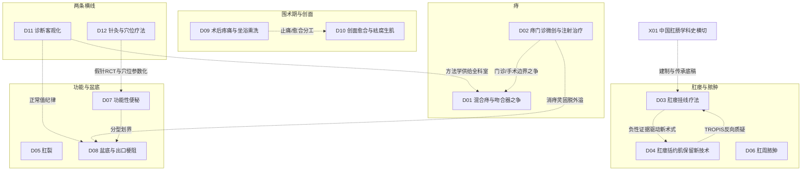

# A 科室研究总览（肛肠科·含中医肛肠线）

> A1 方向地图；A2 条目一览（每条一行回答六个问题）；A3 全科层面的问题转向（详见 C4）；A4 给临床医生的阅读提醒；A5 怎样用这份报告。年份都是本轮找到的最早文献或公认奠基，不是绝对第一篇。

## A1 方向地图

五条临床线加两条横线：D11（诊断客观化）向全部临床方向供给分度、测压、造影与影像方法学；D12（针灸）以假针对照 RCT 与八髎穴 CT 参数化沟通经典穴位与骶神经解剖；X01 提供统一核实过的事件底稿。方向间完整关系（28 条，含依据强度）见 `C_时间线与分支图.md`。

## A2 条目一览

| 条目 | 研究什么 | 从哪里来 | 为什么变 | 现在研究什么 | 用了什么数据 | 最大未知 | 覆盖 |
|---|---|---|---|---|---|---|---|
| D01 | 混合痔切除与吻合器手术的谱系、验证与清算 | 1882 Whitehead 环切（扫描页 L4，后因畸形被弃）；1937 Milligan-Morgan 外剥内扎（DOI 直取） | 1975 肛垫学说把目标改为"保留与固定"；1998 PPH 创立→2000 首代 RCT→2007–16 复发清算与 eTHoS QALY 裁决 | 复发清算 TSA 更新 Meta（RR 1.56）、国产器械与经济学（MLPPH ICER）、日间化、Goligher 分度结局方法学反思 | 技术系列→RCT→Meta/NMA→HTA 经济学→真实世界审计；中国线七段接力（枯痔→消痔灵→丁氏→PPH 入华→TST→注册 RCT→双指南） | 吻合器缺 ≥5 年大样本注册 RCT；急便感/狭窄的器械剂量关系无 RCT；中外指南分流机制无正面研究 | 基本完整但有标注缺口 |
| D02 | 痔的门诊微创（注射/套扎/红外）与器械演进 | 1869 Morgan 注射硬化（转述）；1879 Andrews 3,300 例（扫描页 L4）；1958/1963 套扎器械化 | 1992→95 证据修正链把套扎定为一线；硬化剂分中国消痔灵→芍倍线与日本 ALTA 线（2014 头对头：狭窄 3.5% vs 0） | HOLLAND RCT 重新谈判 III 度（复发 47.5% vs 6.1%）、LHP 激光五年随访、泡沫聚桂醇、内镜化 CAES、痔动脉栓塞 | 个人系列→RCT/盲法分解试验→多中心注册式→Meta→长期单中心回顾（ALTA 9 年）→组学（消痔灵单核测序） | 消痔灵/芍倍缺国际多中心 RCT 与上市后监测；门诊手段 5 年以上复发数据极少 | 基本完整但有标注缺口 |
| D03 | 肛瘘挂线疗法（切割/引流/虚挂）的分化与证据 | 希波克拉底《论瘘》；1556《古今医统大全》挂线二十四字（归属两说并存）；1976 Parks & Stitz 规范化 | 芬兰 63% 控便损害与汇总失禁 12%（隐窝腺性 18%）把切割挂线降为低推荐；Williams 1991 四型分化；中国变体家族（48 RCT 网络 Meta） | 虚挂 vs 实挂（DADS RCT）、紧线剂量四臂 RCT、荷兰 SETON 非劣效、COIS 去挂线化 RCT | 古籍/医史→单中心系列→RCT（ICMR 1991 起）→网络 Meta（含中文库）→前瞻队列 | 挂线 vs 保留括约肌新术式无头对头 RCT；中国 RCT 注册规范与主终点一致性差 | 基本完整但有标注缺口 |
| D04 | 肛瘘括约肌保留新技术（瓣/LIFT/材料/器械/TROPIS/干细胞） | Elting 1912 推移瓣先例（转述）→Parks & Stitz 框架→Aguilar 1985 瓣 189 例 | 瓣的成功率波动大（复发 2–54%）驱动"不动刀"路线：纤维蛋白胶 1993、生物瘘管栓 2006、LIFT 2007、VAAFT/FiLaC 器械化、2017 TROPIS 反向开放 | 激光参数与按瘘管型别愈合率、TROPIS 汇总（80% 但全为单臂）、干细胞"短阴长阳"、序贯策略（90.1%）、网状 Meta 收敛（栓/胶/PRP 高失败一致） | 系列首报→动物材料实验→小 RCT（多 ≤60 例/随访 <24 月）→注册库审计（3 项核对均发现终点漂移/回溯注册）→网状 Meta | 高位/复杂瘘定义与成功率口径未统一（LIFT 47–95%）；器械缺大样本长期 RCT；肛门功能基线报告不齐 | 基本完整但有标注缺口 |
| D05 | 肛裂的手术、扩张兴衰与药物化学括约肌切开 | 19 世纪切开/扩张两源（史学转述）；1951 Eisenhammer 把手术目标重定向为切断内括约肌 | 1962 Bennett 127 例审计量化"有效—致残"；1993 内镜超声证明扩肛后 65% 括约肌缺损（Lord 术宣判）；1994–2000 GTN/CCB/BTX 三条药物线成形 | 药物头对头已收口（Cochrane：药物远逊手术、初愈者复发约 50%）；BTX 剂量/联合策略；LIS 切量标准化；PTNS/脂肪移植等保括约肌新分支 | 测压/血流机制→审计→RCT→Cochrane/网络 Meta（69 RCT）→全球实践审计（ISUCRS） | LIS 切量无 RCT 定论；药物治愈者约 50% 远期复发无干预；儿童肛裂证据极薄 | 基本完整但有标注缺口 |
| D06 | 肛周脓肿的分期 vs 一次根治、成瘘预防与预测 | 1956/1961 隐窝腺学说（Eisenhammer/Parks）；1984 Ramanujam 1023 例分型基准 | 1987/1991 RCT 给出反证与功能代价；2003 Oliver 划定"低位可切、高位勿切"；Cochrane 收束为"选择性一次根治" | 抗生素辅助三 RCT 未裁决（荷兰 ATLAS、西班牙 PERIQxA 在跑）；去习惯化（不填塞/不针吸）；CRP/菌种/机器学习成瘘预测 | 大系列→欧洲小 RCT→Meta/Cochrane→国家登记库（NSQIP/丹麦）→微生物与组学→ML | 裁决性证据停在 2010 年前；成瘘率基线 6.8%–65.6% 高度异质且无金标准定义；小儿零 RCT | 基本完整但有标注缺口 |
| D07 | 功能性便秘的药物、手术、菌群与中医线 | Lane 1904–08 结肠切除系列；1968 乳果糖双盲 RCT；中医承气汤类方与麻子仁丸（原典转述） | Kamm 1988 手术长期随访降温→Wexner 1991 生理筛选；Rome III/IV 统一入组并把功能性排便障碍分道；tegaserod 退市打开促泌剂线 | 二线药物头对头（2026 elobixibat vs 普芦卡必利 55.6% vs 33.9%）、STC 宏基因组特征、通里攻下方动物机制、电针与无创神经调控 | 症状问卷/罗马标准→结肠传输客观化→RCT/注册库→网络 Meta→FMT RCT→组学→HTA | 二线头对头极少；中成药高质量证据仅覆盖麻仁丸一个方剂；中医证型分布流行病学未检得 | 基本完整但有标注缺口 |
| D08 | 盆底与出口梗阻（脱垂手术、失禁病因、盆底失弛缓、神经调控） | 1891–1971 脱垂四大手术原型定型；1964 Wasserman 命名耻骨直肠肌综合征 | 1985 anismus 客观定义；1993 Sultan 量化产伤隐性损伤改写女性失禁病因；Ripstein 术后便秘高发催生 D'Hoore 腹侧网片固定 | SUBSoNIC 首个 SNM 假对照试验（P=0.06 阴性）与适应证扩展、生物反馈 vs 填充物头对头（FIT）、表型驱动个体化、OASI Care Bundle 整群随机 | 单中心系列→盆底生理测试平台→RCT（结构性稀少）→全国队列（芬兰 FINPOP 3515 例）→注册终点核对→撤稿监测 | 脱垂术式比较的随机证据几乎空白；SNM 30 年使用与假对照证据断层；中国消痔灵固脱原始证据不在国际可检索层 | 基本完整但有标注缺口 |
| D09 | 肛肠术后疼痛、尿潴留与坐浴熏洗 | 1982 Nivatvongs 局麻技术条目化；1957 Salvati 尿潴留系统研究；中医熏洗可上溯马王堆帛书（L0） | 1994 酮咯酸"当日出院且尿潴留 0"；2005 Tejirian"坐浴的证据在哪里"把惯例变成待证问题；PROSPECT 程序特异性指南线 | 阴部阻滞超声化与促排尿终点、甲硝唑给药途径三篇 Meta 互搏、坐浴"冷转向"与创面菌群机制、ERAS 中国日间体系落地 | 技术报告→小 RCT（VAS 日记）→PROSPECT/网状 Meta→理赔库流行病学（美国 23426 例）→组学预测 | 中药熏洗缺前瞻注册安慰剂 RCT 与国际 Meta；中药 vs 冰敷 vs 无坐浴从未同框；肛周阻滞 PERCEPT 阳性与 PROSPECT 负面未调和 | 基本完整但有标注缺口 |
| D10 | 肛肠术后创面愈合与祛腐生肌 | 1617《外科正宗》生肌玉红膏（祛腐+生肌同方）；1742《医宗金鉴》条则；1962 Winter 湿性愈合（国际奠基） | 湿性理论颠覆"创面应干燥"；2000 付小兵"因子不缺而修复延迟"改写补因子模型；2021–23 马应龙/康复新液英文 RCT 双双撤稿 | PRP/PRF/CGF 适应边界收窄、现代敷料 vs"少即是多"两路并行、中药"机制化"RCT（NF-κB 等标志物）、红升丹剂量-毒效窗口与汞蓄积 | 医籍→动物模型→中文 RCT（撤稿教训）→注册 RCT→SR/MA→组学（scRNA/外泌体）→核心结局集（AFCOS） | AFCOS 未被中药试验采用（最新四臂 RCT 仍现 5–7 天愈合量级异常）；敷料成本效果空白；含汞丹药无临床 RCT | 基本完整但有标注缺口 |
| D11 | 肛肠诊断客观化（测压/造影/超声与 MRI/量表） | 1963–65 Schuster 系测压；1968 Brodén & Snellman X 线电影摄影 | 1989 Shorvon 确立"影像异常≠疾病"纪律；1993 Sultan 把特发性失禁改写为产科损伤；2012 负梯度常态推翻 HRM 判据；2020 伦敦分类把 dyssynergia 降为不确定发现 | AI/ML 自动判读测压（1214 例三体系验证）、各国正常值本地化落差调查（亚洲仅 38.7% 中心有本地值）、测压+逼出+造影三检查必要性重估 | 健康志愿者正常值队列→结局衍生参照标准（Spencer/Buchanan）→前瞻多中心诊断对照→大容量数据库+机器学习 | MR 排粪造影正常值研究仅 1 项；HRM 跨硬件正常值不可移植；老年/男性人群覆盖不足 | 基本完整但有标注缺口 |
| D12 | 针灸与穴位疗法在肛肠的应用（术后并发症/功能病/机制） | 《针灸大成》玉龙歌等经典歌赋（教材层）；1958 针刺麻醉；韩济生频率-阿片肽机制 | NIH 1997 共识肛肠缺席与 Vickers 1998"100% 阳性"批评构成背景性方法学压力（因果未证），此后试验转向假针对照、前瞻注册与国际期刊 | 腕踝针"预先 vs 即刻"时机三臂、电针整合入结直肠 ERAS（CORRECT 300 例方案）、TEAS 防尿潴留（RR 0.44）、穴位埋线 Meta（23 RCT/1794 例）、承山穴动物机制 | 针麻经验总结→机制动物实验→单中心小 RCT→多中心假针三盲 RCT（1075 例）→非劣效试验→CT 穴位参数化 | 非中国团队独立重复为零；Cochrane 级肛肠针灸证据缺失；ChiCTR 注册终点未机读核对 | 基本完整但有标注缺口 |
| X01 | 中国肛肠学科史（建制、标准化、产业、国际化横切） | 《五十二病方》牡痔/牝痔；1617《外科正宗》枯痔系统记载；1835 伦敦 St Mark's 前身；1954/1956–57 中西医双轨建科 | 1950s 含砒枯痔钉中毒推动无砒改革→消痔灵取代；1998/2000 PPH 与国产化 TST；2006 三会指南→2021 CAES 内镜化；四条学会建制线并行 | CAES 规范化与扩散、消痔灵单核测序机制再评价、中医挂线疗法国际期刊发表、国产器械比较与中文证据国际可见性缺口 | 医籍文本与书目考据→机构档案/院史（L3）→单中心大系列→前瞻队列/RCT→组学 | 消痔灵 1977 研制档案无任何数字记录；1950s 无砒改革一手文献未定位；多个学会成立年份无权威来源 | 基本完整但有标注缺口 |

"覆盖"为成稿自评口径，统一评级与逐方向覆盖表见 `README.md` 与 `F_检索选读排除与覆盖状态.md` 的 F5 表。

## A3 全科层面的问题转向

六次大转向（病例系列→RCT 与注册化；单一治愈率→功能/QALY/PRO 终点；"能不能做"→"给谁做"；疗效叙事→安全再评价；住院大手术→微创/门诊/日间化；中医线从经验叙事→注册 RCT 与机制再评价）的时期、变化内容与章节依据见 **`C_时间线与分支图.md` 的 C4**；其中"国际方法学批评是否改变肛肠试验设计"只有同期性依据，全报告统一标注为背景性压力、因果未证（C5 第 3 条）。

## A4 给临床医生的阅读提醒

1. **本报告不是疗效综述**。它解释每个方向"从哪里来、为什么变、现在研究什么"，不回答"该不该用"；合并效应量请看各章引用的系统评价，并注意其质量分级（本科室多篇关键 SR/Meta 自身口径有缺陷，如 D12 引用的 Medicine 2022 电针 Meta 存在内部数字矛盾，正文已标）。
2. **阅读层级如实**：L0=二手转述、L1=题录、L2=摘要、L3=原文章节、L4=全文。**CNKI/万方本轮未检索，而中医肛肠文献的大头正在中文库**（《中国肛肠病杂志》1981 年创刊至今不入 MEDLINE）——枯痔钉剂型改良、消痔灵早期剂量-并发症关系、大量中文 RCT 只到题录或转述层，这是全报告最大的共同缺口（各章第 8 节有具体影响说明）。
3. **对 RCT 保持两问**：注册的主要终点与发表的是否一致——本科室实测到注册-发表漂移的多种形态（Liao 坐浴 RCT 注册主终点阴性、发表以次要终点叙事；POHM 试验注册-发表终点漂移标本；D04 三项注册核对均发现漂移或回溯注册；TRISDS 报告 ChiCTR 号但注册库未独立核对）；申办方与器械厂商的利益结构是否披露（Longo 参与命名与共识、Biolitec 产业化线、中成药企业申办试验）。
4. **"短期优 ≠ 长期优"是本科室最强的重复模式**：吻合器短期疼痛占优、远期复发 RR 1.56；ALTA 一年复发 16%、九年 47.5%；LIS 即刻愈合可靠、远期 45% "曾失禁"；脓肿一次根治复发 2.9% 但功能紊乱 39.4%。任何只报 12 个月内结局的研究都要打折读。
5. **安全边界先于疗效**：消痔灵肛管狭窄 3.5%（芍倍头对头）与个案坏死、含汞丹药的肾组织汞蓄积、吻合器 FDA 不良事件线索（约 4.1 万例品类级、2012 召回线索存疑未核）、PPH/STARR 的直肠阴道瘘等严重并发症谱（Pescatori）。使用任何中药外控制剂前先读对应章第 5 节。
6. 方向之间不要孤立读：D11 的"正常值纪律"决定 D07/D08 的检查解读边界；D02 与 D01 的"门诊 vs 手术"边界之争贯穿 60 年且仍在进行（HOLLAND）；D03↔D04 的挂线与新术式之争直接改变术式选择；D09/D10 共享填塞否定证据但持相反的坐浴立场；消痔灵一条线同时出现在 D02（痔）、D08（脱垂固脱）与 X01（产业史）。

## A5 怎样用这份报告

- **只读一屏**：每章第 0 节"三分钟速读"（四条，回答从哪里来/为什么改变/如何分化/现在研究什么）。
- **查一个方向的来龙去脉**：读该章第 1–5 节与第 9 节速查表；查具体文献用 `D_关键文献证据表.csv`（可按 direction/kind/层级过滤）。
- **查一个事件/年份**：`data/C_timeline_items.csv`（237 条，按方向与年代）与 X01 章正文；跨方向关系查 C3。
- **要引用某个数字**：回到证据表对应行，按 result_location 回到原文位置；标"存疑/警示降权"的行不要直接引用（如 X01 的 WJGS 2025 队列——源文自身口径互斥）。
- **做科室汇报或选题**：A2 的"最大未知"列 + 各章第 8 节领域证据缺口是直接的选题池；中医线选题先读 F6 的 CNKI 缺口说明，避免在 PubMed 上重复验证中文库已有的结论。
