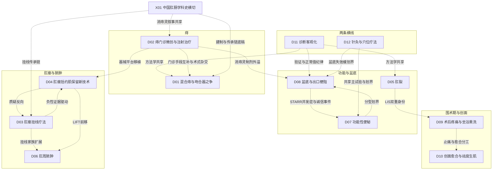

# C 时间线与分支图

> C1 全科分支图（只画跨章关系检查给出依据的边）；C2 各年代代表节点（汇总者从 237 条时间线条目中挑选，全表见 `data/C_timeline_items.csv`）；C3 方向之间的关系（直接贴 `data/C_relations_table.md`，不手抄）；C4 全科层面的六次问题转向；C5 不确定或互相矛盾的因果说法（直接贴 `data/C_conflicts_table.md`）。年份都是本轮找到的最早文献或公认奠基，不是绝对第一篇。

## C1 全科分支图

五条临床线（痔、肛瘘与脓肿、功能与盆底、围术期与创面）加两条横线（D11 诊断客观化、D12 针灸）与一条学科史横切（X01）。D11 是全部临床方向的方法学供给方；D02 与 D01 的关系最密（门诊手段与切除手术的边界之争贯穿 60 年）；D03↔D04 的"挂线 vs 保留括约肌新术式"是肛瘘线的发动机。方向间完整关系见 C3。

## C2 各年代代表节点

| 年代 | 节点 | 条目 | 为什么选它 |
|---|---|---|---|
| 古典–19世纪 | 约前2世纪《五十二病方》牡痔/牝痔条目 | [X01-N19]（考据文题录） | 痔的中文疾病分类最早可核源头 |
| 古典–19世纪 | 1556《古今医统大全》引《永类钤方》挂线二十四字原理 | [D03-N02]（二手）（转述层，归属两说并存） | 中医挂线最早有出处的记载 |
| 古典–19世纪 | 1617《外科正宗》生肌玉红膏与枯痔散/砒矾插药系统记载 | [D10-N01]（二手）[X01-N01]（二手）（古籍转写本） | 祛腐+生肌同方与枯痔技法流程的定型节点 |
| 古典–19世纪 | 1742《医宗金鉴》"毒未尽不可骤用生肌"条则 | [D10-N02]（题录）（古籍转述） | 中医创面时序判据条文化 |
| 古典–19世纪 | 1835 伦敦肛肠专科施诊所（St Mark's 前身） | [X01-N02]（题录）（转述） | 国际肛肠建制起点 |
| 古典–19世纪 | 1869 Morgan 注射硬化首报；1879 Andrews 3,300 例大系列 | [D02-N01]（转述/扫描页 L4） | 门诊注射疗法从民间技术变成有安全记录的正规疗法 |
| 古典–19世纪 | 1882 Whitehead 环形切除（后因 Whitehead 畸形被弃）；1891 Thiersch 肛管环扎 | [D01-N01][D08-N01]（题录/扫描页） | 痔根治诉求与脱垂环扎两个原型的起点 |
| 1900s–1940s | 1904–1908 Lane 切结肠治慢性便秘系列 | [D07-N01]（题录） | 便秘外科线起点（后被 Kamm 1988 长期随访降温） |
| 1900s–1940s | 1912 Elting 推移瓣先例（转述）；Moschcowitz 滑疝说 | [D04-N01]（二手）与 D08 第 1 节 Moschcowitz 假说线（转述） | 肛瘘瓣路线与直肠脱垂病理假说的源头 |
| 1900s–1940s | 1937 Milligan-Morgan 外剥内扎 | [D01-N02]（题录）（DOI 直取，不入 PubMed） | 至今仍是一切新术式的对照金标准 |
| 1950s | 1951 Eisenhammer：慢性肛裂本质=内括约肌挛缩 | [D05-N01]（题录） | 肛裂手术目标从"切纤维带"重定向为"切断内括约肌" |
| 1950s | 1953/1956 Eisenhammer 肌间脓肿学说；1961 Parks 隐窝腺学说 | [D06-N01]（题录）[D06-N02]（题录，Parks 1961 BMJ 已核实） | "脓肿期找内口"的病理学依据，D03/D05/D06 共享 |
| 1950s | 1954 张庆荣天津建西医肛肠外科；1956–57 中医肛肠四地建制 | X01 建制线（中文自述/转述） | 中国肛肠学科双轨建制的起点 |
| 1950s | 1958 Blaisdell 脐带结扎器施圈→1963 Barron 套扎器定型 | [D02-N02]（题录）[D02-N03]（题录）（转述/题录） | 痔治疗搬进诊室的器械起点 |
| 1960s | 1962 Bennett & Goligher 127 例审计 | [D05-N02]（Bennett 1962 全文 L4；同节点 Watts 1964 为题录） | 首次量化"有效—致残"权衡的肛裂审计范式 |
| 1960s | 1962 Winter 家猪湿性愈合实验（Nature 193:293-294，被引 2254） | [D10-N03]（题录+引文核） | 国际创面线奠基，与中医祛腐生肌线 1990s 后对话 |
| 1960s | 1963–65 Schuster 系测压；1968 Brodén & Snellman X 线电影摄影 | [D11-N01]（题录）[D11-N02]（题录） | 诊断客观化两条仪器线的可核源头 |
| 1960s | 1969–71 Notaras 侧位皮下 LIS | [D05-N04]（题录） | 肛裂手术日间化节点 |
| 1970s | 1975 Thomson 肛垫下移学说 | [D01-N05]（摘要） | 把痔重定义为"正常结构下移"，PPH 的理论前提 |
| 1970s | 1976 Parks & Stitz 高位瘘挂线规范化 | [D03-N06]（题录）[D04-N02]（题录） | D03/D04 两章共同的国际规范化节点 |
| 1970s | 约1977–1983 史兆岐消痔灵研制与 1,205 例英文系列 | [D02-N05]（题录）[X01-N07]（题录）（转述+PMID 22557383） | 中医注射线的产业起点（研制档案缺口已在 F6 声明） |
| 1980s | 1982 Nivatvongs 肛肠局麻技术条目化 | [D09-N01]（题录） | 术后疼痛方向公认奠基 |
| 1980s | 1984 Ramanujam 1023 例：34.7% 内口检出与分型基准 | [D06-N04]（题录） | 脓肿教科书数字的出处 |
| 1980s | 1985 Preston & Lennard-Jones anismus 客观定义；1989 Shorvon 47 名志愿者正常值 | [D08-N06][D11-N05]（题录/全文） | "排便困难变成可测表型"与"影像异常≠疾病"两条纪律 |
| 1980s | 1980 中华全国中医学会肛肠分会成立；1981《中国肛肠病杂志》创刊 | [X01-N08]（题录）（机构档案 L3；期刊 NLM 记录） | 中医肛肠建制载体（期刊不入 MEDLINE 的可见性缺口由此起） |
| 1990s | 1991 Wexner 生理筛选流程（163 例评估仅 16 例手术）；1991 ICMR 药线多中心 RCT | [D07-N04][D03-N07]（题录） | "给谁做"转向与印度药线的国际 RCT 验证 |
| 1990s | 1992–95 Johanson→MacRae 证据修正链：套扎一线地位确立 | [D02-N06][D02-N07]（题录/摘要） | 门诊三件套排序被 RCT 证据修正的标本 |
| 1990s | 1993 Sultan 202 名孕妇腔内超声：特发性失禁改写为产科损伤 | [D08-N09][D11-N08]（题录） | 失禁病因改写，D08/D11 交叉最重的一笔 |
| 1990s | 1993–2000 GTN/CCB/BTX 三条化学括约肌切开路线 | [D05-N11][D05-N13][D05-N17][D05-N14]（题录/RCT） | 肛裂药物线的成形 |
| 1990s | 1998 Longo 创立 PPH（会议论文集） | [D01-N06]（二手核实存在，原文不可及） | 痔手术范式转变的起点（Longo 1998 原文缺口见 F6） |
| 2000s | 2000 Mehigan/Rowsell 同刊背靠背首代验证 RCT | [D01-N18]（题录；时间线把 Mehigan/Rowsell 两篇合并为一条，期号经抽查更正 9206） | 吻合器证据链起点 |
| 2000s | 2006 Rome III；2006 消痔灵双层注射 36 例 RCT（李华山） | [D07-N06][D08-N14]（题录） | 功能病入组统一与中国注射固脱线唯一可核 RCT |
| 2000s | 2007 Rojanasakul LIFT 首报 94.4% | [D04-N06]（题录） | 肛瘘保留括约肌新术式浪潮的起点（后经 Wallin 2012 40% 降温） |
| 2000s | 2009 复发之争公开化与 HTA 清算（Jayaraman OR 3.85→Burch/NICE OR 4.34/6.78） | D01 证据清算线（题录/HTA 报告） | 吻合器从"默认替代"转入"远期清算"的转折弧 |
| 2010s | 2014 芍倍 vs 消痔灵 1520 例前瞻对照（狭窄 3.5% vs 0） | [X01-N13][D02-N16]（题录/队列） | 中医注射线内部迭代与安全性定量的关键节点 |
| 2010s | 2016 eTHoS 777 例 QALY 主终点裁决；2016 Ann Intern Med 1075 例假电针 RCT | D01 证据清算线（题录）与 [D12-N09]（试验） | 卫生经济学终点进入外科 RCT 与中医线国际化的双标本 |
| 2010s | 2017 TROPIS 开放路线（Garg） | [D04-N15]（题录/系列汇总） | 反器械化路线的起点，引发 D03/D04 的术式边界之争 |
| 2020s | 2021 TRISDS 双挂线 RCT；2022 PPAC2 否定常规填塞 | [D06-N17][D06-N14]（ChiCTR 注册/50 中心） | 中国挂线 RCT 化与"少即是多"反证的并立 |
| 2020s | 2021–23 马应龙/康复新液英文 RCT 双双撤稿；2022 德国"不放敷料"RCT；2023 AFCOS 核心结局集 | D10 撤稿与反证线（撤稿记录/题录） | 中药外治证据质量危机与结局标准化运动的合流 |
| 2020s | 2024–26 LIS 切量/药物头对头收口（elobixibat vs 普芦卡必利）、HOLLAND III 度重新谈判、SUBSoNIC 假对照阴性、消痔灵单核测序 | D05/D07/D02/D08 近五年主题与 [X01-N15]（题录/试验） | 近五年窗口各主线"再清算"的集合形态 |

## C3 方向之间的关系

（直接生成自 `data/qa_relations.json`，28 条，依据强度与章节行号齐全。）

| # | 从 | 到 | 关系 | 依据强度 | 依据（章节:行号 与文献） |
|---|---|---|---|---|---|
| 1 | D11 | D01/D02/D03/D05/D06/D08 | 共享方法 | 原文或综述明确 | D01:19、D02:19、D03:14、D05:14、D06:14、D08:14 各章覆盖边界均注明"分度与测压/排便造影/腔内超声与MRI方法学（→D11）"；D11:44-47、147 提供以术后结局为参照标准的验证方法与伦敦分类 |
| 2 | D11 | D08 | 验证/修正 | 原文或综述明确 | D11:42-44（Shorvon 1989 正常值纪律、Sultan 1993 腔内超声改写失禁病因，注明"交叉 D08"）；D08:30（Shorvon 交叉点）、D08:110 负性⑥（单次测压/影像异常直接诊断的过度化风险） |
| 3 | D03 | D04 | 驱动 | 章节推断 | D03:40 转折三"这一负性证据链把西方主流推向推移瓣/LIFT 等保留括约肌术式（术式细节归 D04）"；D03:107 停滞路线（国际重心转向保留括约肌新术式） |
| 4 | D04 | D03 | 质疑 | 原文或综述明确 | D03:83 主题四（Garg 2024 主张"切割挂线是劣化版切开、应优先 TROPIS"，Tech Coloproctol 2024;28(1):57；Fuschillo 2025 网络 Meta 反向为挂线保留提供论据）；D04:81 主题二 |
| 5 | D03 | D06 | 扩展/共享方法 | 原文或综述明确 | D03:115（林晖 2009 隧道式挂线治马蹄形脓肿 RCT 68 例，PMID 20015430，注明"脓肿适应证与 D06 交叉"）；D06:137 循证化接力同收该文；D06:49 转折十 TRISDS 双挂线 RCT（ChiCTR2000032941）延续挂线家族 |
| 6 | D04 | D06 | 扩展 | 原文或综述明确 | D06:96 主题二"泰国 Rojanasakul 团队（LIFT 术原创者）2021 年把 LIFT 前移到脓肿期：86 例回顾研究"；D04:31（D04-N06 Rojanasakul 2007 LIFT 首报） |
| 7 | D02 | D01 | 互补 | 原文或综述明确 | D01:19（硬化注射/消痔灵主体、胶圈套扎、HAL/THD、激光/射频/栓塞均"→D02"）；D01:96 主题五"新器械对吻合器地位的挤压……主体归 D02，此处只交代格局"；D01:118"消痔灵主体战场在 D02；本方向只承载其与外剥内扎的杂交" |
| 8 | D02 | D01 | 杂交（术式融合） | 原文或综述明确 | D01:118"外剥内扎加硬化剂注射术"被 2006 版指南列为独立术式选项（D01-E06 指南引证清单）；D01:128（指南谱系） |
| 9 | D02 | D08 | 扩展（共享制剂与传承人物） | 原文或综述明确 | D08:34（消痔灵由史兆岐研制、最初用于三期内痔，学术继承人李华山 2006 年 36 例 RCT 为 D08 注射固脱线唯一可核 RCT）；D08:52/114；D02:35（消痔灵线起点） |
| 10 | D02 | X01 | 共享数据/共享叙事 | 原文或综述明确 | 消痔灵研制（约1977）、1983 年 1205 例英文系列（PMID 22557383）、1999 Nishida 独立实验、2014 芍倍头对头（狭窄 3.5% vs 0，PMID 24972583）、CAES 专家建议为两章共享节点：D02:35/47/106/120-124；X01:33-35/77-79/93 |
| 11 | D02 | D04 | 共享方法（器械平台移植） | 原文或综述明确 | D02:90"痔激光与肛瘘激光（D04）是不同病种应用，本方向只承接痔的部分"；D04:33（FiLaC 器械源自静脉腔内激光消融 EVLA 技术移植与 Biolitec 产业化） |
| 12 | D07 | D08 | 分化（分型划界） | 原文或综述明确 | D07:14（"生物反馈与骶神经调控的后续展开移交 D08，本章只保留划界 RCT [D07-N09]"）；D07:44 转折五（Chiarioni 2006 生物反馈 80% vs 泻剂 22%，确立"先分型再治疗"）；D08:42（生物反馈验证接力和三臂随机） |
| 13 | D08 | D07 | 共享证据/质疑 | 原文或综述明确 | D08:14（"STARR 术式细节归 D07，本章只点其并发症谱与证据诚信风波"）；D07:42/96（STARR 证据链、Andreoli 2024）；D08:52/92/98/136（Pescatori 2008 并发症禁忌、Dixon 1 撤回+9 关注、"STARR 撤稿"经检索证伪） |
| 14 | D07 | D12 | 共享节点 | 原文或综述明确 | D07:98/150（D07-N19 电针 vs 普芦卡必利主试验，"两篇亚组分析的母试验（→D12）"，PMID 33273258）；D12:40/155（D12-N10 同一试验） |
| 15 | D12 | D08 | 互补/划界 | 原文或综述明确 | D12:44/121（Xue 2024 针刺 vs 生物反馈 RCT：盆底失弛缓亚组生物反馈终末 VAS 1.40 vs 5.30 更优，注明"与 D08 交叉"）；D12:38（八髎 CT 参数化沟通经典穴位与骶神经解剖）；D08:88（表型驱动个体化） |
| 16 | D12 | D12（国际方法学背景） | 驱动（同期性，全报告口径分歧） | 章节推断 | D12:34 转折三（NIH 1997 共识与 Vickers 1998 阳性偏倚批评"迫使此后试验改用假针对照、前瞻注册并投向国际期刊"，同段自标"国际背景，非直接因果"）；对照口径：D01:141、D02:128、D04:123、D05:124、D07:116、D08:116、D09:130、D10:128、D11:143、X01:85 |
| 17 | D05 | D09 | 互补（同一术式双重身份） | 原文或综述明确 | D05:54/106（LIS 为慢性肛裂"保守起始、LIS 兜底"阶梯的终末标准，3 年愈合 92.5% vs BTX 45%）；D09:45/96/109（LIS 作为痔术后止痛辅助被 Mathai 1996、Khubchandani 2002 两项 RCT 否定且报告失禁） |
| 18 | D09 | D10 | 共享证据/分工 | 原文或综述明确 | D09:19（"创面愈合与敷料、祛腐生肌（D10，痔疾洗液复合终点与康复新液熏洗撤稿仅注明分工）"）；D10:14（"止痛本身与中药坐浴镇痛（D09，仅保留以愈合为终点的试验）"）；填塞否定证据两章同用：D09:53、D10:46（德国 754 例 tamponade RCT、脓肿 packing Meta 3 RCT/490 例=D06-N14 同证据）；康复新液撤稿 PMID 34539803/38125119 两章互认：D09:104/122、D10:46/107 |
| 19 | D09 | D10 | 并行（含方向张力） | 章节推断 | D09:51/86（冰敷优于温水坐浴、"Time to Come Into the Cold"、国际线对温水转负）；D10:38/46/92（湿性愈合/银敷料促上皮化 22 vs 29 天） |
| 20 | D03/D04/D09/D10/D11 | 全报告 | 共享方法（证据诚信审计） | 原文或综述明确 | D04:107（撤稿清查 56 条命中，"其余命中经核对属 D09/D10/血液透析通路等其他方向"）；D08:118（撤稿监测为常规路径）；D09:104（熏洗红膏撤稿 PMID 37564893）；D10:48（ECAM 两篇撤稿）；D11 交叉的腔内超声诊断撤稿见 D04:107 |
| 21 | D03/D07/D12 | 彼此（并行线） | 并行（传统疗法 RCT 化三条线） | 章节推断 | D03:32（ICMR 1991 四中心药线 RCT，"非西方传统疗法被 RCT 验证并进入国际引文网络的少数外科案例"）；D07:46（麻仁丸三部曲：两部曲 2011→三臂 2019）；D12:34/40（Annals 2016 1075 例假针 RCT→AJG 2021 非劣效） |
| 22 | X01 | D01/D02/D03/D08 | 汇拢/互补 | 原文或综述明确 | X01:41/101（学科建制双轨与传承链：丁泽民/史兆岐/曹吉勋/安阿玥、1954/1956-57 建科、1980 学会/1981 期刊）；D01:120-130（丁泽民分段齿形结扎、中国指南分流机制）；D03:115（丁氏挂线单位接力）；D08:114（史兆岐→李华山注射固脱链） |
| 23 | X01 | D01 | 互补（同一监管事件群，定性分歧） | 原文或综述明确 | X01:39/93（TA128/Porrett 2015 死亡综述/FDA 2012 召回线索，归入"国际监管与证据的负性事件"）；D01:51/100/102（TA128=有限推荐、2016 复核维持有效，降调节点为 ASCRS 2018→2024） |
| 24 | D01 | D02/D07 等 | 扩展（方法学模板扩散） | 仅时间先后 | D01:47（eTHoS 777 例、24 个月 EQ-5D QALY 主终点、平行经济学主终点）；后续同构设计：D02:82（HOLLAND QALY/ICUR）、D01:53（MLPPH ICER）、D07:86（2026 年 elobixibat vs 普芦卡必利实用头对头） |
| 25 | D03/D05/D06/X01 | 彼此（古籍源头链） | 共享叙事（口径相容） | 原文或综述明确 | D03:24/93（1556《古今医统大全》引《永类钤方》与 1617《外科正宗》两说并存）；X01:7/24（1617 为"系统记载节点"，"挂线"系被对比的已有疗法，不称首载）；D06:129（"挂线经典记载一般上溯至《古今医统大全》"）；D05:28（肛裂"钩肠痔"病名 L0 存疑） |
| 26 | D03/D05/D06 | 彼此（隐窝腺病理框架） | 共享病理学说 | 原文或综述明确 | D03:26（Parks 1961 腺源学说+Eisenhammer 1953/1956/1958 肌间脓肿说）；D06:22-25（同一对学说为"脓肿期找内口"提供依据，D06-N01/N02）；D05:22（Eisenhammer 1951 把肛裂手术目标重定向为"切断内括约肌"，D05-N01） |
| 27 | D08 | D07 | 并行（STC 两条手术路线未同框） | 章节推断 | D08:86（No.2-Trial：SNM 治顽固慢传输便秘 67 例，6 个月成功率 53.7% vs 3.8%，OR 36.4）；D07:50/104（Knowles 2017：STC 全结肠切除并发症约 24%、仅弱支持孤立性 STC，适应证收紧） |
| 28 | D05 | D12 | 归口（存在冲突，已处置） | 原文或综述明确 | D05:58/122/161-162（D05-N21 华西 2013 肛裂术后针刺 RCT、D05-N22 湖南 2017 穴位埋线治 I/II 期肛裂 RCT，均注明"两篇归口 D12"）；D12:14 原写"未检到"，第一轮修订已改口并补收湖南 RCT（见 C5 第 4 条） |

## C4 全科层面的问题转向

据 `data/qa_relations.json` 的 field_level_turns（跨章关系检查员从 13 章归纳，每条都有章节依据），本科室六十年里可以辨认出六次大的转向：

1. **技术报告与病例系列 → 随机对照试验与注册化（约 1980s–2010s，各病种起点不一）**：痔线走完完整弧线（Whitehead 300 例系列→Lancet 2000 首代 RCT→Senagore 156 例多中心→eTHoS 777 例全国实用主义 RCT）；盆底方向 RCT 稀少成为结构性特征（Cochrane 2008 全领域仅 12 RCT/380 人）；中国线 2020 年代起以注册 RCT 形态进入国际期刊。涉及 D01–D10 全线；对照最鲜明的是 D01/D05/D06/D08/D09。
2. **单一"治愈率"终点 → 功能/生活质量/QALY 与国际统一定义终点（1990s–2020s）**：Wexner/Vaizey 量表+测压组合、eTHoS 的 EQ-5D QALY 主终点、HOLLAND ICUR、2024 年马来西亚激光 RCT 以术后疼痛为主终点（PROM 转向）、便秘 CSBM 应答；并延伸出结局标准化运动（155 项肛瘘研究仅 25% 结局报告高质量→AFCOS 核心结局集）。涉及 D01/D02/D03/D04/D07/D08/D09/D10/D11/D12。
3. **"能不能做" → "给谁做"：筛选流程、分型划界与表型驱动（1990s–2020s）**：Wexner 1991 生理筛选（163 例评估仅 16 例手术）、Rome III/IV 把 FC 与功能性排便障碍分道、Chiarioni 2006 确立"先分型再治疗"、Oliver 2003 划定脓肿"低位可切、高位勿切"、Cochrane 2010 收束为"精心选择的患者"、D08 以 3D 测压表型做"同一症状、按表型分流"。涉及 D04/D05/D06/D07/D08 为主，D01/D03 术式选择同构。
4. **疗效叙事 → 安全再评价与负性证据制度化（1990s–2020s）**：吻合器远期复发清算、消痔灵肛管狭窄 3.5%、切割挂线失禁 12–63%、LIS 远期"曾失禁"45%、脓肿一次根治失禁 RR 3.06、SNM 首个假对照试验阴性、手法扩肛被影像证据宣判；撤稿检索与注册-发表终点核对成为各章证据分级常规。涉及 D01/D02/D03/D04/D05/D06/D08/D09/D10。
5. **住院大手术 → 微创化、门诊化/日间化与场景迁移（1958 年起，1990s–2020s 加速）**：胶圈套扎把痔治疗搬进诊室、PPH 把"切除"改为"悬吊+断流"、激光/射频/栓塞新器械线、肛瘘 LIFT/VAAFT/FiLaC/瘘管夹器械化浪潮、化学括约肌切开以可逆药物替代不可逆切断、骶神经调控以神经调节替代结构修补、ERAS 八要素与注射线内镜化（CAES）。涉及 D01/D02/D04/D05/D08/D09/X01。
6. **中医线：经验外治与"获奖-推广"叙事 → 注册 RCT、国际期刊发表与机制再评价（2000s–2020s）**：挂线变体 48 RCT 网络 Meta 与 COIS/TRISDS RCT 登国际期刊、LIFT-Plug 多中心 RCT 入 Ann Surg、麻仁丸三臂、电针 1075 例假针 RCT 与 AJG 非劣效、消痔灵单核测序+空间转录组、红升丹剂量-毒效定量；同时暴露结构性短板——中文主流期刊不入 MEDLINE 的国际可见性缺口与中药试验注册/盲法缺失。涉及 D02/D03/D04/D06/D07/D08/D10/D12/X01。

## C5 不确定或互相矛盾的因果说法

（直接生成自 `data/C_conflicts_table.md`；六条冲突的第一轮处置已在各章"## 12 复核修订记录"落实，此处保留原始冲突与处置方案作审计留痕。）

| # | 跨章说法 | 涉及位置（复核时行号） | 为什么冲突 | 处理 |
|---|---|---|---|---|
| 1 | NICE TA128（2007）对吻合器痔固定术的定性：是"有限推荐且 2016 年复核维持有效"，还是"限制使用的负性监管事件" | D01:51、102 vs X01:39、93 | 同一监管文件被两章给出方向相反的定性：D01 核实其为附条件推荐并维持有效（未见撤销），X01 将其定性为限用性负性事件 | 以 D01 的核实口径统一表述：TA128（2007）=有限推荐、证据仅限 HCS33、附培训要求，2016 年复核维持；X01 的"限制使用"改为"有限推荐/品牌限定"，其"负性事件"框架改挂 Porrett 2015 系统综述、FDA 召回线索与 ASCRS 2018/2024 降调 |
| 2 | FDA 对痔/外科吻合器的监管节点是 2012 年 Ethicon Class 1 召回（X01），还是 2019 年外科吻合器品类安全行动（D01） | X01:39、93、144 vs D01:51、110、138、178 | 两章各记一个不同年份、不同性质的 FDA 节点，互不引用，且都停留在存疑/检索摘要层 | 两章互加"另见"并分别定性：2012 Ethicon 痔吻合器 Class 1 召回（待核 FDA docket 原件）与 2019 外科吻合器品类安全行动（官方新闻稿、非痔特异）；任一条核实后升级层级并注明来源，否则统一标注"未经核实的监管线索，不作为事实引用" |
| 3 | 国际方法学批评（NIH 1997、Vickers 1998、Tang/Ernst 1999）是否改变了肛肠试验设计 | D12:34 vs D01:141、D02:128 等 10 章 | D12 的"迫使"把跨病种批评写成肛肠试验设计变化的直接动因，与全报告其余十章统一的排除口径冲突 | 全报告统一措辞为"该批评为背景性方法学压力，与其后假针对照/前瞻注册的设计升级同期，因果关系未经研究证实"；D12 将"迫使"改为"与此同期" |
| 4 | 以肛裂为适应证的针灸专项 RCT 是否存在：D05 收录两篇并声明"归口 D12"，D12 却写"未检到" | D05:58、122、161-162 vs D12:14 | D05-N22 正是 D12 声称"未检到"的那类试验，两章直接矛盾 | D12 更正为"检到 D05 交叉的湖南埋线 RCT 一篇（PMID 29231588），华西 2013 为术后辅助场景"，并在第 4 节补入该试验；D05 交叉说明保留 |
| 5 | 跨章试验归属落空：HubBLe"属 D02"（D02 无该文）、STARR vs 生物反馈 RCT（Lehur 2008）"归 D07"（D07 无该文） | D01:136 vs D08:14 | 跨章导航落空，读者按图索骥找不到对应内容 | 第一轮修订核改：两处"属/归"表述改为"本轮 13 章未展开"，删除悬空归属 |
| 6 | PPH 引入中国的时间（2000 年）能否作为不带限定的结论表述 | X01:3 vs X01 正文 37/143、D01:33/122 | X01 头部一句话判断未带限定地写"2000 年引入中国"，弱于正文与 D01 的转述层口径 | X01 一句话判断补括注"（二手转述，一手可核最早 2003）"，与节点表 [X01-N11] 的 L3/转述标注对齐 |
