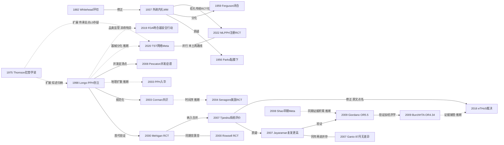

# D01 混合痔：外剥内扎与吻合器（PPH/TST）的术式之争

> **一句话判断**：混合痔手术一百四十年的主线是"切多少、留多少"。Whitehead 环形切除（1882）因黏膜外翻与狭窄被弃，Milligan-Morgan 外剥内扎（1937）以保留皮桥成为国际对照金标准；Longo 吻合器痔上黏膜环切（PPH，1998）借肛垫学说迅速全球化，但 2007 年起被多项系统评价证实远期复发与再干预更高，英国 eTHoS 大样本 RCT（2016，777 例 QALY 主终点）后国际主流指南转向"传统切除优先、吻合器限选择病例"。中国路径不同：PPH 国产化为 TST、结扎系改良为 MLPPH，2020 版中国指南仍条件推荐环切/TST，当前主战场转向日间化与器械卫生经济学。

## 0 三分钟速读

① **从哪里来**：1882 年 Whitehead 在 BMJ 提出在齿线水平环形切除全部载痔黏膜并缝合 [D01-N01]，因"Whitehead 畸形"（黏膜外翻、渗液、狭窄）在 20 世纪被弃；1937 年 Milligan-Morgan 外剥内扎确立保留皮桥的开放式切除，至今仍是一切新术式的对照"金标准" [D01-N02]。

② **为什么改变**：1975 年 Thomson 提出肛垫下移学说——"痔只是肛垫下移的结果"——把术式目标从"切除痔组织"改为"保留并固定肛垫" [D01-N05]；1998 年 Longo 据此创立 PPH，环切痔上黏膜悬吊肛垫而不切垫本身 [D01-N06]。

③ **如何分化**：开放（MM）/闭合（Ferguson，1959）[D01-N04] 与黏膜下（Parks，1956）[D01-N03] 先分两支；吻合器时代再分环形切除（PPH）与国产开窗式选择性切除（TST，临床可核自 2010 年起）[D01-N16]，中国另有结扎系改良 MLPPH 以注册 RCT 对标吻合器 [D01-N17]。

④ **现在研究什么**：吻合器远期复发的再清算（2026 年含试验序贯分析的更新 Meta：复发 RR 1.56）[D01-E02]、国产器械与费用对标（MLPPH 总费用 EUR 1080 vs 吻合器 1658）[D01-N17]、日间手术化、以 Goligher 分度为核心的结局方法学反思。

⑤ **用了什么数据**：从病例系列（Whitehead 300 例）到多中心 RCT（eTHoS 777 例、24 个月 EQ-5D QALY 主终点）[D01-N15]，再到纳入中文库的网络 Meta（22 项 RCT/3511 例）[D01-N16] 与中国注册 RCT+成本效果分析（ChiCTR1800015928）[D01-N17]。

⑥ **还有什么不知道**：吻合器缺 ≥5 年大样本注册 RCT 或器械登记；急便感机制无定论；TST 无国际多中心 RCT；近五年窗口内中国器械线无前瞻大样本 RCT；中国与国际指南分流的机制（证据池、评价标准、价格与支付）未被正面研究。

**覆盖边界**：纳入痔病因学说（静脉曲张说→肛垫下移说，含 Stelzner 前驱）对术式的驱动，Whitehead/MM/Parks/Ferguson 四大经典术式，PPH/TST 的创立、扩散与长期争议，eTHoS 裁决，中外指南立场演变，中国改良术式，近五年日间化与器械经济学。不含：胶圈套扎、痔动脉结扎（HAL/THD）、硬化注射与消痔灵的主体文献、激光/射频消融/栓塞（→D02）；STARR 与直肠脱垂钉合（→D08）；术后疼痛与创面愈合细节（→D09/D10）；Goligher 分度与肛管测压方法学主体（→D11）。**术语与器械名辨析**（易混淆，先说清）：PPH=procedure for prolapse and hemorrhoids，即吻合器痔上黏膜环切（钉合）术，专用圆形吻合器为 Ethicon HCS33（PPH01/PPH03），PPH 也是原发性肺动脉高压的通用缩写，检索时注意；TST=tissue-selecting therapy，国产开环式微创痔吻合器/选择性痔上黏膜切除钉合术，与结核菌素试验（TST）同缩写但毫无关系；HAL/DG-HAL/THD 为痔动脉结扎诸型，主体在 D02；SH=吻合器痔切除术（中国 2020 版指南对 PPH 的官方更名）。

**本章口径**：执行与报告截止 2026-10-18；近期重点窗口 2021-10-18 至 2026-10-18。阅读层级：L0=仅二手转述，L1=题录已核实，L2=摘要已读，L3=原文部分章节已读，L4=全文已读；只到 L0/L1 的说法一律注明转述。本章节点 22 个，按层级计：L4×1、L3×2、L2×10、L1×9。核查状态：通过 15、修正 6（题录期号、作者、PMID 与摘要数值 6 处已按全报告复核核定值写入）、删除 0、存疑 1（N22 FDA 新闻稿原文未逐段核读）；另有传承线两个环节（TST 器械研制支点、消痔灵获奖）按 L0 转述并在正文标注"存疑线索"。覆盖状态（按全报告统一口径于 2026-10-19 重评）：基本完整但有标注缺口——六问（从哪里来、为什么改变、如何分化、现在研究什么、用了什么数据、还有什么不知道）均可据本章回答；主链（Whitehead 环切→MM 金标准→开放/闭合与黏膜下分化→肛垫学说→PPH 创立—规范—验证→长期结局清算→eTHoS 裁决→中外指南分流）与主要分支（FDA/NICE 监管节点、中国线传承与国产化、近五年五个主题）均有节点。理由：历史链、负性路线、监管节点、注册终点核查与口径修正齐备，缺口限于第 8 节已标注项（中文库全文不可得、Longo 1998 论文集无存档、2010/2020 版中国指南原文未逐条核读、Whitehead 1882 扫描页复核轮未逐页复核、N22 FDA 新闻稿未逐段核读），不涉及任一主要分支缺节点或关键转折无可核实来源，故不降为"部分"。

## 1 源头：最初在研究什么

痔手术的起点问题不是"怎么切"，而是"痔是什么、切多少才算根治"。按四类起点标注：

**被公认的奠基·环切起点（同时也是"最早找到"的环切提案）**：Whitehead 1882 年在 BMJ 提出在齿线水平"切除完整的载痔黏膜环"并缝合近端，主张痔切除应破坏痔血管的血液循环以求根治；1887 年续报 300 例、自称无狭窄或外翻（据史学综述 Pata 2021 [D01-E01] 转述）。本轮已读 BMJ 1882 年原始扫描页第 148-149 页（术式定义段与病例段）；阅读层级 L4（初稿读扫描页 pp.148-149；复核轮未逐页复核）[D01-N01]。

**被公认的奠基·金标准**：Milligan、Morgan 等 1937 年在 Lancet 发表肛管外科解剖与外剥内扎术式（基于 St Mark's 医院的肛管外科解剖研究：三处母痔钳夹、V 形切口、剥离缝扎痔蒂、保留三处皮桥黏膜桥、创面开放；母痔定位左、右后、右前），OpenAlex 显示被引 576 次。"金标准"是后见之明：该表述逐字见于 Lumb 2006 Cochrane 综述摘要（"considered the current gold standard"），并非 1937 年原文自称；原文正文未获（1937 年不入 PubMed、无 PMC 扫描），术式细节叙述据 Pata 2021 [D01-E01] 转述 [D01-N02]。

**存在争议的首次·病理学基础**：血管垫概念有 Stelzner 1962（Langenbecks Arch klin Chir，德文"直肠海绵体 corpus cavernosum recti"，PMID 13916799）与 1964（Dis Colon Rectum 英文短文 THE CORPUS CAVERNOSUM RECTI，7:398-399，PMID 14202628，DOI 10.1007/bf02616852）两个前驱题录——两条均本轮核实，但均无摘要、原文未获；Thomson 1975 年在 Br J Surg 发表"The nature of haemorrhoids"（62:542-552），摘要结论"肛管黏膜下有特化 cushions 组织，piles are merely the result of their displacement"（摘要已读，L2；解剖观察定位右前、右后、左外侧三处垫，与母痔的好发部位对应），OpenAlex 被引 644 [D01-N05]。"谁最早提出血管垫"在文献中两说并存，本轮仅核实题录层级，无力裁决优先权；Thomson 的公认地位主要在于把"垫"与"下移"整合成能指导术式的学说——此后 PPH/TST/肛垫悬吊系术式的理论正当性陈述几乎都回指此文（台湾共识 2025 SH 节与 Yang 2022 背景均为原文层面的引用证据）。

**目前最早找到的文献·中国线起点**：PPH 在中国的 PubMed 可核最早报告为 Zhang SM 等 2003 年《中华外科杂志》（41:815-816）[D01-N07]；国内文献普遍记载的"姚礼庆、傅传刚等 2000 年 7 月率先开展"仅为维普题录层转述（L0），2000-2002 年原始中文报告未获，全报告复核时独立检索 PubMed 侧 2000-2002 年亦无更早中文题录——两说不矛盾（一为院内开展叙述、一为文献可见节点），但前者只能按二手转述处理。

同期两条改良支线的动机值得记住：Parks 1956 年提出黏膜下切除（齿线上方倒 Y 形切口、黏膜下剥离、高位缝扎痔蒂后缝合黏膜瓣），理由是 Milligan-Morgan 切除直肠黏膜过多（狭窄风险）并在感觉敏锐区结扎（疼痛重）——该术式思想为后来"保留肛垫感觉上皮"的功能保留路线提供了先声 [D01-N03]；Ferguson 与 Heaton 1959 年在 Dis Colon Rectum 提出闭合式痔切除（剥离方法与 Milligan-Morgan 相似、创面黏膜皮肤连续缝合），理由是开放创面疼痛、出血与愈合慢——Pata 2021 记载 Ferguson 于 1955 年已描述该术式、1959 年成文发表，并称其为"当前美国最流行的技术" [D01-N04]。这两条动机线——"少切"与"快愈"——在此后每个新术式的宣传里都会重现。

## 2 关键转折：问题—新证据/新方法—认识变化—新问题

**转折一：环切能否根治痔？——验证失败与路线修正。** Whitehead 环切在 19 世纪末曾被视为环状痔的根治手段，但黏膜外翻、黏液渗漏、狭窄与失禁（Whitehead 畸形）随例数积累显现；据 Pata 2021 [D01-E01] 转述，1924 年 Lockhart-Mummery 在伦敦宣告该术式"丧钟已鸣"（其指向的文献为 Smith D. Whitehead Deformity，JAMA 1928;91:879-80，题录已核）[D01-N01]。这是本方向第一条"负性路线"：根治诉求压倒功能保留，代价由患者支付。就谱系而言，Whitehead 把痔手术从局部枯痔/结扎推向环形根治切除，是此后一切"环切"概念——包括一个世纪后 PPH 的环形切除理念——的远祖，这是史学综述明确建立的谱系而非本报告推断。2006 版中国痔指南在列举环形痔切除（Toupet、Whitehead 手术）时注明"因并发症多，目前临床已基本摒弃"（据公开转载全文核对，L0-L1）[D01-E06]。个别中心后来仍将其用于选择性Ⅳ度环状痔（Maria 等 2001，Tech Coloproctol 5:93-96，PMID 11862565，题录核实）——说明"被弃"不等于"消亡"；PPH 风行后中国学者还在期刊上重提"如何评价 Whitehead 环形痔切除术"（尹路、张浩波，《中华胃肠外科杂志》2010 年第 12 期，题录见 2006 版指南引证清单，L1）——环形切除的理念在吻合器时代被重新审视。**关系：修正**（外剥内扎以保留皮桥、不环形切除修正环切，依据为 Pata 2021 时代段叙述）。

**转折二：切除如何标准化、疼痛与狭窄如何减？——开放式内部的两次分化。** Milligan-Morgan 1937 确立标准化开放切除 [D01-N02]；Parks 1956 以黏膜下切除质疑之（**关系：质疑**，动机经 Pata 2021 转述）[D01-N03]——Parks 路线后来有自己的随访积累（Rosa 等 20 年经验系列，Tech Coloproctol 2005;9:209-214，题录级）与两项对照 Milligan-Morgan 的 RCT（Hosch 等，Dis Colon Rectum 1998;41:159-164，PMID 9556238；Roe 等，Br J Surg 1987;74:948-951，PMID 3664229，均题录经 Pata 2021 ref51/52 核实）；Ferguson 1959 以同一剥离原则加创面闭合分化出闭合式路线（**关系：分化**，Pata 2021 称其操作"与 Milligan-Morgan 相似"）[D01-N04]。开放 vs 闭合的支线争论延续至今（Bhatti 等 2016 系统评价比较两者：闭合式疼痛轻、愈合快但感染率有争议，World J Surg 2016;40:1509-1519，PMID 26813541，题录级），不是本章主线；值得注意的是 Senagore 2004 的美国多中心 RCT 选择 Ferguson 而非 Milligan-Morgan 作为常规对照臂 [D01-N09]——美国主流即闭合式。

**转折三：痔是什么？——学说换轨。** 静脉曲张说不能解释出血与脱垂模式；Thomson 1975 的肛垫下移学说把痔重定义为"正常结构的下移" [D01-N05]，Hancock 1977 年 Gut 测压研究从内括约肌活动角度呼应（Gut 1977;18(8):651-655，PMID 892612，题录核实）[D01-N05] 之 followup。**关系：扩展**——肛垫学说使"不切垫、只处理垫上方或垫本身固定"的术式获得病理生理正当性；这一边在原文层面的依据是 Yang 2022 全文背景逐字引 Thomson 1975 并把"切除冗余黏膜+悬吊肛垫"列为治疗原理，以及台湾共识 2025 SH 节的相应表述（依据经全报告复核替换：Pata 2021 全文并未点名 Thomson）。

**转折四：吻合器如何创立、规范并验证？——三年走完"发明→首代验证→规范→美国确认"。** Longo 1998 年在罗马第六届世界内镜外科大会报告以专用圆形吻合器（Ethicon HCS33，即 PPH01/PPH03）经肛环切齿线上 3-4 cm、宽约 1.5-2 cm 直肠黏膜并钉合悬吊肛垫的新术式；原始出处为会议论文集（Monduzzi，Bologna），无同行评审文本可查，其存在经 Pata 2021 ref65 与 Lumb 2006 Cochrane 摘要（"first described by Longo in 1998"）双重核实 [D01-N06]。首代验证 RCT 出现在 2000 年：Mehigan 等（Lancet 2000;355(9206):782-785，PMID 10711925，题录经全报告复核实查）与 Rowsell 等（Lancet 2000;355(9206):779-781，PMID 10711924）同刊背靠背发表——此前叙事曾从 1998 直接跳到 2003/2004、丢掉了这两年，全报告复核时已把起点补前：这批 2000-2001 首代 RCT 正是此后所有 Meta 的底层试验 [D01-N18]、[D01-N19]。2003 年 Corman 牵头的国际工作组（意/法/德/英/新/美 11 名专家、含 Longo 本人）把快速扩散中的新技术纳入规范：议程三项为命名、适应证与禁忌证、首选技术；培训要求术者具备肛肠外科与圆形吻合器使用经验、参加含讲课/视频/模型/观摩的正式课程、在有经验术者指导下完成首例、独立操作资格由科室认定（摘要已读，L2）——这份模板被 NICE TA128 的培训条款与中国 2006 版指南继承 [D01-N08]；代价是发明人本人参与命名、共识无证据分级（利益关联明摆在作者栏）。2004 年 Senagore 等完成美国多中心 RCT（Ⅲ度脱垂痔；主要终点为术后急性疼痛与 1 年内需再治疗的症状复发）：156 例随机（PPH 77/Ferguson 79），PPH 组围手术期疼痛占优，1 年内需再处理 2 例 vs Ferguson 11 例（P=0.01，摘要数字经全报告复核补核）；18 例重大方案违背（PPH 12/Ferguson 6）、无试验注册号（年代早于强制注册）[D01-N09]（**关系：验证**；共识在前、验证在后为时间序推断）。早期器械缺陷（PPH01 钉脚高度不足带来吻合口出血问题，后迭代为 PPH03；NICE TA128 的证据仅覆盖 HCS33）与发明人参与命名是这条快线的两处阴影。

**转折五：长期结局如何清算？——"短期优、长期似"被推翻又留下反例。** Tjandra 与 Chan 2007 年系统评价（检索 Ovid MEDLINE/EMBASE/CINAHL，1991-01 至 2006-08，25 项 RCT、1918 例操作，随访 1-62 个月）给出主流叙事："safe with many short-term benefits. The long-term results are similar"（手术时间 WMD -11.35 分钟，P=0.006；肠功能恢复早 9.91 小时）；其自身限制是纳入 RCT 质量参差、未单独处理复发异质性 [D01-N10]。同年 Jayaraman 等 Cochrane 方法学系统评价限定随访 ≥6 个月重新合并（12 项试验，随访 6 个月至 4 年）：痔复发 OR 3.85（95%CI 1.47-10.07）、脱垂 OR 2.96（1.33-6.58，全报告复核时补核），吻合器组长期脱垂主诉更多——限制是随访上限仅 4 年、复发定义在各原始 RCT 间不一致 [D01-N11]（**关系：质疑**，标题即命题："吻合器的内痔长期复发率更高"）；而意大利 Ganio 等 2007 年报告同一多中心 RCT 的 87 个月随访（Ⅲ-Ⅳ度痔 100 例随机、全部召回门诊复查：问卷+肛管测压+肛门镜，可评估 80 例）：失禁、狭窄、疼痛、出血、皮赘残留与复发脱垂两组均无差异，测压值术后无显著变化，仅Ⅳ度复发倾向更高且与术式无关；随访流失 20%、开放标签是其限制 [D01-N12]（**关系：并行**，两说公开并存）。2008 年 Shao 等在 BJS 发表当时规模最大的早期 Meta 之一（95(2):147-160，PMID 18176936，本轮仅题录核实，数值未核）补齐清算弧线 [D01-N20]。2009 年 Giordano 等（≥12 个月随访界值，MEDLINE/EMBASE/Cochrane 检索，按随机/盲法/失访 0-5 分评分，15 篇文献/1201 例、复发合并池 14 项研究 1063 例）给出脱垂复发 OR 5.5（P<0.001）、因复发再处理 OR 1.9（10 项研究 824 例，P=0.02，全报告复核时自摘要补核）[D01-N13]（**关系：验证**，更严随访界值下方向一致）；同年 Burch 等受 NICE 委托的 HTA 系统评价（26 个数据库与网站、检索至 2006-07、不限语种，27 项 RCT/2279 例，原文承认纳入试验均有方法学缺陷）确认术后疼痛减轻（19/27 试验）、手术时间更短（17 项）、住院与恢复更短，但长期脱垂 OR 4.34（1.67-11.28）、因脱垂再干预 OR 6.78（2.00-23.00），且初始住院费用两组相近——"复发更高"与"不省钱"合并成决策要点 [D01-N14]（**关系：验证+经济学扩展**；其配套 HTA 报告 Health Technol Assess 2008;12(8)，PMID 18373905，为同一项目两份报告）。

**转折五的并行负性线：并发症谱与适应证边界。** Pescatori 与 Gagliardi 2008 年系统梳理 PPH/STARR 并发症（摘要已读）：直肠阴道瘘、慢性直肠痛、直肠闭塞、直肠壁血肿、穿孔合并盆腔脓毒症等罕见但难处理，并指出"Ⅳ度痔 PPH 后并发症率更高、效果更差" [D01-N21]。Ganio 长期随访亦见Ⅳ度复发倾向更高 [D01-N12]。吻合器用于Ⅳ度/重度痔的扩大适应证从此成为明确的负性路线。

**转折六：裁决与指南转向——以及一次机构关系的更正。** eTHoS（Watson 等，Lancet 2016；英国 29 家中心、实用主义平行组开放标签 RCT、Ⅱ-Ⅳ度痔成人 1:1 随机、24 个月 EQ-5D-3L 描述系统曲线下面积为主终点、每 QALY 增量成本为经济学主终点、ISRCTN80061723 见摘要 Methods 末句）：777 例随机（吻合器 389/传统 388），纳入分析 338 vs 352；吻合器术后早期疼痛更轻，但 24 个月生活质量 AUC 传统切除组更高（组间差 -0.073，95%CI -0.140 至 -0.006，P=0.0342）；严重不良事件 7%（24/338）vs 9%（33/352）；讨论原文点名吻合器"复发率更高、里急后重更多、费用更高、失禁更差、并发症含糊"，结论"作为痔个体化方案的一部分，传统切除应作为首选手术"（全文 XML 已读，L3；Trials 2014 方案文 PMID 25388563 确认注册主终点与发表一致）[D01-N15]。其自身限制也要交代：术式无法设盲；成本按英国价格体系计算、外推受限；纳入对象以Ⅱ-Ⅲ度为主，Ⅳ度外推受限。一处必须更正的叙事：eTHoS 的资助方是英国 NIHR HTA 计划（项目号 08/24/02，见 Trials 2014 方案全文资助声明，PMID 25388563），受众是 NHS/NICE 的技术评估决策——**"NICE 委托"一词只适用于 Burch 2008 HTA（TA128 的证据底座），不适用于 eTHoS**；把资助方与指南机构混同会虚构一条因果链；eTHoS 的完整经济学模型另行发表于 HTA 2017;21(70):1-224（PMID 29205150，题录核实，与主报告同一试验项目）[D01-N15] 之补充。指南层面：NICE IPG34（2003-12-17）为介入程序安全许可，TA128（2007-09-26）为有限推荐——推荐吻合器痔固定术作为脱垂内痔的手术选项、证据仅限 HCS33 吻合器（未推荐 Autosuture STRAM 适配器）、附培训要求——2016-04-24 复核"未发现影响推荐的新证据"维持有效；"不再常规推荐"的降调实际发生在 ASCRS 2018（PMID 29420423）→ASCRS 2024（一线手术疗效边际、风险谱显著；据 Guideline Central/Medscape 公开摘要转述，L0-L1）[D01-E04]、意大利 SIUCP/SICOP 2024 [D01-E08] 与台湾共识 2025（Statement 5-3 节 SH 讨论正文：中等并发症与复发风险，适合"愿意接受更高复发风险"者；引句位于该节讨论正文而非陈述标题，全报告复核时注明）[D01-E07]，而非 NICE 撤销 TA128 [D01-E05]。监管面另有独立节点：美国 FDA 2019-03-08 针对外科吻合器（含圆形吻合器品类，非痔特异性召回）发布安全行动，2011-2018 年约 41,000 例不良事件报告、366 例死亡、逾 9,000 例严重伤害，击发失败（misfire）最常见，提议由 Class I 改 Class II 管理（要点经官方新闻稿检索摘要核实，原文未逐段核读，存疑线索）[D01-N22]——这与 Pescatori 的临床并发症谱是两条不同性质的风险证据 [D01-N21]。

**转折七：中国线为何没有跟随？——并行的证据池与评价标准。** PPH 经上海团队引入后（一手可核最早 2003 [D01-N07]），2006 版三学会指南将其列为术式之一（适应证：环状脱垂Ⅲ、Ⅳ度内痔和反复出血的Ⅱ度内痔；指南同时列举 MM、Parks、Ferguson、外剥内扎加硬化注射，并注明环形痔切除已基本摒弃），万方引证 87 条（过半为 PPH/TST 临床报告）显示 2007-2011 年全国扩散 [D01-E06]；国产开环式 TST（临床可核自 2010 年起 [D01-E06] 引证清单、2013 年起 PubMed 题录）与结扎系改良 MLPPH 先后被并入证据体系：网络 Meta（22 项 RCT/3511 例，PPH 1379/TST 805/MMH 1327；PROSPERO CRD42019137270；检索含 CNKI/万方/VIP 至 2019-05-20）显示 TST 尿潴留与失禁率最低、肛门狭窄少于 PPH 与 MMH、"PPH 对降低复发率效果最弱"，作者自陈需更高质量大样本 RCT [D01-N16]；MLPPH 注册 RCT（上海中医药大学附属普陀医院，伦理 PTEC-A-2018-2-1，ChiCTR1800015928 于 2018-05-04 注册，筛选 187 例、随机 133，试验名 MoLish；全文已读 L3）显示手术时间更长（57.42 vs 30.68 分钟，P<0.001）但术后第 3/7/14 天疼痛更轻、1/3 个月 Wexner 失禁分更低、6 个月治愈率更高（P=0.003）、总费用更低（EUR 1080.24 vs 1657.97，P<0.001）、ICER -120656.19 EUR/QALY（MLPPH 占优），治愈率按 1995 年《中医肛肠病诊断疗效标准》判定 [D01-N17]。2020 版《中国痔病诊疗指南》把 PPH 更名"吻合器痔切除术（SH）"并推荐环切或 TST 用于套扎复发或愿手术的Ⅲ-Ⅳ度痔（据公开转载的指南解读转述，L0-L1，原文未核读）；《痔中西医结合诊疗指南（2025 版）》（DOI 10.12114/j.issn.1007-9572.2025.0125）维持 PPH 用于Ⅲ、Ⅳ期内痔、证据强度中/弱。**关系：并行+分化**——中国指南在 eTHoS/ASCRS 降调后仍条件推荐 TST，更合理的读法不是"滞后者"，而是证据池（中文小样本 RCT 为主）与评价标准（中医疗效标准、支付与定价体系）不同的平行体系；器械产业与价格因素被普遍认为参与其中，但本轮材料中没有对此的正面研究，此判断保留开放态（详见第 6 节）。

## 3 分支图

实线=原文明确讨论或综述归纳的关系，虚线=本报告推断（边上已标）。N05→N16 边（肛垫保留理念+分段齿形结扎→TST）的传承支点仅有 L0 二手叙述（百度百科词条与厂商材料层），一手专利/器械注册文献本轮未获，故标"存疑"；TST 与 PPH/MM 的临床并网关系（Zhang 2020）本身成立。

## 4 近五年重点（2021-10-18 至 2026-10-18）

**主题一：吻合器远期复发与失禁的再清算（成熟：证据仍在累加、方向趋于一致）。** 研究内容是吻合器与传统切除在 ≥12 个月随访的复发、再干预、失禁与生活质量重新合并，以及对既往 Meta 质量本身的清算；常用设计为系统评价+Meta+试验序贯分析（TSA）与 overview 再评价（AMSTAR-2/PRISMA 2020/GRADE），证据池为 RCT 与观察性研究混合。代表研究：Lauricella 等 2026 年更新系统评价+Meta+TSA（Int J Colorectal Dis 41:34，检索 2001-01 至 2025-10）：17 项 RCT（SH 1041/CH 1031），总体复发 RR 1.56（95%CI 1.00-2.44，I²=48%）；TSA 所需信息规模 2608 未被达到（实际累积 1913）——此处两个分母不同，不能混用：2072 例是 17 项 RCT 纳入分析的总例数（SH 1041+CH 1031），1913 例是该文 TSA 针对总体复发结局的实际累积信息规模（accrued information size），即复发合并实际可并入的患者例数；两者相差 159 例，系部分试验未提供可并入复发合并的数据（据该文摘要口径推断，摘要未逐句解释差异、全文未核）——方向一致但证据量仍未确证，且置信下限贴着 1（摘要已读）[D01-E02]。Jin 等 2025 年失禁专项 Meta（Surgery 180:109139，覆盖近 25 年文献）：139 项研究（68 项 RCT 8445 例+71 项观察性 22687 例），两类术式合计早期失禁率 RCT 池 5.32%（2.74-8.51）vs 观察池 1.03%（0.28-2.09）、远期 2.48%（1.09-4.25）——失禁负担非零，但 RCT 与观察性池间不一致（摘要已读）[D01-R32]。Chen 等 overview（Asian J Surg 2025;48(1):1-20，Crossref print 口径；PubMed 为 2024-07-15 epub）：23 篇 Meta/SR 中 AMSTAR-2 仅 3 篇中等、9 低、11 极低；减痛效应稳定（OR 0.28，0.15-0.55）而远期复发偏高——证据体整体质量偏低（摘要已读）[D01-E03]。分歧点：减痛优势在各 Meta 间稳固；复发方向一致性增强；失禁孰高孰低两池矛盾。

**主题二：国产器械改良与卫生经济学对标（成熟：发展中）。** 研究内容是中国改良术式（结扎系 MLPPH、选择性吻合器 TST、Ruiyun 术 RPH）与传统切除/PPH 的疗效、并发症与费用比较。窗口内代表：Yang 等 MLPPH 注册 RCT（BJS Open 2022，ChiCTR1800015928，133 例，全文已读）——MLPPH 手术时间更长（57.42 vs 30.68 分钟）但术后第 3/7/14 天疼痛更轻、6 个月治愈率更高（P=0.003）、总费用 EUR 1080.24 vs 1657.97、ICER -120656.19 EUR/QALY [D01-N17]；Huang 等（BMC Surg 2025;25:293，单中心区组随机三组、141 例、数据期 2015-2018）比较重度痔中 TST/PPH 等围手术期指标与肛管动力学（摘要级）；Wang 等（BMC Surg 2026;26:320，回顾队列 192 例：RPH 80/TST 112）以 1 个月有效率与 1 年复发率为主终点的探索性比较（摘要级）。必须说明窗口边界：Zhang 2020 网络 Meta [D01-N16] 是本主题的证据底座但发表于窗口外，只能作背景锚点；**2021-10 至 2026-10 窗口内没有中国器械的前瞻大样本 RCT**——这本身就是本主题最重要的缺口事实。分歧：TST 相对 PPH 的优势证据主要来自中文小样本 RCT 池的合并，偏倚风险高（Zhang 2020 作者自陈）；国际文献未把 TST 单列，对应概念为 partial stapled haemorrhoidopexy（韩国 Ann Coloproctol 2017 两篇，PMID 28289657、28289661，题录级；中国团队 C-PSH 国际发表 BMC Gastroenterol 2023，PMID 38104065）。

**主题三：日间手术化与加速康复（成熟：发展中）。** 研究内容是痔手术（含 PPH/传统切除）日间模式 vs 住院模式的安全性、ERAS 路径与麻醉选择；设计以回顾性对照、叙述性综述与小样本麻醉 RCT 为主。代表：Zhang 等（Front Med 2025;12:1653122，日间 vs 非日间 PPH Ⅲ-Ⅳ度对照，题录核实 L1，具体数字未核）；Kraft 等 ERAS 叙述性综述（Front Surg 2026;13:1728394，题录核实，无检索截止说明，证据强度受限）；Ling 等 RCT（Int J Colorectal Dis 2026;41(1):103，DOI 10.1007/s00384-026-05139-1；全题为静脉镇静+局麻 vs 腰麻用于痔切除联合胶圈套扎，题录核实 L1）。分歧：日间化安全性证据以单中心回顾为主，缺乏跨术式 RCT；与 D09（术后疼痛与 ERAS）交叉处只点到为止。

**主题四：术式比较的方法学反思（成熟：早期线索）。** van Oostendorp 等定性系统评价（Tech Coloproctol 2025;29(1):133）：6692 条记录中 162 项 RCT 的入组标准显示 Goligher 分度过简、不能反映症状严重度，RCT 入组异质（摘要已读）；Li 等跨术式系统评价方案（BMJ Open 2026;16(4):e113469）拟纳入 MM/Ferguson/SH/DG-HAL/THD/激光全部主流术式，明确针对既有网络 Meta 结论冲突设计（方案摘要已读）；van Oostendorp 等Ⅲ度痔套扎 vs 切除成本效果分析（Dis Colon Rectum 2025;68(9):1100-1111，DOI 10.1097/dcr.0000000000003832，题录核实）与 D02 交叉。分歧：以分度还是症状/生活质量入组无共识；结局指标（HSS、Wexner/Vaizey、QALY）跨地区试验不统一——结局定义不一致正是长期困扰本方向合并分析的老问题（Jayaraman 2007 即指出各 RCT 复发定义不一致 [D01-N11]）。

**主题五：新器械对吻合器地位的挤压（成熟：发展中；主体归 D02，此处只交代格局）。** 研究内容是射频消融（RFA）、激光痔扎（LHP）、直肠动脉栓塞（RAE）等门诊化器械与传统切除/吻合器的对照试验布局；设计为注册 RCT 方案、Cochrane 与 Meta。代表：ORION 射频消融 RCT 方案（Girling 等，Tech Coloproctol 2023;27(2):117-124；Ⅱ-Ⅲ度、RFA vs 现有手术）明确以 NICE"需要更多 RCT"的建议为立项依据（方案摘要已读）；激光痔扎 Meta（Tan 等，Int J Colorectal Dis 2022;37(8):1759-1771，题录核实）；直肠动脉栓塞 Cochrane（Khan 等，2024;(5):CD014829，题录核实）。共同点：新器械复发数据随访短，监管方（NICE）要求先试验后推广——这条纪律恰好是吻合器当年快速扩散时没有被执行的那条，也是本章教训的现时版。

## 5 争议、负性结果与停滞路线

**争议一：长期复发之争（核心争议，已大体收束）。** 一方（Tjandra 2007、Ganio 2007）主张短期获益明确、长期相似/等效——Ganio 的 87 个月随访是"长期等效"一方此后在所有 Meta 中的代表证据 [D01-N12]；另一方（Jayaraman 2007 痔复发 OR 3.85、Giordano 2009 脱垂复发 OR 5.5、Burch 2009 长期脱垂 OR 4.34 与再干预 OR 6.78、eTHoS 2016 QALY 更差、Lauricella 2026 RR 1.56）主张远期复发与再干预显著更高。两说的并存结构值得临床医生注意：这不是"谁对谁错"，而是"随访界值怎么定、复发怎么定义"的方法学分歧——限定 ≥6 个月或 ≥12 个月随访就翻盘。现状：国际主流转向"传统切除优先、吻合器限选择病例" [D01-E04]、[D01-E07]；中国 2020 版指南仍条件推荐环切/TST（公开转载转述）——地区分歧持续，属平行体系而非简单滞后。

**争议二：NICE 立场的准确表述。** 常见误传是"NICE 2018 撤回推荐"。核实结果：痔吻合器的 NICE 文件是 IPG34（2003，介入许可）与 TA128（2007，有限推荐、证据仅限 HCS33、附培训要求），TA128 于 2016-04-24 复核"无新证据"维持有效；降调来自 ASCRS 2024 等指南体系而非 NICE 撤销。曾被线索提及的 IPG146 实为颈椎螺钉指南，与痔无关 [D01-E05]。另：Lumb 2006 Cochrane（CD005393.pub2）无后续版本、亦无撤回记录（pub3 在 Crossref 无记录、withdrawn 检索 0 命中，全报告复核时核对），"Cochrane 撤稿"传闻不成立，不写入正文事实。

**争议三：命名与归类。** Corman 2003 共识第一项议程即统一命名（PPH/stapled haemorrhoidopexy）[D01-N08]；国际文献主流用 stapled haemorrhoidopexy；中国 2020 版官方文件把 PPH 更名 SH 并将环切与 TST（开环式选择性切除）并列（公开转载转述）。命名分歧背后是术式定义分歧：环切黏膜 vs 切除+钉合，直接影响与"痔切除术"的比较口径。

**争议四：失禁与急便感归属。** 传统切除长期被认为有内括约肌损伤性失禁风险（Parks 术动机、Hancock 1977 测压线 [D01-N03]、[D01-N05]）；吻合器主打"不伤括约肌"却产生里急后重/急便感与特有严重并发症谱 [D01-N21]；Jin 2025 显示两类术式失禁负担均非零 [D01-R32]；eTHoS 讨论原文承认吻合器 "worse continence" [D01-N15]。急便感机制（吻合口刺激/低位吻合）仍未定论——相关参数（吻合口高度、钉脚、保留黏膜桥数量）与症状的剂量关系没有 RCT 检验。

**争议五：RCT 注册终点与发表终点的一致性。** 本轮核查的两个注册 RCT——eTHoS（ISRCTN80061723，Trials 2014 方案主终点=24 个月 EQ-5D AUC，与发表一致）与 MLPPH（ChiCTR1800015928，2018-05-04 注册，注册主终点=6 个月疗效/治愈率，与发表一致）——均无终点漂移；Senagore 2004、Ganio 2007 等早期 RCT 先于强制注册年代、无注册号可核，构成残余不确定性。

**负性结果与停滞路线**：①Whitehead 环切（1882）——因畸形被弃，仅余选择性Ⅳ度环状痔的零星使用（Maria 2001，PMID 11862565）[D01-N01]；②吻合器用于Ⅳ度/重度痔的扩大适应证——Pescatori 2008 明言Ⅳ度痔 PPH 并发症率更高、效果更差 [D01-N21]，Ganio 见Ⅳ度复发倾向更高 [D01-N12]，Burch 长期脱垂 OR 4.34 [D01-N14]；③"吻合器更省钱"叙事——Burch 实测初始住院费用相近 [D01-N14]，eTHoS 显示每 QALY 成本更差 [D01-N15]，中国 MLPPH RCT 显示吻合器总费用更高（EUR 1658 vs 1080）[D01-N17]；④吻合器/STARR 特有灾难性并发症（直肠阴道瘘、直肠闭塞、盆腔脓毒症常需转流性造口）[D01-N21]；⑤监管面：FDA 2019 吻合器品类安全行动（约 41,000 例不良事件、366 死亡、>9,000 严重伤害，击发失败最常见；要点经检索摘要核实，存疑线索）[D01-N22]。

## 6 传承线与国际线

**传承线（中医肛肠与本土化接力链）**：

（1）古典基础：枯痔散→枯痔钉→枯痔液的技术演化叙述多为转述层（L0），本轮未核到一手古典文献，如实标注。

（2）制剂化：中医研究院广安门医院史兆岐 1977 年前后按"酸可收敛、涩可固脱"理论以五倍子、明矾研制消痔灵注射液并创四步注射法（据医院官网与国家中医药管理局重点学科页转述，L0；"获国家科技进步奖"仅见机构史叙述，未经独立核实，存疑线索）；可核英文临床系列为 Xiu-Zhang S 等 1205 例三度内痔消痔灵注射（Ancient Science of Life 1983;3(2):72-76，PMID 22557383，题录核实；该署名与史兆岐的汉名对应未独立核实）。消痔灵主体战场在 D02；本方向只承载其与外剥内扎的杂交——"外剥内扎加硬化剂注射术"被 2006 版指南列为独立术式选项（据公开转载全文核对）[D01-E06]，临床变体如小切口/多切口外剥内扎加硬化注射术（舒洪权等，《结直肠肛门外科》2009 年第 5 期，引证清单题录，L1）。负性面对称：注射硬化剂有直肠狭窄、直肠壁坏死等严重不良反应个案记录（中文个案层，本轮未系统检索；系统梳理归 D02）；国际期刊 2022 年亦有 Xiaozhiling 专文评论（Dis Colon Rectum，DOI 10.1097/dcr.0000000000002297，PMID 34990420，评论无摘要，L1）——该制剂线已进入国际可见面，"只有获奖没有伤害"的呈现方式不成立。

（3）术式本土化：丁泽民（南京市中医院）1982 年前后创分段齿形结扎术治疗环状混合痔（放射状切口、结扎顶点连线呈齿形、保留皮桥黏膜桥）——据百度百科词条与后续文献叙述（L0-L1），原始论文本轮未核获，存疑线索；这是此后一切"保留皮桥/黏膜桥"本土改良的思想源头叙述。

（4）吻合器时代：姚礼庆（复旦大学附属中山医院）、傅传刚等 2000 年 7 月率先开展 PPH（维普题录转述，L0，存疑线索；一手可核最早为 2003 年 PubMed 题录 [D01-N07]）；姚礼庆团队 2004 年世界华人消化杂志累计报告 226 例（题录级）；钟芸诗、姚礼庆 2005 年《中华胃肠外科杂志》80 例报告（8(4):319-321，PMID 16167251；期号经全报告复核更正，并注明该文是 PPH 术后应用复方角菜酸酯乳膏的随机对照，非术式疗效比较）；2006 版三学会指南将 PPH 列为术式之一后，万方引证 87 条显示 2007-2011 年全国扩散 [D01-E06]。

（5）TST 国产化：开环式吻合器按痔核开窗、选择性切除（保留黏膜桥/皮桥），二手叙述称其结合分段齿形结扎理念、丁义江（南京，丁泽民学术传人）团队参与研发——器械研制年份、厂家（常州系企业说）与设计者名单均无一手支点（L0，存疑线索；无专利或器械注册文献核实）。可核临床报告：任东林团队（中山大学附属第六医院）2010 年《广东医学》22 例、王业皇等（南京市中医院）2010 年《江苏医药》、成川江等 2010 年《结直肠肛门外科》（三条均据 2006 版指南万方引证清单著录，L1）；Ruan 等 2013 年《中华胃肠外科杂志》TST vs PPH 对照（16:645-647，PMID 23888447，题录核实）；Zhang 2020 网络 Meta 把 TST 与 PPH/MM 并网量化 [D01-N16]。

（6）杂交术式的注册 RCT 化：何永恒团队（湖南中医药大学）剪口结扎结合 PPH/痔上黏膜切除钉合多中心临床研究（2010-2011，246 例多中心报告见引证清单，L1）；杨豪等（上海中医药大学附属普陀医院）MLPPH 注册 RCT（ChiCTR1800015928，BJS Open 2022，133 例，全文已读 L3）——以 1995 年《中医肛肠病诊断疗效标准》判定治愈率，同时并行 QALY 成本效果分析，把结扎系改良术式用国际期刊范式对标吻合器 [D01-N17]。

（7）指南体系演变：2006 版《痔临床诊治指南》（中华医学会外科学分会结直肠肛门外科学组+中华中医药学会肛肠病专业委员会+中国中西医结合学会结直肠肛门病专业委员会，中华胃肠外科杂志 2006;9(5):461-463）[D01-E06] →《痔诊断和治疗指南（2010 修订版）》（仅确认存在与承继关系，未逐条核读）→《中国痔病诊疗指南（2020）》（中国中西医结合学会大肠肛门病专业委员会；PPH 更名 SH，推荐环切或 TST；据公开转载解读转述，原文未核读）→《痔中西医结合诊疗指南（2025 版）》（中国全科医学，DOI 10.12114/j.issn.1007-9572.2025.0125）——形成中西医结合的双指南体系。

（8）分流机制（对"为何中国不跟"的正面回答，本轮材料所见的拼图）：器械产业与定价（吻合器费用更高而国产器械以更低价位进入比较，见 MLPPH CEA）[D01-N17]；证据池（纳入 CNKI/万方/VIP 的网络 Meta 以中文小样本 RCT 为主体）[D01-N16]；疗效口径（中医行业标准判定治愈率）[D01-N17]；支付与推广路径（指南由中西医结合学会体系主导修订）。谁在推动、权重几何，无正面研究，保留开放态。

**国际线**：

（1）创立与命名：意大利 Longo 1998（罗马世界内镜外科大会）[D01-N06]；2003 年 Corman 牵头多国工作组统一命名与培训 [D01-N08]。
（2）验证扩散（起点前移至 2000）：英国 Mehigan/Rowsell 同刊背靠背首代 RCT（Lancet 2000;355:779-785）[D01-N18]、[D01-N19] →美国 Senagore 2004 多中心 RCT [D01-N09] →澳大利亚 Tjandra 2007 系统评价 [D01-N10]、加拿大 Jayaraman 2007 [D01-N11] →意大利 Ganio 2007 对立证据 [D01-N12] →英国 Giordano 2009 与 Burch 2009（NICE 委托 HTA）[D01-N13]、[D01-N14] →荷兰阿姆斯特丹团队线：Festen 等 PPH vs THD 随机试验（Int J Colorectal Dis 2009;24:1401-1405，DOI 10.1007/s00384-009-0803-2，Crossref 核实）、复发后再手术（Dig Surg 2009;26:418-421，DOI 10.1159/000236011）与复发预测（2011，DOI 10.1111/j.1463-1318.2011.02837.x）——注意"Festen 2015 荷兰多中心长期随访"的调度线索未获核实，实为 2009-2011 三篇。
（3）裁决试验：英国 eTHoS（29 中心、777 例、QALY 主终点）[D01-N15]；同期 HubBLe 试验（HAL vs 套扎，Lancet 2016;388:356-364，PMID 27236344）属 D02，仅作同计划背景。
（4）指南态度：NICE IPG34→TA128（2016 复核维持）[D01-E05]；ASCRS 2018→2024 转为不常规一线推荐（公开摘要转述）[D01-E04]；意大利 2024 [D01-E08]；台湾共识 2025 [D01-E07]。
（5）器械监管节点：NICE TA128 品牌限定（证据仅覆盖 Ethicon HCS33，未推荐 Autosuture STRAM 适配器）[D01-E05]；FDA 2019-03-08 外科吻合器安全行动（品类级，非痔特异）[D01-N22]。
（6）TST 的国际回声有限：以 partial stapled haemorrhoidopexy 概念出现在韩国文献（2017）与中国团队国际发表（2023）；TST 器械本身未进入欧美指南。
（7）中国线的国际交汇面：MLPPH 以注册 RCT 进入 BJS Open [D01-N17]，BMJ Open 2026 跨术式评价方案拟纳入此类证据；Xiaozhiling 进入 DCR 2022 评论（PMID 34990420）。
（8）方法学口径注记：Vickers 1998 与 Tang/Ernst BMJ 1999 对针刺/中医疗法 RCT 的国际方法学批评不涉及肛肠疾病，本轮未列为证据。

## 7 数据路径小结

历史上：①外科技术报告+病例系列主导（1820s-1990s：Whitehead 300 例系列 [D01-N01]、MM 技术论文 [D01-N02]、姚礼庆团队 226 例）——单位是"患者/痔块"，无对照；②解剖与组织病理研究（Thomson 1975 肛垫解剖+临床对照 [D01-N05]、Stelzner 1962/1964 直肠海绵体；中文侧可核题录如 Han W 等 2005 年《中华胃肠外科杂志》痔弹性纤维与微血管密度研究，PMID 16149003，题录级）——为术式合理性供理论依据；③RCT 时代（2000-2016）：单中心小样本（Ganio 100 例）→多中心（Senagore 156 例）→全国大样本实用主义 RCT（eTHoS 777 例、29 中心、QALY 主终点）；注册制度 2010 年代起强制；④系统评价/NMA 与证据体再评价（Tjandra 25 RCT→Shao 2008→Burch 27 RCT→Zhang 2020 网络 Meta 22 RCT/3511 例→Chen 2025 overview 23 篇 Meta 质量评级→Lauricella 2026 加 TSA）；⑤卫生经济学（Burch 2008 HTA 经济评价→eTHoS 增量成本/QALY→Yang 2022 ICER）——英国由 NICE TA128→HTA 报告→eTHoS 形成完整闭环；⑥真实世界与临床审计（Ruiyun vs TST 回顾队列 192 例；迪拜五年审计 BMC Surg 2026，PMID 42304352，题录级；澳新术式调查 WJCC 2019，PMID 31799299，题录级）。当前新增：注册 RCT+并行成本效果（ChiCTR）、含中文库的网络 Meta、overview 的证据体质量分级、TSA。中国特色路径：以中医行业标准判定疗效、中英文库并行检索、多中心"临床研究"报告传统。当前空白：无前瞻注册的长期（>5 年）器械登记，TST 无国际多中心 RCT。分析单位演变：患者（系列）→患者（RCT）→研究（Meta/NMA）→患者-QALY（经济学试验）。

## 8 还不知道什么（领域证据缺口）与本报告的检索缺口

**领域证据缺口**：①吻合器（PPH/TST）缺 ≥5 年大样本注册 RCT 或器械登记——除 eTHoS 的 24 个月外，所有远期结论依赖小样本随访与 Meta 外推；Lauricella 2026 的 TSA 自陈证据量未达要求信息规模（RR 置信上限逼近 1）[D01-E02]；TST 无任何国际多中心 RCT。②失禁/急便感机制与量化薄弱：吻合口高度、钉脚、保留黏膜桥数量与急便感/狭窄的剂量关系无 RCT，证据散见于 Pescatori 2008 [D01-N21] 与个案报道。③卫生经济学证据几乎全部产自英国（HTA/eTHoS）与单中心中国 RCT，缺多国普适成本数据；中国 2020 版指南推荐 TST 时未附本土 QALY 证据（公开转载层转述）。④窗口内（2021-10 至 2026-10）中国器械线无前瞻大样本 RCT（见第 4 节主题二）。⑤中国与国际指南分流的机制（证据池、评价标准、价格与支付各自权重）无正面研究。

**本报告检索缺口**：①CNKI/万方全文不可得是本章最大检索限制——丁泽民 1982 年分段齿形结扎原始论文、《中华外科杂志》2000-2002 年 PPH 早期报告、消痔灵四步注射的早期中文原始文献（1980 年代《中医杂志》层）、TST 器械研制的一手文献（专利/器械注册证）均未获，中国线多个关键环节停留在题录或 L0 转述层（已在正文逐一标注）；若这些文献可核，中国线"起源—扩散—国产化"的若干转述可能需要改写。②Longo 1998 会议论文集（Monduzzi）无电子存档、无合法公开副本，PPH 原始术式参数（切除宽度、吻合位置）只能从二手器械说明与 NICE 文件重建。③《痔诊断和治疗指南（2010 修订版）》与《中国痔病诊疗指南（2020）》原文未逐条核读，相关表述为公开转载层。④Whitehead 1882 扫描页阅读层级 L4（初稿读扫描页 pp.148-149；复核轮未逐页复核——因 PMC 验证机制未独立复核）。⑤待核线索（无定位来源，不入正文叙事，仅备查）：章立、杨斌等痔核上方直肠壁组织形态学研究（《中华外科杂志》2009 年第 12 期，题录未见卷页与数据库收录号）；消痔灵获奖记录；"史兆岐=Xiu-Zhang S"署名对应；Stelzner 与 Thomson 的优先权裁决；Festen 2015 长期随访（已证伪，实为 2009-2011 三篇）；NICE IPG146（已证伪，为颈椎螺钉指南）；"Burch Cochrane 撤稿"传闻（已排除，CD005393 无撤回记录）。

## 9 本章节点速查表

| 编号 | 年份 | 第一作者+题名简写 | 期刊 | 节点作用 | 设计/数据/分析单位 | 样本 | 关键结果 | 阅读层级 | 核查状态 | PMID/DOI |
|---|---|---|---|---|---|---|---|---|---|---|
| D01-N01 | 1882 | Whitehead, Surgical Treatment of Haemorrhoids | BMJ | 环切起点（后被弃） | 技术报告+病例系列/患者 | 1887 续报 300 例 | 环形切除载痔黏膜并缝合；远期 Whitehead 畸形致弃用 | L4（初稿读扫描页 pp.148-149；复核轮未逐页复核） | 通过 | 20750106 / 10.1136/bmj.1.1101.148 |
| D01-N02 | 1937 | Milligan, Surgical anatomy of the anal canal | Lancet | 金标准外剥内扎 | 解剖+技术描述/患者 | 原文例数未获 | 三母痔钳夹、保留皮桥、创面开放；被引 576 | L1 | 修正（期号 5959） | — / 10.1016/s0140-6736(00)88465-2 |
| D01-N03 | 1956 | Parks, The surgical treatment of haemorrhoids | Br J Surg | 黏膜下切除分支 | 技术描述/患者 | 未获例数 | 黏膜下剥离保感觉上皮；被引 221 | L1 | 修正（期号 180） | 13293338 / 10.1002/bjs.18004318002 |
| D01-N04 | 1959 | Ferguson, Closed hemorrhoidectomy | Dis Colon Rectum | 闭合式分支（美国主流） | 技术描述/患者 | 未获例数 | 剥离后连续缝合闭合创面 | L1 | 通过 | 13652788 / 10.1007/bf02616713 |
| D01-N05 | 1975 | Thomson, The nature of haemorrhoids | Br J Surg | 肛垫下移学说 | 解剖+临床研究/患者与标本 | 摘要未给例数 | "痔只是肛垫下移的结果"；被引 644 | L2 | 修正（Hancock PMID 892612） | 1174785 / 10.1002/bjs.1800620710 |
| D01-N06 | 1998 | Longo, 环形缝合器新术式（PPH） | 第六届世界内镜外科大会论文集 | PPH 创立 | 器械+技术报告/患者 | 论文集不可得 | 环切痔上黏膜悬吊肛垫；器械 HCS33 | L1 | 通过 | — / — |
| D01-N07 | 2003 | Zhang SM, 吻合器治疗脱垂性痔 | 中华外科杂志 | PPH 入华可核节点 | 中文临床报告/患者 | 例数未取得（题录） | PPH 在中国可开展；226/80 例佐证系姚礼庆团队 2004 报告与钟芸诗 2005 RCT（其他团队报告，非本文例数，见第 6 节） | L1 | 修正（Zhong 2005 为 8(4):319-321，titanoreine 术后用药 RCT） | 14703454 / — |
| D01-N08 | 2003 | Corman, 国际工作组共识 | Colorectal Disease | 命名/适应证/培训规范 | 专家共识/研究 | 11 名专家 | 统一命名、术者培训路径 | L2 | 通过 | 12814406 / 10.1046/j.1463-1318.2003.00483.x |
| D01-N09 | 2004 | Senagore, PPH vs Ferguson 多中心 RCT | Dis Colon Rectum | 美国首个多中心验证 | 多中心 RCT/患者 | 156 随机；117 完成 1 年 | 围手术期疼痛占优；1 年内再处理 2 vs 11（P=0.01） | L2 | 修正（第 7 作者 Nivatvongs） | 15622574 / 10.1007/s10350-004-0694-9 |
| D01-N10 | 2007 | Tjandra, Systematic review on PPH | Dis Colon Rectum | "短期优/长期似"框架 | SR+Meta/研究 | 25 RCT/1918 例 | 手术时间 -11.35 min；"长期结果相似" | L2 | 通过 | 17380367 / 10.1007/s10350-006-0852-3 |
| D01-N11 | 2007 | Jayaraman, 长期复发更高的 SR | Dis Colon Rectum | 关键反证 | Cochrane 方法学 SR/研究 | 12 试验 | 痔复发 OR 3.85；脱垂 OR 2.96 | L2 | 通过 | 17665254 / 10.1007/s10350-007-0308-4 |
| D01-N12 | 2007 | Ganio, 多中心 RCT 87 个月随访 | Br J Surg | 对立证据（长期等效） | RCT 长期随访/患者 | 100 随机/召回 80 | 两组失禁、狭窄、复发无差异 | L2 | 通过 | 17520710 / 10.1002/bjs.5677 |
| D01-N13 | 2009 | Giordano, ≥12 个月长期 Meta | Archives of Surgery | 复发结论定量确立 | SR+Meta/研究 | 15 篇/1201 例 | 脱垂复发 OR 5.5；再处理 OR 1.9 | L2 | 修正（OR 数值本在摘要） | 19289667 / 10.1001/archsurg.2008.591 |
| D01-N14 | 2009 | Burch, NICE 委托 HTA 系统评价 | Colorectal Disease | 复发+经济学合并 | SR（NICE 委托）/研究 | 27 RCT/2279 例 | 长期脱垂 OR 4.34；再干预 OR 6.78；费用相近 | L2 | 通过（同项目 HTA 2008 报告） | 18637932 / 10.1111/j.1463-1318.2008.01638.x |
| D01-N15 | 2016 | Watson, eTHoS | Lancet | QALY 裁决性 RCT | 实用主义多中心 RCT/患者 | 777 随机；分析 338/352 | AUC 差 -0.073（P=0.034）；传统切除应为首选 | L3 | 通过 | 27726951 / 10.1016/s0140-6736(16)31803-7 |
| D01-N16 | 2020 | Zhang G, PPH/MM/TST 网络 Meta | Int J Surgery | 国产 TST 并网 | 贝叶斯 NMA（含中文库）/研究 | 22 RCT/3511 例 | TST 尿潴留失禁最低；PPH 复发控制最弱 | L2 | 通过 | 31887419 / 10.1016/j.ijsu.2019.12.027 |
| D01-N17 | 2022 | Yang H, MLPPH vs 吻合器 RCT | BJS Open | 结扎系改良注册 RCT+CEA | 单中心开放标签 RCT/患者 | 133 随机 | 6 个月治愈率更高；费用 EUR 1080 vs 1658；ICER 占优 | L3 | 通过 | 35552375 / 10.1093/bjsopen/zrac064 |
| D01-N18 | 2000 | Mehigan, Stapling vs Milligan-Morgan RCT | Lancet | 首代验证 RCT 之一 | RCT/患者 | 本轮题录核实 | 首批吻合器 vs MM 随机对照 | L1 | 通过 | 10711925 / — |
| D01-N19 | 2000 | Rowsell, 环形黏膜切除 RCT | Lancet | 首代验证 RCT 之二 | RCT/患者 | 本轮题录核实 | 同刊背靠背发表 | L1 | 通过 | 10711924 / — |
| D01-N20 | 2008 | Shao, SR+Meta 吻合器 vs MM | Br J Surgery | 早期最大 Meta 之一 | SR+Meta/研究 | 题录级 | 数值本轮未核 | L1 | 通过 | 18176936 / — |
| D01-N21 | 2008 | Pescatori, PPH/STARR 并发症 SR | Tech Coloproctology | 特有并发症谱与Ⅳ度负性 | SR/研究 | 摘要级 | 直肠阴道瘘、慢性直肠痛、盆腔脓毒症；Ⅳ度更差 | L2 | 通过 | 18512007 / 10.1007/s10151-008-0391-0 |
| D01-N22 | 2019 | FDA 外科吻合器安全行动 | FDA 官方新闻稿 | 器械监管节点 | 监管行动/器械品类 | 2011-2018 约 41,000 例 AE | 366 死亡、>9,000 严重伤害；拟 Class I→II | L1（检索摘要核实） | 存疑（原文未逐段核读） | — / —（FDA 官网 URL） |

## 10 本章入口文献与检索截止

| 编号 | 文献 | 检索截止 | 用途 | 层级 |
|---|---|---|---|---|
| D01-E01 | Pata F 等. Evolution of Surgical Management of Hemorrhoidal Disease: An Historical Overview. Front Surg 2021;8:727059（PMID 34527700；全文开放） | 未说明（叙述性史学综述） | 历史脉络主入口 | L4 |
| D01-E02 | Lauricella S 等. Int J Colorectal Dis 2026;41:34（PMID 41535511） | 2001-01 至 2025-10 | 吻合器长期结局最新证据底座 | L2 |
| D01-E03 | Chen YT 等. Asian J Surg 2025;48(1):1-20（epub 2024-07-15；PMID 39009485） | 建库至 2023-10 | 既有 Meta 质量再评价 | L2 |
| D01-E04 | ASCRS 痔临床实践指南. Dis Colon Rectum 2024;67(5):614-623（PMID 38294832） | 未说明（指南） | 国际指南立场 | L1 |
| D01-E05 | NICE IPG34（2003-12-17）；TA128（2007-09-26 发布，2016-04-24 复核维持） | 官方文件 | NICE 采纳与维持的准确表述 | L2 |
| D01-E06 | 痔临床诊治指南（2006 版）. 中华胃肠外科杂志 2006;9(5):461-463（三学会联合） | 官方文件 | 中国指南表述与扩散证据（万方引证 87 条） | L2 |
| D01-E07 | 台湾大肠直肠外科医学会共识. Int J Colorectal Dis 2025;40(1):224（PMID 41162746） | 未说明（共识） | 当前国际共识措辞 | L3 |
| D01-E08 | 意大利 SIUCP/SICOP 指南. Ann Coloproctol 2024;40(4):287-320（PMID 39228195） | 未说明（指南） | 国际指南格局补充 | L1 |
| 补充 | Lumb KJ 等. Stapled versus conventional surgery for hemorrhoids. Cochrane 2006;(4):CD005393.pub2（PMID 17054255；无后续版本、无撤回） | Cochrane 常规 | "金标准/1998 首报"表述源；撤稿传闻排除 | L1 |

检索执行日 2026-10-18；本轮未使用浏览器类工具、未登录付费库；CNKI/万方全文不可得（影响见第 8 节）。修订记录：初稿成于 2026-10-18，含 17 个关键节点+8 个入口、6 处题录修正与 3 处摘要数值补核、8 条复核意见（Mehigan/Rowsell 前移、eTHoS 资助方更正、FDA 监管节点补入、消痔灵负性面对称、TST 传承线降为存疑线索、中国起点口径统一为"一手可核最早 2003"、主题二窗口边界注明、中国分流机制补写），新增节点 5 个（N18-N22），复核确认无新增。

## 12 复核修订记录（2026-10-18）

- 机械质检｜角色名清除：正文 11 行（含本章口径段与第 10 节修订记录句）残留流程角色词 16 处（调研、核查、批评三类合计 2/11/3 处）｜改前→改后要点：全部改写为临床表述——核对、补核、实查、更正类动作的来源统一写作"全报告复核时核对/补核/实查/更正"；第 10 节修订记录的分工叙述改为"含 17 个关键节点+8 个入口、6 处题录修正与 3 处摘要数值补核、8 条复核意见"；连带同步证据表 19 行 key_result/result_location 中的同类角色词（改写口径同上）；所有节点编号、题录、数字、阅读层级与结论均不变。

- Rowsell（D01-R19）期号 9203→9206、补 DOI；Zhang S（D01-R35）题名补全、design 改回顾性队列、补 DOI；Li X（D01-R39）题名补全尾段；正文 355(9203) 两处同步改 9206。（2026-10-19，汇总者依 80 行抽查报告执行）

- 第二轮（完整性检查，2026-10-19，依最终完整性检查 top_issues 逐条执行）：
  1. 核查计数统一（建议改）：第 0 节口径"通过 16、修正 6、删除 0、存疑 0"改为"通过 15、修正 6、删除 0、存疑 1（N22 FDA 新闻稿原文未逐段核读）"，与第 9 节 N22 行及证据表节点级计数（15/6/1）一致；证据表本就正确，未动。
  2. Lauricella 2026 TSA 分母口径（建议改）：第 4 节主题一补明 2072 例为 17 项 RCT 纳入分析总例数（SH 1041+CH 1031）、1913 例为该文 TSA 针对总体复发结局的实际累积信息规模（accrued information size，复发合并实际可并入例数），相差 159 例系部分试验未提供可并入复发合并的数据（据摘要口径推断，摘要未逐句解释差异、全文未核）；证据表 D01-R24 key_result 同步补注。表述经 Europe PMC 按 PMID 41535511 取摘要核实（本轮唯一检索）。
  3. Jin 2025 引用错位（建议改）：第 5 节争议四失禁 Meta 标注 [D01-E02] 改为 [D01-R32]（Surgery 180:109139，PMID 39854786，证据表已有行，未新增入口编号）；第 4 节 Jin 句连带补 [D01-R32] 标注以便回查。
  4. N07 例数归属（建议改）：第 9 节 N07 行样本列改"例数未取得（题录）"，关键结果列注明 226/80 例系姚礼庆团队 2004 报告与钟芸诗 2005 RCT（其他团队报告，非本文例数，保留第 6 节传承线叙述）；证据表 D01-R07 的 n_studies/n_reports/n_patients 连带改为仅计本文（1/1/例数未取得），key_result 首句补"本文例数未取得（题录级）"并把佐证数字明确标注为其他团队报告。
  5. Whitehead 1882 L4 表述统一（建议改）：第 1 节源头段、第 9 节 N01 行、第 8 节缺口④三处统一为"L4（初稿读扫描页 pp.148-149；复核轮未逐页复核）"。
  6. 覆盖状态按全报告统一口径重评并写入第 0 节口径段：基本完整但有标注缺口，理由见该段。本轮有限检索合计 1 次（Europe PMC REST，PMID 41535511），未用浏览器类工具、未绕过访问限制；其余条目均为一致性修订，未新增文献或数字。
