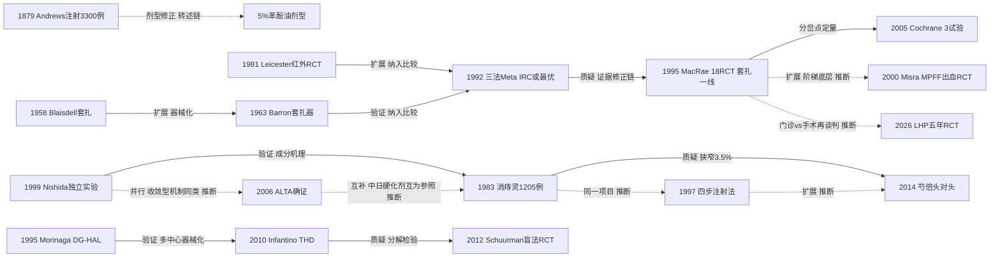

# D02 痔的门诊微创与注射治疗（含消痔灵线）

> **一句话判断**：痔的门诊微创线是一百五十年的"复发换微创"谈判：硬化注射（1869 起）与胶圈套扎（1958/1963 器械化）先把治疗搬进诊室，1995 年 Meta 确立套扎为 I–III 度一线；此后消痔灵/ALTA 硬化、多普勒痔动脉结扎不断重划边界。当前主战场在 Goligher III 度——HOLLAND RCT 报告套扎 12 个月复发 47.5%、非劣效失败，THD 单用 1 年临床失败 61%——门诊手段的适应证正被 III 度 RCT 与器械经济学重新谈判；中国线则以消痔灵→芍倍的安全迭代与内镜化独自展开。

## 0 三分钟速读

① **从哪里来**：注射硬化 1869 年始于都柏林（Morgan，转述层），1879 年 Andrews 报告 3,300 例大系列（原文页仅载方法要领与总例数；死亡与重大并发症数字系二手转述，见 [D02-N01]），把注射从民间技术变成有安全记录的正规疗法；套扎 1958 年 Blaisdell 借产科脐带结扎器起步、1963 年 Barron 专用器械定型（200 例中 4 例出血）[D02-N02]、[D02-N03]。

② **为什么改变**：门诊三件套（注射/套扎/红外凝固）的排序之争在 1992→1995 年被证据修正链裁决——Johanson"IRC 或最优"的结论 3 年后被 18 项 RCT 的 Meta 推翻，套扎确立一线地位 [D02-N06]、[D02-N07]。

③ **如何分化**：硬化剂分中国消痔灵→芍倍线与日本 ALTA 线（收敛型机理同源）[D02-N05]、[D02-N10]、[D02-N13]、[D02-N16]；痔动脉结扎 1995 年创立后，2012 年盲法 RCT 证明多普勒探头不贡献疗效，分化出"去多普勒"分支 [D02-N08]、[D02-N15]；IRC 兴而渐替，冷冻与手法扩肛被淘汰。

④ **现在研究什么**：III 度套扎 vs 切除的重新谈判（HOLLAND RCT 复发 47.5% vs 6.1%）、激光痔扎（LHP）五年 RCT 随访、泡沫聚桂醇硬化与套扎联合、内镜下门诊治疗、ALTA 长期复发（9 年 47.5%）与痔动脉栓塞 [D02-N17]。

⑤ **用了什么数据**：从个人系列与器械报告，到注册 RCT（NTR2139、NCT04621695）、单中心长期回顾（ALTA 1,180 例 9 年）、社会视角成本-效用分析（€24,042/QALY）与单细胞测序机制研究并行。

⑥ **还有什么不知道**：门诊手段的 5 年以上复发数据极少；消痔灵/芍倍无国际多中心 RCT 与上市后监测；痔动脉栓塞无已完成的 RCT；中国关键中文全文（CNKI/万方）本轮不可得。

**覆盖边界**：纳入硬化注射（5% 苯酚植物油/杏仁油、消痔灵、芍倍、ALTA、聚桂醇泡沫）、胶圈套扎、红外凝固（IRC）、冷冻（按负性路线处理）、痔动脉结扎（DG-HAL/THD/无多普勒 HAL）、激光痔扎（LHP，国际近五年最活跃的新门诊器械线，本轮补入）、药物保守（纤维/地奥司明类黄酮/局部用药）、痔动脉栓塞（早期线索）、门诊阶梯与指南定位。不含：切除性手术与吻合器主体（→D01）；术后疼痛与加速康复细节（→D09）；创面愈合（→D10）；分度与测压方法学（→D11）；针灸穴位（→D12）；注射严重不良事件只点到机制与个案，系统毒理评价不在本章。

**本章口径**：执行与报告截止 2026-10-18；近期重点窗口 2021-10-18 至 2026-10-18。阅读层级：L0=仅二手转述，L1=题录已核实，L2=摘要已读，L3=原文部分章节已读，L4=全文已读；只到 L0/L1 的说法一律注明转述。本章节点 17 个，按层级计：L4×1、L2×12、L1×4。核查状态：通过 16、修正 1（N01 样本数按原始扫描页改为 3,300 例，死亡/并发症数字改标二手转述）、删除 0、存疑 0；另有消痔灵获奖口径、"日本引进痔稳"两处 L0 两说在正文标"存疑线索"。**覆盖状态：基本完整但有标注缺口**——六问均可据本章速读①—⑥回答；章节范围内主要分支（注射硬化含消痔灵/芍倍/ALTA、套扎、IRC、痔动脉结扎含去多普勒线、激光、药物保守、栓塞早期线索）均有节点或专段（分支图已补入药物保守线 N11）；剩余缺口限于第 8 节已标注项（1983 消痔灵系列正文未读、Barron/Blaisdell 原文未读、《中国痔病诊疗指南(2020)》全文未读、CNKI/万方不可得、1879 死亡/并发症数字无一手独立核证），不影响主链与转折可循。

## 1 源头：最初在研究什么

门诊治疗痔的起点问题不是"切不切"，而是"能不能不进手术室"。按四类起点标注：

**目前最早找到的文献·注射硬化**：1869 年都柏林外科医生 James Morgan 以过硫酸铁酊注射治疗痔——本轮在公开库能定位的最早记录；1869 年原刊不在任何可获取开放库，仅存题录转述（据史学综述 Pata 2021 [D02-E8] 转述，L0）。

**被公认的奠基·第一个大系列与安全边界**：1879 年 Edmund Andrews（芝加哥医学会会议报告）注射治疗 3,300 例——本轮核查读取了 Buffalo Med Surg J 原始扫描页（单页即全文，L4），原文明确写 "conclusions from 3,300 cases"（此前通行的"3,000 例"系二手讹变；Pata 2021 还把人名误写为 Andrew Edmunds）。注意：这页转载短文只含 5 条操作要领与总例数，"9 例死亡、23 例重大并发症、25% 剧烈疼痛"等数字不在原文页，只存在于 Pata 2021→Dis Colon Rectum 1988;31:331-2 重刊（PMID 3282844）的二手转述链 [D02-N01]。此后剂型转向稀释的 5% 苯酚植物油/杏仁油；1888 年 St Mark's 的 Swinford Edwards 以 38 例仅 1 例复发使英国接受注射疗法（BMJ 2:815，DOI 10.1136/bmj.2.1450.815，Crossref 核实）。

**被公认的奠基·套扎器械化**：1958 年 Blaisdell 以脐带结扎器施放胶圈处理内痔（Am J Surg 96:401-4；无摘要、不在 PMC，本轮未读原文，L1）[D02-N02]；1963 年 Barron 设计专用套扎器并报告 200 例门诊套扎、仅 4 例出血（数字据 Pata 2021 L3 转述），技术步骤沿用至今 [D02-N03]。

**目前最早找到的文献·红外凝固**：1977 年 Neiger 在德文会议文集中首报 IRC（Witzstrock, Baden-Baden, pp.102-106，原文不可得）；1981 年 Leicester 等（St Mark's）以英文随机试验引入国际：IRC 治疗非脱出内痔可能优于注射、与套扎相当、疼痛显著更少（P<0.001）[D02-N04]。

**作者自称首次·消痔灵（中国线）**：中国中医研究院广安门医院史兆岐于 1970 年代末依"酸可收敛、涩可固脱"研制消痔灵注射液（五倍子+明矾）并提出四步注射法（医院官网技术页，L0；1970 年代中文原始文献本轮未能在公开库核实）；最早可核的英文临床系列为 1983 年 Ancient Science of Life 三度内痔 1,205 例（收稿 1982-12-28；正文为 PDF-only 扫描，本轮实测无法阅读，L1）[D02-N05]。

**被公认的奠基·痔动脉结扎**：1995 年日本 Morinaga 以自研器械 Moricorn 联合多普勒行痔动脉结扎：116 例，疼痛改善 96%、脱出 78%、出血 95%，全程免麻醉、无重大并发症，作者自陈需更长随访与对照 [D02-N08]。"THD"器械命名与黏膜固定打包则由意大利 Dal Monte/Tagariello 系建立（2004 Chir Ital、2007 Tech Coloproctol，均题录核实）——属"存在争议的首次"，概念优先权在 Morinaga。

**目前最早找到的文献·ALTA**：日本收敛型硬化剂硫酸铝钾鞣酸（ALTA/OC-108）本轮能核到的最早英文临床对照为 Takano 2006（10 机构）；更早研发文献（"Kondo 1990s"线索）未核到，如实存疑 [D02-N13]。

## 2 关键转折：问题—新证据/新方法—认识变化—新问题

**转折一：注射疗法安全吗？——大系列披露并发症，剂型被迫稀释。** Andrews 1879 年 3,300 例系列（死亡与重大并发症数字据二手转述）把注射从民间"痔医"技术变成有并发症谱记录的正规疗法 [D02-N01]；直接后果是剂型改造——降低浓度与播散风险的 5% 苯酚植物油/杏仁油成为 20 世纪硬化注射主流载体，并在日本沿用至 2014 年正式获批（JARC 2017 指南全文已读，L3）[D02-E3]。**关系：修正**（稀释剂型修正高浓度石炭酸体系）。

**转折二：门诊三件套谁最优？——本方向第一条证据修正链。** IRC 经 Leicester 1981 英文 RCT 立足后 [D02-N04]，Johanson & Rimm 1992 把比较 IRC/套扎/注射的 5 项试验 863 例合并：12 个月无症状率三种治疗相当，套扎因复发需再治疗更少（长期疗效更好）但疼痛更多，IRC 并发症更少更轻，作者结论"综合考虑 IRC 可能是最佳非手术治疗" [D02-N06]。3 年后 MacRae & McLeod 1995 以 18 项 RCT 得出相反排序：套扎优于注射（总应答 P=0.005；I–II 度 P=0.007；III 度 P=0.042）、并发症无差（P=0.35）；注射（P=0.031）与 IRC（P=0.0014）更可能需要再治疗；切除术疗效优于手法扩肛（P=0.0017）与套扎（P=0.001）但疼痛/并发症更多（并发症 P=0.02、疼痛 P<0.0001）——推荐套扎为 I–III 度初始治疗 [D02-N07]。**关系：质疑+修正**。该文以量化证据奠定"低度门诊、高度手术"阶梯，至今被引最高（Europe PMC 本轮实测 227）。

**转折三：硬化剂能否现代改造？——中国消痔灵线的接力与自我否定。** 史兆岐 1983 年 1,205 例英文系列使消痔灵进入国际文献 [D02-N05]；1997/1998 年四步注射法以英文（Chinese J Integr Trad West Med 3:246-249，DOI 10.1007/bf02934821）与中文版（PMID 11475740）发表，把经验注射标准化为针对直肠上动脉分支的可教授操作 [D02-N09]（1983→1997 为同一作者、同一技术的方法学深化，推断）。1999 年日本实验室独立验证：消痔灵由五倍子与硫酸铝钾组成，可使大鼠曲张缩小但对注射区造成严重损伤、为三种硬化剂中溶血性最低者——属"收敛型"而非去污剂型 [D02-N10]（**关系：验证**，外部确认）。2014 年安阿玥等的头对头前瞻队列（I–III 度 1,520 例、随访 3 年）把消痔灵的安全性短板量化：有效率芍倍 97.5% vs 消痔灵 91.8%，消痔灵组肛周硬结 1.1%、肛管直肠狭窄 3.5%（26 例），芍倍组均为 0 [D02-N16]（**关系：质疑**，非随机队列、研发机构自评是限制）。个案线上，硬化注射后致命性直肠坏死（Schulte 2008，PMID 18043926）、直肠穿孔（Vindal 2008，PMID 18695313）、狭窄后穿孔（Suh 2013，PMID 23586012）持续散在出现（摘要均已读）——大系列低并发症率与致命个案并存，是这条线的基本事实。

**转折四：日本给出收敛型硬化剂的对照证据。** Takano 2006 多中心对照（2000-10 至 2002-10，10 机构）：III–IV 度 ALTA 80 例 vs 结扎切除 85 例，28 天脱出消失率 94% vs 99%，1 年复发 16%（12/73）vs 2%（2/81），疼痛出血 ALTA 更低 [D02-N13]——首次量化"复发换微创"的代价，成为 2014 年 ALTA 与 5% 苯酚杏仁油日本获批（JARC 2017，L3）[D02-E3] 的关键证据。长期数据随后修正边界：Abe 2022 单中心 1,180 例报告 3/6/9 年累积复发 7.4%/27.2%/47.5%；2024 年 SR/MA（12 研究 4,249 例）合并复发约 10%、并发症 5.2%，且与分度构成无关。**关系：扩展→修正**（短期确证→长期边界收窄）。

**转折五：痔动脉结扎的兴起与"卖点拆解"。** Morinaga 1995 单臂之后 [D02-N08]，意大利系将其器械化为 THD 并加黏膜固定（2004/2007）；Infantino 2010 五中心前瞻 112 例（手术时间 33.9±8.8 分钟、平均结扎 7.2±1.5 处、72% 免镇痛、随访 15.6±6.5 个月：85.7% 治愈、残留痔 8% 用套扎补救）把它变成可复制的日间术式 [D02-N14]；同年 NICE IPG342/HTG218（2010-05-19，官网本轮核实）裁定"短中期有效、无重大安全问题、常规临床治理安排即可使用"。2012 年 Schuurman 盲法 RCT（II–III 度 82 例，NTR2139）分解有效成分：非多普勒组与多普勒组症状改善无差、脱出改善反而在非多普勒组更多（P=0.047），多普勒组并发症与计划外事件更多（P<0.0005），结论"多普勒换能器不贡献疗效" [D02-N15]（**关系：质疑**）。2025 年 SR/MA（7 项 2008–2023 年 RCT、514 例）继续检验该结论；JARC 2025 综述（全文已读）明确"HAL 无多普勒仍有效的证据在增长" [D02-E4]。**关系：分化**——HAL/DG-HAL/THD 的命名区分被弱化，"去多普勒"成为器械简化的现实方向。

**转折六：药物保守的证据化与复发上界。** Misra 2000 双盲 RCT（急性内痔出血 100 例）：第 3 天止血 MPFF 80%（40/50）vs 安慰剂 38%（19/50），P<0.01；持续用药防复发 30/47 vs 12/30，P<0.05 [D02-N11]。纤维 Meta（7 试验 378 例）显示症状不改善风险降 47%、出血降 50% [D02-E6]；Cochrane 2012 确认地奥司明类黄酮对出血与总体症状有统计学获益但方法学局限多 [D02-E7]。2023 年复发系统评价（44 篇）强调真实世界复发数据缺口；JAMA 2025 综述给出上界——类黄酮停药后 3–6 个月症状复发可达 80%，被 AGA 2026 采纳为咨询口径 [D02-E2]。**关系：扩展**——药物从经验用药变成有 RCT 支撑的阶梯底层，但"控制症状"与"治愈"的差距被复发数据摆上台面。

**转折七：III 度的重新谈判与激光线入场。** 门诊 vs 手术的分岔点定量长期停留在 Cochrane 2005（RBL vs 切除：仅 3 项低质量试验 202 例，完全缓解切除更好 RR 1.68，95%CI 1.00–2.83，异质性 I²=90.5%）[D02-N12]——该 Cochrane 自 2005 年发布后至 2026-10 未见更新（本轮复核 PubMed 全库 Cochrane 痔记录仅 8 条，最新为 2024 年 RAE 方案 PMID 39908072），III 度问题证据停滞 20 年。2025 年荷兰 HOLLAND 多中心非劣效 RCT（10 院、n=87、NCT04621695、因资金提前终止）报告 RBL 未达非劣效：12 个月复发 47.5% vs 切除 6.1%（绝对差 41%，95%CI 24–59%），QALY 差 -0.045；切除组第 1 周疼痛更高（VAS 4 vs 1），套扎返工更快（1 vs 9 天）——III 度适应证被重新打开。同期激光痔扎（LHP）以五年双盲 RCT 随访入场：121 例随机、5 年随访 102 例，症状复发切除 24%/LHP 29%/缝合黏膜固定 44%（log-rank P=0.076），LHP 术后疼痛更轻、恢复更短 [D02-N17]。**关系：并行+再谈判**——门诊、微创手术与切除在 III 度的取舍从"指南共识"变回"未决问题"。

## 3 分支图

实线=原文明确讨论或综述归纳的关系，虚线=本报告推断（边上已标）。5% 苯酚油剂型未设节点，仅示意剂型修正方向；药物保守线以 N11 单节点接入（详见第 2 节转折六）；HOLLAND RCT、THD 2025 RCT 等近五年研究见第 4 节，不占节点。

## 4 近五年重点（2021-10-18 至 2026-10-18）

**主题一：III 度痔门诊 vs 手术的重新谈判与器械经济学（发展中）。** 以症状量表/QALY/复发为主要终点，直接随机比较套扎与切除术在 III 度的取舍。代表：HOLLAND RCT（Dis Colon Rectum 2025;68:572-583，PMID 39952268）：10 家荷兰医院 2019-10 至 2022-09，n=87（套扎 47/切除 40），因资金提前终止、作者自陈统计力不足——RBL 未达非劣效（QALY 差 -0.045，95%CI -0.087~-0.004），12 个月复发 47.5% vs 6.1%；同队列成本-效用分析（PMID 40492557，n=79，与主报告为同一 RCT 的两次分析，不计为独立证据）：24 个月 QALY 差 0.08（0.04–0.13）、复发差 33.5%、住院成本切除高 €1,364，ICUR €24,042/QALY——结论依赖支付意愿阈值（€20k/QALY 时切除具成本效果概率仅 45.5%，€50k 时 83.9%）。门诊手段间比较：Salgueiro 2022 SR/MA（6 RCT+3 队列）套扎脱出控制 93.1% vs 硬化 66.4%（RR 1.34）；Abounozha 2025 SR/MA（5 研究 953 例）HAL 复发 19.3% vs 套扎 28.4%（OR 0.57）。分歧：HOLLAND 提前终止与样本小使结论强度受限，ASCRS 2024/AGA 2026/JARC 2017 等指南仍把门诊治疗放 I–III 度一线 [D02-E1]、[D02-E2]；经济学结论外推出荷兰医保体系存疑。

**主题二：泡沫聚桂醇硬化与 Sclerobanding（发展中）。** 3% 聚桂醇泡沫源自静脉曲张技术移植：奠基系列为 Fernandes 2019（2% 泡沫连续 2,000 例、4 周电话随访 98% 很满意，据 JARC 2025 转述，L1；原始文 PMID 31192285）；sclerobanding（套扎+泡沫联合）原始论文为 Pata 等 JCM 2021（97 例无术中并发症、1 月内并发症 4.1%，PMID 35011962，题录核实；据 JARC 2025 转述结果，L1）。窗口内：国际专家调查+系统评价（30 名专家、20 项研究+Delphi 建议，Updates Surg 2025;77:1439-1450）显示患者选择、操作技术、术后管理差异显著；内镜下泡沫硬化+套扎（EFSB）多中心随机（WJG 2024;30:3326-3335，4 家三级医院 195 例、12 个月）EFSB 组痔严重度评分更低、复发更少、疼痛更轻；改良 sclerobanding vs 套扎回顾比较（Int J Colorectal Dis 2025，PMID 41047429，题录层）；3% 泡沫多中心前瞻（Int J Colorectal Dis 2026;41:71，题录层）。反对面明确：比利时共识指南不推荐聚桂醇作痔硬化剂（过敏风险 1/10,000 或更高；De Schepper 2021，PMID 33639701，题录核实）[D02-E4]；Updates Surg 2026 述评标题即"promising, yet premature without long-term evidence"（PMID 40588690）。

**主题三：内镜下门诊治疗（发展中）。** 借结肠镜/胃镜完成套扎、注射及其组合。代表：内镜两种套扎法 RCT（Surg Endosc 2023;37:6235-6245，70 例随机、62 例完成 12 个月，总治疗成功率=完全缓解 67.8%+部分 27.4%）；内镜下硬化三中心回顾 1,147 例（Surg Endosc 2025;39:7240-7251，2018-12 至 2022-12）：总有效率 92.85%（1065/1147）；国内多中心内镜套扎+注射分析（《中华胃肠外科杂志》2025;28(12):1434-1440，题录层，全文在知网未读）；内镜下套扎 vs 芍倍注射液回顾比较（Surg Endosc 2025;39:1555-1564，题录层）——把中国芍倍线接入国际内镜话语。分歧：麻醉方式、帽辅助、碘染色定位齿状线尚无统一；内镜路径与传统肛镜路径的随机比较仍少。

**主题四：ALTA 长期复发、出境与注射+黏膜固定变体（日本国内成熟/国际扩散中）。** Abe 2022（DCR，1,180 例 II–IV 度）：3/6/9 年累积复发 7.4%/27.2%/47.5%，并发症：发热≥38℃ 1.4%、直肠溃疡 0.9%、直肠狭窄 0.4%、肛周脓肿 0.3%，作者自陈 3 年后随访渐失；Manaki 2024 SR/MA（12 研究 4,249 例）：合并复发 10%（6.52–14.08%）、并发症 5.20%，复发与分度构成无相关；ALTA+黏膜固定（AM）中期结局（Tech Coloproctol 2023;27:1335-1343）：注射中位 3 点、总剂量中位 19 mL、术后疼痛中位≤2。ALTA 扩散链的中间环节由 Surg Today 2011 综述补上（2011 年已称 mainstay，PMID 21626327，题录层）。分歧：Takano 1 年 16% 与 Abe 9 年 47.5% 表明复发随时间上升；日本指南仍推荐 ALTA 用于 II–IV 度（复发 4–16% 区间）[D02-E3]。

**主题五：激光痔扎（LHP）——本轮补入的近五年主题（发展中）。** LHP 是近五年国际"门诊/微创 vs 手术"再谈判中最活跃的新器械线之一（Europe PMC 题名检索 44 篇，2025–2026 密集产出）。代表：双盲 RCT 五年随访（Dis Colon Rectum 2026，PMID 42478482）[D02-N17]：121 例随机、5 年随访 102 例，症状复发切除 24%/LHP 29%/缝合黏膜固定 44%（log-rank P=0.076，三组差异未达统计学显著），LHP 术后疼痛显著更轻、恢复更短——目前该线等级最高的长期证据；方法学综述（ANZ J Surg 2025，PMID 40586452，题录层）；LHP vs LigaSure SR/MA（BMC Surg 2026，PMID 42374341，题名层）；另有 LHP vs 套扎 RCT（n=70，PMID 38797851，题录层）。分歧：复发点估计略高于切除但置信区间宽、长期证据仍以单中心为主；Tech Coloproctol 2026 有并发症提示（PMID 42128976，题名层）。痔激光与肛瘘激光（D04）是不同病种应用，本方向只承接痔的部分。

**主题六：痔动脉栓塞（RAE/Emborrhoid）——早期线索。** 经血管内栓塞直肠上/痔动脉治疗 I–III 度出血性痔。Cochrane 2024 仅到方案阶段（CD015358，PMID 39908072）——方案状态本身说明 RCT 证据不足以完成评价；技术-解剖综述（RadioGraphics 2022;42:1829-1844，题录层）与 PRISMA SR（15 项研究、检索截至 2022-08，Health Sci Rep 2026;9:e71577）。据 JARC 2025 转述：大多报告安全有效，但有个案直肠乙状结肠缺血→狭窄→3 次扩张→脱垂复发→改行 Milligan-Morgan；栓塞组 1 年满意度低于切除组。适应证倾向限于高龄/抗凝/手术高风险出血人群。

**主题七：药物保守与围术期辅助（症状控制成熟/复发与术后辅助争议）。** 窗口内代表：Lohsiriwat 2023 复发系统评价（44 篇，Adv Ther 40:117-132）：痔病复发的一致性数据有限；MOST 开放标签 RCT（DCR 2024;67:826-833，莫斯科 Sechenov 大学）：III–IV 度切除术后 MPFF 辅助 60 天，主终点皮桥血栓/水肿与 VAS 疼痛；JAMA 2025 综述（PMID 40824576）：类黄酮减少出血、疼痛与肿胀，但停药后 3–6 个月复发可达 80%，I–III 度可行门诊治疗、套扎症状缓解 89%。Misra 2000 [D02-N11] 为本主题历史起点（节点层），不重复计入窗口证据。

## 5 争议、负性结果与停滞路线

**争议一：III 度套扎能否替代切除（HOLLAND 之争，活跃）。** 传统阶梯（MacRae 1995、Cochrane 2005、ASCRS/AGA/中国 2020 指南）把门诊治疗放 I–III 度一线 [D02-N07]、[D02-N12]、[D02-E1]；III 度分岔点定量长期停留在 [D02-N12]，HOLLAND RCT 报告 III 度套扎复发 47.5% vs 6.1%、非劣效失败后重开。现状：HOLLAND 提前终止、作者自陈统计力不足，指南尚未因此改写；成本-效果结论随支付阈值反转。

**争议二：痔动脉结扎是否需要多普勒（活跃）。** 器械系以多普勒定位为卖点；Schuurman 盲法 RCT 认为探头不贡献疗效且并发症更多 [D02-N15]；2025 SR/MA（7 RCTs 514 例，PMID 40665575）系统检验；JARC 2025 称无多普勒仍有效的证据在增长 [D02-E4]。须说明：本方向三条器械/注射线中，消痔灵线（Nishida 实验质疑+DCR 2022 编辑评论 PMID 34990420）与泡沫线（"promising, yet premature"述评）都有国际批评的直接文字锚点，HAL 器械线本轮只找到阴性 RCT 与 SR 的间接证据，未定位到对该类器械"证据等级低而器械化快"的直接批评引语——此为检索缺口，不虚构引语。

**争议三：THD 单用在 III 度的边界（活跃）。** 2025 年西班牙开放标签 RCT（PMID 41553737，n=50）：III 度 THD 1 年临床失败率 61% vs 切除 8%，全部 8 例再手术都在 THD 组；2026 年 SR/MA 汇总长期复发（PMID 42882067）。单用 THD 的适应证被压向 II 度/低 III 度或需联合黏膜固定。

**争议四：ALTA 的复发代价（活跃）。** 见主题四：1 年 16%→9 年 47.5%；SR 合并 10% 且与分度无关；长期随访短缺被多篇自陈。

**争议五：消痔灵的有效性与安全性（未解）。** 国内推广口径（官网称治愈数以百万计，L0）与国际独立实验（收敛型机理成立但注射区严重损伤 [D02-N10]）、国内头对头（狭窄 3.5% [D02-N16]）、致命个案（Schulte 2008 等）并存；DCR 2022 编辑评论"Xiaozhiling in the 21st Century"（PMID 34990420，题录）显示国际界面已打开但无 RCT。国内部分被芍倍替代（2019 年补充指南 PMID 31302972、2020 年经济学比较 PMID 33353276 支持）。

**争议六：RCT 注册与终点一致性。** 本轮核对的两个注册试验均无终点漂移：HOLLAND（NCT04621695，注册主终点与发表一致，但提前终止致效能不足——注册-发表一致前提下仍需警惕结论强度）；Schuurman（NTR2139，一致）[D02-N15]。

**负性结果与停滞路线**：①冷冻疗法（1969–1980s）：Lewis 1969 首报、Goligher 1976（Dis Colon Rectum 19:213-8，PMID 1269347）、Rudd 1977 3,000 例系列（PMID 849687）、中国 1981 年《中华外科杂志》1,225 例（PMID 7261756，题录）——因脱落期分泌物多、疼痛、脱落慢退出主流；②手法扩肛（Lord）：Meta 显示切除术疗效显著优于扩肛（P=0.0017）后从主流比较与指南阶梯中消失 [D02-N07]；③"IRC 最优"结论：1992 提出、1995 被推翻，IRC 至今保留为辅助手段且正被其他能量器械替代（JARC 2025）[D02-N06]、[D02-N07]、[D02-E4]；④1879 高浓度石炭酸剂型：因死亡与重大并发症被稀释剂型取代 [D02-N01]；⑤硬化注射严重并发症个案线：致命直肠坏死、穿孔、狭窄后穿孔持续散在（PMID 18043926/18695313/23586012）；⑥Cochrane 证据线停滞：RBL vs 切除 2005 年版 20 年未更新（全库痔记录 8 条），phlebotonics 停在 2012 年版 [D02-N12]。

## 6 传承线与国际线

**传承线（中国注射线接力链）**：

（1）古典源头：枯痔疗法最早见于南宋魏岘《魏氏家藏方》"枯药"，明代《外科正宗》确立规范疗程（据中国中医药报 2017 年陈民藩访谈转述，L0）。

（2）枯痔钉-献方阶段（1956 年前后三条支线）：丁泽民创建南京市中医院肛肠科并把丁氏祖传验方与专科器械献给国家；温州陆琦把祖传枯痔钉秘方献给国家；福建陈民藩自 1956 年专研枯痔钉、以 3,000 余例临床数据改进剂型，形成陈氏肛肠流派五代传承（均机构网页/报刊口述史，L0）。

（3）化学改造与制度化：史兆岐（广安门医院）1970 年代末研制消痔灵并提出四步注射法 [D02-N05]、[D02-N09]。获奖口径两说并存（存疑线索）：官网称 1980 年卫生部甲级科研成果奖、1985 年国家科委国家科技进步二等奖、1991 年列为国家中医管理局全国推广项目、1986 年南斯拉夫/比利时国际发明奖（L0）；"国家发明奖（含尤里卡金奖）"之说见于调度线索与中山市中医院彭林教授学术成就页（L0，未给出年份、未核证书）——本轮无力裁决，两说保留。另"2006 年日本引进消痔灵定名痔稳"仅见官网 L0 页面，与 JARC 2017"ALTA/5% 苯酚杏仁油 2014 年获批"的时间线关系未核实，可能为不同产品，两说并存（存疑线索）[D02-E3]。

（4）替代迭代：安阿玥（中日友好医院）创安氏疗法，以芍倍注射液对照消痔灵：2014 年头对头队列（狭窄 3.5% vs 0）[D02-N16]→2019 年中国中西医结合学会大肠肛门病专业委员会《芍倍注射液治疗痔病出血补充临床指南》（中华胃肠外科杂志 22:694-696，PMID 31302972，L1）→2020 年芍倍 vs 胶圈套扎疗效-安全-经济学多中心分析（同刊 23:1194-1199，PMID 33353276，L1）→2021 年注册 RCT 方案（PMID 34797296）→2026 年多中心单臂研究（Curr Probl Surg，PMID 41638841）。

（5）近年延伸：消痔灵机制研究进入组学层面（单核 RNA 测序+空间转录组，WJGS 2025，PMID 40291892；肛周血流与直肠黏膜下纤维，WJGPT 2026，PMID 41809221，均 L1）；内镜下芍倍与套扎比较进入国际期刊（Surg Endosc 2025，PMID 39762601）。

（6）指南线：《中国痔病诊疗指南(2020)》（中国中西医结合学会大肠肛门病专业委员会，结直肠肛门外科 2020;26(5):519-533，任东林等；sinomed 题录核实 L1，全文 CNKI 不可得，推荐意见表述据公开解读页转述 L0）将硬化注射与套扎列为 I–III 度门诊推荐。

**国际线**：硬化注射 1869 爱尔兰→1879 美国→1888 英国 St Mark's；套扎 1958/1963 美国；IRC 1977 德国→1981 英国；冷冻 1969/1976 美国兴起后淘汰；痔动脉结扎 1995 日本→意大利器械化（2004/2007）→2010 意大利多中心验证与 NICE 许可→2012 荷兰盲法拆解→2025 荷兰/西班牙 RCT 重划界；硬化剂现代线 2006 日本 ALTA→韩国引入（Lim 2012，PMID 22606645）→2024 国际 SR；泡沫线由静脉曲张技术国际移植（葡萄牙奠基系列→意大利联合术式→比利时指南抵制）。监管与评价节点：NICE IPG342/HTG218（2010，常规安排即可使用）；ASCRS 2024（题录层，要点经二手转述）[D02-E1]；AGA 2026 实践更新（摘要层）[D02-E2]；意大利 SIUCP 2024（PMID 39228195）与台湾共识 2025（PMID 41162746）题录层提及。对消痔灵的国际反应：日本实验室独立成分/机理研究 [D02-N10]、DCR 2022 编辑评论（PMID 34990420）。跨病种方法学背景：Vickers 1998 与 Tang/Ernst BMJ 1999 对中医疗法 RCT 的国际方法学批评，评述病种不含肛肠，仅作背景、不构成对肛肠试验的直接批评（本轮未再单查原始文，依据任务书口径注明）。

## 7 数据路径小结（历史上 vs 现在）

（1）个人系列+器械报告（1958–1980s：Blaisdell/Barron/Leicester/史兆岐 1,205 例）→（2）RCT 与盲法分解试验（1990s 起：MacRae 纳入 18 RCTs；Schuurman n=82、NTR2139；HOLLAND n=87、NCT04621695；内镜 ERBL 两法 RCT n=70；LHP vs 套扎 RCT n=70；THD vs 切除开放标签 RCT n=50）→（3）多中心前瞻注册式研究（Infantino 5 中心 112 例；Takano 10 机构 165 例；3% 泡沫多中心前瞻）→（4）系统评价/Meta（18 RCTs 1995；Cochrane 2005/2012/2024-protocol；ALTA SR 12 研究 4,249 例；HAL vs RBL 5 研究 953 例；多普勒 SR/MA 7 RCTs 514 例）→（5）单中心大样本长期回顾（Abe 2022 ALTA 1,180 例 9 年；内镜硬化三中心 1,147 例）→（6）真实世界/调查与国际共识（泡沫国际专家调查+Delphi）→（7）动物/细胞实验（Nishida 1999：内皮细胞系、大鼠红细胞、兔耳缘静脉、大鼠曲张模型）→（8）组学与机制数据（消痔灵单核 RNA 测序+空间转录组）→（9）成本-效果（HOLLAND 队列 ICUR €24,042/QALY；芍倍 vs 套扎国内经济学分析）→（10）PRO 量表（HDSS、SHS-HD 用于 2025 THD RCT 主终点；VAS/HSS 用于内镜研究）。结构特征：早期为个人系列；1990s 进入 Meta 时代；2010s 起试验注册号常见（NTR2139、NCT04621695）；近五年并行 PRO 终点、长期复发、卫生经济学与组学机制四条路径。

## 8 还不知道什么（领域证据缺口）与本报告的检索缺口

**领域证据缺口**：①消痔灵与芍倍缺乏国际多中心 RCT 与上市后安全性监测——国际可见证据为 1983 单中心系列（正文不可得）、1999 动物实验与 2014 国内队列，狭窄 3.5% 只有一个队列来源 [D02-N05]、[D02-N10]、[D02-N16]；②门诊手段（套扎/硬化/注射）的 5 年以上复发数据极少——ALTA 9 年 47.5%（单中心）是少数例外，套扎与硬化的长期随访多在 12 个月内；③痔动脉栓塞无已完成的 RCT（Cochrane 2024 仅到方案阶段）；④HOLLAND 经济学结论的外推性——仅荷兰 10 院 79 例成本数据，社会视角成本结构未必适用其他医保体系；⑤HAL 器械线缺国际批评的直接文字锚点（与消痔灵线、泡沫线的批评呈现力度不对等），本轮未定位到、不虚构；⑥LHP 五年 RCT 为单中心，多中心长期对照与并发症谱待积累 [D02-N17]。

**本报告检索缺口（含 CNKI 影响）**：①1983 年消痔灵英文系列正文未能阅读（PMC3331546 为 PDF-only，PMC 页面遇反机器人验证、Europe PMC 渲染端点被 Cloudflare 拦截、LWW 原刊页 403，均按纪律未绕过），治愈率等结果数字无法转录；②Barron 1963/Blaisdell 1958 原文未读（无摘要、经 idconv 实测不在 PMC），关键例数依赖 Pata 2021 L3 转述；③《中国痔病诊疗指南(2020)》全文未读——CNKI/万方不可得，仅 sinomed 题录与公开解读页转述，中国指南推荐意见的证据分级细节无法核对，这使中国线与欧洲指南的比较只能停在"推荐方向"层面；④枯痔钉→消痔灵的中间环节（1950–70 年代明矾/枯痔液制剂）原始文献多在 CNKI，本轮只到 L0/L1 转述；⑤Andrews 1879 的死亡/并发症数字仅存二手转述链（原文单页不含），19 世纪并发症谱的真实规模无法独立核证 [D02-N01]。CNKI/万方不可得的总体影响：中国线的关键剂量-并发症关系、枯痔钉剂型改良数据与国内真实世界并发症率均无法纳入本章，中国注射线的安全性画像目前由单一英文队列与个案报告承担，系统性偏乐观或偏悲观均无法排除。

## 9 本章节点速查表

| 编号 | 年份 | 第一作者+题名简写 | 期刊 | 节点作用 | 设计/数据/分析单位 | 样本 | 关键结果 | 层级 | 核查 | PMID/DOI |
|---|---|---|---|---|---|---|---|---|---|---|
| N01 | 1879 | Andrews·石炭酸注射治痔 | Buffalo Med Surg J 19:70 | 硬化注射第一个大系列与安全边界（修正：3,300 例） | 单臂系列/会议报告/患者 | 3,300 例（原文扫描页） | 原文页仅载方法要领与总例数；9 死/23 重大并发症/25% 剧痛系二手转述（Pata 2021→DCR 1988 重刊） | L4 | 修正 | 36663664 |
| N02 | 1958 | Blaisdell·Office ligation | Am J Surg 96:401-4 | 套扎器械化与门诊化起点 | 个人系列/患者 | 未读原文，缺 | 以脐带结扎器施放胶圈（据 Pata 2021 确认方法学事实） | L1 | 通过 | 13571517 |
| N03 | 1963 | Barron·Office ligation | Am J Surg 105:563-70 | Barron 套扎器定型（分水岭） | 器械设计+单臂系列/患者 | 200 例（转述） | 仅 4 例出血（据 Pata 2021 转述）；技术步骤沿用至今 | L1 | 通过 | 13969563 / 10.1016/0002-9610(63)90332-5 |
| N04 | 1981 | Leicester·Infrared coagulation | Dis Colon Rectum 24:602-5 | IRC 英文首报+首个 RCT | 前瞻随机/St Mark's/患者 | 摘要未给总数 | IRC 优于注射（非脱出）、与套扎相当、疼痛更少 P<0.001 | L2 | 通过 | 7318625 |
| N05 | 1983 | Shi（史兆岐）·消痔灵 1205 例 | Ancient Science of Life 3(2):72-6 | 消痔灵最早可核英文大系列 | 单中心系列/患者 | 1,205 例（题名） | 正文 PDF-only 未读，结果数字无法转录 | L1 | 通过 | 22557383 |
| N06 | 1992 | Johanson·Optimal nonsurgical treatment | Am J Gastroenterol 87:1600-6 | 三门诊手段首次定量比较（"IRC 或最优"，后被修正） | Meta 5 试验/研究+患者 | 5 项/863 例 | 12 月无症状率相当；套扎再治疗更少但疼痛更多；IRC 并发症更少 | L2 | 通过 | 1442682 |
| N07 | 1995 | MacRae·Comparison of treatment modalities | Dis Colon Rectum 38:687-94 | 确立套扎一线与门诊-手术阶梯 | Meta 18 RCTs/研究+患者 | 18 项 | 套扎>注射 P=0.005；注射 P=0.031/IRC P=0.0014 更需再治疗；切除>扩肛 P=0.0017；被引 227 | L2 | 通过 | 7607026 |
| N08 | 1995 | Morinaga·Moricorn DG-HAL | Am J Gastroenterol 90:610-3 | 痔动脉结扎分支起点 | 自研器械+单臂/患者 | 116 例 | 疼痛改善 96%、脱出 78%、出血 95%；免麻醉；无重大并发症；被引 190 | L2 | 通过 | 7717320 |
| N09 | 1997 | Shi（史兆岐）·四步注射法 | Chin J Integr Trad West Med 3:246-249 | 四步注射法国际发表（技术标准化） | 方法学论文/患者 | 正文未获取 | 题录层：III–IV 期、直肠上动脉分支靶点；1998 中文版 PMID 11475740 | L1 | 通过 | — / 10.1007/bf02934821 |
| N10 | 1999 | Nishida·收敛型硬化剂比较 | J Gastroenterol Hepatol 14:481-8 | 消痔灵成分与机理首次独立实验确认 | 体外+动物/细胞·大鼠·兔 | 细胞系+大鼠+兔 | 五倍子+硫酸铝钾；溶血最低；注射区严重损伤；收敛型非去污剂型 | L2 | 通过 | 10355514 |
| N11 | 2000 | Misra·MPFF 急性出血 RCT | Br J Surg 87:868-72 | 药物保守线起点 RCT | 双盲 RCT/患者 | 100 例（各 50） | 第 3 天止血 80% vs 38%（P<0.01）；持续用药防复发 30/47 vs 12/30（P<0.05） | L2 | 通过 | 10931020 |
| N12 | 2005 | Shanmugam·RBL vs 切除 Cochrane | Cochrane DB Syst Rev (3):CD005034 | 阶梯分岔点定量；20 年未更新 | Cochrane SR/研究+患者 | 3 试验/202 例 | 完全缓解切除更好 RR 1.68（1.00–2.83）；I²=90.5% | L2 | 通过 | 16034963 |
| N13 | 2006 | Takano·ALTA vs 手术 | Int J Colorectal Dis 21:44-51 | ALTA 国际确证（复发换微创量化） | 多中心对照（非随机）/患者 | 165 例（80/85） | 28 天脱出消失 94% vs 99%；1 年复发 16% vs 2% | L2 | 通过 | 15843937 |
| N14 | 2010 | Infantino·THD 多中心 | Colorectal Dis 12:804-9 | THD 日间化多中心验证 | 5 中心前瞻/患者 | 112 例 | 72% 免镇痛；85.7% 治愈；残留 8% 用套扎补救；排尿困难 6+尿潴留 1 | L2 | 通过 | 19508513 |
| N15 | 2012 | Schuurman·多普勒盲法 RCT | Ann Surg 255:840-5 | 拆解多普勒卖点（去多普勒分支） | 单盲 RCT/患者 | 82 例（40/42） | 两组无差；脱出非多普勒组更好 P=0.047；多普勒组并发症多 P<0.0005；NTR2139 | L2 | 通过 | 22504188 |
| N16 | 2014 | An（安阿玥）·芍倍 vs 消痔灵 | Chin J Integr Med 20:555-60 | 国内注射线替代节点（安全量化） | 前瞻队列（非随机）/患者 | 1,520 例（各 760） | 有效率 97.5% vs 91.8%；消痔灵组狭窄 3.5%（26 例）、硬结 1.1%，芍倍组 0 | L2 | 通过 | 24972583 |
| N17 | 2026 | Makunaite·LHP 五年双盲 RCT 随访 | Dis Colon Rectum 2026;69(10):2484-91 | 激光线最高等级长期证据（本轮补入） | 单中心双盲 RCT 5 年随访/患者 | 121 随机/102 例随访 | 症状复发切除 24%/LHP 29%/黏膜固定 44%（P=0.076）；LHP 疼痛更轻恢复更短 | L2 | 通过（补充文献，附 PMID，摘要层本轮已核） | 42478482 / 10.1097/DCR.0000000000004372 |

## 10 本章入口文献与检索截止

| 编号 | 文献 | 用途 | 检索截止/层级 |
|---|---|---|---|
| E1 | ASCRS Clinical Practice Guidelines for the Management of Hemorrhoids. Dis Colon Rectum 2024;67:614-623（PMID 38294832） | 治疗阶梯与 DG-HAL/SH 争议现行定位 | 未获取（付费墙；题录层核实，要点经 JARC 2025 与 AGA 2026 转述）；L1 |
| E2 | AGA Clinical Practice Update on Diagnosis and Treatment of Hemorrhoids. Clin Gastroenterol Hepatol 2026;24:1773-1781（PMID 42067175） | 内科→门诊→手术阶梯与药物复发口径 | Expert Review 未说明截止；摘要已读；L2 |
| E3 | Japanese Practice Guidelines for Anal Disorders I. Hemorrhoids. J Anus Rectum Colon 2017;1:89-99（PMID 31583307，PMC6768674） | 5% 苯酚杏仁油/ALTA 2014 获批、RBL 首选 II 度、ALTA 复发 4–16% | 指南；全文已读；L3 |
| E4 | Kang SI. Latest Research Trends on the Management of Hemorrhoids. J Anus Rectum Colon 2025;9:179-191（PMID 40302863） | 近五年主题框架（泡沫/sclerobanding/内镜/栓塞/去多普勒 HAL） | 收稿 2024-10-09；全文已读；L3 |
| E5 | MacRae HM, McLeod RS. Dis Colon Rectum 1995;38:687-694（PMID 7607026） | 奠基性证据分级：RBL 一线地位（=N07） | 摘要已读；L2 |
| E6 | Alonso-Coello P, et al. Fiber for hemorrhoids. Am J Gastroenterol 2006;101:181-188（PMID 16405552） | 纤维效应量（症状风险降 47%、出血降 50%；7 试验 378 例） | 摘要已读；L2 |
| E7 | Perera N, et al. Phlebotonics for haemorrhoids. Cochrane 2012;(8):CD004322（PMID 22895941） | 地奥司明类黄酮证据层级与局限 | 摘要已读；L2 |
| E8 | Pata F, et al. Evolution of Surgical Management of Hemorrhoidal Disease. Front Surg 2021;8:727059（PMID 34527700，PMC8435716） | 1869/1879/1958/1963/1977/1995 史料链定位（注意其 3,000 例与人名讹误，已按原始扫描页修正） | 全文已读；L3 |

本章检索执行日 2026-10-18；入口文献之外的关键数字均经本轮逐点独立复核（16 节点+8 入口+21 条近期研究+9 条起源+12 条边全量核查；核查状态见各节点标注）。

## 12 复核修订记录（2026-10-18）

- Nishida（D02-R10）first_author T→R；ASCRS 2024 指南（D02-R18）first_author 机构署名改 Hawkins AT（ASCRS临床实践指南委员会）。（2026-10-19，汇总者依抽查报告执行）

### 第二轮（完整性检查，2026-10-19）

- 【必须改】速读①对 Andrews 1879 的表述对齐核查结论：原"报告 3,300 例大系列并披露死亡与重大并发症"改为"报告 3,300 例大系列（原文页仅载方法要领与总例数；死亡与重大并发症数字系二手转述，见 [D02-N01]）"，消除把二手数字误读为 1879 年原文披露的风险；[D02-N01] 引用随句内移，全句保持单一引用。
- 【建议改】N17 第一作者补全：经 PubMed E-utilities efetch（PMID 42478482）核实第一作者 Makunaite G、卷期页 2026;69(10):2484-2491、DOI 10.1097/DCR.0000000000004372；第 9 节速查表 N17 行与 evidence_D02.json（D02-R17）的 first_author/volume_pages/doi 同步，原"第一作者未在补充材料中给出"空缺消除。
- 【建议改】分支图补药物保守分支：新增 N11 节点（"2000 Misra MPFF出血RCT"）与 N07→N11 虚线边（标签"扩展 阶梯底层 推断"），图注补"药物保守线以 N11 单节点接入（详见第 2 节转折六）"；mermaid 仅按既有写法新增一行，语法与既有边标签风格未动。
- 【建议改】争议一引用位置：[D02-N12] 只保留在"传统阶梯"句；HOLLAND 句改写为"III 度分岔点定量长期停留在 [D02-N12]，HOLLAND RCT 报告 III 度套扎复发 47.5% vs 6.1%、非劣效失败后重开"，消除 N12 紧跟 HOLLAND 结果句造成的"为 HOLLAND 数据作证"歧义。
- 覆盖状态按统一口径重评为"基本完整但有标注缺口"，理由已写入"本章口径"。
