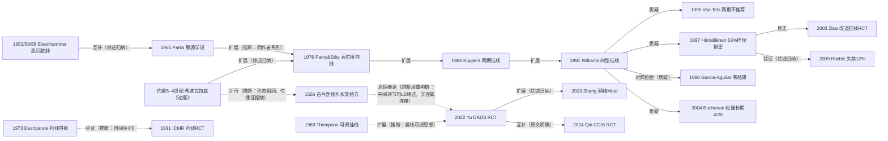

# D03 肛瘘：挂线疗法的传承线与括约肌保护之争

> **一句话判断**：挂线（seton）是极少数拥有两条互不隶属的古典源头——希波克拉底马鬃线与中医"药线日下，肠肌随长"——且至今仍写进主流指南的术式。1990 年代西方长期随访证实切割挂线有 12%–63% 的控便代价，推动国际指南在 2010s–2020s 转向"保留括约肌优先"；中国则以低位切开高位挂线、虚挂减压（DADS）等改良 RCT 维持挂线在高位复杂瘘的主力地位。对临床医生最重要的一点：挂线"切与不切、紧与不紧"直接决定功能结局，荷兰 SETON 试验（计划 277 例）正在检验两期法中松弛挂线是否必要。

## 0 三分钟速读

① **从哪里来**：希波克拉底《论瘘》记载马鬃缠亚麻线留置缓割（[D03-N01]）；中医线以 1556 年《古今医统大全》引元《永类钤方》"药线日下，肠肌随长……"为最早有出处的记载（[D03-N02]；转述层，古籍原本未核，归属两说并存）；1976 年 Parks & Stitz 把高位瘘挂线规范为现代术式（[D03-N06]）。
② **为什么改变**：芬兰 35 例平均 70 个月随访显示切割挂线后 63% 有轻度控便损害（[D03-N10]），2009 年文献汇总给出失禁均值 12%（隐窝腺性 18%）（[D03-N13]），此后多数国际指南对切割挂线降为低推荐。
③ **如何分化**：Williams 1991 首次系统区分"分期切开/切割挂线/短期引流/长期引流"四种用法（[D03-N08]）；中国分化出对口引流、定向挂线、保留括约肌挂线等变体家族（48 个 RCT 的网络 Meta，[D03-N15]）；印度 Kshara sutra 药线形成独立平行线（[D03-N05]→[D03-N07]）。
④ **现在研究什么**：虚挂引流能否替代实挂切割（DADS RCT，[D03-N14]）、紧线剂量（1/5–1/2 括约肌周长四臂 RCT，PMID 40606235）、两期法中松挂是否必要（荷兰 SETON 非劣效试验，PMID 42838583）、不挂线只切括约肌间（COIS RCT，[D03-N16]）。
⑤ **用了什么数据**：早期靠单中心病例系列（[D03-N08]–[D03-N12]），近五年转向注册 RCT、前瞻队列与网络 Meta（48 RCT 4205 例，[D03-N15]）；标准终点组合为愈合率/愈合时间＋Wexner/Vaizey 评分＋肛管测压。
⑥ **还有什么不知道**：挂线与 LIFT/推移瓣/TROPIS 之间没有头对头 RCT；中国 48 个 RCT 几乎全部是单中心中文试验；1556 年古籍原文与 1970s–80s 中国原始论文之间存在题录断层，传承链中段只能靠医史转述拼接。

**覆盖边界**：纳入——隐窝腺学说对治疗原则的塑造；切开/切除与挂线的古典传统（国际线与中医线）；现代切开挂线（低位切开高位挂线、虚实结合/松紧可调）在中国的规范化与 RCT 化；松弛（引流）seton 的角色与边界；印度 Kshara sutra 药线平行线。不含——推移瓣/LIFT/瘘管栓/VAAFT/激光/干细胞/TROPIS 的原始研究（交 D04，只作对比引用）；肛周脓肿一次根治与分期之争（D06）；克罗恩肛瘘（边界外）；Goodsall 规则与腔内超声/MRI/测压诊断学（D11）；混合痔与门诊微创（D01/D02）。

**本章口径**：执行日/报告截止日 2026-10-18；近期重点窗口 2021-10-18 至 2026-10-18。阅读层级：L0=仅二手转述、L1=题录已核实、L2=摘要已读、L3=原文部分章节已读、L4=全文已读；只到 L0/L1 的不写"已核对原文贡献"，转述写"据〈来源〉转述"。本章节点 19 个，按层级计数：L3×1、L2×12、L1×5、L0×1；全部经独立核查（1 处字段修正，见第 12 节）。**覆盖状态（2026-10-19 按全报告统一口径重评）：基本完整但有标注缺口**——理由：从哪里来/为什么改变/如何分化/现在研究什么/用了什么数据/还有什么不知道六问均可据本章回答；国际、中医、印度三条主线及切割—引流分化、负性证据链、松挂边界、中国 RCT 化等章节范围内主要分支均有节点；缺口限于古籍原本未核（N02 全条 L0）、Parks 1961 原文未读（N03 L1 封顶）、CNKI/万方未查、1556→1970s 传承中段为医史转述拼接等第 8 节已标注项，不影响六问作答。

## 1 源头：最初在研究什么

起点说法按四类标注："目前最早找到的文献"是数据库与公开档案可达范围内的最早记录，不是断言式第一；"被公认的奠基工作"指后续指南与综述共同回指的工作；"存在争议的首次"保留两说；"医史转述层的奠基叙事"是只有二手材料支撑的叙事。

**（1）国际古典源头（目前最早找到的文献，L3）。** 希波克拉底文集《论瘘》PART 4 记载：以锡制有眼探子将五股生亚麻线（外缠马鬃）导入瘘管、打结留置；"线任何一段松了，就每日拧紧扭转；若生麻线在瘘管割穿之前腐烂，须另接新线——马鬃之所以缠在外面，正因为它不易腐烂"。这一段确立了挂线"缓慢勒割＋持续引流"两大原理，"线松即紧、烂则续线"的逐日紧线逻辑是现代切割挂线紧线方案的直系原型 [D03-N01]。限定：文集作者归属（希波克拉底本人抑或学派）与成文年代（约公元前 5–4 世纪）存疑；Dis Colon Rectum 1980;23(1):56-59 将其重印为"结肠直肠外科经典论文"（PMID 6991228），佐证教科书地位；同篇另载的铜盐腐蚀布条贯通法后世未见延续。

**（2）中医古典源头（存在争议的首次，L0）。** 现行主流转述（北京市中医药管理局 2023-02-27 科普文，北京中医医院系统）把中医挂线最早记载定在明嘉靖三十五年（1556）徐春甫《古今医统大全》"脏毒"条引元·李仲南《永类钤方》（刊行年份有 1330/1335/1337 数说），并引出二十四字原理："药线日下，肠肌随长，僻处即补，水逐线流，未穿疮孔，鹅管内消"（公开页作"疮孔"，另有转写作"疮口"，属异文；全句六句二十四字）。同一公开页还载《永类钤方》条内李春山"芫根煮线挂破大肠七十余日获全功"医案与"草探一孔引线系肠外坠铅锤悬"的操作细节。另一说（lius.cc 学术页）称此句见于 1617 年陈实功《外科正宗·脏毒论》正文。两说并存，本轮未取得两书原版刻本，无法裁定归属 [D03-N02]。限定：两书原文均未核得，本条全部内容为二手转述。

**（3）病理学奠基（被公认的奠基工作，L1）。** Parks 1961 年在 BMJ 提出绝大多数肛瘘源于肛门隐窝腺感染、经括约肌间蔓延形成脓肿与瘘，治疗关键是清除内口感染源并最大限度保留括约肌（题录已核实：BMJ 1961;1(5224):463-469，PMID 13732880；OpenAlex 被引 631 次；PMC1953161 扫描页因 NCBI 人机验证阻断，两位成员本轮独立复现，原文未读，不引原文数字）[D03-N03]。与之互补的是 Eisenhammer 的肌间脓肿起源说：本轮实查其最早文献为 1953 年（S Afr Med J 27:266-270，PMID 13076663，内括约肌的外科重要性；"最早"限肌间脓肿起源线——另 1951 年有内括约肌挛缩纠正文 PMID 14866486、1947 年有早期论文，全报告复核时核对）与 1956 年（Surg Gynecol Obstet 103(4):501-506，PMID 13360660，内括约肌与肛直肠脓肿），1958 年 SGO 106:595-599（PMID 13556476，"基于高位肌间病灶的肛直肠瘘性脓肿新路径"）更直接对应肌间瘘脓肿学说，1978 年 DCR 21(4):237-254 为其最终总结（PMID 657933）[D03-N04]。通行"Eisenhammer 1946 年首创"之说经 Europe PMC 全作者列表核查（1947–1985，无 1946 年文）证伪；引用时写 Parks 1961／Eisenhammer 1953/1956（或 1958），该组锚年限肌间脓肿—瘘线（1951 年文为肛裂/内括约肌切开线的锚，归 D05）。两条学说共同构成"隐窝腺（cryptoglandular）"框架——挂线由此获得病理学地位。

**（4）中国现代切开挂线的形成（医史转述层的奠基叙事，L0）。** 《中国医学通史》现代卷肛肠科章节（网络转载页，本轮逐项核对）可证实三条：1960 年代后期起强调内口处理为成败关键；挂线材料由"药线"改为"橡皮线"（免煎煮浸泡、免频繁紧线、痛苦小疗程短）；"切开挂线法治疗高位复杂性肛瘘"载入多种学术著作。至于"1978 年前后通过成果鉴定并获全国科学大会奖"及史兆岐、周济民、曹吉勋等人名，该通史页无载，仅见于百度百科等词条（L0 转述），年份与人名均不作确证使用。此线通向中国挂线的 RCT 化（[D03-N14]，中段见第 6 节）。

**（5）印度药线现代起点（目前最早找到的现代报告，L1）。** Deshpande & Sharma 1973 年在 Am J Proctol 首报 Kshara sutra（阿育吠陀药线）治疗肛瘘 200 例并随访（24(1):49-60，PMID 4570230），1976 年同组续报高位瘘"成功的非手术治疗"（27(1):39-47，PMID 1108672；同组延续报告，不重复计为独立证据）[D03-N05]。老刊无摘要，愈合/复发数字未取得。阿育吠陀古典源头（《妙闻集》Bhagandara 传统）本轮只到转述层。

**（6）药线的对照验证（被公认的奠基工作，L2）。** 印度医学研究理事会（ICMR）1991 年发表于 Indian J Med Res 的四中心（孟买、昌迪加尔、新德里、Wardha）RCT：药线 265 例 vs 常规手术 237 例，两组全部愈合；中位愈合 8 周 vs 4 周（药线显著更慢）；一年复发 4% vs 11%（P=0.03；复发分析基于各 150 例随访，非全样本）；轻度失禁 8 例 vs 13 例；药线组普遍局部灼热、分泌物增多 [D03-N07]。摘要未报告盲法与分配隐匿。这是非西方传统疗法被 RCT 验证并进入国际引文网络（Europe PMC 被引 31 条）的少数外科案例。

## 2 关键转折：问题—新证据/新方法—认识变化—新问题

**转折一：从古典技艺到病理学框架（1953–1976）。** 1976 年之前挂线只是散在技艺。Parks 1961 腺源学说回答"为什么高位瘘不能一刀切开"；Eisenhammer 1953/1956/1958 肌间脓肿说补上解剖骨架（互补，综述归纳：ESCP 2024 病因框架同时容纳两说）[D03-N03][D03-N04]。同年 Parks & Stitz 在 DCR 发表高位瘘挂线专文，把 seton 规范为"先引流控制感染、再缓割或保留"的分阶段术式；同期 Parks/Gordon/Hardcastle 分类（BJS 1976;63(1):1-12，400 例、四主型，摘要已读）提供了瘘型语言 [D03-N06]。关系性质：同作者 1961→1976 系列的扩展（推断依据：同作者系列与后续教科书接续叙述）。注意：本轮核得该专文为 1976 年 DCR，而非部分二手材料所写 1968。

**转折二：挂线内部分化——"切"与"引流"分家（1984–1991）。** Kuypers 1984 报告括约肌外瘘两期挂线 10 例，随访 6 个月–2.5 年无复发（6 例轻度渗液、1 例失禁），是两期挂线最早的现代系列（扩展）[D03-N17]。Williams 1991（明尼苏达，6 年 74 例回顾）首次把挂线并列为四种用法分别报告结局：两期切开 24 例（复发 2/24=8%、轻度失禁 13/24=54%）、切割挂线 13 例（复发 0/13、失禁 7/13=54%）、短期引流 14 例（复发 2/14=14%、失禁 5/14=36%）、克罗恩长期引流 23 例（复发 9/23=39%、失禁 6/23=26%，48% 获良好结果）[D03-N08]。"切与引流是目的不同的两种挂线"自此成为讨论框架（原文明确讨论：摘要四技术并列比较）。

**转折三：负性证据链与西方转向（1995–1998）。** 三组数据接连打击"挂线保功能"的预设。其一，荷兰 Nijmegen 1981–1990 年 34 例两期挂线（括约肌外 16、经括约肌 18）：术前控便正常 31 例中 29 例获随访，术后仅 12 例控便正常（A 级 12、B 级 5、C 级 11、D 级 1），复发 2 例、经括约肌瘘全部愈合，作者明确"不推荐用于高内口/直肠开口瘘"（质疑）[D03-N09]。其二，瑞典 Graf 1995 随机比较紧线与不紧线：紧线组失禁 7/9 vs 切断组 4/16（P=0.03），提示失禁来自线对肌肉的压榨伤而非切开本身（PMID 7612773，摘要已读）。其三，芬兰赫尔辛基 44 例切割挂线中 35 例平均 70 个月随访（28–184 月）：63%（22/35）轻度控便损害（其中 4 例术前已有）、愈合平均 151 天，静息压组间相似、挤压压差 P=0.0345，作者结论"对高位经括约肌瘘应优先选用避免括约肌切断的方法"（质疑）[D03-N10]。明尼苏达团队再把两大切割路径头对头：García-Aguilar 1998 切割挂线 vs 两期挂线切开，治愈率与失禁率均无差异——切割挂线并不优于两期切开，两条路线共享同等功能代价（对照检验/零结果）[D03-N18]。这一负性证据链把西方主流推向推移瓣/LIFT 等保留括约肌术式（术式细节归 D04）。

**转折四：功能性修正尝试（1989–2003）。** Thompson 1989 提出可调（松/紧可转换）seton（Surg Gynecol Obstet 169(6):551-552，题录层）[D03-N19]。Zbar 2003 完成"内括约肌保留（改道）挂线"的首个 RCT：1998–2002 年 34 例高位经括约肌瘘随机，改良组修补内括约肌、线改走括约肌间再缓割外括约肌部分——控便评分、复发、愈合时间与传统切割挂线无差异，仅测压指标（全括约肌长度直肠肛门抑制反射曲线下面积）占优（P<0.05）（修正）[D03-N11]。测压优势未转化为临床终点，但"只缓割外括约肌"的思路与中国的"虚挂/虚实结合"及埃及 rerouting 系列同构。

**转折五：松挂的角色重定义与汇总定调（2004–2025）。** Buchanan 2004（St Mark's，20 例复杂瘘，≥10 年随访）：松挂短期脓毒症控制 13/20，长期成功仅 4/20；16 例持续/复发、13 例再手术、7/20 最终仍需切开外括约肌（短期仅 3/20）；拔线后 6/15/60 月分别复发 7、11、15 例；克罗恩与隐窝腺性复发相近（5/6 vs 11/14，P=1.000）（质疑）[D03-N12]——松挂从"确定性治疗"降级为"过渡/桥梁"。爱尔兰 2014 年多中心 200 例给出更乐观的中期数据（耐受 96%、复发 6%，回顾性多中心），桥梁定位与"务实低成本"立场并存（PMID 24989839，摘要已读）。Ritchie 2009 文献汇总给出可引用的合并估计：切割挂线失禁均值 12%、隐窝腺性瘘 18%、内口越近端越高（验证，综述归纳）[D03-N13]。此后 Lu 2025 对 15 部指南/共识（9 指南+6 共识）的系统综述确认："多数指南对切割挂线给予低推荐，主要因为失禁"（E02，PMID 40672439）；ESCP 2024（45 个 PICO）与 ASCRS 2022 把保留括约肌术式放在高位瘘优先位置（E03/E05）。McMaster 切割挂线 SR/MA（29 研究 1513 例）给出当代基线：复发 6%、6 月失禁 16%（5%–38%）、平均愈合 14.6 周、6 月完全愈合 73%（E01，PMID 38091125）。

**转折六：中国线的 RCT 化回应（2022–2026）。** 中国路线没有跟随"弃挂线"，而是改造挂线。中日友好医院 2022 年 DADS RCT（单盲、1:1、n=120）：减压引流挂线（虚挂）与传统切割挂线 1 年愈合无显著差异（切割组 5 例未愈，9.1%），但返工（紧线/换线）时间 5±2 vs 10±3 天（P<0.001）、Vaizey 失禁评分与术后疼痛更低（扩展：把"虚挂"做成可注册、可对照的术式终点）[D03-N14]。长春中医药大学 2023 年网络 Meta 把对口引流（ITCP）、定向挂线（DLM）、保留括约肌挂线（ITSS/SPTM）、主灶切开支管引流（MIBD）等变体放进同一框架（48 RCT、4205 例）：ITCP 综合优势最大、DLM 疼痛与安全性最优、ITSS 功能保护最优（扩展：家族级证据聚合）[D03-N15]。南京（丁氏痔科单位）2024 年 COIS RCT（n=72）进一步挑战"必须挂线"：只切括约肌间间隙，愈合 35.75±11.15 vs 55.69±13.42 天（P<0.001）、3 月静息压 58.39±6.72 vs 51.25±4.33 mmHg、Wexner 0.50 vs 3.00（均 P<0.001）、复发 2.78% vs 8.33%（P=0.607，未达显著）（互补/再修正）[D03-N16]。石家庄 2025 年四臂 RCT 把"紧多少"参数化：紧线至括约肌周长 1/5、1/4、1/3、1/2 四档（n=100，4×25），1/2 大紧线组功能影响最大，较小紧线组疼痛更轻、3 月测压更优（摘要载 1/5 组 3 月静息压/最大收缩压最高；各臂优劣表述以原文为准）（PMID 40606235）。同期发生一起证据合规事件：山东团队 LCCS Meta（Int Wound J 2024;21(3):e14675，16 篇 1124 例，称 LCCS 愈合率 97.44% vs 81.69%）因同行评议受损于 2025 年撤稿（撤稿文 Int Wound J 2025;22(3):e70295；原文 PMID 38484699，撤稿 PMID 40031944）。

**转折七：印度药线的再评价与微创化（2001–2025）。** 新加坡中央医院 2001 年 RCT（108 例随机、分析 100，54 vs 46）显示化学药线用于低位瘘术后前 2–4 天疼痛更重，愈合时间、并发症与功能无差异——药线不适宜低位瘘（适用边界负性结果；PMID 11875680）。2015 年印度头对头再评价延续 ICMR 方向（PMID 26283840）。2025 年出现微创化变体：IFTAK（BHU Varanasi，复发瘘肌间平面拦截+药线，10 例回顾系列，2–3 月 cut-through、12 月无复发；PMID 40646373）与 MIKST（PMID 40213169）；Solan 前瞻对比（50 例，St James's I–II）显示药线组手术时间 18.6±3.2 vs 28.4±4.5 分钟、住院 2.3±0.8 vs 4.1±1.2 天、术后 6 小时 VAS 3.1 vs 6.4、愈合 6.2±1.5 vs 8.9±1.8 周（均 P<0.001；排气失禁 0 vs 2）（PMID 41607971）。成分层面，Gewali 1990 从药线分离出 euphol、ingenol 型二萜酯与姜黄素类（J Ethnopharmacol 1990;29(2):199-206，PMID 2374431），构成"腐蚀+消炎"的药理基础；日本曾仿制"金沢 Sutra"做药理评价（Yokogawa 等，J Nat Med 2017，PMID 27900596；"Kanazawa Sutra"系药线名而非作者）。

## 3 分支图

实线=原文明确讨论或综述归纳的关系；虚线=本报告推断。最长的一条虚线（1556→2022）是跨断层原理继承的重构链：其中间环节（1960 年代末药线改橡皮线、内口处理关键化、"低位切开高位挂线"成形）均为 L0 医史转述，不是逐篇文献连接。

## 4 近五年重点（2021-10-18 至 2026-10-18）

**主题一：两期法中松弛挂线的必要性与"去挂线化"（成熟度：发展中）。** 研究什么：先松挂引流约 8 周再行确定性手术 vs 直接确定性保留括约肌手术——松挂是否真的改善愈合与功能。数据与设计：多中心非劣效 RCT（进行中）、≥10 年长期队列、多中心回顾。代表研究：荷兰 SETON 试验方案（Elwakel 2026，BMJ Open 2026;16(10):e122832，PMID 42838583；注册 NL-010338）：计划 277 例（每组 126），主终点为末次手术后 26 周瘘管闭合（临床+MRI/腔内超声确认），非劣效界值 15 个百分点，整合成本效用分析。分歧：Buchanan 2004（长期成功 4/20）支持"松挂非根治"，Kelly 2014（n=200，耐受 96%、复发 6%）与多数中国研究认为松挂耐受良好、有桥梁价值，SETON 试验则质疑松挂在两期法中的必要性本身。材料舒适度是桥接期的现实约束：Kristo 2016（维也纳，n=44 配对，窗口外历史对照）显示无结 Comfort Drain 较常规打结松挂改善生活质量与肛周舒适度、控便相近（Colorectal Dis 2016;18(6):O194-198，PMID 26999764；作者与期号经核查修正）。

**主题二：中国挂线变体的 RCT 化与紧线方案优化（成熟度：发展中——数量大、多中心化刚起步）。** 研究什么：虚挂替代实挂、紧线比例（1/5–1/2 周长）、松紧可调、LCCS（松+割结合）的疗效与功能。数据与设计：单中心 RCT（注册于 NCT/ChiCTR）、四臂随机剂量式试验、前瞻队列、48 RCT 网络 Meta。代表研究及结果：DADS RCT（n=120，1 年愈合无差、返工时间与功能占优，[D03-N14]）；COIS RCT（n=72，愈合快 20 天、功能优，[D03-N16]）；网络 Meta（48 RCT/4205 例，ITCP 综合最优，[D03-N15]）；紧线四臂 RCT（n=100，1/2 组功能最差；PMID 40606235）；LCCS RCT 协议（中日友好医院，ChiCTR2100045450，计划 76 例，主终点治愈率/长期复发/Wexner；截至本轮检索结果未发表；PMID 34628926）；LCCS 前瞻队列（n=132，2020-12 至 2022-02 手术：12 月愈合 130/132=98.5%，外院失败转入者 27/29=93.1%，Wexner 0 分 68.2%、余 1 分，VAS 0 分 96.2%；PMID 41524718）。分歧与方法学问题：证据几乎全部为中文单中心试验（Zhang 2023 自述质量参差）；已实查一例回溯注册（NCT05087407：研究 2016-12 启动、注册首次提交 2021-10-12）且注册主终点（6 月愈合率/复发率/愈合时间三项）与发表主终点（1 年创面愈合率）表述不一致——记录为方法学备注；LCCS Meta 2025 年撤稿（同行评议受损）。国际指南对切割挂线低推荐与中国“高位瘘挂线仍为主力”（转述层）的立场并存。

**主题三：Kshara sutra 药线的再评价与微创化（成熟度：印度国内成熟；国际主流之外）。** 研究什么：药线 vs 切开/切除的当代对照、复发瘘微创变体（IFTAK/MIKST）、药理成分。代表研究：Sachar 2025 前瞻对比（n=50，各终点均 P<0.001，药线占优）；IFTAK 2025（n=10 复发瘘，12 月无复发）；MIKST 2025（PMID 40213169）。分歧：ICMR 1991 结论药线远期优于常规手术，但西方主流指南（ESCP/ASCRS）与近 15 年国际 SR 几乎不纳入药线；印度国内存在阿育吠陀外科执业合法性的公开争论（J Ayurveda Integr Med 2021;12(1):195-197，PMID 33518387）。Cochrane 2010 仅顺带收录 ICMR 试验（E04）。

**主题四：TROPIS 与括约肌保留术式对挂线地位的挑战（与 D04 交叉，成熟度：争议大）。** 代表研究：Chen 2025 TROPIS SR/MA（福建中医药大学，24 研究/2813 例，检索至 2024-03 含中文库）：TROPIS 总有效率为常规治疗（含切开挂线/药线、LIFT 等）的 3.15 倍（95%CI 1.22–8.13），并发症 OR 0.28（0.18–0.42）（PMID 40607121）。评论立场：Garg 2024（印度 Garg Fistula Research Institute）主张"切割挂线是劣化版切开、并发症更高，应优先 TROPIS"（Tech Coloproctol 2024;28(1):57，PMID 38789585，L1）。间接反证：Fuschillo 2025 网络 Meta（49 研究/3520 例，PROSPERO CRD42022375600）显示保留括约肌四术式失败率并不低——LIFT 28.6%、VAAFT 22.3%、FiLaC 43.9%、EAF 25.9%（PMID 40392371），为挂线保留提供论据。争鸣：TROPIS SR 受多篇 letter 质疑（PMID 41815266、41342583、41133388；被评文 Zhou P，Int J Surg 2025;111(10):7301-11，PMID 40693967）。双方均缺 TROPIS vs 挂线的头对头 RCT。

**主题五：挂线材料、舒适度与患者报告结局（成熟度：早期线索）。** 研究什么：松挂材料（丝线/血管环/缝线/无结引流）对舒适度、QoL、脱线率的影响。代表研究：Kristo 2016（历史对照，见主题一）；美国 NCT05933343（Ethibond vs 血管环，2023-12 启动，入组仅 2 例即 TERMINATED）；土耳其 NCT07818642（松挂材料更换对 PRO 的影响，2026-09 注册，尚未招募）。规模小、多为单中心，共识度高但证据薄。

## 5 争议、负性结果与停滞路线

**争议一：切割挂线（实挂）是否应作为高位瘘常规治疗。** 中国线（成都曹吉勋虚实结合、南京丁氏、中日友好 LCCS/DADS）认为改良切割挂线（低位切开高位挂线、松紧可调、虚挂减压）仍是高位复杂瘘主力且功能可保——注意：2020 版《肛瘘诊治中国专家共识》（署名经核查修正为中国医师协会肛肠医师分会临床指南工作委员会，中华胃肠外科杂志 2020;23(12):1123-1130）"切割挂线较单纯切开更好保留功能、挂线类术式仍为高位瘘主力"的立场，其原文全文本轮未核得，属转述层证据。西方线（Hämäläinen 1997、Ritchie 2009、Garg 2024、多数国际指南）给出失禁 12%–18%（合并 16%）的数字，主张高位经括约肌瘘优先保留括约肌术式。状态：仍在争议——双方证据池都是低-中质量研究，缺乏跨国头对头 RCT；中国 2020 共识与国际 ESCP 2024 立场并存。

**争议二：松弛挂线是根治手段还是过渡桥梁；两期法中挂线是否必要。** 一方（Kelly 2014）认为松挂耐受好、务实、低成本；另一方（Buchanan 2004，长期成功率 4/20）认为松挂只能是桥梁；荷兰 SETON 试验（2026 协议）进一步质疑跳过松挂是否非劣效。状态：发展中——SETON 试验结果将首次以 RCT 证据回答"松挂是否必要"。

**争议三：二十四字诀的文献归属。** 1556《古今医统大全》引《永类钤方》说与 1617《外科正宗》正文说并存；两书原版刻本本轮均未核得，保留两说，待古籍版本学核对。

**争议四：Kshara sutra 在现代医学体系中的地位。** 印度线（ICMR 1991、CCRAS 体系、BHU）视其为经 RCT 验证的常规疗法；西方主流（Cochrane 仅顺带收录、ESCP/ASCRS 不提及）证据认可度低；另有阿育吠陀外科执业权限的监管争论（2019–2021 印度公开争论，PMID 33518387）。平行线：印度国内成熟、国际主流之外，暂无合流迹象。

**争议五：RCT 注册规范与注册/发表终点一致性。** 已实查一例回溯注册+终点漂移（NCT05087407）；Zhang 2023 纳入的 48 个 RCT 大多无国际注册号。影响证据可信度分级。

**负性结果与失败路线清单**（均为本轮实查来源）：
1. García-Aguilar 1998 零结果：切割挂线 vs 两期挂线切开，治愈率与失禁率均无差异 [D03-N18]。
2. 两期挂线术用于高内口/直肠开口瘘：Van Tets 1995，29 例随访术后仅 12 例控便正常，作者明确不推荐 [D03-N09]。
3. 松挂作为最终（根治）治疗：Buchanan 2004，≥10 年长期成功 4/20，多数需再手术、7 例最终仍需切开外括约肌 [D03-N12]。
4. 化学药线用于低位瘘：Ho 2001，无优势且术后早期更痛（PMID 11875680）。
5. 药线挂线的近期代价（ICMR 试验内部）：愈合时间翻倍（8 vs 4 周）、局部灼热与分泌物增多 [D03-N07]。
6. 已撤稿的证据合成：LCCS Meta（Int Wound J 2024）因同行评议受损于 2025 年撤稿（原文 PMID 38484699，撤稿 PMID 40031944）。

**停滞路线**：1976–1997 年西方"切割挂线改良"（紧线方案、可调 seton，[D03-N19]）在负性证据链后基本停滞，国际重心转向保留括约肌新术式（D04）；挂线材料学与 PRO 研究规模小、进展慢（一项美国材料 RCT 入组 2 例即终止）。

## 6 传承线与国际线

**传承线（中医挂线，本方向主体接力链；多数环节为 L0 转述，断层已标明）：**
① 古典源头：元·李仲南《永类钤方》（约 1330/1337）首载挂线治肛漏（转述层，含李春山芫根煮线医案、坠铅锤操作）；明·徐春甫《古今医统大全》（1556）转引并凝练"药线日下……鹅管内消"二十四字分期缓切原理；归属另有《外科正宗》（1617）一说（两说并存）。清代以降挂线为中医外科治漏常法（转述层，本轮未核清代专书）。
② 1950–60 年代传统延续："药线配铅锤、弯刀切开"（《中国医学通史》肛瘘节，L0）。
③ 1960 年代末–1970 年代改革：内口处理为成败关键；药线改橡皮线（免煎煮浸泡、免频繁紧线、痛苦小疗程短）——这两条在通史页可证；"低位切开、高位挂线"术式成形；"1978 年前后成果鉴定/全国科学大会奖"仅百度百科等 L0 转述（通史页无载），不作确证。
④ 单位级接力（L0–L2 拼接）：成都中医药大学附属医院曹吉勋——《中国痔瘘学》主编，"肛瘘切缝（挂线）内口引流术"与"虚实结合挂线"（实挂切割+虚挂引流；院官网术式页，L0）；南京市中医院丁氏痔科——丁泽民（1956 年献方入院）→丁义江（2024 年国家级非遗传承人公示）→丁曙晴，形成"低位切开高位虚挂引流、中位挂线、定向挂线"等丁氏挂线（腾讯新闻/口述历史与公开综述转述，L0；该单位 2024 年在 J Am Coll Surg 发表 COIS RCT，L2，[D03-N16]）；中国中医科学院广安门医院李国栋——切开挂线术治疗高位复杂性肛瘘（院官网，L0）；北京中医医院王嘉麟——挂线要领"麻醉须到位、勒线勿过紧、切开宜充分"（北京市中医药管理局页，L0）；上海天山中医医院林晖——隧道式挂线治疗马蹄形低位肛周脓肿 RCT（68 例 34/34，《中西医结合学报》2009;7(12):1119-22，PMID 20015430，L2；脓肿适应证与 D06 交叉）；广东省中医院——解剖学瘘管切除联合挂线 36 例（2005，PMID 15885176，L1）；中日友好医院郑丽华团队——LCCS/DADS 系列：2021 LCCS RCT 协议（ChiCTR2100045450）、2022 DADS RCT（n=120）[D03-N14]、2026 前瞻队列（n=132，PMID 41524718）；石家庄市中医院——紧线方案四臂 RCT（2025，PMID 40606235）；长春中医药大学——48 RCT 网络 Meta [D03-N15]。
⑤ 规范与专著：黄乃健主编《中国肛肠病学》（山东科学技术出版社 1996 年 6 月第 1 版；挂线章节本轮未读）；《肛瘘诊治中国专家共识（2020 版）》（署名与页码 1123-1130 经核查修正；立场为转述层证据）。
⑥ 断层声明：曹吉勋、史兆岐等 1970s–80s 原始论文经 PubMed（含中国机构限定）检索 0 命中，CNKI/万方全文不可得——1556→2020 之间存在约一个世纪的题录级断层。上述接力链中段以医史转述（L0）+单位官网（L0）+2005 年后 PubMed 收录中文论文（L1/L2）拼接而成，缺原始文献一环。

**国际线（口径：不含中国单位）：**
① 古典源头与近代传承：希波克拉底马鬃线为国际公认起点 [D03-N01]；中世纪至 19 世纪欧洲（含 St Mark's 医院 Salmon 时代 ligature 传统）本轮仅转述层、未核 19 世纪原始文献（如实标注：待核）。
② 规范化：Parks 1961（伦敦 St Mark's）与 Parks & Stitz 1976 [D03-N03][D03-N06]。
③ 各国独立验证与反驳：荷兰 Kuypers 1984（两期挂线治括约肌外瘘）[D03-N17]；美国 Williams 1991（四型挂线）[D03-N08]；荷兰 Van Tets & Kuijpers 1995（两期挂线不推荐）[D03-N09]；瑞典 Graf 1995（压榨机制，P=0.03）；芬兰 Hämäläinen & Sainio 1997（63% 控便损害）[D03-N10]；美国 García-Aguilar 1998（零结果）[D03-N18]；美国 Thompson 1989 可调挂线 [D03-N19]；西印度群岛/意大利 Zbar 2003（改道挂线 RCT）[D03-N11]；埃及 rerouting seton 注册试验系列（NCT03636997 与 NCT03983174 均已完成，分别 2017-02/2017-01 启动；NCT07850440 尚未招募、计划 2026-10 启动、计划入组 35——状态经注册库 API 核实修正）。
④ 证据合成与指南转向：Ritchie 2009 [D03-N13]；Cochrane 2010（仅 10 个 RCT，"亟需高质量试验"；E04，检索至 2009）；SICCR 2020 立场声明（意大利，Tech Coloproctol 24:127-143，PMID 31974827）；ASCRS 2016/2022（E05，卷期经核查修正为 65(8):964-985）；ESCP 2024（45 个 PICO、42 条推荐；E03）；McMaster 切割挂线 SR/MA（29 研究 1513 例；E01，检索至 2022-10）；Lu 2025 指南综述（15 部文件、AGREE II；E02，检索至 2024-04-01）——国际态度明确转向"保留括约肌优先、切割挂线低推荐"。
⑤ 当代国际试验：荷兰 SETON 非劣效试验（NL-010338，2026 协议，PMID 42838583）；材料与 PRO 试验（美国 NCT05933343 已终止、土耳其 NCT07818642 尚未招募）。
⑥ 印度平行线（对国际线的实质贡献）：Deshpande & Sharma 1973/1976 [D03-N05]→Gewali 1990 成分分析（日印合作，PMID 2374431）→ICMR 1991 四中心 RCT [D03-N07]→Dutta 2015 再评价（PMID 26283840）→2025 年 IFTAK/MIKST/Sachar 前瞻对比——Kshara sutra 是非西方医学被 RCT 验证并进入国际期刊的少数外科疗法之一，但未获西方指南采纳；印度国内另有阿育吠陀外科执业权限的监管争论（PMID 33518387）。

## 7 数据路径小结（历史上 vs 现在）

- **古典文本与医史路径**：希波克拉底《论瘘》（英译全文，L3）、《古今医统大全》/《永类钤方》（转述层，L0）、《中国医学通史》（L0）——本方向特有：源头证据大量依赖古籍与医史转述。
- **单中心病例系列（1976–2014 主导）**：Parks & Stitz 1976、Kuypers 1984、Williams 1991（n=74）、Van Tets 1995（n=34）、Hämäläinen 1997（n=44/35）、Buchanan 2004（n=20）、Kelly 2014（n=200，多中心回顾）——回顾性、样本 20–74、失禁多为问卷自报。
- **RCT**：ICMR 1991（4 中心 502 例）→Ho 2001（108 例）→Zbar 2003（34 例测压 RCT）→Yu 2022（n=120，NCT05087407）→Qin 2024（n=72）→Zhao 2025（n=100 四臂剂量式）。中国 RCT 多注册于 NCT/ChiCTR，但大量中文 RCT（Zhang 2023 纳入 48 个）无国际注册。
- **证据合成**：Ritchie 2009 文献汇总；Khamar 2023 SR/MA（29 研究 1513 例）；Zhang 2023 网络 Meta（48 RCT 4205 例，8 库含 CNKI/万方/维普）；Fuschillo 2025 网络 Meta（49 研究 3520 例）；Chen 2025 SR/MA（24 研究 2813 例）；Cochrane 2010（10 RCT）。
- **前瞻队列（近五年新增）**：LCCS 队列 n=132（PMID 41524718）。
- **指南/共识路径**：ESCP 2024（45 PICO+新 Meta）、ASCRS 2022、SICCR 2020、《肛瘘诊治中国专家共识（2020 版）》（转述层）、Lu 2025（AGREE II 评价 15 部）。
- **注册库路径**：本轮 ClinicalTrials.gov API 实查 40 条 seton-fistula 试验（荷兰 SETON、埃及 rerouting 系列、美/土材料试验、中国 DADS/LCCS）。
- **基础与转化路径**：药线化学成分分析（Gewali 1990）、日本仿制药线药理评价（Yokogawa 2017）、紧线力学剂量式 RCT（Zhao 2025）。
- **终点组合**：愈合率/愈合时间＋Wexner/Vaizey 失禁评分＋肛管测压（静息压/最大收缩压）＋VAS/返工时间；西方新增 PRO 与成本效用（SETON 试验），主终点确认要求 MRI/腔内超声（与 D11 交叉）。

## 8 还不知道什么（领域证据缺口）与本报告的检索缺口

**领域证据缺口：**
1. 挂线 vs 括约肌保留新术式（LIFT/推移瓣/TROPIS）无头对头 RCT——Cochrane 2010 即呼吁；2023–2025 年四方证据合成（Khamar、Zhang、Fuschillo、Chen）各自为战、互不覆盖；荷兰 SETON 试验只解决松挂必要性，不解决挂线 vs 新术式。
2. 中国挂线 RCT 的注册规范与主终点一致性差（已实查一例回溯注册+终点漂移；48 个 RCT 大多无国际注册号）。
3. 挂线在高位瘘"持续主导地位"缺乏国际可比数据：西方 SR 中高位瘘常用 LIFT/推移瓣，中国共识以挂线为主力，同一瘘型两种主流路径并行，尚无跨地区实效比较（RWD/登记库）证据。
4. 松挂的最佳拔线时机与桥接后术式选择无 RCT；紧线剂量、材料、PRO 研究规模小。

**本报告检索缺口（含 CNKI/万方影响）：**
5. **CNKI/万方未检索（不登录策略）对本章结论的影响最大**：Zhang 2023 网络 Meta 纳入的 48 个中文 RCT 只能经该 Meta 间接覆盖；1970s–80s 中国"切开挂线"原始论文（史兆岐、曹吉勋、丁泽民等）题录不可得，传承链存在约一个世纪的题录级断层；本章对中国线"形成期"的描述只能到医史转述层（L0）。
6. 中医古籍原文（《永类钤方》《古今医统大全》《外科正宗》）未核，二十四字诀归属无法裁定；古籍数字化全文本轮不可得。
7. Parks 1961 原文未读（PMC1953161 扫描页受 NCBI 人机验证阻断，两位成员独立复现，按纪律不绕过），L1 封顶，节点未引原文数字。
8. 待核线索（未取得可定位来源，不进正文叙事）："Eisenhammer 1946 首创"说（已证伪）；《永类钤方》确切刊行年份；《外科正宗》挂线条文原文；曹吉勋《部分切开挂线治疗高位复杂性肛瘘》等 1980 年前后论文题录；黄乃健《中国肛肠病学》挂线章节条目页码；中国中西医结合学会《肛瘘中西医结合诊疗指南》公示稿；1978 年全国科学大会奖/成果鉴定原始档案；"Melchior 等 seton 系统评价"（多轮检索未检得，疑为误记）；19 世纪 St Mark's ligature 传统原始文献；ChiCTR2100045450 注册页主终点逐项核对。

## 9 本章节点速查表

| 编号 | 年份 | 第一作者+题名简写 | 期刊 | 节点作用 | 设计/分析单位 | 样本 | 关键结果 | 层级 | 核查 | PMID/DOI |
|---|---|---|---|---|---|---|---|---|---|---|
| N01 | 约前5–4世纪 | Hippocrates《论瘘》（DCR 1980 重印） | MIT Classics/DCR | 国际古典源头：缓割+引流 | 操作记述/患者 | — | 线松每日拧紧、烂则续线（马鬃不朽） | L3 | 通过 | 6991228 / 10.1007/bf02587204 |
| N02 | 1556 | 徐春甫《古今医统大全》引《永类钤方》 | 古籍（未核原本） | 中医最早有出处记载（转引层） | 术法条目 | — | 二十四字分期缓切原理；归属两说 | L0 | 通过 | —（北京市中医药管理局页） |
| N03 | 1961 | Parks. Pathogenesis and treatment of fistula-in-ano | BMJ | 腺源学说奠基 | 解剖-病理+病例/患者 | 未取得 | 内口处理+括约肌保护框架；被引631 | L1 | 通过 | 13732880 / 10.1136/bmj.1.5224.463 |
| N04 | 1956 | Eisenhammer. 内括约肌与肛直肠脓肿 | Surg Gynecol Obstet | 肌间脓肿说（互补源头） | 临床解剖病理/患者 | 未取得 | 肌间间隙入治疗核心；"1946首创"证伪 | L1 | 通过 | 13360660 |
| N05 | 1973 | Deshpande & Sharma. 药线治疗肛瘘200例 | Am J Proctol | 药线现代首报 | 病例系列/患者 | 200 | 数字未取得（原文不可得）；1976 同组续报 | L1 | 通过 | 4570230 |
| N06 | 1976 | Parks & Stitz. The treatment of high fistula-in-ano | Dis Colon Rectum | 西方挂线规范化 | 病例系列/患者 | 未取得 | 分阶段挂线保护外括约肌；系1976非1968 | L1 | 通过 | 964106 / 10.1007/bf02590941 |
| N07 | 1991 | ICMR. Kshaarasootra 多中心 RCT | Indian J Med Res | 药线 RCT 里程碑 | 多中心RCT/患者 | 502（复发分析300） | 复发4% vs 11% P=0.03；愈合8 vs 4周 | L2 | 通过 | 1937599 |
| N08 | 1991 | Williams. Seton treatment of high anal fistulae | Br J Surg | 四型挂线分化 | 回顾/患者 | 74 | 引流组失禁更低（26–36% vs 54%）但复发更高（14–39% vs 0/13） | L2 | 通过 | 1958973 |
| N09 | 1995 | Van Tets & Kuijpers. 两期挂线不推荐 | Br J Surg | 负性证据 | 回顾/患者 | 34（随访29） | 术后控便正常仅12/29 | L2 | 通过 | 7648099 |
| N10 | 1997 | Hämäläinen & Sainio. 切割挂线控便损害 | Dis Colon Rectum | 负性里程碑 | 病例系列+测压/患者 | 44（随访35） | 63%轻度控便损害；愈合均值151天 | L2 | 通过 | 9407983 |
| N11 | 2003 | Zbar. 内括约肌保留改道挂线 RCT | Tech Coloproctol | 功能性修正 | RCT/患者 | 34 | 临床终点无差；RAIR曲线下面积优 P<0.05 | L2 | 通过 | 14605927 |
| N12 | 2004 | Buchanan. 松挂长期结局 | Br J Surg | 松挂边界 | 回顾+信访/患者 | 20 | 长期成功4/20；60月复发15/20 | L2 | 通过 | 15048751 |
| N13 | 2009 | Ritchie. 切割挂线失禁率汇总 | Colorectal Dis | 汇总定调 | 文献汇总/研究 | 多项（未报总数） | 失禁12%（隐窝腺性18%） | L2 | 通过 | 19175623 |
| N14 | 2022 | Yu. DADS vs 切割挂线 RCT | Sci Rep | 中国虚挂 RCT 化 | 单盲RCT/患者 | 120 | 愈合无差；返工5±2 vs 10±3天 P<0.001 | L2（方法L3） | 修正（注册日期2021-10-12） | 35551237 / 10.1038/s41598-022-11712-9 |
| N15 | 2023 | Zhang. 挂线变体网络 Meta | Int J Colorectal Dis | 家族级证据 | 网络Meta/RCT | 48 RCT/4205 | ITCP 综合最优；ITSS 功能最优 | L2 | 通过 | 37707561 / 10.1007/s00384-023-04519-1 |
| N16 | 2024 | Qin. COIS vs 切割挂线 RCT | J Am Coll Surg | "去挂线"挑战 | RCT/患者 | 72 | 愈合快20天、测压/Wexner优；复发NS | L2 | 通过 | 39166759 / 10.1097/xcs.0000000000001192 |
| N17 | 1984 | Kuypers. 两期挂线治括约肌外瘘 | Dis Colon Rectum | 规范化链缺环 | 病例系列/患者 | 10 | 无复发；6例渗液、1例失禁 | L2 | 通过 | 6697826 / 10.1007/BF02553987 |
| N18 | 1998 | García-Aguilar. 切割vs两期挂线切开 | Br J Surg | 零结果对照 | 回顾对照/患者 | 未取得 | 治愈率与失禁率均无差 | L2 | 通过 | 9501826 |
| N19 | 1989 | Thompson. 可调挂线 | Surg Gynecol Obstet | 可调挂线早期源头 | 操作报告/患者 | — | 松/紧可转换 | L1 | 通过 | 2683156 |

## 10 本章入口文献与检索截止

| 编号 | 文献 | 检索截止 | 用途 | 层级 |
|---|---|---|---|---|
| E01 | Khamar J, et al. Cutting seton for cryptoglandular fistula-in-ano: SR/MA. Tech Coloproctol 2023;28(1):12. PMID 38091125, DOI 10.1007/s10151-023-02886-z | 2022-10 | 切割挂线当代证据基线（29 研究/1513 例） | L2 |
| E02 | Lu MY, et al. 肛瘘临床实践指南/共识系统综述. Front Surg 2025;12:1566130. PMID 40672439, DOI 10.3389/fsurg.2025.1566130 | 2024-04-01 | 15 部指南/共识全景；切割挂线低推荐 | L2 |
| E03 | Reza L, et al. ESCP cryptoglandular anal fistula guidelines. Colorectal Dis 2024;26(1):145-196. PMID 38050857, DOI 10.1111/codi.16741 | 未说明（摘要层面） | 欧洲权威立场框架（45 PICO） | L2 |
| E04 | Jacob TJ, Perakath B, Keighley MR. Surgical intervention for anorectal fistula. Cochrane 2010;(5):CD006319. PMID 20464741, DOI 10.1002/14651858.CD006319.pub2 | 2009 | 手术对照证据历史基线（10 RCT） | L2 |
| E05 | ASCRS Clinical Practice Guidelines. Dis Colon Rectum 2022;65(8):964-985（期号经核查修正）. PMID 35732009, DOI 10.1097/dcr.0000000000002473 | 未说明（摘要层面） | 国际指南态度（保留括约肌优先） | L1 |
| E06 | Zhang H, et al. 挂线术式网络 Meta（题名 method 单数，经核查修正）. Int J Colorectal Dis 2023;38(1):228. PMID 37707561, DOI 10.1007/s00384-023-04519-1 | 2023-05-23 | 中国挂线变体家族骨架 | L2 |
| E07 | 中国医师协会肛肠医师分会临床指南工作委员会. 肛瘘诊治中国专家共识（2020版）. 中华胃肠外科杂志 2020;23(12):1123-1130（署名经核查修正） | 共识文件（未说明） | 国内规范立场锚点（转述层证据） | L1 |
| E08 | 《中国医学通史》现代卷·肛肠科章节（zhongyibaodian.com 网络转载） | 史料记述至1990年代 | 中医挂线现代化叙事（材料改革等三条可证） | L0 |

## 12 复核修订记录（2026-10-18）

> 本节为本章唯一修订记录节：原两节同号"## 12 复核修订记录"（成稿修订记录与全报告复核记录，且编号自第 10 节直接跳 12）已合并为一节；证据表落点：**data/evidence_D03.json**（51 行，行号 D03-EV-xxx 与正文节点对应）。

**成稿修订（本轮成稿相对调研稿的修订）**

1. E05 ASCRS 2022 期号由 65(7) 修正为 65(8)（核查修正）。
2. E06/N15 题名 "methods" 修正为单数 "method"（核查修正）。
3. E07 2020 版共识署名由"中华医学会外科学分会结直肠肛门外科学组"（实为 2006 版指南署名）修正为"中国医师协会肛肠医师分会临床指南工作委员会"，页码补全 1123-1130；其立场在正文明确标注为转述层证据（处理审读意见第 7 条）。
4. 松挂材料研究作者由"Vial M"修正为 Kristo I 等（Colorectal Dis 2016;18(6):O194-198），结果改写为"无结 Comfort Drain 较常规打结松挂改善 QoL 与肛周舒适度、控便相近"，标注为窗口外历史对照（核查修正+处理审读意见第 6 条）。
5. NCT07850440 状态由"招募中"修正为"尚未招募（NOT_YET_RECRUITING，计划 2026-10 启动、计划入组 35）"（核查修正）。
6. N14 注册日期修正为首次提交 2021-10-12（原写 2021-10-21）；回溯注册与注册/发表主终点不一致按方法学备注保留（核查修正）。
7. 中国现代切开挂线起源：按核查意见由"被公认的奠基工作"降为"医史转述层的奠基叙事（L0）"；"1978 年成果鉴定/全国科学大会奖"与人名（史兆岐、周济民、曹吉勋）注明通史页无载、仅百度百科等 L0 转述（核查修正）。
8. 二十四字诀：原稿"十六字"计数有误，改为"二十四字"（药线日下……鹅管内消，六句二十四字）；引文采用公开页"未穿疮孔"并注明"疮口"异文；补入李春山芫根煮线医案与坠铅锤操作（同页 L0）（处理审读意见第 2 条+核查补充）。
9. 新增节点 D03-N17（Kuypers 1984，PMID 6697826）、D03-N18（García-Aguilar 1998，PMID 9501826）、D03-N19（Thompson 1989，PMID 2683156）——均出自审读环节遗漏候选与补充建议且附 PMID/DOI；García-Aguilar 1998 零结果按审读意见列入负性结果清单并接入叙事（处理审读意见第 3 条）。
10. Eisenhammer 节点补 1958 年"高位肌间病灶"专文（PMID 13556476）与 1951 年内括约肌文（PMID 14866486）（审读环节补充）。
11. N02→N14 长边改标"原理继承（跨断层重构链）"，明示非逐篇文献连接、中间环节均 L0（处理审读意见第 4 条）。
12. 一句话判断年代表述拆分：1990 年代负性证据与 2010s–2020s 指南转向分列（处理审读意见第 5 条）；审读意见第 1 条（检索计数底账不符）属调研稿内部统计问题，不涉正文，未采纳其分项数字。
13. 审读意见共 7 条"一般"问题、无"严重"问题，全部逐条处理或在第 8 节说明；遗漏候选清单无"删除"判项、无"存疑"判项；审读环节补充文献仅采用附 PMID/DOI 者；三份材料之外未新增任何文献、数字或因果。

**第一轮（全报告复核，基线日 2026-10-18）**

以下为全报告复核（基线日 2026-10-18）对本章的修订，逐条注明"来源｜改了哪里｜改前→改后要点"；仅处理清单内问题及连带修改，未新增文献或数字。

1. 机械质检｜角色名清除｜原第 12 节（成稿修订记录）13 条残留流程角色式称谓共 15 处（两类称谓分别 4 处、11 处），证据表 6 行 role/result_location 字段同类残留｜改前：正文以两类流程角色称谓记录成稿期审读分工与核实动作→改后：统一改写为"审读意见第 N 条""审读环节补充""遗漏候选清单"等非角色表述，核实类动作改写为"经核查/逐字经核查"；证据表（data/evidence_D03.json）role/result_location 字段同步清理；所有题录、数字、阅读层级与结论均不变，引用节点编号回查对应关系不受影响。

2. 跨章一致性｜Eisenhammer 锚年加范围限定｜第 1 节（3）段｜改前："本轮实查其最早文献为 1953 年……引用时写 Parks 1961／Eisenhammer 1953/1956（或 1958）"未加范围限定，与 D05 以 1951 年文（PMID 14866486，内括约肌挛缩纠正）为肛裂/内括约肌切开线锚、1947 年已有早期论文相抵→改后："最早 1953"限定于肌间脓肿起源线，补注 1951/1947 年文归属他线；引用口径注明 1953/1956（或 1958）限肌间脓肿—瘘线；证据表 D03-EV-004 key_result 同步改为分线表述。第 2 节转折一与分支图 N04 原已带"肌间脓肿说"限定，无需改动。

3. 跨章一致性（表述级，确认项）｜「药线日下，肠肌随长」归属两说｜第 1 节（2）段、第 5 节争议三｜全报告复核时核对：本章已保留 1556《古今医统大全》引《永类钤方》说与 1617《外科正宗》正文说两说并存，并声明两书原版刻本未核、无法裁定，符合复核口径；正文无需改动，仅记录确认结论（X01 一侧的两说标注由该章处理）。

- García-Aguilar 1998（D03-EV-018）n_patients 补 59（12/47）、url 改文献定位；Chen TROPIS SR（D03-EV-036）期刊名 Surgical→Surgery Open Science。（2026-10-19，汇总者依抽查报告执行）

**第二轮（完整性检查，2026-10-19）**

以下为最终完整性检查（qa_completeness.json 中 D03 的 top_issues，共 4 条、均为"建议改"）的修订，逐条记录；本轮未新增检索、未新增文献或数字：

1. 第 9 节速查表 N08 行"关键结果"｜改前"切割0/13复发但失禁54%；引流组更低复发"易把复发—失禁取舍看反（切割组复发 0/13 本为四组最低，引流组复发 14%–39% 更高，引流组优势在失禁更低）→改后"引流组失禁更低（26–36% vs 54%）但复发更高（14–39% vs 0/13）"；证据表 D03-EV-008 key_result 原按四组如实列数、无此问题，未动。
2. 第 12 节编号断档｜原两节同号"## 12 复核修订记录"合并为本节唯一第 12 节，内分"成稿修订／第一轮（全报告复核）／第二轮（完整性检查）"三块，并补证据表落点说明（data/evidence_D03.json）；第 0–10 节编号与内容不变。
3. 第 0 节速读①｜中医线"药线日下，肠肌随长……"引文处改标"转述层，古籍原本未核，归属两说并存"，避免速读层误以为古籍原文已核（与第 1 节（2）段口径一致）。
4. 共识立场转述层口径｜第 7 节"指南/共识路径"条《肛瘘诊治中国专家共识（2020 版）》已带（转述层）标注，本轮复核确认保持；连带把第 4 节主题二引述的"高位瘘挂线仍为主力"立场句补（转述层），与第 5 节、第 10 节 E07 口径一致。
5. 覆盖状态重评｜按全报告统一口径评为"基本完整但有标注缺口"，理由写入第 0 节"本章口径"；mermaid 分支图未涉及本轮条目，未改动。
