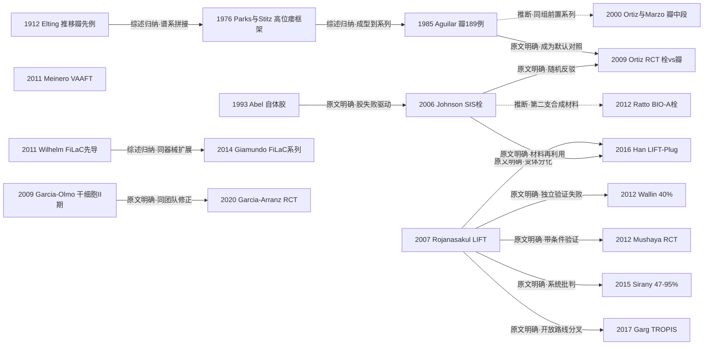

# D04 肛瘘：括约肌保留新术式的竞争（推移瓣/LIFT/瘘管栓/VAAFT/干细胞）

> 一句话判断：这是"不切断括约肌治好肛瘘"三十余年的术式竞争史——推移瓣是公认基准，两代材料封闭（纤维蛋白胶、瘘管栓）已被随机试验与学会指南判为基本无效；LIFT、VAAFT、FiLaC 等闭合与器械路线的真实成功率强烈依赖瘘管类型与报告口径（LIFT 一期愈合 47%–95%），TROPIS 开放路线与干细胞长期终点是当前最不确定的前沿。对临床医生最重要的一点：器械系列报告的高成功率不可直接采信，选术式先看瘘管类型与随机证据，再看指南分级。

## 0 三分钟速读

①**从哪里来**：以推移组织瓣封闭内口的思路被后续文献追溯至 Elting 1912 [D04-N01]，经 Parks & Stitz 1976"探查括约肌间感染源+处理内口"框架成型 [D04-N02]，Aguilar 1985 的 189 例系列（90% 无症状、复发 1.5%）把瓣变成基准术式 [D04-N03]。

②**为什么改变**：切开/切除损伤括约肌致失禁，瓣的成功率在报告间波动大（综述转述复发 2%–54%），驱动"不动刀"路线：1993 自体纤维蛋白胶 [D04-N04]、2006 可缝合生物瘘管栓 [D04-N05]。

③**如何分化**：闭合路线内部分化为瓣、LIFT（2007 泰国首报 94.4%）[D04-N06] 与器械化三支（VAAFT 瘘管镜 [D04-N09]、FiLaC 激光 [D04-N17]、瘘管夹）；2017 年 TROPIS 以"经肛开放括约肌间间隙"反其道而行 [D04-N15]；干细胞另起细胞治疗线 [D04-N08]。

④**现在研究什么**：激光参数标准化与按瘘管型别的愈合率（简单瘘 60.8% vs 复杂瘘 54.6%）、TROPIS 汇总（一次治愈 80% 但纳入研究全为单臂系列）、干细胞"短期无效-长期维持"、瘘管夹（汇总愈合 67.7%）、序贯策略（总体愈合 90.1%）与网状 Meta 收敛（栓/胶/PRP 高失败一致）。

⑤**用了什么数据**：单中心系列→RCT→试验注册库→网状 Meta；本轮对 3 项试验注册库核对均发现终点漂移或回溯注册，4 项相关撤稿被排除出证据链。

⑥**还不知道什么**：成功率报告口径至今未统一；微创器械缺大样本长期 RCT（现有 RCT 多≤60 例、随访<24 个月）；多数器械研究无基线失禁评估；非 MEDLINE 中文文献层不可得。

**覆盖边界**：纳入直肠内/肛管推移瓣谱系、纤维蛋白胶、瘘管栓（SIS 与 Gore BIO-A 两支材料）、LIFT 及变体（BioLIFT/LIFT-Plug/VAMLIFT）、VAAFT、FiLaC 激光、瘘管夹（OTSC/镍钛/形状记忆合金）、干细胞与注射再生材料（限隐窝腺肛瘘）、TROPIS、RCT 与系统评价/网状 Meta、学会指南。不含/只点到：挂线与切开线（D03）、肛周脓肿（D06）、克罗恩肛瘘的干细胞与生物治疗主线（仅在 Garcia-Olmo 2009 混合 II 期与 darvadstrocel 监管节点作边界交叉）、诊断客观化（D11）。

**本章口径**：报告截止 2026-10-18；近期重点窗口 2021-10-18 至 2026-10-18。证据阅读层级：L0=仅二手转述、L1=题录已核实、L2=摘要已读、L3=原文部分章节已读、L4=全文已读。本章关键节点 19 个（L1 三个：N01/N18/N19；L2 十五个；L3 一个：N09），入口综述/指南/共识 9 篇（E1–E9），近期代表研究 16 项，证据表共 44 行。19 个节点的题录与关键数字均经本轮独立复核，2 处修正（N12 FiLaC 起点定位、N14 期刊卷期），无删除项、无存疑项。覆盖状态（按统一口径复核评）：**基本完整但有标注缺口**——六个问题均可据本章回答，范围内主要分支（推移瓣谱系、材料封闭两支、LIFT 及变体、VAAFT、FiLaC、瘘管夹、干细胞与再生注射、TROPIS、中医拖线）均有可核节点；缺口限于第 8 节已标注项目：Elting 1912 与 Parks 1961 原文未读（起点停留转述层）、非 MEDLINE 中文库不可得、器械产业层仅 L0–L1、拖线"首创"年代与安氏原始论文待核；PRP III 期 RCT（2019）为窗口外背景锚点，已按统一口径标注（第二轮修订），不属于未声明缺口。

## 1 源头：最初在研究什么

（起点按四类标注：被公认的奠基工作／目前最早找到的文献／作者自称首次／背景前提。"最早找到"不等于"绝对最早"。）

**推移瓣谱系**。"以推移组织瓣封闭内口"被后续文献一致追溯到 Elting 1912（Ann Surg 56:744-752）；1912 年原文扫描页在 PMC 受访问验证限制未能读取，该起点停留在转述层——据 FOISF 2025（Gastroenterol Rep 13:goaf006，全文已读）转述："ERAF, as described by Elting in 1912, has a long history in the treatment of anal fistula"，同一综述给出瓣失败率 10%–60% 的文献区间 [D04-N01]。体系成型是 Parks & Stitz 1976（St Mark's 系列）：高位肛瘘处理被组织成"探查括约肌间平面+瘘管剔除（core-out）+内口处理"，这是其后瓣、LIFT、TROPIS 共同的病理生理出发点；其前提为 Parks 1961 BMJ 隐窝腺肛瘘理论（题录已核实，原文未读，属背景前提）[D04-N02]。1985 年 Aguilar 的 189 例黏膜瓣系列给出第一份大样本功能代价轮廓：90% 无症状、轻度污便 8%、气失禁 7%、稀便失禁 6%、无固形便失禁、复发 1.5%——瓣从零星报道变成有复发率与失禁谱数据的常规选择 [D04-N03]。1985–2009 年的谱系中段，本轮补入 Ortiz & Marzo 2000（Br J Surg 87:1680-1683，题录层；Ortiz 2009 同组前置系列、非同一队列）作为承上启下节点 [D04-N18]。

**材料封闭路线**。本轮在英文期刊临床报告中能核实的最早纤维蛋白胶报告是 Abel 1993（DCR 36:447-449）：自体胶 10 例（直肠阴道瘘 5+复杂肛瘘 5），6/10 愈合；更早仅见 1988 年德文书章节（非期刊临床报告，全文未核）[D04-N04]。可缝合生物瘘管栓（Surgisis AFP，猪小肠黏膜下层 SIS）的临床起点是 Johnson 2006（DCR 49:371-376）：25 例前瞻比较，3 个月未闭率胶 60% vs 栓 13%；同项目群同年还有 Champagne 长期系列（DCR 49:1817-1821，PMID 17082891，患者级 83%/瘘管级 85%）与 O'Connor 克罗恩栓系列（PMID 16998638，属边界外交叉）[D04-N05]。栓家族第二支材料（Gore BIO-A 合成延迟可吸收补片）2012 年起有独立报告群：Ratto 2012 首报（Colorectal Dis 14(5):e264-9，PMID 22288601；抽查更正——该 PMID 首报者为 Ratto C 等，Buchberg 系另一篇栓比较文 Am Surg 2010, PMID 21105632）、Ommer 2012 德国多中心初步结果（PMID 22984363）、2016 多中心随访（Tech Coloproctol，PMID 27418257）与 2016 系统评价（Colorectal Dis，PMID 26542191），均题录层 [D04-N19]。

**LIFT**。目前最早找到的文献是泰国 Rojanasakul 2007（J Med Assoc Thai 90:581-586）：18 例前瞻观察，94.4% 一期愈合；2005–2007 年标题检索未发现更早雏形报告 [D04-N06]。

**器械化（瘘管镜与激光）**。VAAFT 首报为 Meinero & Mori 2011（Tech Coloproctol 15:417-422），作者自称 novel sphincter-saving procedure，属"作者自称首次" [D04-N09]。FiLaC 的器械与术式最早临床先导是 Wilhelm 2011（Tech Coloproctol 15:445-449）：11 例先导研究，一期愈合 9/11（81.8%），1470nm 径向光纤，器械明确标注厂商 Biolitec；Giamundo 2014（Colorectal Dis 16:110-115，35 例先导研究，一期愈合 71.4%）是首个较大规模专门临床系列而非首报——此为本轮独立复核修正的关键结论（1470nm 参数据 Wilhelm 2011 与 Giamundo 2015 摘要佐证）[D04-N17][D04-N12]。激光能量器械源自静脉腔内激光消融（EVLA）的技术移植与 Biolitec 的产业化；器械产业层（CE 上市时间、厂商注册研究）本轮只有 L0–L1 层信息，列入第 8 节待核线索。

**TROPIS 与干细胞**。TROPIS 首报为 Garg 2017（Int J Surg 40:130-134），作者自述经肛开放括约肌间间隙"此前从未用于复杂肛瘘"，属作者自称首次、单术者系列 [D04-N15]。细胞治疗线的临床起点是 Garcia-Olmo 2009 多中心 II 期 RCT（49 例：隐窝腺 35+克罗恩 14）[D04-N08]。

## 2 关键转折：问题—新证据/新方法—认识变化—新问题

**转折一（扩展）：瓣的建立与代价暴露（1976–2000s）。** Parks 框架回答"感染源在哪"，Aguilar 系列回答"瓣能不能常规做"：可行、复发 1.5%，但轻度失禁谱合计约 15%，且无对照、20% 失访、无统一失禁量表 [D04-N02][D04-N03]。新问题：瓣的技术要求高、成功率在不同报告间波动大——综述转述的复发区间 2%–54%（Meinero 2011 引言列引）与失败率 10%–60%（FOISF 2025 转述）均为二手串联，第一手区间缺乏节点级支撑 [D04-N18]。这为"新术式以瓣为对照"提供了理由，也埋下本方向反复重演的口径问题。

**转折二（分化→质疑→修正）：材料封闭两起两落（1993–2016）。** 胶的失败直接催生栓：Johnson 2006 原文明言"胶的长期闭合率令人失望，可能因其液体性状难以固定"，遂改为可缝合固定于内口的 SIS 栓，3 个月未闭率 13% vs 胶 60% [D04-N04][D04-N05]。器械系列报告的 80%+ 成功率（同项目群 Champagne 2006）推动全球栓热潮，随后被独立随机证据拉回：西班牙 Navarra 组 Ortiz 2009 RCT 因栓组高复发提前终止，1 年复发 12/15 vs 瓣 2/16（RR 6.40，95%CI 1.70–23.97），有既往手术史者栓效果尤差 [D04-N07]；荷兰多中心 PLUG 试验（van Koperen 2011，DCR 54:387-393，ISRCTN97376902）60 例复发 71% vs 52%（无显著差异），作者评"both disappointing"。合成材料第二支 Gore BIO-A 与 SIS 栓同潮起落，2016 年系统评价后无后续 RCT [D04-N19]。ASCRS 指南对栓与胶的分级从 2016 年"相对无效 2B"维持到 2022 年"相对无效 1B"（据 GuidelineCentral 公开摘要转述，L2）[E2][E3]。新问题：为什么器械系列与 RCT 差这么多——利益关联团队、随访时长与愈合定义差异，成为本方向反复重演的方法学母题。

**转折三（验证→质疑→分化）：LIFT 的全球扩散与口径混乱（2007–2019）。** LIFT 以"经括约肌间平面结扎瘘管、完全不切断括约肌"的简单逻辑成为其后十余年试验最多的保括约肌新术式：泰国首报 18 例 94.4%（作者自认例数小需更大样本；MEDLINE 将其出版类型误标为 RCT，与原文自述的前瞻观察系列不符，本轮复核属实）[D04-N06]。独立验证随即分裂：明尼苏达大学 Mellgren/Madoff 组回顾 93 例，首次成功率仅 40%、含补救后累计 47%/57%，未找到成功预测因子 [D04-N10]；澳大利亚阿德莱德 RCT（复杂瘘挂线≥6 个月控制脓毒症后随机，LIFT 25 vs 肛管直肠瓣 14）19 个月复发 2/25 vs 1/14，手术时间短 32.5 分钟（P<0.001），作者把低复发部分归功于挂线预处理 [D04-N11]——"挂线预处理"自此固化为 LIFT 研究的标准设计变量。Sirany 2015 系统评价识别 7 种技术变体、一期愈合率区间 47%–95%、结论"真实疗效因变体与混合汇总而不可知"，成为方法学警示 [D04-N13]。原组十年回顾（Malakorn 2017，DCR 60:1065-1070，PMID 28891850）：251 例、中位随访 71 个月、总一期愈合 87.65%，但高位经括约肌仅 60.0%、马蹄形 40.0%——亚型差异被确认。BJS Open 2019 汇总（30 研究 1295 例）：成功率 LIFT 69.1% vs 瓣 74.6% 无显著差，失禁 1.6% vs 7.8%（瓣更高）[E6]。认识收敛为："与推移瓣等效、失禁更少、成功率强烈依赖瘘管类型与技术变体"。

**转折四（分化）：器械化浪潮——可视化与能量（2011 起）。** VAAFT 引入"诊断性瘘管镜"：136 例手术（随访 98 例）一期愈合 73.5%，>1 年随访 62 例愈合率 87.1%，镜下内口发现率 82.6%，5 例氰基丙烯酸酯胶再注射者全部复发 [D04-N09]；瑞士 Mendrisio 组 2020 年 104 例 3 年客观治愈 83.3%、主观治愈 84.4%（Tech Coloproctol 24:741-746，PMID 32318991）。FiLaC 与 VAAFT 同年进入临床（Wilhelm 11 例先导 81.8%，Biolitec 器械 [D04-N17]），Giamundo 2014 的 35 例（71.4%、无失禁）使其成为独立可复制的术式 [D04-N12]；同代另有 Oztürk & Gülcü 2014 独立 50 例系列（DCR 57:360-364，PMID 24509460），说明激光路线并非单一起源团队。夹具（OTSC/镍钛/形状记忆合金）为第三支器械化路线（见第 4 节主题四）。新问题：能量参数、病例选择与内口处理方式不统一，疗效口径混乱在激光线上重演了 LIFT 的老问题，直到 2025 年国际 Delphi 推荐才部分标准化。

**转折五（分化）：中国 ADM 材料线与 LIFT 合流（2009–2020）。** 北京朝阳医院王振军/韩举刚团队把脱细胞真皮基质（ADM）引入肛瘘：2009 年 JACS 大鼠实验（PMID 19476898）→2011 年中华胃肠外科机制研究（PMID 22205460，据 2020 版中国共识转述其为国内率先应用）→2012 年中文首报（PMID 23268266）→2013 年 Colorectal Dis 国际首报 LIFT-Plug（PMID 23067044）→2016 年 5 校多中心 235 例 RCT（2011-03 至 2013-04 入组）：6 个月一期愈合 LIFT-Plug 94.0%（95%CI 89.7–98.3）vs LIFT 83.9%（95%CI 77.2–90.6，P<0.001），中位愈合时间 LIFT-Plug 22 天 vs LIFT 30 天（P<0.001），手术时间 LIFT 26.7 分钟短于 LIFT-Plug 28.5 分钟（P=0.03），6 个月内两组无失禁无复发 [D04-N14]。引用该文须注意两点：其一，注册库（NCT01478139，本轮经 ClinicalTrials.gov 核对）主终点仅"愈合时间"，发表把 6 个月愈合率列为共同主要终点，注册-发表终点不完全一致；其二，摘要结论称 LIFT-Plug"术后疼痛更低"而其结果段 P=0.13，摘要内部不自洽，宜只取愈合与时间终点。长期随访续发于中华胃肠外科 2020（PMID 31958934）。这是中国对本方向最重要的国际证据贡献。

**转折六（分化）：开放 vs 闭合的哲学分叉——TROPIS（2017）。** Garg 主张括约肌间间隙脓毒症如"密闭小间隙内的脓肿"，必须经肛开放引流才能治愈高位复杂肛瘘，直接对抗瓣/LIFT/栓的"闭合内口"逻辑：61 例入组（52 例分析，复发性 85.2%、马蹄形 36.1%）一期愈合 44/52（84.6%）、再手术后总愈合 47/52（90.4%）、失禁评分无显著变化 [D04-N15]。其 2015 年 PERFACT 术式（WJG 21:4020-4029，PMID 25852290）为同一"开放"哲学前身。此路线至今无 RCT（见第 4 节主题二）。

**转折七（修正）：从结构修补到细胞治疗（2009–2020）。** Garcia-Olmo 2009 II 期（49 例）显示自体脂肪源性干细胞（ASC）+胶愈合 17/24（71%）vs 单胶 4/25（16%）（RR 4.43，95%CI 1.74–11.27），1 年复发 17.6% [D04-N08]。同团队（马德里）2020 年隐窝腺专用随机试验（57 例，ITT 44，均先行深搔刮+内口关闭，盲态评估）反转：16 周愈合 ASC 组 30.4% vs 对照 42.8%（干细胞无优势），52 周 55.0% vs 63.1%，2 年 50.0% vs 26.3%——"短期无效、长期维持"的反直觉结论形态确立，作者自述设计针对"此前一个 III 期试验错误的教训" [D04-N16]。新问题：对照臂是本身疗效弱的胶（无安慰剂）、样本小、注册终点登记含糊（NCT01803347 仅写 "Safety/efficacy"，本轮核对），长期优势仍是待验证假设。

## 3 分支图

（mermaid；节点格式"年份 简称"；实线=原文明确讨论或综述归纳的关系，虚线=本报告推断；边上标关系类型。）

## 4 近五年重点（2021-10-18 至 2026-10-18）

**主题一：激光闭合（FiLaC）的证据成熟化。** 研究内容从"能不能做"转向参数标准化、按瘘管型别的愈合率与患者报告结局；数据与设计为系统评价/Meta、国际 Delphi、双盲 RCT 与多中心 RCT 方案。代表研究：按型别 SR/MA（16 研究，检索至 2025-02）显示简单瘘愈合 60.8% vs 复杂瘘 54.6%、经括约肌型预后最好、括约肌上/外约 50%（Lasers Med Sci 2026;41:209，PMID 42678555）；13 国 21 名专家一轮达成 25 条 FiLaC Delphi 推荐，就激光设置、围术期与术后处理给出标准化框架（Tech Coloproctol 2025;29:131，PMID 40489006）；马来西亚激光 vs LIFT 双盲 RCT（56 例）术后疼痛无差、激光组手术时间 32.5 分钟显著短于 LIFT（P<0.001，LIFT 组时长摘要未报告）、治疗失败 54% vs 50%（无显著差异）——但试验 2018-01 开始、主随访 2020-12 完成、2023-12-25 才回溯注册（NCT06212739，本轮经注册库核对）（World J Surg 2024;48:1990-1999，PMID 38844401）；首个多中心激光 RCT 方案 LATFIA 已发表尚无结果（Colorectal Dis 2024;26:1038-1046，Gaillard 等，PMID 38499516）。分歧：复杂瘘成功率约 55% 且证据多为单臂；RCT 终点从治愈转向疼痛/PROM；回溯注册削弱结论可信度。成熟度：发展中。

**主题二：TROPIS 与"引流优先 vs 闭合内口"之争。** 研究内容为高位复杂肛瘘一次治愈率、与挂线联用及机制解释。代表研究：SR/MA 汇总 6 研究 499 例（检索至 2024-12-31）一次治愈 80%（95%CI 0.77–0.84）、最终治愈 89%（Int J Surg 2025;111:7301-7311，PMID 40693967）；作者机制文章提出括约肌间间隙引流为治愈关键（Surg Open Sci 2025;28:11-12，PMID 41035489）；中国松挂线+TROPIS 失败相关因素分析为本土化改良（Tech Coloproctol 2026;30:38，Ma Q 等，PMID 41781750）。分歧：纳入研究全为单臂系列、无 RCT；同刊多篇评论与信件（PMID 40844884、41133388、41085655）质疑"一次治愈"口径与证据等级；创新者本人 2025–2026 年高频发文回应。成熟度：发展中（争议中）。

**主题三：干细胞与注射再生材料（隐窝腺肛瘘）。** 研究内容为剂量、PRP 与纤维蛋白胶对照、短期 vs 长期终点。代表研究：5 项 RCT 的 Meta（1056 例，检索至 2024-06，PROSPERO CRD42024602327）：短期与 1 年疗效优于对照、中远期无差异、剂量亚组存在效应差异（Front Med 2025;12:1627065，PMID 40933558）；PRP phase III 双盲 RCT（56 例，2019，窗口外背景锚点）愈合 71% vs 胶 58.3%（P=0.608），结论"与胶等效且更便宜"（Int J Colorectal Dis 2019;34:1113-1119，PMID 31037566）。本主题窗口内证据以上述 Front Med 2025 Meta（检索至 2024-06）与 Updates Surg 2025 网状 Meta [E7] 为主，PRP RCT 仅作窗口外背景锚点。分歧：PRP 在 2025 网状 Meta 中被列为失败率最高（OR 11.5，95%CI 1.3–99），与上述 RCT"等效"结论冲突——证据冲突，保留两说；隐窝腺肛瘘至今无获批细胞产品（darvadstrocel 仅限克罗恩、欧盟批准，为同源技术的边界外监管参照，史述见 Expert Opin Biol Ther 2023，PMID 37992074）。成熟度：发展中。

**主题四：瘘管夹闭器械。** 研究内容为机械闭合内口的有效率与夹移位等器械特有并发症。代表研究：南京中医药大学国家中医肛肠中心一次性形状记忆合金肛瘘夹 AFC 前瞻随机研究（51 例）：6 个月愈合 AFC 92.0%（23/25）vs 推移瓣 65.4%（17/26，P=0.021），经括约肌亚组 100% vs 80%（P=0.047）；样本小、随访短（J Gastrointest Surg 2022;26:2224-2226，PMID 35614286，全文已读）；Cleveland Clinic 组夹器械系统评价（12 研究 438 例、293 例置夹，检索 2000-01 至 2025-03）：合并愈合 67.7%（隐窝腺 78.7%）、夹自发移位/非计划取出 17.3%、无失禁报告（Surgery 2025;187:109669，PMID 40929949）；早期镍钛夹可行性报告（Dis Colon Rectum 2017;60:723-728，Nordholm-Carstensen 等，PMID 28594722）。分歧：单中心小样本阳性（92%）与汇总 67.7% 之间的落差；夹移位是器械特有失败模式。成熟度：早期线索/发展中。

**主题五：序贯策略与网状 Meta 的收敛尝试。** 把 9–13 种术式放入同一比较框架，并评估"多次序贯保括约肌手术"的总体愈合。代表研究：16 RCT 网状 Meta（检索至 2023-06，CRD42022304345）：LIFT/VAAFT/切割挂线+重建与瓣失败率无显著差，栓 OR 3.6、胶 OR 7.5、PRP OR 11.5 显著高失败，仅切割挂线失禁 OR 8.6（Updates Surg 2025;77(4):1067-1078，PMID 40442569）[E7]；28 RCT 2274 例、检索含 CNKI/万方/维普/SinoMed（至 2023-03）的 NMA：治愈与复发两两无显著差，并发症维度瘘管切除术 SUCRA 排序最优、VAMLIFT 疼痛最低、LIFT 失禁最低，作者自述"瘘管切除术可能相对更优"的结论建立在不封闭环路网络上、只能参考（Int J Surg 2024;110:441-452，PMID 37737881）；英国前瞻序贯队列 101 例：序贯 1–4 次手术后总体愈合 90.1%（平均 1.6 次/人），一期成功率推移瓣 85.7% > LIFT 56% > 栓 38.8%（P=0.007）（Tech Coloproctol 2026;30:109，Anand & Senapati，PMID 42141242）。分歧：NMA"各术式无差异"与器械系列高成功率矛盾；序贯数据提示"单次成功率被低估、总体治愈被高估"的两难。成熟度：证据综合方法成熟，临床结论仍不定。

同期中国线索：华西医院改良栓+挂线 140 例队列（Front Med 2026，PMID 42040561）显示栓路线在中国临床未随国际退潮停止；中山六院任东林团队 FOISF 内括约肌瓣封堵 15 例无复发（Gastroenterol Rep 2025;13:goaf006，全文已读）为新瓣术式代表。

## 5 争议、负性结果与停滞路线

**已基本收敛的争议**

- **栓是否有效**：器械系列 80%+（Champagne 2006 患者级 83%/瘘管级 85%）vs 独立 RCT 反转（Ortiz 2009 RR 6.40；van Koperen 2011"both disappointing"）；2025 网状 Meta 栓失败 OR 3.6；ASCRS 2016（2B）→2022（1B）"相对无效" [D04-N05][D04-N07][E3][E7]。Gore BIO-A 第二支材料与 SIS 栓同潮退出，2016 年系统评价（PMID 26542191）后无后续 RCT [D04-N19]。
- **LIFT 真实疗效**：94.4%（18 例）vs 40%（93 例）vs 系统评价区间 47%–95%（26 研究、7 种变体）；长期数据确认高位经括约肌 60%、马蹄形 40%；与瓣等效、失禁更少、依赖瘘管类型与技术变体。ASCRS 2022 给 1B 同时备注证据等级局限 [D04-N06][D04-N10][D04-N13]。

**进行中的争议**

- **TROPIS 开放 vs 闭合哲学**：无 RCT；Meta 80% 一次治愈被同刊评论与信件质疑（PMID 40844884、41133388、41085655），双方以系列数据与叙事对垒 [D04-N15]。
- **干细胞"短期无效-长期维持"**：短期阴性已定（16 周 30.4% vs 42.8%）；长期维持优势为小样本（ITT 44）待验证假设 [D04-N08][D04-N16]。
- **PRP 矛盾定位**：phase III RCT（2019，窗口外背景锚点）"等效且更便宜"（71% vs 58.3%，P=0.608）vs 网状 Meta OR 11.5——证据冲突，保留两说 [E7]。

**试验注册与发表质量问题（本方向的系统性现象）**

- 注册漂移：NCT01478139（注册主终点仅"愈合时间"，发表列 6 个月愈合率为共同主终点）；NCT01803347（注册终点仅"Safety/efficacy"、timeframe "2014, march"，预计 80 例实际入组 57 例）；NCT06212739（试验 2018-01 开始、主随访 2020-12 完成、2023-12-25 才首次注册）。Rojanasakul 2007 被 MEDLINE 标为 RCT 而原文自述前瞻观察系列。以上均经本轮注册库/题录核对属实 [D04-N06][D04-N14][D04-N16]。
- 撤稿：LIFT vs 瘘管切除术 90 例"RCT"（J Int Med Res 2020，PMID 32967495；2024 年批量撤稿通告一次性撤稿 14 篇，通告 PMID 38217421；第一作者单位为山东东营市人民医院）；高位肛瘘挂线 Meta（Int Wound J 2024，PMID 38484699；通告 PMID 40031944）；复杂肛瘘腔内超声诊断（Comput Math Methods Med 2022，PMID 35685902；撤稿通告 PMID 38094314；属 D11 交叉）；保皮桥引流+瘘管切除术（J Healthc Eng 2021，PMID 34876965；通告 PMID 36741867）。本轮按撤稿/撤稿通告在 Europe PMC 复核检索共命中 56 条（2026-10-18），其余命中经核对属 D09/D10/血液透析通路等其他方向，非本方向漏检。

**负性结果与停滞路线**

- **纤维蛋白胶（1993–2010s）**：从 60% 早期愈合走向长期失败，降级为干细胞/PRP 的载体与对照；胶+瓣联合无额外优势（van Onkelen 2008，Int J Colorectal Dis，PMID 18322659）[D04-N04]。
- **Surgisis 栓热潮（2006–2010）**：独立 RCT 反转后退潮；以 LIFT-Plug/改良栓形式在中国部分存活（Han 2016 的 94.0% 即改用形态；华西 2026 队列）[D04-N14]。
- **LIFT 在明尼苏达的失败与亚型局限**：首次成功率 40%；原组长期数据亦显示高位经括约肌 60%、马蹄形 40% [D04-N10]。
- **BioLIFT 补强移植物（Ellis 2010，DCR 53:1361-1364，PMID 20847616）**：94% 单中心报告后十余年无完成的 RCT（2023 年仍只见系统评价方案，BMJ Open，DOI 10.1136/bmjopen-2022-065876，PMID 37612106），路线停滞。
- **氰基丙烯酸酯腔内封堵**：VAAFT 组内 5 例胶再注射者全部复发，提示单纯腔内胶封不能解决上皮化管道 [D04-N09]。

## 6 传承线与国际线

**传承线（中医拖线）**：上海顾氏外科（创于 1862 年，国家级非遗"顾氏外科疗法"）→第四代传承人陆金根（上海中医药大学附属龙华医院）于 20 世纪 70 年代末–80 年代初首创"拖线疗法"（以线代刀、蚀管祛腐，用于复杂性肛瘘与高位马蹄形脓肿）——此"首创"与年代表述仅据龙华医院官网流派页与 2019 年文汇报道转述（L0，未经一手文献核实）；本轮可核实的最早英文临床报告为 2006 年 J Chin Integr Med（PMID 16529689），另有 2008 年临床报道（PMID 18847530）与 2011 年大鼠感染性瘘模型（PMID 21565145）；2024 年"多切口拖线+激光闭合"RCT 发表于 PLOS ONE（PMID 39331594），拖线置管与腔镜/激光路线合流。与 D03 的分工：切开/挂线引流属 D03，拖线作为保括约肌谱系的中医支系入本章，两者共享"引流优先"思想。

**传承线（西医 ADM/LIFT-Plug）**：王振军/韩举刚团队（首都医科大学附属北京朝阳医院）2009 动物实验（PMID 19476898）→2011 机制研究（PMID 22205460）→2012 中文首报（PMID 23268266）→2013 国际首报（PMID 23067044）→2016 五校多中心 RCT（Ann Surg，PMID 26606429）→2020 长期随访（中华胃肠外科，PMID 31958934）；《肛瘘诊治中国专家共识（2020 版）》把 LIFT、瘘管填塞、VAAFT、脱细胞生物补片纳入规范（中华胃肠外科 2020;23:1123-1130，PMID 33353263；要点据公开网页转述）[E8]。器械自研：南京市中医院（国家中医肛肠中心）一次性形状记忆合金肛瘘夹 AFC 及 51 例 RCT（PMID 35614286）。新瓣术式：中山大学附属第六医院 FOISF（Gastroenterol Rep 2025，15 例无复发）。华西医院改良栓+挂线 140 例队列（Front Med 2026，PMID 42040561）。安氏线：中日友好医院安阿玥"主灶切开对口引流法"（保护括约肌与肛直环、低位切开高位胶管引流的非挂线思路）本轮仅见百科与商业医疗网站等二手转述（L0），原始论文载于非 MEDLINE 中文期刊/论文集未能题录核实——按来源门仅列第 8 节待核线索，不进入证据链。

**国际线**：海外验证与反驳构成本方向主干——西班牙 Navarra 组 RCT 反驳栓热潮（BJS 2009）；荷兰阿姆斯特丹 PLUG 试验（DCR 2011，"both disappointing"）；美国明尼苏达把 LIFT 拉到 40%（DCR 2012）；澳大利亚阿德莱德 LIFT vs 瓣 RCT（Am J Surg 2012）；马来西亚两线：Shanwani 2010 LIFT 早期传播（45 例一期愈合 82.2%，DCR 53:39-42，PMID 20010348）与激光 vs LIFT 双盲 RCT（WJS 2024，回溯注册）；瑞士 Mendrisio VAAFT 3 年客观治愈 83.3%（Tech Coloproctol 2020，PMID 32318991）；美国 Cleveland Clinic 夹器械系统评价（Surgery 2025）。规范文件三极：ASCRS 2016（Vogel，PMID 27824697）→2022（Gaertner，PMID 35732009）：瓣与 LIFT 1B、栓+胶"相对无效"1B、内镜/激光 2C（长期未知）、间充质干细胞仅对克罗恩 2B（据 GuidelineCentral 公开摘要转述，L2）[E2][E3]；德国 S3 肛周脓肿与肛瘘指南第二修订版（Langenbecks Arch Surg 2017，Ommer 等，PMID 28251361，题录层）为欧洲主要国家规范参照——德国恰为 FiLaC 器械所在国 [E9]；中国 2020 共识。国际共识：2025 年 13 国 21 名专家 FiLaC Delphi 推荐。监管节点：darvadstrocel 获欧盟批准用于克罗恩肛瘘（边界外），成为同源细胞技术的事实参照。中国贡献反向输出：LIFT-Plug RCT 已成为国际系统评价的常引证据。方法学口径说明：国际针灸/中医疗法 RCT 方法学批评（Vickers 1998、Tang/Ernst BMJ 1999）不针对肛肠病种，本章不将其写为对肛瘘试验的直接批评。

## 7 数据路径小结

历史上，单中心前瞻/回顾病例系列是奠基与器械首报的标准路径（量级 18–136 例：Rojanasakul 18、Meinero 136、Giamundo 35、Wallin 93、Garg 61、Anand 101、FOISF 15）；动物实验用于材料线（Han 2009 大鼠 ADM 模型；拖线疗法 2011 大鼠感染性瘘模型；2026 年西班牙猪肛瘘愈合模型，DOI 10.1016/j.cireng.800296）。2009 年起 RCT 成为分水岭（Ortiz 31、Mushaya 39、van Koperen 60、Han 235、Garcia-Arranz 57、AFC 夹 51、PRP 56、马来西亚激光 56），但本方向 RCT 普遍样本≤60、随访<24 个月。现在：试验注册库（NCT/ISRCTN）成为证据审计工具——本轮 3 项核对均发现终点漂移或回溯注册，注册质量本身成为方法学研究对象；2024–2025 年至少 3 篇网状 Meta（PROSPERO 注册），其中一篇检索含中文库（CNKI/万方/维普/SinoMed）；GRADE 学会指南（ASCRS 2016/2022、德国 S3 2017）与中国共识、国际 Delphi 收口；机构时间趋势系列（Blumetti 2012：1975–2009 年 2267 台手术中切割 vs 非切割比例显著右移，卡方线性趋势 P<0.05）量化术式变迁；患者报告结局与失禁量表（Wexner/CCF/Vaizey/SF-36）成为标准终点，2024 年马来西亚 RCT 以术后疼痛为主终点标志 PROM 转向。未见成为主流的路径：人群登记库/医保真实世界数据、多组学与肛瘘证候量表。

## 8 还不知道什么（领域证据缺口）与本报告的检索缺口

**领域证据缺口**

1. 高位/复杂肛瘘定义与成功率报告口径至今未统一（瘘管类型、随访时长、一期 vs 最终愈合混用）；肛瘘领域尚无类似 CoreNAMES 的报告规范。LIFT 47%–95% 区间与 NMA"各术式无差异"的结论都直接源于口径不一。
2. 微创器械（激光/VAAFT/夹/栓）缺大样本长期 RCT：现有 RCT 多≤60 例、随访<24 个月；LATFIA 是首个多中心激光 RCT 但尚无结果（ASCRS 2022 对内镜/激光路线仅给 2C）。
3. 肛门功能结局报告不齐：多数器械研究无基线失禁评估（Wallin 2012 作者自述缺基线；Sirany 2015 批判核心之一）。
4. 干细胞长期维持优势仍为小样本假设；器械产业层（Biolitec CE 上市时间、EVLA 技术移植、厂商注册研究）只有 L0–L1 层信息，器械监管史待核。
5. 中国线：拖线疗法"首创"年代无一手文献；"安氏主灶切开对口引流法"原始论文未获题录；两者均待核。

**本报告检索缺口**

- CNKI/万方全文不可得：非 MEDLINE 中文期刊（《中国肛肠病杂志》《结直肠肛门外科》等）的中文改良研究只能借 2024 年纳入中文库的网状 Meta（28 RCT/2274 例）作二手计数。这可能低估中国改良术式的数量与细节，并对第 6 节中国线的完整性构成实质性限制。
- Elting 1912 与 Parks 1961 原文未读（PMC 扫描页受访问验证限制、Internet Archive 无该卷），起点叙述停留在转述层。
- LIFT 起源的更早雏形（2005–2006 年会议/摘要）与 LIFT/推移瓣进入中国的最早文献未核实（J Med Assoc Thai 早期卷期未被本轮工具覆盖；中文首发多在非 MEDLINE 期刊）。
- 待核线索（有线索但本轮未核实，不进正文证据链）：Parks 1962 "anorectal flap" 单独论文；Sirany 2017 "栓长期失败" Meta；Armstrong 2006 独立栓系列；van Koperen 2009 推移瓣系列；"Otis 刀"用于肛瘘；中国自研"中药瘘管栓"；安阿玥原始论文。

## 9 本章节点速查表

| 编号 | 年份 | 第一作者+题名简写 | 期刊 | 节点作用 | 设计/数据/分析单位 | 样本（研究/患者/专科单位） | 关键结果 | 阅读层级 | 核查状态 | PMID/DOI |
|---|---|---|---|---|---|---|---|---|---|---|
| D04-N01 | 1912 | Elting：Fistula in Ano（Whitehead 术相关） | Ann Surg | 推移瓣理念最早先例（被公认；内容据 FOISF 2025 转述） | 医院经验报告/原文未读/患者 | 原文未读无法给出 | 未读原文无数值 | L1（内容 L0 转述） | 通过 | 17862924；10.1097/00000658-191211000-00010 |
| D04-N02 | 1976 | Parks & Stitz：The treatment of high fistula-in-ano | Dis Colon Rectum | 高位瘘保功能框架成型（公认奠基） | St Mark's 系列/摘要（OpenAlex）/患者 | 摘要未报总例数 | 提出括约肌间平面探查+core-out+内口处理；无成功率数字 | L2 | 通过 | 964106；10.1007/bf02590941 |
| D04-N03 | 1985 | Aguilar：Mucosal advancement | Dis Colon Rectum | 瓣的大系列与功能代价轮廓 | 单中心系列/患者 | 189 例（随访率 80%） | 90% 无症状；复发 1.5%；污便 8%/气失禁 7%/稀便失禁 6% | L2 | 通过 | 4017809；10.1007/bf02554093 |
| D04-N04 | 1993 | Abel：Autologous fibrin glue | Dis Colon Rectum | 胶路线起点（最早英文临床报告） | 非随机系列/患者 | 10 例（瘘管 10 条） | 6/10 愈合；RVF 4/5 | L2 | 通过 | 8482163；10.1007/bf02050009 |
| D04-N05 | 2006 | Johnson：Plug vs fibrin glue | Dis Colon Rectum | 可缝合 SIS 栓临床起点 | 前瞻比较/患者 | 25 例（胶 10/栓 15） | 3 个月未闭 60% vs 13%（P<0.05） | L2 | 通过 | 16421664；10.1007/s10350-005-0288-1 |
| D04-N06 | 2007 | Rojanasakul：LIFT 首报 | J Med Assoc Thai | LIFT 起源与命名（最关键转折） | 前瞻观察（被库误标 RCT）/患者 | 18 例 | 一期愈合 17/18（94.4%）；愈合 4 周；无失禁 | L2 | 通过 | 17427539；无 DOI |
| D04-N07 | 2009 | Ortiz：Plug vs flap RCT | Br J Surg | 对栓热潮的第一个独立随机反驳 | RCT（提前终止）/患者 | 31 例（栓 15/瓣 16） | 1 年复发 12/15 vs 2/16（RR 6.40，1.70–23.97） | L2 | 通过 | 19402190；10.1002/bjs.6613 |
| D04-N08 | 2009 | Garcia-Olmo：ASC II 期 | Dis Colon Rectum | 干细胞治疗线起点（含隐窝腺 35 例） | 多中心随机 II 期/患者 | 49 例（隐窝腺 35/克罗恩 14） | 愈合 71% vs 16%（RR 4.43）；1 年复发 17.6% | L2 | 通过 | 19273960；10.1007/dcr.0b013e3181973487 |
| D04-N09 | 2011 | Meinero & Mori：VAAFT 首报 | Tech Coloproctol | 瘘管镜器械化起点 | 前瞻单臂（全文已读）/患者 | 136 例手术（随访 98） | 一期愈合 73.5%；>1 年 87.1%；内口发现率 82.6%；胶再注射 5 例全复发 | L3 | 通过 | 22002535；10.1007/s10151-011-0769-2 |
| D04-N17 | 2011 | Wilhelm：径向激光 FiLaC 先导 | Tech Coloproctol | FiLaC 器械与术式最早临床先导（复核补入） | 先导研究/患者 | 11 例 | 一期愈合 9/11（81.8%）；1470nm；器械标注 Biolitec | L2 | 通过 | 21845480；10.1007/s10151-011-0726-0 |
| D04-N10 | 2012 | Wallin：Does LIFT raise the bar | Dis Colon Rectum | LIFT 独立外部验证失败 | 回顾队列/患者 | 93 例 | 首次成功率 40%；累计 47%/57%；无预测因子 | L2 | 通过 | 23044679；10.1097/dcr.0b013e318266edf3 |
| D04-N11 | 2012 | Mushaya：LIFT vs flap RCT | Am J Surg | LIFT vs 瓣早期 RCT（固定挂线预处理） | RCT/患者 | 39 例（LIFT 25/瓣 14） | 复发 2/25 vs 1/14；手术短 32.5 分钟；恢复快 1 周 | L2 | 通过 | 22609079；10.1016/j.amjsurg.2011.10.025 |
| D04-N12 | 2014 | Giamundo：FiLaC 35 例 | Colorectal Disease | FiLaC 首个较大规模专门系列（"首报"定位经复核修正） | 前瞻先导/患者 | 35 例（瘘管 35 条） | 一期愈合 71.4%；无失禁；能量参数未标准化 | L2 | 修正 | 24119103；10.1111/codi.12440 |
| D04-N13 | 2015 | Sirany：LIFT a mixed bag | Dis Colon Rectum | LIFT 口径混乱的系统量化批判 | 系统评价/研究 | 26 研究（1 RCT+25 队列） | 7 种变体；一期愈合 47%–95%；真实疗效未知 | L2 | 通过 | 25944433；10.1097/dcr.0000000000000374 |
| D04-N14 | 2016 | Han：LIFT vs LIFT-Plug 多中心 RCT | Annals of Surgery | 中国 ADM 线与 LIFT 合流（中国国际证据贡献） | 5 校多中心 RCT/患者 | 235 例（LIFT 118/Plug 117） | 6 个月愈合 LIFT-Plug 94.0% vs LIFT 83.9%；22 vs 30 天；注册终点漂移 | L2（摘要+注册库） | 修正 | 26606429；10.1097/sla.0000000000001562 |
| D04-N15 | 2017 | Garg：TROPIS 首报 | Int J Surg | 开放路线分叉（对抗闭合逻辑） | 单术者前瞻队列/患者 | 61 例入组（52 分析） | 一期愈合 84.6%；总愈合 90.4%；失禁无显著变化 | L2 | 通过 | 28259693；10.1016/j.ijsu.2017.02.095 |
| D04-N16 | 2020 | Garcia-Arranz：隐窝腺 ASC RCT | Stem Cells Transl Med | 干细胞短阴长阳反转节点 | 多中心随机单盲/患者 | 57 例（ITT 44） | 16 周 30.4% vs 42.8%（阴）；2 年 50.0% vs 26.3%（长期优势） | L2（摘要+注册库） | 通过 | 31886629；10.1002/sctm.19-0271 |
| D04-N18 | 2000 | Ortiz & Marzo：Endorectal flap | Br J Surg | 推移瓣谱系中段（复核轮补入；Ortiz 2009 同组前置） | 单中心系列/题录层/患者 | 题录层未取得例数 | 题录已核实；摘要层数字未取得 | L1 | 通过 | 11122184；无 DOI |
| D04-N19 | 2012 | Ratto C：Gore Bio-A Fistula Plug（抽查更正，原记 Buchberg 系另文） | Colorectal Disease | 栓家族第二支（合成材料）存在证据（复核轮补入） | 前瞻系列/题录层/患者 | 题录层未取得例数 | 关联群：Ommer 2012（22984363）、多中心 2016（27418257）、SR 2016（26542191） | L1 | 通过 | 22288601；14(5):e264-9 |

## 10 本章入口文献与检索截止

| 编号 | 入口文献 | 类型 | 检索截止 | 阅读层级 | PMID/DOI |
|---|---|---|---|---|---|
| E1 | Chua KHL, Lee DJK. Evidence outside the box: minimally invasive treatment for anal fistula. World J Gastrointest Surg 2025;17(11):111285 | 叙述性综述（OA） | 未说明；收稿 2025-06-26/接受 2025-09-22，覆盖约至 2025 年中 | L3 | 41357640；10.4240/wjgs.v17.i11.111285 |
| E2 | Vogel JD, et al. ASCRS Clinical Practice Guideline (abscess, fistula-in-ano, RVF). Dis Colon Rectum 2016;59(12):1117-1133 | 学会指南 | 未说明（逐条附分级） | L1（立场据公开摘要转述 L2） | 27824697；10.1097/dcr.0000000000000733 |
| E3 | Gaertner WB, et al. ASCRS Clinical Practice Guidelines（2016 版更新）. Dis Colon Rectum 2022;65(8):964-985 | 学会指南 | 未说明（逐条附分级） | L1（立场据公开摘要转述 L2） | 35732009；10.1097/dcr.0000000000002473 |
| E4 | Blumetti J, et al. Evolution of treatment of fistula in ano. World J Surg 2012;36:1162-1167 | 单机构 35 年时间趋势 | n/a（原始研究 1975–2009 病例） | L2 | 22362043；10.1007/s00268-012-1480-9 |
| E5 | Dudukgian H, Abcarian H. Why do we have so much trouble treating anal fistula? World J Gastroenterol 2011;17(28):3292-3296 | 叙述性综述（OA） | 未说明 | L2 | 21876616；10.3748/wjg.v17.i28.3292 |
| E6 | Stellingwerf ME, et al. ERAF vs LIFT meta-analysis. BJS Open 2019;3(3):231-241 | 系统评价与比例 Meta | 未在摘要说明；检索 MEDLINE/Embase/Cochrane（2019-03 发表） | L2 | 31183438；10.1002/bjs5.50129 |
| E7 | Sierra Fernández I, et al. Network meta-analysis of cryptoglandular complex anal fistula treatment. Updates Surg 2025;77(4):1067-1078 | 网状 Meta（PRISMA-NMA） | 2023-06（CRD42022304345） | L2 | 40442569；10.1007/s13304-025-02270-6 |
| E8 | 中国医师协会肛肠医师分会临床指南工作委员会. 肛瘘诊治中国专家共识（2020 版）. 中华胃肠外科杂志 2020;23(12):1123-1130 | 国家学会专家共识 | 未说明（共识类） | L1（要点据公开网页转述 L0–L1） | 33353263；10.3760/cma.j.cn.441530-20200925-00537 |
| E9 | Ommer A, et al. German S3 guideline: anal abscess and fistula (second revised version). Langenbecks Arch Surg 2017 | 德国国家 S3 指南 | 未说明 | L1（题录层） | 28251361；无 DOI |

（本章全部检索与复核执行于 2026-10-18：Europe PMC、PubMed E-utilities、OpenAlex、Crossref、ClinicalTrials.gov 注册库及公开网页；开放全文 4 篇读到方法与结果层。）

- **实质错误更正**：D04-EV-019 Gore Bio-A 栓首报作者张冠李戴——PMID 22288601 系 Ratto C 等（Colorectal Dis 14(5):e264-9），Buchberg 系另文（Am Surg 2010, PMID 21105632）；正文第 2 节、分支图 N19、节点表同步更正。LATFIA 方案（D04-EV-023）改原题并点明对照臂（FiLaC vs 直肠黏膜瓣推移、高位经括约肌瘘）。（2026-10-19，汇总者依抽查报告执行）

## 12 复核修订记录（2026-10-18）

**第一轮（抽查更正，2026-10-19 执行）**：即上条实质错误更正——D04-EV-019 首报作者更正为 Ratto C（分支图 N19 节点文字同步为 Ratto，保持更正后状态，本轮不改回）；LATFIA 方案题录更正。其余题录、数字、阅读层级未动。

**第二轮（完整性检查，2026-10-19 执行）**：依据最终完整性检查中 id="D04" 的 top_issues（3 条，均为"建议改"），逐条落实；未新增文献或数字，未做新增检索。

1. 窗口纪律｜PRP III 期 RCT 标注窗口外锚点｜第 4 节主题三｜改前：PRP phase III 双盲 RCT（Int J Colorectal Dis 2019;34:1113-1119，证据表 D04-EV-028，year=2019）作为"近五年重点"代表研究列出且未标窗口外地位，与 D01 对窗口外锚点（Zhang 2020）的显式标注做法不一致→改后：该句标注"（56 例，2019，窗口外背景锚点）"，并补一句"本主题窗口内证据以上述 Front Med 2025 Meta（检索至 2024-06）与 Updates Surg 2025 网状 Meta [E7] 为主，PRP RCT 仅作窗口外背景锚点"；第 5 节"PRP 矛盾定位"条同步补"（2019，窗口外背景锚点）"（连带位置）；证据表 D04-EV-028 role 字段同步加"（2019，窗口外背景锚点）"（kind 字段与行数不变，计数不受影响）。
2. 转述层标记拉齐｜中国 2020 共识句补标｜第 6 节传承线（西医 ADM/LIFT-Plug 段）｜改前：直接引用《肛瘘诊治中国专家共识（2020 版）》"把 LIFT、瘘管填塞、VAAFT、脱细胞生物补片纳入规范"而未带转述标记，与第 10 节 E8 已声明的"要点据公开网页转述（L0–L1）"及 D03 章处理不一致→改后：该句括注补"要点据公开网页转述"，与 E8、D03 口径拉齐。
3. 颗粒度对齐｜速查表 N06 关键结果补分母｜第 9 节 D04-N06 行｜改前："一期愈合 94.4%"→改后："一期愈合 17/18（94.4%）"，与证据表 D04-EV-006 key_result（已记 17/18）颗粒度一致。

覆盖状态复评：**基本完整但有标注缺口**。理由：六问均可据本章回答；范围内主要分支（推移瓣谱系、材料封闭两支、LIFT 及变体、VAAFT、FiLaC、瘘管夹、干细胞与再生注射、TROPIS、中医拖线）均有可核节点；缺口限于第 8 节已标注项（起点原文未读、中文库不可得、器械产业层 L0–L1、拖线首创年代与安氏原始论文待核），且原"部分满足"的近期截止项（PRP 2019 窗口外未标注）已按统一口径标注，转为已声明缺口。三条 top_issues 全部落实，无"必须改"条目。
