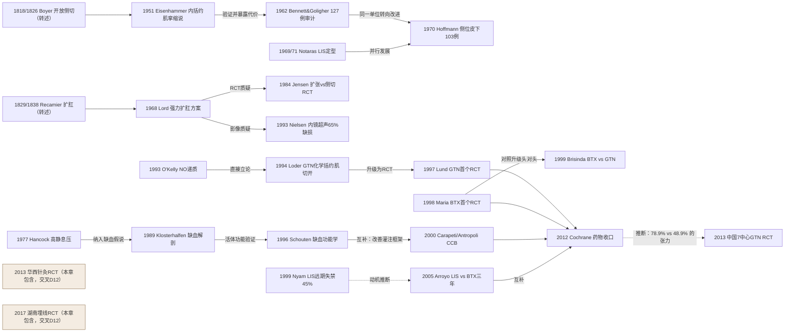

# D05 肛裂：从扩肛到化学括约再到肉毒毒素

> 一句话判断：肛裂治疗的主线是把"可逆的药物降张"与"不可逆的括约肌切断"排成阶梯——药物（硝酸甘油→地尔硫䓬→肉毒毒素）先走、侧位内括约肌切断术（LIS）兜底；曾经风靡的手法扩肛（Lord 术）因内镜超声证据被主流弃用。当前真正的争议不在"药还是刀"，而在 BTX 与 LIS 的界线以及 LIS 到底该切多少。

## 0 三分钟速读

① **从哪里来**：19 世纪已有切开（Boyer 1818/1826 两说）与扩张（Recamier 1829/1838 两说）两条源头（均为历史综述转述层）；现代起点是 Eisenhammer 1951 把手术目标从"切纤维带"改写为"切断内括约肌" [D05-N01]。
② **为什么改变**：Bennett & Goligher 1962 对 127 例的全文审计首次量化"有效—致残"权衡——愈合可靠，但伤口平均 7 周才愈、43% 有控便瑕疵 [D05-N02]；1993 年内镜超声证明盲目扩张后 65% 存在括约肌缺损，Lord 术被宣判 [D05-N10]。
③ **如何分化**：Notaras 1969/1971 把 LIS 做成小切口日间手术 [D05-N04]；1994-2000 年间 GTN（Loder→Lund RCT）、CCB（Carapeti/Antropoli）、BTX（Maria/Brisinda）三条"化学括约肌切开"路线先后成形 [D05-N11][D05-N13][D05-N17][D05-N14][D05-N16]。
④ **现在研究什么**：药物头对头已收口、BTX 的剂量/注射技术/联合策略、LIS 切量标准化（开放vs闭合、部分/完全/个体化）、保括约肌新分支（神经调节、脂肪移植）与全球实践审计。
⑤ **用了什么数据**：从球囊测压、尸体血管造影、激光多普勒，到 75 RCT 的 Cochrane 汇总、69 RCT 网络 Meta，再到 21 国 302 例的前瞻快照审计 [D05-N19][D05-E4][D05-E8]。
⑥ **还有什么不知道**：LIS 切量无 RCT 级定论；药物治愈者远期复发约 50% 无解 [D05-N19]；保括约肌新分支全部没有 RCT；中文非 MEDLINE 期刊里庞大的扩肛/中药外治文献本轮无法核实。

**覆盖边界**：纳入肛裂机制认识演进（高静息压/缺血/NO）、药物阶梯、BTX、LIS 及其切量争议、手法扩肛的兴衰、近五年联合策略与真实世界审计。不含：痔（D01/D02）、肛瘘（D03/D04）、肛周脓肿（D06）、术后疼痛与坐浴（D09）、创面愈合（D10）、针灸专题（D12，两篇肛裂针灸 RCT 本章包含、归口 D12 交叉）、盆底与肛门失禁专题（D08）；儿童肛裂仅 Kenny 2001 RCT 一处点到 [D05-支撑文献]。

**本章口径**：截止 2026-10-18；近期窗口 2021-10-18 至 2026-10-18（只用于重点展开）。阅读层级：L0=仅二手转述；L1=题录已核；L2=摘要已读；L3=原文部分章节已读；L4=全文已读。本章 22 个节点：L4 2 个（Bennett 1962 与 Lord 1968，本轮经 PMC 扫描全文读图升层）、L2 18 个、L1 2 个（N01/N04，其内容层依赖 Riboni 2024 历史综述 L4 转述，已逐一注明）。转述类说法一律写"据 Riboni 2024 历史综述转述"；核实状态用"本轮已核""未经独立复核"表述。**覆盖状态（二轮完整性检查按统一口径重评）：基本完整但有标注缺口**——六问均可据本章回答，章节范围内主要分支（切开/扩张两大源头、化学括约肌三线、BTX/LIS 界线与切量之争、保括约肌新分支、真实世界审计、指南）均有节点；缺口限于第 8 节已标注项目（19 世纪法文原始文献未取得、CNKI/万方未查、个别系统评价检索截止标"未说明"等）。

## 1 源头：最初在研究什么

**两条史前线索（分类：目前最早找到的文献；均转述层）**。据 Riboni 2024 历史综述（本轮全文已读，L4）转述：切开线的最早记录是 Boyer 的开放性侧方切开——综述正文记 1818、里程碑表记 1826，两说并存——Dupuytren 1832 改良为仅切浅层肌纤维，Velpeau 时代该手术可致盆腔脓肿甚至死亡；扩张线是法国医生 Recamier（1774-1852）以两指加拇指扩压肛管，正文记 1829、表记 1838。19 世纪法文原始文献本轮均未取得，所有"首次"叙述停留在史学转述层；综述正文另记 Blandin（19 世纪，表内拼作 Baladin 1849）已描述闭合皮下侧切的更早形态 [D05-E1]。换句话说，肛裂从一开始就带着它的全部后劲：**切**（不可逆降张）与**扩**（机械降张）两条路线在 19 世纪已经分立，此后 170 年的一切都发生在对这两条的修正与再平衡之上。

**现代公认奠基（分类：被公认的奠基工作）**：Stephen Eisenhammer（南非约翰内斯堡）1951 年在 S Afr Med J 提出慢性肛裂的本质是内括约肌慢性挛缩，手术只需侧方开放切断内括约肌并切除裂缘与哨兵痔 [D05-N01]。这一步把 19 世纪含混的"括约肌切开"重新定向：此前的主流叙事是 Miles 1918 年的"栉膜带（pecten band）"纤维带假说，据此行栉膜带切断——而 Bennett & Goligher 1962 原文明言，所谓纤维带"其实是内括约肌痉挛性肥厚的下缘"（引 Eisenhammer 1951 与 Goligher 1955，本轮全文已读）。Eisenhammer 1951 原文无摘要、不在 PMC，方法与结果数字仍在转述层；其"侧位优于后位"的后续主张亦据历史综述转述。

**机制源头（分类：被公认的奠基工作）**：Hancock 1977 以球囊测压对 12 例肛裂 vs 40 名对照，实测肛管最大静息压 116.8±21.8 vs 85.0±20.5 cmH₂O（P<0.01）、超慢波出现率 80% vs 5%，并发现扩张或侧位皮下切开均可使异常活动消失——"括约肌痉挛"从此变成可测参数，"降张=愈合"的定量框架由此奠定 [D05-N06]（限定：这是首个完整同行评议论文；此前一年 Birmingham 组 Keighley 等已在 Br J Surg 发表肛裂肛管测压会议摘要，PMID 953506，先行记录）。对"痉挛"概念的质疑线几乎同样早：Kuypers 1983 在 Dis Colon Rectum 发文直问"肛裂真的存在括约肌痉挛吗"（PMID 6872775，本轮题录已核，L1）——这一质疑没有推翻高压事实，但把"痉挛（可逆的收缩）"推向"高静息压（慢性高张）"的更准确表述。

**缺血与 NO 源头**：Klosterhalfen 1989（分类：目前最早找到的缺血解剖文献，PMID 2910660）与 O'Kelly 1993（NO 递质确认，PMID 7684992）分别开出血供与神经化学两条解释路径，详见 2.4 节。

**中医源头（存疑）**：中医肛肠病学把肛裂归入"钩肠痔/裂痔/裂肛痔"范畴；病名"钩肠痔"据二手转述记载于《疮疡经验全书》（窦汉卿）卷七——该说法本轮仅两条网络转述来源（维基教科书中医条目、专利背景段），核查判定为存疑，古典原书未核，不排除更早出处；病因多归血热肠燥、阴虚津乏、气滞血瘀。方剂线的止痛如神汤出自陈实功《外科正宗》（1617），原书卷页本轮亦未核对（L0）。

## 2 关键转折：问题—新证据/新方法—认识变化—新问题

### 2.1 手术目标被重定向，代价第一次被量化（1951→1962）

Eisenhammer 1951 确立"切断内括约肌即可治愈慢性肛裂"之后，第一个问题是：这术式真的有效、代价多大？Bennett & Goligher 1962（利兹大学医院，BMJ 原文 4 页本轮全文读图，L4）给出首个系统审计 [D05-N02]：1955-1961 年间 176 例肛裂手术中 141 例行内括约肌切开、34 例手法扩张、1 例裂切除；随访追回 127 例（62 男 65 女，年龄 19-73 岁，高峰在第五个十年；随访 3 个月-6 年，105 例超 1 年、23 例超 3 年）。结果：疼痛于首次排便即获缓解者占绝大多数；伤口愈合很少短于 4 周、平均 7 周，停工平均 17 天（约 2.5 周）；复发 9/127（7%，仅 4 例有客观裂口证据），且随随访延长上升——3-12 个月组 0/22、1-3 年组 6/82、超过 3 年组 3/23。功能代价是全文最重的部分：术后最初几周排气失控 43/127（34%）、稀便失控 19/127（15%）；随访时点仍有排气失控 30/127（24%）、粪失控 14/127（11%）；肛门污粪 35/127（28%）且"无随时间自发改善趋势"；三者合并任何功能瑕疵共 55/127（43%）。同期 100 名从未做过肛门手术的年龄性别匹配对照中，相应比例为 10%/3%/2%、合并 11%。一个反直觉的发现：切断范围与功能缺陷无剂量关系（远端 1/2 组 64 例、缺陷 41%；3/4 组 41 例、51%；全肌组 20 例、40%）——控便更多依赖外括约肌与耻骨直肠肌的代偿。文中另有 10 例在侧方（多为左侧）而非后正中切开，功能缺陷"极小"，但复发 9 例中 3 例恰在这 10 例侧切组内，作者据此告诫慎用侧切——这个当时被否定的方向，恰恰是七年后的未来。原文结尾明言"正重新探索其他手术方法"；据 Riboni 2024 历史综述转述，作者组由此转向手法扩张，1964 年 Watts 姐妹篇发表扩张结果（PMID 14162964，题录层 L1）[D05-N02]。

### 2.2 从后位大切口到侧位皮下小切口（1969-1970）

开放切口愈合慢的问题催生了微创化。这里有一条常被忽略的负性支线：Eisenhammer 式早期开放后正中切开（后经 Morgan & Thompson 1956 标准化——Bennett 1962 原文明言其技术"紧随 Morgan 与 Thompson 及 Goligher 所述"）伤口大、愈合慢，并被认为与"钥匙孔"畸形和控便缺陷相关，最终被侧位路径全面取代（后位→侧位的转移叙述据 Riboni 2024 综述 L4 转述；Hoffmann 1970 的历史对照亦显示侧位皮下优于本单位既往开放后切）。Notaras 1969 年在 Proc R Soc Med 会议首报、1971 年在 Br J Surg 发表完整系列的"侧位皮下内括约肌切断"：侧方小切口、皮下切断内括约肌下缘、几乎不留外部创面，据历史综述转述"迅速流行并成为其后多年的首选" [D05-N04]。Hoffmann & Goligher 1970 以单中心连续 103 例（99 例随访成功，3-24 个月，均值 11 个月）独立验证：裂持续/复发仅 3/99（1 例再切即愈）、轻微控便缺陷 12/99，结论"目前最可靠、最满意的术式是侧位皮下内括约肌切断"，优于本单位既往开放后切与扩张 [D05-N05]。两条系列并行发展，LIS 从此与局麻、日间手术兼容（Rudd 1975 年 200 例门诊侧切进一步推进日间化，PMID 1126267，题录层）。遗留问题同样在 1962 年已埋下：切断量没有标准（完全/部分之争延续至今），当时无长期失禁数据；1984 年后 RCT 时代到来时，开放 vs 闭合的长期差异也始终没有出现（García-Aguilar 1996，864 例病案+问卷审计，开放 vs 闭合失禁无差异，PMID 8878506，题录层）。

### 2.3 Lord 扩张：从风靡到宣判（1968→1993）

扩张线的顶点是伦敦 Peter Lord 1968 年的"新方案"（Proc R Soc Med 原文 2 页本轮全文读图，L4）[D05-N03]。注意：这篇论文写的是三期痔而非肛裂——丙泮尼地静脉麻醉下"强力手法扩张肛管与直肠下段"，目标是"双手四指插入下段直肠"（即八指），作者自述可感到纤维"带（band）"松脱；术后佩戴 Normacol 扩张器按"每日×2 周→隔日×2 周→每周 2 次×2 周→每周 1 次×2 周→每月×6 个月"方案自我维持。全文自报该操作已施行 250 余例、"无一例失禁"（同时承认部分患者术后数周排气控制差、稀便时污渍），并给出 High Wycombe 医院集团痔切除术从 1961-64 年均 54 例降至 1967 年 9 例的壮观曲线；约 1/5 重度三期痔患者随访时表示失望。据 Riboni 2024 历史综述转述，该操作"也被用于治疗肛裂"，1960-80 年代在西方与中国门诊扩散为肛裂常规之一。裁决来自两条独立证据：Jensen 1984 门诊 RCT（58 例随机：LIS 复发 1/30 vs 扩张 8/28，P<0.05；排气失控与污渍 LIS 均显著更好，P<0.002）[D05-N07]；Nielsen 1993 内镜超声（32 例扩张后 2-6 年随访，20 例接受超声：13/20，即 65% 存在括约肌缺损——其中 2 例失禁者均为内括约肌缺损，11 例控便正常者中内括约肌 9、外括约肌 1、内外联合 1；轻度失禁 12.5%）[D05-N10]。扩张的本质由此被改写为"不可控的括约肌撕裂"，西方指南相继弃用；扩张线只剩"控制力度"的边缘改良（Strugnell 1999 全肌松下控制性扩张，PMID 10361188；Pinsk 2021 标准化扩张长期控便随访，PMID 32178506），从未获得 RCT 级复兴证据 [D05-支撑文献]。

### 2.4 机制收敛：高压—缺血—NO 同一框架（1977→1996）

单纯高静息压解释不了为什么 80-90% 的裂口偏爱后正中。Klosterhalfen 1989（德国亚琛，尸体肛管血管造影 41 例、组织学 10 例、形态计量 20 例）发现 85.4% 标本直肠下动脉属后连合灌注薄弱的 1 型，提出"先天血供薄弱+高张压迫=局部缺血性溃疡" [D05-N08]。O'Kelly 1993 体外肌条实验确认 NO 是人内括约肌 NANC 抑制性神经递质（L-NNA 完全抑制、L-精氨酸逆转）[D05-N09]。Schouten 1996（鹿特丹，27 例+27 对照激光多普勒+同步测压）在活体闭合证据链：肛裂患者最大静息压 121.07±24.48 vs 68.78±16.97 mmHg、裂口处血流 0.46±0.20 vs 0.76±0.28 V（均 P<0.001）；LIS 后压力降 35%、原裂口血流升 65%、24/27 六周内愈合 [D05-N12]。至此"高压→低灌注→不愈"与"降压→灌注恢复→愈合"成为主流框架，一切降张手段（刀与药）殊途同归。

### 2.5 化学括约肌切开时代（1994-2000）

机制链条一旦闭合，药物应用只差临门一脚（硝酸酯降压本身有先导记录：Guillemot 1992 Dig Dis Sci 信件、1993 DCR 便秘患者试点，PMID 1728524/8458265，但适应证非肛裂愈合）。Loder 1994（St Mark 医院）以"可逆化学括约肌切开"为题首证 0.2% GTN 软膏使最大静息压平均降 27%（P=0.0004；随机段 GTN 组显著降压 P=0.002）[D05-N11]。Lund & Scholefield 1997 Lancet 完成首个随机双盲安慰剂对照 RCT（80 例；本轮据核查修正：愈合数字在摘要层——8 周愈合 26/38（68%）vs 3/39（8%），P<0.0001；MARP 由 115.9 降至 75.9 cmH₂O）[D05-N13]。BTX 线此前只有德国 Jost & Schimrigk 的 1993 年信件首报（DCR 36:974）与 1994/1995 跟进（1994 年短文卷号经核查修正为 37(12):1340），Maria 1998 NEJM 完成首个双盲安慰剂对照 RCT（内括约肌两侧 20U BTX-A vs 盐水：2 个月愈合 11/15 vs 2/15，P=0.003；同组 Ann Surg 57 例剂量系列摘要载低剂量组愈合 10 例 vs 高剂量组 23 例，提示剂量效应）[D05-N14]。Brisinda 1999 NEJM 头对头：BTX 20U vs 0.2% GTN 两个月愈合 24/25（96%）vs 15/25（60%）（P=0.005），GTN 组 5 例中重度头痛；10 例无应答者（BTX 组 1 例、GTN 组 9 例）交叉换药后全部愈合（此处经核查修正：是交叉换药，非转手术）[D05-N16]。CCB 分支以"无头痛的降张"出发：Carapeti 2000 DCR 外用 2% 地尔硫䓬 8 周愈合 10/15（67%）；意大利 Antropoli 1999 多中心双盲 RCT 283 例急性肛裂 0.2% 硝苯地平凝胶 21 天完全缓解 95% vs 对照 50%（P<0.01）[D05-N17]。

### 2.6 代价双向暴露与全谱系收口（1999-2022）

两条路线的代价几乎同时到期。手术端：Nyam & Pemberton 1999（Mayo，585 例 LIS、问卷应答 487/585=83%、平均随访 72 个月）报告愈合 96%（中位 3 周）、复发 8%，但"曾出现任何程度失禁"高达 45%（女性 53.4% vs 男性 33.3%，P<0.05；随访时点排气失禁 6%、污渍 8%、固体失禁 1%，仅 3% 影响生活质量、满意度 98%）[D05-N15]。药物端：Cochrane 2012（检索 1966-2010 年 8 月，75 项 RCT、5031 例）汇总 GTN 愈合 48.9% vs 安慰剂 35.5%（P<0.0009），初愈者远期复发约 50%；BTX 与 CCB 疗效与 GTN 相当而副作用更少；任何药物均远逊手术，但均无失禁风险（期号经核查修正为 2012;(2):CD003431）[D05-N19]。头对头的远期硬终点由 Arroyo 2005 补齐（80 例随机：3 年愈合 LIS 92.5% vs BTX 25U 45%，P<0.001；复发高危因素=病程>12 个月、哨兵痔、治疗后持续高静息压/超慢波；其 2004 年 JACS 姊妹 RCT 证明日间局麻下开放 vs 闭合 2 年愈合 92.5% vs 90%，卷期经核查修正为 199(3):361-367）[D05-N18]。"保守起始、LIS 兜底"的阶梯定型；但 2022 年 Surgery 网络 Meta（69 项 RCT，卷号经核查修正为 172(1):41-52）重排全谱系：LIS 愈合概率最高、失禁概率也最高，BTX 与药物治疗相当 [D05-E4]。

### 2.7 中国接入（2013-2017）

中国以国际规范方法自主验证药物阶梯：北京朝阳医院牵头全国 7 中心双盲 RCT（240 例慢性肛裂，GTN 软膏 vs 凡士林基质对照，卷期经核查修正为 16(7):654-657）：56 天完全愈合 90/114（78.9%）vs 31/107（29.0%）（P<0.01），VAS 降幅 94.8% vs 61.2%，不良反应 42.1% vs 9.3%（头痛头胀为主、均自限）[D05-N20]。注意其中存在未抹平的张力：GTN 组 78.9% 的愈合率远高于 Cochrane 汇总的 48.9%，可能来自对照（凡士林基质 vs 惰性安慰剂）、疗程与人群差异，本轮保留两说、不作解释 [D05-N19][D05-N20]。保守端中医外治线并行：华西医院 2013 年 200 例肛裂术后 RCT（中髎/下髎针刺+长强悬灸 vs 口服聚乙二醇——对照药经核查修正，原稿误写乳果糖）：治疗第 3 天起排便疼痛改善优于药物组 [D05-N21]；湖南中医药大学 2017 年 60 例 I/II 期肛裂 RCT（穴位埋线每周 1 次×4 周 vs 0.2% 硝酸甘油外用）：第 3/7 天 VAS 与疼痛持续时间更优，3 个月随访复发 1 vs 6 [D05-N22]（两篇本章包含，归口 D12 交叉）。

## 3 分支图

实线=原文明确讨论或综述归纳的关系；虚线=本报告推断。扩张线（N03→N07/N10）的两次"质疑"均有被引原文摘要级证据；针灸两篇由本章承载，与本方向药物阶梯为并行关系，归口 D12 交叉。

## 4 近五年重点（2021-10-18 至 2026-10-18）

**口径（二轮完整性检查补注）**：本节系统评价/网络 Meta 逐篇标注实际检索截止日（本轮已补查 6 篇：4 篇核到检索日、2 篇标"检索截止：未说明"）；回顾性对照、问卷、器械系列、病例系列等原始研究无检索截止概念，不标。

**主题一：药物阶梯的头对头与途径优化（成熟，汇总层饱和）。** 外用 vs 口服 CCB：Front Pharmacol 2025 系统评价（4 RCT/279 例，检索至 2025-02）显示外用 CCB 未愈风险低于口服（OR 2.65，95%CI 1.50-4.69，中等质量证据），敏感性分析提示外用不良事件更少（PMID 40918532）。BTX vs GTN 再评价：Biomed Res Int 2026 系统评价（10 试验/698 例，检索截止 2025-03-24，全文方法学段明示检索执行于该日）报告 BTX 愈合优于外用 GTN（RR 1.18，95%CI 1.02-1.36，P=0.029），复发无差异、副作用 BTX 更少（PMID 42663187；结果段为本轮核查补充升级）。五药（地尔硫䓬/GTN/硝苯地平/米诺地尔/利多卡因）网络 Meta：Int J Surg 2025;111(4):3020-3029（22 RCT/1770 例，检索截止 2024-05-29；期刊卷期经核查补全，PMID 39878173）。分歧：外用 vs 口服的结论依赖剔除高偏倚试验的敏感性分析；BTX vs GTN 比较反复出现，结论随纳入试验质量波动。

**主题二：BTX 的剂量、注射技术与联合策略（发展中）。** Ann Med Surg 2025 综述（23 项研究，检索截止：未说明，全文方法学段自称未注册而文末另载 PROSPERO CRD420250655245；期号经核查修正为 87(8):5142-5152）：BTX 愈合 60-85%、无 GTN 样头痛，LIS 愈合 90-95% 但失禁风险 5-15%，BTX 复发后常需再注射或转手术（PMID 40787502）。BTX vs LIS 定量：Langenbecks Arch Surg 2024 Meta（18 试验/1839 例，检索至 2023-10；期号经核查修正为 409(1):355）：LIS 愈合显著高于 BTX（pooled effect 0.77，95%CI 0.69-0.83，I²=90.95%）（PMID 39579232）。联合策略：Int J Colorectal Dis 2025 回顾性对照 217 例（BTX 单用 143 vs BTX+外用地尔硫䓬 74；期号经核查修正为 40(1):54，PMID 40009123）；Tech Coloproctol 2025 两篇——BTX 五年远期结局（29(1):122，PMID 40413661）与"裂切除该不该加 BTX"的立场文（29(1):118，PMID 40402256）。分歧：最佳剂量/浓度/注射点位无共识（2022 年 Int J Surg 剂量点位网络 Meta——检索自建库至 2021-05-31，摘要明示——及同期评论即为此争论，PMID 35934283/36113840）；联合策略多为回顾性证据。

**主题三：LIS 技术标准化与失禁顾虑（争议持续）。** 国际术式调查：Turk J Surg 2025 匿名问卷 207 名外科医生（土耳其 131/他国 76）：开放术式偏好 73.6%、闭合 21.4%；部分切开 66%、完全切开 21%、个体化 12%，围手术细节高度异质（PMID 40619740）。开放 vs 闭合汇总：Sci Rep 2023 Meta（8 RCT/1035 例，检索截止 2022-12-30，纳入 2000-01-01 至 2022-12-30 发表 RCT，PROSPERO CRD42023392626；文章号经核查修正为 13(1):20957，PMID 38017243）；闭合侧切失禁风险专项分析 Cureus 2024;16(11):e74216（PMID 39712762；经补查原文摘要确认其为单中心原始描述性病例系列、139 例、2018-08-21 至 2019-02-21 收集，非系统评价，无检索截止概念）；个体化切量器械化尝试：Updates Surg 2024;76(6):2205-2210（原始器械系列，无检索截止概念；期刊经核查修正，原稿误写 Tech Coloproctol；PMID 39256270，LigaSure 小颚钳 T-LIS）。历史背景：García-Aguilar 1998 报告失禁者切开的括约肌比例更长（75% vs 57%，PMID 9559625）、1996 年开放 vs 闭合长期无差异（PMID 8878506）[D05-支撑文献]。悬而未决：45% vs 5-15% 的落差主要来自定义与应答偏倚；个体化切量的控便优势"未被一致证实"（据 Riboni 2024 转述），缺 RCT。

**主题四：保括约肌新分支（早期线索，无 RCT）。** 经皮胫神经调节（PTNS）系统评价（5 项研究/102 例，检索截止：未说明——摘要未报、全文未获取）：复发 19%（16/84）、2 个月愈合 72%、6 个月 73.6% 无症状（Int J Colorectal Dis 2021，PMID 34132862）；克罗恩病慢性肛裂新鲜自体脂肪移植试点（Tech Coloproctol 2025;30(1):2，PMID 41275461）；L-精氨酸经 NO 通路的综述（Amino Acids 2025;57(1):43，页码经核查修正，PMID 40924217）。全部为病例系列/试点/综述层级，与 LIS 相比复发更高（据 Riboni 2024 转述："LIS 目前仍以更好结局与更低复发率继续保持优势"）。

**主题五：真实世界与国际实践审计（发展中）。** ISUCRS 2022 全球快照审计（21 国 56 名结直肠外科医生 2 周前瞻、302 例，急性 42%/慢性 58%）：78% 起始保守治疗、22% 手术（以 LIS 最常见）；8 周症状缓解/愈合保守 73% vs 手术 88%（J Clin Med 2026;15(12):4677）[D05-E8]。意大利初级保健行政数据库分析（Updates Surg 2024;76(6):2193-2203，期刊经核查补全，PMID 38796820）；荷兰全国外科医生问卷（Int J Colorectal Dis 2022;37(4):973-978，卷期经核查补全，PMID 35194670）。核心发现是指南与实践的落差：指南一线外用药、LIS 少用，真实世界 LIS 仍是最常用手术、BTX 使用率低。

**主题六：指南更新与证据分级（成熟）。** 英国 ACPGBI 2023 六阶段指南更新 2008 年立场声明，外用地尔硫䓬等列为一线（Colorectal Dis 2023;25(12):2423-2457）[D05-E2]；意大利 SIUCP 2023 Delphi 共识（全文已读 L3）：一线 0.3% 硝苯地平+1.5% 利多卡因或硝酸酯，失败后手术，正文强调侧切结局最优、复发最低 [D05-E7]；美国 ASCRS 指南经核查确认存在 2023 年更新版（Davids 等，Dis Colon Rectum 2023;66(2):190-199，PMID 36321851——纠正了"2024 版可能不存在"的猜测，原 2017 版锚点保留 PMID 27926552）[D05-E3][D05-E9]；西班牙 AECP 2018 治疗算法共识（PMID 29525120）；Gastroenterology 2026 权威综述把慢性肛裂序列写成"外用钙拮抗剂或硝酸酯→BTX→较少用 LIS" [D05-E6]。各指南在 BTX 与 LIS 排序、测压/超声是否常规使用上口径不一。

## 5 争议、负性结果与停滞路线

**药 vs 刀的表观共识与真实分歧。** 一方（Cochrane 2012、Arroyo 2005、Jin 2022）：任何药物远逊手术，LIS 应为慢性/难治性裂的终末标准 [D05-N19][D05-N18][D05-E4]；另一方（ACPGBI 2023、Gastroenterology 2026）：外用 CCB/BTX 起步，LIS 因失禁风险"较少使用" [D05-E2][D05-E6]。真实世界以保守起始为主（78%）[D05-E8]。未解决的是 BTX 与 LIS 的界线：2024 年 Meta 仍显示 LIS 愈合优势，BTX 阵营以失禁风险回应。

**LIS 长期失禁率的定义之争。** Mayo 45% 曾有失禁 [D05-N15] vs 主流综述 5-15%，落差主要来自"曾经任何失禁"的宽定义、应答偏倚与无术前基线；女性更高的信号（53.4% vs 33.3%）与后方切口史混杂。切量方案（部分/完全/个体化）缺 RCT，2025 年国际调查显示 12% 医生自称个体化、66% 部分切开、21% 完全切开——切多少仍是经验而非证据。

**手法扩张（Lord 术）的废弃与残线。** 废弃证据链：Jensen 1984 RCT + Nielsen 1993 内镜超声（65% 缺损、12.5% 轻度失禁）[D05-N07][D05-N10]；更早 Gutman 1989 已报告扩张并发症（PMID 2791795）。具有讽刺意味的是，Lord 1968 原文自报"250 余例无失禁" [D05-N03]——无对照的自报安全性在影像证据面前不堪一击。改良派（Strugnell 1999 全肌松下控制性扩张、Santander 2010 测压筛选、Pinsk 2021 标准化扩张随访）始终未获 RCT 级复兴证据；扩张在中国等地的组合术式中延续的说法只见于英文转述，中文原始文献本轮不可得。

**gonyautoxin：一条与肉毒毒素无关的失败支线。** 需要更正一个易混淆点：gonyautoxin（膝沟藻毒素）是双鞭甲藻产生的石房蛤毒素（saxitoxin）族麻痹性贝毒，与肉毒毒素是完全不同的物质，绝不能归入 BTX 线。智利 Garrido 组将其注射治疗肛裂做了原始试验（Dis Colon Rectum 2005;48(2):335-340，PMID 15812585；Colorectal Dis 2007;9(7):619-624，PMID 17824979，均题录层 L1），初步报告疗效安全性尚可，但据 Riboni 2024 历史综述转述"未随时间获得广泛应用"，未形成分支（原始试验细节本轮未读全文）。

**GTN 单药退居二线与"药物替代手术"预期的落空。** GTN 头痛发生率 20-70%；Cochrane 汇总初愈者远期复发约 50% [D05-N19]；常规实践审计（Jonas 2002，Colorectal Dis 4(5):317-320）8 周愈合仅 61%（57/93）、25 例复发；更早 Jonas 1999（J R Soc Med 92(4):186-188）以"GTN 时代侧切并不多余"为题：常规实践 GTN 仅 21/49 愈合，GTN 失败后行 LIS 者 26 例全部愈合（三条摘要均本轮已核）[D05-支撑文献]。地尔硫䓬可愈 GTN 抵抗者（Jonas 2002 DCR 45(8):1091-1095，39 例静息压再降 20%）[D05-支撑文献]。

**机制之争的收敛。** 病因解释曾有三条并行路线：高静息压派（Hancock 1977：内括约肌高张/超慢波为核心）[D05-N06]、缺血派（Klosterhalfen 1989、Schouten 1996：后正中血供薄弱+高压压迫=缺血溃疡）[D05-N08][D05-N12]、NO 派（O'Kelly 1993：NANC/NO 介导松弛）[D05-N09]，外加 Kuypers 1983 的"痉挛存在吗"质疑线（PMID 6872775）。与治疗之争不同，这条战线已经收敛：高压是加重缺血的条件、缺血解释位置偏好、NO 解释药物降张的分子入口——三者合入同一框架，现行指南与教科书按此表述，已无对立阵营仍在运作。

**撤稿与研究诚信。** 本方向经三路独立核查（PubMed 出版类型检索、efetch XML 关联、网络检索）确认的唯一撤稿：西班牙 Arroyo 组 2012 年 DCR 发表的 GTN 肛周 vs 肛内给药 RCT（PMID 22810476，注册号 NCT01132391）于 2013 年被 DCR 撤稿（撤稿声明 PMID 23652758，DCR 2013;56(6):802；撤稿理由正文付费墙内，本轮未核）。广为流传的"Maria/Brisinda BTX 系列撤稿"传闻未获证实：对 Maria G/Brisinda G 全部肛裂论文检索 retracted publication[pt] 均 0 命中，NEJM 1998/1999 仅载 CommentIn/ErratumIn（NEJM 1999 勘误卷页 341(8):624）。

## 6 传承线与国际线

**中医传承线（层级别逐一标注）。** ①病名与病机（L0，存疑）：肛裂属"钩肠痔"范畴，据转述记载于《疮疡经验全书》卷七（本轮未能核对原书，存疑保留）；②方剂线（L0）：陈实功《外科正宗》（1617）载止痛如神汤（秦艽、桃仁、皂角刺、苍术、防风、黄柏、当归、泽泻、槟榔、熟大黄），现代中医肛肠临床仍以其为气滞血瘀疼痛证的代表方（此句属转述层）；③指南线（L0）：中华中医药学会《中医肛肠科常见病诊疗指南》（中国中医药出版社，2012）将肛裂列入诊疗规范（据转述）；2026 年 7 月发布《肛裂中西医结合临床用药指导河南专家共识（2026 版）》（医脉通指南库 guide.medlive.cn/guideline/39624，L0）；④本土 RCT 接力（L2）：华西医院 2013 针灸 RCT 与湖南中医药大学 2017 埋线 RCT（见 2.7 节）[D05-N21][D05-N22]——两篇本章包含，专题归口 D12 交叉（针灸与穴位疗法方向本轮未收录此二篇，读者可按 PMID 回查本章节点）；⑤西医为主体的本土验证（L2）：朝阳医院 7 中心 GTN RCT [D05-N20]。**明确标注的空白**：中国门诊曾广泛使用的扩肛疗法本土化与"扩肛+侧切"组合术式，主要见于《中国肛肠病杂志》《结直肠肛门外科》等非 MEDLINE 期刊，本轮只能确认其存在性叙述（英文文献转述），无法核到任何一篇原始中文文献。

**国际线（本方向主线）。** 南非 Eisenhammer 1951 重构解剖→英国利兹 Goligher 组 1962/1964/1970 三步确立切开—扩张权衡与侧位皮下 LIS→英国 Notaras 1969/1971 技术定型（注意：曾告诫慎用侧切的是 Bennett & Goligher 1962 原文 [D05-N02]，而非 Notaras 本人——这个当年被否定的方向恰是七年后的主流，历史在此开了个玩笑）[D05-N02][D05-N04][D05-N05]；英国 Hancock 1977（测压）、德国亚琛 Klosterhalfen 1989（缺血解剖；注意其机构为德国 RWTH-Aachen 病理所，本报告已修正早期材料误标的"荷兰"）与荷兰鹿特丹 Schouten 1996（激光多普勒）、英国 St Mark 团队（Loder 1994 GTN、Carapeti 1999/2000 地尔硫䓬）、英国诺丁汉 Lund & Scholefield 1997（GTN 首个 RCT）、意大利罗马 Catholic 大学团队（Maria/Brisinda 1998-1999 BTX 系列）、意大利 Antropoli 1999（硝苯地平）、西班牙 Arroyo 组（2004/2005 日间 RCT 与 3 年边界；其 2012 年 RCT 2013 年被撤稿）。评价机构：Cochrane（Nelson，2012 版 75 RCT/5031 例）、ASCRS（2017 版与 2023 更新版均已核实）、ACPGBI（2008→2023）、西班牙 AECP 2018、意大利 SIUCP 2023；ISUCRS 2022 快照审计刻画真实世界。口径提醒：国际上对针灸类 RCT 方法学的一般性批评（如 1990 年代末 BMJ 系列评论）所评病种不含肛肠疾病，不构成对本章两篇针灸 RCT 的直接批评，此处只作跨病种方法学背景。

## 7 数据路径小结

历史上：①人体机械/生理测量——球囊测压（Hancock 1977，12+40）、体外肌条药理（O'Kelly 1993）、尸体血管造影与形态计量（Klosterhalfen 1989，41/10/20）、激光多普勒+同步测压（Schouten 1996，27+27；Lund 1997 RCT 内嵌测压/血流）；②单中心系列与审计——Hoffmann 1970（103 例）、Bennett 1962（127 例随访审计）、Nyam 1999（585 例问卷）、García-Aguilar 1996（864 例）、Rudd 1975（200 例门诊侧切，PMID 1126267）；③RCT——从 Jensen 1984 的 58 例到 Antropoli 1999 的 283 例、中国 2013 的 240 例七中心。现在：④汇总证据——Cochrane 2012（75 RCT）、网络 Meta（Jin 2022，69 RCT；BTX vs LIS 2024，18 试验/1839 例；CCB 途径 2025，4 RCT/279 例）；⑤真实世界/登记——ISUCRS 快照（21 国 302 例前瞻）、行政数据库（意大利）、全国问卷（荷兰、207 医生国际术式调查）；⑥试验注册库——NCT01132391（注册终点=治疗期头痛 VAS，与发表一致；该 RCT 后被撤稿，注册信息成为撤稿核查的工具）；⑦机制与再生方向——多为试点/病例系列（PTNS 汇总 102 例、自体脂肪、L-精氨酸）。演进主线：从"外科医生的手感和问卷"走向"测压/超声/血流参数+RCT+网络 Meta+国际注册审计"。

## 8 还不知道什么（领域证据缺口）与本报告的检索缺口

**领域证据缺口**：①LIS 切量（partial/tailored）无 RCT 级定论，个体化切量的控便优势未被一致证实；②药物治愈者远期复发约 50% 无干预手段（Cochrane 检索止于 2010-08，其后无更新版收口）；③保括约肌新分支（PTNS、自体脂肪、L-精氨酸）全部没有 RCT；④BTX 最佳剂量/浓度/注射点位无共识；⑤儿童肛裂证据极薄，唯一可核实 RCT 为 Kenny 2001（Arch Dis Child，GTN 双盲，PMID 11668104），成人证据不可外推。

**本报告检索缺口**：①19 世纪法文原始文献（Recamier/Boyer/Dupuytren）未取得，"首次"叙述停留在史学转述层；②**CNKI/万方未检索对本章结论的影响是实质性的**：中文非 MEDLINE 期刊中扩肛疗法本土化、"扩肛+侧切"组合术式、中药坐浴/栓膏治疗肛裂的原始 RCT 全部无法核实，中国线的"传承链"只在古籍转述（L0）与两篇针灸 RCT、一篇 GTN RCT（L2）上成立，中间数十年的中文实践证据缺失；③《疮疡经验全书》《外科正宗》原书卷页未核对，"钩肠痔"病名归属本轮判存疑；④Gui 1994 Lancet 信件题录取自历史综述参考文献列表，未单独核实 PMID；⑤2012 年撤稿 RCT 的撤稿理由在付费墙内未能读取；⑥硝酸甘油软膏（Rectiv 0.4%）的美国获批监管节点未在 FDA 公开库逐条核实，不作断言；⑦Lord 1969 年 Br J Surg 短文的卷页传闻（"56(3):222-223"）未能核实，已从节点引文中移除。

## 9 本章节点速查表

| 编号 | 年份 | 第一作者+题名简写 | 期刊 | 节点作用 | 设计/分析单位 | 样本 | 关键结果 | 层级 | 核查 | PMID/DOI |
|---|---|---|---|---|---|---|---|---|---|---|
| N01 | 1951 | Eisenhammer；内括约肌挛缩的手术矫正 | S Afr Med J | 奠基：手术目标重定向为内括约肌 | 个人系列/患者 | 未报告（题录层） | 切断内括约肌可愈慢性肛裂；侧位优于后位（转述） | L1 | 通过 | 14866486 |
| N02 | 1962 | Bennett & Goligher；内括约肌切开结果 | Br Med J | 奠基性验证：量化"有效—致残" | 6 年单中心随访/患者 | 176 例手术，127 例审计 | 复发 9/127（7%）且随时间上升；污粪 35/127；合并功能瑕疵 43%；对照 11%；切量-缺陷无剂量关系 | L4（全文读图） | 通过 | 13967491 |
| N03 | 1968 | Lord；痔的"新方案"（扩肛） | Proc R Soc Med | 分支起点：Lord 术原始方案 | 日间操作系列/患者 | 250 余例操作（自报） | 双手八指扩张；自报无失禁；痔切除 54→9 例/年 | L4（全文读图） | 通过 | 5679021 |
| N04 | 1971 | Notaras；侧位皮下内括约肌切断 | Br J Surg | 奠基：现代 LIS 技术定型 | 连续系列/患者 | 未报告（题录层） | 小切口皮下切断；"迅速流行成首选"（转述） | L1 | 通过 | 5548514（1969：5803521） |
| N05 | 1970 | Hoffmann & Goligher；侧位皮下 LIS | Br Med J | 验证：确立侧位皮下优势 | 单中心连续+历史对照/患者 | 103 例（随访 99） | 复发 3/99；轻微控便缺陷 12/99 | L2 | 通过 | 5470113 |
| N06 | 1977 | Hancock；内括约肌与肛裂 | Br J Surg | 机制奠基：高静息压定量 | 球囊测压/患者 | 12+40 | 116.8 vs 85.0 cmH₂O；超慢波 80% vs 5% | L2 | 通过（补 1976 会议摘要注） | 890253 |
| N07 | 1984 | Jensen；侧切 vs 扩张 RCT | Br Med J (Clin Res Ed) | 验证：扩张线首个 RCT 败诉 | 门诊 RCT/患者 | 58 | 复发 1/30 vs 8/28；控便 P<0.002 | L2 | 修正（卷期补全 289(6444):528-530） | 6432173 |
| N08 | 1989 | Klosterhalfen；直肠下动脉解剖 | Dis Colon Rectum | 机制：缺血说解剖证据 | 尸体造影+组织学/标本 | 41/10/20 | 85.4% 后连合灌注薄弱 | L2 | 通过 | 2910660 |
| N09 | 1993 | O'Kelly；NO 与内括约肌松弛 | Gut | 机制：NO=NANC 递质 | 体外肌条/标本 | 未报数量 | L-NNA 抑制、L-精氨酸逆转 | L2 | 通过 | 7684992 |
| N10 | 1993 | Nielsen；扩张后内镜超声 | Dis Colon Rectum | 反证：扩张=括约肌撕裂 | 随访+超声/患者 | 32（超声 20） | 65% 缺损；轻度失禁 12.5% | L2 | 修正（缺损细分 2+9+1+1） | 8348852 |
| N11 | 1994 | Loder；"可逆化学括约肌切开" | Br J Surg | 奠基：GTN 概念+人体首证 | 两阶段测压/患者 | 30 | MARP 降 27%（P=0.0004） | L2 | 通过 | 7953427 |
| N12 | 1996 | Schouten；肛裂的缺血性质 | Br J Surg | 验证：缺血说活体闭合 | 激光多普勒+测压/患者 | 27+27 | 血流 0.46 vs 0.76 V；LIS 后压降 35%/血流升 65%/24 例愈 | L2 | 通过 | 8653368 |
| N13 | 1997 | Lund & Scholefield；GTN RCT | Lancet | 奠基：GTN 首个 RCT | 随机双盲/患者 | 80 | 愈合 26/38（68%）vs 3/39（8%），P<0.0001 | L2 | 修正（摘要数字补入） | 8988115 |
| N14 | 1998 | Maria；BTX vs 盐水 | N Engl J Med | 奠基：BTX 首个双盲 RCT | 双盲 RCT+剂量系列/患者 | 30+57 | 愈合 11/15 vs 2/15（P=0.003）；剂量系列 10 vs 23 例 | L2 | 修正（Ann Surg 表述收敛） | 9435326 |
| N15 | 1999 | Nyam & Pemberton；LIS 远期 | Dis Colon Rectum | 反证：LIS 失禁 45% | 问卷审计/患者 | 585（应答 487） | 愈合 96%；45% 曾失禁（女 53.4%） | L2 | 通过 | 10528769 |
| N16 | 1999 | Brisinda；BTX vs GTN | N Engl J Med | 验证：药物头对头 | 随机/患者 | 50 | 96% vs 60%（P=0.005）；10 例交叉后全愈 | L2 | 修正（交叉而非转手术） | 10395629 |
| N17 | 2000 | Carapeti；外用地尔硫䓬/氯贝胆碱 | Dis Colon Rectum | 分支：CCB 线起点 | 两阶段开放/患者 | 343（含硝苯地平 RCT 283） | 地尔硫䓬愈合 67%；硝苯地平缓解 95% | L2 | 通过 | 11052511 |
| N18 | 2005 | Arroyo；LIS vs BTX 三年 | Am J Surg | 边界：远期硬终点+分层 | RCT/患者 | 80（+80 JACS） | 3 年 92.5% vs 45%（P<0.001） | L2 | 修正（JACS 期号 199(3)） | 15820455 |
| N19 | 2012 | Nelson；Cochrane 非手术疗法 | Cochrane Database Syst Rev | 收口：药物定量基线 | 系统评价/RCT 及患者 | 75 RCT/5031 例 | GTN 48.9% vs 35.5%；复发约 50%；药物远逊手术 | L2 | 修正（期号 (2)） | 22336789 |
| N20 | 2013 | Peng；GTN 软膏多中心 RCT | 中华胃肠外科杂志 | 中国线：本土多中心验证 | 多中心双盲 RCT/患者 | 240（完成 221） | 56 天愈合 78.9% vs 29.0% | L2 | 修正（卷期 16(7)） | 23888450 |
| N21 | 2013 | 黄（华西医院）；针灸治肛裂术后 | 中国针灸 | 中国线：针灸交叉（本章包含，归 D12） | RCT/患者 | 200 | 第 3 天起疼痛改善优于口服聚乙二醇组 | L2 | 修正（对照药=聚乙二醇） | 23967636 |
| N22 | 2017 | 邓（湖南中医药大学）；穴位埋线 | 中国针灸 | 中国线：埋线交叉（本章包含，归 D12） | RCT/患者 | 60 | 第 3/7 天 VAS 优；3 个月复发 1 vs 6 | L2 | 通过 | 29231588 |

## 10 本章入口文献与检索截止

| 编号 | 入口文献 | 类型 | 检索截止 | 层级 |
|---|---|---|---|---|
| E1 | Riboni C, et al. Anal Fissure and Its Treatments: A Historical Review. J Clin Med. 2024;13(13):3930（PMID 38999495） | 历史综述（开放全文已读） | 未说明（叙述性历史综述） | L4 |
| E2 | Cross KLR, et al. ACPGBI guideline on the management of anal fissure. Colorectal Dis. 2023;25(12):2423-2457（PMID 37926920） | 国家学会指南 | 未说明（摘要述六阶段方法） | L2 |
| E3 | Stewart DB, et al. Clinical Practice Guideline for the Management of Anal Fissures. Dis Colon Rectum. 2017;60(1):7-14（PMID 27926552） | 国家学会指南（旧版锚点） | 未说明 | L1 |
| E4 | Jin JZ, et al. A systematic review and network meta-analysis comparing treatments for anal fissure. Surgery. 2022;172(1):41-52（PMID 34998619） | 网络 Meta（69 RCT） | 未说明（PROSPERO CRD42021229615） | L2 |
| E5 | Nelson RL, et al. Non surgical therapy for anal fissure. Cochrane Database Syst Rev. 2012;(2):CD003431（PMID 22336789） | Cochrane 系统评价 | 1966 年至 2010 年 8 月（摘要明示） | L2 |
| E6 | Bharucha AE, et al. An Evidence-Based Practical Review on Common Benign Anorectal Disorders. Gastroenterology. 2026;170(1):50-69（PMID 41236452） | 权威证据综述 | 未说明 | L2 |
| E7 | Brillantino A, et al. SIUCP guidelines for the management of anal fissure. BMC Surg. 2023;23(1):311（PMID 37833715） | 国家学会 Delphi 共识 | 未说明（2023-10 接收） | L3 |
| E8 | Dulskas A, et al. Global Management of Anal Fissure: ISUCRS 2022 Snapshot Audit. J Clin Med. 2026;15(12):4677（PMID 42355845） | 国际前瞻快照审计 | 快照采集 2022-06 至 2022-07 | L2 |
| E9 | Davids JS, et al. ASCRS Clinical Practice Guidelines for the Management of Anal Fissures. Dis Colon Rectum. 2023;66(2):190-199（PMID 36321851） | 国家学会指南（核查环节补充） | 未说明 | L1 |

## 12 复核修订记录（2026-10-18）

- 机械质检｜证据表入口文献行编号｜本章引用的入口文献编号 [D05-E1]—[D05-E9]（正文实际引用其中 8 篇）此前在证据表中登记为 D05-E23—D05-E31，机械质检"引用 30 缺 8"→ 证据表 9 行入口编号统一改为 D05-E1—D05-E9，与第 10 节入口表对齐；正文一处"[D05-入口文献 E1]"改为标准单括号"[D05-E1]"。文献内容、层级与核查状态均无变化。
- 证据抽查｜Bennett & Goligher 1962 与 Lord 1968 的全文层级（全报告复核时核对，经 Wayback 调取 PMC1927080 与 PMC1902648 扫描页读图）｜本章此前已把两篇升为 L4 并并入一手数字（2.1/2.3 节、本章口径、速查表 N02/N03 一致），复核确认处理到位；仅 2.1 节"原文无摘要、不在 PMC"一句紧跟 Bennett 1962"全文已读"之后、指代易误读→ 明确为"Eisenhammer 1951 原文无摘要、不在 PMC"。两个 L4 节点本身未改。
- 跨章一致性｜两篇肛裂针灸 RCT（华西 2013、湖南 2017）的归口表述｜原文多处写"归口 D12 详见交叉说明"，而 D12 章边界注明"肛瘘与肛裂的针灸专项 RCT 本轮未检到"且全章无此二篇（全报告复核时核对）→ 覆盖边界、2.7 节、分支图、第 6 节、速查表 N21/N22 及证据表对应行统一改为"本章包含，归口 D12 交叉"：两篇由本章承载，专题归属 D12 仅作交叉标记。
- 证据抽查｜gonyautoxin 与肉毒毒素脱钩（全报告复核时核对）｜本章已设专段（第 5 节）更正：gonyautoxin 为石房蛤毒素族麻痹性贝毒，与肉毒毒素无关，并补 Garrido 2005（PMID 15812585）/2007（PMID 17824979）原始文献，证据表对应行已标"石房蛤毒素族，非肉毒毒素"→ 复核确认无残留，未再改动。

- Lund 1997（D05-R13）题名补全尾段；「被引 212」删除（计数随时点漂移，不录）。（2026-10-19，汇总者依抽查报告执行）

**第二轮（完整性检查，2026-10-19）**

- 指代歧义（第 6 节国际线）｜原句"（注意其 1962 年原文曾告诫慎用侧切……）"中"其 1962 年原文"指代易误读为 Notaras 本人的 1962 年原文（Notaras 并无 1962 年原文，1962 年原文为 Bennett & Goligher [D05-N02]）→ 改为"（注意：曾告诫慎用侧切的是 Bennett & Goligher 1962 原文 [D05-N02]，而非 Notaras 本人——这个当年被否定的方向恰是七年后的主流，历史在此开了个玩笑）"，指代落到人名、反讽保留。
- 检索截止补查（第 4 节，共 5 次 Europe PMC 查询：1 次批量摘要 + 4 篇开放全文）｜① Biomed Res Int 2026（PMID 42663187）：全文方法学段明示"文献检索执行于 2025-03-24"→ 正文与证据行 D05-R33 已标注，阅读层级 L2→L3；② Int J Surg 2025 五药网络 Meta（PMID 39878173）：全文明示"末次检索 2024-05-29"，摘要载 22 RCT/1770 例 → 正文与 D05-R34 已标注，层级 L1→L3；③ Sci Rep 2023 Meta（PMID 38017243）：全文载纳入 2000-01-01 至 2022-12-30 发表 RCT、PROSPERO CRD42023392626 → 正文与 D05-R41 已标注，层级 L1→L3；④ Ann Med Surg 2025（PMID 40787502）：全文方法学段自称"protocol was not registered"而文末另载 PROSPERO CRD420250655245，未报检索截止日 → 统一标"检索截止：未说明"，两处注册表述并存如实记录，层级 L2→L3；⑤ Int J Surg 2022 剂量点位网络 Meta（PMID 35934283）：摘要明示"检索自建库至 2021-05-31"→ 正文与 D05-R67 已标注；⑥ Cureus 2024（PMID 39712762）：经摘要核实为单中心原始描述性病例系列（139 例，2018-08-21 至 2019-02-21 收集）而非系统评价 → 正文改注"无检索截止概念"；Updates Surg 2024 T-LIS（PMID 39256270）同为原始器械系列，不标检索截止；⑦ PTNS 系统评价（PMID 34132862）：摘要未报检索截止、全文未获取 → 标"检索截止：未说明（摘要未报、全文未获取）"。第 4 节新增标注口径说明一句；本章口径补记覆盖状态重评。
- 证据行支撑文献标识（D05-R50—R67）｜支撑文献行 node_id 复用被支撑节点编号（如 Watts 1964 标 D05-N02）、一个 node_id 对应多行，机读统计易误并 → 按 role 字段方案统一补显式说明：R50—R62（有 node_id）改为"支撑文献：node_id 指被支撑节点（不独立计节点）；<原说明>"；R63—R67（node_id 原为空）改为"支撑文献：无所属节点，node_id 留空（不独立计节点）；<原说明>"。字段结构不变，不新增字段。
- 覆盖状态重评（统一口径）｜六问均可答、主要分支均有节点、缺口限于第 8 节已标注项 → 评"基本完整但有标注缺口"，理由已写入本章口径。
- C2 写法对齐核查｜全章无"该节点仅题录"类表述；2.1 节 Bennett 1962 为 L4 全文读图、同节点 Watts 1964 标"题录层 L1"，与 C2 写法一致，未改。mermaid 分支图本轮无标签改动。
