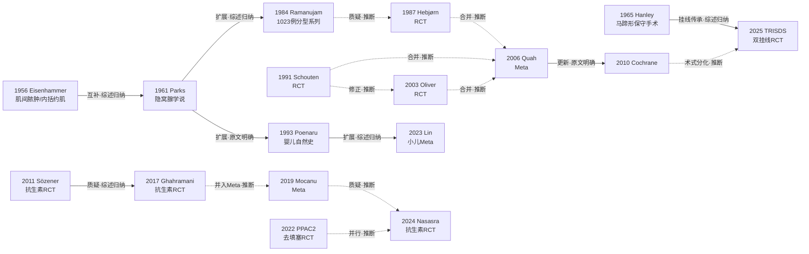

# D06 肛周脓肿：一次根治与分期手术之争

> **一句话判断**：切开引流时要不要同期处理内口（"一次根治"），是肛周脓肿持续近 70 年的核心术式之争；5 个小型 RCT、2006 年 Meta 与 2010 年 Cochrane 把答案阶段性收束为"可在精心选择的患者中做一次根治"——同期手术使复发/持续病变大幅下降（RR 0.13–0.17），但同一 Cochrane 的 1 年失禁合并 RR 3.06（95%CI 0.7–13.45）点估计不利，只是事件稀少、区间极宽而未达显著，且这批证据全部止于 2010 年以前。近五年争论以新形式延续：抗生素辅助能否预防成瘘（RCT 阴-阳-阴、观察性证据自身已分裂，荷兰 ATLAS 与西班牙 PERIQxA 两个安慰剂对照 RCT 截至 2026-10-18 未揭榜）、以松挂线/双挂线/LIFT 为形态的括约肌保留型同期处理（中国 TRISDS RCT：12 个月治愈 78.2% vs 41.2% 且肛门功能无差异）、术后"去填塞"与成瘘风险预测模型。

## 0 三分钟速读

1. **从哪里来**：1950–60 年代隐窝腺感染学说把脓肿重新定义为"肛瘘的急性期"——Eisenhammer 1956 提出肌间脓肿与内括约肌处理 [D06-N01]，Parks 1961 从组织病理确立肛腺-括约肌间蔓延途径 [D06-N02]，"脓肿期找内口"从此有了病理学依据。
2. **为什么改变**：1984 年 1023 例大系列把分型与"34.7% 术中见内口"变成教科书数字 [D06-N04]；但 1987/1991 两个 RCT 随即给出反证与功能代价（瘘管切开不减少复发、排气失禁更差；一期根治把复发从 40.6% 压到 2.9% 却以功能紊乱 39.4% vs 21.4% 为代价）[D06-N05] [D06-N06]；2003 年 Oliver 划定"低位可同期切、高位勿同期切"的边界 [D06-N08]。
3. **如何分化**：Cochrane 收束为"选择性一次根治"后，路线分化为三支——欧美 RCT 传统的瘘管切开（切括约肌）、中国挂线传统的松挂线/双挂线（不切括约肌，2025 年 TRISDS 注册 RCT 登上国际期刊）[D06-N17]、泰国 LIFT 前移到脓肿期；小儿线另成保守与手术的拉锯。
4. **现在研究什么**：抗生素辅助预防成瘘（2011 阴性、2017 阳性、2024 再阴性，观察性队列一阳一阴）、脓肿期括约肌保留确定性处理、术后去习惯化（不填塞、不针吸）、成瘘风险预测（CRP、菌种、新分类、机器学习）。
5. **用了什么数据**：从大型单中心病例系列（1023 例级）到小样本 RCT、Cochrane 合并，再到国家登记库与多院 EHR（美国 NSQIP 2358 例、丹麦多中心 475 例）、多中心试验网络（英国 PPAC2 的 50 家 NHS 医院）与机器学习模型（737 例回顾数据）。
6. **还有什么不知道**：一次根治 vs 分期的裁决性证据（以失禁为主导终点、随访 >5 年的大 RCT）至今没有，Cochrane 自 2010 年未更新 [D06-N10]；抗生素问题等 ATLAS/PERIQxA 揭榜；小儿领域一个 RCT 都没有，两项非随机 Meta 结论相反。

**覆盖边界**：纳入成人肛周/肛管直肠周围脓肿从切开引流到一次根治的争论（RCT 与队列、失禁与复发、成瘘率）、隐窝腺机制对"找内口"的支撑、分型、抗生素辅助 RCT 与 Meta、小儿肛周脓肿自然史与保守倾向、糖尿病/免疫低下人群、术后处理（填塞、引流场所、针吸）、近五年挂线/LIFT 同期处理与预测模型。不含：肛瘘确定期手术（归 D03/D04）、克罗恩肛周脓肿（仅在"幼年脓肿提示克罗恩"的预警价值处点到）、坏死性筋膜炎、影像学本身（归 D11）。

**本章口径**：截止 2026-10-18；近期重点窗口 2021-10-18 至 2026-10-18。阅读层级：L0=仅二手转述、L1=题录已核实、L2=摘要已读、L3=原文部分章节已读、L4=全文已读（按本轮调研与核查的实际阅读深度标注）。本章节点 17 个：节点级 RCT 8 个（N05/06/08/11/12/14/16/17）、节点级 Meta/Cochrane 4 个（N09/10/13/15）、奠基/分型/系列节点 5 个（N01–04、N07）；另有约 25 项近期代表研究与中国线证据以文献编号入文、未占节点名额（节点之外另有的专门 RCT，如 Kronborg 1984 一期缝合试验、2021 针吸试验，见第 5、7 节）。节点阅读层级：L1×3（N01/02/03）、L2×12、L3×2（N14/17）。核查状态：17 节点中 16 通过、1 修正（N15 小儿 Meta 口径）；题录级修正 3 处（Roskam 2026 作者首字母、2018 共识影像准确率口径、共识所引 Cochrane 版本表述）；无删除项；存疑项 1（EV56 西班牙长程队列，题录未核，相关数字按调研材料转述标注）。覆盖状态：基本完整但有标注缺口——六个问题均可据本章回答、范围内主要分支均有节点与可核来源，缺口限于第 8 节已列出的原文未读、中文单源转述链与个别未核题录（理由见第 12 节第二轮修订记录）。

## 1 源头：最初在研究什么

**起点不是"怎么切"，而是"脓肿是什么"。** 19 世纪末欧洲解剖学已埋下伏笔：Chiari 1878 首先提出肛腺在肛瘘发病中的作用，Herrmann & Desfosses 1880 解剖证实肛腺并提示其感染可致瘘（两人文献无 PubMed 题录，据 ANZ J Surg 2025 综述 doi:10.1111/ans.70296 与 Włodarczyk 2021 综述 PMC7894698 转述，L0）。

- **公认的奠基工作**：Eisenhammer（南非约翰内斯堡）1956 年在 Surg Gynecol Obstet 发表《The internal anal sphincter and the anorectal abscess》（103:501-506，PMID 13360660），把肛周脓肿归因于内外括约肌间间隙的原发感染（肌间脓肿），并提出切开引流同期处理内括约肌远端以求根治——这是"一次根治"路线的解剖病理起点。其内括约肌中心思想在 1951/1953 年 S Afr Med J 已有前导（1953 年篇 PMID 13076663，题录本轮核实）。原文无摘要、不在 OA，本轮未读原文，内容据陈琴等 2013 年挂线综述与 Sugrue 2017 发病机制系统评价转述（L1）。[D06-N01]
- **公认的奠基工作**：Parks（伦敦 St Mark's 医院）1961 年在 BMJ 发表《Pathogenesis and treatment of fistula-in-ano》（1(5224):463-469，PMID 13732880），系统提出肛腺/隐窝感染经括约肌间蔓延的病因学，成为"找内口"的理论基石；"脓肿是肛瘘的急性期"的连续性疾病观由此定型。PMC 存有扫描件（PMC1953161），但文章页返回验证码页面，按"不绕过访问限制"纪律未读原文，本轮仅据题录（L1）与 Cochrane 2010 背景、SICCR 2020 共识的二手转述。[D06-N02]
- **目前最早找到的"脓肿同期根治"方向文献**：Eisenhammer 1958 年《A new approach to the anorectal fistulous abscess based on the high intermuscular lesion》（Surg Gynecol Obstet 106:595-599，PMID 13556476，题录已核）；其 1966 年 DCR 长文与 1978 年"final evaluation"总结该路线。限定语：这是本轮在 Europe PMC/PubMed 能找到的最早记录，以题录为准，不排除更早的散在报告；1956 年一篇已含"脓肿期处理内括约肌"的思路，1958 年篇给出瘘性脓肿的术式分类，两者分工不同。[D06-N01]
- **公认的奠基工作（限术式）**：Hanley（美国）1965 年在 Dis Colon Rectum 发表《Conservative surgical correction of horseshoe abscess and fistula》（8(5):364-368，PMID 5830659），确立马蹄形脓肿"后正中部切开引流+侧方对流口"的保守手术。两点限定：其一，"1965 年首次介绍"指保守性术式而非解剖发现——后正中深（括约肌下）间隙及其与马蹄形瘘的关系，Courtney 1949 年已描述（Surg Gynecol Obstet 89:222-226，PMID 18133264，题录本轮核实），早于 Hanley 术式 16 年；其二，Hanley 1965 原文无摘要未读，"首次介绍"一语出自 2018 中国共识原文（本轮 L4 已读 PDF 页面图像），非本报告独立溯源。[D06-N03]

把学说变成可测数字的是 Ramanujam 1984：1023 例大系列给出脓肿分布（肛周 42.7%、坐骨直肠窝 22.7%、括约肌间 21.4%、肛提肌上 7.33%）与"34.7% 术中见内口"，并把"脓肿期术中探查内口、低位瘘一期切开"流程化——此后一切成瘘率研究都以它为基准（详见第 2 节）。[D06-N04]

## 2 关键转折：问题—新证据/新方法—认识变化—新问题

**转折一：脓肿从孤立感染变成瘘的急性期（互补）。** Eisenhammer 的外科入路与 Parks 的组织病理构成隐窝腺学说的两条腿（"互补"判断属综述归纳，见陈琴 2013 综述与 Sugrue 2017 系统评价）。认识变化：任何"一次根治"的论证核心从此变成"处理隐窝内口"。新问题：学说不能解释全部病例（新生儿与部分女性病例），2017 年系统评价将其修正为含上皮化、微生物在内的多因素机制。[D06-N01] [D06-N02]

**转折二：大系列把机制变成流程与数字（扩展）。** Ramanujam 1984（Cook County 医院体系，5 年半前瞻登记，1023 例）在区域麻醉下脓肿开盖清创，见低位瘘即一期瘘管切开、高位行挂线二期：34.7%（355 例）术中见内口；平均随访 36 个月，复发率单纯引流组 3.7% vs 一期切开组 1.8%。注意：两组非随机分配，1.8% vs 3.7% 不能作因果解释——但"术中常规探内口"从此成为可复制的操作流程。[D06-N04]

**转折三：随机证据入场，"常规一次根治"被否定（质疑）。** Hebjørn 1987（丹麦，RCT，18 例单纯引流 vs 20 例术后 3 天瘘管切开，随访 12 个月）：两组复发无差异，瘘管切开组排气失禁显著更高、住院更长、愈合更慢，作者建议瘘管切开只用于复发性脓肿。这是对 Ramanujam 式"早期积极一期处理"的第一次随机反驳，"无选择一次根治"自此退出国际默认。（Hebjørn 与 Ramanujam 的对立为本报告依两文结论对比所作推断，摘要未互相点名。）[D06-N05]

**转折四：从"能不能"到"值不值"（修正）。** Schouten 1991（荷兰 Rotterdam，前瞻随机 70 例：一期瘘管切除+部分内括约肌切除 36 例 vs 单纯引流 34 例，中位随访 42.5 个月）：复发/持续病变 2.9% vs 40.6%（log-rank P<0.0003）——同期根治确实把复发压低约 14 倍；但功能紊乱加重 39.4% vs 21.4%（摘要原文"P less than 0.106"，Fisher 精确检验，未达显著），且 40.6% 的复发率意味着半数以上患者引流即愈、本不需二次手术。作者本人转向"瘘管切除留作二期"。争论重心从疗效移到功能代价与人群选择。[D06-N06]

**转折五：划定解剖边界——"对哪种瘘、用什么方式"（修正）。** Oliver 2003（西班牙，前瞻随机 200 例，按瘘管高低分层处理）：复发单纯引流 29% vs 同期处理 5%；术中内口检出率高达 83%；失禁集中在高位瘘"延迟渐进挂线切开"亚组（36.7%），低位即期简单瘘管切开仅 2.8%，单纯引流组 0。第一次在随机设计内把"处理方式×瘘管高度"交叉：问题不是"该不该同期处理"，而是"对哪种瘘用什么处理"——低位可同期、高位勿同期切割成为此后共识的底层逻辑。[D06-N08]

**转折六：Meta 与 Cochrane 收束为"选择性一次根治"（扩展/收束，且收束于 2010 年前的证据之上）。** Quah 2006（新加坡，检索 1966–2004，5 个 RCT 405 例）：同期括约肌切断术使复发降 83%（RR 0.17，95%CI 0.09–0.32，P<0.001），排气失禁/渗漏 RR 2.46（0.75–8.06，P=0.140）趋势不利但不显著。Malik 2010 Cochrane（6 个 RCT 479 例）：复发/持续病变/再手术 RR 0.13（0.07–0.24）；1 年失禁合并 RR 3.06（95%CI 0.7–13.45），不显著且试验间异质（I²=44.4%）——点估计上同期手术使失禁风险约增至三倍，只因事件极少而区间横跨近 20 倍；低位瘘术后肛管测压可有一过性压力下降而无临床失禁。结论原话是"可在精心选择的患者中推荐"。这一定量收束结束了"要不要做"的争论，但须写明：全部纳入试验 ≤200 例、术式异质、长期失禁数据极少，"选择谁"至今无统一标准，Cochrane 自 2010 年后无更新。（Hebjørn/Schouten 是否在 Quah 的 5 项之内，摘要只给检索窗口与合计数、未列名单，属据二次文献的推断。）[D06-N09] [D06-N10]

**转折七：抗生素辅助成为新的主战场（一阴一阳一再阴）。** Sözener 2011（土耳其 3 中心双盲安慰剂对照，183 例随机/151 例符合方案，阿莫西林克拉维酸 10 天）：1 年成瘘率 29.8%（45/151）；安慰剂 22.4% vs 抗生素 37.3%（P=0.044，抗生素组数值反而更高）；坐骨直肠窝（OR 7.82）与括约肌间脓肿（OR 3.35）是成瘘危险因素——健康成人常规抗生素无效的高级别阴性证据。[D06-N11] Ghahramani 2017（伊朗 Shiraz 单中心单盲 RCT，307 例随机/299 例分析，甲硝唑+环丙沙星 7 天，注册号 IRCT201311049936N7）：抗生素组成瘘显著更低（P<0.001），单变量分析中术后抗生素是唯一保护因素（OR 0.426）——与 Sözener 构成同题 RCT 一阴一阳的直接冲突，随访长度（3 个月 vs 12 个月）与盲法级别被推上方法学议程。[D06-N12] Mocanu 2019 Meta（6 项研究 817 例，其中 3 项 RCT 进合并）：抗生素降低 36% 成瘘几率（OR 0.64，0.43–0.96，P=0.03），但明言证据质量低；合并口径下抗生素组成瘘 16%（459 例中）vs 未用 24%（358 例中）。（Ghahramani 是否在 3 项之内由合计数推知，摘要未列名单。）[D06-N13] Nasasra 2024（以色列单中心单盲 RCT，98 例完成，阿莫西林克拉维酸 875/125mg×7 天）：成瘘 16.3% vs 10.2%（P=0.67）、复发 4 vs 5（P=0.73）——第三个 RCT 回归阴性，2017 年的阳性未能复制。[D06-N16] 此后两个大型安慰剂对照 RCT（荷兰 ATLAS、西班牙 PERIQxA）立项运行；须说明：两份协议的背景与 Mocanu 结论方向一致，但"直接催生"的因果未核对协议引文，只能写为同一未决问题背景下的前后相继。[D06-N13]

**转折八：术后处理"去习惯化"。** PPAC2（英国 50 家 NHS 医院多因素平行 RCT，2018-02 至 2020-03，433 例，注册 ISRCTN93273484，摘要并列注册 NCT03315169）：脓腔常规填塞更痛（前 10 天平均最大 VAS 38.2 vs 28.2，均差 9.9，95%CI 4.84–15.05，P<0.0001）而成瘘（15% vs 11%，OR 0.69）与复发（3% vs 6%，OR 1.85）均无差异——百年习惯被高等级证据否定；2024 年加拿大系统评价（3 个 RCT 490 例）确认。同期丹麦三中心 RCT 否定针吸替代切开（针吸+克林霉素复发 41% vs 切开 15%，HR 3.033，P=0.014）。[D06-N14]

**转折九：小儿线自然史与两极 Meta（扩展→冲突）。** Poenaru 1993（36 例男婴回顾系列）量化"脓肿→瘘"转化约 42%、92% 肛瘘前有脓肿，支持小儿先保守；[D06-N07] Lin 2023 系统评价（31 项研究 2507 例，无 RCT）按初始治疗重切分证据后结论内部口径分裂："保守 vs 单纯引流"无差异（OR 1.222，95%CI 0.615–2.427，P=0.567），但"保守 vs 手术"OR 0.278（0.109–0.707，P=0.007）、"手术 vs 引流"OR 4.360（1.761–10.792，P=0.001），作者总体结论倾向初始手术干预——把该文简单归为"保守派"并不准确（此为核查修正后的口径）。[D06-N15] 次年 Sun 2024 Meta（16 项非随机研究 1262 例）按手术口径重分析：一期瘘管处理使成瘘降 86%（OR 0.14，0.06–0.32）。两项 Meta 纳入研究重叠而分组口径不同、结论相反，小儿线成为"无 RCT 的两极"。[D06-N15]

**转折十：中国挂线传统的 RCT 化（分化）。** Cochrane 说"可在精心选择的患者中做同期手术"，但欧美 RCT 传统里的"同期手术"是瘘管切开（切括约肌）；中国线把"同期手术"具体化为不切割括约肌的松挂线/双挂线：TRISDS（江西中医药大学附属医院，注册 ChiCTR2000032941，2020-09 至 2023-09，106 例随机非盲对照，肛提肌下方伴内口脓肿）12 个月治愈 78.2%（43/55）vs 常规引流 41.2%（21/51），术后 2 月 Wexner 评分中位均 1.0 无差异——中国挂线传统以注册 RCT 形态登上国际期刊。注意其局限：非盲、单中心、复合终点（治愈=上皮化+无瘘+无复发）、对照组未探查内口（可能高估差异）；ChiCTR 网站本轮访问被拒（HTTP 405），注册终点与发表终点一致性未能独立核对。[D06-N17]

## 3 分支图

实线=原文明确讨论或综述归纳的关系；虚线=本报告推断（含"据二次文献检索窗口推知合并关系"）。抗生素三个 RCT 之间的"质疑"指结论方向相反（阴-阳-阴），非文献互斥。

## 4 近五年重点（2021-10-18 至 2026-10-18）

**主题一：抗生素辅助预防成瘘——仍是一个开放问题（发展中）。** 研究什么：脓肿引流后短程抗生素能否降低 1 年内成瘘与复发。常用设计：单盲/双盲安慰剂 RCT、系统评价、倾向评分校正的回顾队列。代表研究：Nasasra 2024 RCT 阴性（98 例，成瘘 16.3% vs 10.2%，P=0.67，PMID 38701427）[D06-N16]；Blondin 2025 法国三级专科回顾队列（276 例倾向评分加权）：1 年成瘘 65.6%，抗生素组 54.0% vs 未用 75.0%（P<0.001，加权 OR 0.53，0.31–0.92）——观察性证据倾向有益（PMID 39895142）；但 Alabbad 2025 科威特 770 例回顾队列（2011–2024，60.5% 接受≥7 天抗生素）总成瘘率仅 6.8%、用药与不用无差异（PMID 41441928，doi:10.1007/s10151-025-03264-7）——观察性证据自身已经分裂，且 6.8% 的低基线进一步印证成瘘率的人群/定义异质性。进行中的裁决性证据：荷兰 ATLAS（阿姆斯特丹 UMC 牵头的多中心双盲安慰剂 RCT，环丙沙星+甲硝唑，按成瘘率 30%→15% 设计、总样本 298，1 家学术+7 家荷兰周边医院，EudraCT 2020-004449-35/NCT05385887，PMID 36351727）与西班牙 PERIQxA（多中心随机双盲，阿莫西林/克拉维酸 875/125mg TID×7 天 vs 安慰剂，286 例，主要终点 6 个月内成瘘，EudraCT 2021-003376-14，PMID 38355562）；两者截至 2026-10-18 均未发表结果。分歧：RCT 层面阴-阳-阴三次反复；Meta（Mocanu 2019，OR 0.64）低质量阳性；观察性一阳（Blondin）一阴（Alabbad）——实验性与观察性证据内部均已分裂，裁决只能寄望 ATLAS/PERIQxA。免疫抑制/糖尿病人群推荐用抗生素，争议较小。

**主题二：脓肿期括约肌保留型同期处理——松挂线/双挂线/LIFT（发展中）。** 研究什么：在引流同期以不切割或缓切割的挂线、LIFT/内口闭合代替传统瘘管切开。代表研究：TRISDS RCT（106 例，治愈 78.2% vs 41.2%，Wexner 无差异，PMID 41035902）[D06-N17]；泰国 Rojanasakul 团队（LIFT 术原创者）2021 年把 LIFT 前移到脓肿期：86 例回顾研究（2014–2016）中 66 例成功行 LIFT、20 例尝试内口闭合，成功率 86%/70%，无失禁，主要终点 90 天愈合（PMID 33394781）；土耳其 Erol 2020 前瞻试点（松挂线 23+低位瘘管切开 4 vs 单纯引流 17）：12 个月松挂线组 0 复发 vs 引流组 10/17（58.8%，P<0.0001），48.1% 需二期拔线等干预，失禁评分无变化（PMID 32341739）；印度 Gaddam 2026 前瞻对照（各 71 例，10 个月随访）：复发 23.9% vs 4.2%（P=0.001），瘘仅见于单纯引流组（25.4%）——注意该文题名 observation study 与方法段自称 randomized 相矛盾，方法学表述混乱（PMID 42154297）；中文 RCT 证据由 Shi 2021 系统评价汇总：切开+挂线在治愈率、愈合时间、VAS、Wexner、成瘘、复发上均优于单纯切开引流（14 项 RCT，检索 CNKI/万方/VIP/PubMed/Cochrane 至 2021-07；"全部为中文试验"系推断、摘要未载明，PMID 34628909）。分歧：观察性证据一致有利但缺盲法与长期功能数据；同期确定性处理的适用解剖范围（伴内口的肛提肌下脓肿 vs 所有脓肿）未统一；缺更大样本多中心试验。

**主题三：术后处理与引流方式的去习惯化（填塞已收束，引流场所有争议，针吸已收束）。** PPAC2（433 例）+Kim 2024 系统评价（3 RCT 490 例，检索至 2023-01-05）：填塞增加疼痛、延迟愈合，复发与成瘘无差异（PMID 35929816、39332832）——"不填塞"成为新的默认答案 [D06-N14]；丹麦针吸 RCT（98 例，NCT02585141）不推荐针吸替代切开（PMID 33447866）。"引流场所"之争未决：美国多院 EHR 回顾队列（458 例，2014–2018）Cox 回归显示手术室引流较床旁引流 1 年复发/成瘘风险降低（aHR 0.20，0.114–0.367；总体 20.3%，PMID 36150906）；单中心急诊对照（113 例：床旁 66 vs 手术室 47）则显示 30 天并发症相当（10%），术前 SIRS 才与并发症相关（P=0.02）（PMID 38684322）。两文均回顾性、人群不可比，无 RCT。

**主题四：成瘘风险预测与个体化（早期线索）。** 丹麦首都大区多中心回顾队列（475 例，2018–2019，中位随访 1108 天）：成瘘 33.7%；危险因素——低位括约肌间（OR 2.77）、坐骨肛门窝（OR 2.48）、克罗恩（OR 5.96）、复发性脓肿史（OR 4.14）、大肠杆菌培养阳性（OR 4.06）、术前 CRP>100 mg/L（OR 3.21）（2023 在线/2024;39(1):4，PMID 38093036）。中国单中心 525 例（2012–2022，均行单纯引流）新分类：1 年总复发 39%，"易成瘘型"vs"非易成瘘型"复发 81.0% vs 23.5%（OR 7.651），提出按成瘘倾向指导术式选择、尚未外部验证（PMID 39649212）。机器学习路线：Wang 等 2025 的南京 737 例回顾数据（2022-01 至 2023-06）CatBoost 预测术后复发，训练/验证/时间验证 AUC 0.821/0.744/0.735，预测因子含糖尿病史、脓肿间隙、AISI（Front Public Health 2025;13:1722109，PMID 41393021）。分歧：预测因子稳定性在各队列间不一致；模型均单中心回顾、无前瞻验证。

**主题五：小儿肛周脓肿——保守、引流与一期瘘管处理的三方拉锯（发展中，无 RCT）。** 三篇系统评价并立：Lin 2023（31 研究 2507 例，检索截止：未说明——摘要未载明、全文不可得）内部口径分裂、作者总体倾向初始手术 [D06-N15]；Sun 2024（16 项非随机研究 1262 例）一期瘘管处理优（愈合 OR 5.76，4.04–8.22；成瘘降 86%，OR 0.14，PMID 37023788）；Chen J 2025（Front Surg，18 项回顾研究 1770 例，PROSPERO CRD42023472249，检索 1990-01 至 2023-11——2026-10-19 据 OA 原文 Methods 补核）保守组治愈 75.2% vs 手术组 73.4%、复发与成瘘差异极小（PMID 40585484，doi:10.3389/fsurg.2025.1572049）——纳入研究重叠而口径不同，结论并立。队列侧：Kang 2022（457 例首次脓肿/瘘，非手术 169 例）非手术与手术复发/成瘘/再就诊无差异、住院与手术更少（PMID 35647894）；Yin 2022 新生儿对照（138 例，137 男 1 女，中位随访 6.5 年）：引流+一期瘘管切开治愈 98.5% vs 单纯引流 80.8%（P=0.001）、成瘘 1.5% vs 13.7%（P=0.01）、无失禁（PMID 35601425）。克罗恩预警：Roskam 等 2026 多中心研究（152 例 2–18 岁）幼年肛周脓肿/瘘后克罗恩病发生率 21.1%，12–18 岁组风险高于 6–12 岁组（OR 2.09）与 2–6 岁组（OR 14.24）——"年长儿脓肿"处理趋积极（作者题录经核查修正为 Roskam M, Dierikx T, Hulsmann S 等；J Pediatr Gastroenterol Nutr 2026;82(5):1226-1232，PMID 41742643，doi:10.1002/jpn3.70373；克罗恩本身归边界外，此处只点到）。

**主题六：菌群、糖尿病与特殊人群（糖尿病线渐厚，菌群线早期）。** Sanchez-Haro 2025 系统评价（22 篇脓肿+7 篇瘘，检索库 MEDLINE/EMBASE/Cochrane Library/Google Scholar，检索截止：未说明——摘要未载明、全文不可得）：大肠杆菌与拟杆菌属最常见，新分子技术检出 Bilophila wadsworthia（脓肿）与 Rothia 属（瘘），菌群-成瘘关系待重估、各研究间不一致（PMID 40833840）。Zhang H 2025 观察性 Meta（检索自建库至 2024-11，含中文库）：30.7% 脓肿患者合并糖尿病、22.0% 糖尿病患者发生脓肿（双向关联）；糖尿病者肺炎克雷伯菌检出高（OR 4.73，1.30–17.19）、大肠杆菌低（OR 0.57，0.39–0.84）——抗生素选择需区别（PMID 41367540）。血糖控制与复发：Li 等 2026 的 232 例回顾研究（2023-06 至 2025-03）6 个月复发 29.3%，糖尿病 OR 3.99（1.61–9.88）、HbA1c 每升 1% 复发 OR 1.50（Front Med 2026;13:1758123，PMID 41709901）——血糖管理进入脓肿随访路径。2018 中国共识"无并发因素者不常规用抗生素、伴蜂窝织炎/系统性疾病/免疫抑制者推荐"（共识原文，L4）与试验人群（多为无并发因素者）并不矛盾。

## 5 争议、负性结果与停滞路线

**争议一：一次根治 vs 分期手术——形式上收敛，实质以新形式延续。** 一次根治派（Ramanujam 系列、Oliver、中国挂线/TRISDS 路线）：引流同期处理内口可把复发/成瘘降到个位数，避免二次手术；分期派（Hebjørn 结论侧、Schouten 结论侧、丹麦/荷兰实践）：半数以上患者引流即愈，常规一期手术把括约肌风险强加给不需二次手术者。定量现状：RR 0.13–0.17 的复发获益 vs 失禁 RR 3.06（0.7–13.45）不显著但点估计不利；ASCRS 2016/2022、SICCR 2015/2020、中国 2018/2025 共识均取个体化口径，无一家推荐无差别一次根治（其中 ASCRS 2022 条款系据题录与共识/综述转述，正文未读，见第 8 节缺口 9）。状态：分歧并未终结——分期派与一次根治派以新形式延续（松挂线/LIFT 同期处理的单中心 RCT vs 高收入国家"引流优先"的默认实践），且收束所依据的全部 RCT 止于 2010 年以前。[D06-N09] [D06-N10] [D06-N17]

**争议二：抗生素辅助——未决。** 见第 4 节主题一。截至 2026-10-18，三个 RCT 结论 1:2（阴-阳-阴）、随访与盲法不一，Meta 合并仅 3 项研究且证据质量低，观察性证据一阳一阴自相分裂；ATLAS 与 PERIQxA 结果发表后应更新本节。

**争议三：小儿初始处理——无 RCT 的两极。** 见第 4 节主题五。双方共同承认无 RCT 是根因；新生儿一期瘘管切开（Yin 2022）与"等待自愈"（Kang 2022）并存；克罗恩风险随年龄上升使年长儿处理趋积极。

**争议四：同期确定性处理的术式形态——切割挂线 vs 松挂线/虚挂线 vs LIFT。** 切割挂线确切但失禁顾虑（国际报告切割挂线失禁率约 12%，据陈琴 2013 综述转述 Ritchie 2009 等，未经原文核对）；松挂线/虚挂线以引流替代切割保护括约肌；LIFT/内口闭合从括约肌间入路关闭感染源。各家缺乏头对头比较与 >5 年功能与复发数据；切割挂线在国际上因失禁数据退居二线，但中国改良形态（LCCS=松挂线联合切割挂线）仍在 RCT 检验（注册 ChiCTR2100049198）。[D06-N17]

**争议五：引流场所——手术室 vs 床旁。** 见第 4 节主题三。回顾性证据互搏，无 RCT。

**负性结果与失败路线**（保留负面证据是本章原则）：
1. 无选择的一次瘘管切开作脓肿常规——Hebjørn 1987 RCT 否定（复发无减少、排气失禁更差）。[D06-N05]
2. 一期瘘管切除+部分内括约肌切除的激进解剖性根治——Schouten 1991：复发 2.9% 但功能紊乱 39.4% vs 21.4%，作者本人放弃一期实施。[D06-N06]
3. 高位瘘"延迟渐进挂线切开"同期处理——Oliver 2003 该亚组失禁 36.7%，成为"高位不应同期切割"的反面教材。[D06-N08]
4. 针吸+抗生素替代切开——丹麦三中心 RCT：针吸复发 41% vs 切开 15%（HR 3.033），"不能推荐"。
5. 脓腔一期缝合+抗生素覆盖——Kronborg 1984 RCT（Acta Chir Scand 150:689-692，PMID 6397949）：愈合快 3 周但脓肿复发倾向更高，未成主流。
6. 术后常规脓腔填塞——PPAC2+2024 系统评价否定。[D06-N14]
7. 为脓肿-肛瘘寻找统一"特异性病原体"的路线——2025 系统评价确认菌群谱各研究不一致、慢性瘘管内常查不到细菌，转向菌群多样性/宿主免疫解释。

## 6 传承线与国际线

**传承线（中国）**。古典文献层（L0，二手转述，本轮未读古籍原本）：肛周脓肿散见于"脏毒""悬痈""坐马痈""跨马痈"等病名；《诸病源候论》已有"痔久不瘥，变为漏"之说；明·陈实功《外科正宗》（1617）有"脏毒论"专篇并系统记载挂线法；挂线经典记载一般上溯至明·徐春甫《古今医统大全》。

**须显式标注：以下 1950s–2004 段为单源转述链**——全部据陈琴、王晓锋、李华山 2013 年《世界华人消化杂志》挂线综述（21(1):82-86，doi:10.11569/wcjd.v21.i1.82，本轮全文已读）一家的转述，未经原始文献交叉核验；若该综述转述有误，本章无第二来源可纠。
- 机制实验：胡伯虎、史兆歧、周济民 1983 年在《中医杂志》报告犬动物实验，论证挂线四机理（慢性勒割、异物刺激、引流、标志）（转述）。
- 一次根治的普及：曹吉勋（成都中医药大学附属医院）自 20 世纪 50 年代起研究肛管直肠周围脓肿一期根治术，主张切开排脓同时寻找内口处理、高位者辅以挂线（原始文献未获，转述）。
- 辽宁中医药大学附属肛肠医院自 20 世纪 70 年代以"切开挂线术"为脓肿常规，累计治疗 6000 余例、随访 3000 余例——**据陈琴综述转述，近期治愈率 99.7%、远期 96.9%、后遗肛瘘 3.1% 三个数字未经原始文献核对，引用时须带此限定**。
- 概念更新：钱海华 2004 年在《吉林中医药》首倡"虚挂线引流"（不紧线、纯引流）（转述）。

**循证化接力（以下均已核实题录/摘要或全文）**：上海天山中医医院林晖 2009 年《中西医结合学报》隧道拖线疗法治疗低位马蹄形脓肿 RCT（68 例，PMID 20015430）→ 南京中医药大学第二、第三附属医院 2018 年 Gastroenterology Report 三腔间隙清除术（TCC）病例对照（138 例三组：TCC 成瘘 13.0% vs 单纯引流 39.1% vs 切割挂线一次根治 8.7%；切割挂线组 2 例失禁、TCC 组无失禁，PMID 30151207）——该文直接把"一次根治（切割挂线）"与"保功能的 TCC"同台比较，标志中国线从"根治优先"向"保功能优先"的内部转向；TCC 多中心 RCT 2020 年挂 medRxiv 预印本、本轮未查到正式发表 → 中日友好医院 2022 年 LCCS（松挂线联合切割挂线）随机非劣效试验协议（Ann Transl Med 10:108，ChiCTR2100049198）→ 2024 年放射切口+隧道浮线引流治疗高位后马蹄形脓肿 RCT（PMID 39465802，题录核实）→ 2025 年 TRISDS 经括约肌间双挂线 RCT（106 例，治愈 78.2% vs 41.2% 且功能无差异，ChiCTR2000032941）[D06-N17] → 2026 年 TCC 单中心真实世界研究 308 例（成瘘 4.9%、复发 8.1%，Tech Coloproctol 30:114）。共识线：中国医师协会肛肠医师分会《肛周脓肿临床诊治中国专家共识》2018（中华胃肠外科杂志 21(4):456-457，L4 全文已读：30%~70% 并发肛瘘、1/3 后期成瘘、抗生素不常规推荐、伴瘘者挂线可作确定性手术前的安全替代、改良 Hanley 等）→ 2025 年更新版（同会，中华胃肠外科杂志 28:1369-1378，9 个临床问题 19 条推荐，PMID 41397818）。中国线的独特处：把国际因失禁顾虑而退却的"脓肿期同期确定性处理"以松挂线/拖线形态 RCT 化并发表于国际期刊。另：广安门医院李国栋的脓肿一次根治具体文献本轮未单独查到，见第 8 节待核线索。

**国际线**。学说源流：约翰内斯堡 Eisenhammer（1956–1978 系列）与伦敦 St Mark's 的 Parks（1961）共同奠定隐窝腺学说 [D06-N01] [D06-N02]；马蹄形脓肿保守手术由美国 Hanley（1965；1978 年 Ann Surg 橡皮筋挂线）确立 [D06-N03]。欧美 RCT 传统多持谨慎立场：丹麦 Hebjørn 1987、荷兰 Schouten 1991、丹麦 Kronborg 1984（一期缝合）、西班牙 Oliver 2003。证据收束：新加坡 Quah 2006 Meta 与 Cochrane 2010（英国/美国作者团队）是国际态度的锚点 [D06-N09] [D06-N10]。指南态度：ASCRS 2011/2016/2022 三版、德国 S3 2012（PMID 22362468）、意大利 SICCR 2015 共识与 2020 立场声明（PMID 31974827）、英国 ACPGBI 2018 第二版（PMID 30178915）、日本 2018 指南（PMID 31559351）、WSES-AAST 2021 肛肠急诊指南（PMID 34530908）——各家均取个体化/选择性口径，无一家推荐无差别一次根治（本轮读到题录与摘要层面，各指南正文未全读）。抗生素问题的国际裁决链：土耳其（2011 阴）→伊朗（2017 阳）→加拿大 Meta（2019 低质量阳）→以色列（2024 阴）→荷兰 ATLAS 与西班牙 PERIQxA 在跑，法国队列倾向有益、科威特队列阴性——欧洲内部亦在对冲。围术期与数据路径的国际贡献：英国 PPAC2（50 家 NHS 医院）否定填塞、丹麦否定针吸、美国 NSQIP 分析（Sho 2020，DCR 63:1127-1133，2358 例门诊引流的再手术/再入院）与多院 EHR 分析开启登记库/真实世界路径、丹麦多中心队列把 CRP 与培养菌种纳入预测、巴林（109 例，成瘘 33.9%；题录与摘要已于 2026-10-19 经 Europe PMC 核实，PMID 34376025）与西班牙长程队列（Chaveli Díaz 2020，303 例，平均随访 119.7 个月，总复发 48.2% 且 82.2% 发生在第一年、总成瘘率 40.3%、超声见无症状瘘 2.4%——以上数字均据调研材料转述，题录未核、二轮检索未命中，见第 8 节缺口 10）提供地区成瘘率基线、泰国 LIFT 团队把 LIFT 前移到脓肿期。器械与监管节点：本方向以术式为主、无植入器械，本轮未查到器械监管事件。注册与终点一致性核对结果：PPAC2 注册主要终点（前 10 天平均最大疼痛）与发表一致（全文核对）；TRISDS 报告 ChiCTR2000032941 但 ChiCTR 网站本轮访问被拒、未独立核对；Ghahramani 报告 IRCT 号但未核对注册库；Sözener 2011 与 Nasasra 2024 摘要未见注册号。

## 7 数据路径小结

**历史上**：大型单中心病例系列是主干（Ramanujam 1984 的 1023 例、西班牙 303 例长程队列（据调研材料转述，题录未核）、巴林 109 例），加之 1984–1991 年欧洲小样本 RCT（38–70 例级）——证据体量小、失禁评价为症状学对比、无量化量表。**现在**：(1) RCT 转向多中心与注册化——节点级 8 个 RCT 之外，填塞议题另有 2 项小 RCT 被 Kim 2024 系统评价合并（共 3 RCT 490 例）、丹麦针吸试验注册于 NCT02585141；中文 RCT 单独成库（Shi 2021 系统评价 14 项，检索 CNKI/万方/VIP）。(2) Meta/Cochrane 常态化：Quah 2006（5 RCT 405 例）、Cochrane 2010（6 RCT 479 例）、Mocanu 2019（6 研究 817 例）、Kim 2024（3 RCT 490 例）、小儿三篇（2507/1262/1770 例）、糖尿病 Meta（2025）。(3) 国家登记库与真实世界数据：美国 NSQIP（2358 例）、美国多院 EHR Cox 模型（458 例）、丹麦首都大区多中心病案回顾（475 例、中位随访 1108 天）、英国 NHS 多中心试验网络（PPAC2）。(4) 微生物与组学：脓液培养成为预测变量（大肠杆菌阳性 OR 4.06——丹麦队列；糖尿病者肺炎克雷伯菌 OR 4.73——Zhang 2025 Meta），菌群系统评价（2025，29 篇）。(5) 影像辅助（与 D11 交叉，只点到）：2018 中国共识引述腔内超声（EUS）91%、MRI 87%、麻醉下检查 91% 的诊断准确率口径（两种技术联合可达 100%；此为核查修正后的数字）。(6) 中医线数据路径：证候/术式 RCT 与真实世界研究并行，中文库是中文试验的主要来源，结局以愈合时间/VAS/Wexner 为主、多为单中心。(7) 新兴：机器学习预测模型（737 例回顾数据，CatBoost）。

## 8 还不知道什么（领域证据缺口）与本报告的检索缺口

**领域证据缺口**：
1. 一次根治 vs 分期的裁决性证据停在 2010 年前：无以失禁为主导终点、样本 >200、随访 >5 年的 RCT；Cochrane 自 2010 年后无更新。
2. 抗生素辅助问题在三个 RCT 后仍无裁决；荷兰 ATLAS 与西班牙 PERIQxA 结果截至 2026-10-18 未发表——本方向最重要的进行中证据。
3. 小儿领域完全没有 RCT，三项非随机系统评价两极并立（Lin 2023 内部口径分裂/作者倾向手术 vs Chen 2025 保守≈手术 vs Sun 2024 一期瘘管处理优）。
4. 成瘘率基线数字高度异质：引流的自然成瘘率从 6.8%（Alabbad 队列）、10.2%（Nasasra 对照）到 65.6%（Blondin 队列）、40.3%（西班牙，题录未核）、33.7%（丹麦）不等；"成瘘"本身缺乏金标准定义（临床瘘/超声瘘/需手术瘘）与统一随访窗口；西班牙队列还发现 2.4% 无症状超声瘘（同一未核来源）。
5. TCC 三腔间隙清除术的多中心 RCT（2020 medRxiv 预印本）未查到正式发表。
6. 风险预测模型（新分类、ML）均单中心回顾、无外部与前瞻验证。

**本报告的检索缺口**：
7. Eisenhammer 1956/1958 与 Parks 1961 原文未读：无 OA，Parks 的 PMC 扫描页返回验证码页面（按纪律未绕过）——两个奠基节点停留在 L1+二手转述，方法与样本细节缺失。
8. 中文一次根治的奠基性原始文献（曹吉勋系列、辽宁 6000 例系列、钱海华 2004 虚挂线）未获原文，仅据陈琴 2013 综述一家转述（L0 单源链）——CNKI/万方全文不可得（不登录、不付费）是主因；此缺口对中国线 1950s–2004 段的可信度构成实质性限制：该段的机制实验、普及链与三个结果数字均无独立来源可交叉，本章已按单源转述链显式标注。
9. ASCRS 2022 指南正文未读（无摘要、付费墙），推荐条款仅据题录与共识/综述转述；国际指南具体推荐强度未逐条核实。
10. 西班牙长程队列（Chaveli Díaz 2020，303 例）题录未核：2026-10-19 以 Europe PMC 检索作者姓氏（Chaveli）与特征数字（119.7 个月、40.3%）均未命中题录，原始出处待查——相关数字按调研材料转述标注，证据行核查状态已改"未核/存疑"。

**待核线索（本轮未能核实，不进正文叙事）**：Quah HM 2009 前瞻队列（疑与 2006 Meta 记忆混淆）；Tang CL 2008 抗生素 RCT（未查到，Tang 实为 Quah 2006 合作者）；Vasudevan 一次切开 Meta（未查到）；Cirocco WC 1990s 成瘘率系列（其 1992 年 DCR 论文为 Goodsall 规则研究，PMID 1587170，疑记忆有误）；"中国肛周脓肿诊疗共识 2020"（未查到，2020 年发表的是《肛瘘诊治中国专家共识（2020 版）》，属 D03）；李国栋脓肿一次根治具体文献；1880s–1940s 欧洲更早的隐窝腺表述（19 世纪源头 Chiari/Herrmann-Desfosses 已据二手综述补证，更早文献未系统追溯）。

## 9 本章节点速查表

| 编号 | 年份 | 第一作者+题名简写 | 期刊 | 节点作用 | 设计/分析单位 | 样本 | 关键结果 | 层级 | 核查 | PMID/DOI |
|---|---|---|---|---|---|---|---|---|---|---|
| N01 | 1956 | Eisenhammer·内括约肌与肛周脓肿 | Surg Gynecol Obstet | 学说起点：肌间脓肿，同期处理内括约肌 | 临床病理论述/患者 | 未核实（原文未读） | 据二手转述：肌间脓肿为脓肿-瘘共同起点 | L1 | 通过 | 13360660 |
| N02 | 1961 | Parks·肛瘘发病机制与治疗 | BMJ | 理论奠基：隐窝腺感染学说 | 临床病理/患者 | 未核实（原文未读） | 据二手转述：内口位于齿线后正中隐窝、经括约肌间蔓延 | L1 | 通过 | 13732880 / 10.1136/bmj.1.5224.463 |
| N03 | 1965 | Hanley·马蹄形脓肿保守手术 | Dis Colon Rectum | 方法奠基：后正中切开+侧方对流 | 术式报告/患者 | 未核实（原文未读） | 2018 共识转述：手术有效；改良 Hanley 保括约肌疗效相近 | L1 | 通过 | 5830659 / 10.1007/BF02627261 |
| N04 | 1984 | Ramanujam·1023 例脓肿与瘘 | Dis Colon Rectum | 分型与成瘘基准数字 | 前瞻登记系列/患者 | 1023 | 内口检出 34.7%；分布 42.7/22.7/21.4/7.33%；复发 3.7% vs 1.8%（非随机） | L2 | 通过 | 6468199 / 10.1007/BF02553848 |
| N05 | 1987 | Hebjørn·脓肿随机瘘管切开试验 | Scand J Gastroenterol | 反证：常规一期切开无益有害 | RCT/患者 | 38（18 vs 20） | 复发无差异；排气失禁更差；建议仅用于复发者 | L2 | 通过 | 3554492 / 10.3109/00365528708991876 |
| N06 | 1991 | Schouten·一期瘘管切除随机试验 | Dis Colon Rectum | 关键验证与边界：收益-代价交换 | 前瞻 RCT/患者 | 70（36 vs 34） | 复发 2.9% vs 40.6%（P<0.0003）；功能紊乱 39.4% vs 21.4%（摘要原文 P less than 0.106） | L2 | 通过 | 1991422 / 10.1007/BF02050209 |
| N07 | 1993 | Poenaru·婴儿肛瘘病因与管理 | J Pediatr Surg | 小儿自然史：42% 成瘘、全为男婴 | 回顾系列/婴儿 | 36 | 92% 有脓肿史；47% 见深厚异常隐窝；31 例随访 20 个月无复发 | L2 | 通过 | 8308691 / 10.1016/0022-3468(93)90163-F |
| N08 | 2003 | Oliver·引流±瘘管处理随机研究 | Int J Colorectal Dis | 边界划定：低位可切、高位勿切 | 前瞻随机/患者 | 200 | 复发 29% vs 5%；失禁集中高位延迟挂线 36.7%、低位即期 2.8%；内口检出 83% | L2 | 通过 | 12548410 / 10.1007/s00384-002-0429-0 |
| N09 | 2006 | Quah·引流 vs 括约肌切断 Meta | Int J Colorectal Dis | 第一次定量总结 | Meta（检索 1966–2004）/研究×患者 | 5 RCT/405 | 复发 RR 0.17（0.09–0.32）；失禁 RR 2.46（0.75–8.06）不显著 | L2 | 通过 | 16317550 / 10.1007/s00384-005-0060-y |
| N10 | 2010 | Malik·Cochrane 引流±瘘管手术 | Cochrane Database Syst Rev | 国际权威收束："精心选择的患者" | Cochrane/研究×患者 | 6 RCT/479 | 复发 RR 0.13（0.07–0.24）；1 年失禁 RR 3.06（0.7–13.45）不显著，I²=44.4% | L2 | 通过 | 20614450 / 10.1002/14651858.CD006827.pub2 |
| N11 | 2011 | Sözener·抗生素预防成瘘 RCT | Dis Colon Rectum | 抗生素线关键阴性 | 3 中心双盲安慰剂 RCT/患者 | 183 随机/151 符合方案 | 成瘘 22.4% vs 37.3%（P=0.044，抗生素更高）；坐骨直肠窝 OR 7.82 | L2 | 通过 | 21730779 / 10.1097/DCR.0b013e31821cc1f9 |
| N12 | 2017 | Ghahramani·抗生素预防成瘘 RCT | Surgery | 抗生素线阳性反证 | 单中心单盲 RCT/患者 | 307 随机/299 分析 | 抗生素组成瘘显著更低（P<0.001；OR 0.426）；IRCT201311049936N7 | L2 | 通过 | 28822559 / 10.1016/j.surg.2017.07.001 |
| N13 | 2019 | Mocanu·抗生素预防 Meta | Am J Surg | 抗生素问题定量小结（低质量阳性） | PRISMA Meta/研究×患者 | 6 研究 817（3 RCT 入 Meta） | OR 0.64（0.43–0.96，P=0.03）；成瘘 16% vs 24% | L2 | 通过 | 30773213 / 10.1016/j.amjsurg.2019.01.015 |
| N14 | 2022 | Newton·PPAC2 填塞 RCT | Br J Surg | 去习惯化：否定常规填塞 | 50 中心多因素 RCT/患者 | 433（213 vs 220） | 疼痛 VAS 均差 9.9（P<0.0001）；成瘘/复发无差异；ISRCTN93273484 | L3 | 通过 | 35929816 / 10.1093/bjs/znac225 |
| N15 | 2023 | Lin·小儿初始处理 Meta | J Pediatr Surg | 小儿线证据收束（口径分裂） | PRISMA Meta/研究×患者 | 31 研究/2507（无 RCT） | 保守 vs 引流 OR 1.222（0.615–2.427）；保守 vs 手术 OR 0.278；作者总体倾向初始手术 | L2 | 修正 | 36894443 / 10.1016/j.jpedsurg.2023.01.055 |
| N16 | 2024 | Nasasra·抗生素不影响成瘘 RCT | Dis Colon Rectum | 抗生素争论最新裁决（阴性） | 单中心单盲 RCT/患者 | 98 完成 | 成瘘 16.3% vs 10.2%（P=0.67）；复发 P=0.73 | L2 | 通过 | 38701427 / 10.1097/DCR.0000000000003334 |
| N17 | 2025 | Zhang·TRISDS 双挂线 RCT | Gastroenterol Rep | 中国同期确定性处理注册 RCT | 单中心随机非盲对照/患者 | 106（55 vs 51） | 12 个月治愈 78.2% vs 41.2%；Wexner 无差异；ChiCTR2000032941 | L3 | 通过 | 41035902 / 10.1093/gastro/goaf091 |

（节点级之外的重点文献——Kronborg 1984 一期缝合、针吸 RCT 2021、Blondin/Alabbad 2025、ATLAS/PERIQxA 协议、小儿 Sun 2024/Chen 2025、丹麦/中国预测队列等——见第 4、5 节与证据表 data/evidence_D06.json。）

## 10 本章入口文献与检索截止

| 编号 | 入口文献 | 检索截止 |
|---|---|---|
| E01 | Malik AI, Nelson RL, Tou S. Incision and drainage of perianal abscess with or without treatment of anal fistula. Cochrane Database Syst Rev 2010;(7):CD006827（PMID 20614450；2018 中国共识参考文献[2]即本评价） | 未说明（摘要未载明） |
| E02 | Gaertner WB, et al. ASCRS Clinical Practice Guidelines for the Management of Anorectal Abscess, Fistula-in-Ano, and Rectovaginal Fistula. Dis Colon Rectum 2022;65:964-985（PMID 35732009） | 未说明（无摘要、正文未读） |
| E03 | Amato A, et al. Evaluation and management of perianal abscess and anal fistula: SICCR position statement. Tech Coloproctol 2020;24:127-143（PMID 31974827） | 未说明（摘要未载明） |
| E04 | 中国医师协会肛肠医师分会. 肛周脓肿临床诊治中国专家共识. 中华胃肠外科杂志 2018;21(4):456-457（doi:10.3760/cma.j.issn.1671-0274.2018.04.018） | 未说明（专家共识，无系统检索声明） |
| E05 | 同会. Expert consensus on clinical diagnosis and treatment of anorectal abscess (2025 version). 中华胃肠外科杂志 2025;28:1369-1378（PMID 41397818） | 未说明（专家共识） |
| E06 | Quah HM, et al. Meta-analysis of randomized clinical trials comparing drainage alone vs primary sphincter-cutting procedures. Int J Colorectal Dis 2006;21:602-609（PMID 16317550） | 1966–2004（摘要写明） |
| E07 | Shi Y, et al. A systematic review and meta-analysis of incision and seton drainage in the treatment of high perianal abscess. Ann Palliat Med 2021;10:9830-9840（PMID 34628909） | 至 2021 年 7 月（摘要写明） |
| E08 | 陈琴， 王晓锋， 李华山. 挂线疗法治疗肛管直肠周围脓肿的应用进展. 世界华人消化杂志 2013;21(1):82-86（doi:10.11569/wcjd.v21.i1.82） | 未说明（叙述性综述） |

本章检索执行日 2026-10-18；全部 PMID/DOI/卷页经本轮实际查证（Europe PMC/PubMed/PMC/Crossref/注册库网页），核查无删除项。2026-10-19 二轮补查（Europe PMC 与 OA 原文，共 11 次查询）：巴林队列（EV57）补齐卷页 39:27-31 与 DOI 10.3393/ac.2020.00962.0137，33.9% 成瘘率经摘要原文确认；EV39/EV47 第一作者按 PMID 回填为 Wang D、Li T；Chen 2025 检索窗口（1990-01 至 2023-11）据 OA 原文 Methods 补核；Lin 2023 与 Sanchez-Haro 2025 检索截止在摘要与可得全文均未载明，标"未说明"；西班牙长程队列检索未命中，改标"未核/存疑"并新增第 8 节缺口 10。

## 12 复核修订记录（2026-10-18）

1. 机械质检｜证据表 data/evidence_D06.json 补入口文献编号｜改前：正文曾以单个方括号形式引用 D06-E07、D06-E08 两个入口编号（分别为 Shi 2021 中文挂线系统评价 PMID 34628909 与陈琴 2013 挂线综述 doi:10.11569/wcjd.v21.i1.82），两编号在证据表查不到对应行，机械质检记"引用 17 缺 2"（全报告复核时核对）；改后：正文引用已统一为 [D06-Nxx] 单括号形式（17 个节点逐一可回查、缺失 0），两文分别落在证据表 EV24、EV25 行，本次在两行 role 字段补入"第 10 节入口文献编号 E07 / E08"，入口编号与证据行一一对应；未新增文献、未改任何数字，速读与一句话判断未动。

- Eisenhammer 1953（D06-EV55）页码 27:246-250→27(13):266-270；巴林队列（D06-EV57）补全题录（PMID 34376025, Ann Coloproctol 2023）。（2026-10-19，汇总者依抽查报告执行）

### 第二轮（完整性检查，2026-10-19）

依据 data/qa_completeness.json 中 id="D06" 的 top_issues（4 条，均为"建议改"）逐条执行，检索合计 11 次查询（Europe PMC 9 次 + PROSPERO/OA 原文网页 2 次），未超 20 次上限：

1. EV56/EV57 核查状态口径矛盾（建议改）：EV57 巴林队列经 Europe PMC 补齐卷页 39:27-31、DOI 10.3393/ac.2020.00962.0137，109 例与 33.9% 成瘘率经摘要原文确认，limitations 改为"题录与摘要已核"（维持"通过"）；EV56 西班牙长程队列检索未命中（作者姓氏 Chaveli 与特征数字 119.7 个月、40.3% 均无命中），核查状态"通过"→"未核/存疑"、阅读层级 L1→L0（题录未核实不再符合 L1 定义），limitations 补记检索未命中；正文第 6 节首次引用处加"据调研材料转述"限定，第 7 节、第 8 节缺口 4 连带加注，第 8 节新增检索缺口 10。
2. Lin 2023/Chen 2025/Sanchez-Haro 2025 检索截止未标注（建议改）：Chen 2025 据 Frontiers OA 原文 Methods 补核为"检索 1990-01 至 2023-11"（PROSPERO 注册页为 JS 壳无内容）；Lin 2023 与 Sanchez-Haro 2025 摘要与可得全文（Europe PMC 全文 XML 均无）均未载明检索截止，统一标"检索截止：未说明"（第 4 节主题五/主题六正文与证据行 EV15/EV44/EV45 data_source 同步标注）。
3. 第 5 节争议一对 ASCRS 2022 的肯定表述与第 8 节缺口 9 口径不一致（建议改）：该句已补"（其中 ASCRS 2022 条款系据题录与共识/综述转述，正文未读，见第 8 节缺口 9）"。
4. EV39/EV47 第一作者空缺（建议改）：按 PMID 41393021/41709901 经 Europe PMC 回填为 Wang D、Li T（题录核实，verification_status 维持"通过"），正文第 4 节主题四/主题六相应补出"Wang 等 2025""Li 等 2026"。
5. 本章口径更新：原"无存疑项"改为"存疑项 1（EV56）"，并新增覆盖状态说明"基本完整但有标注缺口"及理由。一句话判断、三分钟速读、分支图（mermaid 语法与标签）、第 9 节速查表均未改动（本轮意见不涉及）；除上述有限检索所得外未新增文献或数字。
