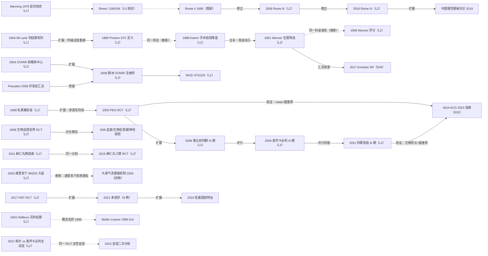

# D07 功能性便秘：通里攻下、生物反馈与新兴药物

> **一句话判断**：功能性便秘的研究史，是从"切掉淤滞的结肠"与"泻剂经验治疗"起步，经结肠慢传输（STC）客观分型、罗马标准统一入组，走到"渗透性泻剂一线、促分泌剂/促动力药二线、外科严格限选、菌群与中成药并行"的分型治疗格局。证据强度高度分化：西药已有 GRADE 强推荐清单和首个两机制头对头 RCT，中成药只有麻仁丸拿到"优于安慰剂、不优于番泻叶"的高质量三臂数据。贯穿始终的负性约束是蒽醌类泻剂的黑变病安全叙事——癌变联系已基本否定，监管焦点转向长期使用的电解质风险。

## 0 三分钟速读

① **从哪里来**：外科线起于 Lane 1904–1908 年"切除结肠治慢性便秘"系列报告 [D07-N01]；药物线起于 1968 年乳果糖双盲 RCT（荷兰）[D07-N20]；中医线公认源自《伤寒论》承气汤类方与麻子仁丸（原典层属公认转述）。
② **为什么改变**：Kamm 1988 对 44 例结肠切除的长期随访显示术后 17 例腹泻、10 例需精神科治疗 [D07-N03]，直接催生 Wexner 1991 的生理筛选流程——163 例评估仅 16 例手术 [D07-N04]；tegaserod 2007 年因心血管风险退市，为普芦卡必利重新打开促动力线。
③ **如何分化**：Rome III/IV 统一入组并把功能性排便障碍分道 [D07-N06]、[D07-N17]；Chiarioni 2006 用"生物反馈 80% vs 泻剂 22%"给盆底失弛缓划界（移交 D08）[D07-N09]；STARR 沿欧洲注册库扩军同时暴露急便 17.8% 的代价 [D07-N08]、[D07-N11]；中成药完成"剂量摸索→安慰剂对照→三臂"三部曲 [D07-N14]、[D07-N16]；FMT 把菌群推入 RCT [D07-N15]。
④ **现在研究什么**：二线药物头对头（2026 年 elobixibat 持续应答 55.6% vs 普芦卡必利 33.9%，P=0.024）、STC 宏基因组特征、通里攻下方的动物机制、电针与无创神经调控。
⑤ **用了什么数据**：罗马症状标准＋CSBM 应答终点＋前瞻登记库＋网络 Meta（33 项 RCT/17214 例）＋试验注册终点核对；中医线增加证候富集入组与动物模型/网络药理学。
⑥ **还有什么不知道**：药物两两头对头仍缺、STARR 无保守治疗对照 RCT、吴咸中通里攻下线 1960s–70s 原始论文在开放层不可及（仅传记层）、CNKI/万方不可得使多数中成药证据只剩题录层。

**覆盖边界**：纳入——罗马标准对便秘研究入组与终点的塑造；泻剂药理线（乳果糖→PEG→促分泌剂/促动力药）；蒽醌类与结肠黑变病安全线；中医通里攻下线与中成药 RCT；STC 外科线；STARR 从直肠前突到排便梗阻综合征（ODS，obstructed defecation syndrome）的扩散与争议；近五年头对头、菌群/FMT、中成药质量升级。不含——生物反馈与骶神经调控的展开、盆底失弛缓与出口梗阻诊治细节（交 D08，本章只保留划界 RCT [D07-N09]）；针灸与穴位疗法系统梳理（D12，本章只保留电针主试验作交叉）；排便造影/测压/影像诊断学（D11）；IBS-C 流行病学边界、器质性/继发性便秘、先天性巨结肠（边界外）。

**本章口径**：执行日/报告截止日 2026-10-18；近期重点窗口 2021-10-18 至 2026-10-18。阅读层级：L0=仅二手转述、L1=题录已核实、L2=摘要已读、L3=原文部分章节已读、L4=全文已读；只到 L0/L1 的不写"已核对原文贡献"。本章节点 21 个，按层级：L2×18、L1×3；无 L0 节点，但中医现代接力链（吴咸中线 1960s–70s）与罗马标准 1989/1992 两环仍停留 L0 转述（见第 1、6、8 节）。全部节点与入口文献经本轮独立核查，7 个原节点的修正级字段改动（DOI/作者列/数字补全）已按修正值吸收；无删除、无存疑级条目。**覆盖状态：基本完整但有标注缺口**——六问（从哪里来、为什么改变、如何分化、现在研究什么、用了什么数据、还有什么不知道）均可据本章回答；章节范围内主要分支（外科线、罗马标准、泻剂药理线、STARR、生物反馈划界、中成药三部曲、菌群/FMT、电针、蒽醌安全线）均有节点，电针主试验（D07-N19）样本量与主要终点结果已按摘要补全，不再有"结果空缺"的编号节点；缺口限于已在第 8 节标注的项目（Lane/Preston/Kamm 原文未读、CNKI/万方不可得、罗马 1989/1992 原件 L0、Phytomedicine 2021 题录未取得等）。

## 1 源头：最初在研究什么

起点说法按四类标注："目前最早找到的文献"指数据库与公开档案可达范围内的最早记录，不是断言式第一；"被公认的奠基工作"指后续系统评价与指南共同回指的工作；"存在争议的首次"保留两说；"公认转述层的奠基叙事"是只有二手材料支撑、原文不可核的叙事。

**（1）外科起点（目前最早找到的文献，L1）。** 本轮核查后的表述：可检索的最早记录是 Lane 1904 年 Lancet 讲演《慢性便秘所致胃肠通道状况的手术治疗》（Lancet 1904;164(4242):1695-1699，DOI 10.1016/s0140-6736(01)35278-9）与 1905 年 BMJ 论文（BMJ 1905;1(2309):700-702，DOI 10.1136/bmj.1.2309.700）；1908 年 BMJ 1(2455):126-130（DOI 10.1136/bmj.1.2455.126）是 Lane 的手术结果报告 [D07-N01]。时代背景是"慢性肠淤滞/自体中毒"学说——认为结肠淤滞引起全身中毒，内科无效者可以切掉结肠；该理论框架后来被整体推翻，外科路线随之沉寂数十年，直到客观结肠传输测量出现才以新适应证重建（理论衰亡过程本身为本轮据医学史常识性转述，未经专门史学文献核实，L0）。Preston 1984 年 BJS 论文题名中的"(Arbuthnot Lane's disease)"（PMID 6733431，摘要逐字核实：21 例中 16 例结肠切除后 10 例排便正常、周排便 0.3→21.7 次）是这条路线被回溯命名的直接证据。限定：Lane 原文三篇均未读（不在开放 XML、PMC 扫描不可及），结论限于题录与回溯性引用层。

**（2）表型奠基（被公认的奠基工作，L2）。** Preston & Lennard-Jones 1986 年以"不透 X 线标志物结肠传输延迟＋钡灌肠正常"定义 64 例年轻女性"idiopathic slow transit constipation"（Gut 1986;27:41-48）：患者约每周排便 1 次且需借助泻剂，腹痛、腹胀、恶心突出并影响工作，症状多自青春期起病，补麦麸通常无效，直肠排便感觉较健康对照更少 [D07-N02]。它把重度便秘从"精神性/饮食纤维不足"归因转向可测量的结肠运动障碍表型；同组 1985 年 anismus 论文（Dig Dis Sci 30:413-418，PMID 3987474）把出口梗阻从同一病人池里分出去。"公认"依据为英国 NIHR CapaCiTY 系统评价与后续 STC 文献沿用其定义与术语。

**（3）症状标准前史与罗马体系（前史 L1；1989/1992 两环 L0）。** 症状学前史是 Manning 1978 年 BMJ 的 IBS 阳性诊断标准（BMJ 1978;2(6138):653-654，PMID 698649，本轮核实确为 BMJ）。演进链：1988 年罗马国际胃肠病大会组建工作团队→1989 年 Gastroenterology International 发表首份 IBS 诊断指南（Thompson WG 等，2:92-95；该刊未被 PubMed/Crossref/OpenAlex 收录，L0 转述）→Rome I（1992 工作团队报告/1994 Degnon 专著，原件未回读，L0）→Rome II（Gut 1999;45 Suppl 2，PMID 10457044，题录核实）→Rome III（Longstreth 2006，Gastroenterology 130:1480-1491）[D07-N06]→Rome IV（Mearin 2016，Gastroenterology 150:1393-1407）[D07-N17]。链条年代学据 Thompson 本人《The road to rome》（Gastroenterology 2006;130:1552-1556，PMID 16678568，题录级）与 Rome Foundation 二手材料转述。限定：1989/1992 两个原件不在任何开放数据库，只能如实标 L0。

**（4）黑变病与"泻剂结肠"安全线的起点（转述＋题录层）。** 结肠黑变病最早描述：Billiard 1825 年首次注意黏膜色素沉着、Cruveilhier 1829 年首次描述、Virchow 1857 年命名 melanosis coli 并认定良性——以上据 Zhang 2023 年 Front Pharmacol 综述第 1.1 节转述（该综述全文本轮已读，L3；1825/1829 原典未回溯核对）；英文早期大样本锚点是 Speare 1958 年 887 例系列（Dis Colon Rectum 1958;1:172-180，PMID 13537819，题录级）。"泻剂结肠"（cathartic colon，蒽醌滥用致结肠不可逆神经肌损害的放射学概念）起点：Heilbrun 1943 年 Radiology 41(5):486-491（DOI 10.1148/41.5.486，Crossref 核实）[D07-N21]；PubMed 可检索最早条目为 Marshak & Gerson 1960（Am J Dig Dis，PMID 14421510，题录）；病理定位为 Morson 1971（Gut，PMID 5123298，题录）。

**（5）泻剂药理线源头（L1）。** 现代 RCT 意义上的泻剂药理线起于 1968 年荷兰乳果糖双盲对照试验（Wesselius-De Casparis A 等，Gut 1968;9:84-86，PMID 4867936，题录经本轮核实补全作者）[D07-N20]；此后经 PEG（2000，见第 2 节转折三）推进到促分泌剂与促动力药。

**（6）中医通里攻下线源头（古典公认转述 L0；现代实验室锚点 L2）。** 方剂源流公认出自东汉张仲景《伤寒论》承气汤类（大承气汤、小承气汤、调胃承气汤）与麻子仁丸，后世温病学增液承气等扩展——原典未在本轮数据库核查，属中医界公认转述。现代体系化接力：吴咸中（1925-2026）与郑显理等自 1960s 在天津市南开医院建立中西医结合治疗急腹症体系——1964-1977 吴任南开医院院长兼外科主任，1975 年成立天津市中西医结合急腹症研究所（吴任所长），1972 年人民卫生出版社《中西医结合治疗急腹症》（郑显理为主要编写者之一），"通里攻下法在腹外科疾病中的应用与基础研究"获 2003 年度国家奖；以上生平经本轮独立检索复核属实（吴咸中 2026-04-24 于天津逝世，享年 101），但材料属性为传记、院史页与讣闻（L0）。检索限定：经 AUTH:"Wu Xianzhong" 检索得 32 条命中，绝大多数为同名者；1960s–70s 该线原始论文未在开放层命中，本轮不能给出任何一篇当时的原始论文题录。可核实的通里攻下原始研究锚点在 2000 年：陈海、吴咸中、关凤林"通里攻下中药对多器官功能不全综合征大鼠肠屏障的保护作用"（中国中西医结合杂志 2000;20:120-122，PMID 11783313，英文摘要已读，L2）——大承气汤类方干预 Zymosan A 诱导 MODS 大鼠 [D07-N18]。限定：该文单位为大连医科大学，适应证是 MODS 而非便秘；它支撑的是"通里攻下"方法学的现代实验室线，不构成便秘临床证据。

## 2 关键转折：问题—新证据/新方法—认识变化—新问题

**转折一：从"能不能切掉结肠"到"谁才该切"（1904→1986→1988→1991→1996）。** Lane 系列开辟激进外科路线又被其理论崩塌拖入沉寂 [D07-N01]；1986 年 STC 获得客观定义后路线复活 [D07-N02]。Kamm 1988 年首先降温：同一医院 15 年间 44 例正常结肠直径女性（中位每 4 周排便 1 次）行结肠切除，术后 22 例排便频率正常、17 例腹泻（>3 次/日）、5 例持续或复发便秘，腹痛 98%→71%，10 例因重度心理障碍需精神科治疗，且术前盆底矛盾收缩与气球排出障碍不能预测结局（Gut 1988;29:969-973，DOI 10.1136/gut.29.7.969 经核查补全）[D07-N03]。Wexner 1991 年把教训转化为可操作流程：1988-07 至 1990-11 连续 163 例慢性便秘行全结肠传输、测压、排粪造影、EMG 评估，仅 16 例（10%）"结肠无力"（弥漫延迟且无盆底矛盾证据）行全结肠切除+回直肠吻合——无死亡与重大并发症，平均随访 15 个月自发排便 3.5 次/日，满意度优/良 15/16，3 例不完全小肠梗阻保守治愈（Dis Colon Rectum 1991;34:851-856，DOI 10.1007/bf02049695 经核查补全）[D07-N04]。关系判定：N03→N04 为互补（验证/回应，据 Knowles 2017 系统评价归纳为同一"患者选择"问题）；N04→N05 为同一科室谱系（推断：同为 Cleveland Clinic 结直肠外科，Wexner 为资深作者）。Agachan 1996 年把结局测量标准化：232 例（女 185/男 47，均值 64.9 岁）降维出 0–30 分 Wexner 便秘评分（18 项中 8 项入选，入组者均 >15 分）[D07-N05]，成为此后外科系列、生物反馈研究与 FMT 试验的通用终点。

**转折二：症状标准统一国际入组（1999→2006→2016→中国 2019）。** Rome II 被认为过严、试验间不可比；Rome III（2006）确立"症状近 3 个月、起病≥6 个月"框架，FC 与 IBS-C 分列、IBS 按 Bristol 粪便性状分型、检查按年龄与报警症状分层 [D07-N06]；Rome IV（2016）进一步把 FC 与功能性排便障碍分道、阿片性便秘（OIC）单列 [D07-N17]。患病率随标准收紧而下降：Suares & Ford 2011 汇总 45 篇/41 人群/261040 人，总体患病率 14%，采用 Rome II/III 者更低（PMID 21606976）。传导到中国：2019 年《中国慢性便秘专家共识意见（2019，广州）》全文页明言"随着罗马Ⅳ标准的发布……有必要制定我国慢性便秘诊治的共识意见"（中华医学会消化病学分会，中华消化杂志 2019;39:577-598，DOI 10.3760/cma.j.issn.0254-1432.2019.09.001，全文页公开，本轮核实）。此后国际药物试验入组几乎全部以 Rome III/IV FC 标准为准。

**转折三：渗透性泻剂一线化与两个新药类登场（2000–2011）。** DiPalma 2000 多中心双盲 RCT 把 PEG-3350 从肠道准备转为每日口服渗透泻剂：151 例随机（女 131/男 20），14 天治疗，排便频率优于安慰剂（P<0.001），第 2 周 4.5 vs 2.7 次/周（P<0.01），实验室指标与不良事件组间无显著差异（数字经核查按摘要补全）[D07-N07]；2011 年 Meta 汇总泻剂 RR 0.52（Ford & Suares，Gut，PMID 21205879，本轮核实），AGA-ACG 2023 指南强推荐 PEG（见第 10 节 E02）。促分泌剂：鲁比前列酮（局部作用 2 型氯通道激活剂）242 例 III 期，第 1 周 SBM 均数 5.69 vs 3.46（P=0.0001），多数患者 24–48 小时内排便，最常见不良事件为恶心（因恶心停药 5%）[D07-N10]；24μg bid 剂量由同项目剂量摸索试验确定（Johanson & Ueno 2007，APT 25:1351-1361，129 例，48μg/日定为 III 期剂量，PMID 17509103）。促动力线在 tegaserod 2007 年因心血管缺血事件退市（Gastroenterology 评论 PMID 17570201，题录经检索核实）后由高选择性 5-HT4 激动剂普芦卡必利重开：713 例完成疗效评估的 III 期，达到 ≥3 SCBM/周者 2mg 19.5%（P<0.01）、4mg 23.6%（P<0.001）vs 安慰剂 9.6%（数值经核查按摘要修正）[D07-N12]；tegaserod 2019 年以受限获取项目重返美国市场但限于 IBS-C 特定人群（Med Lett Drugs Ther 2019，PMID 31169806；Aliment Pharmacol Ther 2020 评论"tegaserod and IBS, two decades on"，PMID 31850554，均题录核实），未回到 CIC 一线。利那洛肽（GC-C 激动剂）两项 12 周 III 期（合计 1276 例）定型 CSBM responder 终点：主要终点达成率 Trial 303/01 分别 21.2%/16.0%（145μg）与 19.4%/21.3%（290μg）vs 安慰剂 3.3%/6.0%，腹痛亦改善 [D07-N13]；注册号 NCT00765882/NCT00730015，本轮经 ClinicalTrials.gov API 核对实际入组 643/633、注册主要终点（CSBM Overall Responder）与发表一致。关系判定：N10→N12 为并行（据 Luthra 2019 网络 Meta 把两类药纳入同一网络归纳）。到 2019 年，网络 Meta（33 项 RCT/17214 例，检索至 2019-06 第 3 周）仍明言"无头对头 RCT"，排序只能靠 P-score（E03）——这构成此后头对头研究的动机基线。

**转折四：出口梗阻的解剖矫正尝试与并发症代价（2004–）。** Boccasanta 2004 前瞻多中心试验把双吻合器经肛直肠切除（STARR）引入正式文献：90 例 ODS（2001 年），手术时间 43.3±8.7 分钟、住院 2.1 天，并发症急便 17.8%、排气失禁 8.9%、尿潴留 5.5%、出血 4.4%、吻合口狭窄 3.3%（作者列经核查修正：第 7 作者为 Mascagni D，署名至少 10 人，无 Roviaro G）[D07-N08]。欧洲 STARR 注册库把证据升级到真实世界量级：录入 2838 例、2224 例满 12 个月（女 83.3%，均值 54.7 岁），ODS 评分 15.8→5.8（P<0.001），但结论明确承认术后排便急迫感与疼痛是"需优化的主要并发症" [D07-N11]。质疑轴由 Pescatori & Gagliardi 2008 并发症汇总（Tech Coloproctol 12:7-19，PMID 18512007，题录核实）与注册库自认构成；NICE HTG224（2010-06-23 发布）以非随机证据为主支持"选择性使用并强调监测"；Ripamonti 2022 系统综述（24 项研究/4464 例，2008–2020）与 Andreoli 2024 年 15 年随访+医学法律视角（Am J Surg 2024;229:169-173，DOI 10.1016/j.amjsurg.2023.11.016，题录经核查补全）延续长期结局与患者选择之争。ODS 诊治细节移交 D08，本章只保留证据链骨架。

**转折五：分型治疗学的分水岭（2006）。** Chiarioni 2006 RCT 给"功能性排便障碍该不该长期吃泻剂"以定量答案：常规治疗无效的盆底失弛缓患者 109 例随机，5 次生物反馈 vs PEG+咨询，6 个月显著改善 43/54（80%）vs 12/55（22%），获益持续至 12/24 个月 [D07-N09]。它确立"先分型再治疗"：STC 与盆底失弛缓两条治疗线分开；生物反馈与骶神经调控的后续展开移交 D08。

**转折六：中成药的 GCP 化三部曲（2011–2019）。** 麻子仁丸（《伤寒论》方）沿用近两千年而无严格试验。Cheng 2011 年 AJG 两部曲建立模板：试验 I 剂量摸索 96 例（每臂 32），7.5g bid 优于 2.5/5.0g；试验 II 双盲安慰剂对照 120 例随机（每臂 60），入组 Rome III FC 且中医辨证实证者，2 周导入、8 周治疗、8 周随访，治疗期应答率 43.3% vs 安慰剂 8.3%（P<0.05）——合计 216 例（样本量与结果数值经核查按摘要修正补全）[D07-N14]。Trials 2013 协议（14:366，PMID 24180235，全文已读）明言承接两部曲并推进到活性对照三臂设计（注册号 NCT01695850 仅属三臂试验）。Zhong 2019 年 CGH 三臂双盲双模拟 RCT（香港 8 家诊所 2013-06 至 2015-08，291 例 1:1:1）：第 8 周完全应答麻仁丸 7.5g bid 68% vs 番泻叶 15mg 57.7%（P=.14，不优于番泻叶）vs 安慰剂 33.0%（P<.005），耐受良好 [D07-N16]。中成药第一次拿到"优于安慰剂、不优于阳性对照药"的完整三臂数据——把证据从"单组有效率"推进到现代比较框架，也终结了"强于西药泻剂"的定位宣称。

**转折七：菌群进入 RCT（2017–）。** Tian 2017 把 FMT 从病例系列推入 STC 随机对照：60 例随机鼻肠管 FMT 6 天 vs 常规治疗，ITT 临床改善 53.3% vs 20.0%（P=0.009）、临床治愈 36.7% vs 13.3%（P=0.04）、周均 CSBM 3.2±1.4 vs 2.1±1.2（P=0.001），Wexner 评分改善 [D07-N15]。机制与标志物延伸：Xie 2021（8 例三疗程前后 16S+代谢组，临床改善 62.5%、缓解 75%，Wexner/GIQLI/HAMD 改善；Prevotella/Bacteroides、Roseburia/Blautia 下降而 Bifidobacterium、Lactobacillus 上升，PMID 34852831）；Han 2024（24 例生理学定义 STC vs 24 名对照 shotgun 宏基因组：α 多样性无差异但组成差异显著，PERMANOVA R²=0.050，PMID 39225513）；2024 年《慢性便秘肠道微生态临床应用中国专家共识（2024版）》把菌群检测/微生态制剂/FMT 规范化——署名经核查修正为中华医学会肠外肠内营养学分会等（中华胃肠外科杂志 2024;27(4):326-337，PMID 38644237，16 条共识意见）。

**转折八：手术适应证的证据分级收紧（2017）。** 英国 NIHR CapaCiTY 系统评价汇总 STC 结肠切除 40 篇/2045 例：并发症约 24%、长期小肠梗阻约 15%、手术相关死亡 6/2045（约 0.4%），对"孤立性 STC 且无盆底失弛缓"仅给出弱支持（E04，摘要逐字核实）。这把 Wexner 式生理筛选升级为证据分级约束：手术从"疗效叙事"转入"并发症负担定价"。

## 3 分支图

实线=原文明确讨论或综述归纳的关系；虚线=本报告推断或概念史联系。图中所有节点端点均可解析（Rome IV 已设节点 [D07-N17]，不再出现"某节点对应的 Rome IV"式别名）。

## 4 近五年重点（2021-10-18 至 2026-10-18）

**（1）二线药物从"网络 Meta 排名"走向真正头对头。** 研究问题：一线泻剂失败的 Rome IV FC 患者中，促分泌、促动力与回肠胆汁酸转运体（IBAT）抑制剂如何直接比较。数据与设计：多中心前瞻实用试验＋盲态终点评估，持续 CSBM 应答终点（≥3 CSBM/周且较基线增加≥1，8 周中≥6 周）。代表：Goyal 2026（Aliment Pharmacol Ther 64:1071-1082，214 例，elobixibat 108 vs 普芦卡必利 106，注册号 CTRI/2025/04/085075）——持续 CSBM 应答 55.6% vs 33.9%（P=0.024），elobixibat 优效，用力排便/腹痛/腹胀/QoL 亦更优（结果数值经核查按摘要补全，此前"摘要截断"的表述已被推翻）。框架基线：Luthra 2019 网络 Meta（33 项 RCT/17214 例，明言无头对头，E03）；规范锚点：AGA-ACG 2023 指南（10 条 GRADE 推荐，检索 2021-05-15 首查、2022-11-05 更新，全文已核）——强推荐 PEG、匹可硫酸钠、利那洛肽、plecanatide、普芦卡必利，条件推荐纤维、乳果糖、番泻叶、镁制剂、鲁比前列酮；未纳入任何中药制剂（E02）。分歧：P-score 排名能否替代头对头；实用试验 8 周 vs 12 周终点无共识。成熟度：发展中——首个前瞻头对头 2026 年才出现，利那洛肽 vs 普芦卡必利、鲁比前列酮 vs 利那洛肽等组合仍空白。

**（2）肠道菌群：FMT 谱系、宏基因组特征与微生态共识。** 数据与设计：RCT（FMT vs 常规治疗）、前后对照 16S+代谢组、病例对照 shotgun 宏基因组、洛哌丁胺/地芬诺酯诱导 STC 动物模型。代表：Xie 2021（8 例三疗程，改善 62.5%/缓解 75%）；Han 2024（48 例，α 多样性无差而组成差异显著，存在独特宏基因组-代谢组特征）；微生态共识 2024（中华医学会肠外肠内营养学分会等，16 条意见，规范菌群检测/微生态制剂/FMT）。分歧：FMT 给药途径（鼻肠管/结肠镜/口服冻干粉）与复治策略未定；菌群特征多为关联证据、因果未立。成熟度：发展中。

**（3）中成药 RCT 质量升级与机制再入。** 研究问题：通里攻下/润下/补法各线能否给出 GCP 级证据并用菌群-脑肠轴框架解释。代表：Qiao 2021 儿童消积导滞汤双盲安慰剂 RCT（200 例，8 周治疗+12 周随访，随访末应答 62% vs 31%，χ²=19.315，PMID 33938874）；Lyu 2022 Meta（97 项 RCT/8693 例，总有效率 OR 3.62，95%CI 3.19-4.11；排便频率 MD 0.83 次/周；纳入研究质量总体受限，E08）；窗口外早期汇总（2018 年发表，在本章重点窗口之外，保留于此仅为与中成药 Meta 证据并读）：Gong 2018 补中益气改良方 Meta（25 项 RCT/2089 例，较泻剂/促动力药改善症状且不良事件更少，自认证据质量有限，检索截止未说明，PMID 29552087）；Wan 2026 大承气汤便秘适应证动物机制（5-HT 通路介导 PANoptosis 与代谢改善，J Ethnopharmacol 360:121206，PMID 41534751）。核心张力：大样本 Meta（多为低质量双臂试验）的强阳性与少量高质量三臂试验"不优于番泻叶"并存；高质量证据集中于麻仁丸一个方剂。成熟度：发展中、结论分化。

**（4）蒽醌类安全线重估。** 数据与设计：叙述性综述（检索至 2023-01，含 PubMed+CNKI）、监管评估、停药消退病例报告。代表：Zhang 2023（7 科 20 种含蒽醌中药清单，全文已读，E07）；Chiba 2024 停用番泻叶约 7 个月后黑变病内镜消退（Int Med Case Rep J 2024;17:783-787，PMID 39282237，DOI 10.2147/imcrj.s475869，题录经核查补全并可由 L0 升 L1）；EMA/HMPC 番泻叶评估报告（文号经核查修正为 EMA/HMPC/228759/2016，Revision 1；警示框架聚焦长期使用电解质紊乱/低钾风险而非致癌）。分歧：黑变病-腺瘤关联两说并存（见第 5 节）。成熟度：安全叙事成熟——癌变联系基本否定，机制与长期监测仍在发展。

**（5）STARR 的长期结局、HTA 与适应证收敛。** 代表：Ripamonti 2022 系统综述（24 项研究/4464 例，安全有效、改善 QoL，呼吁国际指南优化选择，PMID 35237648）；NICE HTG224（2010-06-23，以非随机证据为主支持选择性使用）；Andreoli 2024（Am J Surg 229:169-173，15 年经验与医学法律视角，题录经核查补全）。分歧：急便 17.8%、排气失禁 8.9% 能否被术者经验与选择标准消解；与保守治疗/生物反馈比较的 RCT 缺失。成熟度：技术成熟、适应证与选择标准未收敛。

**（6）电针/神经调控（与 D12/D08 交叉）。** 代表：电针 vs 普芦卡必利多中心随机非劣效主试验（Am J Gastroenterol 2021;116(5):1024-1035，PMID 33273258，DOI 10.14309/ajg.0000000000001050）[D07-N19]：560 例重度慢性便秘患者随机（每组 280），主要终点为第 3–8 周周均 CSBM≥3 的比例（mITT，非劣效界值 -10%）——电针 36.2% vs 普芦卡必利 37.8%，差 -1.6%（95%CI -8.0~4.7），非劣效 P<0.001，非劣效成立；8 周总体 CSBM 应答 24.9% vs 25.5%（P=0.864），不良事件 17.7% vs 44.2%，8 周电针的效应在停针后可持续 24 周（摘要已读，本轮按 Europe PMC 摘要补全，层级 L1→L2）——此前以亚组二次分析代主试验的代表性问题已修正：2023 年女性亚组（446 例，总体应答 25.23% vs 25.89%，差 -0.67%，95%CI -8.80~7.40，P=0.872；数值经核查按摘要修正）与 2026 年超重度便秘亚组（Integr Med Res，PMID 41080507）均挂靠主试验、不单独计为独立试验证据；另有无创神经调控（迷走机制）综述（Therap Adv Gastroenterol 2026;19，PMID 42491410，摘要已读）。分歧：电针 RCT 盲法可行性、对照选择（假电针 vs 阳性药）与随访长度。成熟度：早期线索–发展中。

## 5 争议、负性结果与停滞路线

**争议一：蒽醌类泻剂与黑变病、"泻剂结肠"及癌变风险。** 一说蒽醌滥用导致黑变病并增加腺瘤/癌风险（20 世纪 cathartic colon 学说：概念起点 Heilbrun 1943 [D07-N21]，PubMed 可检索最早 Marshak 1960，病理定位 Morson 1971）；另一说黑变病为良性可逆色素沉着、癌变联系无可信证据。关键证据：Nusko 1993（Pharmacology 47 Suppl 1:234-241，2277 例结肠镜队列：泻剂使用者与黑变病者结直肠癌无显著增加，腺瘤 RR 1.72/2.19，作者提示暗背景下息肉更易检出的检出偏倚；本轮未经独立复核，题录信息在案）；Campbell 1983（Dis Colon Rectum 26:445-448，PMID 6861575）证明放射学改变可逆——"可逆性"争论早于概念告终即在放射学界展开；Müller-Lissner 1996（Gut 39:486-488，PMID 8949659）题名即宣告概念衰落；Morales 2009（J Toxicol 2009;287247，摘要已读）系统清理番泻叶致癌/泻剂结肠证据并给出否定结论。现状：癌变联系基本否定；黑变病-蒽醌关联成立、为良性可逆；监管焦点转为长期使用电解质风险（EMA/HMPC/228759/2016）。两说在中文临床文献中并存。

**争议二：STC 全结肠切除的适应证与患者选择。** 一说生理筛选下满意率高（Wexner 1991：16 例中优/良 15 例）[D07-N04]；另一说长期结局不均一、并发症负担重，应严格限于保守治疗失败者（Kamm 1988 [D07-N03]；Knowles 2017：40 篇/2045 例，并发症约 24%、长期小肠梗阻约 15%、手术相关死亡 6/2045，仅弱支持孤立性 STC，E04）。未决：指南倾向严格选择+术前多生理检查；术后小肠梗阻与功能不满意是长期核心负担。

**争议三：STARR 的地位。** 支持：前瞻多中心与欧洲注册库显示 ODS 评分 15.8→5.8、QoL 改善 [D07-N08]、[D07-N11]；质疑：急便 17.8%、排气失禁 8.9% 与新发失禁风险、适应证滥用担忧（Pescatori 汇总；NICE 要求监测）。未收敛：缺与保守治疗比较的 RCT，长期并发症谱刚起步（15 年随访 + 医学法律视角，Andreoli 2024）。

**争议四：中成药证据等级。** 一说大样本 Meta 显示显著有效（97 项 RCT/8693 例，OR 3.62，E08），临床广泛应用合理；另一说绝大多数纳入试验低质量，仅有的高质量三臂双盲试验显示麻仁丸不优于番泻叶（仅优于安慰剂）[D07-N16]。现状：证据升级中、结论分化；高质量证据集中于麻仁丸一个方剂，其余制剂以低质量试验与动物机制研究为主。

**负性/停滞路线。** ①"泻剂结肠"概念（[D07-N21]→Marshak 1960→Morson 1971→Campbell 1983 可逆→Müller-Lissner 1996 告终）：20 世纪中期限制泻剂使用的核心恐惧被证伪，现代文献仅在动物模型沿用该词。②tegaserod（5-HT4 第一代）：2007 年心血管缺血风险全球退市（PMID 17570201），重创促动力研发信心；2019 年以受限获取项目重返美国市场但限于 IBS-C 特定人群、40–55 岁无心血管危险因素者框架（PMID 31169806；APT 2020 评论 PMID 31850554），始终未回 CIC 一线——"退市即终结"是误读，"复市即翻案"同样是误读。③STC 全结肠切除扩大化：1980s 短期满意率推动扩手术后，长期随访暴露约 15% 小肠梗阻、约 24% 并发症与 0.4% 手术相关死亡，适应证重新收紧 [D07-N03]（E04）。④麻仁丸"强于西药泻剂"定位：三臂试验 68% vs 57.7%（P=.14）不支持 [D07-N16]。⑤Lane 式"肠淤滞/自体中毒"理论：盛行的理论框架被推翻后整条外科路线沉寂数十年（理论衰亡过程为医学史常识性转述，L0）[D07-N01]。

## 6 传承线与国际线

**传承线（中医线，本方向核心）。** 接力链：①古典源流：《伤寒论》承气汤类与麻子仁丸（公认转述，原典未核，L0）→②现代急腹症学派：吴咸中/郑显理南开医院体系（1964-1977 院长任期、1975 研究所、1972 人卫教材、2003 年国家奖；吴咸中 1925-2026；全部为传记/院史/讣闻转述层，生平经本轮独立检索复核属实；1960s–70s 原始论文经 AUTH:"Wu Xianzhong" 等 32 条命中均为同名者碰撞，未在开放层找到任何一篇题录——该线以急腹症为主体，向功能性便秘的延伸是同一治法谱系的间接延伸，本轮未查到当时直接治疗功能性便秘的原始论文）→③实验室锚点：通里攻下方保护 MODS 大鼠肠屏障（大连医科大学，2000）[D07-N18]，把方法学的现代实验室线抬到 L2→④临床证据链：芪蓉润肠口服液治卒中后便秘临床观察（中国中西医结合杂志 2002;22:622-623，PMID 12572389，题录）→麻仁丸三部曲 [D07-N14]→[D07-N16]→儿童消积导滞汤安慰剂 RCT（200 例，2021）→补中益气改良方 Meta（25 项 RCT/2089 例，2018）→六味安消胶囊仅 CNKI 层临床观察（浙江中医药大学学报 2009;33:232-233，60 例，题录经 E08 参考文献目录核实，全文不可得）→⑤机制再入：大承气汤便秘机制（2026，动物）、大黄提取物菌群-胆汁酸轴（J Ethnopharmacol 2026，动物，PMID 42379537）、济川煎/增液汤/枳术丸类网络药理学+菌群研究（2024–2026 多篇，动物层；另见补中益气汤 STC 动物模型 PMID 32317976、枳术丸 PMID 38950678）→⑥指南与共识：2019 中国慢性便秘共识（基于罗马Ⅳ，全文页公开）＋中国医师协会肛肠医师分会系列共识——慢性便秘围手术期管理 2021（PMID 34923784）、出口梗阻型便秘诊治 2022（PMID 36562227）、便秘经肛给药 2022（PMID 36562228）、慢性便秘检查与评估 2024（PMID 39710444）＋中华医学会肠外肠内营养学分会微生态共识 2024（PMID 38644237，署名经核查修正）。另检索到《功能性便秘中西医结合诊疗专家共识（2025年）》解读页，正文/发布单位未核实，作待核线索（第 8 节）。

**国际线。** ①诊断标准：罗马体系为国际基金会主导（Manning 1978 前史→Roma'88/1989→Rome I 1992/1994→II 1999→III 2006 [D07-N06]→IV 2016 [D07-N17]），决定全球 FC 试验入组。②药物研发与注册均跨国：乳果糖（荷兰，1968）[D07-N20]→PEG-3350（美国，2000）[D07-N07]→鲁比前列酮 Sucampo/Abbott [D07-N10]→普芦卡必利 Movetis/杨森（比利时）[D07-N12]→利那洛肽 Ironwood/Forest（注册终点经 ClinicalTrials.gov API 核对）[D07-N13]→elobixibat（日本，2026 头对头）；tegaserod 2007 退市/2019 受限复市构成药监节点。③证据合成与指南：Ford 团队体系（Gut 2011 泻剂 RR 0.52；2019 网络 Meta 33 RCT/17214 例；AGA-ACG 2023 GRADE 指南，未纳入中药制剂）；患病率基线 14%（45 篇/261040 人）。④外科与器械：STARR 由意大利 Longo 2004 会议文集提出（非期刊论文，据 Ripamonti 2022 转述）、Boccasanta 前瞻多中心验证 [D07-N08]、Jayne（英）/Schwandner（德，PMID 20549229）注册库、Pescatori（意）并发症汇总、英国 NICE HTG224 评估——态度为"选择性使用、需优化选择"。⑤监管：EMA/HMPC 2021 起对番泻叶（folium/fructus）再评估（文号 EMA/HMPC/228759/2016），聚焦长期使用电解质紊乱风险——含中药泻剂在内的蒽醌类最重要的国际监管节点。⑥海外对中医证据的方法学评价：麻仁丸试验由香港团队发表于 AJG/CGH 完成国际同行评审；美国团队 2021 年在 Phytomedicine 以 GRADE 评价麻仁丸证据（该系统评价完整题录本轮未取得，见第 8 节）——属方法学评价而非对中医理论的批评。口径注意：Vickers 1998 与 Tang/Ernst BMJ 1999 对针刺类中医疗法 RCT 的方法学批评，评述病种不含肛肠/便秘，不作直接批评引用。本轮未查到国际指南直接推荐或批评中医通里攻下/中成药治疗便秘。

## 7 数据路径小结

历史上 vs 现在：①症状问卷+罗马标准（Manning→Rome II/III/IV [D07-N06]、[D07-N17]；患病率 14%，45 篇/261040 人）。②结肠传输客观化：不透 X 线标志物（[D07-N02] 入组标准；[D07-N16] 次要终点）、核素传输扫描（Kamm 1988 Gut 29:1085-1092，PMID 3410334）。③肛直肠生理：测压/排粪造影/EMG 筛选手术（[D07-N04]；[D07-N05] 量表校验）。④RCT 与注册库：安慰剂对照（[D07-N07]、[D07-N14]、儿童 2021）、三臂双盲双模拟（[D07-N16]）、注册终点核对（NCT00730015/NCT01695850 经 API 核对）、FMT RCT（[D07-N15]）。⑤Meta/网络 Meta：Gut 2011（RR 0.52）、Luthra 2019（33 RCT/17214 例）、Lyu 2022（97 RCT/8693 例）、Gong 2018（25 RCT/2089 例）。⑥前瞻登记库与 HTA：欧洲 STARR 注册库 2838 例 [D07-N11]、德国注册库、NICE HTG224。⑦动物模型：洛哌丁胺/地芬诺酯诱导 STC＋中药干预（PMID 32317976、38950678、42379537）。⑧多组学：16S+代谢组（2021）、shotgun 宏基因组（2024）。⑨监管数据：EMA/HMPC 评估、NICE HTA。⑩中医证候维度：实证辨证富集入组（[D07-N14]、[D07-N16]）；证型分布流行病学未找到可核题录（第 8 节）。方向性变化：终点从排便次数/量表走向 CSBM 应答与注册终点一致性核对；设计从单中心系列走向实用主义头对头与登记库；中医线从单组有效率走向安慰剂模拟剂+活性对照+证候富集。

## 8 还不知道什么（领域证据缺口）与本报告的检索缺口

领域证据缺口：①二线药物头对头 RCT 极少——至 2019 年网络 Meta 时为零，2026 年才出现 elobixibat vs 普芦卡必利首个前瞻比较，利那洛肽 vs 普芦卡必利、鲁比前列酮 vs 利那洛肽等组合仍缺（E03）。②STARR 与保守治疗/生物反馈比较的 RCT 缺失（Ripamonti 2022 与 NICE 均呼吁）。③中成药高质量证据仅覆盖麻仁丸一个方剂；六味安消、芪蓉润肠口服液等无双盲安慰剂 RCT。④FMT 给药途径与复治策略未定，菌群特征因果性未立。⑤功能性便秘中医证型分布的规范流行病学调查未找到可核题录（检索 "syndrome differentiation/TCM syndrome" 640 条命中无适用研究，应在 CNKI）。

本报告检索缺口（含 CNKI/万方影响说明）：①吴咸中/郑显理通里攻下线 1960s–70s 原始论文不可及：经 AUTH:"Wu Xianzhong" 检索 32 条命中基本为同名者，《天津医药杂志》等载体不在 PubMed，CNKI/万方未登录不可用——该接力链目前只有 L0 传记转述，本章如实未把任何 1960s–70s 论文写成已核实题录。②CNKI/万方全文不可得对本章结论的总体影响：《中国肛肠病杂志》《结直肠肛门外科》未被 MEDLINE 收录，中文原始试验只能经二手 Meta 的参考文献题录间接反映（如六味安消 2009），中成药证据总量被系统性低估的风险无法排除；2019/2022/2024 各中文共识仅核到题录/公开页层。③Preston 1986/Kamm 1988/Lane 1904–1908 原文不可得（Europe PMC fullTextXML 返回 500 的扫描件、PMC 页面验证码，按纪律不绕过），相应节点止步 L1/L2。④罗马标准 1989/1992 两环原件不在 PubMed/Crossref/OpenAlex，只有二手转述（L0）。⑤2021 年 Phytomedicine 麻仁丸 GRADE 系统评价仅有年份与团队信息、完整题录未取得，其合并数字（如 CSBM 加权均差 0.95，95%CI 0.56-1.35）未入正文、仅记录在案。⑥Bartle 1925 黑变病报告、Wald 1990s 流行病学专篇、《功能性便秘中西医结合诊疗专家共识（2025年）》、吴咸中为周恩来治疗的轶事等线索未能核实，列为待核线索，不进入正文证据。⑦泻剂结肠的 1955/1966 年文献（Heilbrun & Bernstein；Lancet 1966）仅存于核查记录，未独立复核题录细节。

## 9 本章节点速查表

| 编号 | 年份 | 第一作者+题名简写 | 期刊 | 节点作用 | 设计/分析单位 | 样本 | 关键结果 | 层级 | 核查 | PMID/DOI |
|---|---|---|---|---|---|---|---|---|---|---|
| D07-N01 | 1904–1908 | Lane WA，切结肠治慢性便秘系列（1908 为手术结果报告） | Lancet / BMJ | 国际外科起点 | 外科病例系列/患者 | 原文未读 | 题录核实；Preston 1984 回溯命名 Arbuthnot Lane's disease | L1 | 修正（年份起点改 1904） | 10.1136/bmj.1.2455.126；10.1016/s0140-6736(01)35278-9 |
| D07-N02 | 1986 | Preston DM，idiopathic slow transit constipation | Gut | STC 表型奠基 | 病例-对照/患者 | 64 例女性 | 每周排便约 1 次需泻剂；青春期起病；麦麸无效 | L2 | 通过 | 3949236 |
| D07-N03 | 1988 | Kamm MA，Outcome of colectomy | Gut | 手术降温反证 | 单中心系列/患者 | 44 | 22 正常/17 腹泻/5 复发；10 例精神科；盆底指标不预测结局 | L2 | 修正（补 DOI） | 3396968；10.1136/gut.29.7.969 |
| D07-N04 | 1991 | Wexner SD，生理筛选是成功关键 | Dis Colon Rectum | 手术筛选流程 | 前瞻评估/患者 | 163 评估、16 手术 | 优/良 15/16；自发排便 3.5 次/日；3 例肠梗阻 | L2 | 通过 | 1914716；10.1007/bf02049695 |
| D07-N05 | 1996 | Agachan F，便秘评分系统 | Dis Colon Rectum | 通用量表 | 问卷降维/患者 | 232 | 0–30 分；8 项入选；沿用至今 | L2 | 通过 | 8646957 |
| D07-N06 | 2006 | Longstreth GF，Functional bowel disorders（Rome III） | Gastroenterology | 入组标准统一 | 国际共识/诊断标准 | — | 症状 3 个月+起病 6 个月框架；FC 分型 | L2 | 通过 | 16678561 |
| D07-N07 | 2000 | DiPalma JA，新 PEG 泻剂 RCT | Am J Gastroenterol | 渗透泻剂一线化 | 多中心双盲 RCT/患者 | 151 随机 | 14 天；P<0.001；第 2 周 4.5 vs 2.7 次/周 | L2 | 修正（结果补全） | 10685748 |
| D07-N08 | 2004 | Boccasanta P，STARR 前瞻多中心 | Dis Colon Rectum | STARR 进入正式文献 | 前瞻多中心/患者 | 90 | 急便 17.8%、排气失禁 8.9%；症状显著改善 | L2 | 修正（作者列） | 15484341 |
| D07-N09 | 2006 | Chiarioni G，生物反馈优于泻剂 | Gastroenterology | 分型治疗分水岭（→D08） | RCT/患者 | 109 随机 | 6 个月 80% vs 22% | L2 | 通过 | 16530506 |
| D07-N10 | 2008 | Johanson JF，鲁比前列酮 III 期 | Am J Gastroenterol | 促分泌剂开类 | 多中心双盲 RCT/患者 | 242 随机 | 第 1 周 SBM 5.69 vs 3.46；恶心停药 5% | L2 | 通过 | 17916109；10.1111/j.1572-0241.2007.01524.x |
| D07-N11 | 2009 | Jayne DG，欧洲 STARR 注册库 | Dis Colon Rectum | 真实世界验证与边界 | 前瞻登记库/患者 | 2838 录入/2224 满 1 年 | ODS 15.8→5.8；承认急便/疼痛需优化 | L2 | 通过 | 19571694 |
| D07-N12 | 2009 | Tack J，普芦卡必利 III 期 | Gut | 促动力线重开 | 多中心双盲 RCT/患者 | 713 | 2mg 19.5%（P<0.01）/4mg 23.6%（P<0.001）vs 9.6% | L2 | 修正（数值） | 18987031 |
| D07-N13 | 2011 | Lembo AJ，利那洛肽两项 III 期 | N Engl J Med | CSBM 终点定型 | 两项双盲 RCT/患者 | 1276 | 21.2%/16.0% vs 3.3%/6.0%（145μg/对照）；注册一致 | L2 | 修正（作者列） | 21830967 |
| D07-N14 | 2011 | Cheng CW，麻子仁丸两部曲 | Am J Gastroenterol | 中成药 GCP 模板 | 剂量摸索+双盲 RCT/患者（实证证型） | 216（96+120） | 7.5g bid 优；应答 43.3% vs 8.3%（P<0.05） | L2 | 修正（样本量/结果） | 21045817 |
| D07-N15 | 2017 | Tian H，FMT 治疗 STC RCT | PLoS One | 菌群进入 RCT | RCT/患者 | 60 | 改善 53.3% vs 20.0%；治愈 36.7% vs 13.3% | L2 | 通过 | 28158276 |
| D07-N16 | 2019 | Zhong LLD，麻仁丸三臂 RCT | Clin Gastroenterol Hepatol | 中成药比较框架闭环 | 三臂双盲双模拟 RCT/患者 | 291 | 68% vs 番泻叶 57.7%（P=.14）vs 安慰剂 33.0% | L2 | 通过 | 29654915 |
| D07-N17 | 2016 | Mearin F，Bowel Disorders（Rome IV，兼入口文献 E01） | Gastroenterology | 标准修订与分道 | 国际共识/诊断标准 | — | FC 与功能性排便障碍分道；OIC 单列 | L2 | 通过 | 27144627 |
| D07-N18 | 2000 | 陈海/吴咸中，通里攻下中药保护 MODS 大鼠肠屏障 | 中国中西医结合杂志 | 通里攻下实验室锚点 | 动物实验/大鼠（Zymosan A MODS） | 材料未给明细 | 大承气汤类方肠屏障保护；单位大连医科大学，非便秘适应证 | L2 | 通过 | 11783313 |
| D07-N19 | 2021 | Liu B，电针 vs 普芦卡必利非劣效主试验 | Am J Gastroenterol | 电针主试验（亚组之母） | 多中心 RCT/患者 | 560 随机（每组 280）；女性亚组 446 | 36.2% vs 37.8%，差 -1.6%（95%CI -8.0~4.7），非劣效成立；不良事件 17.7% vs 44.2%（→D12） | L2 | 修正（补主试验结果） | 33273258；10.14309/ajg.0000000000001050 |
| D07-N20 | 1968 | Wesselius-De Casparis A，乳果糖双盲试验 | Gut | 泻剂药理线起点 | 双盲 RCT/患者 | 题录级 | 乳果糖糖浆双盲对照（荷兰） | L1 | 通过 | 4867936 |
| D07-N21 | 1943 | Heilbrun N，泻剂结肠放射学证据 | Radiology | cathartic colon 概念起点 | 放射学观察/患者 | 题录级 | 长期蒽醌滥用相关结肠改变；1996 年概念告终 | L1 | 通过 | 10.1148/41.5.486 |

## 10 本章入口文献与检索截止

| 编号 | 入口文献 | 用途 | 检索截止 | 层级 | PMID/DOI |
|---|---|---|---|---|---|
| E01 | Mearin F, et al. Bowel Disorders. Gastroenterology 2016;150(6):1393-1407（=节点 D07-N17） | 罗马 IV 定义与分型 | 未说明（共识章节） | L2 | 27144627 |
| E02 | Chang L, et al. AGA-ACG Guideline: Pharmacological Management of Chronic Idiopathic Constipation. Gastroenterology 2023;164:1086-1106 | 药物 GRADE 推荐（未纳入中药） | 2021-05-15 首查、2022-11-05 更新（全文已核） | L3 | 37211380 |
| E03 | Luthra P, et al. 网络Meta. Lancet Gastroenterol Hepatol 2019;4:831-844 | 相对疗效框架；"无头对头"基线 | 2019-06 第 3 周 | L2 | 31474542 |
| E04 | Knowles CH, et al. Surgery for constipation: Colonic resection. Colorectal Dis 2017;19 Suppl 3:17-36 | STC 手术证据整合（40 篇/2045 例） | 未说明（按 PRISMA 2016 执行） | L2 | 28960923 |
| E05 | Jayne DG, et al. 欧洲 STARR 注册库. Dis Colon Rectum 2009;52:1205-12（=节点 D07-N11） | STARR 真实世界结局 | 数据下载日 2008-05-17 | L2 | 19571694 |
| E06 | Cheng CW, et al. 中草药治功能性便秘系统评价. World J Gastroenterol 2009;15:4886-4895 | 中医线早期证据总况 | 未说明 | L2 | 19842218 |
| E07 | Zhang R, et al. 黑变病与含蒽醌中药综述. Front Pharmacol 2023;14:1160480 | 负性安全叙事主入口（全文已读） | 2023-01 | L3 | 37214441 |
| E08 | Lyu Z, et al. 中成药 Meta. World J Clin Cases 2022;10:4856-4877 | 中成药 RCT 总规模（97 项/8693 例） | 2020-10-20 | L2 | 35801027 |

本章检索截止 2026-10-18；全部题录经 Europe PMC/PubMed E-utilities/OpenAlex/Crossref/ClinicalTrials.gov API 实查（约 90 次检索逐条留痕于过程记录）。转述层内容已逐处标注"据〈来源〉转述"或"L0"；未经独立复核的个别题录（Nusko 1993、Phytomedicine 2021 等）已说明。

- Nusko 黑变病队列（D07-EV-052）补全题录（PMID 8234435, Pharmacology 1993）。（2026-10-19，汇总者依抽查报告执行）

## 12 复核修订记录（2026-10-18）

- 第一轮修订记录未单列成节：题录修正、数值补核与 L0 标注已随文记于各节"经核查修正/补全"处与上条补记，本章不重复罗列。

### 第二轮（完整性检查）

- N19 电针主试验补主要结果｜位置：第 4 节(6)、第 9 节速查表 D07-N19、分支图 N19 标签、证据表 D07-EV-019｜改前：正文只记两篇亚组分析，速查表样本列"总数未在材料记录"，证据行 limitations 自认"主试验样本量与主要终点结果未在材料记录"｜改后：按 PMID 33273258 摘要（Europe PMC，本轮实查）补全——560 例随机（每组 280），主要终点第 3–8 周周均 CSBM≥3 比例（mITT，非劣效界值 -10%），电针 36.2% vs 普芦卡必利 37.8%，差 -1.6%（95%CI -8.0~4.7），非劣效 P<0.001、非劣效成立；不良事件 17.7% vs 44.2%，停针后效应可持续 24 周；卷页补 116(5):1024-1035；节点层级 L1→L2（摘要已读），速查表核查列改"修正（补主试验结果）"，mermaid 仅改 N19 标签内层级文字。
- D07-EV-061 DOI 纠错｜位置：证据表 D07-EV-061｜改前：doi 为 Johanson 2008 AGJ 论文的 10.1111/j.1572-0241.2007.01524.x（与 D07-EV-010 重复，题录回查断链）｜改后：按 PMID 17509103（Europe PMC 本轮实查）改为该 APT 2007 论文自身 DOI 10.1111/j.1365-2036.2007.03320.x，verification_status 改"修正"；正文第 2 节转折三无 DOI 引用，无需连带。
- Gong 2018 窗口外标注｜位置：第 4 节(3)｜改前：2018 年 Meta 列于"近五年重点"小节、无窗口标注、未记检索截止｜改后：句首加"窗口外早期汇总（2018 年发表，在本章重点窗口之外，保留于此仅为与中成药 Meta 证据并读）"，括注补"检索截止未说明"；第 6 节传承线该文献本就列在历史接力链，无需连带。
- D07-EV-036 期刊名补全｜位置：证据表 D07-EV-036、正文第 4 节(4)｜改前：journal 只记 PMC11402352 与卷页 17:783-787，正文引用未给期刊｜改后：按 PMID 39282237（Europe PMC 本轮实查）补 International Medical Case Reports Journal、2024;17:783-787、DOI 10.2147/imcrj.s475869；正文引用处同步补期刊卷页与 DOI。
- 覆盖状态重评｜位置：本章口径段｜结论："基本完整但有标注缺口"。理由：六问均可据本章回答；主要分支均有节点；原"部分满足"的 node_elements 缺口（N19 主试验结果空缺）已按摘要补全消除；余下缺口均属第 8 节已标注项（Lane/Preston/Kamm 原文未读、CNKI/万方不可得、罗马 1989/1992 原件 L0、Phytomedicine 2021 题录未取得），不影响据本章回答六问。
- 本轮检索：3 次（均 Europe PMC REST，EXT_ID 定向查询 PMID 33273258/17509103/39282237），全部命中；未动用 PubMed E-utilities，未用浏览器类工具。（2026-10-19，第二轮修订依完整性检查意见执行）
