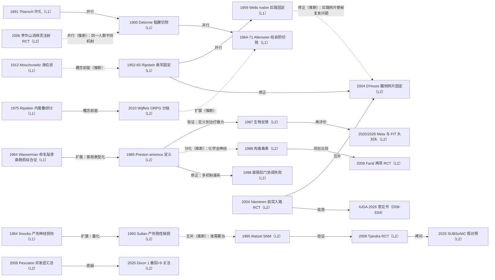

# D08 盆底功能障碍与出口梗阻：盆底失弛缓、直肠前突、直肠脱垂与肛门失禁

> **一句话判断**：这个方向的研究史，是一部从"外科解剖修复"（环扎、切除、悬吊固定）转向"功能评估与功能恢复"（测压—排粪造影定义盆底失弛缓，生物反馈与骶神经调控，以症状和生活质量为终点）的历史。今天三条主线的证据强度迥异：盆底失弛缓以生物反馈为一线（Meta OR 3.63）但最优形式与幅度未定；直肠脱垂至今没有定论级术式证据（Cochrane 全领域仅 12 个 RCT/380 人）；肛门失禁完成了"括约肌修补→骶神经调控（SNM）"的转向，但 2025 年首个假对照试验未能证明 SNM 的实验性疗效。中国线以消痔灵注射固脱独树一帜，其 2006 年随机对照是成人直肠脱垂注射路线目前唯一可核的 RCT。

## 0 三分钟速读

① **从哪里来**：直肠脱垂的四大手术原型全部在 1971 年前定型——Thiersch 1891 年肛管环扎 [D08-N01]、Delorme 1900 年经会阴黏膜袖切除 [D08-N02]、Ripstein 1952–1965 年经腹网片悬吊 [D08-N03]、Altemeier 1964/1971 年经会阴一期切除 [D08-N05]，其间 Wells 1959 年 Ivalon 海绵后路固定补上后路线第三环 [D08-N17]；功能线起于 Wasserman 1964 年命名"耻骨直肠肌综合征" [D08-N04]。
② **为什么改变**：Preston & Lennard-Jones 1985 年用水囊逼出试验＋盆底肌电把"排便困难"变成可测表型 [D08-N06]；Sultan 1993 年量化产伤隐性括约肌损伤（初产妇新发缺损 35%、剖宫产 0 例）改写女性失禁病因 [D08-N09]；Ripstein 式固定术后便秘高发，直接催生 D'Hoore 2004 年"少游离、前腹侧"的腹侧网片固定 [D08-N13]。
③ **如何分化**：盆底失弛缓分化出生物反馈 [D08-N07]、肉毒毒素 [D08-N08] 与肌肉切开三条支线，"切肌肉"被 Nijmegen 学派长期观察否定；失禁线走向神经调控 [D08-N10]；直肠前突入路之争由随机试验定调（经阴道组前突复发 7% vs 经肛 40%）[D08-N12]；内脱垂获得 Oxford 分级与"前兆"框架 [D08-N16]；中国把痔的硬化注射扩展为成人直肠脱垂固脱方案 [D08-N14]。
④ **现在研究什么**：SNM 首个假对照试验（SUBSoNIC，P=0.06 阴性）与其适应证向顽固便秘、低位前切除综合征扩展；生物反馈 vs 注射填充物头对头（FIT 试验）与"表型驱动"个体化（天津磁电生物反馈 RCT）；经肛内镜直肠固定等器械化手术；产伤预防包（OASI Care Bundle）的整群随机评估。
⑤ **用了什么数据**：从单中心累积系列（Altemeier 12 年/19 年两度总结）走向盆底生理测试平台（测压/排粪造影/腔内超声/3D 高分辨率测压）、RCT 与假对照设计、全国登记队列（芬兰 FINPOP 3515 例，NCT02716506）与 NCT 注册终点核对；撤稿数据库监测已成为本方向证据梳理的常规路径。
⑥ **还有什么不知道**：直肠脱垂术式比较的随机证据几乎空白；SNM 临床应用 30 年仍无完成的假对照证据；中国消痔灵/明矾注射线 1970–80 年代原始文献在开放层不可达；CNKI/万方不可得使中国线早期环节只剩转述层。

**覆盖边界**：纳入——直肠脱垂术式演进（环扎/切除/悬吊/腹腔镜与腹侧网片固定/经肛器械化）；直肠内套叠与内脱垂自然史；盆底失弛缓（命名、定义、生物反馈、肉毒毒素、耻骨直肠肌切开之争）；直肠前突手术入路（经阴道/经肛/经会阴/腹侧网片固定）；肛门失禁（括约肌修补→SNM→注射填充物）；产伤与括约肌损伤流行病学；中医注射固脱传承线。STARR 术式细节归 D07，本章只点其并发症谱与证据诚信风波；STARR vs 生物反馈 RCT（Lehur 2008，119 例随机，PMID 18642046）按分工归 D07。不含便秘总体与泻剂（D07）、排便造影/测压方法学（D11）、泌尿妇科盆底（边界外交叉）。

**本章口径**：执行日/报告截止日 2026-10-18；近期重点窗口 2021-10-18 至 2026-10-18。阅读层级：L0=仅二手转述、L1=题录已核实、L2=摘要已读、L3=原文部分章节已读、L4=全文已读；只到 L0/L1 的不写"已核对原文贡献"。本章节点 17 个，按层级：L2×11、L1×6；无 L0 节点，但中国注射线的 1970–80 年代源头（史兆岐段）与小儿明矾注射全国推广停在 L0 转述（见第 1、6、8 节）。全部节点与入口文献经本轮独立核查：13 个节点通过、4 个节点按核查修正值吸收（Thiersch 重印本题名补传记前缀、Ripstein 1963 篇补合著者、Altemeier 两篇卷期改正、Hallan 期号改正并补注失败细节），另据核查补充新增 1 个节点（Wells 1959 [D08-N17]）；17 个编号节点与 8 篇入口文献无删除级、无存疑级条目，未编号文献中 Maher & Baessler 2006 与 FIGO 2020 两篇妇科证据链文献维持“存疑”标注（本轮未经独立复核，见第 2 节转折六）；8 篇入口文献中 3 篇刊名/卷期按核查修正。1880s–1970s 经典原文多不可达（不在 PMC、付费墙或仅中文全文在 CNKI），相应节点维持 L1，详见第 8 节。**覆盖状态（完整性检查二轮复评）：基本完整但有标注缺口**——六个问题（从哪里来、为什么改变、如何分化、现在研究什么、用了什么数据、还有什么不知道）均可据本章回答；章节范围内主要分支（脱垂术式四原型与腹/会阴之争、盆底失弛缓三支线、SNM 与注射填充、前突两学科线、内脱垂自然史、中国注射固脱线）均有节点与可核来源；缺口限于第 8 节已标注项（经典原文多维持 L1、CNKI/万方不可达、中国注射线 1970–80 年代源头停于 L0 转述、两篇妇科证据链文献存疑未复核），完整性检查三条意见已在二轮修订中逐条落实。

## 1 源头：最初在研究什么

起点按四类标注："目前最早找到的文献"限本轮数据库与公开档案可达范围，不是断言式第一；"被公认的奠基工作"指后续系统评价与指南共同回指的工作；"存在争议的首次"保留两说。

**（1）直肠脱垂的四大手术原型（皆 1971 年前定型）。**

- **环扎线（被公认的奠基工作，L1）**：1891 年德国外科医生 Carl Thiersch 提出以金属丝/带环扎肛管下端防止脱垂复出，本轮依据是 1988 年 Dis Colon Rectum"经典论文"重印本（经核查补全实题：Carl Thiersch 1822-1895. Concerning prolapse of the rectum with special emphasis on the operation by Thiersch，DCR 1988;31(2):154-155，PMID 3276468）[D08-N01]。限定：1891 年德文原文未获（无 DOI/PMID），不能排除更早的类似环扎尝试；环扎因复发、缝线感染与大便嵌塞退居高龄/高危患者的姑息选项，现代变体（生物补片 Thiersch，DCR 2017，PMID 28059915；Mersilene 带，2026 个案系列）仍见于高龄患者报告。
- **黏膜切除（被公认的奠基工作，L1）**：1900 年法国 Delorme 报告经会阴切除直肠黏膜袖并折叠肌层（Bulletin et Mémoires de la Société des Chirurgiens de Paris 1900;26:499-518；题录经开放全文参考文献列表核实）[D08-N02]。法文原文未获；现代远期数据由 Placer 2015 补足：42 例（中位 76 岁）、中位随访 85 个月复发 12%（5 年累积复发率 9.9%）、并发症 9.5%、无死亡，便秘与同期盆底修补为复发相关因素（Gastroenterol Res Pract 2015;2015:920154，L2/L3）。
- **悬吊固定（目前最早找到的文献，L1）**：Ripstein 自 1952 年 Am J Surg（83:68-71，PMID 14903331）起，经 1963 年 Ann Surg（157:259-264，经核查补全为 Ripstein CB 与 Lanter B 合著；该篇存在 PMC 扫描、本轮被访问验证页拦截未读）至 1965 年 DCR（8:34-38，PMID 14255004）确立经腹网片固定路线，1987 年以 Gore-Tex 更新悬吊材料并称三十年应用复发罕见（Am Surg，PMID 3800163，题录转述）[D08-N03]。其病理假说上承 Moschcowitz 1912 年"滑疝/盆底固定缺陷"说（DCR 1983;26(8):553-565 经典重印，PMID 6347568，L1）。腹入路的另一平行起源"切除＋固定"（Frykman-Goldberg 术）本轮只定位到术式命名综述（PMID 3376679），原始题录见第 8 节待核线索。
- **后路线补环（本轮核查补充，L1）**：Wells 1959 年以 Ivalon 海绵行后路直肠固定（Proc R Soc Med 1959;52:602-603，PMID 13843894）[D08-N17]——后路网片线 Ripstein→Wells→D'Hoore 的关键一环。
- **经会阴切除（被公认的奠基工作，L1）**：Altemeier 等以经会阴一期直肠乙状结肠切除＋吻合治疗全层脱垂，12 年（Arch Surg 1964;89:6-16，PMID 14148777，卷号经核查由 88 改正）与 19 年（Ann Surg 1971;173(6):993-1006，期号经核查改正；PMC 扫描存在、本轮被拦截未读）两度总结，1971 年篇被引 287 次；后世称 Altemeier 术 [D08-N05]。原文例数与复发率未能自原文核证；其 20 世纪末复兴由 Cincinnati 系列记录：372 例（1976–1994）中经会阴切除术占比从 1976–1980 的 22% 升至最后五年的 79%，女:男 9:1，但随访问卷回复率仅 40–49%（Kim 1999，DCR 42(4):460-466，PMID 10215045，L2）。

**（2）功能线源头：从命名到客观表型（L1→L2）。** Wasserman 1964 年在 DCR 提出"耻骨直肠肌综合征（rectal stenosis due to anorectal spasm）"（DCR 1964;7:87-98，PMID 14128302，本轮题录层）[D08-N04]，把排便困难归因于盆底横纹肌功能性狭窄并暗含"松解肌肉"的治疗方向。1985 年 Preston & Lennard-Jones 用直肠水囊逼出试验＋用力时盆底肌电定义 anismus：慢传输便秘患者不能排出水囊、用力时盆底横纹肌肌电反常增强（Dig Dis Sci 1985;30(5):413-418，PMID 3987474，L2）[D08-N06]；同期荷兰 Nijmegen 的 Kuijpers & Bleijenberg 以荷兰文命名"痉挛性盆底综合征"（Ned Tijdschr Geneeskd 1985;129:1624-8，PMID 4047220，L1）。概念先声可上溯至 1981 年 Gastroenterology 一则"Biofeedback…maybe for constipation"评论（80:1089-1090，PMID 7202972，L1，据核查补记）。影像基线的另一警示属 D11 主线，此处点到：Shorvon 1989 年对健康志愿者的排便造影显示正常人亦常见前突/内套叠样"异常"（Gut 1989;30(12):1737-1749，PMID 2612988，L1）——影像异常不等于疾病。

**（3）失禁线源头：产伤神经损伤与测量工具。** 电生理前驱为 Snooks 等关于阴道分娩致盆底神经损伤的研究（J Neurol Neurosurg Psychiatry 1984;47(12):1269-1273，PMID 6512547；续篇 Int J Colorectal Dis 1986;1(1):20-24，PMID 3598309；均 L1，据核查补出题录）；量化奠基为 Sultan 1993（NEJM 329(26):1905-1911，PMID 8247054，L2，见第 2 节）[D08-N09]。结局测量层面，Jorge & Wexner 1993 年的肛门失禁评分（DCR 1993;36(1):77-97，PMID 8416784，L1）成为此后失禁与 SNM 研究的通用工具。

**（4）中国注射固脱线的源头（转述层 L0＋可核锚点 L2）。** 消痔灵（含鞣质硬化剂）由中国中医科学院广安门医院史兆岐于 1970 年代末按中医"酸可收敛、涩可固脱"理论研制，最初用于三期内痔——此段仅有医院官网技术页与人物报道支撑（L0 转述），1980 年代"注射治疗成人直肠脱垂"的原始论文本轮未在 PubMed/CNKI 公开层查到。可核的现代锚点是其学术继承人李华山团队 2006 年的 36 例随机对照（首都医科大学学报 2006;27(6):812-815，期刊官网摘要页已读）[D08-N14]。小儿直肠脱垂注射传统（1970–80 年代明矾液/消痔灵全国推广）的中国原始文献同样不可达，国际平行仅有巴西 1981（PMID 6974376）与乌兹别克 1980（PMID 7414844）两篇题录（L1）。

## 2 关键转折：问题—新证据/新方法—认识变化—新问题

**转折一：脱垂手术从"缩窄/去组织"到"固定"，再到"少游离"（1891→1952→1959→2004）。** 环扎 [D08-N01]、黏膜切除 [D08-N02]、悬吊固定 [D08-N03]、经会阴切除 [D08-N05] 与 Wells 后路海绵固定 [D08-N17] 构成并存的手术原型；Cochrane 2008 对腹入路与会阴入路孰优的结论是"证据不足以判定、无法确定或排除临床重要差异"（12 个 RCT/380 人；侧韧带切断减少复发但加重便秘、切除固定者便秘更少；Cochrane Database Syst Rev 2008，CD001758.pub2，PMID 18843623，检索至 2008-01-10，L2）。D'Hoore 2004 年针对"既往网片悬吊技术术后便秘常见、疑因直肠完全游离致自主神经去神经"的问题（摘要原句，经核查核实），改为仅前腹侧游离的腹腔镜腹侧网片固定（VMR）：42 例中位随访 61 个月（29–98），远期复发 2 例，31 例失禁中 28 例显著改善，19 例梗阻性排便中 16 例缓解，随访中新发轻度梗阻仅 2 例，未诱发慢传输顽固便秘；扩至 109 例复发 3.66%、轻微并发症 7%（Br J Surg 2004;91(11):1500-1505，PMID 15499644；Surg Endosc 2006;20(12):1919-1923，PMID 17031741；均 L2）[D08-N13]。关系判定：Ripstein→Wells 为并行（同为后/侧方网片固定，综述归纳）；Wells→D'Hoore 为修正（推断：VMR 原文明言针对"most mesh suspension techniques"的术后便秘，Ivalon 海绵线亦属此类）；脱垂患者常合并内套叠与前突，是 VMR"一次手术兼顾"的动机。

**转折二：出口梗阻从概念命名到可测表型，再到多机制谱系（1964→1985→1998）。** Wasserman 的命名 [D08-N04] 经 Preston 1985 的客观化 [D08-N06] 变成可研究的表型。Rao 1998 年再修正：35 例便秘患者中 18 例为梗阻性排便，机制分三型（直肠推进力不足/反常收缩/松弛不良）；25 名健康人中 5 人（20%）也呈"不协调型"、但仅 1 例球囊逼出失败——单次测压下诊断的假阳性风险自此被记录；生物反馈纠正了这些病理生理异常并改善便秘（Am J Gastroenterol 1998;93(7):1042-1050，PMID 9672327，DOI 10.1111/j.1572-0241.1998.00326.x，L2）[D08-N11]。这解释了为什么单一"放松训练"对部分患者无效，也为罗马标准的 dyssynergic defecation 定调。

**转折三："肌肉"治疗三支线的分化与"切肌肉"的边缘化（1987→1988→1991→1996→2009）。** Bleijenberg & Kuijpers 1987 年以生物反馈治疗痉挛性盆底综合征：10 例中 7 例完全成功，3 例部分改善者中 2 例后来行次全结肠切除后排便恢复正常（细节经核查补注；DCR 1987;30(2):108-111，PMID 3803114，L2）[D08-N07]——证明不切肌肉也能治"肌肉病"，治疗目标从解剖修复转向神经肌肉再学习。Hallan 1988 年在 Lancet 以肉毒 A 毒素注射耻骨直肠肌/括约肌复合体治疗 7 例 anismus，症状评分改善伴最大自主收缩压与挤压压显著下降、排便时肛直肠角增大（Lancet 1988;2(8613):714-717，期号经核查改正，DOI 10.1016/S0140-6736(88)90188-2，PMID 2901570，L2）[D08-N08]——把"削弱肌肉"从不可逆手术变成剂量可控、可重复的注射。反面证词同样来自 Nijmegen：Kuijpers & Bleijenberg 1991 年综述明言"旨在削弱盆底功能的手术无长期良好效果并可能导致大便失禁"（PMID 1812414，L2）；van Tets 等 1996 年前瞻 12 例神经源性失禁，生物反馈训练 12 周后 0 例改善（静息压 7→9 kPa、挤压压 3.9→4.9 kPa，无临床意义；PMID 8797647，L2）——生物反馈不是万能的盆底治疗。头对头证据迟至 2009 年由埃及 Mansoura 团队补上：30 例男性随机，耻骨直肠肌部分切除长期成功率 66.6% 高于肉毒 40%（初始 86.7%），但切除组 2/15 轻度失禁（Int J Colorectal Dis 2009;24:327-34，PMID 19039596）；48 例随机，生物反馈长期成功 25% vs 肉毒 33.3%（Int J Colorectal Dis 2009;24:115-20，PMID 18719924；均 L2）。国际系统综述（2016/2020/2023，PMID 27602248/32403161/37816487，L1 题录）一致结论：三类方法证据均有限、肉毒效应短暂。关系判定：定义→生物反馈为验证接力（原文明确讨论"教会患者用力时放松盆底"）；定义→肉毒为分化（推断）；同组 1994 年随机（20 例，EMG 反馈优于气囊反馈，PMID 8017359，L2）与 Heymen 2007 年三臂随机（84 例：生物反馈 30/地西泮 30/安慰剂 24，生物反馈优于两对照，DCR 50:428-41，PMID 17294322，L2）逐步把生物反馈推为一线；切开术在临床已边缘化但未消失。

**转折四：产伤改写女性失禁病因，预防走向"打包化"（1984→1993→2017–2022）。** Sultan 1993 年前瞻队列（202 例产前入组、产后 6 周复查 150 例、32 例异常者 6 个月复查）以腔内超声＋测压量化：初产妇新发括约肌缺损 28/79（35%）、随访至 6 个月的 22 例缺损全部持续；经产妇产前已有缺损 40%、产后 44%；23 例剖宫产 0 例新发缺损；产钳 8/10 有缺损、吸引器 0/5；内括约肌缺损伴静息压显著降低（61±11 vs 48±10 mmHg）（NEJM 1993;329:1905-1911，DOI 10.1056/NEJM199312233292601，L2）[D08-N09]。女性失禁从"老年退行"改写为"产科机械事件＋神经损伤"。测量端由 Wexner 失禁评分（PMID 8416784）标准化。预防端：英国 16 个产科单位 2017-01 至 2018-03 实施 OASI Care Bundle 四要素（产前讨论 OASI、手法会阴保护、60° 中侧切开指征、产后系统检查含肛直肠），评估显示 OASI 率下降（Int Urogynecol J 2021;32(7):1989-1995，PMID 33988784，L2）；因非随机设计与 Hawthorne 效应受限，OASI2 整群随机实施研究方案 2021 年发布（Implement Sci 2021;16:55，PMID 34022926，L1；DOI 10.1186/s13012-021-01125-z 经核查修正）；16 单位 16 个焦点组 101 名临床医生（37 产科医生＋64 助产士）的定性研究显示两类人群对"是否需要改变现有实践"看法相似，分歧主要在"女性想要什么"主题与会阴保护技术变化（BMJ Open 2020;10(9):e035674，期号经核查改正，PMID 32907894，L2；抽查依摘要与 PMC 全文改正——原句"认知不同"与原文相反）；阶梯楔形评估报告 2022 年刊出（BJOG，PMID 34545987，L1）。中国肛门失禁共识（2022 版）亦将产伤列为首要病因（中华胃肠外科杂志 2022;25(12):1065-1072，PMID 36562229，L2）。

**转折五：失禁治疗从修补结构到调节神经，30 年后等来假对照（1995→2004→2008→2025）。** Matzel 1995 年在 Lancet 报告 3 例骶脊神经电刺激治疗大便失禁：2 例完全自制、1 例由重度失禁改善为轻度污便，肛管闭合压随刺激时间延长而增加（Lancet 1995;346(8983):1124-1127，DOI 10.1016/S0140-6736(95)91799-3，PMID 7475602，L2）[D08-N10]，治疗目标从括约肌解剖转向神经通路调节，与产伤病因线构成"谁需要治—怎么治"的互补（推断：SNM 针对的正是"括约肌形态完好而功能不足"人群）。此后：多中心前瞻 37 例测试/34 例植入，失禁发作频率与生活质量改善（Lancet 2004;363:1270-1276，PMID 15094271，L2）；120 例随机 SNM vs 最佳支持治疗（DCR 2008;51(5):494-502，PMID 18278532，L2）。但 2025 年才出现首个假刺激对照试验 SUBSoNIC：筛查 220 例仅入组 39 例（COVID-19 招募受挫）、完成主要终点 16 例，SNM 较假刺激每周失禁发作减少 0.795 次（95%CI -1.5 至 0.0，P=0.06）未达显著，作者明言"未能找到 SNM 实验性疗效的确凿证据"；58 周开放随访仍见改善（6.2→3.2 次/周）（Colorectal Dis 2025;27(11):e70308，PMID 41220094，L2）——临床惯例与实验证据之间出现罕见的 30 年时差。注射填充物支线同样经历证据断裂：Kenefick 2002 年 Gut 硅胶生物材料注射系列（6 例，Gut 51:225-8，PMID 12117884）因作者在整理长期随访时发现原稿重大数据错误而于 2006/2007 撤回（Notice of withdrawal，PMID 17171815），路线由 Graf 2011 年假对照 RCT（dextranomer/透明质酸优于假注射，PMID 21420555，L2）与 2026 年 FIT 试验重建。

**转折六：直肠前突入路之争的随机化与两学科收敛错位（2004→2020→2025→2026）。** Nieminen 2004 年首个随机先导试验（30 例，每组 15）：12 个月症状改善经阴道 93% vs 经肛 73%（P=0.08），需手助排便 7% vs 27%，前突复发 7% vs 40%（P=0.04），新发/残留肠疝 0 vs 4（P=0.05），两组均无新发性交痛、27% 性功能改善（Dis Colon Rectum 2004;47(10):1636-1642，DOI 10.1007/s10350-004-0656-2，PMID 15540292，L2）[D08-N12]。妇科证据链（Maher & Baessler 2006 综述，PMID 15838586，本轮未经独立复核；SGS 系统综述，检索至 2018-04-04，PMID 31256222，L2；FIGO 2020 更新，PMID 31628853，本轮未经独立复核）把"无网片经阴道修补"推为一线；SGS 2019 同时记录阴道骶棘固定术后解剖改善但排便症状反而加重的反例——"解剖修复≠功能改善"在后盆底同样成立。肛肠界继续比较：Balata 2020 经会阴 vs 经阴道 RCT（64 例，结果相当，PMID 31996580，L2）；Sanad 2025 腹腔镜腹侧网片固定 vs 经阴道修补 RCT（40 例，便秘评分与性功能评分相当，Tech Coloproctol 2025;29(1):125，PMID 40423835，L2）。IUGA 2026 意见书（与 ASCRS 联合）定调：保守治疗一线；自身组织经阴道前突修补为安全有效的一线手术；超声/动态 MRI/排粪造影用于分流（Int Urogynecol J 2026;37(1):75-85，PMID 41217465，L2）。妇科指南层已收敛、肛肠界仍在比较，两学科结论错位。

**转折七：内脱垂获得可分期的自然史框架（1975→2010）。** 概念前驱是 Ripstein 主持的 1975 年 DCR 研讨会"内套叠=一期脱垂"（DCR 18(6):458-460，标题即含 internal intussusception (Stage I rectal prolapse)，PMID 1181147，L1）。Wijffels 2010 年以 Oxford 直肠脱垂分级（ORPG 1–5 级）分析 531 例排粪造影患者（女 89%）：各级平均年龄显著递增（1 级 38.6 岁、2 级 52.1 岁、3 级 56.0 岁、4 级 60.3 岁、5 级 66.5 岁），支持内脱垂为外脱垂前兆（Colorectal Dis 2010;12(8):822-830，PMID 19508530，L2）[D08-N16]。这给了内套叠可分期的语言，使"内脱垂→梗阻性排便→外脱垂"成为可研究的时间轴；但横断面年龄阶梯不能证明个体纵向进展（原文自承 lack of longitudinal follow-up）。

**转折八：中国注射固脱线给出首个随机证据（2006），并与国际环扎线融合（2021）。** 李华山等 36 例完全性直肠脱垂随机（高浓度 20/低浓度 16）行消痔灵双层 4 步注射（两侧骨盆直肠间隙＋直肠后间隙＋直肠黏膜下层）：近期疗效高浓度组 19/20 临床控制（另 1 例有效）、低浓度组 16/16 临床控制（组间无显著差异），未见严重肝肾功能损害；3–36 个月随访复发 7/36（4 例再注射后达临床控制、1 例开腹肠切除、1 例开腹直肠悬吊固定、1 例 PPH）；作者结论"痛苦小、操作简便、费用低、可重复，宜作基层首选"（首都医科大学学报 2006;27(6):812-815，期刊官网摘要页全文已读，L2）[D08-N14]。这是成人脱垂注射固化路线目前唯一可核的 RCT——但对照臂为不同药物浓度而非安慰剂/手术，且无 3 年以上随访。2021 年 Wang 等报告改良 Gant-Miwa-Thiersch 联合黏膜下/直肠周围硬化剂注射治疗全层脱垂（BMC Surg 2021;21(1):284，PMID 34090388；中国应用人群复发 23.8%，经摘要核实）——中西两条技术线在"注射＋环扎"处交汇。吻合器线（STARR）的并发症谱由 Pescatori & Gagliardi 2008 系统化：直肠阴道瘘、慢性肛痛、直肠壁血肿、穿孔伴盆腔脓毒症（常需转流性造口），并把肠疝与盆底失弛缓列为禁忌（Tech Coloproctol 2008;12(1):7-19，PMID 18512007，L2）[D08-N15]；15 年 1726 例（1280 STARR＋446 Longo）单中心系列＋法医学视角于 2024 年延续（Am J Surg 2024;229:169-173，PMID 38042721，L2）。STARR 术式主线归 D07，本章保持"并发症与诚信争议如实记录、术式评价点到"的边界。

## 3 分支图

实线=原文明确讨论或综述归纳的关系；虚线=本报告推断或概念史联系。

## 4 近五年重点（2021-10-18 至 2026-10-18）

**（1）SNM 适应证扩展与首个假对照试验的拷问。** 研究问题：SNM 在失禁之外能否走向顽固性慢传输便秘与低位前切除综合征（LARS），以及它 30 年的临床使用能否通过假对照检验。数据与设计：多中心双盲交叉 RCT（活动刺激 vs 假刺激）、开放标签实用型随机试验、RCT 的 Meta。代表研究：①SUBSoNIC（Colorectal Dis 2025;27(11):e70308，PMID 41220094）：10 中心筛查 220 例、入组 39、完成主要终点 16，SNM 较假刺激每周失禁发作 -0.795（95%CI -1.5 至 0.0，P=0.06），结论为未能证明实验性疗效；②荷兰 No.2-Trial（Ann Surg 2024;279(5):746-754，PMID 37991178，NCT02961582）：67 例顽固特发性慢传输便秘随机，6 个月治疗成功率 SNM 53.7% vs 个体化保守治疗 3.8%（OR 36.4，95%CI 3.4-387.5，P=0.003）；③SANLARS（Dis Colon Rectum 2024;67(3):435-447，期号经核查改正，PMID 38084933，NCT02517853）：测试期 LARS 评分下降≥50% 者进入开机/关机随机期；④SNM 治慢性便秘 RCT 的 Meta（Neuromodulation 2025;28(5):737-745，DOI 10.1016/j.neurom.2025.03.001，PMID 40196977，题录经核查补全；摘要已读，L2）：5 个 RCT/187 例（SNM 154 例 vs 对照 119 例，含交叉假刺激与保守治疗），便秘缓解合并 OR 1.92（95%CI 0.68-5.42，P=0.217）不优于对照，便秘评分中位降幅 27.9% vs 18.4%，生活质量无显著差异，不良事件相当（OR 2.22，95%CI 0.19-25.53），结论为 SNM 对便秘与生活质量均未见可察觉改善（检索至 2024-03）。分歧：SUBSoNIC 因招募崩溃（16/39 完成主要终点）检验效能不足，与实用型阳性结果（OR 36.4）正面并存，SNM 治便秘 Meta 合并结果亦为阴性（见④），构成"广泛使用 vs 实验证据薄弱"的冲突。成熟度：SNM 治失禁临床成熟、实验证据存疑；治便秘/LARS 发展中。

**（2）生物反馈的再评价：头对头、数字化与表型驱动。** 数据与设计：多中心 RCT、RCT 系统评价（Cochrane 偏倚工具＋GRADE）、单盲 RCT 结合 3D 高分辨率测压预测模型。代表研究：①FIT 试验（Clin Gastroenterol Hepatol 2026，DOI 10.1016/j.cgh.2026.09.040，PMID 42838314，NCT03811821）：美国 5 中心，筛查 8705 人、275 例进入药物＋行为治疗阶段、200 例无应答者随机（注射 101 vs 生物反馈 99，女 88%），3 个月失禁发作≥75% 减少的比例两组相当；②Tu 2026 Meta（Front Med 2026;13:1759161，PMID 42292261，检索至 2025-08-19）：19 个 RCT（自 3757 条记录筛出），总有效率 RR 1.23（95%CI 1.12-1.34）、周排便频率 +1.60 次、症状评分 SMD -1.07、生活质量 SMD -0.74，作者自承样本小、GRADE 受限；③Geng 2026（Int J Colorectal Dis 2026;41(1):76，PMID 41784838）：天津联合医学中心 68 例排粪造影确认的中度前突相关梗阻性排便女性，磁电生物反馈 vs 常规生物反馈（1:1 单盲），磁电组快肌募集、肛门直肠功能与生活质量显著改善，并以 3D 高分辨率测压表型构建"生物反馈或手术"的分层预测模型；④经皮胫后神经刺激（PTNS）近五年两篇 RCT（摘要均已读，L2）：Cureus 2025;17(3):e80885（PMID 40255795）60 例 ODS（女 38）随机，双侧 PTNS 组便秘评分改善 66.7%±8.4 vs 生物反馈组 47.4%±10.4（P<0.001），生活质量（PAC-QoL）改善 60.4% vs 42.6%；Tech Coloproctol 2025;29(1):178（PMID 41099902）50 例无解剖异常 ODS 随机，双侧 PTNS＋药物 6 周 MODS 评分下降 10 分 vs 单纯药物 4 分（P<0.001），PAC-QOL 降幅 65% vs 37%。两篇均单中心小样本阳性结果，作者自承有待多中心验证。分歧：Meta 持续阳性但 GRADE 受限；FIT 显示生物反馈与注射填充物"相当"而非"更优"；生物反馈对神经源性失禁无效的负性结论（PMID 8797647）仍在划界。中国团队走"影像＋测压表型驱动个体化"路线，与欧美"头对头等效性检验"路线并行。成熟度：发展中。

**（3）器械化/腔内经肛的直肠脱垂手术。** 数据与设计：前瞻性技术演进系列、系统综述、RCT。代表研究：①经肛自然腔道内镜直肠固定 NOrectopexy（Dis Colon Rectum 2023;66(1):118-129，PMID 36515516）：单中心 29 例（前 12 例初版、后 17 例改良版——腹侧经皮缝合固定＋黏膜下隧道打钉固定于骶岬），技术可行、短期结局可接受，原文自述该路线"在很大程度上仍是实验性的"；②以健康相关生活质量为终点的直肠脱垂手术系统综述（Tech Coloproctol 2025;29(1):159，PMID 40813512，题录核实）——终点从复发率转向 QoL 的信号；③机器人直肠固定 vs 会阴入路综述（Cureus 2025;17(11):e96696，DOI 10.7759/cureus.96696，PMID 41399587，题录经核查补全）。分歧：腔内手术证据仍为早期系列；机器人与腹腔镜的成本效益未定。成熟度：早期线索至发展中。

**（4）ODS 手术的证据整合与安全性再审视（VMR vs STARR vs 局部修补）。** 数据与设计：叙述性综述（SANRA 评价）、RCT、学会意见书、卫生政策文件与学术诚信监测。代表研究：①VMR vs STARR 临床综述（Updates Surg 2025;77(5):1645-1655，PMID 40581891）：2004–2025 年 43 项研究，两法早期症状缓解均显著，核心权衡是 STARR 长期便急与 VMR 网片相关风险；②Sanad 2025 RCT（PMID 40423835，见第 2 节转折六）；③学术诚信事件：英国 Bristol 的 Dixon 因 GMC/MPTS 2024 年 7 月暂停执业（2025 年 1 月延长），其 10 篇 Colorectal Disease 论文于 2025 年 4 月被处理——1 篇撤回（2017 年接收未刊）＋9 篇编辑关注（含 2010 年 STARR 中期结果、VMR 系列、2013 年 VMR 专家共识）；背景为 Spire 对 544 例审查发现 259 例受损、Southmead 调查认定 203 例不必要手术（Retraction Watch 2025-04-21 报道，https://retractionwatch.com/2025/04/21/suspended-uk-surgeon-tony-dixon-expressions-of-concern-withdrawal ，L2）。分歧：IUGA 2026（妇科主导）推经阴道修补一线，肛肠界强调 VMR 对内套叠/全层病变的整体固定价值；英国部分卫生辖区已对 STARR 与 VMR 设政策限制（公开政策页转述层，L0）；Dixon 事件后两条路线的既有证据（尤其专家共识类）可信度受损。成熟度：证据整合期。

**（5）产伤性括约肌损伤的预防路径（OASI Care Bundle）。** 数据与设计：质量改进项目（16 个英国产科单位）、整群随机实施研究、定性研究、阶梯楔形评估、系统综述。代表研究：OASI2 方案（Implement Sci 2021;16:55，PMID 34022926）、OASI-CB 质量改进项目总结（Int Urogynecol J 2021;32(7):1989-1995，PMID 33988784：四要素，评估显示 OASI 率下降）、临床医生定性研究（BMJ Open 2020;10(9):e035674，PMID 32907894）、阶梯楔形评估报告（BJOG 2022，PMID 34545987，L1）。分歧：质量改进评估显示 OASI 率下降，但非随机设计与 Hawthorne 效应使因果推断受限（OASI2 整群随机即为回应）；60° 中侧切开的普遍适用性存争议。成熟度：预防路径在推广与严格评估并行。

## 5 争议、负性结果与停滞路线

**争议一：STARR 的证据诚信与并发症（STARR 主线归 D07）。** 推广方：对内套叠/前突相关 ODS 症状缓解率高、微创（Schiano di Visconte 2025 归纳 43 项研究，PMID 40581891）；质疑方：Pescatori & Gagliardi 2008 系统警示特有重度并发症并把肠疝与盆底失弛缓列为禁忌 [D08-N15]；Andreoli 2024（1726 例＋法医学视角，PMID 38042721）强调长期后遗症与适应证把控；2025 年 4 月 Colorectal Disease 对 Dixon 10 篇作出 1 撤回＋9 关注（Spire 审查 544 例中 259 例受损、Southmead 认定 203 例不必要手术）。经 PubMed"Retracted Publication"与 Europe PMC 撤稿字段检索，STARR 论文本身无撤稿记录，被处理的是同作者 VMR/STARR 证据群。相邻撤稿（均经 PubMed 核实）：Gut 对 Kenefick 2002 的撤回（PMID 17171815）、Int J Colorectal Dis 2007 年撤回 Gourgiotis 直肠脱垂综述（PMID 17021747）、Hindawi 旗下期刊 2023 年撤稿排便造影论文（PMID 35480080）、Arch Gynecol Obstet 2026 年撤回 LVR＋阴道骶棘固定随机试验（PMID 35835920，撤稿说明 PMID 42443552）。

**争议二：耻骨直肠肌切开 vs 肉毒毒素 vs 生物反馈。** 荷兰 Nijmegen 学派：削弱盆底的手术长期效果差且可致失禁，应弃用（PMID 1812414）；埃及 Mansoura 团队：30 例男性随机显示切开长期成功率 66.6% 高于肉毒 40%（但 2/15 轻度失禁），生物反馈长期仅 25%、肉毒 33.3%（PMID 19039596/18719924）；国际系统综述一致认为三类方法证据均有限。现状：生物反馈一线、切开边缘化但未消失；无大样本长期 RCT，争议以"证据不足"形式持续。

**争议三：SNM 的安慰剂对照证据缺失。** 指南与共识（含中国 2022 失禁共识，PMID 36562229）把 SNM 列为顽固性失禁一线外科治疗；SUBSoNIC 作为首个假对照试验因招募崩溃未能证明实验性疗效（P=0.06）。同类问题亦适用于胫后神经刺激（CONFIdent 系列 2021 年方案 PMID 33950027 已核，最终疗效发表物本轮未锁定）。

**争议四：直肠脱垂腹入路 vs 会阴入路。** Cochrane 2008（12 RCT/380 人）"无法确定或排除临床重要差异"；男性亚组系统综述（Tech Coloproctol 2024;28(1):158，PMID 39538028，期号经核查改正）汇总 8 研究 452 例：腹入路复发 6% vs 会阴 19.3%（RR 0.50，无统计学显著）、后路网片 0.8%、VMR 11.2%、切除固定 0；ASCRS 指南（DCR 2011;54(11):1339-1346，PMID 21979176，L1）维持"年轻者腹入路、老年体弱者会阴入路"的分层框架。临床惯例按年龄/体能/便秘失禁表型分层，且被反复确认"无定论"。

**争议五：直肠前突入路的两学科错位。** 妇科证据链（Nieminen 2004 RCT [D08-N12]、Maher & Baessler 2006、SGS 2019、FIGO 2020、IUGA 2026）倾向无网片经阴道修补（解剖复发少、代价是性交痛风险）；肛肠界继续发展经肛/经会阴/吻合器/VMR 路线；Balata 2020 与 Sanad 2025 两个 RCT 分别显示经会阴≈经阴道、VMR≈经阴道。妇科指南层已收敛、肛肠界仍在比较。

**争议六：注射填充物的数据完整性。** 支持线：Graf 2011 假对照 RCT 阳性（PMID 21420555）、FIT 2026 显示与生物反馈相当、可作门诊选择；质疑线：该路线标志性早期论文（Kenefick 2002 Gut，6 例）因作者发现原数据重大错误撤回（PMID 17171815）。技术仍在用（低门槛），但早期证据链曾断裂，后续 RCT 替代了被撤证据。

**负性结果与停滞路线。** ①耻骨直肠肌部分切除/后切（"切肌肉"路线）：Wasserman 1964 命名 [D08-N04] 后展开，被 Nijmegen 学派明确否定（PMID 1812414）；Farid 2009 虽显示切除组长期成功率更高，但 2/15 轻度失禁未逆转边缘化（PMID 19039596）。②生物反馈治疗神经源性失禁：12 例训练 12 周后 0 例改善（PMID 8797647）——生物反馈的适应证边界。③SNM 首个假对照试验的阴性结果（SUBSoNIC，P=0.06，PMID 41220094）：高价侵入疗法的实验证据断层。④STARR 用于肠疝/盆底失弛缓患者：此类症状源于非解剖因素，吻合器切除无效且并发症风险高（禁忌，[D08-N15]）。⑤阴道骶棘固定改善排便症状的预期落空：SGS 2019 记录解剖改善但排便症状加重（PMID 31256222）——"解剖修复≠功能改善"。⑥以单次测压/影像异常直接诊断盆底失弛缓：健康人 20% 呈不协调型（PMID 9672327）、正常人排便造影常见"异常"（PMID 2612988）——诊断过度化风险自方法学建立之初即被记录。⑦Dixon（英国 Bristol）的 VMR/STARR 证据群：1 篇撤回＋9 篇编辑关注，2013 年"VMR 专家共识"可信度随之受损。

## 6 传承线与国际线

**传承线（中医注射固脱线，本方向核心）。** 接力链：①理论与制剂源头——广安门医院史兆岐于 1970 年代末按中医"酸可收敛、涩可固脱"理论研制消痔灵注射液并提出四步注射法，最初用于三期内痔（医院官网技术页与人物报道，L0 转述；1980 年代原始论文本轮未在 PubMed/CNKI 公开层查到）。②扩展到成人直肠脱垂——史兆岐学术继承人、广安门医院李华山团队 2006 年 36 例随机对照（双层 4 步注射，近期临床控制高浓度 19/20＋低浓度 16/16，复发 7/36，首都医科大学学报 27(6):812-815）[D08-N14]；官网续载派生术式"直肠周围 8 步注射法、盆底 13 点注射法"（L0）。③小儿注射传统——中国 1970–80 年代明矾液/消痔灵注射治小儿脱垂的全国推广，PubMed 同期仅见国际平行（巴西 1981，PMID 6974376；乌兹别克 1980，PMID 7414844，均 L1），中国原始文献未能核证。④与西方环扎线融合——2021 年改良 Gant-Miwa-Thiersch 联合硬化剂注射（BMC Surg 21(1):284，PMID 34090388；复发 23.8%）。⑤指南化——便秘外科诊治指南 2008 草案→2017 版→2025 版（中国普外基础与临床杂志刊出，转述层）；《中国成人慢性便秘评估与外科处理临床实践指南》（中华胃肠外科杂志 2022;25(1):1-9）；慢传输型便秘外科共识（中国医师协会肛肠医师分会牵头，2023，转述层）；《中国肛门失禁诊断与治疗专家共识（2022 版）》（中华胃肠外科杂志 2022;25(12):1065-1072，PMID 36562229，L2，涵盖 SNM 等现代手段并将产伤列为首要病因）。⑥当代表型驱动器械化——天津团队 2026 年磁电生物反馈 RCT（68 例前突相关 ODS，PMID 41784838，L2），把 3D 高分辨率测压表型用于生物反馈/手术分流。西医主线的学派谱系（国际源流）：德国 Thiersch（1891 环扎）、法国 Delorme（1900 黏膜切除）、美国 Ripstein（1952–65 悬吊）与 Altemeier（1964–71 经会阴切除）、英国（Wasserman 1964 虽刊于美国 DCR、功能定义线由英国 St Mark's 系 Preston/Lennard-Jones 1985 与 Sultan/Kamm 1993 承接）、荷兰 Nijmegen 系（Kuijpers/Bleijenberg 1985–1996 痉挛盆底与生物反馈）、德国 Erlangen 系（Matzel 1995 SNM）、美国 Iowa 系（Rao 1998 协调失败）、比利时鲁汶系（D'Hoore 2004 VMR）、英国 Oxford 系（Wijffels 2010 内脱垂分级）、日本 Gant-Miwa 传承（2021 年与消痔灵/硬化剂融合，PMID 34090388）。

**国际线。** ①术式扩散与反向修正：鲁汶把 Ripstein 式固定修正为 VMR [D08-N13]；埃及 Mansoura 团队承担多项独立随机验证（Farid 2009 两项、Balata 2020、Sanad 2025）；芬兰 Tampere Nieminen 组贡献首条前突 RCT（2004）并在后续运行全国盆底手术队列 FINPOP（2015 年全国 3515 例，随访注册 NCT02716506）。②国际系统评价的"降温"作用：Cochrane 2008（12 RCT/380 人，PMID 18843623）、Cochrane 2012 生物反馈/括约肌训练治失禁证据不足（PMID 22786479）、Cochrane 2014 生物反馈治慢性便秘（PMID 24668156）、SGS 2019（PMID 31256222）与 FIGO 2020（PMID 31628853）从妇科侧给出"经阴道无网片一线"。③监管与卫生政策：英国部分卫生辖区对 STARR 与 VMR 设政策限制/审批（公开政策页，L0 转述层）；欧洲以 NCT 注册（NCT02961582、NCT02517853、NCT03811821）约束手术扩散并核对注册终点。④学术诚信监管：Gut 撤回 Kenefick 2002（PMID 17171815）；Colorectal Disease 2025 年 4 月对 Dixon 10 篇撤回＋关注；另有 Hindawi 2023 撤稿（PMID 35480080）、Arch Gynecol Obstet 2026 撤回（PMID 35835920/42443552）、IJCD 2007 撤回 Gourgiotis 综述（PMID 17021747）——均经 PubMed 检索核实，撤稿监测已成为本方向证据梳理必查路径。⑤口径注意：国际学界对针刺类疗法 RCT 的方法学批评（Vickers 1998；Tang & Ernst BMJ 1999）评述病种不含肛肠疾病，本轮亦未检索其原文，如引用只能作跨病种方法学背景，不得写成直接针对肛肠试验的批评（公认转述层，L0）。

## 7 数据路径小结

历史上 vs 现在：①单中心病例系列与累积经验报告——从 Thiersch/Delorme 到 Ripstein（1952–1987 多次总结）与 Altemeier（12 年/19 年两度总结）；该路径的固有缺陷由 Kim 1999 示范：372 例 19 年回顾、随访问卷回复率仅 40–49%（PMID 10215045，L2）。②盆底生理测试平台——直肠水囊逼出＋盆底 EMG（Preston 1985）、排粪造影分级（Wijffels 2010 ORPG 531 例）、正常人排便造影基线（Shorvon 1989，D11 交叉）、直肠肛门协调测压（Rao 1998，25 健康＋35 便秘）；当前演进为 3D 高分辨率测压＋Glazer 表面肌电＋排粪造影表型（Geng 2026，68 例 RCT）。③随机对照试验——数量稀少是本方向的结构性特征：Cochrane 2008 全领域仅 12 个 RCT/380 人；已核 RCT 覆盖生物反馈（Heymen 2007 三臂 84 例；Bleijenberg 1994，20 例）、前突入路（Nieminen 30 例、Balata 64 例、Sanad 40 例）、SNM（Tjandra 120 例、SUBSoNIC 假对照入组 39 例、SANLARS、No.2-Trial 67 例）、注射填充（Graf 2011 假对照、FIT 200 例）、消痔灵浓度对照（李华山 36 例）。④登记库与全国队列——芬兰 FINPOP 2015 全国 3515 例盆底手术队列（NCT02716506）；英国 NHS 16 产科单位 OASI 质量改进项目＋OASI2 整群随机实施研究；男性脱垂亚组只能靠 8 研究 452 例汇总（PMID 39538028）。⑤国际试验注册库与注册终点核对——NCT02961582、NCT02517853、NCT03811821；中国 ChiCTR 在近五年 ODS/生物反馈试验中的应用本轮未专门核证（检索缺口）。⑥中医特色数据路径——消痔灵注射线以脱出长度＋排粪造影为疗效指标、血常规/肝肾功能为安全指标（李华山 2006）；传承叙事依赖院史/官网/纪念文献（L0），原始数据在中文期刊（CNKI 层，不可达）。⑦学术诚信事件监测——PubMed"Retracted Publication"[pt]、Europe PMC 撤稿字段与 Retraction Watch 数据库：本轮实证 Gut 撤回 1、Colorectal Disease 撤回 1＋关注 9、另有 3 起相邻撤稿。方向性变化：终点从复发率/压力数字走向症状量表与生活质量（FIT、No.2-Trial、Geng 2026 均含 PRO 终点）；设计从单臂系列走向假对照交叉与注册终点一致性核对；表型分层（测压参数→治疗分流）正在把"同一诊断、一种术式"的旧路径改为"同一症状、按表型分流"。

## 8 还不知道什么（领域证据缺口）与本报告的检索缺口

**领域证据缺口：**
1. 直肠脱垂术式比较的随机证据几乎空白：Cochrane 2008 仅 12 个 RCT/380 人且明确"无法确定或排除临床重要差异"，此后至 2024 年仍无大规模术式 RCT（男性亚组只能用 8 研究 452 例汇总）——决定了该领域指南长期停留在低等级推荐。
2. SNM 缺乏完成的假对照试验：SUBSoNIC 仅 16 例完成主要终点，30 年临床使用与实验证据之间存在断层；胫后神经刺激（CONFIdent 系列）最终疗效发表物本轮未锁定。
3. 盆底失弛缓的"切开术"仅存 30 例级比较研究（Farid 2009），无长期 RCT；肉毒毒素效应短暂、剂量方案不一。
4. 中国消痔灵/明矾注射线的原始证据不在国际可检索层：史兆岐 1980 年代成人（及 1970 年代小儿）注射的原始论文未能在 PubMed 核证；小儿注射线的全国推广数据缺国际文献；与 CNKI/万方不可达叠加。
5. 内脱垂"前兆"说仍停留在横断面年龄阶梯推断，缺纵向队列验证。
6. 顽固性便秘/LARS 的 SNM 扩展适应证只有实用型阳性试验（No.2-Trial OR 36.4）而无假对照确认。

**本报告的检索缺口与待核线索：**
- Thiersch 1891（德文）与 Delorme 1900（法文）原文未取得，仅到重印本/引用题录层；Wasserman 1964、Ripstein 系列、Altemeier 系列原文无摘要且部分 PMC 扫描（Ripstein 1963 PMC1466428、Altemeier 1971 PMC1397506）被访问验证页拦截未能读取——相关节点维持 L1。
- Frykman-Goldberg"切除＋固定"术的原始报告本轮仅定位到术式命名综述（PMID 3376679），原始题录待查——腹入路平行起源的重要缺环。
- CNKI/万方不可达的影响：中国盆底肛肠学组（中华医学会外科学分会结直肠肛门病学组盆底组）成立时间与成立文件未能核证；便秘外科指南 2008/2017/2025 三版与 2023 慢传输外科共识只到署名与期刊转述层；ChiCTR 注册的中文 RCT 未系统检索——中国线的证据总量可能被系统性低估，本章相应段落已标 L0/L1。
- 待核线索（有线索、未定位原文）：史兆岐 1980 年代消痔灵注射治成人直肠脱垂原始论文（可能载于《中国肛肠病杂志》/《中医杂志》等非 MEDLINE 期刊）；中国小儿明矾液注射 1970s–80s 全国推广原始文献；Snooks 1984–86 前更早的盆底神经损伤研究本轮未追溯（Snooks 本身已核出题录，见第 1 节）；Halligan & Bartram 1990 年代排便造影/超声对内套叠诊断意义的系列（属 D11 主线，本轮仅核 Shorvon 1989 交叉点）；"调度提示的 STARR 撤稿"经检索证伪——STARR 论文本身无撤稿记录，实为同作者证据群的 1 撤回＋9 关注。
- 本章成稿所依赖的调研、核查材料齐备，但本轮批评审读环节的材料缺位（对应问题清单文件未生成），故审读意见逐条处理一项无对象可核；相关质量保障由全报告复核补偿检查覆盖（证据行抽查、跨章事实与关系一致性、机械质检及角色词清除，见第 12 节）。

## 9 本章节点速查表

| 编号 | 年份 | 第一作者+题名简写 | 期刊 | 节点作用 | 设计/数据/分析单位 | 样本 | 关键结果 | 阅读层级 | 核查状态 | PMID/DOI |
|---|---|---|---|---|---|---|---|---|---|---|
| D08-N01 | 1891（1988 重印） | Thiersch C——肛管环扎治脱垂（重印本题含传记前缀 Carl Thiersch 1822-1895） | Dis Colon Rectum | 建立路线：环扎缩窄原型 | 术式报告（1891 德文）/患者 | 原文例数未核证 | 环扎维持复位；因复发/感染退居姑息选项，现代变体仍在用 | L1 | 修正（题名补前缀） | 3276468 / 10.1007/BF02562653 |
| D08-N02 | 1900 | Delorme E——黏膜袖切除+肌层折叠 | Bull Mem Soc Chir Paris | 建立方法：会阴"去组织"原型 | 术式报告（法文未获）/患者 | 原文例数未核证；Placer 2015 现代系列 42 例 | 现代远期复发 12%（5 年累积 9.9%），并发症 9.5% | L1（远期层 L2） | 通过 | 无（题录经参考文献核实） |
| D08-N03 | 1952-1965 | Ripstein CB——经腹网片悬吊固定三篇 | Am J Surg/Ann Surg/Dis Colon Rectum | 建立方法：腹入路"固定"路线 | 外科系列（无摘要）/患者 | 未能核证 | 确立网片固定；术后便秘高发催生后续修正 | L1 | 修正（1963 篇补合著者 Lanter B） | 14903331；13974042；14255004 |
| D08-N04 | 1964 | Wasserman IF——耻骨直肠肌综合征 | Dis Colon Rectum | 提出问题：功能性狭窄命名 | 临床观察/患者 | 未核证（未读正文） | 把排便困难归因盆底横纹肌，暗含"松解"方向 | L1 | 通过 | 14128302 |
| D08-N05 | 1964-1971 | Altemeier WA——经会阴一期切除（12 年/19 年） | Arch Surg/Ann Surg | 建立方法：会阴"切除"原型 | 单中心累积系列/患者 | 未能核证（未获正文；1971 篇被引 287） | 会阴入路复兴（Kim 1999：占比 22%→79%） | L1 | 修正（卷期改 89:6-16 与 173(6)） | 14148777；5578808 |
| D08-N06 | 1985 | Preston DM——Anismus in chronic constipation | Dig Dis Sci | 建立方法：客观表型化 | 水囊逼出+EMG 病例对照/患者 | 总数未在摘要给出 | 便秘者水囊不能逼出、肌电反常增强 | L2 | 通过 | 3987474 / 10.1007/BF01318172 |
| D08-N07 | 1987 | Bleijenberg G——生物反馈治疗痉挛性盆底 | Dis Colon Rectum | 建立方法：功能恢复路线起点 | 单组前后对照/患者 | 10 | 7 例完全成功；3 例部分改善中 2 例后行次全结肠切除排便正常 | L2 | 通过（细节补注） | 3803114 / 10.1007/BF02554946 |
| D08-N08 | 1988 | Hallan RI——肉毒 A 毒素治 anismus | Lancet | 建立方法：可逆化学去神经 | 注射前后对照/患者 | 7 | 症状改善伴压力下降、肛直肠角增大 | L2 | 修正（期号 8613；补 DOI） | 2901570 / 10.1016/S0140-6736(88)90188-2 |
| D08-N09 | 1993 | Sultan AH——阴道分娩括约肌破坏 | N Engl J Med | 提供验证：产伤病因线量化 | 前瞻队列/产妇 | 202（复查 150+32） | 初产新发缺损 35%、剖宫产 0、产钳 8/10；缺损伴静息压降低 | L2 | 通过 | 8247054 / 10.1056/NEJM199312233292601 |
| D08-N10 | 1995 | Matzel KE——骶神经电刺激治失禁 | Lancet | 建立方法：神经调控路线 | 前瞻试验/患者 | 3 | 2 例完全自制、闭合压随刺激增加 | L2 | 通过 | 7475602 / 10.1016/S0140-6736(95)91799-3 |
| D08-N11 | 1998 | Rao SSC——直肠肛门协调失败 | Am J Gastroenterol | 修正认识：多机制谱系 | 前瞻生理研究/患者 | 60（25 健康+35 便秘） | 18/35 梗阻性；健康人 20% 不协调型（假阳性警示） | L2 | 通过（补 DOI） | 9672327 / 10.1111/j.1572-0241.1998.00326.x |
| D08-N12 | 2004 | Nieminen K——前突经阴道 vs 经肛 RCT | Dis Colon Rectum | 提供验证：入路之争首个随机 | 前瞻随机先导/患者 | 30 | 复发 7% vs 40%（P=0.04）；症状改善 93% vs 73%（P=0.08） | L2 | 通过（补 DOI） | 15540292 / 10.1007/s10350-004-0656-2 |
| D08-N13 | 2004 | D'Hoore A——腹腔镜腹侧网片固定 | Br J Surg/Surg Endosc | 建立方法：少游离修正后路便秘 | 前瞻系列/患者 | 42（2006 扩至 109） | 复发 2/42；失禁 28/31 改善；ODS 16/19 缓解；109 例复发 3.66% | L2 | 通过 | 15499644；17031741 / 10.1002/bjs.4779 |
| D08-N14 | 2006 | 李华山——消痔灵双层 4 步注射治完全性直肠脱垂 | 首都医科大学学报 | 形成分支：中国注射固脱线 RCT | 多单位随机（浓度头对头）/患者 | 36 | 近期控制高浓度 19/20（另 1 例有效）＋低浓度 16/16；复发 7/36（4 例再注射控制）；未见肝肾损害 | L2 | 通过 | 无（期刊官网摘要页 URL） |
| D08-N15 | 2008 | Pescatori M——PPH/STARR 术后并发症 | Tech Coloproctol | 提供反证：吻合器安全边界 | 并发症系统综述/研究汇总 | 纳入篇数未核证 | 直肠阴道瘘/慢性肛痛/穿孔脓毒症；肠疝与失弛缓为禁忌 | L2 | 通过 | 18512007 / 10.1007/s10151-008-0391-0 |
| D08-N16 | 2010 | Wijffels NA——内脱垂自然史与 ORPG 分级 | Colorectal Dis | 改变认识：内脱垂"前兆"框架 | 横断面分级/患者 | 531（女 89%） | 各级平均年龄 38.6→66.5 岁递增 | L2 | 通过 | 19508530 / 10.1111/j.1463-1318.2009.01891.x |
| D08-N17 | 1959 | Wells C——Ivalon 海绵后路直肠固定 | Proc R Soc Med | 建立方法：后路线补环（核查补充） | 术式报告/患者 | 未核证 | 后路网片线 Ripstein→Wells→D'Hoore 关键一环 | L1 | 新增（本轮核查补核题录） | 13843894 |

## 10 本章入口文献与检索截止

- D08-E01 Grimes CL，等（SGS 系统评价组）。后盆腔脱垂与排便梗阻症状的手术干预系统综述。Int Urogynecol J 2019;30(9):1433-1454（PMID 31256222）。检索截止 2018-04-04（MEDLINE/Embase/ClinicalTrials.gov）。用于前突入路证据与推荐、阴道骶棘固定排便症状加重的反例。核查通过。
- D08-E02 Moore D，Young CJ。成人盆底失弛缓生物反馈系统综述/Meta。Tech Coloproctol 2021;24(9):909-918（刊名卷期经核查修正；原提交误为 Int J Colorectal Dis 2020;35(5)；DOI 10.1007/s10151-020-02230-9，PMID 32372153）。检索截止 2019-03。用于证据基线：11 试验 725 人、临床改善率 63%、Meta OR 3.63（该组摘要数字本轮未经独立复核，据该综述转述）。
- D08-E03 Emile SH，等。男性完全性直肠脱垂手术系统综述/Meta。Tech Coloproctol 2024;28(1):158（期号经核查修正；PMID 39538028）。检索窗口 2000-01 至 2024-02。用于男性亚组各术式复发率。
- D08-E04 IUGA 意见书（与 ASCRS 联合）。排便梗阻的临床与影像直肠前突处理。Int Urogynecol J 2026;37(1):75-85（PMID 41217465）。学会意见书，未给出检索截止日。用于当前 ODS/前突共识：保守一线、经阴道修补一线手术。
- D08-E05 Tu Y，等。成人慢性便秘生物反馈 RCT 系统评价/Meta。Front Med 2026;13:1759161（PMID 42292261）。检索截止 2025-08-19。用于生物反馈近期证据（19 RCT，RR 1.23）。
- D08-E06 Spivak R，Hu K。直肠脱垂治疗史。Clin Colon Rectal Surg 2025;38(6):363-368（期号经核查修正；PMID 41040126）。叙述性历史综述，未说明检索截止。用于历史框架。
- D08-E07 Varma M，等（ASCRS）。直肠脱垂处理实践指南。Dis Colon Rectum 2011;54(11):1339-1346（DOI 10.1097/DCR.0b013e3182310f75 经核查补全，PMID 21979176）。指南，任务制定期文献综述，未说明检索截止。用于腹/会阴分层框架与"证据等级低故未更新"的背景。
- D08-E08 中国肛门失禁诊断与治疗专家共识（2022 版）。中华胃肠外科杂志 2022;25(12):1065-1072（DOI 10.3760/cma.j.cn441530-20221012-00409，PMID 36562229）。共识文件，未说明检索截止。用于中国线现代段。
- 交叉参考：Cochrane 2008（CD001758.pub2，PMID 18843623，检索至 2008-01-10）为直肠脱垂手术线的证据合成入口（见第 2、4、5、7 节）。
- 本章检索执行日 2026-10-18；入口文献检索截止日之后的 2025–2026 年新证据（SUBSoNIC、FIT、Sanad、Geng、IUGA、Dixon 事件等）已按近期窗口补查并注明。

## 12 复核修订记录（2026-10-18）

以下为全报告复核（基线日 2026-10-18）对本章的修订，逐条注明"来源｜改了哪里｜改前→改后要点"；仅处理清单内问题及连带修改，未新增文献或数字。另按流程完整性补记：本章成稿管线因并发限流跳过了独立批评性审读环节（对应审阅问题清单未生成），该缺口的补偿检查由全报告复核完成——全报告复核时核对了证据行抽查、跨章事实与关系一致性、机械质检及本章角色词清除（见下第 1、2 条），未发现需回改正文事实的遗留问题。

1. 机械质检｜角色名清除｜第 8 节末条与第 9 节速查表 D08-N17 行各残留 1 处流程角色式称谓｜改前：第 8 节以角色名指称"审读意见逐条处理"一项无对象可核、第 9 节 D08-N17 核查状态列写作"新增（角色名＋补核题录）"→改后：第 8 节改为"故审读意见逐条处理一项无对象可核；相关质量保障由全报告复核补偿检查覆盖（见第 12 节）"，第 9 节改为"新增（本轮核查补核题录）"。
2. 机械质检｜复检确认｜角色名清除后全文复检｜改前：流程角色式称谓共 2 处→改后：全文（含本节）复查五类流程角色称谓 0 处；引用节点 [D08-Nxx] 回查证据表的对应关系未受影响，证据表（data/evidence_D08.json）无角色称谓残留，无需改行。
3. 机械质检（流程完整性）｜第 8 节末条与本节补记审读环节缺位的补偿方式｜改前：第 8 节仅记"批评审读环节材料缺位、相关质量保障以核查修正为准"，未说明补偿路径→改后：明确该环节因管线并发限流跳过、由全报告复核补偿检查覆盖，并以全报告复核的角色词检查结果（清除后 0 处）作为补偿核验之一，第 8 节句子同步指向本节。

- **实质错误更正**：OASI Care Bundle 定性研究（D08-R041）key_result 原句「两类人群对是否改变实践认知不同」与原文相反（摘要与 PMC 全文均明确两组看法相似、分歧在「女性想要什么」主题），正文第 2 节与证据行同步改正。van Tets 1996（D08-R048）补原题/刊名卷页/DOI；Wang J 2021（D08-R059）阅读层级 L1→L2。（2026-10-19，汇总者依抽查报告执行）

**第二轮（完整性检查）修订（2026-10-19）**：依最终完整性检查清单（qa_completeness.json 中 id=D08 的 top_issues，共 3 条，均为建议改）逐条落实：

1. 李华山 2006 消痔灵 RCT 近期疗效表述统一｜改动位置：第 2 节转折八、第 6 节传承线、第 9 节速查表 D08-N14 行、证据表 D08-R014 key_result｜改前：第 2 节“高浓度组临床控制 19＋有效 1、低浓度组 16/16”、第 6 节“近期临床控制 36/36”、证据行“近期临床控制 20/20 与 16/16”三处不一致→改后：四处统一为“高浓度组 19/20 临床控制（另 1 例有效）、低浓度组 16/16 临床控制”。
2. “无存疑条目”口径句限定｜改动位置：第 0 节本章口径｜改前：“无删除级、无存疑级条目”易读作全章无存疑条目，与证据表 D08-R057/D08-R058 的“存疑”标注冲突→改后：限定为“17 个编号节点与 8 篇入口文献无删除级、无存疑级条目”，并注明未编号文献中 Maher & Baessler 2006 与 FIGO 2020 维持“存疑”标注（本轮未经独立复核）；第 2 节转折六“本轮未经独立复核”限定语与证据表两行核查状态原样保留。
3. 题录级代表研究补读摘要｜改动位置：第 4 节(1)④、(1)分歧句、(2)④，证据表 D08-R029、D08-R032｜改前：三篇以“代表研究”列入近五年正文但摘要未读、无疗效结果（证据表 L1 明示“摘要未读”）→改后：经 Europe PMC 按 PMID 精确补读三篇摘要（检索 3 次），正文补一句话疗效/合并结果并标 L2——Neuromodulation 2025 SNM 治便秘 Meta 为阴性（5 RCT/187 例，OR 1.92，95%CI 0.68-5.42，P=0.217），第 4 节(1)分歧句补注“SNM 治便秘 Meta 合并结果亦为阴性”；Cureus 2025（60 例，双侧 PTNS 便秘评分改善 66.7% vs 生物反馈 47.4%，P<0.001）与 Tech Coloproctol 2025（50 例，MODS 下降 10 vs 4 分，P<0.001）为阳性，正文并注明两篇均单中心小样本；证据表两行阅读层级 L1→L2、key_result/result_location/limitations 补齐，D08-R032 标题误标“ODS女性”更正（摘要实为 60 例中女 38）。

覆盖状态复评：按统一口径评为**“基本完整但有标注缺口”**，理由已写入第 0 节本章口径末段（六问均可答、主要分支均有节点；缺口限于已标注的经典原文 L1、CNKI 不可达、中国注射线 L0 源头与两篇存疑未复核文献）。本章 OASI 定性研究“两组看法相似”结论维持抽查更正版不动。
