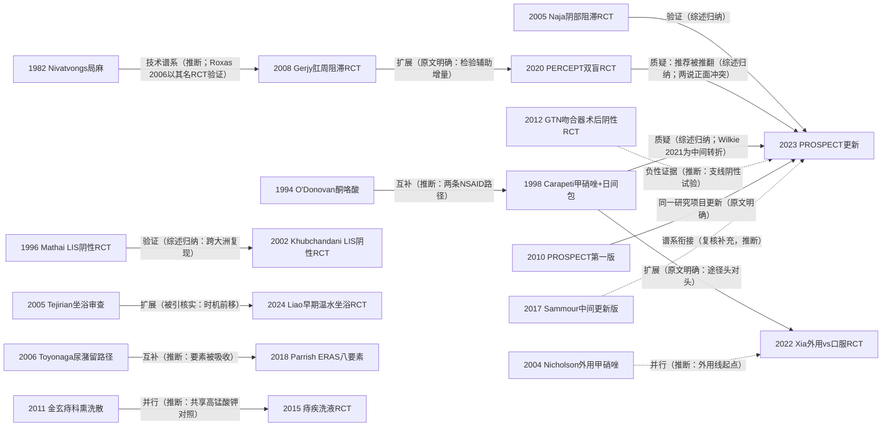

# D09 术后疼痛与坐浴熏洗（中医优势线）

> **一句话判断**：肛肠术后疼痛管理从"忍痛住院"走向"可预测的日间多模式镇痛"——麻醉从全麻/椎管内退到局麻组合（双侧阴部神经阻滞获正式推荐、肛周阻滞陷入本方向最尖锐的证据冲突），药物从阿片退到NSAID与外用药（口服甲硝唑被2023版指南放弃后又被2025–2026年新Meta部分翻案），坐浴从最普遍的术后医嘱变成待证问题（国际线走向"该冷静了"的冰敷转向，中国中药熏洗线以高锰酸钾为共同对照平行推进）。对临床医生最重要的一点：中医熏洗坐浴线试验数量庞大，但至今没有一项前瞻注册RCT进入国际指南证据池，两条线没有同框头对头。

## 0 三分钟速读

① **从哪里来**：起点两端——古典端，痔的熏洗最早见于马王堆帛书《五十二病方》"以熏痔"类记载（L0转述层，引文字句在各转述源间有出入）；现代端，公认奠基是1982年Mayo Clinic的Nivatvongs肛肠局麻技术条目化 [D09-N01] 与1957年Salvati把术后尿潴留变成系统研究对象 [D09-N22]（Am J Surg 94(1):114-117，PMID 13424882）。

② **为什么改变**：痔切除术后剧痛、尿潴留与恶心把患者拴在病床上——1994年术中酮咯酸+口服方案给出"当日出院且尿潴留为0"的第一份量化证据 [D09-N02]；2005年Tejirian一句"坐浴的证据在哪里"（仅找到1项坐浴vs安慰剂随机研究）把惯例变成待证问题 [D09-N07]。

③ **如何分化**：四支并行——麻醉线（阴部阻滞 [D09-N06]、肛周阻滞 [D09-N14]、低剂量脊麻）、药物线（NSAID基础+外用甲硝唑/GTN/地尔硫卓/硫糖铝 [D09-N16]）、路径线（ERAS八要素打包 [D09-N13]）、中医线（金玄痔科熏洗散 [D09-N11]、痔疾洗液 [D09-N12] 等成药vs高锰酸钾）。

④ **现在研究什么**：阴部阻滞的超声化与促排尿终点、甲硝唑给药途径的三篇Meta互搏、坐浴的"冷转向"与创面菌群机制、ERAS在中国日间手术体系落地、阿片处方流行病学。

⑤ **用了什么数据**：从单中心小样本RCT的每日疼痛日记（20–166例），到程序特异性系统评价（PROSPECT 2023筛371项RCT [D09-N16]）、理赔数据库（美国Optum 23426例）、注册库（NCT/ANZCTR/ChiCTR）与创面渗出液16S测序。

⑥ **还有什么不知道**：中药熏洗线无前瞻注册RCT与安慰剂对照、无英文专项Meta；坐浴两线无同框比较；肛周阻滞PERCEPT阳性与PROSPECT负面声明未调和；疼痛测评时点与量表至今未标准化。

**覆盖边界**：纳入——肛肠术后疼痛的测量与流行特征、麻醉技术演进（局麻组合、阴部/肛周阻滞、低剂量脊麻）、多模式镇痛（NSAID/对乙酰氨基酚基础、阿片最小化、外用甲硝唑/GTN/地尔硫卓/硫糖铝）、术后尿潴留与排便管理（作为围手术期管理一部分）、ERAS在肛门日间手术的移植、中药坐浴熏洗线（高锰酸钾对照→成药熏洗剂RCT、温度/疗程参数）。不含——创面愈合与敷料、祛腐生肌（D10，痔疾洗液复合终点与康复新液熏洗撤稿仅注明分工）；术式间疼痛比较的术式学细节（D01，只取"日间疼痛可控"结论）；针灸止痛细部（D12，仅点到）；肛裂药物阶梯（D05，仅坐浴线边缘引用Gupta系列）；术后出血/感染总论（点到）。

**本章口径**：执行日/报告截止日2026-10-18；近期重点窗口2021-10-18至2026-10-18。阅读层级：L0=仅二手转述、L1=题录已核实、L2=摘要已读、L3=原文部分章节已读、L4=全文已读；只到L0/L1的不写"已核对原文贡献"，转述写"据〈来源〉转述"。本章节点21个（1957–2024，含独立复核阶段补充的3个与完整性检查修订补入的Salvati 1957 [D09-N22]），按层级计数：L2×16、L1×5。全部节点经独立复核：13通过、4修正（N08回顾期表述、N11样本量360例并降级L1、N16卷页与作者列、N17关键结果写反）、3新增（N18/N19为复核补充、N20为外审补充，题录均已核实）、0删除；完整性检查修订（2026-10-19）后N11改标存疑（题录经多渠道不可达，移第8节待核线索），Salvati 1957补为N22（题录经Europe PMC与PubMed E-utilities双库核实，卷号94(1)修正原稿之104）。关键注册核对发现两处注册-发表不一致（POHM终点漂移、Liao注册主终点阴性）。**覆盖状态：基本完整但有标注缺口**——理由：六个问题（从哪里来、为什么改变、如何分化、现在研究什么、用了什么数据、还有什么不知道）均可据本章正文与节点回答；麻醉、药物、路径/尿潴留、坐浴（国际线＋中医熏洗线）四个主要分支均有节点链与可核来源；缺口限于第8节已标注项（CNKI/万方未检索、N11题录不可达、ANZCTR/ISRCTN仅间接核对、ASCRS指南正文付费墙、局部注射镇痛注册编号未核实等），无主分支缺节点、无主链关键转折缺可核实来源。

## 1 源头：最初在研究什么

起点说法按四类标注："目前最早找到的文献"是公开资料可达范围内的最早记录，不是断言式第一；"被公认的奠基工作"指后续综述与指南共同回指的工作；限定语逐条给出。

**（1）古典熏洗线（目前最早找到的文献；L0）。** 中药熏洗治痔的最早文字记载见马王堆帛书《五十二病方》，其中有"以熏痔"类记载（熏蒸洗浴八方）。本轮未读帛书原件，属转述层：据《生命时报》/北京清华长庚医院科普转载页（btch.edu.cn/xxdt/mtbd/46591.htm）、汉斯出版社2025年中文综述（D09-E8）等转引；经独立复核另见更强的二手源——2013年广安门医院李华山团队熏洗综述亦以《五十二病方》为最早记载，但调研材料记该文为World Journal of Gastroenterology、复核材料记为《世界华人消化杂志》，期刊归属两说并存且均未附PMID，须核原文后方可引用。注意：引文字句在各转述源间有出入（一作"以熏痔，药寒而休，日三熏"，一作"以熏痔，三日而止"），须以帛书整理本核对后方可锁定句读。《金匮要略》苦参汤熏洗确立"先熏后洗"操作范式；明·陈实功《外科正宗》系统化痔病外治并留下止痛如神汤——该方至今仍以外洗形式用于混合痔外剥内扎术后（山东中医药大学学报2023，题名与期刊层，全文未读）；清·吴师机《理瀹骈文》集外治大成（古籍转述层）。

**（2）肛肠局麻的条目化（被公认的奠基工作；L1）。** Nivatvongs S（Mayo Clinic）1982年在Dis Colon Rectum发表改良肛肠局麻技术（25:259-260，PMID 7067567），描述局限于肛管黏膜下与痔核基底的低容量浸润；1997年同刊再述（40:1128-1129，PMID 9293946）；2006年Roxas & Delima的RCT题名即以"Nivatvongs technique"命名该技术作为对照臂检验（Asian J Surg 29:70-73，PMID 16644505），结果支持其优于常规局麻 [D09-N01]。经独立复核的限定：更早的肛肠局麻技术文献自1950年代已存在（1954透明质酸酶局麻PMID 13197670、1961年题名几乎同构的"An improved type of local anesthesia in anorectal surgery"PMID 13785306、1969技术描述PMID 5818367、1973年576例经验PMID 4741406等，非系统穷举）——Nivatvongs 1982的性质是Mayo条目化命名、并被后续RCT以其名检验的技术坐标，不是最早的肛肠局麻文献。1982年原文无摘要、全文未读，本条止于题录与引用层。

**（3）术后尿潴留成为系统研究对象（目前最早找到的文献；L1）。** Salvati EP & Kleckner MS 1957年Am J Surg"Urinary retention in anorectal and colonic surgery"（94(1):114-117，PMID 13424882）[D09-N22]，是本轮Europe PMC按被引与年份排序能找到的最早专题文献（次早为1962年，PMID 14002986）；更早文献可能存在。原稿卷号误作104，完整性检查修订轮经Europe PMC与PubMed E-utilities双库核实为94(1)。尿潴留此后贯穿本方向：它是限制日间手术的并发症，也是后来限液路径与阴部阻滞新终点的对象（见转折六）。

**（4）NSAID替代阿片的门诊镇痛起点（L2）。** O'Donovan S等1994年（Dis Colon Rectum 37:793-799，PMID 8055724）前瞻三组比较63例：术中酮咯酸（ketorolac）括约肌注射+术后口服5天（24例）vs 标准麻醉药过夜住院（18例）vs 皮下吗啡自控泵（21例）——酮咯酸组疼痛控制与麻醉药组相当、满意度更高、尿潴留为0；自控泵组疼痛最轻但尿潴留与恶心增多 [D09-N02]。非随机分组、单中心，但它给出了"NSAID方案可当日出院且不增加尿潴留"的第一份量化证据。

**（5）神经刺激器引导阴部神经阻滞（被公认的奠基工作；L2）。** Naja Z、Ziade MF、Lönnqvist PA（黎巴嫩贝鲁特/瑞典卡罗林斯卡合作）2005年Can J Anaesth（52:62-68，PMID 15625258）前瞻随机双盲三臂RCT：全麻 vs 全麻+神经刺激器引导双侧阴部阻滞 vs 全麻+安慰剂阻滞，各30例——阴部阻滞组术后镇痛更好（P<0.005）、镇痛药消耗更少（P<0.05）、恢复正常活动更快（P<0.001）、满意度更高（P<0.001）[D09-N06]。限定：是否绝对首篇阴部阻滞肛肠RCT未做穷尽检索；调度线索"Naja 2004"经复核为年份误差（2003–2006年该作者19条记录中2004年两条均为胸椎旁阻滞）。

**（6）坐浴的循证审查起点（被公认的奠基工作；L2）。** Tejirian T & Abbas MA（Kaiser Permanente，洛杉矶）2005年Dis Colon Rectum"Sitz bath: where is the evidence?"（48:2336-2340，PMID 15981059）：Medline检索36篇文献的叙述性综述——仅找到1项坐浴vs安慰剂的随机研究；冷坐浴消肿优于温坐浴但患者更偏好温坐浴；5篇报道并发症（疱疹播散、母婴B族链球菌暴发、皮肤烫伤）；结论"缺乏支持坐浴的科学数据" [D09-N07]。经独立复核补充跨病种前史：2000年妇产科已有坐浴不改善会阴切开创面愈合的阴性RCT（PMID 15512551）——坐浴的循证质疑并非始于肛肠，也非始于本文；本文是对更早护理学文献的归纳，其后凡谈坐浴必引此文（被引列表32条实测核实）。

**（7）金玄痔科熏洗散的现代起点（目前最早找到的对照试验报告；L1）。** 金玄痔科熏洗散（玄明粉、马齿苋、金银花、枯矾、荆芥；马应龙药业）上市前据称完成835例随机双盲双模拟多中心阳性药（复方荆芥洗剂）对照试验（试验组507/对照328）——据厂商官网产品页与百科词条转述（L0），注册库与期刊原文均未核到，不得作证据引用。经独立复核修正两点：其一，2008–2010年已有更早临床应用报告（地奥司明联合金玄痔科熏洗散76例坐浴治疗、湖南中医杂志约2009年镇痛观察、医药导报2010肛周湿疹37例，均题录层）；其二，据检索快照转述的最早**对照**（vs高锰酸钾）报告（题录待核）是王敏英等2011年《医药导报》：360例肛门疾病患者随机分治疗组200/对照160，治疗组有效率96.5% vs 73.8%（疗效数字与题录均为检索快照层读取——期刊官网与Crossref本轮均404，题录经多渠道不可达，未经原文复核）[D09-N11]。

## 2 关键转折：问题—新证据/新方法—认识变化—新问题

**转折一：NSAID+局麻组合使"当日出院"从口号变成方案（1994→1998→2004→2010）。** O'Donovan 1994证明NSAID方案可实现当日出院 [D09-N02]；2000年Limb多模式前瞻（吲哚美辛栓+芬太尼，均值VAS 2–3、95%满意，PMID 10856841，题录层）继续累積"日间可行"证据；英国St Mark's医院1998年Lancet双盲RCT（40例）把甲硝唑400mg tid×7天叠加于"术中双氯芬酸栓+出院带0.2% GTN膏+乳果糖"的日间包上：第5/6/7天疼痛显著低于安慰剂（p=0.004/0.02/0.006）、恢复工作/日常活动中位数15 vs 18天（p=0.009）——把术后疼痛拆成"早期创面痛+后期继发炎痛"两段并证明后者可用口服抗菌药压制，同时示范了完整的日间多模式模板 [D09-N04]。外用甲硝唑的首篇阳性RCT出现在2004年（Dis Colon Rectum 47:711-716，PMID 15054681，题名即"10%外用甲硝唑降低痔切除术后疼痛并改善愈合"；题录层，独立复核阶段补入）[D09-N19]。2010年PROSPECT工作组（Joshi/Neugebauer）以程序特异性方法系统评价1966年至2006年6月英文RCT：筛得207项、纳入106项、41项手术/替代干预被排除，因方法学质量混杂未做定量合并，产出建议——推荐局麻浸润（单独或作为全麻/区域麻醉辅助）+NSAID/对乙酰氨基酚/阿片组合；若适合，吻合器术式疼痛角度可能更优 [D09-N10]。这一版明确只收英文RCT——中国中药熏洗线从此被系统性排除在其证据池外（见转折七）。

**转折二：内括约肌痉挛减压假说被两项独立RCT否定，争议转移到化学松弛剂（1996→2002→2023）。** "痔切除术后疼痛经内括约肌痉挛介导"是1990年代主流假说。新加坡中央医院Mathai 1996（Br J Surg 83:380-382，PMID 8665199）：痔切除±侧方内括约肌切开（LIS）各16/17例，术后疼痛评分无显著差异，LIS组2例液状便失禁（1例持续1年）[D09-N03]；美国Lehigh Valley医院Khubchandani 2002（Dis Colon Rectum 45:1452-1457，PMID 12432291）：闭合式痔切除42例随机39例分析，术后4小时、首次排便后、第4天疼痛均无差异，两组控气/污便困难比例相同 [D09-N05]——跨大洲的阴性复现（综述归纳关系）。同期Galizia 2000（Eur J Surg 166:223-228，PMID 10755337，题录层）、Kanellos 2005（World J Surg 29:464-468）报告阳性，两说并存至今（另有Hosseini 2007阳性报告仅存作者与年份，见第8节待核线索）；Emile 2016综述（Int J Colorectal Dis 31:1261-1272，题录层）将阴性RCT并列为该争议的整理节点。2023年化学括约肌切开Meta（Cheng等，BMC Surg 23:113，题录层）把争议转向药物侧：GTN、地尔硫卓、肉毒毒素成为绕开失禁风险的松弛剂替代；手术切开LIS在主流推荐中降为争议选项。值得注意的是，[D09-N05]确认"两组控便损害无差异"这一点被正反两方各自引用——同一数字服务相反结论，是该争议证据被过度消费的典型样本。

**转折三：甲硝唑从口服到外用、从"指南放弃"到Meta回摆（1998→2021→2022→2023→2025–2026）。** Carapeti 1998阳性 [D09-N04] 之后：Balfour 2002（DCR 45:1186-1190，闭合式痔切除阴性边缘）、Ala 2008（DCR 51:235-238，10%外用阳性）、Lyons 2017 Meta（Colorectal Dis 19:803-811）。2021年Wilkie等双盲RCT（POHM试验，Colorectal Dis 23:274-282，PMID 32750730，40例）阴性：混合效应模型中分配组别不影响疼痛改善（P=0.8837），作者结论不应常规使用——经注册库（ANZCTR，间接途径，见第8节）核对，该试验存在注册-发表终点漂移：注册主终点为"第1–7天每日VAS 0–10"，发表主终点为"21天Likert 0–10疼痛"，量表与时间窗不一致。2022年新西兰奥克兰团队头对头双盲双模拟RCT（120例各60，注册号NCT03343509经复核补入）：外用10%甲硝唑膏 vs 口服400mg tid×7天，疼痛峰值在第3–4天，静息痛无组间差异（第3天MD 0.47，95%CI -0.48至1.42），再入院14例（11.7%）两组相当，59%偏好外用 [D09-N15]——把"口服还是外用"从疗效之争降为偏好与便利之争。2023年PROSPECT更新据此宣布"放弃口服甲硝唑、推荐外用" [D09-N16]。但2025–2026年三篇新Meta部分回摆（详见第4节主题二）：口服对对照仍有效、途径间无差异或倾向外用——PROSPECT的放弃决定与国际Meta方向相反，期刊通信辩论仍在进行。

**转折四：麻醉线——阴部阻滞确立、肛周阻滞正面冲突、超声化开题（2004→2005→2008→2020→2023）。** 瑞典Linköping团队2004年八点肛周阻滞技术（Nyström等，Tech Coloproctol 8:23-26，PMID 15057585）加2008年RCT（58例，ISRCTN19930199）：吻合器痔上黏膜切除术在肛周阻滞 vs 全麻下完成，累积平均VAS 23.1 vs 29.4（P=0.376）、峰值42.1 vs 47.9（P=0.537），阻滞全部充分——证明最痛的术式之一也可纯局麻完成，"术式决定麻醉"的旧观念改为"麻醉方式独立可选" [D09-N09]（"40ml罗哌卡因/8点注射"为全文细节，摘要层不可上推）。Naja 2005阴部阻滞RCT [D09-N06] 之后，Naja 2006年续报（Can J Anaesth 53:579-585，PMID 16738292）在80例比较阴部阻滞与全麻、报告3例阻滞失败转全麻——同组把方法从"辅助"推向"可单独支撑"。另一条微量化支线是鞍麻/低剂量脊麻：Wassef 2007（Anesth Analg 104:1594-1596，题录层）代表鞍麻减量以降低低血压与尿潴留代价的方向。瑞士PERCEPT双盲安慰剂RCT（2020，Br J Surg 107:960-969，138例，NCT03405922）检验肛周阻滞作为全麻/脊麻辅助的增量价值：24h NRS 1.1 vs 2.3（P<0.001）、口服吗啡当量10.2 vs 16.6mg（P=0.028）、无注射相关并发症，结论"应推荐" [D09-N14]。2023年PROSPECT更新却宣布"肛周浸润既有推荐被推翻（invalidate recommendations on perianal infiltration）"、同时"当代文献确认双侧阴部阻滞的镇痛效应"——同一干预被两项高质量证据判为相反方向，且PROSPECT摘要未解释与PERCEPT的冲突，构成本方向当前最尖锐的方法学争议 [D09-N16]。补全谱系：2017年奥克兰团队执笔的PROSPECT中间更新版（World J Surg 41:603-614，PMID 27766395；题录层，独立复核阶段补入）位于两版之间 [D09-N18]。

**转折五：坐浴从常规医嘱到"该冷静了"（2005→2006–2010→2024→2025）。** Tejirian审查 [D09-N07] 触发系列检验，结果以阴性为主：Gupta 2006（肛裂，PMID 16916391）、2007（括约肌切开后，PMID 17534541）、2008（痔术后50例RCT：每周疼痛P=0.234、镇痛药消耗P=0.435均无差异，ANZ J Surg 78:398-401，PMID 18380741）；JBI 2010系统评价（JBI Libr 8:447-469，PMID 27820019）结论证据不足；2018年Dis Colon Rectum社论以"Kill the Sitz Bath and Save the Planet"为题把批判推到极端（社论题名层，正文未读）。2024年台湾Liao等RCT修正方向——但结果结构经复核与初稿相反：手术当日早期（术后6h）温水坐浴降低术后疼痛（GEE B=-0.81，95%CI -1.44~-0.18），而其**注册主终点尿潴留两组无显著差异**（摘要明确"There was no significant difference in…urinary retention between groups"）；真实结构是"注册主终点阴性、疼痛为阳性次要终点"（Int J Nurs Stud 154:104765，PMID 38642473，NCT04535765）[D09-N17]。它把坐浴的适应证尝试绑定到促排尿，并把时机从"术后24h"前移为可调参数——但排尿终点本身为阴性。2025年同地区冰敷RCT给出更强反证：166例（冰敷82/温水84），冰敷组16h内疼痛更低（P<0.01）、24h肿胀更轻（无/轻度76.8% vs 56.0%，P=0.03）、7天创面REEDA更优（P=0.02）、24h吗啡消耗4.58 vs 6.39mg（P<0.01）（Dis Colon Rectum 68:865-874，PMID 40145987）；同期DCR社论题为"Time to Come Into the Cold"（PMID 40145962，L1）——国际线对"温水本身"的评价由中性转负。电子马桶（bidet）vs坐浴RCT（NCT02353156，PMID 39757160）在替代品方向延续。

**转折六：尿潴留可干预化与ERAS打包（2006→2018→2026）。** 日本Toyonaga等（Int J Colorectal Dis 21:676-682，PMID 16552523）：回顾2011例脊麻下肛肠手术（回顾期经复核修正为2003年1月至6月）+前瞻干预研究——痔切除术后尿潴留21.9%、瘘管切除6.3%、总体16.7%；痔切除独立危险因素含女性、术前排尿症状、糖尿病、术后需镇痛、切除痔核>3个；围术期限液使尿潴留7.9% vs 16.7%（P<0.0001）、预防性镇痛7.9% vs 25.6%（P=0.0005）[D09-N08]——把尿潴留从"不可避免的并发症"转为可量化的路径目标。2018年美国Kaiser Permanente南加州14中心把ERAS八要素（术前教育、术前开方、碳水负荷、多模式镇痛、优先MAC麻醉、常规局麻/区域阻滞、术中限液、出院后电话随访）打包移植到肛门日间手术：八要素全部交付时术后疼痛显著降低（P=0.005）；碳水负荷（P=0.002）、MAC（P=0.003）、多模式镇痛（P=0.02）各自与更低疼痛相关；碳水负荷后便秘复诊增多（P=0.04）而疼痛复诊减少（P=0.002）（World J Surg 42:1929-1938，PMID 29318355）[D09-N13]——其限液要素与Toyonaga、多模式要素与PROSPECT在此接轨（推断关系）。执行差距随即显现：2019年Acta Chir Belg前瞻队列题名即"多模式镇痛下仍有高疼痛评分"（PMID 30189793，题名层）。2024年前瞻队列（GAL vs 脊麻：尿潴留15.5% vs 32.1%，PMID 38313411）与2026年危险因素更新（PMID 42392852）延续该线；ERAS Society结直肠指南（World J Surg 2019;43:659-695；2025年更新，Surgery，doi:10.1016/j.surg.2025.109397）为上位框架。

**转折七：中医熏洗线自成一支——高锰酸钾对照范式与成药RCT（2011→2015→至今）。** 与国际线平行，中国线以"成药熏洗剂 vs 高锰酸钾溶液"为延续至今的对照范式：王敏英2011年金玄痔科熏洗散360例（治疗组200/对照160）报告有效率96.5% vs 73.8%（快照转述层）[D09-N11]；2015年痔疾洗液348例RCT（各174例）把终点从单纯疼痛扩展到疼痛-水肿-出血-愈合复合评价：术后6h疼痛无差异，3/5/7天治疗组显著更低（P<0.05），7天水肿与便血评分更低、肉芽生长评分更高，愈合时间13.89±2.78 vs 18.45±1.65天（中国中药杂志 40:4497-4500，PMID 27097430，英文摘要层，中文全文未读）[D09-N12]。这条成药谱系此后延伸：硝黄煎剂等后续院内制剂研究以痔疾洗液为阳性对照（山东中医杂志，题录层）；2015年之后Heliyon 2023把此类研究并入"中医护理"Bundle合并（见第4节主题六），2026年湖南中医杂志网状Meta（唐柔等，题录层）才尝试按适宜技术拆分干预。两条线长期平行而少对话：PROSPECT只收英文RCT，熏洗剂RCT绝大多数无前瞻注册；直到创面渗出液16S测序（2025，见第4节主题三）与"中医护理"Bundle Meta（2023）才出现机制层与Meta层的微弱接触。

## 3 分支图

实线=原文明确讨论或综述归纳的关系；虚线=本报告推断。尿潴留线1957年Salvati起点 [D09-N22] 未入图；LIS支线（N03/N05）与尿潴留线（N08）另有化学松弛剂、促排尿支线延伸到第4–5节，未入图。

## 4 近五年重点（2021-10-18 至 2026-10-18）

**主题一：阴部神经阻滞的超声化与多终点化（疼痛+排尿）。** 盲法/神经刺激器引导阴部阻滞的镇痛效应获PROSPECT确认 [D09-N16] 后，研究转向超声引导的安全性与促排尿独立作用。数据与设计上，这一主题以双盲RCT、只收双盲RCT的Meta与预注册的多中心非劣效方案为载体。代表：①系统评价/Meta（6项双盲RCT、501例）：PNB组术后6/12/24h VAS分别MD -3.04/-3.14/-2.25（均P<0.0001）（Front Med 2023;10:1283512，PMID 38152300）；②前瞻随机双盲RCT（66例）：超声引导经会阴阴部阻滞组术后排尿困难14% vs 40%（P=0.028），首日NRS与镇痛需求更低（BMC Anesthesiol 2025;25:535，PMID 41174487）；③多中心非劣效RCT方案（202例，NCT07015775，主终点恢复室最大NRS、非劣效界值0.7，2025年9月开始入组）：超声 vs 神经刺激器引导（BJA Open 2025;16:100512，PMID 41476689）。分歧：盲扎 vs 超声引导的安全性（阴部动脉误穿、直肠损伤）与成本效益；PROSPECT确认疗效但未裁定引导方式。成熟度：发展中。

**主题二：甲硝唑给药途径与证据再评价（"Meta战"）。** 三篇新Meta与一项阴性RCT、一份指南形成四方对峙；设计上，这一主题引入了试验序贯分析（TSA）、PROSPERO预注册与RoB2+GRADE分级，以及期刊通信辩论——方法学装备在升级，结论却在互搏。①BMC Surg 2025;25:92（9RCT+试验序贯分析）：术后d1/d2/d7/d14疼痛均低于对照（d1 MD -1.07，P=0.006；d14 MD -1.80，P<0.0001）（PMID 40055703）；②Colorectal Dis 2025;27:e70321（4RCT 439例，RoB2+GRADE）：d1/3/7外用vs口服均无显著差异（d3 MD -0.4，I²=94%）（PMID 41319118）；③Int J Colorectal Dis 2026;41:42（17RCT 1297例，PROSPERO CRD42024580928）：d7 MD -1.72（95%CI -2.27至-1.18），d3倾向外用（PMID 41586878），同期通信（doi:10.1007/s00384-026-05117-7）辩论仍在进行。分歧核心：Wilkie 2021阴性RCT（见转折三）与三篇阳性Meta并存；PROSPECT放弃口服 [D09-N16] 与Meta显示口服有效方向相反——矛盾集中于纳入研究质量与异质性权重，尚无按终点一致性的再分析。成熟度：证据量大但结论稳定性争议。

**主题三：坐浴的温度、时机、替代品重估（"冷转向"与机制化）。** 这一主题的设计载体横跨注册RCT（NCT）、社论/立场文与16S rRNA微生物组机制研究，是本方向设计谱系最杂的一支。①冰敷 vs 温水坐浴RCT（166例）：冰敷组16h内疼痛更低（P<0.01）、24h肿胀更轻（无/轻度76.8% vs 56.0%，P=0.03）、7天REEDA更优、24h吗啡消耗4.58 vs 6.39mg（P<0.01）（Dis Colon Rectum 2025;68:865-874，PMID 40145987）；②社论"Time to Come Into the Cold"（PMID 40145962，L1）延续批判框架 [D09-N07]；③早期温水坐浴RCT以促排尿为注册主终点、排尿阴性而疼痛阳性（PMID 38642473）[D09-N17]；④电子马桶（bidet）替代RCT（NCT02353156，注册主终点为疼痛评分，PMID 39757160）；⑤机制新路径：肛周脓肿术后中药坐浴组创面渗出液16S rRNA测序显示菌群结构差异伴疼痛缓解与愈合加速（IET Syst Biol 2025;19:e12114，PMID 39846370；例数在正文，本轮读至摘要层）——这是"中药加药坐浴"第一次获得分子层面的机制数据路径，但属单一机制研究，不构成临床证据。分歧：国际线倾向冰敷/冷水与减少坐浴耗时，中国线继续发展加药温水熏洗——两条线对"温水本身"的评价相反。成熟度：发展中。

**主题四：ERAS路径正式化与中国日间手术体系。** ①叙述性综述汇总ERAS在痔手术的早期数据：疼痛评分可降约40%、功能恢复提前2–3天、非计划复诊减少近50%（Front Surg 2026;13:1728394，PMID 41716317——注意这是综述转述汇总值，无对应单一RCT支持）；②中国制度化坐标：2018年逾半数三级医院开展日间手术、639家设日间手术中心、日间手术占择期手术12.8%、年超125万台（Paediatr Anaesth 2025;35(4):412-423，PMID 39921339；期刊归属经复核修正）；混合痔在国卫医函〔2016〕306号日间手术试点病种目录内。分歧：执行研究中报告"多模式镇痛下仍有高疼痛评分"（Acta Chir Belg 2019前瞻队列，PMID 30189793）；中国多中心ERAS结局分析缺失（见第8节）。成熟度：国际路径框架成形、中国结局数据空白。

**主题五：阿片最小化与处方流行病学（美国数据路径）。** 美国Optum商业保险理赔库回顾队列（2010-01至2017-06）：23426例日间肛肠手术（痔16185、肛裂5690、肛瘘1512）——围术期阿片配药率72%（2010）降至66%（2017）；中位口服吗啡当量280→225；2.1%（499例）发生新发持久阿片使用；围术期额外配药OR 3.92（95%CI 2.92-5.27）（Surgery 2021;169:759-766，PMID 33288211）。分歧/空白：中国无对应理赔库研究公开；多模式镇痛能否替代阿片缺头对头路径RCT（PROSPECT推荐与处方现实间存在差距）。成熟度：美国成熟、中国线空白。

**主题六：中医外治的证据捆绑化与拆分尝试。** ①Heliyon 2023"中医护理"Bundle Meta（15篇，中英六库联检至2022-06-20，L3全文已读）：VAS降低MD -1.15（95%CI -1.96至-1.06）、止痛有效OR 4.78、愈合时间缩短4.44天、住院缩短4.87天——作者自认"干预无统一标准致异质性大"且全部来自中国；熏洗坐浴与耳穴、穴位按摩被捆为一类，无法归因到熏洗本身（PMID 38053898）。②RCT系统评价（检索至2021-09-30）：电针对6/24h及排便痛有效、其余RCT结论不一致，仅4项RCT 275例（Front Surg 2022;9:815618，PMID 35419404；细部归D12，此处仅作为"独立证据不足"的旁证）。③拆分尝试：2026年湖南中医杂志网状Meta（唐柔等，题录层）开始按适宜技术拆分干预。④值得注意的例外：Yang 2023开放痔切除镇痛策略网络Meta（13RCT 731例，PMID 36609578）联检CNKI/万方/维普，是少数把中文RCT纳入的国际发表。⑤Cochrane库有中药治痔专篇（止血方向，CD007760，2010，PMID 20927750），但经77条题录逐条扫描确认无痔术后镇痛专篇。成熟度：数量多、质量参差，正从Bundle合并走向干预拆分。

## 5 争议、负性结果与停滞路线

**争议一：LIS（侧方内括约肌切开）作为痔术后止痛辅助的价值与失禁代价。** 一方（[D09-N03]、[D09-N05]两项RCT）认为不减轻疼痛且增加失禁风险（Mathai组2例液便失禁、1例持续1年）；另一方（Galizia 2000，Eur J Surg 166:223-228；Kanellos 2005，World J Surg 29:464-468）报告疼痛减轻。系统综述方（Lohsiriwat 2022，D09-E2）允许"可考虑但增失禁风险"；2023年化学括约肌切开Meta（Cheng，BMC Surg 23:113）试图以药物松弛剂绕开失禁问题。状态：手术切开已边缘化，化学松弛剂成主流替代；另一篇汇总GTN/地尔硫卓/肉毒毒素合并效应的33研究Meta（2023，World J Surg系）本轮材料未附题录定位，见第8节。

**争议二：坐浴是否有效——国际负性证据与中国熏洗加药坐浴的对峙。** 国际线：Tejirian 2005指无证据 [D09-N07]，Gupta 2008阴性RCT（50例，疼痛P=0.234），2025年冰敷RCT显示温水坐浴劣于冰敷（PMID 40145987），DCR社论主张"Come into the Cold"；中国线：以高锰酸钾为对照的成药熏洗RCT持续报告阳性（金玄有效率96.5% vs 73.8%，快照层 [D09-N11]；痔疾洗液愈合13.89 vs 18.45天 [D09-N12]），并把疼痛-水肿-出血-愈合做复合评价。状态：未决——两线使用不同对照（温水vs高锰酸钾）与终点体系，尚无同框头对头（中药熏洗 vs 冰敷/无坐浴）RCT。

**争议三：甲硝唑口服是否该放弃。** Carapeti 1998阳性 [D09-N04]；Lyons 2017与2025–2026三篇Meta阳性（主题二）；Wilkie 2021双盲RCT阴性且存在注册-发表终点漂移（ANZCTR注册d1–7 VAS vs 发表21天Likert，经注册库间接途径核对）；PROSPECT 2023据此放弃口服只留外用 [D09-N16]；Xia 2022头对头显示两途径疗效等效 [D09-N15]。状态：未决——指南与国际Meta方向相反，通信仍在进行（2026）。

**争议四：肛周阻滞作为麻醉辅助的附加价值。** PERCEPT 2020双盲RCT（138例）结论"应推荐"（24h NRS 1.1 vs 2.3，P<0.001）[D09-N14]；PROSPECT 2023宣布"肛周浸润既有推荐被推翻" [D09-N16]。状态：未决（本方向最尖锐的方法学冲突）——PROSPECT声明依据未在摘要展开，与PERCEPT同存；部分机构转向阴部阻滞或超声引导路径；需按术式分层（痔/瘘/裂）的充分把握度双盲RCT。

**争议五：中医肛肠术后RCT的报告质量与注册缺失。** Joshi 2010以"方法学质量混杂"为由未做定量合并并只收英文RCT [D09-N10]；Heliyon 2023作者自认干预无统一标准致异质性大且全部来自中国（PMID 38053898）；ChiCTR可见白及RCT注册（ChiCTR-IIR-16007736，属D10）等个案，但熏洗剂专项前瞻注册RCT未见；2022年一篇"中药熏洗坐浴联合红膏管理肛肠术后创面"英文论文（Contrast Media Mol Imaging，原文PMID 36176927）于2023年被撤稿（撤稿声明PMID 37564893）——撤稿后其数字不可引用。状态：持续批评；预注册与盲法报告是最大短板。

**负性结果与失败路线清单**（均有可定位来源）：
1. 温水坐浴作为痔术后常规止痛医嘱（国际线）：Gupta 2008 RCT 50例疼痛与镇痛消耗均无差异（PMID 18380741）；Gupta 2006/2007系列阴性为主（PMID 16916391、17534541）；JBI 2010系统评价结论证据不足（PMID 27820019）。
2. 口服甲硝唑作为止痛辅助：Wilkie 2021双盲RCT阴性（P=0.8837），且注册-发表终点漂移（PMID 32750730）；与三篇阳性Meta长期并存。
3. 痔切除术中常规联合LIS止痛：两项独立RCT阴性并报告失禁案例 [D09-N03][D09-N05]；术式降为争议选项。
4. 外用GTN在吻合器痔手术后：RCT阴性、不减痛（Int Surg 2012;97:112-119，PMID 23102076）[D09-N20]——注意PROSPECT推荐清单含外用GTN [D09-N16]，该支线自身存在术式分层阴性证据。
5. 针刺/电针作为痔术后止痛的独立证据：系统评价仅4项RCT 275例、结论不一致（PMID 35419404）；PROSPECT未纳入任何针刺推荐（细部归D12）。
6. 部分中药熏洗英文发表的可信度：2022年熏洗联合红膏英文论文被撤稿（撤稿声明PMID 37564893）。

**停滞路线**：坐浴的循证审查滞后约5年——2000年妇产科已有坐浴阴性RCT（PMID 15512551），肛肠惯例到2005年才被系统质疑 [D09-N07]；Cochrane库至今无痔术后镇痛专篇（77条题录逐条扫描，2010年中药止血专篇CD007760是唯一中药-痔专篇）；中药熏洗剂专项英文Meta至今未检索到；LIS手术切开止痛建议在1996–2002年两项阴性RCT后长期停在"两说并存"状态而无决定性试验收尾。

## 6 传承线与国际线

**传承线（中医肛肠术后熏洗坐浴）：**
① **古典源流（考证层，L0–L1）**：马王堆《五十二病方》"以熏痔"（句读在各转述源间有出入，原件未核）；《金匮要略》苦参汤确立"先熏后洗"；明·陈实功《外科正宗》系统化痔病外治并留止痛如神汤——至今仍以外洗形式用于混合痔外剥内扎术后（山东中医药大学学报2023，题录层）；清·吴师机《理瀹骈文》集外治大成（转述层）。
② **近现代流派与人物（转述层为主）**：成都肛肠专科医院曹吉勋以"腰俞穴麻醉"贡献于肛肠手术麻醉，与坐浴熏洗共同构成川派中医肛肠的围手术期组合（据公开纪念性文章转述，L0，原始页本轮未核）；辽宁尚德俊《熏洗疗法心得录》整理熏洗方药史料（L0）；上海龙华医院陆金根（顾氏外科）团队的坐浴临床研究见现代中西医结合杂志2021;30(7):700-704（题录层，经汉斯综述转引）；广安门医院李华山团队2013年熏洗综述（公开全文可读；期刊归属两源记载不一，见第1节）梳理"泻湿解毒（芒硝、大黄主药）与敛湿消肿（五倍子、明矾主药）"的组方规律——硝矾洗剂（芒硝/月石/明矾）正是这一规律的产物，《中国肛肠病》对其的报道被专利文件CN1044443C（肛肠疾病薰浴剂）转述；《药学服务与研究》2000年吕萍报告硝矾熏洗剂质控与100例炎性外痔临床应用（开放PDF层）。
③ **成药与院内制剂谱系（L0–L2）**：马应龙金玄痔科熏洗散——上市前835例双盲双模拟多中心阳性药（复方荆芥洗剂）对照试验（据厂商官网与百科转述，L0，507+328例）→王敏英2011年360例vs高锰酸钾 [D09-N11] →各地院内制剂与变方（祛毒汤加减、苦参汤加减、硝黄煎剂等，CNKI题录层，其中硝黄煎剂后续研究以痔疾洗液为阳性对照，山东中医杂志题录层）；苗药痔疾洗液2015年348例RCT [D09-N12]；康复新液熏洗用于PPH术后（PMID 34539803）——注意该文2023年已撤稿（归D10，其数字在疼痛线同样不可引用）。这一谱系的对照药选择本身就有叙事价值：金玄以复方荆芥洗剂为上市前对照、上市后以高锰酸钾为研究对照——"比消毒液有效"与"比同类中药有效"是两个强度完全不同的宣称，公开证据目前集中在前者。
④ **标准与政策（L1）**：中华中医药学会《中医肛肠科常见病诊疗指南》（中国中医药出版社）将术后中药熏洗坐浴列为常规外治；国卫医函〔2016〕306号三级医院日间手术试点病种目录含混合痔，国卫办医函〔2019〕904号扩展至434项，2022年《日间手术推荐目录》继续收录（nhc.gov.cn页可核）；2024年国家医保局《中医外治类医疗服务价格项目立项指南（试行）》将中医外治整合为18项价格项目，为熏洗坐浴提供收费科目。
⑤ **当代注册与数据路径（L1–L2）**：ChiCTR注册的中药白及痔术后创面修复与止痛RCT（ChiCTR-IIR-16007736，2016，归D10）；ChiCTR产业注册（局部注射镇痛，原始编号本轮未能核实、已不引编号，见第8节待核线索）；浮针痔术后镇痛多中心临床观察（亚太传统医药2021;17(1):70-72，题录层，细部归D12）；2026年网状Meta拆分尝试（题录层）。熏洗剂专项的前瞻注册RCT在ChiCTR可查范围内未见——注册缺失不是技术问题，而是该线试验文化与审稿门槛的历史惯性。整体判断：该线以"成药熏洗vs高锰酸钾"为主流对照范式、以疼痛-水肿-出血-愈合复合结局为评价体系，但缺前瞻注册、缺盲法安慰剂对照、未进入国际指南证据池，与国际线平行而少对话。

**国际线（口径：不含中国单位）：**
① **麻醉与阻滞**：Mayo Clinic的Nivatvongs条目化（1982/1997）[D09-N01]；瑞典Linköping的Nyström/Gerjy八点肛周阻滞系列（2004–2008）[D09-N09]；黎巴嫩-瑞典（卡罗林斯卡）的Naja阴部阻滞RCT（2005/2006）[D09-N06]；瑞士PERCEPT双盲辅助RCT（2020，NCT03405922）[D09-N14]；德国-加拿大合作的PROSPECT工作组两版程序特异性建议（2010 [D09-N10] /2017中间版 [D09-N18] /2023 [D09-N16]，2023版第一作者Bikfalvi，经复核修正）。
② **药物镇痛**：英国St Mark's（Carapeti/Phillips）1998甲硝唑RCT与日间多模式包 [D09-N04]；美国O'Donovan 1994酮咯酸 [D09-N02]；印度Gupta 2006–2008坐浴阴性RCT系列；新西兰奥克兰（Hill/Sammour团队）2022外用vs口服甲硝唑RCT [D09-N15]与2017 PROSPECT中间更新 [D09-N18]；外用GTN支线的吻合器术后阴性RCT [D09-N20]；台湾Liao/Chen的早期坐浴与冰敷RCT [D09-N17]（地区线）。
③ **指南态度（经复核限定）**：PROSPECT 2010/2023因只收英文RCT，中药熏洗坐浴线确定不在其证据池内——这是唯一有摘要明示依据的排除机制；ASCRS 2018/2024指南（Dis Colon Rectum，付费墙，疼痛条目正文未读）、意大利SICCR 2020共识、SIUCP 2024指南、台湾2025共识等，本轮均未核对其正文，"是否纳入中药熏洗"只能据语言与证据池推断、不能作断言。
④ **监管与处方流行病学**：美国阿片危机背景下的Optum理赔库23426例全国评估（PMID 33288211）推动阿片最小化处方；中国对应物为ChiCTR产业注册（局部注射镇痛，编号未核实，见第8节）。
⑤ **方法学批评的跨病种背景**：Vickers 1998与Tang/Ernst（BMJ 1999）对针灸/中医疗法RCT的方法学批评，其评述病种不含肛肠疾病，本轮材料亦未附题录（见第8节待核线索），只能作跨病种方法学背景、不得写成直接针对肛肠试验的批评。国际线对中医线的实际介入接近零；唯一纳入中文RCT的国际发表是Yang 2023网络Meta（PMID 36609578）。

## 7 数据路径小结

**历史上**：技术报告与病例系列（1982局麻技术、1957尿潴留专文 [D09-N22]）→非随机分组比较（1994酮咯酸三组）→单中心小样本RCT为绝对主力（20–166例；Mathai 33例、Carapeti 40例、Xia 120例、PERCEPT 138例、冰敷RCT 166例），VAS/NRS每日疼痛日记是标准工具（Carapeti用线性模拟图每日自记、Gerjy用14天累积/峰值双指标）→程序特异性系统评价（PROSPECT 2010筛207入106；2023筛371入84RCT+19SR）与网络Meta（Balciscueta 2021日间痔手术29研究3309例，D09-E3；Yang 2023联检中文库13RCT 731例）。**现在**：多中心卫生体系数据（Kaiser 14中心ERAS八要素；美国Optum理赔库23426例阿片流行病学——中国无对应理赔库研究公开）；注册化设计（主终点预先注册：NCT03405922、NCT04535765、NCT07015775、NCT03343509；ANZCTR的POHM试验提供了注册-发表终点漂移的实测标本）；中文期刊病例对照/参数研究（金玄360例、痔疾洗液348例、坐浴温度/时机参数研究——山东医药2014;54(16):81-82、环球中医药2008、辽宁中医杂志2014等，均题录层）；组学与预测新路径（2025起：创面渗出液16S测序PMID 39846370；网络药理学筛选苦参汤靶点PMID 40694626；术前压力痛阈预测术后痛Anesth Analg 2021，PMID 32675636；疼痛轨迹前瞻队列J Pers Med 2023，PMID 36983710）。分析单位以患者为主；尿潴留回顾（N08）按手术例次、坐浴证据审查（N07）按文献计（研究数、患者数分开记录；同一项目多篇报告如Naja 2005/2006、PROSPECT三版以谱系关系标注，不重复计为独立证据）。元研究路径正从Bundle合并（Heliyon 2023）走向干预拆分（2026网状Meta）。证伪机制同样留下数据痕迹：注册号核对（NCT/ANZCTR/ISRCTN）与撤稿检索成为本轮证据分级的常规步骤。

## 8 还不知道什么（领域证据缺口）与本报告的检索缺口

**领域证据缺口：**
1. 中药熏洗坐浴缺前瞻注册、安慰剂对照、多中心RCT，也无国际检索的专项系统评价/Meta（英文可检索范围内未查到金玄痔科熏洗散或痔疾洗液专项Meta）——中国线数百项RCT未进入PROSPECT/ASCRS证据池（ChiCTR站内API不可直连，注册全景未核）。
2. 坐浴国际线与中国线无同框头对头：中药熏洗 vs 冰敷 vs 无坐浴从未在同一样本比较；2025年冰敷RCT与中药RCT的对照互不相容（温水vs高锰酸钾）。
3. 肛周阻滞辅助价值：PERCEPT 2020阳性 [D09-N14] 与PROSPECT 2023负面声明 [D09-N16] 未获正式调和，需按术式分层（痔/瘘/裂）的充分把握度双盲RCT。
4. 肛肠术后疼痛测评标准化不足：VAS/NRS时点（4h/24h/d3/d7/首便）各研究不一，2025年JMDH证据总结（D09-E5，22项研究/29条证据）才开始整理评估工具域。
5. 甲硝唑口服的"指南放弃vs Meta阳性"方向冲突，需要按注册终点一致性与研究质量分层的再评价（个体患者数据层面空白）。
6. 中国肛肠日间手术的ERAS路径效果数据缺失：无Kaiser Permanente式多中心结局分析（已查2018年体系数据639中心/125万台，未见结局研究；不排除中文文献存在）。

**本报告的检索缺口与待核线索：**
1. **CNKI/万方未检索（不登录、不付费策略）对本章结论的影响最大**：《中国肛肠病杂志》《结直肠肛门外科》等未被MEDLINE收录的中文期刊大量熏洗坐浴RCT只到题录/快照层，中医线的真实试验全貌无法独立核实——王敏英2011的疗效数字仅到快照层，且该题录本体经期刊官网、Crossref等多渠道不可达（证据表D09-EV-011已标存疑、移待核线索）；坐浴温度/疗程参数研究（山东医药2014;54(16):81-82、环球中医药2008、辽宁中医杂志2014;41(6):1199-1200、山东医药2012;52(24):1-3等）全文不可得。
2. **注册核对的留痕边界**：NCT系注册（NCT03405922、NCT04535765、NCT07015775、NCT02353156、NCT03343509）有本轮直接查询记录；ANZCTR（ACTRN12619000492156，POHM终点漂移）与ISRCTN（19930199）经间接途径核对、无本轮直接留痕——相应结论应以"经注册库核对（间接途径）"为准，留痕补全是后续工作。
3. **待核线索**（附可得信息，均未升入正文证据）：GTN支线自身RCT链（Wasvary 2001、Elton 2001、Tan 2006 BJS 0.2% GTN RCT、2010/2016两轮GTN Meta、Patti 2016）与地尔硫卓线（Sugimoto 2013、Huang 2018 Meta）——仅存于检索备注，无题录定位；汇总GTN/地尔硫卓/肉毒毒素的33研究Meta（2023，World J Surg系，无PMID）；Hosseini 2007 LIS阳性RCT（仅作者+年份）；Gabrielli F肛肠局麻RCT（按作者+主题检索Europe PMC与OpenAlex未命中，OpenAlex同名命中为心血管/肝病学领域）与Peces-Barba肛肠局麻RCT（本轮未检索，仅存线索）；ASCRS 2018/2024疼痛管理条目（付费墙，2018版存在性已核，PMID 29420423/38294832）；《混合痔术后应用金玄痔科熏洗散临床观察》（中医杂志期刊集群2023，80例vs高锰酸钾，模板页未加载作者与摘要）；金玄835例上市前试验的注册记录；局部注射镇痛ChiCTR产业注册的原始编号（原记GBI268，与ChiCTR编号体系不符且全章无留痕，Europe PMC检索零命中，本轮未能核实、正文已删去编号仅保留"ChiCTR产业注册（局部注射镇痛）"）；坐浴温度/时机参数研究全文（山东医药2014;54(16):81-82、环球中医药2008、宁余音2004、辽宁中医杂志2014;41(6):1199-1200、山东医药2012;52(24):1-3，均万方/维普题录层）；TAPH试验（外用镇痛RCT，Dis Colon Rectum 2024;67:1158-1168，PMID 38871679，注册完善——独立复核建议补入谱系，其结果本轮未展开核对）；《五十二病方》帛书整理本页码与图版；李华山2013综述的期刊归属（WJG vs 世界华人消化杂志两说）；唐柔等2026湖南中医杂志网状Meta（题录层）；Vickers 1998与Tang/Ernst BMJ 1999方法学批评题录（跨病种背景）；"Kill the Sitz Bath"2018社论完整题录。
4. 已核销的线索：Xia 2022注册号（原为待核，本轮已核到NCT03343509）；"Naja 2004"（确认为2005/2006年份误差）；"Cochrane痔术后药物镇痛2015"（77条题录扫描确认不存在）。

## 9 本章节点速查表

| 编号 | 年份 | 第一作者+题名简写 | 期刊 | 节点作用 | 设计/数据/分析单位 | 样本 | 关键结果 | 阅读层级 | 核查状态 | PMID/DOI |
|---|---|---|---|---|---|---|---|---|---|---|
| D09-N01 | 1982 | Nivatvongs·改良肛肠局麻 | Dis Colon Rectum | 局麻技术条目化（非最早局麻文献） | 技术报告/患者 | 例数未核（原文未读） | 提出命名技术；1997再述；2006被以其名RCT检验 | L1 | 通过 | 7067567 / 10.1007/BF02553124 |
| D09-N02 | 1994 | O'Donovan·术中酮咯酸 | Dis Colon Rectum | NSAID替代阿片的日间化起点 | 前瞻三组比较/患者 | 63（24+18+21） | 酮咯酸组疼痛相当、尿潴留0；自控泵组尿潴留恶心增多 | L2 | 通过 | 8055724 / 10.1007/BF02050144 |
| D09-N03 | 1996 | Mathai·痔切除±LIS | Br J Surg | LIS止痛无效+失禁代价（首证） | 前瞻RCT/患者 | 33（16/17） | 疼痛无差异；LIS组2例液便失禁（1例持续1年） | L2 | 通过 | 8665199 / 10.1002/bjs.1800830327 |
| D09-N04 | 1998 | Carapeti·甲硝唑日间RCT | Lancet | 继发炎痛可药物压制+日间包模板 | 双盲RCT/患者 | 40（20/20） | 第5/6/7天疼痛低（p=0.004/0.02/0.006）；复工15 vs 18天 | L2 | 通过 | 9449871 / 10.1016/S0140-6736(97)09003-X |
| D09-N05 | 2002 | Khubchandani·LIS阴性复现 | Dis Colon Rectum | LIS假说独立复核阴性 | 前瞻RCT/患者 | 39（随机42） | 4h/首便/4天疼痛均无差异；控便损害两组相同 | L2 | 通过 | 12432291 / 10.1007/s10350-004-6450-3 |
| D09-N06 | 2005 | Naja·阴部神经阻滞RCT | Can J Anaesth | 神经刺激器阴部阻滞奠基 | 随机双盲三臂RCT/患者 | 90（各30） | 镇痛更好（P<0.005）、恢复更快（P<0.001） | L2 | 通过 | 15625258 / 10.1007/BF03018582 |
| D09-N07 | 2005 | Tejirian·坐浴证据审查 | Dis Colon Rectum | 坐浴从医嘱变待证问题 | 叙述性综述/文献 | 36篇（仅1项随机） | 缺支持坐浴的科学数据；冷坐浴消肿更优但偏好温 | L2 | 通过 | 15981059 / 10.1007/s10350-005-0085-X |
| D09-N08 | 2006 | Toyonaga·尿潴留量化与限液 | Int J Colorectal Dis | 尿潴留转为可干预路径目标 | 回顾+前瞻干预/手术例次 | 2011（痔1243） | 痔切除尿潴留21.9%；限液7.9% vs 16.7%（P<0.0001） | L2 | 修正（回顾期为2003年1–6月） | 16552523 / 10.1007/s00384-005-0077-2 |
| D09-N09 | 2008 | Gerjy·吻合器术局麻RCT | Br J Surg | 纯局麻可完成最痛术式 | RCT/患者 | 58 | 累积VAS 23.1 vs 29.4（P=0.376）无差异 | L2 | 通过 | 18844245 / 10.1002/bjs.6379 |
| D09-N10 | 2010 | Joshi·PROSPECT第一版 | Br J Surg | 程序特异性建议框架 | 系统评价/RCT | 106项（筛207） | 推荐局麻浸润+NSAID/对乙酰氨基酚/阿片组合 | L2 | 通过 | 20593430 / 10.1002/bjs.7161 |
| D09-N11 | 2011 | 王敏英·金玄痔科熏洗散 | 医药导报 | 成药vs高锰酸钾对照范式 | 对照报告（非RCT）/患者 | 360（200/160） | 有效率96.5% vs 73.8%（快照转述，未经原文复核） | L1 | 存疑（题录不可达） | — / 10.3870/yydb.2011.04.027 |
| D09-N12 | 2015 | Wang YJ·痔疾洗液RCT | 中国中药杂志 | 成药线复合结局验证 | 随机平行对照/患者 | 348（各174） | 3/5/7天疼痛更低；愈合13.89 vs 18.45天（P<0.05） | L2 | 通过 | 27097430 |
| D09-N13 | 2018 | Parrish·ERAS八要素 | World J Surg | ERAS移植到肛门日间手术 | 多中心回顾分析前瞻数据/患者 | 摘要未给总数（14中心） | 八要素全交付疼痛更低（P=0.005）；MAC减少可预防复诊 | L2 | 通过 | 29318355 / 10.1007/s00268-017-4414-8 |
| D09-N14 | 2020 | Rotigliano·PERCEPT | Br J Surg | 肛周阻滞辅助的双盲检验（争议源） | 双盲安慰剂RCT/患者 | 138（计划166） | 24h NRS 1.1 vs 2.3（P<0.001）；吗啡当量10.2 vs 16.6mg | L2 | 通过 | 32187663 / 10.1002/bjs.11520 |
| D09-N15 | 2022 | Xia·外用vs口服甲硝唑 | Dis Colon Rectum | 甲硝唑途径头对头（等效） | 双盲双模拟RCT/患者 | 120（各60） | 静息痛无差异（d3 MD 0.47）；59%偏好外用 | L2 | 通过（补注册号NCT03343509） | 34897211 / 10.1097/DCR.0000000000002163 |
| D09-N16 | 2023 | Bikfalvi·PROSPECT更新 | Eur J Anaesthesiol Intensive Care | 当代推荐基线与两处翻转 | 系统评价/RCT+SR | 84RCT+19SR（筛371） | 放弃口服甲硝唑；阴部阻滞确认；肛周浸润推翻 | L2 | 修正（卷页2(3):e0023；作者列） | 39917290 / 10.1097/EA9.0000000000000023 |
| D09-N17 | 2024 | Liao·早期温水坐浴RCT | Int J Nurs Stud | 坐浴时机前移（注册主终点阴性） | 纵向双盲区组RCT/患者 | 64（各32） | 疼痛降低（B=-0.81）但尿潴留（注册主终点）无差异 | L2 | 修正（关键结果写反；卷154） | 38642473 / 10.1016/j.ijnurstu.2024.104765 |
| D09-N18 | 2017 | Sammour·PROSPECT中间更新 | World J Surg | PROSPECT谱系2010→2023补环 | 系统评价/RCT | 篇数未核（题录层） | 中间更新版（奥克兰团队执笔）；具体推荐未逐条核对 | L1 | 通过（复核新增） | 27766395 / 10.1007/s00268-016-3737-1 |
| D09-N19 | 2004 | Nicholson·外用甲硝唑首证 | Dis Colon Rectum | 外用甲硝唑线起点 | RCT/患者 | 未核（题录层） | 题名层：10%外用降低疼痛并改善愈合 | L1 | 通过（复核新增） | 15054681 / 10.1007/s10350-003-0129-z |
| D09-N20 | 2012 | Cross·GTN吻合器术后阴性RCT | Int Surg | 外用GTN支线的阴性证据 | RCT/患者 | 未核（摘要层） | GTN不减吻合器痔手术后疼痛 | L2 | 通过（外审补充；作者经Europe PMC补核） | 23102076 |
| D09-N22 | 1957 | Salvati·术后尿潴留 | Am J Surg | 尿潴留系统研究起点（目前最早找到的专题文献） | 临床研究（原文未读）/患者 | 未核（题录层） | 把肛肠与结肠术后尿潴留变为系统研究对象；卷号94(1)经双库核实 | L1 | 通过（完整性检查修订新增） | 13424882 |

## 10 本章入口文献与检索截止

| 编号 | 文献 | 类型 | 检索截止 | 用途 |
|---|---|---|---|---|
| D09-E1 | Bikfalvi A, Faes C, Freys SM, Joshi GP, Van de Velde M, Albrecht E（PROSPECT）. Eur J Anaesthesiol Intensive Care 2023;2(3):e0023（PMID 39917290） | 程序特异性指南/系统评价 | 2022-02-02（方法学明示：2016-01-01起） | 镇痛推荐框架、阴部阻滞确认与肛周浸润推翻、口服甲硝唑退场（卷页与作者经复核修正） |
| D09-E2 | Lohsiriwat V, Jitmungngan R. Medicina (Kaunas) 2022;58(3):418（PMID 35334594） | 系统综述 | 2021-09-30（方法学明示） | 157项RCT四分类全景；外用vs口服甲硝唑当时无头对头的缺口来源 |
| D09-E3 | Balciscueta Z, Balciscueta I, Uribe N. Int J Colorectal Dis 2021;36:2553-2566（PMID 34417639） | 网络Meta分析 | 未说明（PROSPERO CRD42020185160） | 日间痔手术疼痛术式间比较（吻合器最不痛、开放最痛；术式细节归D01） |
| D09-E4 | Joshi GP, Neugebauer EAM（PROSPECT）. Br J Surg 2010;97:1155-1168（PMID 20593430） | 系统综述 | 2006-06（方法学明示：1966起） | 向后追溯1966–2006 RCT谱系；PROSPECT第一版（与D09-N10同文） |
| D09-E5 | Zou S, et al. J Multidiscip Healthc 2025;18:6857-6870（PMID 41158518） | 证据总结（6S模型） | 2025-02-01（方法学明示） | 近期证据结构（22项研究/29条证据，含中医域与评估工具域） |
| D09-E6 | ASCRS临床实践指南. Dis Colon Rectum 2024;67:614-623（PMID 38294832） | 学会指南 | 未说明（付费墙，正文未读） | 国际指南线存在性；疼痛条目内容未核对（L1） |
| D09-E7 | Kraft A, et al. Front Surg 2026;13:1728394（PMID 41716317） | 叙述性综述 | 未说明 | ERAS外推到痔手术的当代叙事（疼痛降40%、复诊近半减少为综述汇总值） |
| D09-E8 | 胡浩，贾后军. 中医学（汉斯出版社）2025;14(7):3006-3010（doi:10.12677/TCM.2025.147442） | 叙述性综述（开放获取） | 未说明 | 中文熏洗线近年文献表（坐浴温度/时机、苦参汤、各成药RCT线索） |

（本章检索执行日2026-10-18；本轮调研与复核共执行约72次检索，节点全部经独立复核；注册核对覆盖NCT系直接查询与ANZCTR/ISRCTN间接核对。）

## 12 复核修订记录（2026-10-18）

1. 机械质检｜全章引用节点与证据表对应关系｜确认无问题，未改证据表：正文引用节点20个（D09-N01–N20）逐一能在证据表回查、缺失0（全报告复核时核对），证据表42行均有节点标识；分支图语法通过。
2. 机械质检｜第4节主题二"分歧核心"句的引用写法｜复合括注归一：Wilkie 2021阴性RCT后的"[D09-N15前文]"→"（见转折三）"。改前该复合写法把层级词混入引用括号、且回查指向有误（D09-N15是Xia 2022外用vs口服甲硝唑试验，并非Wilkie 2021 POHM试验）；改后正文引用节点一律为[D09-Nxx]单括号形式，Wilkie 2021（PMID 32750730）的细节仍以转折三与负性结果清单为准。改后全章仍为20个节点全部可回查、缺失0。

- ASCRS 2024 指南入口（D09-EV-026）first_author 改 Hawkins AT；金玄痔科熏洗散 2011（D09-EV-011）DOI 经六渠道不可达，verification_status 改「存疑（移待核线索）」。（2026-10-19，汇总者依抽查报告执行）

**第二轮（完整性检查修订，2026-10-19）**：依 data/qa_completeness.json 中 D09 top_issues（4条建议改）与附加条目逐条落实；本轮共执行5次有限检索（Europe PMC 4次、PubMed E-utilities 1次，间隔≥1.5秒），mermaid 图未动。

1. N11三处状态同步｜证据表 D09-EV-011 此前已标存疑；本轮同步：第9节速查表 N11 核查状态"修正（样本量360；L2→L1）"→"存疑（题录不可达）"；第1节（7）"公开可核的最早对照报告"→"据检索快照转述的最早对照报告（题录待核）"；第8节待核线索第1条补明该题录本体经期刊官网、Crossref等多渠道不可达（移待核线索）。其疗效数字（96.5% vs 73.8%）在正文各处维持"快照转述、未经原文复核"限定，不作已核引用。
2. GBI268删号｜第6节传承线⑤"局部注射镇痛产业注册GBI268"与第6节国际线④同号一并删去编号，仅保留"ChiCTR产业注册（局部注射镇痛，编号未核实）"；第8节待核线索补留痕：该编号与ChiCTR编号体系不符、全章无留痕、Europe PMC检索零命中，本轮未能核实。
3. N20补第一作者｜经Europe PMC核实 PMID 23102076 作者列为 Cross T, Bartlett L, Mushaya C, Ashour M, Ho YH：证据表 D09-EV-020 first_author"（题名作者，Int Surg）"→"Cross T"，速查表 D09-N20 行同步补实名，回查链闭合。
4. 第7节分析单位概括修正｜"分析单位均为患者"→"分析单位以患者为主；尿潴留回顾（N08）按手术例次、坐浴证据审查（N07）按文献计"，与速查表 N07/N08 行口径一致。
5. 补Salvati 1957（附加条目）｜新增证据行 D09-EV-043（kind关键节点、node_id D09-N22、reading_level L1、PMID 13424882，题录经Europe PMC与PubMed E-utilities双库核实）；顺带修正卷号——原稿"104:114-117"双库一致证实为 94(1):114-117，0速读①与第1节（3）同步改并挂 [D09-N22]；第7节历史段与分支图下注（文字注，未动图）补该节点引用；第9节速查表增 N22 行；D09_write.json timeline_items 追加1957条目（branch 麻醉线/尿潴留）。本章口径更新为21节点（1957–2024）、L2×16/L1×5、1存疑（N11）、0删除。
6. 覆盖状态重评｜按统一口径评为"基本完整但有标注缺口"：六问均可据本章回答，麻醉、药物、路径/尿潴留、坐浴（国际线＋中医熏洗线）四分支均有节点链与可核来源；缺口限于第8节已标注项（CNKI/万方未检索、N11题录不可达、ANZCTR/ISRCTN仅间接核对、ASCRS正文付费墙、局部注射镇痛注册编号未核实等），无主分支缺节点、无主链关键转折缺可核实来源。理由已写入"本章口径"。
