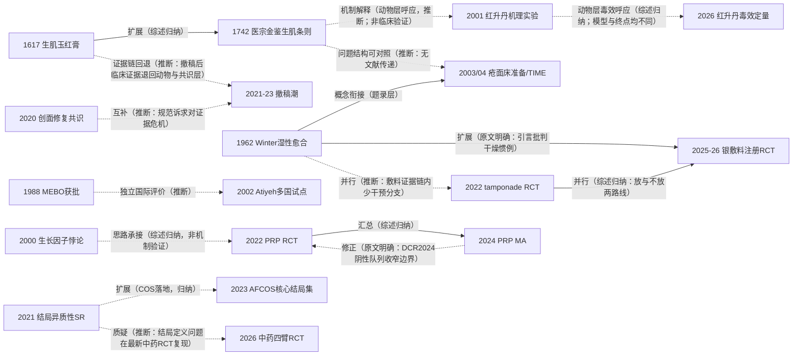

# D10 肛肠创面愈合：祛腐生肌线与创面修复材料

> **一句话判断**：肛肠术后创面愈合是中医外治优势宣称与国际创面材料科学正面相遇的方向——中医祛腐生肌线从 1617 年《外科正宗》生肌玉红膏，到 1742 年"毒未尽不可骤用生肌"的时序条则，再到丹药机理、制剂产业化与 2019 版专家共识；国际湿性愈合线从 Winter 1962 年家猪实验，经疮面床准备/TIME 框架与现代敷料，走到"少干预"反证。对临床医生最重要的一点：两条线至今没有在临床层真正交汇——祛腐生肌至今没有一项现代临床 RCT，而近五年英文期刊的肛肠创面 RCT（本轮实查可数约六项、可核注册号者仅一项）正被结局定义异质、撤稿潮与无注册号问题拖住。

## 0 三分钟速读

① **从哪里来**：中医线最早可核实的方源是明·陈实功《外科正宗》（1617）生肌玉红膏——祛腐（轻粉）与生肌（当归/血竭/白蜡）同一张处方 [D10-N01]；清《医宗金鉴》（1742）把"何时可用生肌药"写成条则 [D10-N02]。国际线的公认奠基是 Winter 1962 年家猪实验：密闭湿性环境上皮化快于暴露结痂（Nature 193:293-294，OpenAlex 被引 2254 次）[D10-N03]。
② **为什么改变**：湿性愈合理论颠覆"创面应干燥"的惯例，2003–2004 年疮面床准备/TIME 框架把它操作化为创面评估语言 [D10-N18]；2000 年付小兵团队发现慢性溃疡组织中生长因子"含量不缺而修复延迟"，改写了"外源补因子即可促愈"的简单模型 [D10-N05]。
③ **如何分化**：制剂线（马应龙麝香痔疮膏、MEBO、康复新液）走产业化；丹药线（红升丹）从机理实验走向毒效定量 [D10-N06][D10-N15]；血液制品线（PRP）从乐观汇总走向适应边界收窄 [D10-N12][D10-N13]；敷料线分裂为"放高级敷料"与"不放敷料"两路并行的 RCT [D10-N11][D10-N14]。
④ **现在研究什么**：自体血液制品（PRP/PRF/CGF）、现代敷料与"少即是多"、中药外治"机制化"RCT（携带 NF-κB 等生物标志物）、祛腐丹药的剂量-毒效窗口、机器学习风险预测与核心结局集（COS）/患者报告结局。
⑤ **用了什么数据**：从医籍条则、病例系列走向注册双中心 RCT（ChiCTR2000039169）、国际多中心 RCT（德国 14 家医院 754 例）、SR/MA 与单细胞测序；但方法学系统评价显示 155 项肛瘘研究中仅 25% 的结局报告高质量 [D10-N09]。
⑥ **还有什么不知道**：肛肠创面没有落地的核心结局集，"愈合时间"在不同研究里定义不可比（最新中药四臂 RCT 报出 5–7 天愈合的量级异常 [D10-N16]）；祛腐生肌无临床 RCT；敷料成本效果证据空白；2021–2023 年两篇中药英文 RCT 撤稿后，可引用的中文制剂 RCT 证据非常薄 [D10-N10]。

**覆盖边界**：纳入——痔/瘘/脓肿术后开放创面的愈合评价与特殊性问题；中医祛腐生肌线（红升丹/白降丹/轻粉、生肌玉红膏、马应龙麝香痔疮膏、康复新液、MEBO）；现代创面材料线（银离子/水胶体/HA 等敷料、PRP/PRF/CGF、臭氧/激光等物理疗法）；生长因子机制研究与"生长因子悖论"；愈合时间作为主要终点的方法学批评；2021-10 至 2026-10 的 RCT 热潮与成本效果问题。不含——止痛本身与中药坐浴镇痛（D09，仅保留以愈合为终点的试验）；痔症状管理的药物线与消痔灵注射（D02）；肛周脓肿手术决策（D06，填塞问题只用于创面管理视角）；括约肌保留新术式本体（D04，PRP 用于瘘管愈合归本章）；糖尿病足等一般创面（边界外，仅作 MEBO 外溢注记）。

**本章口径**：执行日/报告截止日 2026-10-18；近期重点窗口 2021-10-18 至 2026-10-18。阅读层级：L0=仅二手转述、L1=题录已核实、L2=摘要已读、L3=原文部分章节已读、L4=全文已读；只到 L0/L1 的不写"已核对原文贡献"，转述写"据〈来源〉转述"。本章节点 18 个，按层级计数：L3×3、L2×7、L1×6、L0×2；全部经独立核查（6 处修正已采纳，无删除判项）。**覆盖状态：基本完整但有标注缺口**——理由：六个问题（从哪里来、为什么改变、如何分化、现在研究什么、用了什么数据、还有什么不知道）均可据本章回答；章节范围内主要分支（祛腐生肌古典条则与丹药线、中药制剂线、湿性愈合与敷料线、PRP/血液制品线、结局标准化与风险预测线）均有可回查节点；缺口限于第 8 节已标注项（CNKI/万方未检索、Winter 1962/Atiyeh 2002 等付费墙原文未读、古籍善本未读、个别转述层线索未核），不阻塞任何一问的作答。

## 1 源头：最初在研究什么

起点说法按四类标注："目前最早找到的文献"是公开资料可达范围内的最早记录，不是断言式第一；"被公认的奠基工作"指后续综述与教材共同回指的工作；"存在争议的首次"保留两说；企业/媒体叙事明确标注层级。

**（1）祛腐生肌的方剂源头（目前最早找到的文献；题录 L1、内容 L0）。** 生肌玉红膏首载于明·陈实功《外科正宗》（1617 年刊），组成为当归、白芷、紫草、血竭、甘草、轻粉、白蜡等，功效叙述"活血祛腐、解毒消肿、润肤生肌止痛"，用于痈疽溃后腐肉不脱、新肉不生、久不收口。它的结构性意义在于把"祛腐"（轻粉）与"生肌"（当归/血竭/白蜡）统一进同一张油膏处方，成为肛肠术后中药油纱条谱系的原型方之一 [D10-N01]。限定：古籍善本本轮未读，以上内容据二手文献转述；两条独立佐证为英文综述摘要（J Ethnopharmacol 2026，PMID 42624442：first recorded in Wai Ke Zheng Zong）与含轻粉（Calomelas）矿物药系统综述（PMID 41151647）将其列为轻粉制剂；不同版本组成（轻粉/白占有无）记载有出入。更早的明·申斗垣《外科启玄》（1604）"偎脓长肉"说仅到维基文库等古籍网页转述层（L0–L1）。

**（2）"何时可用生肌药"的条文化（被公认的奠基工作；条文转录经 L4 全文核对，原籍 L1）。** 清·吴谦等《医宗金鉴·外科心法要诀》（1742 年成书，据通行记载）"生肌类方"条："毒未尽，不可骤用生肌药也。只以贝叶膏贴之，频换，俟生肉珠时，方用生肌药。"另引"凡大毒溃烂，内毒未尽，若骤用生肌，则外实内溃，重者逼毒内攻，轻者反增溃烂"（据徐强等《慢性疮面相关"生肌"的再认识》，上海中医药杂志 2021;55(1):27-30，本轮 L4 全文已读，注[11]对应人民卫生出版社 1973 年影印本第 92 页）。这两条把换药时序变成可操作判据：腐未尽禁生肌、俟"生肉珠"（肉芽出现，为该团队解读）方用生肌药 [D10-N02]。限定："公认"限于中医疡科与中西医结合疮疡学术共同体；原籍本身未读。

**（3）湿性愈合理论（被公认的奠基工作；L1）。** Winter GD 在 Nature 1962;193:293-294 报告幼年家猪浅表创面的暴露与密闭对照，提出密闭湿性环境加快上皮化（PMID 14007593，DOI 10.1038/193293a0；OpenAlex 被引 2254 次，本轮实查）[D10-N03]。Hinman & Maibach 1963（Nature 200:377-378，PMID 14087904，DOI 10.1038/200377a0）在人体创面证实空气暴露与密闭的差异，把结论外推到人。限定：两篇原文均不在 PMC、付费墙未读，本报告仅题录层；"约 2 倍上皮化速度"等具体倍数的常见转述未经本轮原文核对。

**（4）湿润烧伤膏与"烧伤湿性医疗技术"（存在争议的首次；L0）。** 徐荣祥 1988 年获卫生部湿润烧伤膏（MEBO）新药证书，自称创立"烧伤湿润暴露疗法/原位再生科学"，以《中国烧伤创疡杂志》为学术阵地，其后外溢用于肛肠创面 [D10-N04]。1988 年获新药证书经美宝官网、人民网（2021-11-08）、中新网（2010-01-21）多源转述确认；"1984 年《药品管理法》实施后第一个获批中药新药""1987 年国家重大科技成果"为企业/媒体叙事；批件原件本轮未获得。批评方意见（方舟子 2007 年博客：专利实质为含蜂蜡/甾醇的药膏、"原位再生"缺乏严格同行评审证据）属博客层证据，如实标注层级。国际独立评价见第 2 节转折三。

**（5）制剂产业化的两条企业叙事（L0）。** 马应龙：上市公告书（新浪财经 600993 档案）核实 1966 年更名武汉第三制药厂、1995 年恢复马应龙字号、2004-05-17 上交所上市；"1981–1982 年在八宝古方基础上研制麝香痔疮膏"与"上溯 1582 年马应龙生记药店"均为企业叙事，无独立学术史料。康复新液（美洲大蠊制剂，国药准字 Z51021834，四川好医生攀西药业）：研制源头为大理医学院李树楠 1982 年前后对美洲大蠊的系统研究（一说 20 世纪 70 年代起）；上市时间有"1990 年代通过鉴定、成为中国首个以美洲大蠊为原料的新药"与"约 2000 年上市"两说并存（二手来源，批件未核）。英文期刊有美洲大蠊提取物机制综述（PMID 37484248）与网络药理学研究（PMID 33777160）可作机制侧注记。

**（6）生长因子线的中国起点（L2）。** 与上述古典与制剂源头并行，现代创面修复的生物学的起点在 1962/2000 两端：除 Winter 外，2000 年付小兵团队《碱性成纤维细胞生长因子和转化生长因子β在溃疡与增生性瘢痕组织中的表达及其对创面修复的影响》（中国修复重建外科杂志 2000;14(5):271-274，PMID 12516473）用 21 例人体组织免疫组化（慢性溃疡 8、增生性瘢痕 8、正常皮肤 5）发现 bFGF 与 TGF-β 在溃疡肉芽组织中可检出（不减少），提出高浓度生长因子下修复延迟可能与因子-受体结合障碍有关 [D10-N05]——这为后续外源生长因子与自体血液制品两条产品线的适用边界立了据。

## 2 关键转折：问题—新证据/新方法—认识变化—新问题

**转折一：祛腐与生肌的时序条文化（1617→1742）。** 明末方剂传统把祛腐与生肌并置一方（生肌玉红膏），清官修医书则回答"什么时候不能用生肌药"——腐未尽骤用生肌会"外实内溃"。两者是传承承接关系（综述归纳：徐强 2021 同篇先引生肌玉红膏系外用方、后引生肌类方条则）[D10-N01][D10-N02]。这一时序判据是中医疡科独有的操作化框架；它与 2003 年后国际"疮面床准备/TIME"框架在问题结构上可对照（见转折三），但两者之间没有文献传递证据，只有问题同构。

**转折二：湿性愈合颠覆干燥惯例，再经框架化进入产品时代（1962→2004）。** Winter 1962（家猪）与 Hinman 1963（人体）确立"湿性环境促上皮化"，1980 年代起密闭敷料产品化 [D10-N03]。1980–2000 年代的概念与产品化过渡层，本轮以两篇题录层文献补入：Schultz 等 2003 年 Wound Repair Regen 提出疮面床准备（wound bed preparation）的系统性创面管理框架（PMID 12654015），2004 年 Int Wound J 提出 TIME（Tissue/Infection-Moisture/Edge）四要素评估框架（PMID 16722894）[D10-N18]。此后肛肠开放创面——排便污染、开放换药、愈合周期以周计——成为湿性理念最难直接套用的场景之一，2026 年 Journal of Tissue Viability 的叙述性综述才把湿性愈合系统落到痔术后（D10-E01：可缩短上皮化时间但直接证据少、对疼痛效果不确定、成本效果空白）。注意：1990 年代及以前的肛肠创面敷料对照试验，本轮在 Europe PMC/OpenAlex 均未检索到，国际早期线只能上溯到理论奠基文献（见第 8 节）。

**转折三：MEBO 建制化与国际独立评价；生长因子悖论改写"补因子"模型（1988→2002→2003/04）。** MEBO 1988 年获批使中药膏剂获得烧伤/创面大宗制剂供给线，但其证据几乎全部出自徐荣祥体系的自有期刊。2002 年 Atiyeh 等（第一作者属贝鲁特美国大学体系，作者含希腊、意大利、法国学者及药厂方，多国多中心试点）在 Ann Plast Surg 48(2):226-227 发表对 MEBO 的国际同行评审试点评价（PMID 11910244；Europe PMC 无摘要，结论为可用于多种创面且耐受良好，题录级，具体数字未核，本报告不作引申），其后同一作者群完成 MEBO 成本效益分析（Burns 2002;28，PMID 12417161）[D10-N07][D10-N04]。结论量级为"中性—温和正面"，未复现"原位再生"叙事，但为中东等地区的后续应用（含 MEBO 用于肛裂的三臂 RCT 方案，BMC Complement Med Ther 2021;21:75，PMID 33627111；结果论文本轮未见）铺了路。同一时期，付小兵 2000 年的生长因子悖论 [D10-N05] 把慢性创面治疗思路从"补多少因子"转向"微环境与受体信号是否可用"——这是理解后来 rhEGF/rh-aFGF/rb-bFGF 产品线（含 2026 年 rh-aFGF 中国专家共识，D10-E07：12 条推荐，7 强/4 中/1 弱）与 PRP"自体因子鸡尾酒"路线适用边界的共同前提。

**转折四：祛腐丹药从机理叙事到毒效定量（2001→2026）。** 红升丹（主成分 HgO）承担明清疡科"祛腐"端，现代被称"外科圣药"且炼制工艺濒失。2001 年姚昶、许芝银（南京中医药大学）发表红升丹提毒去腐机理实验（南京中医药大学学报(自然科学版) 2001;17(4):227-229，题录经两处独立引文核实）：据徐强 2021 第 29 页转述，红升丹可提高创面肉芽中 TNF、IL-6 含量并经高浓度 IL-2R 促细胞有丝分裂，利于肉芽增殖 [D10-N06]——注意该实验的具体数字本轮未读到原文（CNKI 不可得），属转述层，不可引用。2026 年 J Ethnopharmacol（355(Pt A):120671，PMID 41043664）在大鼠慢性难愈创面模型给出剂量-效应与毒理边界：中剂量疗效最佳（创面结构改善、炎细胞浸润减少、胶原与肉芽增加、VEGF 上调、IL-6 下调、Hyp 合成促进）；治疗剂量下主要器官未见病理异常，但原子吸收光谱检出显著肾组织汞蓄积，提示长期用药肾毒性风险 [D10-N15]。需要强调：2001 与 2026 两项是不同动物模型、不同终点，两者与 1742 年古籍条则之间只有"动物层机制呼应"关系，不构成对中医时序理论的临床验证（见第 5 节争议五）。工艺侧，中国中药杂志 2025;50(10):2695-2703（PMID 40686138）用 AHP+熵权法+正交试验把炼制工艺标准化为文火 175℃/30min、武火 270℃/60min、尾火 180℃/15min——工艺抢救性标准化走在了临床证据前面。

**转折五：肛肠创面结局的方法学清算与核心结局集动议（2021→2023）。** Techniques in Coloproctology 2021;25(7):761-830（PMID 33963945）系统评价 2008-01 至 2020-05 的 155 项肛瘘干预性研究，提取 552 个结局条目：每研究结局中位数 3 个（IQR 2–5），仅 25% 研究的结局报告质量高，归并为 52 个独特结局、4 个核心领域 14 个域 [D10-N09]。这直接质疑"愈合时间"作为主要终点的可比性。其同组直接产出是 2023 年 Ann Surg 的 AFCOS 肛瘘核心结局集（277(5):e1045-e1050，PMID 35815887，DOI 10.1097/sla.0000000000005462；经系统综述+患者访谈+Delphi+共识会议形成最小结局集；题录层）[D10-N17]，配套还有 2024 年 20 条目复杂肛瘘 PROM（CCFQ-20，J Patient Rep Outcomes 2024;8(1):99，PMID 39172310）与 2025 年肛瘘术后延迟愈合危险因素 Meta 注册方案（PLoS One 2025;20(7):e0329030，PROSPERO CRD420251013602，PMID 40720484）。结局标准化是本方向当前最重要的基础设施工程。

**转折六：撤稿潮、注册 RCT 与"少干预"反证（2021–2025）。** 三件事同时发生。其一，中药膏剂英文 RCT 撤稿：马应龙麝香痔疮膏用于内痔结扎+外痔切除术后的回顾性对照（ECAM 2022;2022:5630487，100 例 50/50，2019-08 至 2020-10）于 2023 年整体撤稿（撤稿通知 DOI 10.1155/2023/9783075，声明仅一句"This retracts"）；康复新液熏洗坐浴用于 PPH 术后的 RCT（ECAM 2021;2021:6473754，106 例 53/53）同样于 2023 年整体撤稿（DOI 10.1155/2023/9769102）。四条记录均经摘要与撤稿通知核对；撤稿后原文宣称的促愈合数字不可再引用 [D10-N10]。其二，注册 RCT 出现：银离子敷料双中心 RCT（中山大学附属第五医院+深圳市第二人民医院，2021-03 至 2022-04，ChiCTR2000039169 于 2020-10-20 注册）112 例随机（银敷料 52 vs 凡士林纱条 50）、102 例完成，由不知分配的独立评估者判定主要终点：完全上皮化中位时间 22 天（IQR 21–24.75）vs 29 天（IQR 26.75–32），P=0.008；疼痛 VAS 差 0.5（P=0.766）、水肿（P=0.619）、感染（两组 0 例）、第 14 天创面细菌培养阳性率（P=0.908）均无差异（全文 L3 已读；注册主要终点与发表主要终点一致系据论文声明，注册库记录页为动态页面，本轮未能直接打开原件比对）[D10-N14]。其三，"少干预"反证：德国 14 家医院多中心开放标签 RCT（DRKS00011590）950 例筛选、754 例随机、725 例接受干预，痔切除术后不留填塞敷料 vs 留置填塞：48h 最大疼痛中位 5（IQR 3–7）vs 6（4–7），P<0.001；7 天内需再干预的大出血两组各 5 例（1.4%），差 -0.03%（90%CI -1.47~+1.41）达非劣 [D10-N11]。肛周脓肿腔填塞的同向反证为 Ann R Coll Surg Engl 2025;107(1):29-34 的 Meta（3 RCT/490 例，检索至 2022-12：填塞对脓肿复发 RR 1.57（0.764–3.29）与成瘘 RR 0.686（0.430–1.09）均无显著影响，D10-E04）；更早的同行评审先声是 Dinah & Adhikari 2006（Ann R Coll Surg Engl，"Gauze packing of open surgical wounds: empirical or evidence-based practice?"，PMID 16460637，一般外科创面层证据，题录层）——对填塞惯例的质疑并非 2022 年后才有。

**转折七：PRP 从乐观汇总到边界收窄；中药外治"机制化"RCT 的质量疑点（2022–2026）。** PRP 线：2022 年 ANZ J Surg 前瞻 RCT（92(5):1137-1141）96 例高位经括约肌瘘（先挂线引流控制感染后随机，PRP 49 vs 黏膜推移瓣 47）：愈合率 71.43%（35/49）vs 57.45%（27/47），P=0.152 未达显著；但管径<4mm 者 PRP 愈合 87.18%（34/39）vs 管径较宽者 10%（1/10），P<0.001——确立"细、单、未分支管道"适用边界（摘要未见试验注册号）[D10-N12]。2024 年 Ann Saudi Med Meta（44(4):264-271）汇总：治愈率 68%（95%CI 60–76）、失禁 27%（12–46）、复发 18%（12–26）；对照研究中 PRP 改善 OR=1.35（1.14–1.60，P<0.001）、复发 OR=1.17（0.44–3.11，无显著）；摘要未列纳入研究数与总例数（2023 年 Int J Colorectal Dis 38(1):70 的 Meta 补充了分层：14 研究/514 患者，单用治愈 62.39% vs 联合术式 83.12%，总体 72.11%，4 篇 RCT 中 RR 1.30，1.10–1.54）[D10-N13]。荷兰倾向评分加权队列（Dis Colon Rectum 2024;67(8):1065-1071）给出阴性结果：219 例中 88 例（40.2%）在推移瓣修复上加用 PRP，primary healing 67.0% vs 69.5%（P=0.71）、secondary 37.5% vs 43.5%、overall 73.9% vs 77.1%；平均 6.8 年长期随访愈合 67.1%、复发 6.3% vs 2.9%（P=0.37）——其讨论部分明确援引早期小样本试点与 Meta，声明"在无头对头 RCT 的情况下"以大样本队列作答，是对乐观信号的正面回应 [D10-N13]。中药外治线：Front Surg 2026;13:1738476 四臂 RCT（中药熏洗+麝香痔疮栓/单熏洗/单栓剂/1:5000 高锰酸钾坐浴各 40 例+40 例内部验证队列）报告联合组愈合时间 5.15±0.60 vs 7.45±0.75 天（P<0.001）、4 周总有效率 97.50% vs 65.00%、NF-κB p65 相对下降 51.5%、IL-6 下降 33.0%、I/II 级并发症 7.50% vs 22.50%（P=0.032）、验证队列一致（P=0.618）（全文 L3 已读）[D10-N16]。但两点硬伤：全文未检索到任何 ChiCTR/NCT/DRKS 注册号；且 5–7 天的"愈合时间"与 MMH 开放创面通常 4–8 周愈合的临床量级不符，同期复方黄柏液 RCT（Front Pharmacol 2026;17:1732119，60 例 30/30 随机双盲安慰剂对照+机制研究）报告的肛瘘切开术后愈合时间为 40.23±9.61 vs 45.84±13.29 天，反衬出量级异常——该文样本量计算段还明言按"愈合时间"计算样本量（自称 pilot 编号 Pilot-MMH-2023-02，n=60），与摘要宣称的主要终点（术后 14 天完全上皮化率）直接矛盾 [D10-N16]。这是结局定义问题（[D10-N09]）在最新中药试验中的现实标本。

## 3 分支图

实线=原文明确讨论或综述归纳的关系；虚线=本报告推断。特别说明：N02→N06、N06→N15 两条虚线只表示"同一研究对象在不同时代的动物层研究呼应"，动物实验不能验证古籍条则，两项动物研究之间也不互为验证；N05→N12 表示研究思路承接（外源单因子→自体多因子），两篇 PRP Meta 的摘要中并无机制段落。

## 4 近五年重点（2021-10-18 至 2026-10-18）

先给一个计数底账：本轮实查可数的肛肠创面愈合相关 RCT/对照试验约六项（银敷料双中心 RCT、Front Surg 中药四臂 RCT、德国 tamponade 多中心 RCT、加压 vs 非加压敷料单盲对照（J Perianesth Nurs 2024;39，PMID 38864797）、复方黄柏液随机双盲安慰剂对照（Front Pharmacol 2026;17:1732119）、Suile 创面膏 RCT（BMC Surg 2026，PMID 42098742）），另有 2021 年发表、2023 年撤稿的康复新液 RCT 一项；其中注册号可核者仅银敷料一项。"数量明显增多"是相对 2021 年以前的稀疏而言，不是井喷。

**主题一：自体血液制品（PRP/PRF/CGF）——发展中（MA 显示改善信号，对照与边界收窄）。** 研究什么：PRP/PRF 注射或填充对肛瘘愈合率、复发、失禁的影响；CGF 对术后创面巨噬细胞极化的作用。数据与设计：单中心前瞻 RCT（96 例）、倾向评分加权队列（219 例）、三篇 MA（2022 J Cosmet Dermatol（PMID 35049123）、2023 Int J Colorectal Dis、2024 Ann Saudi Med）、机制研究。代表结果见第 2 节转折七。分歧：MA 层面改善 OR 1.35 优效，而荷兰大样本队列对"推移瓣+PRP"完全阴性；证据基础以病例系列为主；适应边界集中在管径<4mm。机制侧新增 CGF 经 M2 巨噬细胞极化加速肛瘘术后创面愈合的动物+体外研究（BMC Gastroenterol 2026;26(1):515，PMID 42432551）。

**主题二：现代敷料与"少即是多"——国际线较成熟，肛肠特异性证据发展中、成本效果空白。** 研究什么：银离子/活性敷料对上皮化时间、感染、疼痛的影响；取消填塞/充填是否更优。代表研究：银敷料 RCT（上皮化 22 vs 29 天，P=0.008 [D10-N14]）；德国 tamponade RCT（不放更优 [D10-N11]）；packing Meta（填塞无益，D10-E04）；活性敷料回顾性匹配对照 110 例（疼痛更低、愈合率更高，P<0.05，BMC Gastroenterol 2025;25:320，PMID 40307709）；加压 vs 非加压敷料单盲对照（PMID 38864797）。分歧：银敷料 RCT 显示缩短上皮化时间，而 Front Surg 四臂试验引言转述的既往评价称银敷料主要减感染、不促愈合——该转述的原始 Meta 本轮未定位到题录，不作为独立争议证据。JTV 2026 叙述性综述（D10-E01）代表国际伤口护理界的判断：敷料可缩短上皮化时间但痔术后直接证据少、对疼痛效果不确定、正式成本效果证据缺乏；银敷料 RCT 亦未报告成本。

**主题三：中药外用制剂的"机制化"RCT 与组学机制研究——发展中（临床证据质量低于机制热度）。** 研究什么：中药熏洗/膏剂/栓剂对术后创面愈合与炎症通路（NF-κB、NETs、TGF-β/Smad）的作用；单细胞测序与网络药理学解释机制。代表研究：Front Surg 四臂 RCT（[D10-N16]，无注册号+终点量级异常）；复方黄柏液 RCT+NETs 机制（40.23±9.61 vs 45.84±13.29 天，量级正常但 P 值在摘要中被截断）；复方丹参/黄连载药白及凝胶敷料经 TGF-β/Smad 促血管生成的动物+体外研究（J Mol Histol 2026;57(1):48，PMID 41528408，大鼠线扎肛瘘模型）；当归补血汤促肛瘘术后创面愈合的单细胞测序研究（Hereditas 2025;162(1):204，PMID 41068813）。分歧：机制叙事快速更新（NF-κB→NETs→scRNA），但临床层终点定义与注册缺失并存；撤稿潮（[D10-N10]）之后，Suile 创面膏 RCT（BMC Surg 2026，PMID 42098742）成为中药创面膏剂在正规外科期刊的新例，其质量表现值得跟踪。

数据与设计小结（主题一至三）：PRP 线的证据池由单中心 RCT、倾向评分队列、病例系列与三篇 MA 构成；敷料线的证据池由注册双中心 RCT、国际多中心 RCT、SR/MA 与回顾性匹配对照构成；中药线的证据池由多臂 RCT+内部验证队列、动物模型（线扎肛瘘）、scRNA-seq、网络药理学与载药生物材料敷料构成。三条线共同的短板是：多中心化刚起步、核心结局未统一、注册与盲法稀缺。

**主题四：祛腐丹药的安全收敛与工艺传承——毒理发展中、临床早期。** 研究什么：红升丹的剂量-毒效窗口与汞蓄积定量；炼制工艺标准化与非遗保护；含汞外用药的历史与监管。代表研究：J Ethnopharmacol 2026 大鼠毒效研究（中剂量最优+肾组织汞蓄积 [D10-N15]）；中国中药杂志 2025 工艺标准化（PMID 40686138）；汞与含汞制剂系统综述（Front Pharmacol 2022;13:807807，PMID 35308204）与轻粉（Calomelas）系统综述（PMID 41151647）。分歧：动物层祛腐有效一致，但临床无 RCT、汞毒性不可忽略；"外科圣药工艺濒失"的传承诉求与安全监管张力并存。

**主题五：风险预测与结局标准化——早期线索。** 研究什么：肛肠术后不良愈合的机器学习预测模型；核心结局集与 PROM；延迟愈合危险因素。代表研究：机器学习模型（Front Surg 2026;13:1829528，回顾建模 246 例（191 好/55 差）+152 例时间验证：BMI、糖尿病、大便性状、术前肛周感染为核心预测因子，内部 AUC 0.877–0.897；单中心、非外部多中心验证）；AFCOS 核心结局集（[D10-N17]）；CCFQ-20（PMID 39172310）；延迟愈合危险因素 Meta 方案（PMID 40720484）。

## 5 争议、负性结果与停滞路线

**争议一：肛肠创面湿性愈合 vs 干性/暴露惯例。** 国际线（Winter–Hinman 传统）主张湿性环境促上皮化；传统肛肠换药（干纱条、坐浴后晾干）仍广泛使用。证据：JTV 2026 综述认为湿性管理可能缩短上皮化时间但痔术后直接证据少；银敷料 RCT 显示上皮化快 7 天 [D10-N14]；德国 tamponade RCT 显示"不放"更优 [D10-N11]。状态：理论上收敛、肛肠特异性证据仍在积累，未决。

**争议二：术后敷料/填塞是否必要——"少即是多"与"高级敷料有益"两路线并行。** 一方：不放填塞疼痛更轻、出血非劣（754 例）[D10-N11]，脓肿 packing 无益（3 RCT/490 例，D10-E04），且质疑早在 2006 年已见同行评审文献（PMID 16460637）；另一方：高级敷料缩短上皮化 [D10-N14]。两路线在不同终点上各自成立；成本效果证据缺失使临床决策悬置。状态：争议活跃。

**争议三：MEBO 与"原位再生科学"的科学性。** 徐荣祥体系视其为原创发明（1988 新药证书+美国专利，均转述层）；批评方指专利实质为普通药膏、"再生"缺乏严格同行评审证据（博客层）。国际独立试点（多国多中心，题录层）结论中性偏正面，未复现"原位再生"叙事 [D10-N07]。状态：争议未决，学术叙事被质疑而临床使用（含肛肠外溢）持续。

**争议四：中药外用肛肠 RCT 的报告质量。** 高产出的"机制化 RCT"浪潮 vs 撤稿潮、无注册号、终点定义异常：ECAM 两篇撤稿（2023）[D10-N10]；Front Surg 四臂 RCT 全文无注册号且愈合时间量级异常+主终点自相矛盾 [D10-N16]；155 项研究仅 25% 结局报告高质量 [D10-N09]。对照样板是注册+盲法评估者的银敷料 RCT [D10-N14]。状态：活跃——注册试验与放任发表并存。

**争议五：动物层机制与中医理论的"验证"关系。** 本章特别澄清：2001 年红升丹促炎促分裂实验、2026 年红升丹毒效研究，与 1742 年"腐去肌生"条则之间是动物层机制呼应关系——研究对象（大鼠创面 vs 中医疡科临床指征）、终点（细胞因子浓度 vs 临床愈合）均不同，且 2001 年实验数字仅为转述层；两条线在临床层从未交汇，祛腐生肌外治法至今没有一项现代临床 RCT。任何"机制已验证中医理论"的表述都不成立。

**争议六：PRP 的适应边界。** 乐观派（MA 改善 OR 1.35、联合术式治愈 83.12%）vs 谨慎派（荷兰 219 例阴性队列；单用治愈率仅 62.39%）；边界假设（管径<4mm、单管未分支）待多中心 RCT 检验。状态：发展中。

**负性结果与失败路线清单**（均有可定位来源）：
1. PRP+直肠内推移瓣：荷兰 219 例倾向评分队列，primary/secondary/overall healing 均无差异，平均 6.8 年长期随访亦无差异（PMID 38701430）。
2. 马应龙麝香痔疮膏术后创面英文 RCT：ECAM 2022 发表、2023 年整体撤稿，数字不可引用（PMID 35722161；撤稿 37387909）。
3. 康复新液熏洗坐浴用于 PPH 术后：ECAM 2021 发表、2023 年整体撤稿（PMID 34539803；撤稿 38125119）。
4. 痔术后填塞敷料与脓肿腔 packing 惯例：多中心 RCT 与 Meta 双双削弱旧惯例（PMID 35639947；38563064）。
5. MEBO 向糖尿病足等一般创面的扩展：英文 Meta 结论"尚需更多研究"（题录层），未形成强证据；糖尿病足属边界外，本方向不展开。
6. 红升丹的汞毒性收敛：治疗剂量即出现肾组织汞蓄积（动物层，PMID 41043664），临床应用萎缩。

**停滞路线**：含汞丹药的临床开发整体停滞（无 RCT、监管收紧，仅剩工艺与毒理研究）；1990 年代以前肛肠特异的敷料对照试验线索中断（本轮未检索到），国际线在 1963–2003 年间只剩理论框架演进；MEBO 肛裂 RCT 停在方案阶段（结果论文本轮未见）。

## 6 传承线与国际线

**传承线（中医创面外治；据天津中医药大学第二附属医院疮疡科团队的自我谱系叙述可述，该链主要经徐强 2021 一篇 L4 文献及其引文转述支撑，尚缺独立来源交叉，链上多数原文为 CNKI 题录层）：**
① 古典源流：明·申斗垣《外科启玄》（1604）"偎脓长肉"（古籍网页转述层）；明·陈实功《外科正宗》（1617）立生肌玉红膏，祛腐与生肌同方 [D10-N01]；清·吴谦《医宗金鉴·外科心法要诀》（1742）"毒未尽不可骤用生肌、俟生肉珠时方用生肌药" [D10-N02]。明清疡科丹药系统（红升丹/白降丹）承担"祛腐"端。
② 现代理论接力：天津李竞提出"腐祛肌生为皮肤溃疡愈合客观规律"（《疮疡外治法》，中国医药科技出版社 1998；经徐强 2021 引文核实）；天津中医药大学第二附属医院张朝晖/徐强团队续承为"煨脓长肉—护场—可视之肌/微观之肌"理论（上海中医药杂志 2021;55(1):27-30，L4 已读），并落到慢性疮面与肛瘘创面（湿润生肌油纱促肛瘘术创面愈合，冷羽等，中华中医药学刊 2018;36(2):475-478，引文层；生肌膏换药频次对兔慢性溃疡的影响，卢旭亚等，中医杂志 2015;56(6):515-517，引文层——两文原文均未获取）。南京中医药大学许芝银、姚昶 2001 年完成红升丹机理实验 [D10-N06]。付小兵（解放军总医院）2000 年生长因子悖论 [D10-N05] 为国内生长因子产品线（rb-bFGF/rh-aFGF，2026 年 rh-aFGF 专家共识 D10-E07）立界。
③ 制剂产业化：武汉马应龙（1966 更名武汉第三制药厂、1995 恢复字号、2004 上市；"1981–1982 研制麝香痔疮膏"为企业叙事）；徐荣祥 MEBO（1988 新药证书，《中国烧伤创疡杂志》建制，争议见争议三）；康复新液（李树楠研制源流，约 1990–2000 年间上市，两说并存）。九华膏（滑石/硼砂/贝母/银朱/龙骨/冰片）为验方收入《全国中药成药处方集》，多地肛肠科作院内制剂（百科转述层；流传的"史兆岐研制九华膏"说法本轮未找到任何文献记录——史兆岐的公认贡献是消痔灵注射线，属 D02）。
④ 规范化与当前：《肛肠术后创面修复管理规范专家共识（2019 年版）》（陈希琳、史大卓、段宏岩等，实用临床医药杂志 2020;24(4):1-4，DOI 10.7619/jcmp.202004001——期刊自建 DOI，Crossref 无注册，不影响题录真实性；共识全文本轮未获取，条目内容为转述层）[D10-N08]，中医外治与现代敷料首次进入同一份全国性肛肠创面规范文本；注册双中心 RCT（银敷料，[D10-N14]）；中药熏洗机制化 RCT（[D10-N16]，无注册号）；中药载药生物材料与单细胞测序机制潮（2025–2026）。负资产：2021–2023 英文期刊中药膏剂撤稿潮 [D10-N10]。

**国际线（口径：不含中国单位）：**
① 理论奠基与框架化：Winter 1962（家猪）→Hinman & Maibach 1963（人体）[D10-N03]→1980 年代密闭敷料产品化→Schultz 2003 疮面床准备、2004 TIME 框架 [D10-N18]→JTV 2026 综述把湿性愈合落到痔术后（D10-E01）。
② 国际 RCT 与系统评价：德国 14 医院多中心 tamponade RCT（DRKS00011590，754 例）[D10-N11]；英国 packing Meta（Ann R Coll Surg Engl 2025，检索至 2022-12，D10-E04）与 2006 年纱布填塞质疑先声（PMID 16460637）；Tech Coloproctol 2021 结局异质性系统评价触发 COS 动议 [D10-N09]，2023 年 AFCOS 落地 [D10-N17]。
③ 海外对中药制剂的独立评价：Atiyeh 等 2002 多国多中心试点与 2002 年 Burns 成本效益分析（PMID 12417161）[D10-N07]；MEBO 扩散至中东（MEBO vs 地尔硫卓肛裂三臂 RCT 方案，BMC Complement Med Ther 2021;21:75，PMID 33627111；结果论文本轮未见）。
④ PRP/血液制品：ANZ J Surg 2022 RCT [D10-N12]、三篇 MA（2022/2023/2024）[D10-N13]、荷兰阴性队列（PMID 38701430）、CGF 机制研究（PMID 42432551）。
⑤ 物理疗法与器械：意大利系 VAAFT+臭氧油敷料在儿童肛瘘的标准化报告（Surg Endosc 2024;38:2273-2279，30 例中位愈合 28 天，PMID 38443498）；巴西开放肛肠创面低能量激光评估（J Coloproctol 2024;44:S1-S138，DOI 10.1055/s-0045-1808880，会议摘要级）；Semiflex 真空辅助肛瘘创面试点（2025，题录层）。
⑥ 口径说明：国际上针对中医疗法 RCT 方法学的一般性批评文献，其评述病种不含肛肠疾病，本章不作直接引用；本章实际采用的国际方法学批评是 JTV 2026 综述与 Tech Coloproctol 2021 结局学系统评价。

## 7 数据路径小结

历史上：医籍条则与经验方剂（1617/1742，以个案与医籍为载体，无对照概念）→动物实验（大鼠慢性难愈创面/糖尿病创面模型：红升丹毒效、生肌玉红膏机制；大鼠线扎肛瘘模型：载药敷料与 NETs 研究；兔慢性溃疡：换药频次）→单中心病例系列与回顾对照（多国 MEBO 试点、伊朗 PRP 系列）→中文单中心 RCT（马应龙 100 例、康复新液 106 例——均已撤稿）→注册 RCT（ChiCTR2000039169 银敷料双中心、德国 DRKS 多中心）。现在：SR/MA（PRP 三篇、packing、结局异质性）→机制组学（网络药理学：美洲大蠊 AKT1/VEGFA/MMP9，PMID 33777160；单细胞测序：当归补血汤、Calvatia lilacina（PMID 41495793）；外泌体 miRNA（PMID 40900833）；AAS 汞定量+正交工艺优化）→新兴方向（机器学习风险预测、PROM 与核心结局集）。分析单位从方剂/条文演化为患者/创面，近五年新增组织标本（免疫组化、scRNA）与工艺参数（温度/时间）作为分析对象。证候量表：本方向以"腐/肌"时序与疮面阴阳辨证为主，未见跨中心验证的证候量表。证伪机制也在数据层留下痕迹：撤稿通知与注册号检索（全文关键词核验）成为本轮证据分级的常规步骤。

## 8 还不知道什么（领域证据缺口）与本报告的检索缺口

**领域证据缺口：**
1. 肛肠术后创面缺少落地的核心结局集：155 项研究仅 25% 结局报告高质量、"愈合时间"定义不可比 [D10-N09]；AFCOS 已发布 [D10-N17] 但在中药试验中尚未被采用——最新四臂 RCT 仍出现 5–7 天愈合的量级异常与主终点自相矛盾 [D10-N16]。
2. 中药外用试验注册率与盲法不足；撤稿潮后可引用的中文制剂 RCT 证据薄弱：本轮可数近五年 RCT 约六项，注册号可核者仅一项。
3. 肛肠术后敷料的成本效果证据完全空白（JTV 2026 明示；银敷料 RCT 未报告成本）。
4. 含汞丹药无现代临床 RCT；毒理仅到大鼠层，长期低剂量汞暴露未评估；工艺标准化走在临床证据之前。
5. 祛腐生肌外治法与湿性愈合在机制叙事上兼容，但两条线在临床层从未交汇——没有一项头对头或安慰剂对照的临床试验回答"祛腐生肌是否改变肛肠创面愈合轨迹"。
6. 愈合不良的机器学习预测模型均为单中心回顾、时间验证而非外部多中心验证；PRP 管径边界假设缺多中心 RCT。

**本报告的检索缺口与待核线索：**
1. CNKI/万方未检索（不登录、不付费策略）：《中国肛肠病杂志》《结直肠肛门外科》等未被 MEDLINE 收录的中文期刊大量 RCT 只到题录/转述层，这是对本章结论影响最大的检索缺口——中药外治的真实试验全貌（含权隆芳 2020 年 200 例混合痔 RCT、孟占伟 2014 年 160 例肛瘘 RCT 等转述层线索）无法独立核实。
2. 1990 年代及以前的肛肠创面敷料对照试验未能在 Europe PMC/OpenAlex 检索到；Winter 1962、Atiyeh 2002 全文付费墙未读（前者仅题录+被引数）。
3. 中医传承链依赖单一长篇二手来源（徐强 2021，L4）支撑，链上李竞 1998 专著、姚昶 2001、卢旭亚 2015、冷羽 2018 均未获取原文；中国中西医结合学会疡科分会的创面愈合评价标准文件未找到原始题录。
4. 待核线索（附可得信息，均未升入正文证据）：史兆岐与九华膏的关系（未找到任何文献记录）；康复新液用于肛肠术后的中文 Meta（未检索到）；黄倩 2011 升丹制剂毒性硕士论文（仅搜索摘要）；MEBO 肛裂三臂 RCT 的结果论文（仅方案，PMID 33627111）；加味生肌玉红膏肛瘘术后大鼠预印本两篇（Research Square，rs.3.rs-1924388/rs.3.rs-1687354，未见期刊发表版）；印度 VAAFT+PRF 回顾队列（JMAS 2022，41 vs 24 例，题录未独立核实，数字不入正文）；唐乾利 2008 烧伤湿性医疗技术推广总结（OpenAlex 题录，无 PubMed 记录）；复方黄柏液坐浴混合痔 RCT（仅搜索摘要提及；相关英文记录为动物 NETs 研究 PMID 42812331）。
5. Front Surg 四臂试验引言转述的"银敷料不减感染/不促愈合"既往 Meta：本轮以 silver dressing+healing+systematic review 检索未定位到题录，该冲突表述已降级为"该试验引言转述的既往评价"，不作独立争议证据。

## 9 本章节点速查表

| 编号 | 年份 | 第一作者+题名简写 | 期刊 | 节点作用 | 设计/数据/分析单位 | 样本 | 关键结果 | 阅读层级 | 核查状态 | PMID/DOI |
|---|---|---|---|---|---|---|---|---|---|---|
| D10-N01 | 1617 | 陈实功·生肌玉红膏 | 《外科正宗》（古籍） | 祛腐生肌油膏原型方 | 经验方剂/方剂 | — | 祛腐（轻粉）与生肌（当归/血竭/白蜡）同方 | L1（内容 L0） | 通过 | — |
| D10-N02 | 1742 | 吴谦·生肌类方条则 | 《医宗金鉴·外科心法要诀》 | "何时生肌"条文化判据 | 医籍条文/条文 | — | 毒未尽禁生肌；俟生肉珠方用生肌 | L3（转录经 L4 核对；原籍 L1） | 通过 | — |
| D10-N03 | 1962 | Winter·Formation of the scab | Nature | 湿性愈合奠基 | 动物对照/动物创面 | 家猪（头数未核） | 密闭湿性上皮化快于暴露（转述；被引 2254） | L1 | 通过 | 14007593 / 10.1038/193293a0 |
| D10-N04 | 1988 | 徐荣祥·MEBO 获批 | （行政批件+自有期刊） | 中药膏剂建制化，争议源头 | 研究体系/制剂 | — | 获批推广；"原位再生"叙事引争议 | L0 | 通过 | — |
| D10-N05 | 2000 | 付小兵·bFGF/TGF-β 表达 | 中国修复重建外科杂志 | 生长因子悖论 | 免疫组化/组织标本 | 21 例（8+8+5） | 因子不缺而修复延迟，指向受体结合障碍 | L2 | 通过 | 12516473 |
| D10-N06 | 2001 | 姚昶·红升丹提毒去腐机理 | 南京中医药大学学报 | 祛腐线机制实验节点 | 动物实验/动物创面 | 动物（未核） | TNF/IL-6/IL-2R 促炎促分裂（转述层，不可引用） | L1（结果 L0） | 通过 | — |
| D10-N07 | 2002 | Atiyeh·MEBO 多国试点 | Ann Plast Surg | 国际独立评价 MEBO | 多中心试点/患者 | 未核（无摘要） | 可用且耐受良好（题录级） | L1 | 修正（作者列与机构表述） | 11910244 / 10.1097/00000637-200202000-00032 |
| D10-N08 | 2020 | 陈希琳·创面修复共识 2019 版 | 实用临床医药杂志 | 中国规范化节点 | 专家共识/共识文件 | — | 中药外治与现代敷料同入规范（内容转述层） | L1（内容 L0） | 通过 | — / 10.7619/jcmp.202004001 |
| D10-N09 | 2021 | Machielsen AJHM·结局异质性 SR | Tech Coloproctol | 结局方法学清算 | 系统评价/研究 | 155 研究/552 结局 | 仅 25% 结局报告高质量；52 独特结局 | L2 | 通过（补 25(7):761-830；补第一作者实名） | 33963945 / 10.1007/s10151-021-02452-5 |
| D10-N10 | 2021–23 | （撤稿潮标本） | ECAM | 中药英文 RCT 可靠性危机 | 2 篇原文+2 撤稿通知/患者 | 100；106 | 双双整体撤稿，数字不可引用 | L2 | 通过 | 35722161;37387909;34539803;38125119 |
| D10-N11 | 2022 | （tamponade RCT） | BJS Open | "少干预"反证 | 多中心开放标签 RCT/患者 | 754 随机/725 干预 | 不放敷料疼痛 5 vs 6（P<0.001）；出血非劣 | L2 | 修正（6(3)） | 35639947 / 10.1093/bjsopen/zrac070 |
| D10-N12 | 2022 | Hermann J·PRP vs 推移瓣 RCT | ANZ J Surg | PRP 随机证据与边界 | 前瞻 RCT/患者 | 96（49/47） | 愈合 71% vs 57%（NS）；<4mm 者 87% | L2 | 通过（补 92(5)；补第一作者实名） | 35486027 / 10.1111/ans.17656 |
| D10-N13 | 2024 | （PRP SR/MA） | Ann Saudi Med | PRP 汇总节点 | SR/MA/研究 | 篇数未列 | 治愈 68%；改善 OR 1.35；失禁 27% | L2 | 修正（44(4)） | 39127896 / 10.5144/0256-4947.2024.264 |
| D10-N14 | 2025–26 | （银离子敷料 RCT） | BMC Gastroenterol | 现代敷料注册 RCT 样板 | 双中心 RCT/患者（创面） | 112 随机/102 完成 | 上皮化 22 vs 29 天（P=0.008）；感染疼痛无差 | L3 | 修正（26(1):15；终点一致系据论文声明） | 41350634 / 10.1186/s12876-025-04525-3 |
| D10-N15 | 2026 | （红升丹毒效） | J Ethnopharmacol | 丹药毒效定量收敛节点 | 大鼠毒理+机制/动物创面 | 大鼠（分组未列） | 中剂量最优；肾组织汞蓄积（AAS） | L2 | 修正（毒性表述；355(Pt A)） | 41043664 / 10.1016/j.jep.2025.120671 |
| D10-N16 | 2026 | （中药四臂 RCT） | Front Surg | 机制化 RCT 新范式+质量疑点 | 四臂 RCT+验证队列/患者 | 160+40 | 愈合 5.15 vs 7.45 天；无注册号；主终点矛盾 | L3 | 修正（13 卷；样本量段矛盾） | 42245301 / 10.3389/fsurg.2026.1738476 |
| D10-N17 | 2023 | （AFCOS 核心结局集） | Ann Surg | COS 运动落地节点 | SR+Delphi+共识/研究 | — | 肛瘘最小结局集成形 | L1 | 通过（新增） | 35815887 / 10.1097/sla.0000000000005462 |
| D10-N18 | 2003/04 | Schultz·疮面床准备/TIME | Wound Repair Regen；Int Wound J | 国际线概念衔接层 | 框架论述/创面评估框架 | — | WBP 系统框架；TIME 四要素 | L1 | 通过（新增） | 12654015;16722894 |

## 10 本章入口文献与检索截止

| 编号 | 文献 | 类型 | 检索截止 | 用途 |
|---|---|---|---|---|
| D10-E01 | Moist wound healing in Hemorrhoidectomy: narrative review. J Tissue Viability 2026;35(4):101056（PMID 42822092） | 叙述性综述 | 未说明 | 国际线主干：湿性愈合生物学依据、敷料选择、成本效果缺口 |
| D10-E02 | TCM for wound healing after anal fistula surgery. J Tradit Chin Med 2023;43(5):1047-1054（PMID 37679994） | 叙述性综述 | 未说明 | 中医外治研究版图与缺陷 |
| D10-E03 | Autologous PRP in anal fistula: SR/MA. Ann Saudi Med 2024;44(4):264-271（PMID 39127896） | 系统评价/Meta | 多库（未说明日期） | PRP 证据结构（卷期经核查修正） |
| D10-E04 | Packing in perianal abscesses: SR/MA. Ann R Coll Surg Engl 2025;107(1):29-34（PMID 38563064） | 系统评价/Meta | 2022-12（摘要写明） | 填塞惯例国际反证（创面管理视角，交叉 D06） |
| D10-E05 | Outcome heterogeneity in cryptoglandular anal fistula studies. Tech Coloproctol 2021;25(7):761-830（PMID 33963945） | 系统评价 | 2008-01 至 2020-05（摘要写明） | 结局异质性与 COS 动议（与 D10-N09 同文） |
| D10-E06 | PRP in anal fistula: SR/MA. Int J Colorectal Dis 2023;38(1):70（PMID 36905475） | 系统评价/Meta | 至 2022-12-05（摘要写明） | PRP 单用 62.39% vs 联合 83.12% 分层（14 研究/514 例） |
| D10-E07 | Chinese Expert Consensus for rh-aFGF in Chronic Refractory Wounds. Pharmaceuticals 2026;19(2):328（PMID 41754868） | 专家共识 | 未说明 | 生长因子产品线规范化现状（12 条推荐：7 强/4 中/1 弱） |

（本章检索执行日 2026-10-18；本轮共执行约 65 次检索，记录见检索日志。）

## 12 复核修订记录（2026-10-18）

1. 机械质检｜无修改（引用回查通过）｜全报告复核时核对：正文 73 处引用均为 [D10-Nxx] 单个方括号形式（无 [N01/N02] 类复合写法、层级标注未入括号），被引节点 D10-N01–N18 共 18 个全部能在证据表回查、缺失 0，证据表 18 条关键节点行与正文一一对应。改前→改后：确认无问题，正文与证据表均未作改动。

- AFCOS（D10-EV-017）first_author 补实名 Iqbal N；Wang Y（D10-EV-024）补实名；Front Pharmacol RCT（D10-EV-028）补 DOI；BMC Surg（D10-EV-033）补篇号 494。（2026-10-19，汇总者依抽查报告执行）

### 第二轮（完整性检查，2026-10-19）

依据 qa_completeness.json id="D10" top_issues 逐条落实（本轮共 3 次 Europe PMC 题录检索，间隔 ≥1.5 秒；mermaid 未改动）：

1. 【建议改】关键节点第一作者实名补入：D10-EV-009/D10-N09 第一作者由「（多作者系统评价组）」补为 **Machielsen AJHM**（PMID 33963945，Europe PMC 题录核验，作者串 Machielsen AJHM, Iqbal N 等）；D10-EV-012/D10-N12 第一作者由「（埃及RCT团队）」补为 **Hermann J**（PMID 35486027，作者串 Hermann J, Cwaliński J, Banasiewicz T, Kołodziejczak B）。连带更正：原「埃及RCT团队」的国籍标注与作者列表不符（该团队为波兰波兹南机构），代称整体移除、不再保留；速查表两行第一作者列与核查状态列同步，证据表两条 verification_status 注明补实名。抽查轮已补入的 Iqbal N/Wang Y 实名与 DOI/篇号未动。
2. 【建议改】引用体例补齐：D10-EV-037 卷页由「1829528」核补为「13:1829528（卷号经核查补入）」，即 Front Surg 2026;13:1829528（Europe PMC 核验 vol=13, page=1829528，PMID 42780400）；正文第 4 节主题五同步改为「Front Surg 2026;13:1829528」。EV-037 first_author「（建模团队）」未被清单涉及，维持原状。
3. 【覆盖状态】按统一口径重评为「基本完整但有标注缺口」，评定理由已写入章首"本章口径"；无分支缺节点、无主链关键转折缺源，缺口均为第 8 节已标注项。
