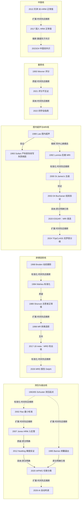

# D11 肛肠诊断客观化：排便造影、测压与影像

> 肛肠诊断客观化是一条「把症状与手指感觉换成可测量参数」的方法学横线：肛管直肠测压、排粪造影、腔内超声/MRI、球囊逼出试验与症状量表五条技术线在 1960s–1990s 相继成形。它目前处在「统一协议之后重估单项判据」的阶段：2020 年伦敦分类统一了测压协议，同年 ESGAR 确立肛瘘 MRI 首选，随后 AI 自动判读与影像报告标准化成为前沿。对临床医生最重要的一点：几乎所有单一影像或压力判据在健康人中都有大量重叠——「检查异常」不等于疾病，必须组合判读并对照健康人分布。

## 0 三分钟速读

1. **从哪里来**：Johns Hopkins 的 Schuster 系 1963 年（J Clin Invest）先系统记录内括约肌反射，1965 年实现内/外括约肌反射同步测压 [D11-N01]；动态排便摄影以 Brodén & Snellman 1968 的 X 线电影摄影为最早可核源头 [D11-N02]。
2. **为什么改变**：1989 年 Shorvon 用 47 名健康志愿者证明「正常」影像涵盖大量既往视为病理的所见，确立「影像异常≠疾病」的解释纪律 [D11-N05]；1993 年 Sultan 用 202 名孕妇的腔内超声把「特发性失禁」大量改写为产科隐性括约肌损伤（初产 35% 出现缺损）[D11-N08]。
3. **如何分化**：测压走「水灌注→高分辨→伦敦分类」（29 人 12 国共识把排便不协调降为「不确定发现」）[D11-N17]；排便造影走「X线→MR」但 MR 对前突检出率反而更低（61.8% vs 73.7%），未实现取代 [D11-N10]；肛瘘影像走「腔内超声→MRI→St James's 五级→结局验证」（分级映射术式 [D11-N11]，按 MRI 手术者再复发 13% vs 忽视者 52% [D11-N12]）。
4. **现在研究什么**：AI/ML 自动判读测压（美国三医疗体系 1214 例验证，AUC 0.79–0.99）；各国自建正常值与执行落差调查（亚洲仅 38.7% 的中心有本地正常值）；测压+逼出+造影三检查的「必要性重估」（MRD 在测压之外是否增值，两派相反结论并存）。
5. **用了什么数据**：健康志愿者正常值队列、手术/组织学金标准小系列、以术后结局为参照标准的队列（本方向方法学上最重要的发明）[D11-N12]、GRADE 分级的行业共识 [D11-N18]、多中心 EMR/测压数据库。
6. **还有什么不知道**：MR 排粪造影的健康志愿者正常值研究全世界仅检得 1 项；HRM 跨硬件正常值不可移植；中国 1990 年代「便秘证型-测压」原始研究与卢任华 1990 年论文确切题录本轮不可核（第 8 节）。

**覆盖边界**：纳入肛管直肠测压（水灌注→高分辨 HRM→3D/HD）、排粪造影（X线与 MR）、腔内/动态超声、肛瘘影像分级、球囊逼出试验（BET）、失禁/梗阻症状量表、正常值重建与 AI 量化；中医辨证客观化只在交叉处点到（治疗端归 D07/D12）。不含：各疾病的治疗结局比较（归各 D 方向）、盆底手术术式（D08）、结直肠肿瘤影像。

**本章口径**：截止 2026-10-18；近期重点窗口 2021-10-18 至 2026-10-18；历史不设下限。阅读层级：L0=仅二手转述、L1=题录已核、L2=摘要已读、L3=部分原文已读、L4=全文已读。本章 20 个节点：L1 2 个、L2 14 个、L3 1 个、L1–L2 混合 3 个；只到 L0/L1 的说法一律写明「据 X 转述」或「本轮未核」。计数口径：本章样本数实义为「受试者数」（患者与健康志愿者合并计入），具体身份在分析单位栏注明，跨方向汇总时勿当作患者量证据。覆盖状态（2026-10-19 二轮修订后按统一口径评定）：**基本完整但有标注缺口**——六问均可据本章回答，测压、排便造影、腔内超声/MRI、量表、中国线及负性/停滞路线等章节范围内主要分支均有节点（20 节点、证据表 41 行）；缺口限于第 8 节已标注的 CNKI/万方未查、部分历史题录未核与个别原文未读项，不影响六问作答。

## 1 源头：最初在研究什么

按四类标注（「目前最早找到」≠「公认第一篇」）：

- **测压（被公认的奠基工作，两步）**：Hopkins 系的测压线以 Schuster、Hendrix、Mendeloff 1963 年 J Clin Invest 42:196-207（PMID 13987316）为先导——系统记录直肠扩张诱发的内括约肌反射及其神经通路与疾病改变；1965 年 Schuster 等 Bull Johns Hopkins Hosp 116:79-88 实现内、外括约肌反射的同步测压记录（RAIR 范式）[D11-N01]。1965 篇老刊无摘要、全文不可得，本节点只能写到方法范式层；1950s 及以前的零星测压记录未逐一追溯（第 8 节）。
- **动态排便摄影（目前最早找到的动态文献）**：Brodén & Snellman 1968（Dis Colon Rectum 11:330-347）用 X 线电影摄影直接观察直肠脱垂由肠套叠起始 [D11-N02]。静态直肠造影类工作更早（如 Bugyi 1958，Dtsch Z Verdau Stoffwechselkr 18:72-75，PMID 13547887，题录级）。
- **排粪造影方法标准化（被公认的奠基工作）**：Mahieu、Pringot、Bodart 1984 年 Gastrointest Radiol 两篇（9:247-251、9:253-261）给出糊状造影剂+特制水囊座椅的点片法协议、56 名对照的 5 条正常标准与 144 幅异常造影的疾病分型 [D11-N03]。注：调度线索中「Phillips/Mahieu 1984 载 Gastroenterology」经本轮核实有误，作者与期刊以本题录为准。
- **球囊逼出试验（目前最早找到的系列研究）**：Barnes & Lennard-Jones 1985（Gut 26:1049-1052，15 名对照+39 名便秘）[D11-N04]。
- **「正常值之争」起点（被公认的奠基工作）**：Shorvon 1989（Gut 30:1737-1749，47 名健康志愿者；调度线索称载 Br J Radiol 有误）[D11-N05]。
- **肛管腔内超声（目前最早找到的肛管系统技术描述）**：Law & Bartram 1989（St Mark's）；同期 Bristol 系的直肠腔内超声用于直肠癌分期，属技术近邻但非肛管括约肌成像 [D11-N06]。
- **肛瘘 MRI（目前最早找到）**：Lunniss 1992（Lancet 340:394-396）[D11-N07]。
- **肛瘘 MR 分级（被公认的奠基工作）**：St James's 五级分类出自 Morris、Spencer、Ambrose 2000（RadioGraphics 20:623-635，利兹）；调度线索「Buchanan 2002 提出该分级」有误——分级出自 Morris 2000 [D11-N11]，Buchanan 2002 是结局研究 [D11-N12]。
- **失禁量表（被公认的奠基工作）**：Jorge & Wexner 1993（Dis Colon Rectum 36:77-97）提出 0–20 分评分；条目细节本轮仅到摘要层，据后续引用文献转述 [D11-N09]。
- **失禁神经生理参数（兴起端）**：Kiff & Swash 1984（BJS 71:614-616）测阴部神经末梢运动潜伏期（PNTML）[D11-N19]。
- **HRM 引入肛管（作者自称首次）**：Jones、Post、Crowell 2007（Am J Gastroenterol 102:850-855）自称首个 HRM 与水灌注的同时对照；HRM 硬件在食管的应用更早 [D11-N14]。

## 2 关键转折：问题—新证据/新方法—认识变化—新问题

**转折一（1963–1985）：把「手指感觉」换成压力与床旁操作。** 失禁、巨结肠、排便障碍当时只能靠触诊与症状描述。Hopkins 两步测压（1963 内括约肌反射系统记录→1965 内/外反射同步记录）奠定 RAIR 范式，服务儿童无神经节症鉴别与失禁生理分型 [D11-N01]。同期 Barnes 1985 的球囊逼出试验证明：排便机制障碍不是「升不高直肠内压」——对照组与一般便秘者用力时直肠内压无显著差异（仅巨直肠组更高，p<0.01），慢传输者 0/14 能侧卧排出而对照 14/15 可 [D11-N04]。「出口功能障碍」从此有了 5 分钟床旁操作性定义，并被写入罗马流程与 IAPWG 协议（扩展，原文明确引用）：Chiarioni 2014 在 286 例中证明 BET 复现性 98%（以 <2 分钟为异常）但与测压一致率仅 78%；IAPWG 2020 将其标准化为 50 mL/坐位/私密环境；Shah 2018 的 meta（Am J Gastroenterol 113:1613-1620，PMID 30171220）进一步检验其作为办公室筛查试验的定位。遗留问题：测压各中心协议互不兼容（见转折六）。

**转折二（1968–1984）：排便时相的动态成像与标准化。** Brodén & Snellman 用电影摄影拍到直肠脱垂的肠套叠起始过程，确立「排便时相动态观察」范式 [D11-N02]；Mahieu 1984 把它简化为可重复的点片法，并首次给出正常参数（肛直角静息 91.96°±1.52、力排 136.76°±1.51、增大 44.8°）与异常分型（直肠内套叠/肛管内套叠/可复位脱垂/直肠前突/耻骨直肠肌压迹加重），失禁者肛直角显著增大（p<0.001）[D11-N03]。此后 40 年 X 线排粪造影方法学框架基本沿此。

**转折三（1989）：志愿者对照改写「正常值」（质疑）。** Mahieu 的「正常」对照按临床判断选定。Shorvon 1989 给 47 名健康年轻志愿者行排粪造影，原句结论「Normality was shown to encompass radiological features often considered pathological」——女性排便期直肠前突极常见，肛直角与会阴下降范围与病理状态重叠 [D11-N05]。这一步确立「影像异常≠疾病」的解释纪律，并把「正常值之争」变成此后每一次模态更替都要重打的官司（第 5 节）。

**转折四（1989–1993）：括约肌可视化与失禁病因改写（验证→改写）。** St Mark's 的 Law & Bartram 1989 建立肛管腔内超声：技术篇 26 例给出五层结构基准，应用篇 22 例术前检出全部 7 例复杂肛瘘与 2 枚临床未料异物 [D11-N06]；同团队 1994 年以 12 例手术+组织学金标准验证超声判对全部 9 处外括约肌缺损与 3 处正常（临床检查准确率仅 50%，EMG/测压各 75%）。随之 Sultan 1993（NEJM）报告 202 名孕妇的前瞻队列：初产 35%（28/79）出现无症状括约肌缺损且随访 6 个月全部持续，产钳助产 8/10 有缺损、胎吸 0/5、剖宫产 0/23 无新发；内括约肌缺损与静息压降低相关（61±11 vs 48±10 mmHg，P<0.001），外括约肌缺损与挤压压降低相关（70±38 vs 44±13 mmHg，P<0.001）[D11-N08]。「特发性失禁」被大量改写为产科隐性括约肌损伤，超声成为产科必查（交叉 D08：产伤预防与修补）。同一时期 Kiff & Swash 1984 的 PNTML（30 例失禁 3.2/3.0 ms vs 对照 2.0/1.9 ms）作为神经生理客观参数进入失禁评估——这条线后来整体退潮（第 5 节）[D11-N19]。

**转折五（1992–2004）：肛瘘影像从「看得见」到「改变结局」（扩展→验证）。** Lunniss 1992 前瞻 16 例：MRI 判读与独立记录的术中所见一致 14/16，建议用于「熟练处理后仍复发」的困难肛瘘 [D11-N07]。Morris 2000 把影像所见翻译成手术语言：1–2 级限于括约肌复合体（简单）、3–4 级侵犯坐骨肛门窝（复杂）、5 级穿越提肛肌板（需寻盆腔脓源）[D11-N11]。Buchanan 2002 在 71 例复发肛瘘完成关键一跃：手术与 MRI 一致者再复发 5/40（13%）vs 不一致者 16/31（52%）（p=0.0005），所有不一致者的再复发都发生在 MRI 预测部位；「总是按 MRI 手术」的医生再复发 16% vs 忽视者 57%（p=0.008）——MRI 指导手术使再复发降 75%；系列后续显示 MRI 改变 10% 原发肛瘘的手术方案（BJS 2003，30 例）、以结局为参照时 MRI 全面优于临床检查与腔内超声而 EUS 定位内口可行（Radiology 2004，104 例）、短程培训可消除专家（85%）与新手（63%）判读差距（AJR 2004，100 例）；更早的 Spencer 1998（40 例）已示 MRI 预测结局优于手术探查（PPV 73% vs 57%，MR 分级与结局相关 p=0.0004）[D11-N12]。这条「利兹分级+St Mark's 结局验证」链被 ESGAR 2020 引为 II 级证据，确立 MRI 首选地位。

**转折六（1989–2020）：测压标准化三代与「硬件跑在标准前面」。** 1989 年英国 working party 已注意到各中心协议互不兼容；Rao 2002 发布首个国际最小标准 [D11-N13]。但 2007 年 HRM 迁移到肛管（29 例同时对照，两法相关而 HRM 读数系统性偏高）先于标准更新——换设备=换数值 [D11-N14]。Carrington 2017 调查 30 国 107 中心：53% 已用 HR-ARM、无任何两中心协议相同、无中心完全遵守 2002 标准。IAPWG 2020（29 人、12 国，2014–2018 六次面对面 Quaker 会议+三轮 Delphi，六学会背书）发布统一测试协议与「伦敦分类」，把 BET 标准化为 50 mL/坐位/私密环境，并注明逼出类检查与影像一致性「至多 fair」[D11-N17]。标准化执行难本身成为 2020 年立项的直接动因。

**转折七（2012–2017）：负梯度判据被健康人数据推翻（反证→修正）。** HRM 普及初期通行「模拟排便时直肠-肛管压力梯度为负=排便不协调」。Mayo 系 Noelting 2012 给 62 名无症状女性测压：52/62 梯度为负，年轻人更负（-41±6 vs 老年 -12±6 mmHg），梯度与球囊逼出时间相关（r=-0.51）但「负梯度」见于多数健康人 [D11-N15]；Prichard 2017（118 例+30 对照，PMID 27720913，本轮题录已核）再次证实重叠。IAPWG 2020 在正文 §5.2 明确承认「梯度等定量指标因健康人显著重叠已被质疑」，把 dyssynergia 列为「不确定发现」、要求逼出试验/影像佐证 [D11-N17]；Heinrich & Fox 2022 在 Gastroenterology 的评论（PMID 36220460）以「One and Done?」概括这场单参数判据的退场。多参数与 ML 判据随之登台（第 4 节）。

**转折八（2013–2024）：正常值本地化与中国行业标准化（推断关系，因果未证）。** 天津团队 110 例 3D-HRM 正常值进入国际期刊：模拟排便直肠肛门压差 -13.1±5.8 mmHg，与 Mayo 系同期独立得出「负梯度为常态」的一致结论 [D11-N16]；中国健康成人固态 HRM 正常值 126 例（平均静息压 71.8±17.3、最大挤压压 178.7±52.8 mmHg，中华内科杂志 2017，PMID 28789489）随后发表。中国医师协会肛肠医师分会 2023《中国结肠与肛门直肠测压专家共识》（中华胃肠外科杂志 26:1095-1102，PMID 38110269）与 2024《慢性便秘检查与评估中国专家共识》（27:1191-1201，PMID 39710444）以 GRADE 分级明确：X线排粪造影 A 级/强推荐为出口梗阻型便秘首选，MRD B 级（仰卧位可能低估），HR-ARM B 级，BET C 级（>5 分钟阳性，作初筛）[D11-N18]。中国正常值工作在前、共识在后且共识引用此类数据，但「本地正常值催生行业标准」属时间先后的推断。

**转折九（1993–2022）：量表端的并行竞争。** Jorge & Wexner 1993 的 20 分评分成为此后 30 年全球试验的默认终点（被引 1988 次，2026 年仍被引）[D11-N09]；但 Wexner、St Mark's/Vaizey、FISI 等多体系并存，Colbran 2021（Colorectal Dis 23:1860-1865，PMID 33724629）显示同一患者对不同量表的回答并不一致，盆底障碍联盟（PFDC）建议同时使用多份问卷；2022 年 UEG/ESCP/ESNM/ESPCG 四学会失禁指南（PMID 35303758）把量表组合与客观检查一并写入路径 [D11-N20]。量表之争与模态之争同构：客观化没有产生唯一金标准。

## 3 分支图

实线=原文明确讨论或综述归纳的关系；虚线=本报告推断（时间先后+同中心/同项目相关，因果未证）。边标签统一为「关系类型·依据」形式（如 扩展·时间先后推断、采纳·原文明确引用）。

## 4 近五年重点（2021-10-18 至 2026-10-18）

**1. HRM/AI：机器学习自动判读。** 用视频深度学习判读 3D-HD 测压排便模式、用 ML 组合测压+BET 参数诊断排便不协调。代表：Azher 等（PMID 40706732）三医疗体系 1214 例 3D-HDAM 回顾，混合深度学习 AUC 分别 Dartmouth 0.99、Henry Ford 0.90、UPMC 0.79——同一模型跨机构落差大，提示设备/人群分布差异未解决；Damianos 等（PMID 41589715）307 例测压+BET 数据五种 ML 模型，BET 异常（59.5% vs 11.8%）或 RAP+RAG 组合 PPV>80%，优化 logistic AUC 0.878；Seo 等（PMID 42826007）综述指出瓶颈在数据标准化、外部验证与可解释性。成熟度：早期线索→发展中；ML 判据未入指南正文。

**2. 正常值人群化重建与执行落差。** 各国自建本地 HRM 正常值：罗马尼亚 132 例（Dimitriu 2023，PMID 38147617，东欧首批之一）；儿科方向洛杉矶儿童医院 998 份测压回顾（Mostamand 2026，PMID 42231615）显示儿童肛门静息压 75.6±21.3 mmHg（无肛门直肠畸形的 944 例；肛门直肠畸形亚组 45.3±19.2 mmHg）、接近成人且无年龄梯度。执行端：Park 等（PMID 41952409）亚洲 8 国 31 中心问卷——80.6% 用 HR-ARM，但仅 58.1% 执行全部 IAPWG 动作、38.7% 有院内正常值、64.5% 用伦敦分类（中国大陆仅 1 家中心参与）。中国本土正常值代表为 Wang 等 126 例（2017，PMID 28789489：静息压 71.8±17.3 mmHg，感觉阈值 FST/DDT/UDT/MDT 47.4/84.5/125.8/175.5 mL）。分歧：「每国自建正常值」vs「多中心共建 normogram」争论未决（Carrington 2014 呼吁协作后十年未实现）。成熟度：发展中。

**3. 三检查整合与「必要性重估」。** 意大利多学科 Delphi（Colarieti 2026，PMID 42768194，20 名专家三轮、36 条目中 21 条达成共识）推进 MRD 转诊与结构化报告。同时做 HRM 与 MRD 是否增值两派相反：Vora & Lacy（PMID 40787901）76 例 Mayo 回顾——测压不协调者（64.5%）的 MRD 解剖所见与无不协调者相似，MRD 未带来显著增量；Keeratichananont 等（PMID 42613978）109 例以 HRM+BET 为参照，主张 M-line、肛直角等 MRD 动态参数可建立独立诊断标准；Zoabi 等（PMID 40569575）325 例整合分析——测压松弛正常者 65% 造影排空正常、侧卧位 BET 高特异低敏感、BET 失败与解剖异常无关联，支持功能/结构分层整合判读。成熟度：发展中。

**4. 儿科与特殊人群。** 除 998 例参考范围外，多中心录屏判读者一致性研究（van der Zande 2026，PMID 41623264，题录级）与测压预测治疗反应的回顾（Patel 2025，PMID 40310128，题录级）；成人正常值能否外推儿童、RAIR 参数儿科标准化仍是开放问题。成熟度：发展中。

**5. 集成式一次性评估设备（Fecobionics）。** 一体化探头同步测压+几何形变+运动学：2019 年首次人体可行性（Gregersen，PMID 31800543）、2023 年可重复性验证（Lo，PMID 36879178）、2026 年中国团队用于出口梗阻排便不协调表型（Li W，PMID 41946530）。设备未入指南，与既有三检查是替代还是补充未定。成熟度：早期线索。

**6. 肛瘘影像的「克罗恩化」。** 解剖分级（St James's/Parks/AGA）在克罗恩肛瘘中信息不足，活动性/严重度分类登场：Schroeder 等（PMID 38642332）TOpCLASS 分类用于 100 例串行 MRI 队列——78.1% 基线为 2b 类、52.1% 随访中分类变化、基线 MRI 指数不能预测迁移而其改善与降类相关；ESUR 2026 以 ESR Essentials 延续盆底影像实践推荐（PMID 42386984，题录级）。诊断准确性层面 ESGAR 2020 判定接近上限，方向转向活动性与疗效评估。成熟度：诊断层面成熟；克罗恩活动性评估早期线索。

## 5 争议、负性结果与停滞路线

**争议一：排粪造影「正常值之争」（未解决）。** 一派沿 Mahieu 传统把前突/套叠视为需纠正的病理；Shorvon 1989 起的志愿者对照证明健康人大量存在同类所见。Grossi 2018 meta（63 项研究：7519 例钡剂+668 例 MRD 患者数据 vs 仅 225 例钡剂+50 例 MRD 志愿者数据）量化了重叠：无症状人群中 >4 cm 前突 15.9%、高度直肠内套叠 23.7%、会阴下降 44.4%，而 MRD 志愿者正常值研究仅 1 项 [D11-N05]（入口 E4）。现状：只能「描述所见+对照志愿者分布」报告。

**争议二：直肠肛门压力梯度的诊断效力（判据已改写）。** 单一负梯度判据被健康人数据推翻（52/62，Mayo 系）[D11-N15]；IAPWG 2020 把 dyssynergia 降为不确定发现 [D11-N17]；2026 年 ML 研究主张「BET 异常或 RAP+RAG 组合」（PPV>80%）优于单参数，尚待外部验证。

**争议三：测压/逼出/造影之间几乎不互相印证（活跃）。** Palit 2016（100 例前瞻同日四检查）：出口梗阻阳性率测压 68%、造影 38%、BET50 31%；测压与造影 k=0.01、逼出与测压 k=-0.07；Chiarioni 2014：BET 复现性 98%（286 例，<2 分钟为异常）但与测压一致率仅 78% [D11-N04]；IAPWG 2020 自述「fair at best」[D11-N17]。近年延续：Vora（MRD 不增值）vs Keeratichananont（MRD 可独立诊断）结论相反（第 4 节主题 3）。

**争议四：HRM 硬件/软件口径与正常值可移植性（未解决）。** Jones 2007 已示 HRM 读数系统性高于水灌注 [D11-N14]；Carrington 2017（无两中心协议相同）与 Park 2026（38.7% 有本地正常值）两轮调查量化执行落差。IAPWG 选择「只定协议不拟正常值」，把问题留给各国队列。

**争议五：伦敦分类的可用性批评（修订中）。** Bellini & Chiarioni 2022（Dig Dis Sci 67:748-749，PMID 33939155）与 Triadafilopoulos 2022（67:5014-5018，PMID 35194706）批评其把常见情形推入灰区、个体内变异性影响诊断稳定；Lambiase 2025（PMID 41185085）简化 push 方案（10–15 秒×2 与标准协议 k=0.97）提示原协议冗长；Ezquerra-Durán 2026（PMID 41555601）指出 3D-HD 下分类的应用局限；韩国 Asan 2540 例数据库对感觉减退部分外部验证通过（Seo 2025，PMID 40205903）。框架被广泛采纳（亚洲 64.5%）但细节持续修订 [D11-N17]。

**争议六：腔内超声 vs MRI 的地位（指南已定，执行分层）。** Gustafsson 2001（23 例）：EUS 对主管分类 61% vs 体线圈 MRI 48%、内口 74% vs 43%；Buchanan 2004（104 例，结局参照）：MRI 全面最优、EUS 定位内口可行 [D11-N12]。ESGAR 2020 定调 MRI 首选（II 级证据）、超声回答特定问题；资源受限地区仍以超声为主。

**负性/停滞路线：**
1. **单一直肠内压/单一测压参数判别便秘亚型（失败）**：Barnes 1985 已证直肠内压无判别力；Raza & Bielefeldt 2009（Dig Dis Sci 54:2503-2511，PMID 19093206，298 例回顾）报告测压参数区分失禁/便秘的灵敏度和特异度均低，明确「不支持常规测压」[D11-N04]。
2. **负梯度判据（被推翻）**：见争议二。
3. **PNTML 的兴起-退潮（停滞）**：Kiff & Swash 1984 确立参数后被多部共识写入失禁评估 [D11-N19]；BJS 2002（Hill、Hosker、Kiff，89:1268-1269，PMID 12296894，题录级）公开质疑其解释力；2018 年盆底中心 2007–2015 前瞻数据库回顾（Saraidaridis 等，Int J Colorectal Dis 33:305-310，PMID 29330765）结论「PNTML 对指导失禁治疗不提供有用信息」——正常/延迟与测压、严重度及治疗反应均无有用关联。
4. **CT 与瘘管造影（被边缘化）**：ESGAR 2020 专家组大多数成员已极少使用，仅保留为 MRI 不可得时的替代 [D11-N12]。
5. **针极 EMG 括约肌制图（被替代）**：Law 1990 对照显示与超声一致但无创快速 [D11-N06]；Sultan 1994 组织学验证中 EMG/测压准确率均仅 75%，超声 12/12 全对 [D11-N08]。
6. **「MR 排粪造影全面取代 X 线」（未实现）**：Ramage 2017 meta（28 项研究）显示 MRD 对直肠前突检出 61.84% vs 73.68%（OR 0.48）、内套叠 37.91% vs 57.14%（OR 0.32）、会阴下降 52.29% vs 74.51%（OR 0.36）；Grossi 2018 钡剂检出内套叠多于 MRD（OR 1.52）；仰卧位与造影剂性状是主因 [D11-N10]。中国 2024 共识仍把 X 线排粪造影列为 OOC 首选（A 级）[D11-N18]。

## 6 传承线与国际线

**传承线（中国）**：
1. **解剖学基座**：张东铭（第二军医大学解剖学教研室）主编《大肠肛门局部解剖与手术学》《结直肠盆底外科解剖与手术学》是国内文献常引的解剖学参考书（转述层，L0 书目信息）。其对本章各检查判读的实际影响，本轮未找到国人文献引用该书或其术语的直接证据，不作影响断言（待核，第 8 节）。
2. **排粪造影的引入与标准化**：据卢任华（长海医院）1997 年《排粪造影的进展》自述（CNKI 题录层转述），国内 1985 年起开展排粪造影；其 1990 年《排粪造影的检查方法和正常测量》制作专用测量尺并给出国人正常值，「卢氏测量」被国内报告长期沿用——均为转述层，确切题录本轮未核（第 8 节）。可核题录的早期国人正常值：龚水根、徐黎明、周成刚《国人排粪造影正常表现》，第三军医大学学报 1993;15:539-543——**存疑**：本轮 PubMed/Europe PMC 未检得该题录，只能到 CNKI/维普题录层，未经独立复核。
3. **测压与中医辨证客观化的交叉线**：1990s–2000s 国内多单位探索便秘中医证型与肛管直肠压力/造影参数的关联，本轮未检到可核题录（第 8 节）；2017 年《功能性便秘中西医结合诊疗共识意见》正式把肛门直肠测压（动力、感觉、顺应性、排便不协调）列为证候与分型客观化依据（公开 PDF，L1）。治疗端归 D07/D12，此处只保留触点。
4. **正常值本地化与行业标准**：Li 等天津 110 例 3D-HRM（2013，N16）→Xu 2014 耻骨直肠肌失弛缓 79 例（PMID 24743503）→Geng 2024/2025 直肠前突 3D-HRM 表型（PMID 38178041/40773094）→Chu 2026 会阴下降（PMID 42344489），并有 3D-HRM 与 X 线造影对照的 pilot（Liu Q 2022，Medicine 101:e31682）；Wang 等 126 例固态 HRM 正常值（2017，PMID 28789489）；南京金陵系列以排粪造影做手术前后对照（Hu XH 等，中华胃肠外科杂志 2011;14:930-933，题录）。行业端为 2023 测压共识与 2024 检查评估双共识（GRADE）[D11-N18]，共识引用的正常值工作以天津系列为代表 [D11-N16]。
5. **肛瘘影像的中国分支**：2019 年中国克罗恩病肛瘘共识（71 条推荐，采纳 AGA 分类框架）与 2020 年北京肛肠学会《肛瘘诊断和治疗指南》（22 条推荐）——均据 Lu 2025 指南系统综述（L3，PMID 40672439）转述；「中国肛瘘 MRI 分级应用共识」独立文件本轮未检到。

**国际线**：
1. **共识多边接力**：IAPWG 2020（29 人 12 国，ESCP/ESNM/ANMS/SLNG/ANMA/ANGMA 六学会背书）[D11-N17]；ESGAR 2020（13 名专家）确立肛瘘 MRI 首选；2026 年 ESUR 以 ESR Essentials 延续盆底影像推荐（PMID 42386984）；2026 年 ANMA+APAGE 亚洲慢性便秘共识（PMID 42663077）；意大利 2026 MRD 报告 Delphi（PMID 42768194）。
2. **各国独立验证与反驳**：韩国 Asan 2540 例验证伦敦分类感觉减退部分（Seo 2025，PMID 40205903）与韩国健康人正常值（Lee 2014，Neurogastroenterol Motil 26:529-537）；罗马尼亚 132 例正常值（Dimitriu 2023，PMID 38147617）；印度同类正常值研究（Deshmukh 2022）；越南同类研究（Cuong 2021）——三国各自独立建库。巴西 Murad-Regadas 系建立 echodefecography 并与排粪造影多中心对照（PMID 17705074/21552052）；美国 Mayo 梯度反证链直接改写国际共识表述 [D11-N15]；美国三医疗体系 1214 例深度学习多中心验证（Azher 2026）。
3. **国际态度的独立性**：日本指南沿用本国 Sumikoshi 分类而未采纳 St James's；中国 2019 共识采纳 AGA 框架（均据 Lu 2025 综述转述）——影像分级呈地缘多元。ESGAR 专家组在过氧化氢（H2O2）增强腔内超声上公开与文献唱反调：19 篇 H2O2 文献中 9 篇对照里 7 篇显示有益，但 13 名专家无一认为必要——国际指南并非自动跟随文献。
4. **执行落差的量化**：Carrington 2017（30 国 107 中心，无两中心协议相同）与 Park 2026（亚洲 31 中心，38.7% 有本地正常值）。

口径说明：对中医疗法 RCT 的国际方法学批评（如 Vickers 1998、Tang & Ernst BMJ 1999）不针对肛肠疾病，本章仅在其「客观化研究应预设对照、盲法与客观终点」的一般意义上作背景，不作为肛肠试验批评引用；本轮亦未查到海外期刊针对中国测压/影像研究的专门批评文献。

## 7 数据路径小结

- **历史上**：健康志愿者正常值队列（Shorvon 47 例→Noelting 62 例→Carrington 115 例→Li 110 例→Wang 126 例）是「正常值之争」的证据基座；单中心病例系列+手术/组织学金标准（Law 22 例、Lunniss 16 例、Sultan 12 例组织学验证）；**结局衍生参照标准**（以术后结局而非术中印象当金标准，Spencer 1998 的 40 例与 Buchanan 系列）是本方向方法学上最重要的发明。
- **现在**：大容量单中心测压数据库回顾（儿科 998 例、韩国 Asan 2540 例）；多机构 EMR/影像数据库+机器学习（Azher 1214 例三体系验证）；前瞻多中心诊断对照（Regadas 2011 echodefecography）；系统综述/Meta（Grossi 2018：63 项研究；Ramage 2017：28 项；Xu D 2024，Eur J Gastroenterol Hepatol 36:534-544，13 研究 2171 例——BET 与测压诊断便秘的灵敏度/特异度均在 0.7 上下、SROC AUC 0.81 相当；Shah 2018，Am J Gastroenterol 113:1613-1620，PMID 30171220，BET 作为办公室筛查试验的 meta）；跨国问卷调查（Carrington 2017、Park 2026）量化标准化落差。
- **量表与设备**：量表走「提案→心理测量验证」路径（Altomare ODS 评分 2008：76 例 ODS+30 名对照，观察者间 r=0.89、重复性系数 3.13；Wexner 评分被引 1988 次是同路径最大规模实例）；设备研发路径（Fecobionics 2019 首报→2023 可重复性→2026 中国表型研究）。
- **中国路径**：正常值本地化单中心系列+GRADE 行业共识；真实世界/登记数据仍薄（Park 2026 大陆仅 1 中心参与国际调查）。

## 8 还不知道什么（领域证据缺口）与本报告的检索缺口

**领域证据缺口：**
1. MR 排粪造影的健康志愿者正常值研究仅 1 项（Grossi 2018）；仰卧位与生理体位差异使外推更难（中国 2024 共识亦承认仰卧位低估病情）。
2. HRM 跨硬件/软件正常值不可移植，国际统一 normogram 未建立：Carrington 2014 呼吁协作建库，十年后亚洲仅 38.7% 中心有本地正常值。
3. 老年、多产与男性人群的排粪造影/测压正常值覆盖不足（Shorvon 47 例为年轻人；Noelting 仅女性；Li 2013 对 60 岁以上分层不足）。
4. 肛瘘腔内超声与 MRI 的头对头多为小样本、以手术印象为参照；结局参照的大样本仅 Buchanan 系列；ESGAR 2020 判定诊断准确性接近上限，未来应转向「活动性/疗效」评估。
5. 测压/逼出/造影三检查的组合判读规则（哪些组合、什么顺序）尚无前瞻验证的统一算法；ML 判据未外部验证入指南。

**本报告检索缺口（含 CNKI/万方影响）：**
6. 因不登录 CNKI/万方，1990s–2000s 国内「便秘中医证型-肛管直肠压力」客观化原始研究全部不可核，本章第 6 节该段只能存目——若该批文献可得，中国线「证候客观化」的起点可能前移。
7. 卢任华 1990《排粪造影的检查方法和正常测量》确切题录（期刊卷期页）未核实：维普页无法抓取，其转述数字（96 例中 26 例即 27.08% 已有异常所见；70 例正常人肛直角静坐 98.67°±13.84°、力排 114.84°±14.92°）未经独立复核，故未写入正文，仅记于此作为待核线索。
8. 龚水根 1993《国人排粪造影正常表现》题录存疑（本轮 PubMed/Europe PMC 未检得，正文已标存疑）。
9. 张东铭两部解剖著作对本章检查判读的实际影响缺乏文献证据（无国人文献引用证据），影响断言不可写，待补证。
10. 更早的测压源头（Schuster 1963 之前，如 Denny-Brown & Robertson 1933 Brain 论文）仅见 Colorectal Dis 2004「classic paper revisited」（DOI 10.1111/j.1463-1318.2004.00636.x）转述，本轮未向前追溯。
11. 中国多中心 HRM 正常值研究未检到（Li 2013 与 Wang 2017 均为单中心）；「中国肛瘘 MRI 分级应用共识」独立文件未检到。

跨章分工备注：Goodsall 规则详见 D03 肛瘘挂线疗法。

## 9 本章节点速查表

| 编号 | 年份 | 第一作者+题名简写 | 期刊 | 节点作用 | 设计/分析单位 | 样本（受试者数） | 关键结果 | 层级 | 核查 | PMID/DOI |
|---|---|---|---|---|---|---|---|---|---|---|
| D11-N01 | 1963/1965 | Schuster：内外括约肌反射测压 | J Clin Invest 42:196-207；Bull Johns Hopkins Hosp 116:79-88 | 奠基（测压起点，两步） | Hopkins 系测压导管/受试者 | 未取得（1965 老刊无摘要） | RAIR+外括约肌反射同步记录范式；1963 篇先系统记录内括约肌反射 | L1（1963 篇 L2） | 修正（起点两步化） | 14261147/13987316 |
| D11-N02 | 1968 | Brodén：直肠脱垂 X 线电影摄影 | Dis Colon Rectum 11:330-347 | 最早动态排便摄影 | 瑞典 Karolinska cineradiography/患者 | 未取得 | 直肠脱垂由肠套叠起始（据转述） | L1 | 通过 | 5683626 |
| D11-N03 | 1984 | Mahieu：Defecography I/II | Gastrointest Radiol 9:247-251、253-261 | 奠基（X线排粪造影标准化） | Louvain 点片法/患者 | 56 对照+144 异常造影 | 5 条正常标准；ARA 静息 91.96°±1.52→力排 136.76°±1.51；失禁 p<0.001 | L2 | 通过 | 6468862 |
| D11-N04 | 1985 | Barnes：球囊逼出试验 | Gut 26:1049-1052 | 奠基（BET） | St Mark's 系/受试者 | 54（15 对照+39 便秘） | 慢传输 0/14 侧卧排出、对照 14/15；用力时直肠内压两组无差异 | L2 | 通过 | 4054703 |
| D11-N05 | 1989 | Shorvon：志愿者排粪造影 | Gut 30:1737-1749 | 改写认识（正常值之争起点） | McMaster/Toronto/健康志愿者 | 47 | 「正常」涵盖前突、套叠等既往视为病理所见 | L2 | 通过 | 2612988 |
| D11-N06 | 1989 | Law：肛管腔内超声技术与应用 | Gastrointest Radiol 14:349-353；Br J Surg 76:752-755 | 奠基（EUS） | St Mark's/受试者 | 48（26+22） | 五层结构基准；7 例复杂肛瘘全部术前检出 | L2 | 通过 | 2680741 |
| D11-N07 | 1992 | Lunniss：肛瘘 MRI | Lancet 340:394-396 | 奠基（肛瘘 MRI） | St Mark's 前瞻盲法对照/患者 | 16 | MRI 判读与术中所见一致 14/16 | L2 | 通过 | 1353557 |
| D11-N08 | 1993 | Sultan：阴道分娩括约肌损伤 | N Engl J Med 329:1905-1911 | 改写认识（失禁病因） | St Mark's/Royal London 前瞻队列/孕妇 | 202（随访 150） | 初产 35% 缺损、产钳 8/10；内括约肌缺损-静息压降低 P<0.001、外括约肌缺损-挤压压降低 P<0.001 | L2 | 修正（P 值、补外括约肌数据） | 8247054 |
| D11-N09 | 1993 | Jorge & Wexner：失禁评分 | Dis Colon Rectum 36:77-97 | 奠基（Wexner 评分） | Cleveland Clinic FL 综述+量表提案/患者 | 不适用（综述） | 五项 0–4 分共 20 分；被引 1988 次 | L2（条目 L1） | 通过 | 8416784 |
| D11-N10 | 1997/1998 | Schoenenberger：动态 MR 排粪造影（附 Healy 对照） | Radiology 206:641-646；AJR 169:775-779 | 奠基+边界（MRD；参数不可互换） | 苏黎世/St Mark's/志愿者+患者 | 30（20+10） | MRD 多腔室优于透视；两模态相关但一致性差（ARA 变化均差 +15.3°，SD 27.92） | L2 | 通过 | 9494480 |
| D11-N11 | 2000 | Morris：St James's 五级 MR 分级 | RadioGraphics 20:623-635 | 奠基（影像→术式映射） | 利兹分类框架/瘘管 | 不适用 | 坐骨肛门窝/提肛肌板受累界定 3–5 级并绑定术式预后 | L2 | 通过 | 10835116 |
| D11-N12 | 2002–2004 | Buchanan：MRI 改变复发肛瘘结局 | Lancet 360:1661-1662（+3 篇系列） | 验证（结局证据） | St Mark's 依从性分层/患者 | 71（系列另 30/104/100） | 手术与 MRI 一致者再复发 13% vs 52%（p=0.0005）；MRI 指导降 75% | L2 | 通过 | 12457791 |
| D11-N13 | 2002 | Rao：测压最小标准 | Neurogastroenterol Motil 14:553-559 | 奠基（首个国际最小标准） | 国际工作组/技术规范 | 不适用 | 设备、校准、参数最小标准；后续调查示无中心完全遵守 | L1 | 通过 | 12358684 |
| D11-N14 | 2007 | Jones：HRM 与水灌注同时对照 | Am J Gastroenterol 102:850-855 | 奠基（HRM 入肛管） | Northwestern/患者 | 29 | 两法相关但 HRM 读数系统性偏高；作者自称首报 | L2 | 通过 | 17397410 |
| D11-N15 | 2012 | Noelting：健康女性 HRM 正常值 | Am J Gastroenterol 107:1530-1536 | 反证（负梯度为常态） | Mayo/健康志愿者 | 62（女性） | 52/62 负梯度；年轻 -41±6 vs 老年 -12±6 mmHg | L2 | 通过 | 22986439 |
| D11-N16 | 2013 | Li：3D-HRM 正常值 | Int J Colorectal Dis 28:1161-1168 | 奠基/分化（中国进入正常值版图） | 天津/健康志愿者 | 110（46 女/64 男） | 男性挤压/残余压更高；模拟排便压差 -13.1±5.8 mmHg；CV 0.21–0.34 | L2 | 通过 | 23657401 |
| D11-N17 | 2020 | Carrington：IAPWG 协议与伦敦分类 | Neurogastroenterol Motil 32:e13679 | 整合（统一协议+分类） | 29 人 12 国共识/技术规范 | 不适用（29 名专家） | dyssynergia 降为不确定发现；BET 50 mL 坐位；六学会背书 | L3 | 通过 | 31407463 |
| D11-N18 | 2024 | 中国医师协会肛肠医师分会：慢性便秘检查与评估共识 | 中华胃肠外科杂志 27:1191-1201 | 奠基（中国行业标准） | GRADE 共识/技术规范 | 不适用 | X 线排粪造影 A 级 OOC 首选；MRD/HR-ARM B 级；BET C 级 | L2 | 通过（分级细节未经独立复核） | 39710444 |
| D11-N19 | 1984–2018 | Kiff→Hill→Saraidaridis：PNTML 兴衰线 | Br J Surg 71:614-616；89:1268-1269；Int J Colorectal Dis 33:305-310 | 负性路线（神经生理参数退潮） | 病例对照→方法学批评→数据库回顾/患者 | 58（30+28，1984 篇） | PNTML 3.2/3.0 vs 2.0/1.9 ms；2018 结论：对指导失禁治疗无有用信息 | L2（2002 篇 L1） | 通过 | 6743983/12296894/29330765 |
| D11-N20 | 2021/2022 | Colbran：评分体系比较；Assmann：四学会指南 | Colorectal Dis 23:1860-1865；United Eur Gastroenterol J 10 | 竞争线（量表不互证） | 量表比较+国际指南/患者 | 材料未给例数 | 同一患者对不同量表回答不一致；指南推荐量表组合并用 | L2/L1 | 通过 | 33724629/35303758 |

## 10 本章入口文献与检索截止

| 编号 | 文献 | 用途 | 检索截止/性质 | PMID |
|---|---|---|---|---|
| E1 | Rao SSC 等. Clin Gastroenterol Hepatol 2023;21:2727-2739.e1 | 测压线当代共识口径 | 叙述性圆桌审查，未说明检索截止 | 37302444 |
| E2 | Carrington EV 等（IAPWG）. Neurogastroenterol Motil 2020;32:e13679 | 测压/BET 主干与伦敦分类 | 共识（2014–2018 Delphi），非系统检索 | 31407463 |
| E3 | Halligan S 等（ESGAR）. Eur Radiol 2020;30:4734-4740 | 肛瘘影像指南 | 系统检索至 2020 年初 | 32307564 |
| E4 | Grossi U 等. Aliment Pharmacol Ther 2018;48:1186-1201 | 排便造影 meta 入口 | 检索无起始日期限制 | 30417419 |
| E5 | Lu MY 等. Front Surg 2025;12:1566130 | 肛瘘指南图谱（15 部文件） | 检索至 2024-04-01（含 CNKI/万方） | 40672439 |
| E6 | 中国医师协会肛肠医师分会等. 中华胃肠外科杂志 2023;26:1095-1102 | 中国测压共识 | 未说明 | 38110269 |
| E7 | Colarieti A 等. Radiol Med 2026（在线） | MRD 报告标准化 | Delphi 共识，非系统检索 | 42768194 |
| E8 | Rottenberg GT, Williams AB. Br J Radiol 2002;75:482-488 | 腔内超声线辅助入口 | 叙述性综述 | 12036847 |
| E9 | Assmann SL 等. United Eur Gastroenterol J 2022;10（UEG/ESCP/ESNM/ESPCG） | 失禁四学会指南（量表+客观检查组合） | 指南，题录级 | 35303758 |

本章全部检索的执行日为 2026-10-18；2025–2026 年文献以 PubMed/Europe PMC 在线题录与摘要为准。

## 12 复核修订记录（2026-10-18）

1. 跨章一致性｜第 8 节缺口节末新增跨章分工备注｜改前：D03 覆盖边界把「Goodsall 规则与腔内超声/MRI/测压诊断学」指引到 D11，而 D11 全章未出现 Goodsall，指引落空（全报告复核时核对）；改后：第 8 节末补一句「Goodsall 规则详见 D03 肛瘘挂线疗法」，明确该床旁经验规则归 D03 承载，本章只保留腔内超声、MRI 与测压等客观检查线。未新增文献与数字，速读、第 9 节速查表与证据表均无需同步。
2. 机械质检｜正文引用与分支图复核，无修改｜全报告复核时核对：正文引用节点 D11-N01–N20 共 20 个全部能在证据表 41 行回查、缺失 0，引用均为 [D11-Nxx] 单个方括号形式、层级词未入括号；分支图边标签与节点文字语法通过。改前→改后：无需改动。

- Lunniss MRI（D11-EV-007）design 注明盲法系合理推断；儿科测压（D11-EV-034）75.6 数值口径注明为无肛门直肠畸形的 944 例。（2026-10-19，汇总者依抽查报告执行）

**第二轮（完整性检查，2026-10-19）**

1. 完整性检查｜第 3 节分支图：多条边无关系标签｜改前：M1→M2、M1→M3、M3→M4、M4→M5、M5→M6、M6→M7、D1→D2、D3→D4、D5→D6、I3→I4、I5→I6、I6→I7、S1→S2、S2→S3、C1→C2 共 15 条边无标签，无法区分原文依据与推断，与全报告「边须注明关系类型与依据」口径不一致；改后：15 条边逐一补「关系类型·依据」标签——依据可回查原文的 3 条保持实线（M4→M5 质疑·原文明确、M5→M6 采纳·原文明确、I5→I6 采纳·原文明确引用，分别对应 Noelting 反证、IAPWG §5.2 明确承认、ESGAR 引为 II 级证据），其余 12 条为时间先后/同领域推断，全部改虚线（扩展/标准化/质疑/采纳·时间先后推断）；节点、子图结构与已有标签边（M2→M6、D2→D3、D4→D5、I1→I2、I4→I5）未动；图例句补「边标签统一为关系类型·依据形式」说明。
2. 完整性检查｜第 3 节分支图：2 条虚线边行内标签写法与全报告「A -.->|标签| B」形式不一致｜改前：I1 -.推断：同中心换模态.-> I3、C2 -.推断：数据先于共识.-> C3；改后：统一为 I1 -.->|推断·同中心换模态| I3、C2 -.->|推断·数据先于共识| C3，只动写法并把标签内冒号改间隔号，标签文字含义不变，全章边写法归一。
3. 完整性检查｜第 4 节主题 2（儿科正常值）：75.6±21.3 mmHg 未注明亚组口径｜改前：「998 份测压回顾……儿童肛门静息压 75.6±21.3 mmHg、接近成人且无年龄梯度」易被读成 998 例总体值；改后：数字后补括注「（无肛门直肠畸形的 944 例；肛门直肠畸形亚组 45.3±19.2 mmHg）」，与证据行 D11-EV-034（key_result 已注明口径，本轮复核确认、未再改动）一致。第 0 节速读与第 7 节仅出现 998 例数、无该压力值，无需连带。
4. 完整性检查｜按统一口径重评覆盖状态｜改前：本章口径无覆盖状态说明；改后：本章口径补「覆盖状态（2026-10-19 二轮修订后）：基本完整但有标注缺口」及理由（六问可答、主要分支均有节点、缺口限第 8 节已标注项）。两条 top_issues 均为标注/口径级，不涉节点缺失或关键转折来源缺失，不降为「部分」。本轮 0 次检索，未新增文献或数字。
