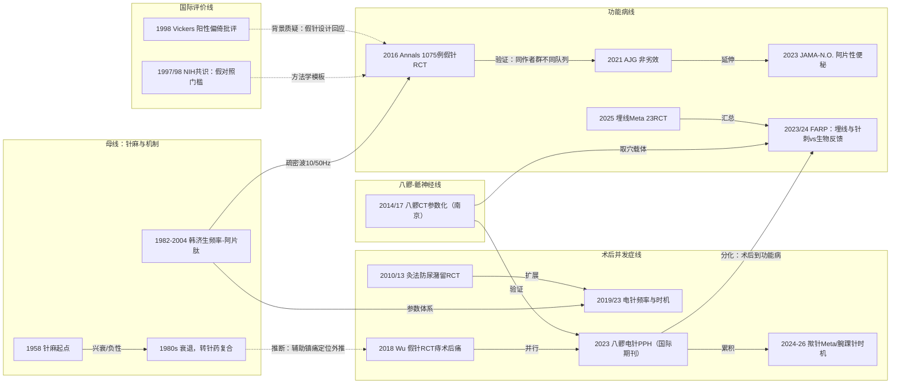

# D12 针灸与穴位疗法在肛肠疾病中的应用

> 针灸在肛肠疾病的应用由三条线汇成：古典"承山、长强、二白"治痔经穴与 1958 年起针刺麻醉的经验外推，在韩济生针刺镇痛神经化学机制（低频/高频-阿片肽）提供的参数体系下走向现代临床试验；证据集中在术后尿潴留（灸/电针/TEAS）、痔与肛周术后疼痛（电针/腕踝针/揿针）和功能性便秘（1075 例假针 RCT、与普芦卡必利非劣效）三条线。国际评价总体保守——NIH 1997 共识未提任何肛肠适应证，Cochrane 便秘评价 2003 年注册、2023 年 pub4 仍是 protocol；至今没有一项非中国团队的独立验证试验。对临床医生最重要的一点：便秘线的假针对照证据已达国际水平（效应可持续 24 周、不良事件约为药物组四成），而痔术后疼痛线仍处在"试验普遍阳性、指南不推荐"的分裂局面。

## 0 三分钟速读

1. **从哪里来**：经典"痔穴"承山、长强、二白见于《针灸大成》玉龙歌"九般痔漏最伤人，必刺承山效若神"（原典电子文本已核）等歌赋，《针灸甲乙经》为教材公认最早源头（教材层转述，本轮未核原典）；现代起点是 1958 年针刺麻醉 [D12-N01] 与韩济生针刺镇痛机制研究 [D12-N02]。
2. **为什么改变**：NIH 1997 共识把针刺"有希望"的适应证划在恶心呕吐与术后牙痛，通篇未提肛肠 [D12-N03]；Vickers 等 1998 年报告中日港台来源针刺试验 100% 阳性 [D12-N04]——两件事迫使此后试验改用假针对照、前瞻注册并投向国际期刊。
3. **如何分化**：术后并发症线（灸/电针防尿潴留、术后疼痛）与功能病线（针刺便秘、功能性肛门直肠痛）分开演进；南京团队把八髎穴做成 CT 测量参数（进针角度/深度），沟通经典穴位与骶神经解剖，成为肛肠国际期刊 RCT 的取穴载体 [D12-N06][D12-N11]。
4. **现在研究什么**：腕踝针"预先 vs 即刻"时机三臂试验（预先组 24h 疼痛 AUC 降 24.5%，POUR 14.44% vs 29.17%）、电针整合入结直肠 ERAS（CORRECT，300 例方案）、承山/背根节动物机制、穴位埋线 Meta（23 项 RCT/1794 例）、TEAS 防尿潴留（RR 0.44）。
5. **用了什么数据**：单中心小样本 RCT（60–275 例）为主体，便秘线有多中心假针 RCT（1075/560 例）；Meta 检索普遍中英文库混合并注册（PROSPERO/INPLASY）；真实世界数据极少（仅 1 项据综述转述的电子医疗数据研究）；中文非 MEDLINE 期刊承载大量原始试验但止于题录层。
6. **还有什么不知道**：非中国团队独立验证为零；Cochrane"针灸治慢性便秘"20 年停留 protocol（已确证）；ChiCTR 注册终点无法机读核对；AJG 2021 试验注册号未核；中文期刊原始试验全文不可得（第 8 节）。

**覆盖边界**：纳入三条应用线——①术后并发症线：痔/肛瘘/肛周脓肿术后疼痛的针刺/电针/腕踝针/揿针、术后尿潴留的灸法/电针/TEAS、术后胃肠功能；②功能病线：穴位埋线与电针治功能性便秘/慢传输型便秘、功能性肛门直肠痛（与 D08 交叉）；③围术期辅助线：针刺麻醉 1958 年起的兴衰与"针药复合麻醉"回归、耳穴与经皮耳迷走神经刺激（taVNS）、韩济生机制对肛肠场景的外推。不含：中药坐浴熏洗与术后镇痛药物（D09）、中药内服通里攻下（D07）、创面用药（D10）、痔手术术式之争（D01）、功法康复。肛瘘与肛裂的针灸专项 RCT 本轮未检到。

**本章口径**：截止 2026-10-18；近期重点窗口 2021-10-18 至 2026-10-18；历史追溯不设下限。阅读层级：L0=仅二手转述、L1=题录已核、L2=摘要已读、L3=原文部分章节已读、L4=全文已读。本章 13 个节点：L3 2 个（N08、N11，经 PMC 全文核实方法与结果）、L2 10 个、L1 1 个（N02，其机制框架部分经 2004 年综述摘要升为 L2），N04 为 L2/L1 混合；古籍条文与 1958 年首例细节等 L0 转述内容在正文单独标注。计数口径：样本数均实义为“患者数”，动物机制研究的分析单位为动物/通路，在表中注明。**覆盖状态：基本完整但有标注缺口**——六问均可据本章回答，三条应用线的主要分支均有节点；缺口限于第 8 节已标注项（中文库全文不可得、ChiCTR 注册终点未机读核对、古籍与 1950s 原始报告未核、部分近五年条目止于题录层）；第二轮完整性修订（2026-10-19）已按 Europe PMC 题录补实名 7 处第一作者，题录均可回查。

## 1 源头：最初在研究什么

按四类标注（"目前最早找到"≠"公认奠基"）：

- **古典"痔穴"线（教材共识，非本轮数据库检索结论）**：现代针灸教材与穴位文献研究公认《针灸甲乙经》（约 259 年，皇甫谧）最早记载长强（GV1）、承山（BL57）治痔疾——本轮未核对《甲乙经》原典条文，此为教材层通行说法；《灵枢·经别》"（足太阳）其一道下尻五寸，别入于肛"为膀胱经穴治肛病的经络依据（据上海针灸杂志 2023 综述 E04 转述）；《针灸大成》（1601）玉龙歌"九般痔漏最傷人，必刺承山效若神，更有長強一穴是"已在中国哲学书电子化计划（ctext.org）原典电子文本核实；《针灸聚英》载《玉龙赋》"长强、承山，灸痔最妙"与《百症赋》"刺长强于承山，善主肠风新下血"与教材引文一致（L0 转述）。二白（EX-UE2，腕掌侧横纹上 4 寸、桡侧腕屈肌腱两侧）主治痔漏，教材引元代《扁鹊神应针灸玉龙经》（王国瑞）为出处，本轮未核元刊原典（L0）。这组穴位至今仍是痔病针灸主穴：Front Surg 2022 系统评价表 1 中 Xiao、Lin 两项痔术后手针 RCT 仍以 EX-UE2 为主穴（据 E01 表 1 转述）。
- **针刺麻醉（公认奠基，两篇回顾性叙述）**：1958 年针刺麻醉起于上海与西安（韩济生 2016 年第一人称回顾"begin in Shanghai and Xi'an in 1958"；World Neurosurgery 2017 历史综述"initiated in 1958"）；首例细节据国家中医药管理局官网 2019-05-29 文章转述为 1958-08-30 上海市第一人民医院尹惠珠在合谷穴针刺下行扁桃体摘除（L0，本轮未核对 1958 年原始报道；首例归属另有 1958 年 12 月西安案例之说，见于媒体与口述层）；时间线：1965 年起全国推广→1970s 高峰→1980s 衰退→1997 年 NIH 共识→2007 年列入国家重点研究计划→"针药复合麻醉"成为部分术式首选；1971 年后向国外传播 [D12-N01]。肛肠/会阴手术在 1960–70 年代针麻中的份额未找到原始统计（第 8 节）。
- **针刺镇痛机制（公认奠基）**：韩济生与 Terenius 1982 年在 Annu Rev Pharmacol Toxicol 22:193-220 总结针刺镇痛的神经化学基础（L1 题录）；1984 年兔脑 PAG/脊髓抗体微注射实验证明β-内啡肽/脑啡肽/物质 P 介导（Neuropharmacology 23:1-5，L1 题录）；2004 年 Neurosci Lett 361:258-261 综述摘要原文载明：2 Hz 促脑啡肽/β-内啡肽/内吗啡肽释放、100 Hz 选择性促强啡肽、两频率联用四肽齐释（L2）——低频/高频/疏密波参数体系由此确立，此后肛肠电针试验的参数选择均溯于此 [D12-N02]。
- **针刺-膀胱/排尿的最早 PubMed 题录（目前最早找到）**：KUO NM 等"A model bladder for the study of acupuncture"（《中华外科杂志》1961;9:503-505，PMID 13927419），本轮在 PubMed 限定 1950–1961 全库检索仅命中此条，内容为动物膀胱针刺模型（据题名转述，题录层；本轮未走 PMC 回溯扫描路径核对原文，原因见第 8 节）；针刺治疗产后尿潴留的英文题录 1985 年见于 J Tradit Chin Med（49 例，PMID 3849626，题录层）。
- **便秘线奠基（公认）**：Liu Z 等 2016 年 Ann Intern Med 多中心假电针对照 RCT（1075 例，注册方中国中医科学院广安门医院）是该方向规模最大、国际影响力最高的原始研究，被 2026 年 AGA 难治性便秘临床实践更新引用 [D12-N07]。

## 2 关键转折：问题—新证据/新方法—认识变化—新问题

**转折一（1958–1980s→今）：针刺麻醉从"替代药物"退为"辅助组件"。** 针麻在 1958 年起点后于 1965 年推广、1970s 达峰，1980s 因镇痛不全、个体差异大、不能肌松而迅速衰退，纯粹针麻退出主流麻醉，转为"针刺辅助/针药复合麻醉"仅用于部分术种——这是本方向最大的负性/失败路线 [D12-N01]。纯替代路线衰退后，针刺以"术后辅助镇痛与并发症防治"身份进入包括肛肠在内的围术期场景（此承接关系为本报告推断：时间先后+韩济生六阶段框架中"针药复合回归"的定位）。上海岳阳团队 2023 年肛肠针麻综述（E04，全文已读）承认针刺麻醉"无法完全替代药物麻醉"、缺乏临床综合评价规范与质量控制标准——遗留问题延续至今（第 5 节）。

**转折二（1970s–2004）：把针刺镇痛改造成神经药理学命题（扩展）。** 面对 1970 年代国际怀疑，韩济生团队用兔脑核团抗体微注射阻断实验证明阿片肽介导，2004 年综述摘要明确频率-肽谱对应（2 Hz→脑啡肽/β-内啡肽/内吗啡肽；100 Hz→强啡肽；联用四肽齐释）[D12-N02]。认识变化：针刺从经验技术变为可测量的神经药理学干预，电针频率成为可优化的"剂量"。新问题：该参数体系在肛肠场景是否成立，直到 2019 年才有头对头数据 [D12-N09]。

**转折三（1997–1999）：国际边界划定与阳性偏倚批评（国际背景，非直接因果）。** NIH 1997 共识发展会议（12 人小组+25 位专家，检索 1970.1–1997.10 文献 2302 篇）认定针刺对术后/化疗恶心呕吐与术后牙痛"有希望"，并明言安慰剂/假针对照设计困难；通篇未提及痔、瘘、肛裂或术后尿潴留——国际官方层面对肛肠适应证保持"沉默"而非否定 [D12-N03]。Vickers 等 1998 年对 MEDLINE 1966–1995 的摘要两级系统评审：针刺试验中源自中国/日本/香港/台湾者 100% 阳性（252/1085 篇入选）、英格兰 75%；非针刺试验 405/1100 篇入选，中国/俄罗斯发表的试验无一篇报告治疗无效；其中"中国发表的 359 篇非针刺 RCT 无一阳性"一句出自论文正文（本轮未获全文核实，数值自洽：359+14+25+7=405，未经独立确认）[D12-N04]。Tang/Ernst 1999 年 BMJ 对中医 RCT 质量的评审同属跨病种背景（L1）。认识变化：此后中国团队的肛肠/便秘试验普遍加装假针对照、盲法与前瞻注册——Annals 2016 三盲假针设计 [D12-N07] 与 2024 年假针安慰剂分析（假针应答仅约 10.6%，PMID 38361038）是对该质疑的直接方法学回应。

**转折四（2010–2013）：术后尿潴留从临床习惯变成量化 RCT 证据（验证）。** 痔瘘/PPH 术后尿潴留需要导尿，综述引文称发生率"可高达 52%"（据 E04 转述，其引文[22]为 Hu J 等灸法网状 Meta 方案），需要低成本非药物预防手段。Li N 2010（60 例三臂：悬灸气海 CV6/中极 CV3 vs 热敷 vs 红外）示灸法组导尿率 10.0%（2/20）vs 热敷 50.0% vs 红外 45.0%（均 P<0.05）；Bian 2013（100 例 PPH 术后，艾条灸关元 CV4 30 min vs 常规护理）示自主排尿中位时间 6h vs 8h（P<0.001）、RR 2.032（95%CI 1.278–3.230）、导尿率 10% vs 38%（P<0.001）[D12-N05]。Bian 是本轮检到最早的 PPH 人群灸法验证（非"首次"——未排查更早报告）。新问题：小样本阳性是否可汇总，2010 年代后期起由系统评价接手（第 4 节主题 5）。

**转折五（2014–2017）：八髎穴解剖参数化（方法节点，南京线）。** 王玲玲（南京中医药大学）团队先总结"八髎深刺、直接刺激骶神经才有效"的临床经验（中国针灸 2014;34(3):285-288），再以 100 例成人俯卧位骨盆 CT 三维重建测出四对骶后孔的进针角度与有效深度：体表夹角 BL31 61.04°±12.15°→BL34 54.39°±10.94°，有效深度 58.16±12.43→31.13±10.94 mm 递减，与 BMI 正相关、与性别体重无关（针刺研究 2017;42(6):537-541）[D12-N06]。同系列还有 2013 年测量定位（PMID 24195211）、2016 年 290 例志愿者 CT（PMID 29071935）、2016 年 15 例成年女性骶骨标本解剖（PMID 27352499，均题录核实）。认识变化："八髎=4 对骶后孔、深处 S1–S4 骶神经"从经典描述变为可操作 CT 参数，为八髎电针进入 PPH 术后疼痛/尿潴留/功能性肛门直肠痛试验提供解剖学正当性（注意：骶神经解剖论述由王玲玲团队与 E04 综述承载，Shen 2023 原文本身无"sacral nerve"字样）。

**转折六（2016–2021）：便秘线国际化——从"是否优于安慰针"到"与处方药比"（验证→改变认识）。** Liu Z 等 2016 年多中心（15 家医院）假电针对照三盲 RCT（NCT01726504，广安门医院注册，2012-10 至 2014-12 入组 1075 例）：电针双侧天枢 ST25+腹结 SP14 疏密波 10/50 Hz、28 次/8 周，1–8 周每周完全自主排便（CSBM）增加 +1.76（95%CI 1.61–1.89）vs 假针 +0.87（0.73–0.97），组间差 0.90（0.74–1.10，P<0.001），9–20 周维持 1.09；≥3 次/周 CSBM 比例 31.3%（治疗期）/37.7%（随访期）vs 12.1%/14.1%；不良事件少且轻度 [D12-N07]。注册主要终点与发表一致（NCT API 核对）。2021 年同一作者群（重叠 13 人，非同一队列）将对照升级为一线促动力药：560 例非劣效 RCT，电针 36.2% vs 普芦卡必利 37.8%，差 -1.6%（95%CI -8%至 4.7%，非劣效成立）；不良事件 17.69% vs 44.24%，效应停针后可持续 24 周 [D12-N10]。认识变化：电针从"中医习惯"升级为"与处方药非劣效的替代选项"，安全性数据成为其相对优势；遗留问题：操作者不可盲、>24 周数据缺失、普芦卡必利固定 2 mg 剂量。

**转折七（2018–2023）：肛肠术后疼痛进入假针对照时代与国际期刊（验证→载体升级）。** 此前痔术后镇痛 RCT 均以药物为对照、无法排除安慰剂效应。Wu J 2018（72 例混合痔外剥内扎术后 15 min 内电针 50 Hz 病灶周围围刺 30 min vs 假针非穴浅刺，单盲）示电针组 VAS 在 6h、24h 及首次排便时显著更低（P<0.05），VRS 在 4h 及排便时、Wong-Baker 在 5/7/8h 及排便时更低——是 Front Surg 2022 系统评价纳入 4 项 RCT 中唯一假针对照者 [D12-N08]。随后参数与时机被头对头检验：Long Q 2019（120 例三臂，术前 30 min 电针下髎 BL34+承山 BL57）示 24h 时 2/100 Hz 疏密波组 VAS 与肢体活动评分低于 2 Hz 与 100 Hz 连续波组（注意：三组"追加麻醉药"4/5/4 例差异无统计学意义，与"口服氨酚双氢可待因量最低"是两个不同结局）；He YH 2023（240 例四臂，次髎 BL33+会阳 BL35，4/20 Hz）示术后 6h 电针组首次排尿时间早于术前/术中组，三个电针组 24h 排尿顺畅度与 VAS 均优于非针刺对照 [D12-N09]。2023 年 Shen J 把八髎电针带上国际结直肠外科期刊：124 例 PPH 前瞻 RCT（对照 67 vs 电针 57，ChiCTR2100043519），电针组术后 8/24/48/72h VAS 与肛门坠胀评分更低、镇痛追加更少、术后第 1 天尿潴留与里急后重发生率更低 [D12-N11]。认识变化：术后疼痛线的证据载体从中文期刊升级到 Int J Colorectal Dis，但该试验无假针对照、样本量不均衡，且不能外推至外剥内扎人群（PPH 术式本身在 D01 存在争议）。

**转折八（2023–2024）：从术后并发症推进到功能性肛门直肠痛（分化）。** Li J 2023（Medicine 102(44):e35462；71 例 FAP）示穴位埋线 vs 假埋线总有效率 85.71% vs 8.33%（P<0.001），VAS、失禁指数与 SF-36 多维度更优，两组无不良反应；Xue Y 2024（南京市中医院 68 例）示针刺（中髎 BL33、下髎 BL34、肝俞、肾俞、大肠俞）vs 盆底生物反馈各 20 次/4 周均显著降 VAS，但盆底失弛缓亚组生物反馈终末 VAS 更低（1.40±0.97 vs 5.30±1.70，P<0.05，数字经 PMC 全文核实），针刺组心理健康维度改善更优 [D12-N12]。认识变化：确立"针刺/埋线 vs 生物反馈"直接比较证据，并给出适用边界——盆底失弛缓亚型首选生物反馈、针刺优势在整体与心理维度（与 D08 交叉）。2024 年 136 例多中心电针八髎 vs 假针 FAP 方案启动（PMID 38647724），该分支向多中心验证推进。

**补充分支（2018–2024）：便秘线的 TEA（经皮穴位电刺激）分支。** 除广安门电针线外，旅美学者陈建德（Jiande DZ Chen）合作网络 2018–2024 年推进 TEA-at-ST36 便秘假对照试验链：本轮抽查 4 篇（武汉 70 例 sham-TEA RCT，Neuromodulation 2024，示 TEA 改善慢传输型便秘症状并加速结肠传输、经自主神经机制；另有南京、上海、杭州站点各 1 篇，PMID 38127047、35347091、36478881、35973183，机构归属已核），全部为中国站点——便秘针灸试验的团队不止广安门一家，但也再次印证"无非中国团队独立验证"（第 5 节）[D12-N13]。

## 3 分支图

实线=原文明确讨论或综述归纳的关系；虚线=本报告推断（时间先后+同中心/同项目相关，因果未证）。

## 4 近五年重点（2021-10-18 至 2026-10-18）

**1. 腕踝针（WAA）用于痔术后疼痛的时机优化。** 腕踝针疗法起源锚点为张心曙《腕踝针》（上海科学技术出版社 1978；据转述 L0，原书与院史归属本轮未核，长海/长征医院两说并存）。两条新 RCT：Xu M 2025（124 例，62/62，2024-01 至 2024-12 入组；WAA 下 6 区+静脉自控镇痛 vs 单纯自控镇痛）示 NRS 自 12h 起更低，镇痛泵用量与补救镇痛减少、便秘与尿潴留发生率更低（后两项位于摘要截断处，本轮未逐字复核；PMID 40988894）；He P 2026 三臂（对照 96/即刻 89/预先 90，2024-06 至 2025-03；预先=术后 1h 内疼痛出现前，即刻=VAS≥1 时）示预先组 24h 疼痛 AUC 44.10（39.08–49.11）vs 对照 58.44（53.67–63.21），降 24.5%；POUR 14.44% vs 29.17%（调整 OR 0.38，0.17–0.80）；补救镇痛 13.33% vs 35.42%；即刻组与对照差异无统计学意义（P=0.453；ChiCTR2400084402，注册终点未能在线核对）（PMID 42602644）。该文随后出现学术通信交锋（Letter PMID 42730025 与作者 Response PMID 42751282，题录层），显示争议活跃。设计特点：疼痛轨迹/累积疼痛负荷（AUC）作为新结局。分歧：即刻镇痛不优于对照，与 He YH 2023"术后早期干预最优"的结论形成张力（两者干预方式不同，不能直接对撞）。均为单中心。成熟度：发展中。

**2. 电针/穴位刺激整合入结直肠 ERAS。** CORRECT 试验方案（Int J Colorectal Dis 2024;39:198，PMID 39652211）：300 例（计划）、4 家分中心、2:2:1 电针（合谷 LI4/支沟 SJ6/足三里 ST36/上巨虚 ST37）vs 假针 vs 对照，均含标准化 ERAS，主要终点首次排气（NCT06128785 为论文自报，摘要未见）；结果未发表。BMJ Open 2025;15(12):e108722（PMID 41475813）方案：3 家医院 50 例，1:1 电针 vs 假针治术后肠梗阻，5 次/5 天，静息态 fMRI 作机制测量。taVNS RCT（Ann Med 2025;57:2476045，PMID 40059790）：96 例肛周手术，术前 30 min+术后 24h 各 30 min，2–72h VAS 更低、补救镇痛更少、尿潴留发生率更低，两组均无低血压/心动过缓（后三项经 PMC 全文核实）。分歧：关键试验尚无结果发表；"整合入 ERAS 路径"多为方案/综述声明，缺结局级证据。成熟度：发展中。

**3. 肛肠术后疼痛的经穴机制动物模型（骶段/背根节通路）。** 电针"承山"在痔术后肛门痛大鼠模型经 mAChRs/IP3-Ca²⁺-CaM 通路镇痛（Clinics 2024;79:100485，PMID 39316895；已发 Corrigendum，Clinics 2025;80:100568，PMID 39778219）；P2X7/ERK 背根节轴两条：Physiol Behav 2025;291:114806（PMID 39814121，含 90 例患者+大鼠切口痛模型的复合设计）、Purinergic Signal 2026;22(1):6（PMID 41543815，70 只 SD 大鼠 7 组+A-438079 拮抗验证）。另有足三里促结肠动力经 TRPV1⁺ 皮肤感觉纤维介导的动物/神经干研究仅核实为 Annals 2016 的引文、未取得题录号（第 8 节待核线索）。分歧：动物模型与临床术式（外剥内扎/PPH）的对应性未建立；多为一稿一通路；Clinics 论文已发勘误。成熟度：早期线索。

**4. 穴位埋线的大样本化。** Front Med 2025;12:1592220（PMID 40909448，INPLASY202570017，检索至 2024-11）：23 项 RCT/1794 例，埋线总有效率优于西药（OR 2.71，1.91–3.83）、针刺（OR 2.90，1.68–5.01）与安慰剂，与口服中药差异无统计学意义（OR 2.34，P=0.12）；作者自认纳入研究以单中心低质量中文 RCT 为主。混合痔术后端：中国针灸 2026;46(5):738-742（PMID 42116778）68 例（34/34）RCT，长强+双承山+大肠俞+白环俞术后第 2 天埋线改善术后并发症（题录与设计层）；路线起点为 Yang 2011（针刺研究 36(4):292-295，120 例，术前 30 min 双承山区埋线 vs 术后口服曲马多 100 mg，术后 5–96h 各时点 VAS 更低）。分歧：埋线异质性（线体/穴位/间隔）未标准化；"优于针刺"的结论需谨慎。成熟度：发展中。

**5. 术后尿潴留（POUR）非药物防治的证据汇总与风险分层。** 三层汇总：灸法 Meta（J Perianesth Nurs 2023;38(6):881-891，PMID 37589632，34 项 RCT，检索至 2021-10-01，含 CNKI/万方/维普）示显著有效率 RR 2.53（2.17–2.95）、总有效率 RR 5.02（4.01–6.28）、首次排尿时间 -2.81 h；TEAS Meta（Heliyon 2024;10:e23537，PMID 38169833，14 项 RCT/2865 例，检索至 2023-02-06）示 POUR 发生率 RR 0.44（0.33–0.58）、残余尿 -75.41 mL，肛肠/妇科/骨科/胆道手术有效而泌尿手术未见，作者自述难排除发表偏倚；针刺跨手术类型 Meta（eCAM 2021;2021:2500282，PMID 34630605，12 项 RCT/979 例，检索至 2020-09）为旁证。人群端：Ann Coloproctol 2026;42(3):281-292（PMID 42392852，ChiCTR2500097230）回顾性病例-对照（2020-06 至 2023-10）示良性肛肠疾病术后 POUR 发生率 9.4%，独立危险因素含女性、糖尿病、麻醉方式等（明细列表在摘要截断处，未逐项复核）。分歧与缺口：发生率口径 9.4% vs "可高达 52%"两说并存（第 5 节）；高危人群分层 RCT 缺失。成熟度：汇总层成熟，原始证据质量受限。

**6. 便秘线的 TEA 分支与 Cochrane 确证。** TEA-ST36 假对照试验链 2018–2024 年持续产出（4 篇站点：武汉/南京/上海/杭州，锚点为 Neuromodulation 2024 武汉 70 例 sham-TEA RCT）[D12-N13]。同期的国际评价层结论落定：Cochrane"Acupuncture for chronic constipation"（CD004117）pub4 经 PMC 存档 objectives 字段原文确证仍为 protocol——"This is a protocol for a Cochrane Review (intervention). The objectives are as follows: To assess the effects of acupuncture therapy for functional chronic constipation."；即 2003 年注册、2012 年 pub3、2023 年 pub4 三版均为 protocol，从未产出完整评价（此前"完成状态存疑"已按本轮核实升级为确证负性结果；作者隶属北京中医药大学循证中医医学中心，经 PMC front matter 核实）。

## 5 争议、负性结果与停滞路线

**争议一：痔术后针刺"证据不确定"与临床广泛应用并存（未决）。** 一方（系统评价者与指南）：Front Surg 2022（4 项 RCT/275 例，检索至 2021-09-30）结论"evidence not conclusive"，明言现行指南持怀疑态度；其中 2 项手针 vs 药物（吲哚美辛栓 80 例、曲马多 58 例）结果不一致，无法确立手针独立镇痛效应，仅电针 vs 假针（Wu 2018）阳性；《痔中西医结合诊疗指南（2025 版）》（中国全科医学 2025;28(26):3217-3228，郑丽华通讯；页面已核）可见推荐中术后疼痛仅推荐多模式联合镇痛、无针灸条目（PROSPECT 痔手术指南 2023 亦不含针灸，题录级旁证，归 D09）。另一方（临床团队）：电针 Meta（Medicine 2022;101(50):e32247，5 项中国研究 465 例，PMID 36550890）与揿针 Meta（PLoS ONE 2024;19:e0296439，11 项 RCT/895 例，VAS SMD -0.77）均阳性。但 Medicine 2022 该 Meta 自身存在内部数字矛盾（经其 PMC 全文确证）：24h 处 SMD=-0.548、CI -0.721~-0.374 却标 P=.547，72h 处 SMD/CI 与 12h 完全重复（-1.089，-1.336~-0.843）——汇总层证据质量有缺陷。现状：指南保守与试验阳性并存。

**争议二：中国来源针刺试验的阳性偏倚（跨病种背景，持续）。** 批评方依据 Vickers 1998（中日港台 100% 阳性）与 Tang/Ernst 1999；本方向 RCT 全部出自中国团队，需自证。回应：NCT01726504 三盲假针设计（注册核对一致）与 NMO 2024 假针安慰剂分析（539 例，三种应答标准下假针应答率 10.58%/9.46%/9.09%，PMID 38361038）。持续状态：本方向尚无非中国团队独立重复；Cochrane 级综合未完成（便秘条目确证停留 protocol；Europe PMC 检索 SRC:CDSR"acupuncture AND (constipation OR urinary retention)"0 命中，痔术后疼痛/尿潴留无 Cochrane 条目）。

**争议三：针刺麻醉的兴衰与"针药复合麻醉"的正当性。** 一方视针麻为 1958–1970s 中国原创成果并大规模推广；另一方承认 1980s 起因镇痛不全、个体差异大而衰退，纯粹针麻退出主流。E04 综述（全文已读）自认针麻"无法完全替代药物麻醉"、缺乏临床综合评价规范与质量控制标准。现状：以针药复合模式进入 ERAS 的定位基本定型，但肛肠场景的高质量循证证据（多中心假对照、规范参数）仍缺。另有一条技术性负性结果：高频连续波长时间刺激易产生肌肉耐受，被疏密波（如 2/100 Hz）取代；Long Q 2019 头对头亦示 100 Hz 连续波组 12/24h 镇痛最弱（据 E04 第 2.2 节与摘要）。

**争议四：肛肠术后尿潴留发生率口径（两说并存）。** Ann Coloproctol 2026 报告 9.4%（定义严格、单中心回顾）；E04 综述引文称"可高达 52%"（其引文[22]为灸法网状 Meta 方案）。差异来自定义（是否含需导尿的显性潴留）、麻醉方式（蛛网膜下腔/全身麻醉为独立危险因素）与队列构成。保留两说，出处如上。

**争议五：RCT 注册终点与发表终点的一致性（核对覆盖不完整）。** 已核对一致：NCT01726504 注册主要终点"Change in Mean Weekly CSBMs During Weeks 1-8"与 Annals 2016 发表一致（API 记录取自 2026-10-18）。实质一致但表述有差：NCT03797586 注册"Number of Participants With Response, weeks 1-8"vs JAMA Netw Open 2023 发表以"week 8 应答率"为主要结果（该试验 100 例，6 家三甲，2019-05 至 2021-12，应答 40.1% vs 9.0%，差 31.1 个百分点，PMID 36811861）。未能核对：ChiCTR2100043519（Shen 2023）、ChiCTR2400084402（He P 2026）、ChiCTR2500097230（Zhang 2026）公开检索需网页交互，API 端点 404；AJG 2021 试验的注册号在本轮三份材料中均未载明、成稿环节不新增检索，未核（第 8 节）。国际注册（NCT）透明度较好，ChiCTR 为检索缺口。

**争议六：功能性肛门直肠痛中针刺与生物反馈的适用边界（初步形成）。** 针刺对 FAP 整体有效且心理维度更优，但盆底失弛缓亚组生物反馈镇痛更优（终末 VAS 1.40±0.97 vs 5.30±1.70）[D12-N12]。待 136 例多中心 RCT（PMID 38647724）验证。

**负性/停滞路线小结**：①针麻纯替代路线（1958–1980s）衰退，仅以针药复合保留 [D12-N01]；②手针 vs 活性药物对照路线无法确立独立效应（Front Surg 2022 表 1）[D12-N08]；③Cochrane 便秘评价 20 年停留 protocol（已确证）；④高频连续波长时间电刺激因肌肉耐受被疏密波取代；⑤肛肠术后腹胀/排气方向的针灸 RCT 缺失——现有试验面向结直肠癌手术（CORRECT、BMJ Open 方案），痔/瘘术后胃肠功能恢复的针灸 RCT 本轮未检到。

## 6 传承线与国际线

**传承线（学术思想→名家/单位→方药/指南的接力链）**：古典经穴（承山/长强/二白治痔，《甲乙经》-《针灸大成》脉络，L0 教材层）→1958 年针刺麻醉（上海/西安起点，首例细节 L0）→韩济生机制线（北京大学，1982 Annu Rev→2004 Neurosci Lett，频率-阿片肽框架）→术后尿潴留灸/针 RCT（中国针灸 2010/2013/2019/2023 多单位：Li N 悬灸 60 例、Bian PPH 灸关元 100 例、Liu F 针+麦粒灸 60 例——该文摘要"共 60 例、每组 31 例"内部数字矛盾，存疑保留（PMID 31286731）；Long Q 电针预刺激 80 例，尿潴留 5.0%（2/40）vs 22.5%（9/40），PMID 31397125）→八髎解剖参数化（南京中医药大学王玲玲团队，CT 三维）→大样本便秘 RCT（中国中医科学院广安门医院，NCT01726504/AJG 2021，科技部"十二五"支撑计划资助）→肛肠针麻-ERAS 线（上海中医药大学附属岳阳中西医结合医院周嘉/王振宜团队，上海针灸杂志 2023;42(11):1228-1234 综述全文已读：整理针药复合取穴合谷/内关/足三里、承山/八髎/白环俞、长强/腰俞，参数雷剑 2015 年 15 Hz、龙庆 2019 年 2/100 Hz，提出构建肛肠针麻临床应用规范、质控标准与综合评价；同团队另有针刺麻醉 WoS 文献计量 1992–2022，PMC10285535）→功能病线（南京市中医院，针刺 vs 生物反馈 FARP RCT）。真实世界路径仅一项：葛茂军等电子医疗数据研究（第二军医大学学报 2021;42(11):1260-1266），据 E04 转述称针药复合麻醉降低女性患者 41% 术后尿潴留风险——原文未获取，样本与统计模型未经独立复核（存疑）。指南层张力：《痔中西医结合诊疗指南（2025 版）》可见推荐无针灸条目——指南采纳落后于试验产出（《中国痔病诊疗指南（2020）》仅网络转述、无可核题录，列入待核线索）。

**国际线**：①官方评价边界——NIH 1997 共识对肛肠适应证保持沉默 [D12-N03]；②方法学批评背景——Vickers 1998/Tang-Ernst 1999（跨病种，评述不含肛肠试验，本轮已核）[D12-N04]；③国际系统评价层——Cochrane CD004117 确证停留 protocol，CDSR 无肛肠针灸条目；④国际指南接触——2026 年 AGA 难治性便秘临床实践更新（Clin Gastroenterol Hepatol，PMID 41504675）引用 Annals 2016（在 209 条被引之列；其内部立场未读全文，L1）；⑤国际期刊载体——Ann Intern Med、Am J Gastroenterol、JAMA Netw Open、Int J Colorectal Dis 构成中国成果出口；美国执业层 Medical Acupuncture 2024 年刊出痔病针灸病例报告与实践调查三篇（PMID 39741763/39741764/39741765，题录层），显示美国针灸师执业兴趣但无 RCT 集中；⑥海外神经调控框架——陈建德（旅美）团队电针/TEA 调节胃肠动力综述（Neurogastroenterol Motil 2018，PMID 29906324）与 2018–2024 TEA 便秘试验链提供海外学术框架，但其试验站点均在中国 [D12-N13]；⑦报告标准——STRICTA（PLoS Med 2010;7(6):e1000261，PMID 20543992）为通用评估工具。**缺席结论与检索覆盖说明**：本方向未检索到海外团队针对痔/肛瘘/肛裂术后或肛肠术后尿潴留的针刺 RCT；德国大型针灸试验（GERAC 等）均为腰痛/膝骨关节炎，无交集。该缺席结论的检索覆盖有限——本轮检索日志中德国专项 1 次、日本 2 次，无韩国/台湾专项抽查；另经专项抽查陈建德合作网络 4 篇 TEA 便秘试验均为中国站点，未发现反例。日本大肠肛门病学会志 1976–1981 年有与针灸-痔匹配的条目（DOI 10.3862/jcoloproctology.29.114、31.479、33.350、34.680），但 Crossref/OpenAlex 均无题名与摘要，无法定性内容；针灸在日本肛肠学界未形成可见 RCT 脉络。

## 7 数据路径小结

**历史上**：1950s–70s 针麻为病例系列与经验总结（中文原始文献未数字化，规模统计缺失）；1980s–2000s 机制线为动物实验；临床证据自 2010 年起以单中心小样本 RCT（60–120 例）起步，结局以"总有效率"等中式终点与导尿率为主。
**现在**：①单中心小样本 RCT（60–275 例）仍为主体（灸法、电针、埋线、腕踝针、taVNS），分析单位均为患者，结局以 VAS/NRS、导尿率、残余尿量、CSBM/SBM 周均数为主；②多中心假针对照 RCT 集中在便秘线（NCT01726504：15 家医院 1075 例三盲；AJG 2021：560 例非劣效；NCT03797586：6 家三甲 100 例），假针为"非穴浅刺+外观相同刺激器"，前瞻 NCT 注册；③系统评价/Meta：中英文库混合检索（CNKI/万方/维普/SinoMed+PubMed/Embase/CENTRAL），PROSPERO（CRD42018099961）或 INPLASY（INPLASY202570017、INPLASY202320095）注册；④真实世界/电子医疗数据：仅 1 项（葛茂军 2021，据 E04 转述，存疑）——路径稀少；⑤动物机制路径：痔术后疼痛大鼠模型（承山-mAChRs/IP3-Ca²⁺-CaM、P2X7/ERK 背根节轴）、慢传输型便秘大鼠（天枢不同频率-结肠肌电/SP/VIP，题录核实）——分析单位为动物/通路；⑥解剖学测量路径：CT 三维重建量化八髎进针角度/深度（100 例骨盆 CT+290 例志愿者 CT+15 例骶骨标本）——穴位数字化；⑦注册与数据挖掘：ChiCTR/NCT 注册（部分 RCT 注册号写入正文）、文献计量（针麻 WoS 1992–2022）、穴位处方数据挖掘。**结构性特征**：中文非 MEDLINE 期刊（《中国肛肠病杂志》《结直肠肛门外科》等）承载大量原始试验但只能到题录/转述层；"总有效率"等中式终点在术后线仍占主导，便秘线已与国际结局标准（CSBM、PRO 量表）接轨。

## 8 还不知道什么（领域证据缺口）与本报告的检索缺口

**领域证据缺口**：①非中国团队的独立重复试验或反驳研究为零（术后疼痛、尿潴留、便秘全部适应证）——Vickers 批评之后 20 余年，假针对照试验仍全部由中国团队完成，国际线只有官方沉默与指南未采纳；②Cochrane 级肛肠针灸证据缺失：便秘条目 CD004117 确证 20 年停留 protocol，痔术后疼痛/尿潴留无 Cochrane 条目；③肛肠术后腹胀/排气方向无针灸 RCT（现有试验面向结直肠癌手术）；④电针频率/时机参数研究无 Meta 汇总（Long 2019、He 2023 为孤立单中心试验）；⑤高危人群（女性、糖尿病、蛛网膜下腔/全身麻醉）分层的 POUR 预防 RCT 缺失；⑥埋线线体/穴位/间隔异质性未标准化，动物模型与临床术式对应性未建立。

**本报告检索缺口（含 CNKI/万方影响）**：①**CNKI/万方未检索**（全文不可得，只到题录或摘要）：中文核心临床期刊大量原始试验止于题录/转述层——如萧华文/沈卫东 2015 电针八髎治肛肠术后疼痛（四川中医 2015;33(3):159-161）、戴君妹 2018 电针白环俞承山（结直肠肛门外科 2018;24(S1):49-51），均据 E04 转述、全文未核；凡依赖此类证据的结论（尤其中文期刊阳性的普遍程度）可能低估异质性与负性结果。②ChiCTR 注册终点未能机读核对（ChiCTR2100043519、ChiCTR2400084402、ChiCTR2500097230，API 404）；**AJG 2021 试验注册号未核**——本轮三份材料均未载其注册号，成稿环节不新增检索，列为待核线索（该试验为改变认识的节点之一，注册核对覆盖因此不完整）。③1950s–70s 肛肠/会阴针麻原始报告与规模统计未数字化、不在国际数据库；1961 年《中华外科杂志》针刺膀胱模型（PMID 13927419）止于题录，本轮未走 PMC 回溯扫描路径核对原文（调研环节未尝试，成稿环节不新增检索）。④古籍原典未核：《针灸甲乙经》《扁鹊神应针灸玉龙经》条文为教材层转述（仅《针灸大成》玉龙歌经 ctext 电子文本核实）。⑤待核线索：葛茂军 2021 真实世界研究（"降低女性患者 41%"，据 E04 转述）；Liu F 2019 摘要内部数字矛盾（60 vs 62）；足三里-TRPV1⁺ 纤维介导结肠动力研究的题录号（仅核实为 Annals 2016 引文）；《中国痔病诊疗指南（2020）》题录；日本大肠肛门病学会志 1976–1981 四条无题名条目；文革针麻累计"200 万例"等规模数字仅见于网络转述，不采信。

## 9 本章节点速查表

| 编号 | 年份 | 第一作者+题名简写 | 期刊 | 节点作用 | 设计/数据/分析单位 | 样本 | 关键结果 | 阅读层级 | 核查状态 | PMID/DOI |
|---|---|---|---|---|---|---|---|---|---|---|
| D12-N01 | 1958（2016/2017 叙述） | Han JS 针麻镇痛研究；Jin L Unforgettable ups and downs | 针刺研究；World Neurosurgery | 历史起点/兴衰框架 | 两篇历史回顾；单位=历史阶段 | 非患者 | 1958 起点-1965 推广-1970s 峰-1980s 衰退-针药复合回归；1971 外传 | L2（首例细节 L0） | 通过 | 29071939；28214637 |
| D12-N02 | 1982–2004 | Han JS & Terenius Neurochemical basis of acupuncture analgesia | Annu Rev Pharmacol Toxicol；Neurosci Lett | 机制奠基（参数体系） | 动物实验+综述；单位=动物/递质系统 | 非患者 | 2 Hz 促脑啡肽/β-内啡肽/内吗啡肽、100 Hz 促强啡肽、联用四肽齐释 | L1（机制框架 L2） | 通过 | 7044284；6201772；15135942 |
| D12-N03 | 1997（1998 发表） | NIH Consensus Conference. Acupuncture | JAMA | 国际边界划定 | 共识会议（12 人小组+25 专家，2302 篇书目）；单位=证据体 | 非患者 | 恶心呕吐/牙痛"有希望"；肛肠适应证缺席；假对照困难 | L2 | 通过 | 9809733 |
| D12-N04 | 1998–1999 | Vickers Do certain countries produce only positive results；Tang Review of RCT of TCM | Control Clin Trials；BMJ | 方法学批评背景（跨病种） | 摘要两级系统评审；单位=试验报告 | 针刺 252/1085、非针刺 405/1100 篇入选 | 中日港台 100% 阳性、英格兰 75% | L2/L1 | 修正（"359 篇"改标正文，未核全文） | 9551280；10406751 |
| D12-N05 | 2010/2013 | Li N 悬灸治痔瘘术后尿潴留；Bian Moxibustion at CV4 | 中国针灸；eCAM | 尿潴留 RCT 起点 | 两项单中心 RCT；患者 | 160 | 灸法导尿率 10.0% vs 50.0%/45.0%；PPH 后 10% vs 38%，RR 2.032 | L2 | 通过 | 20862941；24386005 |
| D12-N06 | 2014/2017 | Cai HH 王玲玲八髎深刺；Jin X CT 三维重建 | 中国针灸；针刺研究 | 八髎解剖参数化 | 经验总结+100 例骨盆 CT；单位=穴位/骶骨 | CT 100 例 | BL31-34 体表夹角 61.04°-54.39°、有效深度 58.16-31.13 mm，与 BMI 正相关 | L2 | 通过 | 24843976；29318863 |
| D12-N07 | 2016 | Liu Z Acupuncture for chronic severe functional constipation | Ann Intern Med | 便秘线奠基/国际化 | 多中心假电针对照三盲 RCT；患者 | 1075 | CSBM 组间差 0.90（P<0.001）；≥3 次/周 31.3% vs 12.1% | L2+注册 L1 | 通过 | 27618593 |
| D12-N08 | 2018 | Wu J 电针治痔术后疼痛 RCT | J Pain Res | 术后疼痛唯一假针 RCT | 单中心单盲 RCT（50 Hz 围刺 vs 假针，全文核实）；患者 | 72 | VAS 6h/24h/首次排便更低（P<0.05） | L3 | 通过 | 30122979 |
| D12-N09 | 2019/2023 | Long Q 不同频率电针；He YH 不同时机电针 | 中国针灸 | 参数/时机优化 | 两项单中心多臂 RCT；患者 | 360 | 2/100 Hz 24h VAS 最低；术后 6h 干预排尿最优 | L2（摘要有截断） | 通过 | 31099217；37068819 |
| D12-N10 | 2021 | Liu B Electroacupuncture vs Prucalopride | Am J Gastroenterol | 非劣效定位 | 多中心非劣效 RCT；患者 | 560 | 差 -1.6%（非劣效成立）；AE 17.69% vs 44.24%；效应持续 24 周 | L2 | 通过（注册号未核） | 33273258 |
| D12-N11 | 2023 | Shen J EA at Baliao after PPH | Int J Colorectal Dis | 国际期刊载体 | 前瞻 RCT（八髎电针 57 vs 对照 67）；患者 | 124 | VAS 8–72h 与坠胀更低、镇痛追加与第 1 天尿潴留更少 | L3 | 通过（ChiCTR 终点未核） | 37074488 |
| D12-N12 | 2023/2024 | Li J 埋线治 FAP；Xue 针刺 vs 生物反馈 | Medicine；Turk J Gastroenterol | 功能病线分化 | 两项 RCT（埋线 vs 假埋线；针刺 vs 生物反馈）；患者 | 139 | 85.71% vs 8.33%；失弛缓亚组生物反馈 VAS 1.40 vs 5.30 更优 | L2（亚组数字经全文核实） | 修正（Medicine 期号 24→44） | 37933076；38454239 |
| D12-N13 | 2022–2024 | Yang J TEA 治慢传输型便秘 sham-TEA RCT | Neuromodulation 2024 | 便秘 TEA 分支锚点 | 假对照 RCT（武汉协和）；患者 | 70 | TEA 改善症状、加速结肠传输（自主神经机制） | L2 | 通过 | 38127047 |

## 10 本章入口文献与检索截止

| 编号 | 入口文献 | 类型 | 检索截止（原文写明） | 层级 |
|---|---|---|---|---|
| E01 | Chen H, et al. Acupuncture for post-hemorrhoidectomy pain: SR of RCTs. Front Surg 2022;9:815618（PMID 35419404） | 系统评价（4 RCT/275 例） | 2021-09-30 | L2（纳入研究表已读） |
| E02 | Liu CF & Chien LW. Moxibustion for POUR. J Perianesth Nurs 2023;38(6):881-891（PMID 37589632） | Meta（34 RCT） | 2021-10-01 | L2 |
| E03 | Cao H, et al. Acupuncture for chronic constipation. Cochrane CD004117.pub4（DOI 10.1002/14651858.CD004117.pub4） | Cochrane 评价 | 未说明（确证仍为 protocol） | L1（PMC front matter 已核） |
| E04 | 尹相宜，等. 针刺麻醉在肛肠手术中的应用研究进展. 上海针灸杂志 2023;42(11):1228-1234 | 叙述性综述（岳阳团队） | 未说明（近 5 年文献） | L4（官网 PDF 全文已读） |
| E05 | Xu N, et al. Intracutaneous pyonex for perianal postoperative pain. PLoS ONE 2024;19:e0296439（PMID 38241273） | Meta（11 RCT/895 例） | 2022-06-15 | L2 |
| E06 | Zhao Y, et al. Acupoint catgut embedding for functional constipation. Front Med 2025;12:1592220（PMID 40909448） | Meta（23 RCT/1794 例） | 2024-11 | L2 |
| E07 | Jin L, et al. Unforgettable ups and downs of acupuncture anesthesia in China. World Neurosurg 2017;102:623-631（PMID 28214637） | 历史叙述 | 未说明 | L2 |
| E08 | Han JS. 针麻镇痛研究. 针刺研究 2016;41(5):377-387（PMID 29071939） | 作者本人历史回顾 | 未说明 | L2 |

本章检索截止 2026-10-18（Europe PMC/PubMed/OpenAlex/Crossref/ClinicalTrials.gov/中文期刊公开 PDF；CNKI/万方全文不可得）。

## 12 复核修订记录（2026-10-18）

1. 机械质检｜正文与证据表均未改动｜复核时核对：全章正文引用节点 13 个（N01–N13）全部可回查证据表对应行、缺失 0，引用写法均为单个方括号形式，确认无问题，故本轮无内容修改（全报告复核时核对）。

- AJG 2021（D12-EV-010）result_location 注明 PubMed 完整摘要与注册号缺口；Li J/Xue（D12-EV-012）P<0.001 补注出处层；两行 first_author 补实名 Chen B、Zheng C。（2026-10-19，汇总者依抽查报告执行）

**第二轮（完整性检查，2026-10-19）**
- 第一作者补实名（依据完整性检查 top_issues，7 个 PMID 全部命中，无「第一作者未核（题录可得）」遗留）：Europe PMC 题录作者串核实后补入 EV-013（38127047→Yang J，同步更新第 9 节速查表 D12-N13 行）、EV-027（41475813→Wang ZY）、EV-031（41543815→Chen B，与同系列 EV-030 Chen B 相符）、EV-032（42116778→Liang W）、EV-040（41504675→Staller K）、EV-041（38647724→Xue Y）；EV-026（39652211）原有 Sun L、EV-028（40059790）原有 Yin ZY 经题录复核一致，未改动。本轮检索共 2 次（Europe PMC REST 批量 1 次+单条复核 1 次），未超 20 次限额。
- 覆盖状态重评：**基本完整但有标注缺口**——六问均可据本章回答、三条应用线（术后并发症/功能病/围术期辅助）主要分支均有节点；缺口限于第 8 节已标注项（CNKI/万方全文不可得、ChiCTR 注册终点未机读核对、古籍与 1950s 原始报告未核、部分近五年条目止于题录层），已在"本章口径"写明。其余正文、分支图与证据表字段结构未改动。
