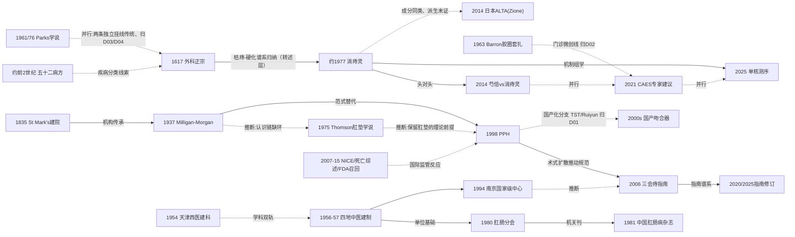

# X01 中国肛肠学科史（横切）

> **一句话判断**：中国肛肠学科史是"中医技法线"与"西医建制线"的双轨史——中医线从枯痔散/挂线的古籍文本（1617年《外科正宗》为系统记载节点）出发，经1950年代无砒改革与公立建科、1980—1981年学会与期刊建制，落到消痔灵（约1977年研制）及其后的制剂迭代、内镜硬化与组学再评价；西医线自St Mark's（1835）—Milligan-Morgan（1937）—肛垫学说（1975）—PPH（1998）—国际监管与证据反应（2007—2015）的西方主线引入并快速国产化。当前最大的结构性矛盾是临床影响巨大而国际学术可见性极低（1983年消痔灵英文系列被引0、中文主流期刊不入MEDLINE），近五年正借国际期刊发表、英文专家建议与单细胞组学启动"反向输出"。对临床医生最重要的一点：注射线与吻合器线的国内叙事同国际证据/监管评价之间仍有落差（复发、狭窄、肝损伤、NICE有限推荐、FDA召回线索）。

## 0 三分钟速读

① **从哪里来**：痔的中文疾病分类最早见于汉墓帛书《五十二病方》的牡痔/牝痔条目（考据文PMID 21569694）[X01-N19]；枯痔方药的可核载录节点是南宋《魏氏家藏方》（2013年《中华医史杂志》考据侧证师承链），另有北宋《太平圣惠方》(992)一说并存；1617年《外科正宗》系统记载枯痔散流程与砒矾插药[X01-N01]。西医线是舶来的：1835年伦敦出现第一家肛肠专科机构（St Mark's前身）[X01-N02]。
② **为什么改变**：含砒枯痔钉的砒中毒报告推动1950年代无砒改革（转述层），最终由成分明确的消痔灵硬化注射取代[X01-N07]；开放痔切除创伤大，1998年PPH把"切除"改为"悬吊+断流"，2000年（据转述）引入中国[X01-N11]，随后迎来NICE有限推荐（2016复核维持）、术后死亡系统综述等国际监管与证据反应[X01-N16]。
③ **如何分化**：注射线内部迭代出芍倍注射液头对头研究（1520例，消痔灵组肛管狭窄3.5% vs 芍倍组0）[X01-N13]，并内镜化为CAES规范[X01-N14]；器械线国产化为TST等分支；建制上分化出中医学会（1980）、中西医结合（1981）、中华医学会学组、医师协会肛肠医师分会四条线[X01-N08]。
④ **现在研究什么**：CAES规范化与扩散、消痔灵的单核测序机制再评价[X01-N15]、中医挂线疗法的国际期刊发表、国产吻合器械比较研究与中文证据的国际可见性缺口。
⑤ **用了什么数据**：从医籍考据、单中心大样本系列（1983年1205例）走到前瞻对照队列（2014年1520例、3年随访）与多组学（2025年单核测序+空间转录组）；单中心、回顾性、中文载体是历史主形态，随机化与国际索引可见性是结构性短板。
⑥ **还有什么不知道**：1950年代无砒改革与消痔灵研制期的一手中文文献不可得；中文主流期刊不入国际索引且CNKI/万方本轮未检索——2024年国际硬化剂系统综述的44项研究（9729例）以来自日本为主，中文证据近乎缺席。

**覆盖边界**：纳入学科建制、制度与监管事件、人物（限学术任职与文献）、文献里程碑、技术与产业节点；不含各术式疗效比较的临床学术史细节（归D01—D12），不含结直肠肿瘤学科史。
**本章口径**：截止2026-10-18；近期窗口2021-10-18至2026-10-18。阅读层级：L0=仅公开电子转写本；L1=题录已在数据库核实；L2=摘要已读；L3=原文部分章节/页面已读；L4=全文已读。本章共19个节点，按核心证据层级计：L0×1、L1×8、L2×3、L3×7；按核查状态计：通过14、修正4（X01-N01/N03/N07/N19）、存疑1（X01-N16）。覆盖状态（统一口径，二轮复评）：**基本完整但有标注缺口**——六个问题（从哪里来、为什么改变、如何分化、现在研究什么、用了什么数据、还有什么不知道）均可据本章作答，章节范围内主要分支（中医技法线、西医建制线、注射线、吻合器器械线、建制四线、国际监管线）均有节点；缺口限于第8节已标注项（1950年代一手中文文献不可得、CNKI/万方未检索、Longo 1998原始会议文献不可核、FDA召回未经独立复核、WJGS 2025队列源文数字口径互斥降权使用）。

## 1 源头：最初在研究什么

按"最早找到""公认奠基""存在争议的首次""作者自称首次"四类标注（区别：*最早找到*是本轮检索实际落到的最早记录，*公认奠基*是领域叙事公认的起点，两者都可以被新证据改写）。

**中医技法线**——研究对象是痔瘘的局部、非切除疗法：
- **最早找到的疾病分类文本**：汉代马王堆帛书《五十二病方》已按"牡痔/牝痔"定义肛内外痔（另有张家山汉简），比《太平圣惠方》年代学线索约早1150年（按章内年份自算：《五十二病方》约前2世纪、《太平圣惠方》992年；考据文PMID 21569694摘要原句无此比较数字，原"约早1800年"为不可溯源换算，二轮修订更正）；依据为《中华医史杂志》2011年考据文（Sun JR等，PMID 21569694，摘要层）[X01-N19]。
- **存在争议的首次（枯痔方药载录）**：一说枯痔散治痔最早见于南宋魏岘《魏氏家藏方》——有《中华医史杂志》2013年《五痔方》考据支撑（PMID 24429040：五痔方承李防御—李永和—马兴思—魏雄蒙—魏岘师承链，明《秘传外科方》另收"李防御五痔方"）；另一说枯痔方药见载于北宋《太平圣惠方》(992)——本轮仅百科转述（L3），卷次与原文条目均未核实。两说朝代相邻，本轮无法以一手古籍条目裁定，保留两说并注明层级。
- **目前最早找到的系统记载文献**：明·陈实功《外科正宗》（成书1617年，断代据馆藏/百科转述）：枯痔散"搽枯痔散，早、午晚每日三次……轻者七日，重者十一日，其痔自然枯黑干硬"；砒矾"搓成如线條陰干……早晚插藥二次……痔漏諸管自然落下"；处方注文"又不用针刀、挂线，不受苦楚"（"挂线"系被对比的已有疗法，非陈氏首创）。本轮据公开电子转写本逐字核对（卷三"下部痈毒门·痔疮论第三十"；注意维基文库现行版本缺卷三，原文路径不可复现）[X01-N01]。
- **作者自称首次（消痔灵）**：史兆岐（中医研究院广安门医院）约1977年（院方官网原文"上世纪70年代末期"）研制消痔灵注射液并提出四步注射法；PubMed/Europe PMC可核的最早英文临床系列为1983年Shi Xiu-Zhang 1205例三期内痔报告（1945—1985年PubMed中国肛肠英文临床文献检索仅命中此一篇）[X01-N07]。

**西医建制线（对照起点）**——研究对象从"专科机构—术式标准化—机制认识"起步：
- **被公认的奠基工作（国际）**：1835年Frederick Salmon在伦敦创办"Benevolent Dispensary for the Relief of the Poor Afflicted with Fistula, Piles and other Diseases of the Rectum and Lower Intestines"（后定名St Mark's，1853年正式启用），为第一家肛肠专科机构；据Front Surg 2021叙述性综述全文转述，另有1935年百年纪念文题录互证（该纪念文刊于Can Med Assoc J，加拿大）[X01-N02]。1937年Milligan-Morgan在St Mark's确立开放痔切除术标准（Lancet 1937;230(5959):1119-1124，DOI已核，1937年Lancet不入PubMed）[X01-N03]。
- **存在争议的首次（国内西医建科）**："1954年张庆荣在天津市滨江医院（现天津市人民医院）创建中国第一个西医肛肠外科"——分类据此降为"存在争议的首次"：其依据仅为中文纪念叙事与百科（纪念文原句经逐字证实，但无一手档案），"第一个"是中文叙述自述口径，不排除更早建制[X01-N04]。

## 2 关键转折：问题—新证据/新方法—认识变化—新问题

**转折一：痔的"非手术化"——从含砒枯痔到成分明确的硬化注射。** 古籍把枯痔散、插药、挂线整理为可传承文本[X01-N01]后，含砒枯痔钉在1950—60年代广泛应用中出现砒中毒报告，福建陈民藩等改进配方、提出一次插钉不超过十九根半并研制无砒枯痔钉与枯痔液（据《中国中医药报》2017年陈民藩专访转述，L2/L3；1978年全国科技大会奖未获获奖名录核证），该路线最终被消痔灵（五倍子鞣酸+明矾硫酸钾铝）取代——成分由Nishida 1999独立记载（J Gastroenterol Hepatol 1999;14(5):481-488，PMID 10355514，摘要层：收敛性而非去垢性硬化剂）[X01-N07]。这是对传统路线的**修正**（谱系归纳属转述层，本报告按成分与"酸可收敛"理论归纳，非文本承接考据）。消痔灵的产业化（院方口径：1980年卫生部甲级科研成果奖、1985年国家科技进步二等奖、1986年国际发明展奖项、1991年全国推广项目——均L3自述，媒体另泛称"国家发明奖/八项大奖"，未核实）走的是"推广培训+产业出口"而非引用链：1983年原始论文Europe PMC被引0、OpenAlex被引1，临床影响与学术计量影响脱节（负性结构性事实）。

**转折二：注射线内部的制剂竞争与场景迁移。** 消痔灵注射后出现肛周硬结与肛管狭窄，2014年前瞻对照队列（1520例，芍倍760 vs 消痔灵760，随访3年完成1508例/99.2%）：有效率97.5% vs 91.8%（P<0.01）、3年复发0.5% vs 1.3%（P<0.01）、消痔灵组肛周硬结8例（1.1%）与肛管直肠狭窄26例（3.5%）对芍倍组均0——**同一治疗线内部的修正与竞争**，把"安全性"推上制剂竞争核心指标（非随机、单中心、摘要层）[X01-N13]。随后注射场景从肛肠科诊室迁到内镜中心：2021年China Gut Conference的CAES（帽辅助内镜下硬化）专家建议载于中华医学会旗舰英文刊Chin Med J（134(22):2675-2677），注射线获得国际可引规范文本——**扩展**（硬化剂不限于消痔灵/芍倍，含聚多卡醇）[X01-N14]。

**转折三：痔的"切除范式"及其国际修正。** Milligan-Morgan把痔切除从个人技巧变为可复制标准（此后半个多世纪的对照金标准）[X01-N03]；1975年Thomson提出肛垫（anal cushion）学说（Br J Surg 1975;62(7):542-52，题录层），为"保留肛垫/悬吊"类术式提供理论前提——Milligan-Morgan与PPH之间痔认识链上此前缺失的一环[X01-N18]。1998年Longo报告圆形吻合器术（罗马世界内镜外科大会论文集，无DOI不入库；转述源Front Surg 2021全文与Sturiale 2021综述），2000年引入中国（据二手转述为2000年6—7月姚礼庆在复旦中山医院完成国内首例，不排除更早记录），并快速国产化为TST等分支——**范式修正+本土化分化**[X01-N11]。

**转折四：国际监管与证据的负性反应（国内叙事长期缺位的一环）。** 吻合器扩散后，国际上出现制度性监管与证据反应：2007年英国NICE对吻合器痔固定术发布有限推荐的正式技术评估（TA128，2016复核维持）；2015年Porrett等系统综述记录吻合器痔固定术后4例死亡、并发症率3.3%—81%（PMC4301293，题录层）；另有2012年11月FDA对Ethicon痔吻合器Class 1召回的线索（本轮未附原始档案链接，未经独立复核，按存疑保留，见第8节）。这一组合约束了吻合器的适应证与国产器械出口叙事，是国内"PPH争议归入临床细节"叙述所遗漏的建制级事件[X01-N16]。注意：流传的"NICE 2018年撤回吻合器指南"说法本轮未能在NICE官网落证（IPG342经查为痔动脉结扎guidance、2010年发布后转入HealthTech 218体系），本章不采用该措辞。

**转折五：学科建制的四线并立与规范统一。** 1954年西医建科[X01-N04]与1956—1957年中医肛肠四地建制（南京丁泽民、北京广安门、成都曹吉勋、沈阳沈河区痔瘘门诊——1956年"最早"两说并立：南京口径与广安门口径各执一词）[X01-N05]形成双轨，随后转入全国建制：1980年中华全国中医学会肛肠分会成立（首任会长据医院官网/百科转述为丁泽民，无学会一手文件；NLM 9426412团体著录佐证学会名称与隶属），1981年《中国肛肠病杂志》创刊（NLM题录：济南、ISSN 1000-1174；PubMed按刊名检索0条——从未入MEDLINE）——"学会+期刊"双支柱，属**互补**关系[X01-N08][X01-N09]；1994年国家中医药管理局首批授予南京"全国中医肛肠专科医疗中心"（单源官网）[X01-N10]。术式扩散（吻合器17处/PPH 14处见于2006版指南全文）与中心建制共同推动2006年三会联合《痔临床诊治指南（2006版）》统一内痔四度分度（推断性边：起草分工未逐条核）[X01-N12][X01-N11]。与"三会"并行的第四条建制线是中国医师协会肛肠医师分会——2026年全国年会（2026-06-12至14，武汉，中南医院承办，800余人参会）证明其持续运行，成立年本轮未获可核来源。

**转折六：肛瘘理论的平行与当代交汇。** 中国挂线传统（古籍文本层[X01-N01]）与Parks隐窝腺学说（BMJ 1961;1(5224):463；1976年高位肛瘘治疗DCR 19:487-99与Parks分类BJS 63:1-12，题录层）是两条独立并存的技术传统，本报告仅推断其为并行关系（未代西方综述点名中医）；近五年二者在国际期刊开始对话（详见第4节主题四）。临床细节归D03/D04[X01-N06]。

## 3 分支图

实线=原文明确讨论或题录层结构证据（学会—机关刊为NLM团体著录）；虚线=本报告推断或转述层归纳，边上已标注。

## 4 近五年重点（2021-10-18 至 2026-10-18）

**主题一：内痔内镜下硬化治疗（CAES）的规范化与国际扩散。** 研究体位/定位/剂量/终点的成文规范及其长期效果；数据为专家建议、叙述性范式综述与多中心前瞻研究。代表：Zhang FM等CAES专家建议（Chin Med J 2021;134(22):2675-2677，题录层）[X01-N14]；CAES范式综述（J Clin Med 2024;13(23):7284，PMID 39685741）；Yu Z等3%聚多卡醇泡沫多中心前瞻研究（Int J Colorectal Dis 2026;41(1):71，222例/14中心：泡沫127 vs 套扎95，治愈率74.19% vs 83.13%（P>0.05），无严重不良事件，ChiCTR2200060325，PMID 41748745，DOI 10.1007/s00384-025-05057-8，摘要层）。分歧：内镜硬化（内镜医师主体）与肛肠科诊室注射（消痔灵传统场景）的边界归属；长期复发问题——国际SR中硬化剂非劣于对照但复发RR 1.11（95%CI 0.69—1.77）。成熟度：规范已成文、长期结局证据在积累（发展中）。

**主题二：消痔灵的现代再评价——机制组学、血流动力学与国际期刊对话。** 研究其分子机制与安全性谱；数据为单核RNA测序+空间转录组、血流与组织纤维观察、国际期刊社论。代表：DCR社论"Xiaozhiling in the 21st Century"（Cosman BC. Dis Colon Rectum. 2022;65(2):131-132，期号经efetch修正）[X01-N15]；WJGS 2025单核测序+空间转录组（17(4):103494，PMID 40291892，摘要层：机制定位为"有效消除痔核、防止局部组织坏死、保护肛垫完整"）[X01-N15]；WJGPT 2026肛周血流与黏膜下纤维机制研究（17(1):113444，PMID 41809221，摘要层）。分歧：国际证据端保留远期复发上升与肝损伤病例报告（Yoshikawa K等，WJG 2017;23(27):5034-5040，PMID 28785156，DOI 10.3748/wjg.v23.i27.5034，摘要层）vs 国内推广叙事（院方"数以百万计"与八项大奖口径，L3自述）；1983年论文零被引显示学术影响与临床影响脱节。成熟度：发展中。

**主题三：国产吻合器械产业线与术式标准竞争。** 研究TST（组织选择性吻合器）等国产分支的标准竞争与器械扩散；代表：BMC Surg 2026 Ruiyun vs TST回顾对比（26:320，192例：80 vs 112，总体疗效与1年复发无显著差异，RPH组手术时间短、术中出血少，摘要层，PMID 41906143）；TST vs PPH对比（中华胃肠外科杂志2013;16(7):645-7，MEDLINE收录刊，PMID 23888447，题录层）；术式间比较证据整合（Int J Surg 2020;74:53-60网络Meta，题录层）。疗效数字仅点到为止，细节归D01。分歧：PPH/TST/Ruiyun远期复发与适应证分级口径不一；TST的发明人/单位/首报年份本轮未获一手文献。成熟度：器械成熟、证据发展中。

**主题四：中医挂线疗法的国际化发表与国际对话。** 研究中医整合挂线术式治疗复杂肛瘘的疗效与国际语境接受度。代表：WJGS 2025回顾队列（17(11):110143，132例：中医整合手术70 vs 常规挂线62；治愈率90.0% vs 78.8%、愈合时间21.5 vs 28.3天、复发5.0% vs 15.0%，摘要层，PMID 41357636；**警示：全报告复核抽查发现该文自身复发率/愈合时间至少四套口径互斥（2.9/11.3、4.0/12.0、5.0/15.0；10/62 vs 5/70 方向相反），本行取摘要口径之一、证据降权使用，待正文核读后裁定**）；WJGS 2026评论信（18(2):114639，PMID 41809360：肯定价值但要求升级为随机试验并标准化方案）；LoSet-TROPlS杂交术式（Tech Coloproctol 2026;30(1)，DOI 10.1007/s10151-025-03260-x，73例、中位随访34个月、一期愈合83.56%、复发9.84%、总愈合86.30%，摘要层，PMID 41781750）；国际术式边界讨论（J Am Coll Surg 2026;242(5):1461-1463，"括约肌间切开术与TROPIS本质相似"，PMID 41417957，题录层）。分歧：国际评论明确要求把回顾性单中心证据升级为RCT；与印度TROPIS（Garg系）的术式边界存在讨论。成熟度：早期线索→发展中。

**主题五：证据体系与中文成果国际可见性缺口。** 系统证据在升级：硬化剂SR（Gallo 2024，Tech Coloproctol 28，44项研究/9729例，成功率RR 1.00[0.71—1.41]、复发RR 1.11[0.69—1.77]，摘要层，PMID 38261136——多数研究来自日本）；手术vs保守Meta（BMC Gastroenterol 2025;25(1):492，PMID 40596934，题录层）；新SR方案注册（BMJ Open 2026;16(4):e113469，PMID 41985960）。学科级结论：中文主流载体（《中国肛肠病杂志》等）不入MEDLINE（PubMed按刊名检索0条，本轮负结果），使中文证据在此类国际SR中近乎不可见——这是结构性可见性缺口而非疗效问题。背景限定：Vickers 1998（Control Clin Trials 1998;19(2):159-166，PMID 9551280）与Tang/Zhan/Ernst 1999（BMJ 1999;319(7203):160-161，PMID 10406751）指中国/中药试验系统性偏阳与质量缺陷，但两文评述病种均不含肛肠疾病，只能作跨病种方法学背景，不得写成针对肛肠试验的直接批评。成熟度：缺口明确、改进中。

## 5 争议、负性结果与停滞路线

1. **含砒枯痔路线的淘汰**：砒中毒报告→无砒改革→硬化注射取代（转述层，一手文献缺失见第8节）。
2. **消痔灵研制年份与奖项两口径**：研制"约1977"（百科/媒体）vs 院方官网"上世纪70年代末期"；奖项院方口径1985年国家科技进步二等奖 vs 媒体泛称"国家发明奖/八项大奖"（未核实）。按来源分层表述，不作定论[X01-N07]。
3. **枯痔疗法中文文献源头两说**：北宋《太平圣惠方》(992，转述未核) vs 南宋《魏氏家藏方》（考据侧证）——保留两说。
4. **注射疗法安全性与远期疗效之争**：消痔灵组肛管狭窄3.5%/硬结1.1%（1520例对照队列）[X01-N13]；ALTA对IV度痔复发率高于低度别（JARC 2023;7(1):8-16，摘要层）；肝损伤病例报告（Yoshikawa K等，PMID 28785156）；国际SR复发RR 1.11。临床细节归D02；学科史层面表现为"推广叙事与国际证据评价的落差"。
5. **国际制度性监管与证据反应**：NICE TA128有限推荐（2007，2016复核维持）、Porrett 2015死亡病例系统综述、FDA 2012召回线索（存疑）[X01-N16]。
6. **1983年消痔灵论文零被引**：Europe PMC被引0、OpenAlex被引1——技术传播靠推广培训与产业出口而非引用链；与中文期刊不入国际索引互为表里，构成"临床影响大、计量影响小"的结构性事实。
7. **中文主流期刊的国际索引缺位**：《中国肛肠病杂志》PubMed检索0条（未入MEDLINE）；《结直肠肛门外科》《中华结直肠疾病电子杂志》亦不在NLM体系。
8. **方法学批评的边界**：Vickers 1998/Tang 1999只能作跨病种背景（评述病种不含肛肠），不得写成针对肛肠试验的批评。
9. **1956年"最早中医肛肠专科"两说**：南京口径与广安门口径并立，保留两说[X01-N05]。

## 6 传承线与国际线

**传承线（中医技法→建制→方药/指南）**：以下接力链据各机构官网、纪念文与百科等自述材料拼接而成，多处为单源，非档案级证据——古籍源头（魏氏家藏方/外科正宗）→1950年代无砒改革（陈民藩，福建，据《中国中医药报》2017转述）→四地建科（1954天津张庆荣；1956南京丁泽民[丁氏痔科，官网称国家级非遗]；1956北京广安门[官网谱系：周济民→史兆岐→李国栋→李华山]；1957成都曹吉勋[成都中医药大学附属医院]；1957沈阳[沈河区痔瘘门诊→沈阳市肛肠医院]；成都肛肠专科医院自述源于1851年龚心裕一脉、1884年黄济川创办、1956年公立化——单源）→学会与期刊（1980肛肠分会[首任会长丁泽民，转述]；1981中西医结合大肠肛门病专业委员会[11月，L3单源]；1981《中国肛肠病杂志》[NLM题录]；1995《大肠肛门病外科杂志》/2006更名《结直肠肛门外科》；1998《中华胃肠外科杂志》[NLM 101177990]；2012《中华结直肠疾病电子杂志》[L3多源，NLM未收]）→技术与产业（消痔灵：史兆岐→四步注射法1997英文版[DOI 10.1007/bf02934821]；芍倍：安阿玥[中日友好医院]→2014对照队列→2026芍药苷RCT[Front Surg 2026;13:1843542，末位作者An Ayue，PMID 42756171]）→中心与指南（1994南京国家级中心；2006三会联合指南→2020《中国痔病诊疗指南》→2025《痔中西医结合诊疗指南》；2021 CAES专家建议）→专著（张庆荣《肛门直肠结肠外科》人卫1980；黄乃健主编《中国肛肠病学》山东科技1996年6月、1668页——均转述层）。注意：2020与2025版指南的署名学会全称本轮未逐一核得（材料仅到题录层），"三会联合"不应被读成指南谱系单线传承；当代谱系人物中任东林（中山六院，官网L3）仅作学术任职记录。

**国际线**：St Mark's 1835（第一家肛肠专科机构）→Milligan-Morgan 1937（术式标准化）[X01-N02][X01-N03]→Barron 1963胶圈套扎门诊化（Am J Surg 1963;105:563-70，题录层，与D02套扎线交叉）[X01-N17]→Thomson 1975肛垫学说[X01-N18]→Longo 1998 PPH→2000年（据转述）引入中国并国产化[X01-N11]→NICE TA128有限推荐（2007；2016复核维持）→FDA召回线索（2012，存疑）→Porrett 2015死亡病例系统综述[X01-N16]。期刊与学会建制：DCR 1958年创刊（NLM 0372764）；日本大肠肛门病学会前身1940年创立、1967年改名Japan Society of Coloproctology（DCR 1997;40(10 Suppl):S64-7，摘要层，PMID 9378015）；欧洲1980年斯特拉斯堡先导会议、1984年ECCP成立、后改组为ESCP（Colorectal Dis 2020;22(9):1035-1075，全文L3）。**消痔灵谱系的日本支线**：Nishida 1999以动物实验系统比较中国消痔灵与乙醇胺油酸酯/聚多卡醇，确认其为收敛性硬化剂；日本在其后发展ALTA（Zione）。Zione在日药品档案（KEGG/JAPIC，https://www.kegg.jp/medicus-bin/japic_med?japic_code=00050512，该页已读）载制造商ジェイドルフ製薬、适应证"脱出を伴う内痔核"；其获批年份统一为2014年（JARC 2017指南全文原句核实，全报告复核时核对）；“2004年末获批、2005年3月上市”保留为另一说（转述层，未经独立复核）。院方口径则称“2006年消痔灵以‘痔稳’名义被日本引进生产”（L3单源，存疑）；且"ALTA直接派生自消痔灵"缺日方一手派生文献——本章只写成分同类（均为明矾/鞣酸类）与Nishida 1999的日方早期研究，不写派生；Miyamoto 2023（JARC 2023;7(1):8-16，摘要层）称ALTA"由日本开发"。**反向交汇（近五年）**：中医挂线进入国际期刊（WJGS 2025队列+2026评论信）；消痔灵进入DCR社论（2022）与WJGS组学研究（2025）；CAES专家建议进入Chin Med J（2021）；Tech Coloproctol 2026收载中国LoSet-TROPlS杂交术式——从"引进—国产化"转向"反向输出"的迹象。本轮未查到1950年代中国与国际肛肠学术的直接交流记录（PubMed 1945—1985中国肛肠英文临床文献仅1983年一篇）。

## 7 数据路径小结

历史上：医籍文本与书目考据（源头层唯一可用证据类型）→单中心大样本病例系列（1983年1205例；2004年姚礼庆PPH 226例，《世界华人消化杂志》非PubMed刊，原文页遇反爬未读）→动物实验（Nishida 1999）。现在：前瞻对照队列（2014年1520例/3年随访）、RCT（2026芍药苷RCT——中医肛肠线的RCT至今稀少）、回顾性单中心队列（WJGS 2025 132例、Tech Coloproctol 2026 73例、BMC Surg 2026 192例）、系统综述/网络Meta（2024硬化剂SR 44研究9729例；2020术式NMA）、多组学（2025单核测序+空间转录组）、指南/共识（2006三会指南PDF全文层；2021 CAES专家建议）、机构档案与院史（1954—1994各建制节点，均L3）。总特点：临床数据以单中心、回顾性、中文载体为主，随机化与国际索引可见性是结构性短板；机制与组学是2020年代新增路径；注册库与国家数据库路径在本轮材料中未检得实例。

## 8 还不知道什么（领域证据缺口）与本报告的检索缺口

**领域证据缺口**：
1. 消痔灵1977年研制档案（实验记录、药政审批、专利）无任何国际数据库记录，亦无公开数字档案——研制年只能挂"约1977/70年代末（转述）"，奖项两口径并存。
2. 1950年代无砒枯痔改革与砒中毒事件的一手中文文献（当年期刊论文、卫生行政通报）未能定位（PubMed/Europe PMC 1940—1990检索0条）。
3. 建制一手文献缺失：肛肠分会1980年成立仪式与首任理事会无官方一手电子文献；中华医学会结直肠肛门外科学组成立年份无权威公开记载（仅确认2008年已以学组名义办会）；中国医师协会肛肠医师分会成立年未获可核来源。
4. 中国首例PPH（2000年姚礼庆，二手多源）、TST起源（发明人/单位/首报年份）、ALTA派生自消痔灵（缺日方一手表述）、黄济川1884年办院（单源）——均无一手文献。
5. 中文证据的国际可见性：中文主流期刊不入MEDLINE，国际SR中中国研究占比低（2024年硬化剂SR以日本研究为主体）。

**本报告检索缺口**：
- **CNKI/万方未检索**（不登录、不付费约束下不可得）：1950—1990年代中文原始研究、学会沿革档案、《中国肛肠病杂志》等刊载内容只能到期刊建制层与转述层，无法核到论文级。对本章结论的影响：传承链与建制节点只能写"据转述"，1950年代改革叙事完全依赖《中国中医药报》2017专访一文。
- 《外科正宗》维基文库现行版本缺卷三，引文改经公开电子转写本逐字核对（非古籍校勘本）；成书年1617为目录/百科转述，NYPL页面本轮不可达。
- 1983年消痔灵论文PMC扫描正文未读（反爬，按纪律停手）；Tang 1999全文复核未完成（bmj.com反爬）。
- FDA 2012年11月对Ethicon痔吻合器Class 1召回仅有检索要点层信息，原始档案链接未留存，未经独立复核——按存疑保留，待核FDA docket原文。
- "NICE 2018年撤回吻合器指南"说法未能在NICE官网落证（IPG342实为痔动脉结扎guidance），不采用。
- 待核线索：李润庭（沈阳市肛肠医院1957年首任医生，中文源称其发明胶圈套扎法——与Barron 1963及D02套扎线交叉）本轮未附可定位来源；丁泽民生卒与"丁氏痔科第八代传人"仅百科口径；《中华结直肠疾病电子杂志》2012年创刊未获NLM/创刊号佐证。另：Longo 1998的转述源DOI（Bentham式10.2174/18761038mta10mtmex）曾因格式非常规被判"不可解析"，二轮修订经Crossref核验可解析、即Sturiale 2021综述（Reviews on Recent Clinical Trials 2021;16(1)），已补入证据表X01-EV-011；Longo原始会议论文本身仍无DOI不入库。

## 9 本章节点速查表

| 编号 | 年份 | 第一作者+题名简写 | 期刊 | 节点作用 | 设计/数据/分析单位 | 样本 | 关键结果 | 阅读层级 | 核查状态 | PMID/DOI |
|---|---|---|---|---|---|---|---|---|---|---|
| X01-N19 | 约前2世纪 | Sun JR（中华医史杂志2011考据文）：五十二病方牡痔/牝痔名目 | 中华医史杂志 | 最早中文痔病分类文本线索 | 医籍考据/条目 | — | 汉墓帛书按牡/牝定义肛内外痔 | L2 | 修正（"1800年差值"改章内自算约1150年） | PMID 21569694 |
| X01-N01 | 1617 | 陈实功《外科正宗》痔疮论第三十 | —（医籍） | 枯痔散/砒矾插药/挂线系统记载节点 | 医籍文本/方剂 | — | 枯痔散日三次×7—11日；插药"诸管自然落下"；"又不用针刀、挂线" | L0（转写本；断代L2） | 修正（来源路径改转写本） | —（好大夫转写本URL） |
| X01-N02 | 1835 | Pata F（转述）：Salmon创办专科施诊所 | Front Surg 2021；纪念文CMAJ 1935 | 西方专科建制起点 | 机构史/机构 | — | 施诊所→St Mark's（1853启用）；第一家肛肠专科机构 | L3（纪念文L1） | 通过 | PMID 34527700; 20319949 |
| X01-N03 | 1937 | Milligan ETC：肛管外科解剖与痔手术 | Lancet 230(5959):1119-24 | 痔切除标准化金标准 | 解剖+术式描述 | — | V形切口/保留黏膜皮肤桥/开放创面 | L1（叙述L3） | 修正（期号5949→5959） | DOI 10.1016/S0140-6736(00)88465-2 |
| X01-N17 | 1963 | Barron J：内痔胶圈套扎 | Am J Surg 105:563-70 | 门诊套扎里程碑（与D02交叉） | 术式描述 | — | 内痔门诊套扎化 | L1 | 通过 | PMID 13969563 |
| X01-N18 | 1975 | Thomson WH：痔的本质（肛垫学说） | Br J Surg 62(7):542-52 | 痔认识链缺环（MM→PPH之间） | 解剖学概念 | — | 痔=肛垫下移 | L1 | 通过 | PMID 1174785 |
| X01-N04 | 1954 | 张庆荣（转述）：建西医肛肠外科 | — | 西医肛肠建科（"第一个"仅中文自述口径） | 建制事件/机构 | — | 1954天津滨江医院建科；1980年专著 | L3 | 通过 | URL：jkchina纪念文 |
| X01-N05 | 1956-57 | 丁泽民/广安门/曹吉勋/沈阳（转述） | — | 中医肛肠四地建制 | 建制事件群/机构 | — | 南京/北京/成都/沈阳；1956"最早"两说并立 | L3 | 通过 | 各官网URL |
| X01-N06 | 1961/76 | Parks AG：隐窝腺学说与分类 | BMJ 1:463；DCR 19:487-99；BJS 63:1-12 | 国际肛瘘理论锚点 | 机制+分类 | — | 隐窝腺学说；高位肛瘘治疗；Parks分类 | L1 | 通过 | PMID 964106; 1267867 |
| X01-N07 | 1977-83 | Shi XZ：消痔灵1205例三期内痔 | Anc Sci Life 3(2):72-6（印度期刊） | 枯痔疗法现代化里程碑 | 病例系列/患者 | 1205例 | 英文系列可核；被引0；院方奖项口径L3 | L1（叙述L3） | 修正（期刊归属改印度） | PMID 22557383 |
| X01-N08 | 1980 | 学会（无个人作者） | — | 全国性中医肛肠学会建制 | 建制事件/学术组织 | — | 肛肠分会成立；首任会长丁泽民（转述） | L3+L1（NLM著录） | 通过 | NLM 9426412佐证 |
| X01-N09 | 1981 | 《中国肛肠病杂志》创刊 | 中国肛肠病杂志（济南） | 专业期刊建制 | 期刊建制 | — | 1981创刊（NLM注记自洽）；未入MEDLINE（PubMed=0） | L1+L3 | 通过 | NLM 9426412; ISSN 1000-1174 |
| X01-N10 | 1994 | 南京市中医院（官方页） | — | 国家级中医肛肠中心授牌 | 建制事件/机构 | 53人/315床 | 首批全国中医肛肠专科医疗中心（单源官网） | L3 | 通过 | URL：njszyy |
| X01-N11 | 1998/2000 | Longo A：圆形吻合器治痔脱垂 | —（罗马会议论文集） | PPH发明与中国引入 | 术式发明/器械 | — | "切除"→"悬吊+断流"；2000年引入（二手转述）；国产化TST | L3 | 通过 | 转述源 Front Surg 2021（PMC8435716）与Sturiale 2021综述（DOI 10.2174/18761038mta10mtmex，二轮核验可解析=Rev Recent Clin Trials 16(1)） |
| X01-N16 | 2007-15 | NICE TA128；Porrett LJ：吻合器并发症系统综述 | NICE；PMC4301293 | 国际监管与证据反应 | 技术评估+系统综述 | — | TA128有限推荐（2016复核维持）；术后4例死亡、并发症3.3%—81%；FDA 2012召回（线索） | L1；FDA部分未经独立复核 | 存疑 | URL：nice.org.uk/guidance/ta128；PMC4301293 |
| X01-N12 | 2006 | 三会联合：痔临床诊治指南(2006版) | 中华胃肠外科杂志（9卷） | 指南/共识建制 | 指南文件 | — | 内痔四度分度统一；全文含吻合器17处/PPH 14处 | L3 | 通过 | URL：medi-guide PDF |
| X01-N13 | 2014 | An AY：芍倍vs消痔灵前瞻队列 | Chin J Integr Med 20(7):555-60 | 注射线制剂迭代竞争 | 前瞻队列/患者 | 1520例（760v760；随访完成1508） | 有效率97.5%v91.8%；3年复发0.5%v1.3%；狭窄3.5%v0 | L2 | 通过 | PMID 24972583; DOI 10.1007/s11655-014-1870-y |
| X01-N14 | 2021 | Zhang FM：CAES专家建议 | Chin Med J 134(22):2675-7 | 注射线内镜化与规范输出 | 专家建议/共识文件 | — | CAES原理、新定位法与更新协议 | L1 | 通过 | PMID 34711720; DOI 10.1097/CM9.0000000000001836 |
| X01-N15 | 2025 | Ke MH：单核测序+空间转录组解析消痔灵机制 | World J Gastrointest Surg 17(4):103494 | 传统制剂的组学再评价 | 单核测序+空间转录组/组织样本 | — | 机制定位：消除痔核/防坏死/保护肛垫 | L2 | 通过 | PMID 40291892; DOI 10.4240/wjgs.v17.i4.103494 |

## 10 本章入口文献与检索截止

| 入口 | 引用 | 检索截止/覆盖 | 层级 |
|---|---|---|---|
| X01-E01 | Pata F, Gallo G, Pellino G, et al. Evolution of Surgical Management of Hemorrhoidal Disease: An Historical Overview. Front Surg. 2021;8:727059（PMID 34527700; DOI 10.3389/fsurg.2021.727059） | 叙述性综述，检索截止未说明（内容至2020年代头20年） | L3 |
| X01-E02 | Shorthouse AJ, Nicholls RJ. A History of the European Society of Coloproctology. Colorectal Dis. 2020;22(9):1035-1075（PMID 33463013; DOI 10.1111/codi.15307） | 学会史，内容至2019年 | L3 |
| X01-E03 | Gallo G, et al. Sclerotherapy for hemorrhoidal disease: systematic review and meta-analysis. Tech Coloproctol. 2024;28（PMID 38261136; DOI 10.1007/s10151-023-02908-w） | SR，检索口径"过去40年" | L2 |
| X01-E04 | Soliman F, Sturgeon G, Hargest R. JRSM. 2015;108(12):482-489（PMID 26152674; DOI 10.1177/0141076815588322） | 历史综述+病例系列，截止未说明 | L2 |
| X01-E05 | Zhang HP. 《魏氏家藏方》五痔方考据. 中华医史杂志. 2013;43(5):297-299（PMID 24429040） | 考据论文 | L2 |
| X01-E06 | Miyamoto H. Minimally Invasive Treatment for Advanced Hemorrhoids. J Anus Rectum Colon. 2023;7(1):8-16（PMID 36743466; DOI 10.23922/jarc.2022-068） | 综述，截止未说明 | L2 |

本章全部检索（Europe PMC/PubMed E-utilities/Crossref/OpenAlex/NLM Catalog/WebSearch/机构官网抓取）执行日与截止日为2026-10-18；负结果（PubMed按刊名检索《中国肛肠病杂志》=0条、1945—1985中国肛肠英文临床文献仅1篇等）与79条检索日志已留档。另有二轮完整性检查补充检索5次（2026-10-19：Europe PMC×1、PubMed E-utilities×2（间隔≥2秒）、Crossref×1、PMC8435716全文XML重读×1），账目见第12节第二轮修订记录。

## 12 复核修订记录（2026-10-18）

1. 机械质检｜第3节分支图第19行边标签｜"成分同类,派生未证"（半角逗号致图解析失败）→"成分同类、派生未证"；同图N06边标签同类半角逗号一并改顿号，改后全图复查无半角逗号。
2. 跨章一致性（与D02）｜第3节分支图ALTA节点、第6节国际线｜ALTA（Zione）获批年份"2004年末获批、2005年3月上市"（检索要点转述）→统一为"2014年获批（JARC 2017指南全文原句核实，全报告复核时核对）"；2004/2005说保留为"另一说（转述层，未经独立复核）"，院方"2006年痔稳引进"维持单源存疑口径；原"两个年份并立、孰是孰非无法裁定"句随之删除。
3. 跨章关系（与D01）｜第2节转折四、第5节第5条、第6节国际线、三分钟速读②、一句话判断、第9节速查表X01-N16行｜NICE TA128定性"限制使用/限用"→"有限推荐（2016复核维持）"；负性事件框架保留Porrett 2015死亡综述与FDA召回线索，相应段落表述改为"监管与证据反应"。
4. 跨章事实（与D01）｜三分钟速读②、第6节国际线时间线｜"2000年引入中国"→"2000年（据转述）引入中国"，与转折三既有"二手转述、不排除更早记录"限定对齐。
5. 跨章关系（与D01）｜第6节国际线时间线｜"2000年PPH入华"补"（据转述）"标记——与第4条为同一处修订，一次落实。
6. 证据表同步｜evidence_X01.json｜X01-N16行（X01-EV-012）标题与key_result中"TA128限用"改"TA128有限推荐（2016复核维持）"；X01-N11行（X01-EV-011）原已带"据二手转述"限定，未改动。

- Ruan N（X01-EV-032）first_author 补实名；WJGS 2025 回顾队列（X01-EV-034）加「源文自身数字口径互斥」警示并降权，正文主题四同步加警示。（2026-10-19，汇总者依抽查报告执行）

**第二轮（完整性检查，2026-10-19）**

1. 年代自洽（建议改）｜第1节"最早找到的疾病分类文本"段、第9节速查表X01-N19行、本章口径｜"比《太平圣惠方》年代学线索约早1800年"与章内年份不自洽（前2世纪至992年实差约1150年）→两处改为"约早1150年（按章内年份自算）"并注明口径；Europe PMC复核PMID 21569694摘要证实原句无"1800"表述，属不可溯源换算；X01-N19核查状态"通过"→"修正"（计数同步：通过14、修正4、存疑1）；同次检索连带补考据文第一作者Sun JR（EV-019同步）。
2. 作者实名（建议改）｜第4节主题一、主题二，第5节争议4，证据表X01-EV-027/X01-EV-030｜占位"（多中心研究组）"→Yu Z（PMID 41748745，Int J Colorectal Dis 2026;41(1):71）、"（WJG病例报告作者）"→Yoshikawa K（PMID 28785156）；PubMed efetch核实，EV-027并升级摘要层（222例/14中心，ChiCTR2200060325），EV-030补DOI与1例病例数；正文三处引用同步加实名，主题二该文献层级标注同步"摘要层"。
3. 转述源DOI回查链（建议改）｜第9节速查表X01-N11行、第8节待核线索、证据表X01-EV-011｜doi字段空缺→补入"10.2174/18761038mta10mtmex"；Crossref核验该Bentham式DOI可解析（doi.org 302），即Sturiale 2021综述（Reviews on Recent Clinical Trials 2021;16(1)，卷期页已录）——完整性检查曾判其"非标准不可解析"，本轮以核验结果为准如实更正并记录；速查表同行改写为"转述源 Front Surg 2021（PMC8435716）与Sturiale 2021综述（DOI已核可解析）"；Longo 1998原始会议论文维持无DOI不入库、L3。
4. 覆盖状态复评（统一口径）｜本章口径｜评为"基本完整但有标注缺口"：六问可答、主要分支均有节点，缺口限于第8节已标注项；理由已写入章首口径行。
5. 检索账目｜本轮共5次外部请求（Europe PMC 1、PubMed E-utilities 2、Crossref 1、PMC8435716全文XML重读1），未超20次限额，E-utilities间隔≥2秒；第10节入口段补记账目一句。未新增清单外文献；EV-034"警示降权"与EV-032实名Ruan N维持不动；mermaid未改动。
